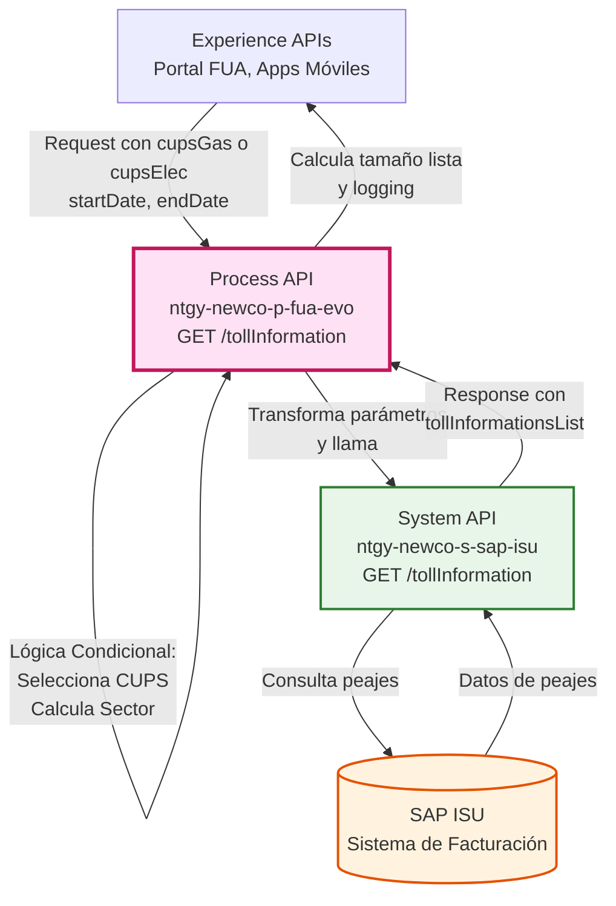
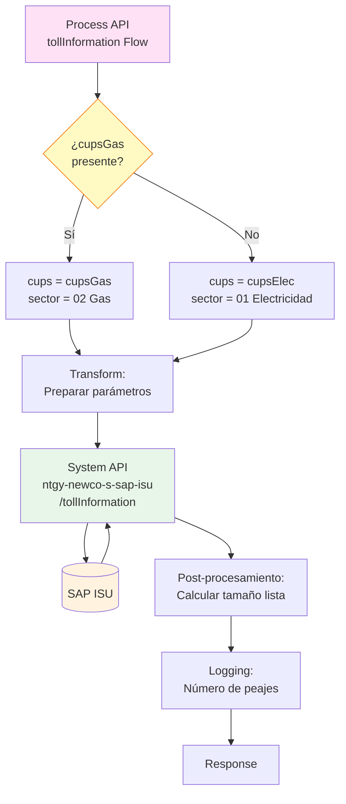
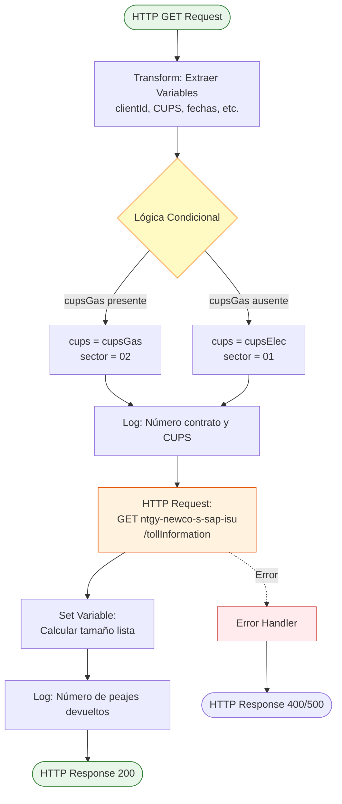
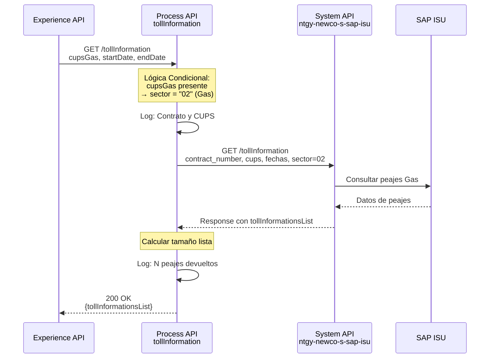
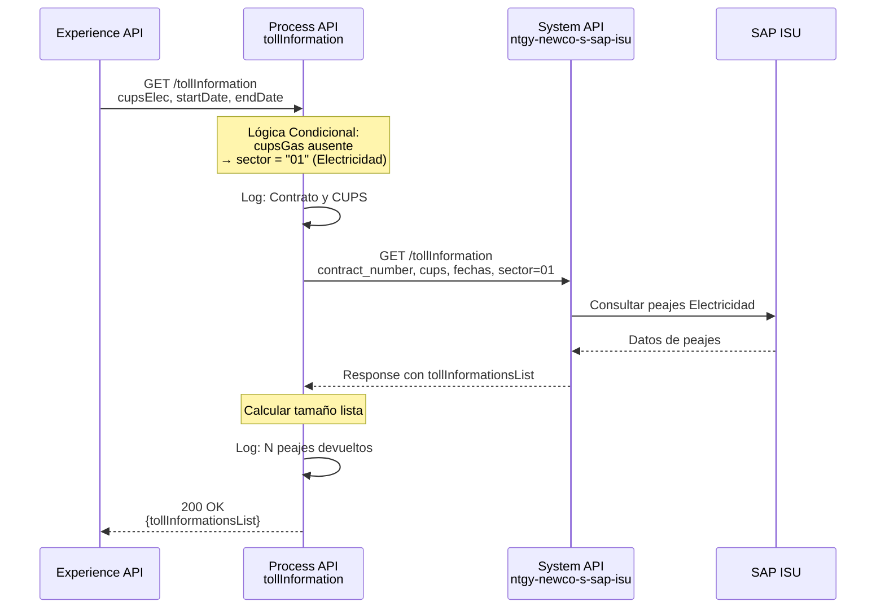
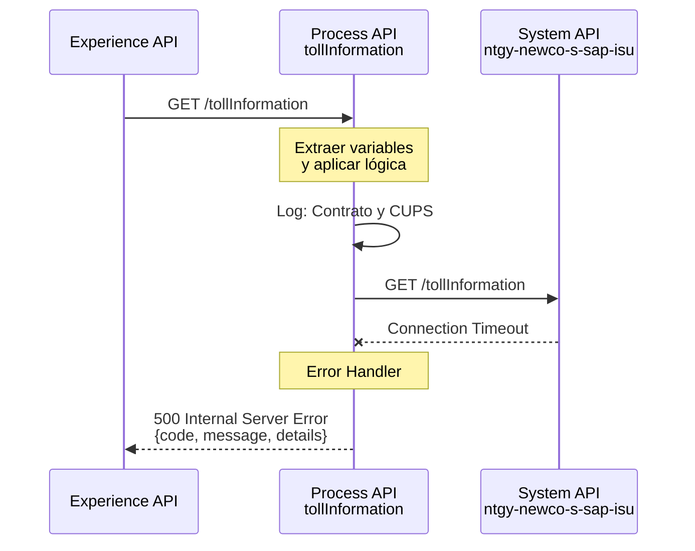
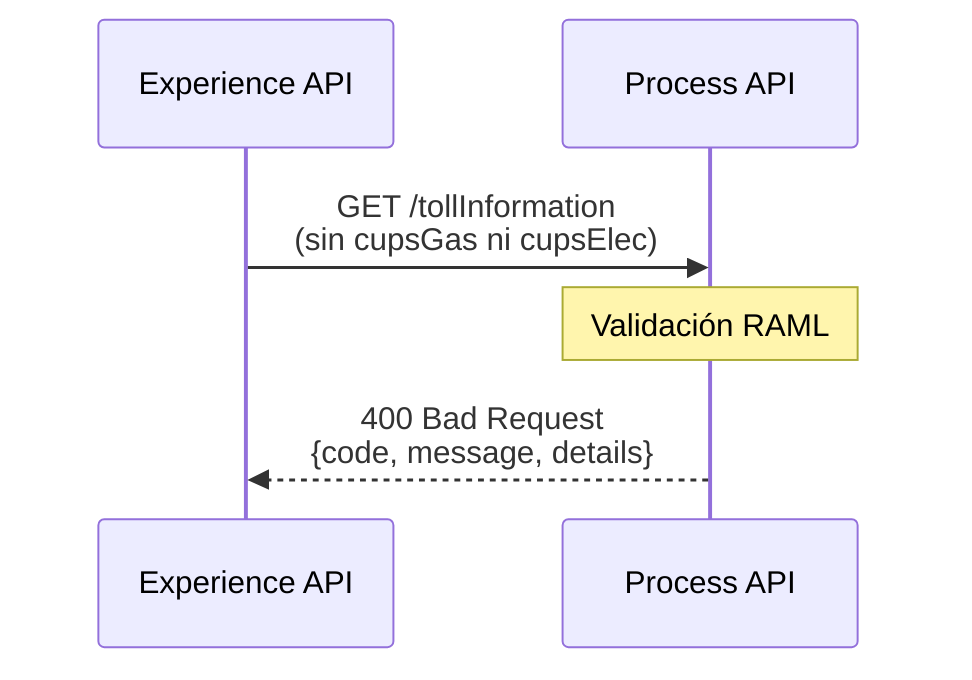

# GET /tollInformation

## 📌 Descripción General

### Propósito del Endpoint

Este endpoint orquesta la obtención de información de peajes (tolls) de acceso a la red eléctrica o de gas para un contrato específico. Implementa lógica condicional para diferenciar automáticamente entre suministros de Gas y Electricidad, calculando el sector correspondiente y seleccionando el CUPS apropiado antes de consultar el System API de SAP ISU.

### Tipo de API

**Capa:** Process API (API-Led Connectivity)

**Función:** Orquestación de consulta de información de peajes con lógica de negocio para diferenciación Gas/Electricidad

### Patrón de Integración

**Tipo:** Orquestación con Transformación y Lógica Condicional

**Descripción:** El endpoint recibe parámetros del cliente, aplica lógica condicional para determinar el tipo de suministro (Gas o Electricidad), calcula el sector correspondiente, y envía la petición transformada al System API de SAP ISU. Tras recibir la respuesta, calcula el tamaño de la lista de peajes para logging y monitoreo.

### Arquitectura API-Led Connectivity



---

## 💼 Propósito del Negocio

### Casos de Uso Principales

1. **Consulta de Peajes de Acceso a la Red**
   - Permite a los clientes visualizar los peajes aplicados en sus facturas
   - Proporciona transparencia sobre los costes regulados de acceso a la red

2. **Análisis de Costes de Suministro**
   - Facilita el desglose de componentes de la factura energética
   - Ayuda a los clientes a entender la estructura de costes

3. **Validación de Facturación**
   - Los clientes pueden verificar los peajes aplicados en un período específico
   - Útil para auditorías y reclamaciones

4. **Diferenciación Automática Gas/Electricidad**
   - El sistema identifica automáticamente el tipo de suministro
   - Aplica el sector correcto (01=Electricidad, 02=Gas) sin intervención manual

### 🔗 Endpoints Dependientes

Este Process API consume el siguiente System API:

| System API | Endpoint | Método | Propósito |
|------------|----------|--------|-----------|
| `ntgy-newco-s-sap-isu` | `/tollInformation` | GET | Obtener información de peajes desde SAP ISU para un contrato y período específico |

### Lógica de Orquestación



**Pasos del Proceso:**

1. **Extracción de Parámetros**: Se extraen todos los parámetros de query y headers
2. **Lógica Condicional CUPS**: 
   - Si `cupsGas` está presente → usa `cupsGas` y sector "02"
   - Si no → usa `cupsElec` y sector "01"
3. **Logging Inicial**: Registra número de contrato y CUPS seleccionado
4. **Llamada al System API**: Invoca SAP ISU con parámetros transformados
5. **Post-procesamiento**: Calcula el tamaño de `tollInformationsList`
6. **Logging Final**: Registra el número de peajes devueltos

### Transformaciones Aplicadas

**Transformación de Request:**

| Parámetro Original | Variable Interna | Lógica Aplicada |
|--------------------|------------------|-----------------|
| `x-client-id` (query) | `vars.clientId` | Extracción directa |
| `cupsGas` o `cupsElec` (query) | `vars.cups` | **Condicional:** Si `cupsGas` no está vacío, usa `cupsGas`; si no, usa `cupsElec` |
| `startDate` (query) | `vars.fecha_desde` | Extracción directa |
| `endDate` (query) | `vars.fecha_hasta` | Extracción directa |
| `cupsGas` o `cupsElec` | `vars.sector` | **Calculado:** "02" si `cupsGas` presente, "01" si `cupsElec` |
| `billingAccountId` (query) | `vars.billingAccountId` | Extracción directa |
| `contractNumber` (query) | `vars.contractNumber` | Extracción directa |
| `x-client-code` (query) | `vars.clientCode` | Extracción directa |

**Lógica Condicional DataWeave:**

```dataweave
// Selección de CUPS
vars.cups = if(!isEmpty(attributes.queryParams.'cupsGas')) 
              attributes.queryParams.'cupsGas' 
            else 
              attributes.queryParams.'cupsElec'

// Cálculo de Sector
vars.sector = if(!isEmpty(attributes.queryParams.'cupsGas')) 
                "02"  // Gas
              else 
                "01"  // Electricidad
```

**Post-procesamiento de Response:**

```dataweave
// Cálculo del tamaño de la lista
vars.numTollInformationsList = if(sizeOf(payload.tollInformationsList) != null) 
                                  sizeOf(payload.tollInformationsList) 
                                else 
                                  0
```

### Contexto Empresarial

- **Dominio:** Gestión de Facturación y Costes Regulados
- **Sector:** Energía - Utilities
- **División:** Naturgy España - NewCo
- **Proceso de Negocio:** Consulta de peajes de acceso a la red eléctrica y de gas

### Stakeholders

- **Clientes Finales**: Necesitan entender los peajes aplicados en sus facturas
- **Agentes de Call Center**: Requieren consultar peajes para resolver consultas sobre facturación
- **Equipo de Facturación**: Utiliza la información para validar cálculos de factura
- **Regulador (CNMC)**: Los peajes son costes regulados que deben ser transparentes

### Valor de Negocio

- **Transparencia Regulatoria**: Cumple con requisitos de transparencia en costes regulados
- **Educación al Cliente**: Ayuda a los clientes a entender la estructura de su factura
- **Reducción de Reclamaciones**: Proporciona información clara sobre peajes aplicados
- **Automatización**: La lógica condicional Gas/Electricidad reduce errores manuales

### Consumidores Potenciales

Este endpoint puede ser consumido por:
- Portal web FUA
- Aplicaciones móviles de clientes
- Sistemas de agentes de call center
- Herramientas de análisis de facturación
- Sistemas de auditoría y compliance

---

## 🔧 Especificación Técnica

### URLs por Ambiente

| Ambiente | URL Base | URL Completa |
|----------|----------|--------------|
| **Local** | `http://localhost:8081` | `http://localhost:8081/api/tollInformation` |
| **Development** | `https://ntgy-newco-p-fua-evo-dev.us-e2.cloudhub.io` | `https://ntgy-newco-p-fua-evo-dev.us-e2.cloudhub.io/api/tollInformation` |
| **UAT** | `https://ntgy-newco-p-fua-evo-uat.us-e2.cloudhub.io` | `https://ntgy-newco-p-fua-evo-uat.us-e2.cloudhub.io/api/tollInformation` |
| **Production** | `https://ntgy-newco-p-fua-evo-pro.us-e2.cloudhub.io` | `https://ntgy-newco-p-fua-evo-pro.us-e2.cloudhub.io/api/tollInformation` |

### Método HTTP

```
GET /api/tollInformation
```

### Parámetros de Entrada

#### Headers

| Header | Tipo | Requerido | Descripción |
|--------|------|-----------|-------------|
| `Content-Type` | string | ✅ Sí | Debe ser `application/json` |
| `client_id` | string | ✅ Sí | Client ID de Anypoint Platform |
| `client_secret` | string | ✅ Sí | Client Secret de Anypoint Platform |

#### Query Parameters

| Parámetro | Tipo | Requerido | Descripción | Ejemplo |
|-----------|------|-----------|-------------|---------|
| `x-client-id` | string | ✅ Sí | Identificador del cliente | `"12345678"` |
| `cupsGas` | string | ⚠️ Condicional | CUPS del suministro de Gas (requerido si no se proporciona `cupsElec`) | `"ES0021000000000001JN"` |
| `cupsElec` | string | ⚠️ Condicional | CUPS del suministro de Electricidad (requerido si no se proporciona `cupsGas`) | `"ES0031406000000001JN"` |
| `startDate` | string | ✅ Sí | Fecha de inicio del período (formato: YYYY-MM-DD) | `"2026-01-01"` |
| `endDate` | string | ✅ Sí | Fecha de fin del período (formato: YYYY-MM-DD) | `"2026-08-31"` |
| `billingAccountId` | string | ❌ No | Identificador de cuenta de facturación | `"BA123456"` |
| `contractNumber` | string | ❌ No | Número de contrato | `"1234567890"` |
| `x-client-code` | string | ❌ No | Código del cliente (Imperial/NewCo) | `"NEWCO"` |

**⚠️ Nota Importante sobre CUPS:**
- Debe proporcionarse **uno y solo uno** de los parámetros: `cupsGas` o `cupsElec`
- Si se proporciona `cupsGas`, el sistema asume suministro de Gas (sector 02)
- Si se proporciona `cupsElec`, el sistema asume suministro de Electricidad (sector 01)

### Respuestas

#### 200 OK - Éxito

**Descripción:** Información de peajes obtenida correctamente desde SAP ISU

**⚠️ Nota Importante:** Este Process API **NO transforma** la respuesta del System API. La estructura devuelta es exactamente la misma que retorna `ntgy-newco-s-sap-isu`.

**Estructura de Respuesta:**

```json
{
  "result": {
    "codResult": "0000",
    "msgResult": "No hay error"
  },
  "tollInformationsList": [
    {
      "atrDate": "09/06/2026",
      "endDate": "30/06/2026",
      "startDate": "01/06/2026",
      "billingReason": "01",
      "invoiceType": "NORMAL",
      "cups": "ES0021000000000001AA",
      "atrRate": "2.0TD",
      "atrInvoiceId": "F2026060001",
      "coversionFactor": "1.0",
      "distribuitor": "DIST001",
      "autoCons": "N",
      "device": "CONTADOR001",
      "power": ["4.6", "4.6"],
      "demandedPower": ["4.6", "4.6"],
      "tollInformationDetailList": [
        {
          "magnitude": "AE",
          "period": "P1",
          "procedenceTo": "REAL",
          "procedenceFrom": "REAL",
          "readingValueTo": "12345",
          "readingValueFrom": "12000",
          "adjust": "0.0",
          "integer": "345",
          "decimal": "0",
          "registerDate": "09/06/2026",
          "consumption": "345",
          "energyRevert": "0"
        }
      ]
    }
  ]
}
```

**Campos de Respuesta:**

| Campo | Tipo | Descripción |
|-------|------|-------------|
| `result` | object | Objeto con resultado de la operación |
| `result.codResult` | string | Código de resultado (`0000` = éxito, otros = error) |
| `result.msgResult` | string | Mensaje descriptivo del resultado |
| `tollInformationsList` | array | Lista de información de peajes para el período solicitado |
| `tollInformationsList[].atrDate` | string | Fecha de carga ATR (formato: dd/MM/yyyy) |
| `tollInformationsList[].endDate` | string | Fecha fin del período (formato: dd/MM/yyyy) |
| `tollInformationsList[].startDate` | string | Fecha inicio del período (formato: dd/MM/yyyy) |
| `tollInformationsList[].billingReason` | string | Motivo de facturación (código) |
| `tollInformationsList[].invoiceType` | string | Tipo de factura (NORMAL, RECTIFICATIVA, etc.) |
| `tollInformationsList[].cups` | string | Código Universal del Punto de Suministro |
| `tollInformationsList[].atrRate` | string | Tarifa ATR aplicada |
| `tollInformationsList[].atrInvoiceId` | string | Identificador de factura ATR |
| `tollInformationsList[].coversionFactor` | string | Factor de conversión aplicado |
| `tollInformationsList[].distribuitor` | string | Código del distribuidor |
| `tollInformationsList[].autoCons` | string | Indicador de autoconsumo (S/N) |
| `tollInformationsList[].device` | string | Identificador del dispositivo/contador |
| `tollInformationsList[].power` | array | Array de potencias contratadas por período |
| `tollInformationsList[].demandedPower` | array | Array de potencias demandadas por período |
| `tollInformationsList[].tollInformationDetailList` | array | Lista de detalles de lecturas y consumos |
| `tollInformationDetailList[].magnitude` | string | Magnitud de la lectura (AE=Activa Entrada, etc.) |
| `tollInformationDetailList[].period` | string | Período tarifario (P1, P2, P3, etc.) |
| `tollInformationDetailList[].procedenceTo` | string | Procedencia de lectura final (REAL, ESTIMADA, etc.) |
| `tollInformationDetailList[].procedenceFrom` | string | Procedencia de lectura inicial (REAL, ESTIMADA, etc.) |
| `tollInformationDetailList[].readingValueTo` | string | Valor de lectura final |
| `tollInformationDetailList[].readingValueFrom` | string | Valor de lectura inicial |
| `tollInformationDetailList[].adjust` | string | Ajuste aplicado |
| `tollInformationDetailList[].integer` | string | Parte entera del consumo |
| `tollInformationDetailList[].decimal` | string | Parte decimal del consumo |
| `tollInformationDetailList[].registerDate` | string | Fecha de registro de la lectura (formato: dd/MM/yyyy) |
| `tollInformationDetailList[].consumption` | string | Consumo calculado |
| `tollInformationDetailList[].energyRevert` | string | Energía excedente/revertida |

#### 400 Bad Request - Error de Validación

**Descripción:** Parámetros inválidos o faltantes

```json
{
  "code": "BAD_REQUEST",
  "message": "Parámetros de entrada inválidos",
  "details": "Debe proporcionar cupsGas o cupsElec"
}
```

#### 500 Internal Server Error - Error del Sistema

**Descripción:** Error en el procesamiento interno o en la comunicación con SAP ISU

```json
{
  "code": "INTERNAL_ERROR",
  "message": "Error al procesar la solicitud",
  "details": "Error de conexión con SAP ISU"
}
```

### Autenticación

- **Tipo:** Client ID & Client Secret (Anypoint Platform)
- **Headers requeridos:** `client_id`, `client_secret`

### Timeouts

| Tipo | Valor |
|------|-------|
| **Request Timeout** | 60 segundos |
| **Connection Timeout** | 30 segundos |

---

## 🏗️ Implementación Técnica

### Arquitectura del Flow



### Componentes del Flow

#### 1. Flow Principal: `get:\tollInformation:ntgy-newco-p-fua-config`

**Ubicación:** `src/main/mule/ntgy-newco-p-fua.xml`

**Responsabilidades:**
- Recibir la petición HTTP GET
- Extraer y transformar parámetros con lógica condicional
- Invocar el subflow `tollInformation`

**Código XML:**
```xml
<flow name="get:\tollInformation:ntgy-newco-p-fua-config">
    <ee:transform doc:name="vars">
        <ee:message />
        <ee:variables>
            <ee:set-variable variableName="clientId">
                <![CDATA[%dw 2.0
                output application/java
                ---
                attributes.queryParams.'x-client-id']]>
            </ee:set-variable>
            
            <!-- Lógica condicional para CUPS -->
            <ee:set-variable variableName="cups">
                <![CDATA[%dw 2.0
                output application/java
                ---
                if(!isEmpty(attributes.queryParams.'cupsGas')) 
                    attributes.queryParams.'cupsGas' 
                else 
                    attributes.queryParams.'cupsElec']]>
            </ee:set-variable>
            
            <ee:set-variable variableName="fecha_desde">
                <![CDATA[%dw 2.0
                output application/java
                ---
                attributes.queryParams.'startDate']]>
            </ee:set-variable>
            
            <ee:set-variable variableName="fecha_hasta">
                <![CDATA[%dw 2.0
                output application/java
                ---
                attributes.queryParams.'endDate']]>
            </ee:set-variable>
            
            <!-- Cálculo de sector basado en tipo de CUPS -->
            <ee:set-variable variableName="sector">
                <![CDATA[%dw 2.0
                output application/java
                ---
                if(!isEmpty(attributes.queryParams.'cupsGas')) 
                    "02"  // Gas
                else 
                    "01"  // Electricidad]]>
            </ee:set-variable>
            
            <ee:set-variable variableName="billingAccountId">
                <![CDATA[%dw 2.0
                output application/java
                ---
                attributes.queryParams.'billingAccountId']]>
            </ee:set-variable>
            
            <ee:set-variable variableName="contractNumber">
                <![CDATA[%dw 2.0
                output application/java
                ---
                attributes.queryParams.'contractNumber']]>
            </ee:set-variable>
            
            <ee:set-variable variableName="clientCode">
                <![CDATA[%dw 2.0
                output application/java
                ---
                attributes.queryParams.'x-client-code']]>
            </ee:set-variable>
        </ee:variables>
    </ee:transform>
    
    <flow-ref doc:name="tollInformationFlow" name="tollInformation" />
</flow>
```

#### 2. Subflow: `tollInformation`

**Ubicación:** `src/main/mule/implementation/tollInformation.xml`

**Responsabilidades:**
- Logging de entrada con número de contrato y CUPS
- Llamada HTTP al System API de SAP ISU
- Post-procesamiento: cálculo del tamaño de la lista
- Logging de salida con número de peajes

**Código XML:**
```xml
<flow name="tollInformation">
    <logger level="INFO" doc:name="Numero contrato y cups" 
            message="tollInformation - Numero de contrato: #[vars.contractNumber] cups: #[vars.cups]"/>
    
    <http:request method="GET" doc:name="Request s-sap-isu (tollInformation)" 
                  config-ref="HTTP_Request_ntgy-newco-s-sap" 
                  path="${ntgy-newco-s-sap.functions.tollInformation}">
        <http:query-params><![CDATA[#[output application/java
        ---
        {
            contract_number: vars.contractNumber,
            cups: vars.cups,
            fecha_desde: vars.fecha_desde,
            fecha_hasta: vars.fecha_hasta,
            sector: vars.sector,
            clientCode: vars.clientCode
        }]]]></http:query-params>
    </http:request>
    
    <set-variable 
        value="#[(if(sizeOf(payload.tollInformationsList) != null) sizeOf(payload.tollInformationsList) else 0)]" 
        doc:name="numTollInformationsList" 
        variableName="numTollInformationsList"/>
    
    <logger level="INFO" doc:name="Se han devuelto lecturas" 
            message="tollInformation - Se han devuelto: #[vars.numTollInformationsList] lecturas"/>
</flow>
```

### Transformaciones DataWeave

#### Transformación 1: Lógica Condicional de CUPS (Líneas 6-11)

**Propósito:** Seleccionar el CUPS apropiado según el tipo de suministro

```dataweave
%dw 2.0
output application/java
---
if(!isEmpty(attributes.queryParams.'cupsGas')) 
    attributes.queryParams.'cupsGas' 
else 
    attributes.queryParams.'cupsElec'
```

**Lógica:**
- Si `cupsGas` no está vacío → usa `cupsGas`
- Si no → usa `cupsElec`

#### Transformación 2: Cálculo de Sector (Líneas 19-24)

**Propósito:** Determinar el sector energético (Gas o Electricidad)

```dataweave
%dw 2.0
output application/java
---
if(!isEmpty(attributes.queryParams.'cupsGas')) 
    "02"  // Gas
else 
    "01"  // Electricidad
```

**Códigos de Sector:**
- `"01"` = Electricidad
- `"02"` = Gas

#### Transformación 3: Construcción de Query Parameters (Líneas 2-11 del subflow)

**Propósito:** Construir los query parameters para la llamada al System API

```dataweave
%dw 2.0
output application/java
---
{
    contract_number: vars.contractNumber,
    cups: vars.cups,
    fecha_desde: vars.fecha_desde,
    fecha_hasta: vars.fecha_hasta,
    sector: vars.sector,
    clientCode: vars.clientCode
}
```

#### Transformación 4: Cálculo de Tamaño de Lista (Línea 14)

**Propósito:** Calcular el número de peajes devueltos para logging

```dataweave
if(sizeOf(payload.tollInformationsList) != null) 
    sizeOf(payload.tollInformationsList) 
else 
    0
```

**Función:** Manejo seguro de null para evitar errores si la lista no existe

### Patrones de Diseño

**Patrón 1:** Request-Reply con Lógica Condicional

**Justificación:** 
- Permite diferenciar automáticamente entre Gas y Electricidad
- Simplifica la integración para consumidores upstream
- Reduce errores al calcular automáticamente el sector

**Patrón 2:** Logging Estratégico

**Justificación:**
- Facilita el debugging y monitoreo
- Registra información clave: contrato, CUPS, número de peajes
- Permite trazabilidad completa del flujo

**Patrón 3:** Post-procesamiento para Métricas

**Justificación:**
- Calcula métricas útiles (tamaño de lista) sin modificar la respuesta
- Facilita monitoreo y alertas
- No impacta la estructura de respuesta del System API

### Diagramas de Secuencia

#### 1. Flujo Normal de Éxito - Suministro de Gas



#### 2. Flujo Normal de Éxito - Suministro de Electricidad



#### 3. Flujo con Error de Conexión al System API



#### 4. Flujo con Parámetros Inválidos



### Manejo de Errores

**Estrategia:** Error handling global con respuestas estandarizadas

**Tipos de Errores:**

1. **Errores de Validación (400)**
   - Parámetros faltantes (ni cupsGas ni cupsElec)
   - Formato incorrecto de fechas
   - CUPS inválido

2. **Errores de Conectividad (500)**
   - Timeout en llamada al System API
   - System API no disponible
   - SAP ISU no responde

3. **Errores de Negocio (400)**
   - Contrato no encontrado
   - CUPS no válido
   - Período sin datos

**Configuración de Retry:**
- Reintentos: 3 intentos
- Backoff: Exponencial (1s, 2s, 4s)

---

## 💻 Ejemplos de Uso

### Ejemplo 1: Consulta de Peajes para Suministro de Gas

#### cURL

```bash
curl -X GET "https://ntgy-newco-p-fua-evo-dev.us-e2.cloudhub.io/api/tollInformation?x-client-id=12345678&cupsGas=ES0021000000000001JN&startDate=2026-01-01&endDate=2026-08-31&contractNumber=1234567890&x-client-code=NEWCO" \
  -H "Content-Type: application/json" \
  -H "client_id: YOUR_CLIENT_ID" \
  -H "client_secret: YOUR_CLIENT_SECRET"
```

**Nota:** El sistema detecta automáticamente que es Gas (sector 02) por la presencia de `cupsGas`

#### Respuesta (200 OK)

```json
{
  "tollInformationsList": [
    {
      "period": "2026-01",
      "tollType": "ACCESO",
      "tollDescription": "Peaje de acceso a red de distribución - Gas",
      "amount": 0.045,
      "unit": "€/kWh",
      "startDate": "2026-01-01",
      "endDate": "2026-01-31"
    },
    {
      "period": "2026-02",
      "tollType": "ACCESO",
      "tollDescription": "Peaje de acceso a red de distribución - Gas",
      "amount": 0.045,
      "unit": "€/kWh",
      "startDate": "2026-02-01",
      "endDate": "2026-02-28"
    },
    {
      "period": "2026-03",
      "tollType": "DISTRIBUCION",
      "tollDescription": "Peaje de distribución - Gas",
      "amount": 0.032,
      "unit": "€/kWh",
      "startDate": "2026-03-01",
      "endDate": "2026-03-31"
    }
  ]
}
```

### Ejemplo 2: Consulta de Peajes para Suministro de Electricidad

#### cURL

```bash
curl -X GET "https://ntgy-newco-p-fua-evo-dev.us-e2.cloudhub.io/api/tollInformation?x-client-id=12345678&cupsElec=ES0031406000000001JN&startDate=2026-01-01&endDate=2026-08-31&contractNumber=0987654321&x-client-code=NEWCO" \
  -H "Content-Type: application/json" \
  -H "client_id: YOUR_CLIENT_ID" \
  -H "client_secret: YOUR_CLIENT_SECRET"
```

**Nota:** El sistema detecta automáticamente que es Electricidad (sector 01) por la presencia de `cupsElec`

#### Respuesta (200 OK)

```json
{
  "tollInformationsList": [
    {
      "period": "2026-01",
      "tollType": "ACCESO",
      "tollDescription": "Peaje de acceso a red de distribución - Electricidad",
      "amount": 0.062,
      "unit": "€/kWh",
      "startDate": "2026-01-01",
      "endDate": "2026-01-31"
    },
    {
      "period": "2026-02",
      "tollType": "ACCESO",
      "tollDescription": "Peaje de acceso a red de distribución - Electricidad",
      "amount": 0.062,
      "unit": "€/kWh",
      "startDate": "2026-02-01",
      "endDate": "2026-02-28"
    },
    {
      "period": "2026-03",
      "tollType": "TRANSPORTE",
      "tollDescription": "Peaje de transporte - Electricidad",
      "amount": 0.018,
      "unit": "€/kWh",
      "startDate": "2026-03-01",
      "endDate": "2026-03-31"
    }
  ]
}
```

### Ejemplo 3: JavaScript (Fetch API)

```javascript
const getTollInformation = async (clientId, cups, startDate, endDate, isGas = true, contractNumber = null) => {
  const baseUrl = 'https://ntgy-newco-p-fua-evo-dev.us-e2.cloudhub.io/api/tollInformation';
  
  const params = new URLSearchParams({
    'x-client-id': clientId,
    startDate,
    endDate
  });
  
  // Añadir CUPS según tipo de suministro
  if (isGas) {
    params.append('cupsGas', cups);
  } else {
    params.append('cupsElec', cups);
  }
  
  if (contractNumber) {
    params.append('contractNumber', contractNumber);
  }
  
  params.append('x-client-code', 'NEWCO');
  
  const response = await fetch(`${baseUrl}?${params}`, {
      method: 'GET',
    headers: {
      'Content-Type': 'application/json',
      'client_id': 'YOUR_CLIENT_ID',
      'client_secret': 'YOUR_CLIENT_SECRET'
    }
  });
  
  if (!response.ok) {
    throw new Error(`HTTP error! status: ${response.status}`);
  }
  
  const data = await response.json();
  return data;
};

// Uso - Suministro de Gas
try {
  const tollsGas = await getTollInformation(
    '12345678',
    'ES0021000000000001JN',
    '2026-01-01',
    '2026-08-31',
    true,  // isGas = true
    '1234567890'
  );
  console.log('Peajes Gas:', tollsGas.tollInformationsList);
} catch (error) {
  console.error('Error al obtener peajes:', error);
}

// Uso - Suministro de Electricidad
try {
  const tollsElec = await getTollInformation(
    '12345678',
    'ES0031406000000001JN',
    '2026-01-01',
    '2026-08-31',
    false,  // isGas = false
    '0987654321'
  );
  console.log('Peajes Electricidad:', tollsElec.tollInformationsList);
} catch (error) {
  console.error('Error al obtener peajes:', error);
}
```

### Ejemplo 4: Python (Requests)

```python
import requests
from typing import Optional, Dict, List

def get_toll_information(
    client_id: str,
    cups: str,
    start_date: str,
    end_date: str,
    is_gas: bool = True,
    contract_number: Optional[str] = None,
    client_code: str = 'NEWCO'
) -> Dict:
    """
    Obtiene información de peajes para un contrato
    
    Args:
        client_id: ID del cliente
        cups: CUPS del suministro
        start_date: Fecha inicio (YYYY-MM-DD)
        end_date: Fecha fin (YYYY-MM-DD)
        is_gas: True para Gas, False para Electricidad
        contract_number: Número de contrato (opcional)
        client_code: Código del cliente
    
    Returns:
        dict: Respuesta con tollInformationsList
    """
    base_url = 'https://ntgy-newco-p-fua-evo-dev.us-e2.cloudhub.io/api/tollInformation'
    
    params = {
        'x-client-id': client_id,
        'startDate': start_date,
        'endDate': end_date,
        'x-client-code': client_code
    }
    
    # Añadir CUPS según tipo de suministro
    if is_gas:
        params['cupsGas'] = cups
    else:
        params['cupsElec'] = cups
    
    if contract_number:
        params['contractNumber'] = contract_number
    
    headers = {
        'Content-Type': 'application/json',
        'client_id': 'YOUR_CLIENT_ID',
        'client_secret': 'YOUR_CLIENT_SECRET'
    }
    
    response = requests.get(base_url, params=params, headers=headers)
    response.raise_for_status()
    
    return response.json()

# Uso - Suministro de Gas
try:
    tolls_gas = get_toll_information(
        client_id='12345678',
        cups='ES0021000000000001JN',
        start_date='2026-01-01',
        end_date='2026-08-31',
        is_gas=True,
        contract_number='1234567890'
    )
    
    print(f"Total peajes Gas: {len(tolls_gas['tollInformationsList'])}")
    for toll in tolls_gas['tollInformationsList']:
        print(f"Período: {toll['period']}, "
              f"Tipo: {toll['tollType']}, "
              f"Importe: {toll['amount']} {toll['unit']}")
        
except requests.exceptions.RequestException as e:
    print(f"Error al obtener peajes: {e}")

# Uso - Suministro de Electricidad
try:
    tolls_elec = get_toll_information(
        client_id='12345678',
        cups='ES0031406000000001JN',
        start_date='2026-01-01',
        end_date='2026-08-31',
        is_gas=False,
        contract_number='0987654321'
    )
    
    print(f"Total peajes Electricidad: {len(tolls_elec['tollInformationsList'])}")
    for toll in tolls_elec['tollInformationsList']:
        print(f"Período: {toll['period']}, "
              f"Tipo: {toll['tollType']}, "
              f"Importe: {toll['amount']} {toll['unit']}")
        
except requests.exceptions.RequestException as e:
    print(f"Error al obtener peajes: {e}")
```

### Ejemplo 5: Error - Parámetros Faltantes

#### cURL

```bash
curl -X GET "https://ntgy-newco-p-fua-evo-dev.us-e2.cloudhub.io/api/tollInformation?x-client-id=12345678&startDate=2026-01-01&endDate=2026-08-31" \
  -H "Content-Type: application/json" \
  -H "client_id: YOUR_CLIENT_ID" \
  -H "client_secret: YOUR_CLIENT_SECRET"
```

**Nota:** Falta proporcionar cupsGas o cupsElec

#### Respuesta (400 Bad Request)

```json
{
  "code": "BAD_REQUEST",
  "message": "Parámetros de entrada inválidos",
  "details": "Debe proporcionar cupsGas o cupsElec"
}
```

### Ejemplo 6: Error - System API No Disponible

#### Respuesta (500 Internal Server Error)

```json
{
  "code": "INTERNAL_ERROR",
  "message": "Error al procesar la solicitud",
  "details": "Error de conexión con ntgy-newco-s-sap-isu: Connection timeout"
}
```
