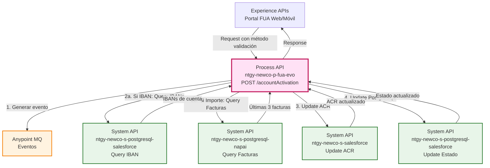
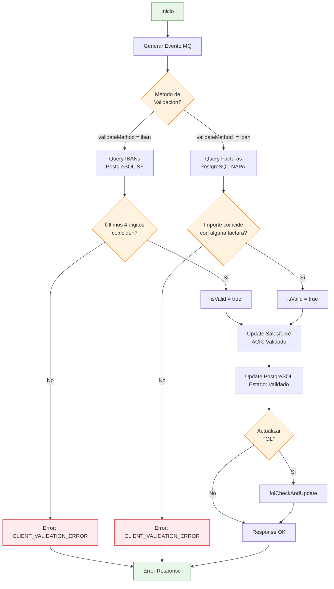
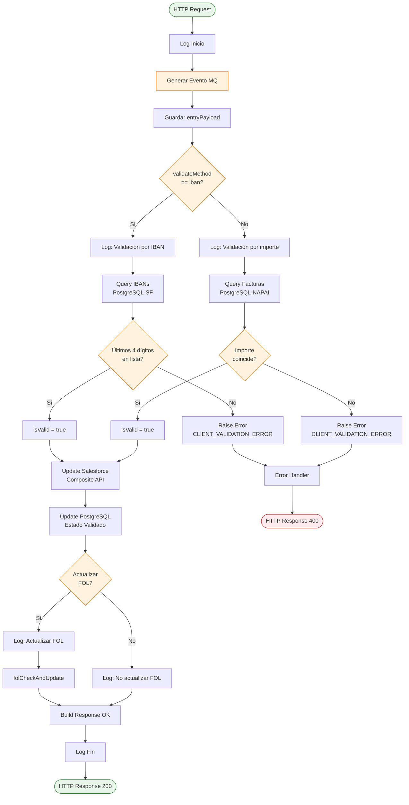
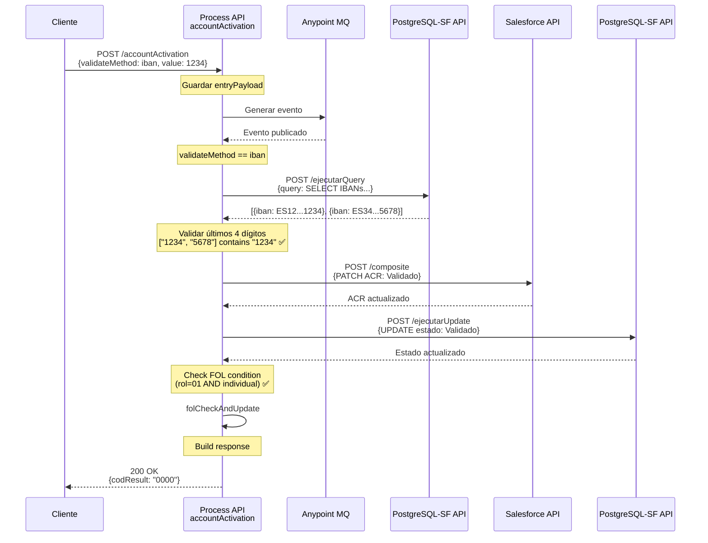
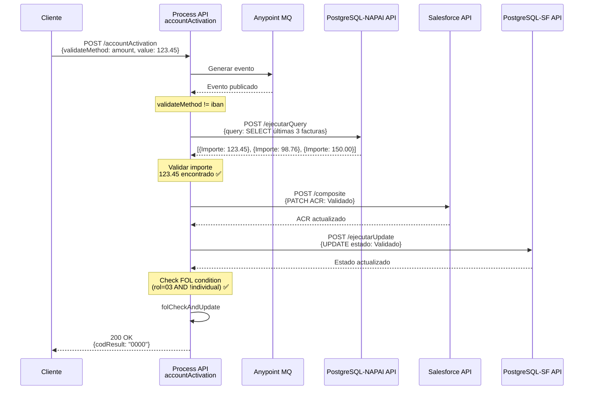
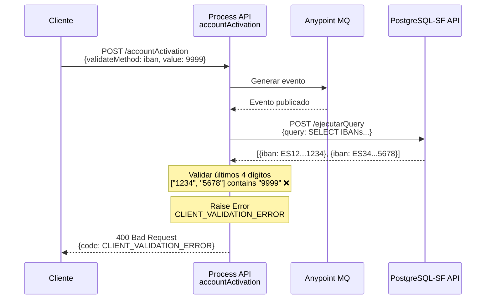

# POST /accountActivation

## 📌 Descripción General

### Propósito del Endpoint

Este endpoint permite **activar una cuenta de cliente** en el portal FUA mediante dos métodos de validación alternativos: validación por los últimos 4 dígitos del IBAN o validación por el importe de una de las últimas 3 facturas. Una vez validado exitosamente, actualiza el estado de la relación Account-Contact en Salesforce y PostgreSQL a "Validado", y opcionalmente actualiza el FOL (First Online Login) según el rol del usuario.

### Tipo de API

**Capa:** Process API (API-Led Connectivity)

**Función:** Orquestación de validación de identidad y activación de cuenta

### Patrón de Integración

**Tipo:** Orquestación Condicional con Validación de Datos

**Descripción:** Este endpoint implementa un flujo de validación con dos caminos alternativos:
1. **Validación por IBAN**: Consulta IBANs asociados a la cuenta en Salesforce y valida los últimos 4 dígitos
2. **Validación por Importe**: Consulta las últimas 3 facturas en NAPAI y valida el importe proporcionado

Tras la validación exitosa, actualiza el estado en Salesforce y PostgreSQL, y opcionalmente actualiza el FOL.

### Arquitectura API-Led Connectivity



---

## 💼 Propósito del Negocio

### Casos de Uso Principales

1. **Activación de Cuenta con IBAN**
   - Cliente proporciona los últimos 4 dígitos de su IBAN
   - Sistema valida contra IBANs registrados con mandato SEPA firmado
   - Beneficio: Validación rápida y segura de identidad

2. **Activación de Cuenta con Importe de Factura**
   - Cliente proporciona el importe exacto de una de sus últimas 3 facturas
   - Sistema valida contra facturas reales en NAPAI
   - Beneficio: Método alternativo cuando el cliente no recuerda su IBAN

3. **Actualización de Estado de Cuenta**
   - Tras validación exitosa, marca la cuenta como "Validado"
   - Actualiza tanto en Salesforce como en PostgreSQL
   - Beneficio: Sincronización de estado en múltiples sistemas

### 🔗 Endpoints Dependientes

Este Process API consume los siguientes System APIs:

| System API | Endpoint | Método | Propósito |
|------------|----------|--------|-----------|
| `ntgy-newco-s-postgresql-salesforce` | `/ejecutarQuery` | POST | Consultar IBANs asociados a la cuenta |
| `ntgy-newco-s-postgresql-napai` | `/ejecutarQuery` | POST | Consultar últimas 3 facturas del cliente |
| `ntgy-newco-s-salesforce` | `/composite` | POST | Actualizar AccountContactRelation a "Validado" |
| `ntgy-newco-s-postgresql-salesforce` | `/ejecutarUpdate` | POST | Actualizar estado en PostgreSQL |

### Lógica de Orquestación



**Pasos del Proceso:**

1. **Generación de Evento**: Publica evento asíncrono en Anypoint MQ para auditoría
2. **Validación Condicional**:
   - **Opción A (IBAN)**: Consulta IBANs con mandato SEPA → Valida últimos 4 dígitos
   - **Opción B (Importe)**: Consulta últimas 3 facturas → Valida importe exacto
3. **Actualización Salesforce**: Actualiza AccountContactRelation a estado "Validado"
4. **Actualización PostgreSQL**: Sincroniza estado en base de datos
5. **Actualización FOL (Condicional)**: Si rol y tipo de cliente cumplen condiciones
6. **Respuesta**: Retorna confirmación exitosa

### Transformaciones Aplicadas

#### Transformación 1: Query IBANs (Validación por IBAN)

**Query SQL generada:**
```sql
SELECT DISTINCT vcpc.vlocity_cmt__iban__c iban 
FROM newcosalesforce.vlocity_cmt__paymentmethod__c vcpc 
WHERE vcpc.vlocity_cmt__accountid__c = :param1  
  AND vcpc.newco_fechafirmamandatosepa__c IS NOT NULL 
  AND vcpc.vlocity_cmt__iban__c IS NOT NULL
```

**Parámetros:**
- `:param1`: `accountId` del payload

**Propósito:** Obtener todos los IBANs asociados a la cuenta que tienen mandato SEPA firmado.

#### Transformación 2: Query Facturas (Validación por Importe)

**Query SQL generada:**
```sql
SELECT * FROM (
  (SELECT agfe."Importe_total_euro" 
   FROM self_publication_sistemas.agrupador_facturas_elec AS agfe 
   WHERE agfe."Documento_Identidad" = :param1 
   ORDER BY agfe."Fecha_emision" DESC LIMIT 3) 
  UNION 
  (SELECT agfg.importe_total_euro 
   FROM self_publication_sistemas.agrupador_facturas_gas agfg 
   WHERE agfg."Documento_Identidad" = :param1 
   ORDER BY agfg."Fecha_emision" DESC LIMIT 3)
) AS importe LIMIT 3
```

**Parámetros:**
- `:param1`: `x-client-code` del header

**Propósito:** Obtener los importes de las últimas 3 facturas (electricidad y gas) del cliente.

#### Transformación 3: Update Salesforce (AccountContactRelation)

| Campo Original | Campo Salesforce | Transformación |
|----------------|------------------|----------------|
| N/A | `newco_estadologinomega__c` | Constante: "Validado" |
| N/A | `NewCo_FechaMod__c` | `now()` formateado como "uuuu-MM-dd" |

**URL del objeto:**
```
/services/data/v52.0/sobjects/AccountContactRelation/NewCo_ExternalACRId__c/{accountId}_{contactId}
```

#### Transformación 4: Update PostgreSQL

**Update SQL generado:**
```sql
UPDATE newcosalesforce.accountcontactrelation 
SET newco_estadologinomega__c = 'Validado' 
WHERE contactid = :param1 AND accountid = :param2
```

**Parámetros:**
- `:param1`: `contactId`
- `:param2`: `accountId`

#### Transformación 5: Condición para Actualizar FOL

**Lógica:**
```dataweave
(rol == '01' AND isIndividualClient) OR (rol == '03' AND !isIndividualClient)
```

**Significado:**
- Actualizar FOL si es cliente individual con rol '01' (titular)
- O si es cliente empresa con rol '03' (representante legal)

### Contexto Empresarial

- **Dominio:** Gestión de Identidad y Onboarding
- **Sector:** Energía - Utilities
- **División:** Naturgy España - NewCo
- **Proceso de Negocio:** Activación de cuenta en portal de autoservicio FUA

### Stakeholders

- **Clientes Naturgy**: Usuarios que activan su cuenta por primera vez
- **Equipo de Atención al Cliente**: Soporte en caso de problemas de activación
- **Equipo de Seguridad**: Monitorea intentos de activación y posibles fraudes
- **Equipo de Facturación**: Proporciona datos de facturas para validación

### Valor de Negocio

- **Seguridad Mejorada**: Validación de identidad mediante datos privados del cliente
- **Flexibilidad**: Dos métodos alternativos de validación
- **Reducción de Fricción**: Activación automática sin intervención de call center
- **Trazabilidad**: Registro de eventos de activación en Anypoint MQ
- **Sincronización de Datos**: Actualización consistente en Salesforce y PostgreSQL

### Consumidores Potenciales

Este endpoint puede ser consumido por:
- Portal web FUA (proceso de registro/activación)
- Aplicación móvil FUA (onboarding)
- Sistemas de agentes de call center (activación asistida)

---

## 🔧 Especificación Técnica

### URLs por Ambiente

| Ambiente | URL Base | URL Completa |
|----------|----------|--------------|
| **Local** | `http://localhost:8081` | `http://localhost:8081/api/accountActivation` |
| **Development** | `https://ntgy-newco-p-fua-evo-dev.us-e2.cloudhub.io` | `https://ntgy-newco-p-fua-evo-dev.us-e2.cloudhub.io/api/accountActivation` |
| **UAT** | `https://ntgy-newco-p-fua-evo-uat.us-e2.cloudhub.io` | `https://ntgy-newco-p-fua-evo-uat.us-e2.cloudhub.io/api/accountActivation` |
| **Production** | `https://ntgy-newco-p-fua-evo-pro.us-e2.cloudhub.io` | `https://ntgy-newco-p-fua-evo-pro.us-e2.cloudhub.io/api/accountActivation` |

### Método HTTP

```
POST /api/accountActivation
```

### Headers Requeridos

| Header | Tipo | Obligatorio | Descripción |
|--------|------|-------------|-------------|
| `Content-Type` | string | ✅ Sí | Debe ser `application/json` |
| `x-client-code` | string | ✅ Sí | Código/documento del cliente (usado en validación por importe) |
| `client_id` | string | ✅ Sí | Client ID de Anypoint Platform |
| `client_secret` | string | ✅ Sí | Client Secret de Anypoint Platform |

### Parámetros de Entrada

#### Request Body

```json
{
  "validateMethod": "iban",
  "value": "1234",
  "accountId": "0011t00000AbCdEFG",
  "contactId": "0031t00000XyZwVAB",
  "rol": "01",
  "isIndividualClient": true
}
```

| Campo | Tipo | Obligatorio | Descripción | Validaciones |
|-------|------|-------------|-------------|--------------|
| `validateMethod` | string | ✅ Sí | Método de validación: `"iban"` o cualquier otro valor (importe) | Valores: "iban" o diferente |
| `value` | string | ✅ Sí | Valor a validar: últimos 4 dígitos IBAN o importe factura | Si IBAN: 4 dígitos. Si importe: formato "123.45" o "123,45" |
| `accountId` | string | ✅ Sí | ID de la cuenta en Salesforce | Formato Salesforce ID (18 caracteres) |
| `contactId` | string | ✅ Sí | ID del contacto en Salesforce | Formato Salesforce ID (18 caracteres) |
| `rol` | string | ✅ Sí | Rol del usuario: "01" (titular), "03" (representante legal), etc. | Códigos de rol definidos |
| `isIndividualClient` | boolean | ✅ Sí | Indica si es cliente individual (true) o empresa (false) | true/false |

### Respuestas

#### ✅ 200 OK - Activación Exitosa

```json
{
  "result": {
    "codResult": "0000",
    "msgResult": "No hay error"
  }
}
```

**Descripción:** La cuenta se ha activado exitosamente. El estado se ha actualizado a "Validado" en Salesforce y PostgreSQL.

#### ❌ 400 Bad Request - Error de Validación

```json
{
  "code": "CLIENT_VALIDATION_ERROR",
  "message": "Error de validación del cliente",
  "details": "El valor proporcionado no coincide con los datos registrados"
}
```

**Causas comunes:**
- Los últimos 4 dígitos del IBAN no coinciden con ningún IBAN registrado
- El importe no coincide con ninguna de las últimas 3 facturas
- Formato de datos incorrecto

#### ❌ 500 Internal Server Error - Error del Sistema

```json
{
  "code": "SYSTEM_ERROR",
  "message": "Error al procesar la activación de cuenta",
  "details": "Error en servicio de PostgreSQL/Salesforce"
}
```

**Causas comunes:**
- Error en PostgreSQL (Salesforce o NAPAI)
- Error en Salesforce
- Timeout en algún servicio
- Error en actualización de FOL

### Autenticación

- **Tipo:** Client ID & Client Secret (Anypoint Platform)
- **Headers:** `client_id` y `client_secret`
- **Adicional:** Header `x-client-code` para identificación del cliente

### Timeouts

| Tipo | Valor | Descripción |
|------|-------|-------------|
| **Request Timeout** | 60 segundos | Timeout total del endpoint |
| **PostgreSQL Timeout** | 10 segundos | Timeout para queries |
| **Salesforce Timeout** | 30 segundos | Timeout para actualización |

### Rate Limiting

- **Límite:** 100 requests por minuto por cliente
- **Header de respuesta:** `X-RateLimit-Remaining`
- **Comportamiento:** HTTP 429 cuando se excede el límite

---

## 🏗️ Implementación Técnica

### Arquitectura del Flow



### Transformaciones DataWeave

#### 1. Transformación Query IBANs (Validación por IBAN)

**Ubicación:** Inline en `accountActivationFlow` (líneas 13-23)

```dataweave
%dw 2.0
output application/json
---
{
  "query": "select distinct vcpc.vlocity_cmt__iban__c iban 
            from newcosalesforce.vlocity_cmt__paymentmethod__c vcpc 
            where vcpc.vlocity_cmt__accountid__c = :param1  
            and vcpc.newco_fechafirmamandatosepa__c is not null 
            and vcpc.vlocity_cmt__iban__c is not null",
  "params": [vars.entryPayload.accountId]
}
```

**Propósito:** Construir query para obtener IBANs con mandato SEPA firmado asociados a la cuenta.

**Tabla consultada:**
- `newcosalesforce.vlocity_cmt__paymentmethod__c`: Métodos de pago

**Filtros:**
- Cuenta específica (`accountid`)
- Mandato SEPA firmado (`newco_fechafirmamandatosepa__c IS NOT NULL`)
- IBAN no nulo

#### 2. Validación de IBAN

**Ubicación:** Inline en `accountActivationFlow` (línea 29)

```dataweave
(vars.resultIbanSF map $.iban[-4 to -1]) contains vars.entryPayload.value
```

**Propósito:** Extraer los últimos 4 dígitos de cada IBAN y verificar si alguno coincide con el valor proporcionado.

**Lógica:**
1. Mapea cada IBAN para extraer últimos 4 caracteres (`[-4 to -1]`)
2. Verifica si el array resultante contiene el valor proporcionado

#### 3. Transformación Query Facturas (Validación por Importe)

**Ubicación:** Inline en `accountActivationFlow` (líneas 42-50)

```dataweave
%dw 2.0
output application/json
---
{
  "query": "select * from (
    (select agfe.\"Importe_total_euro\" 
     from self_publication_sistemas.agrupador_facturas_elec as agfe 
     where agfe.\"Documento_Identidad\" = :param1 
     order by agfe.\"Fecha_emision\" desc limit 3) 
    UNION 
    (select agfg.importe_total_euro 
     from self_publication_sistemas.agrupador_facturas_gas agfg 
     where agfg.\"Documento_Identidad\" = :param1 
     order by agfg.\"Fecha_emision\" desc limit 3)
  ) as importe limit 3;",
  "params": [vars.entryPayload.'x-client-code']
}
```

**Propósito:** Obtener los importes de las últimas 3 facturas (electricidad y gas) del cliente.

**Tablas consultadas:**
- `self_publication_sistemas.agrupador_facturas_elec`: Facturas de electricidad
- `self_publication_sistemas.agrupador_facturas_gas`: Facturas de gas

**Lógica:**
- UNION de las 3 últimas facturas de electricidad y gas
- Ordenadas por fecha de emisión descendente
- Limitadas a 3 resultados totales

#### 4. Validación de Importe

**Ubicación:** Inline en `accountActivationFlow` (línea 56)

```dataweave
!isEmpty(vars.resultLastInvoices[?$.Importe_total_euro as String == (vars.entryPayload.value replace "," with ".")])
```

**Propósito:** Verificar si el importe proporcionado coincide con alguna de las facturas.

**Lógica:**
1. Normaliza el valor de entrada (reemplaza coma por punto)
2. Filtra facturas donde el importe coincide exactamente
3. Verifica que el resultado no esté vacío

#### 5. Transformación Update Salesforce

**Ubicación:** Inline en `accountActivationFlow` (líneas 68-86)

```dataweave
%dw 2.0
output application/json
---
{
  "body": {
    "allOrNone": true,
    "collateSubrequests": false,
    "compositeRequest": [
      {
        "method": "PATCH",
        "url": "/services/data/v52.0/sobjects/AccountContactRelation/NewCo_ExternalACRId__c/" 
               ++ vars.entryPayload.accountId ++ "_" ++ vars.entryPayload.contactId,
        "referenceId": "refAccountContactRelation",
        "body": {
          "newco_estadologinomega__c": "Validado",
          "NewCo_FechaMod__c": now() as DateTime as String {format: 'uuuu-MM-dd'}
        }
      }
    ]
  },
  "operationSalesforce": "composite"
}
```

**Propósito:** Actualizar el estado de AccountContactRelation a "Validado" usando Composite API.

**Campos actualizados:**
- `newco_estadologinomega__c`: "Validado"
- `NewCo_FechaMod__c`: Fecha actual en formato ISO

**Identificador externo:** `NewCo_ExternalACRId__c` = `{accountId}_{contactId}`

#### 6. Transformación Update PostgreSQL

**Ubicación:** Inline en `accountActivationFlow` (líneas 90-97)

```dataweave
%dw 2.0
output application/json
---
{
  "update": "update newcosalesforce.accountcontactrelation 
             set newco_estadologinomega__c = 'Validado' 
             where contactid = :param1 and accountid = :param2",
  "params": [vars.entryPayload.contactId, vars.entryPayload.accountId]
}
```

**Propósito:** Sincronizar el estado en PostgreSQL.

**Tabla actualizada:**
- `newcosalesforce.accountcontactrelation`

#### 7. Condición para Actualizar FOL

**Ubicación:** Inline en `accountActivationFlow` (línea 102)

```dataweave
(vars.entryPayload.rol == '01' and vars.entryPayload.isIndividualClient) 
or 
(vars.entryPayload.rol == '03' and !vars.entryPayload.isIndividualClient)
```

**Propósito:** Determinar si se debe actualizar el FOL (First Online Login).

**Condiciones:**
- Cliente individual con rol '01' (titular)
- O cliente empresa con rol '03' (representante legal)

### Patrones de Diseño

#### 1. Patrón de Validación Condicional

**Justificación:** Dos métodos alternativos de validación según preferencia del cliente.

**Implementación:**
- Choice router basado en `validateMethod`
- Cada rama ejecuta su propia lógica de validación
- Ambas convergen en el mismo flujo de actualización

#### 2. Patrón de Sincronización Multi-Sistema

**Justificación:** Mantener consistencia entre Salesforce y PostgreSQL.

**Implementación:**
- Actualización secuencial en ambos sistemas
- Mismo estado ("Validado") en ambos
- Error en cualquiera detiene el flujo

#### 3. Patrón de Validación de Datos

**Justificación:** Verificar identidad del cliente antes de activar cuenta.

**Implementación:**
- Validación contra datos reales del cliente
- Raise error si validación falla
- Múltiples opciones de validación

### Diagramas de Secuencia

#### 1. Flujo de Validación por IBAN (Exitoso)



#### 2. Flujo de Validación por Importe (Exitoso)



#### 3. Flujo con Error de Validación (IBAN Incorrecto)



### Manejo de Errores

#### Estrategia por Sistema

| Sistema | Tipo de Error | Estrategia | Impacto |
|---------|---------------|------------|---------|
| **PostgreSQL-SF** | Query error | Retornar 500 | ❌ Crítico - Detiene flujo |
| **PostgreSQL-NAPAI** | Query error | Retornar 500 | ❌ Crítico - Detiene flujo |
| **Validación** | IBAN no coincide | Raise CLIENT_VALIDATION_ERROR | ❌ Crítico - Retorna 400 |
| **Validación** | Importe no coincide | Raise CLIENT_VALIDATION_ERROR | ❌ Crítico - Retorna 400 |
| **Salesforce** | Update error | Retornar 500 | ❌ Crítico - Detiene flujo |
| **PostgreSQL** | Update error | Retornar 500 | ❌ Crítico - Detiene flujo |

#### Error Mappings

```xml
<!-- PostgreSQL Salesforce -->
<error-mapping targetType="APP:POSTGRESQL_SALESFORCE" />

<!-- PostgreSQL NAPAI -->
<error-mapping targetType="APP:POSTGRESQL_NAPAI" />

<!-- Validación de Cliente -->
<raise-error type="APP:CLIENT_VALIDATION_ERROR" />
```

#### Códigos de Error Personalizados

| Código | Descripción | HTTP Status |
|--------|-------------|-------------|
| `CLIENT_VALIDATION_ERROR` | Validación de identidad fallida | 400 |
| `POSTGRESQL_SALESFORCE` | Error en query PostgreSQL-Salesforce | 500 |
| `POSTGRESQL_NAPAI` | Error en query PostgreSQL-NAPAI | 500 |
| `SALESFORCE_API_ERROR` | Error en actualización Salesforce | 500 |

### Logging y Monitoreo

#### Puntos de Logging

1. **Inicio del flujo** (INFO)
   ```
   Inicio proceso accountActivation: [payload]
   ```

2. **Método de validación** (INFO)
   ```
   Validamos por iban para realizar la activacion
   ```
   o
   ```
   Validacion por importe para realizar la activacion
   ```

3. **Resultado de validación IBAN** (INFO)
   ```
   Validacion IBAN OK activamos cuenta
   ```
   o
   ```
   Validacion IBAN KO no activamos la cuenta
   ```

4. **Resultado de validación Importe** (INFO)
   ```
   Validacion realizada correctamente
   ```
   o
   ```
   El importe introducido no coincide con ninguno de las 3 ultimas facturas
   ```

5. **Decisión FOL** (INFO)
   ```
   Actualizamos FOL en activacion de cuenta
   ```
   o
   ```
   No actualizamos FOL en activacion de cuenta
   ```

6. **Fin del flujo** (INFO)
   ```
   Fin proceso accountActivation
   ```

#### Métricas Clave

- Tiempo total de ejecución
- Tasa de éxito por método de validación (IBAN vs Importe)
- Tasa de error de validación
- Volumen de activaciones por hora/día
- Distribución de métodos de validación utilizados

---

## 💻 Ejemplos de Uso

### Ejemplo 1: Activación con IBAN (Exitosa)

#### Request

```bash
curl -X POST "https://ntgy-newco-p-fua-evo-dev.us-e2.cloudhub.io/api/accountActivation" \
  -H "Content-Type: application/json" \
  -H "client_id: YOUR_CLIENT_ID" \
  -H "client_secret: YOUR_CLIENT_SECRET" \
  -H "x-client-code: 12345678A" \
  -d '{
    "validateMethod": "iban",
    "value": "1234",
    "accountId": "0011t00000AbCdEFG",
    "contactId": "0031t00000XyZwVAB",
    "rol": "01",
    "isIndividualClient": true
  }'
```

#### Respuesta (200 OK)

```json
{
  "result": {
    "codResult": "0000",
    "msgResult": "No hay error"
  }
}
```

**Descripción:** La cuenta se activó exitosamente validando los últimos 4 dígitos del IBAN. El estado se actualizó a "Validado" en Salesforce y PostgreSQL, y se actualizó el FOL.

---

### Ejemplo 2: Activación con Importe de Factura (Exitosa)

#### Request

```bash
curl -X POST "https://ntgy-newco-p-fua-evo-dev.us-e2.cloudhub.io/api/accountActivation" \
  -H "Content-Type: application/json" \
  -H "client_id: YOUR_CLIENT_ID" \
  -H "client_secret: YOUR_CLIENT_SECRET" \
  -H "x-client-code: 12345678A" \
  -d '{
    "validateMethod": "amount",
    "value": "123,45",
    "accountId": "0011t00000AbCdEFG",
    "contactId": "0031t00000XyZwVAB",
    "rol": "03",
    "isIndividualClient": false
  }'
```

#### Respuesta (200 OK)

```json
{
  "result": {
    "codResult": "0000",
    "msgResult": "No hay error"
  }
}
```

**Descripción:** La cuenta se activó exitosamente validando el importe de una factura. El sistema normalizó el formato (coma a punto) y encontró coincidencia.

---

### Ejemplo 3: Error de Validación (IBAN Incorrecto)

#### Request

```bash
curl -X POST "https://ntgy-newco-p-fua-evo-dev.us-e2.cloudhub.io/api/accountActivation" \
  -H "Content-Type: application/json" \
  -H "client_id: YOUR_CLIENT_ID" \
  -H "client_secret: YOUR_CLIENT_SECRET" \
  -H "x-client-code: 12345678A" \
  -d '{
    "validateMethod": "iban",
    "value": "9999",
    "accountId": "0011t00000AbCdEFG",
    "contactId": "0031t00000XyZwVAB",
    "rol": "01",
    "isIndividualClient": true
  }'
```

#### Respuesta (400 Bad Request)

```json
{
  "code": "CLIENT_VALIDATION_ERROR",
  "message": "Error de validación del cliente",
  "details": "Los últimos 4 dígitos del IBAN no coinciden con ningún IBAN registrado"
}
```

---

### Ejemplo 4: JavaScript (Fetch API)

```javascript
const activateAccount = async (validateMethod, value) => {
  try {
    const response = await fetch(
      'https://ntgy-newco-p-fua-evo-dev.us-e2.cloudhub.io/api/accountActivation',
      {
        method: 'POST',
        headers: {
          'Content-Type': 'application/json',
          'client_id': 'YOUR_CLIENT_ID',
          'client_secret': 'YOUR_CLIENT_SECRET',
          'x-client-code': '12345678A'
        },
        body: JSON.stringify({
          validateMethod: validateMethod, // "iban" o "amount"
          value: value, // "1234" o "123.45"
          accountId: '0011t00000AbCdEFG',
          contactId: '0031t00000XyZwVAB',
          rol: '01',
          isIndividualClient: true
        })
      }
    );

    const data = await response.json();
    
    if (response.ok) {
      console.log('✅ Cuenta activada exitosamente');
      alert('Tu cuenta ha sido activada. Ya puedes acceder al portal FUA.');
      return true;
    } else {
      console.error('❌ Error de validación:', data);
      if (data.code === 'CLIENT_VALIDATION_ERROR') {
        alert('Los datos proporcionados no coinciden. Por favor, verifica e intenta de nuevo.');
      } else {
        alert('Error al activar la cuenta. Por favor, contacta con soporte.');
      }
      return false;
    }
  } catch (error) {
    console.error('Error de red:', error);
    alert('Error de conexión. Por favor, intenta de nuevo.');
    return false;
  }
};

// Ejemplo de uso con IBAN
activateAccount('iban', '1234');

// Ejemplo de uso con importe
activateAccount('amount', '123.45');
```

---

### Ejemplo 5: Python (Requests)

```python
import requests
import json

def activate_account(validate_method, value, account_id, contact_id, rol, is_individual):
    """
    Activa una cuenta de cliente mediante validación por IBAN o importe.
    
    Args:
        validate_method (str): "iban" o "amount"
        value (str): Últimos 4 dígitos IBAN o importe de factura
        account_id (str): ID de cuenta en Salesforce
        contact_id (str): ID de contacto en Salesforce
        rol (str): Código de rol del usuario
        is_individual (bool): True si es cliente individual
    
    Returns:
        bool: True si activación exitosa, False en caso contrario
    """
    url = "https://ntgy-newco-p-fua-evo-dev.us-e2.cloudhub.io/api/accountActivation"
    
    headers = {
        "Content-Type": "application/json",
        "client_id": "YOUR_CLIENT_ID",
        "client_secret": "YOUR_CLIENT_SECRET",
        "x-client-code": "12345678A"
    }
    
    payload = {
        "validateMethod": validate_method,
        "value": value,
        "accountId": account_id,
        "contactId": contact_id,
        "rol": rol,
        "isIndividualClient": is_individual
    }
    
    try:
        response = requests.post(url, headers=headers, json=payload, timeout=30)
        
        if response.status_code == 200:
            data = response.json()
            print(f"✅ Cuenta activada exitosamente")
            print(f"Código: {data['result']['codResult']}")
            print(f"Mensaje: {data['result']['msgResult']}")
            return True
        elif response.status_code == 400:
            error_data = response.json()
            print(f"❌ Error de validación")
            print(f"Código: {error_data.get('code')}")
            print(f"Mensaje: {error_data.get('message')}")
            print(f"Detalles: {error_data.get('details')}")
            return False
        else:
            print(f"❌ Error del sistema: HTTP {response.status_code}")
            return False
            
    except requests.exceptions.Timeout:
        print("❌ Timeout: La solicitud tardó demasiado")
        return False
    except requests.exceptions.RequestException as e:
        print(f"❌ Error de conexión: {str(e)}")
        return False

# Ejemplo de uso con IBAN
activate_account(
    validate_method="iban",
    value="1234",
    account_id="0011t00000AbCdEFG",
    contact_id="0031t00000XyZwVAB",
    rol="01",
    is_individual=True
)

# Ejemplo de uso con importe
activate_account(
    validate_method="amount",
    value="123.45",
    account_id="0011t00000AbCdEFG",
    contact_id="0031t00000XyZwVAB",
    rol="03",
    is_individual=False
)
```

---

## 📊 Consideraciones de Seguridad

### Validación de Identidad

**Métodos de Validación:**

1. **IBAN (Recomendado)**
   - Valida contra IBANs con mandato SEPA firmado
   - Solo últimos 4 dígitos (no expone IBAN completo)
   - Más seguro que importe de factura

2. **Importe de Factura (Alternativo)**
   - Valida contra últimas 3 facturas reales
   - Requiere conocimiento de facturación reciente
   - Útil cuando cliente no recuerda IBAN

### Protección contra Fraude

**Medidas Implementadas:**
- Validación contra datos reales del cliente
- Límite de intentos (implementado en frontend)
- Registro de eventos en Anypoint MQ para auditoría
- Actualización sincronizada en múltiples sistemas

### Privacidad de Datos

**Cumplimiento GDPR:**
- No se exponen IBANs completos (solo últimos 4 dígitos)
- Importes de facturas no son datos sensibles
- Logs no contienen información personal identificable
- Eventos en MQ para trazabilidad de accesos
