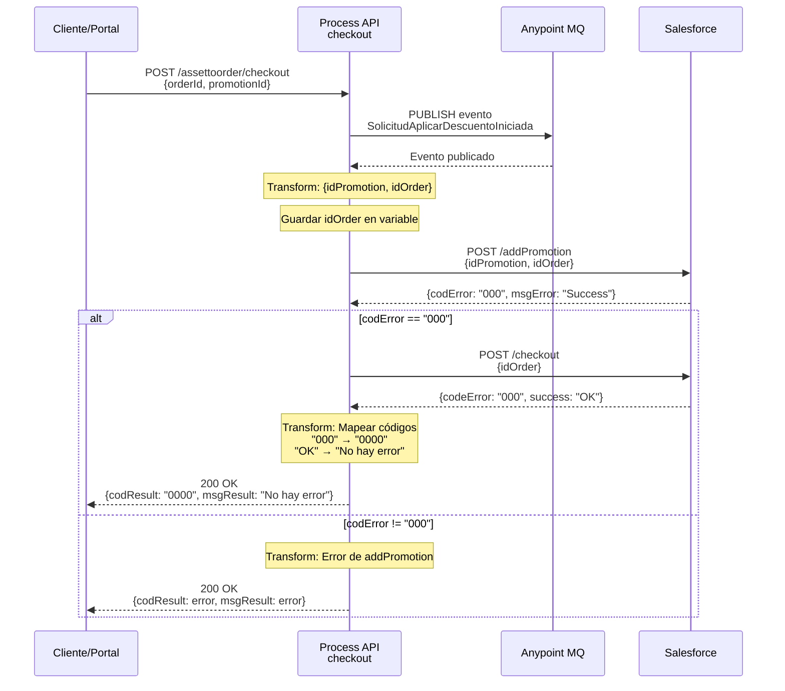

# POST /assettoorder/checkout

## 📌 Descripción General

### Propósito del Endpoint

Este endpoint **finaliza una orden en Salesforce aplicando una promoción seleccionada**, con las siguientes características:

1. **Generación de Evento**: Publica evento a Anypoint MQ para auditoría y procesamiento asíncrono
2. **Aplicación de Promoción**: Añade la promoción seleccionada a la orden
3. **Checkout Secuencial**: Finaliza la orden solo si la promoción se aplicó correctamente
4. **Validación de Códigos**: Verifica código "000" específicamente para proceder

**Flujo de Alto Nivel:**
```
Request → Anypoint MQ (evento) → Salesforce (addPromotion) → Salesforce (checkout) → Response
```

**Relación con POST /assettoorder:**
- POST /assettoorder: Crea orden y obtiene promociones disponibles
- POST /assettoorder/checkout: Aplica promoción seleccionada y finaliza orden

### Tipo de API

**Capa:** Process API (API-Led Connectivity)

**Función:** Orquestación de finalización de orden con aplicación de promoción

### Patrón de Integración

**Tipo:** Orquestación Secuencial con Generación de Evento

**Descripción:** Publica evento de auditoría, aplica promoción a la orden y finaliza el checkout en Salesforce.

### Arquitectura API-Led Connectivity

```mermaid
graph TB
    E[Experience APIs<br/>Portal FUA / Móvil]
    P[Process API<br/>ntgy-newco-p-fua-evo<br/>POST /assettoorder/checkout]
    MQ[Anypoint MQ<br/>Events Queue]
    S1[System API<br/>ntgy-newco-s-salesforce<br/>POST /addPromotion]
    S2[System API<br/>ntgy-newco-s-salesforce<br/>POST /checkout]
    SF[(Salesforce<br/>Orders)]
    
    E -->|Request con<br/>orderId + promotionId| P
    P -->|Publish evento<br/>SolicitudAplicarDescuentoIniciada| MQ
    MQ -->|Evento almacenado| P
    
    P -->|POST addPromotion| S1
    S1 -->|Añadir promoción| SF
    SF -->|codError: "000"| S1
    S1 -->|Success| P
    
    P -->|POST checkout| S2
    S2 -->|Finalizar orden| SF
    SF -->|codeError: "000"| S2
    S2 -->|Success| P
    
    P -->|Response 200 OK| E
    
    style P fill:#ffe1f5,stroke:#c2185b,stroke-width:3px
    style MQ fill:#fff3e0,stroke:#f57c00,stroke-width:2px
    style S1 fill:#e8f5e9,stroke:#2e7d32,stroke-width:2px
    style S2 fill:#e8f5e9,stroke:#2e7d32,stroke-width:2px
```

---

## 💼 Propósito del Negocio

### Casos de Uso Principales

1. **Aplicación de Descuento Seleccionado**
   - Usuario selecciona promoción de la lista obtenida en /assettoorder
   - Sistema aplica la promoción a la orden
   - Finaliza el proceso de checkout
   - **Beneficio:** Proceso guiado y confirmado

2. **Auditoría de Operaciones**
   - Genera evento antes de aplicar cambios
   - Permite trazabilidad completa del proceso
   - Facilita análisis posterior
   - **Beneficio:** Cumplimiento y auditoría

3. **Validación de Aplicación**
   - Verifica que la promoción se aplicó correctamente
   - Solo finaliza si addPromotion fue exitoso
   - Evita órdenes en estado inconsistente
   - **Beneficio:** Integridad de datos

### 🔗 Endpoints Dependientes

Este Process API consume los siguientes servicios:

| Servicio | Operación | Propósito |
|----------|-----------|-----------|
| `Anypoint MQ` | PUBLISH | Publicar evento "SolicitudAplicarDescuentoIniciada" |
| `ntgy-newco-s-salesforce` | POST /addPromotion | Añadir promoción a la orden |
| `ntgy-newco-s-salesforce` | POST /checkout | Finalizar orden en Salesforce |

### Lógica de Orquestación

```mermaid
graph TB
    Start([POST /assettoorder/checkout]) --> GenEvento[generarEventoFlow:<br/>Publish Anypoint MQ]
    
    GenEvento --> Transform1[Transform: Preparar<br/>{idPromotion, idOrder}]
    Transform1 --> SaveOrder[Set Variable:<br/>idOrder]
    
    SaveOrder --> AddPromo[POST Salesforce<br/>/addPromotion]
    AddPromo --> CheckCode{¿codError<br/>== "000"?}
    
    CheckCode -->|Sí| Transform2[Transform: Preparar<br/>{idOrder}]
    Transform2 --> Checkout[POST Salesforce<br/>/checkout]
    Checkout --> TransformSuccess[Transform: Response<br/>Success]
    TransformSuccess --> End([Response 200 OK])
    
    CheckCode -->|No| TransformError[Transform: Response<br/>Error addPromotion]
    TransformError --> End
    
    style Start fill:#e8f5e9,stroke:#2e7d32
    style End fill:#e8f5e9,stroke:#2e7d32
    style GenEvento fill:#fff3e0,stroke:#f57c00
    style AddPromo fill:#e3f2fd,stroke:#1976d2
    style Checkout fill:#e3f2fd,stroke:#1976d2
```

**Pasos del Proceso:**

1. **Generar Evento**: Publica evento "SolicitudAplicarDescuentoIniciada" a Anypoint MQ
2. **Preparar Payload**: Transforma a `{idPromotion, idOrder}`
3. **Añadir Promoción**: POST a Salesforce /addPromotion
4. **Validar Código**: Verifica que `codError == "000"`
5. **Checkout**: Si validación OK, POST a Salesforce /checkout
6. **Response**: Devuelve resultado del checkout

### Transformaciones Aplicadas

#### Transformación 1: Preparar Payload para addPromotion

**Archivo:** Inline en XML (líneas 4-17)

**Lógica DataWeave:**
```dataweave
{
  idPromotion: payload.promotionId,
  idOrder: payload.orderId
}
```

**Variables Creadas:**
```dataweave
vars.idOrder = payload.orderId
```

#### Transformación 2: Preparar Payload para checkout

**Archivo:** Inline en XML (líneas 27-34)

**Lógica DataWeave:**
```dataweave
{
  idOrder: vars.idOrder
}
```

#### Transformación 3: Response Exitoso

**Archivo:** Inline en XML (líneas 39-49)

**Lógica DataWeave:**
```dataweave
{
  "result": {
    "codResult": if(payload.checkoutOutput.codeError == "000") "0000" else payload.checkoutOutput.codeError,
    "msgResult": if(payload.checkoutOutput.success == "OK") "No hay error" else payload.checkoutOutput.success
  }
}
```

**Mapeo de Códigos:**
- Salesforce "000" → API "0000"
- Salesforce "OK" → API "No hay error"

#### Transformación 4: Response con Error

**Archivo:** Inline en XML (líneas 52-62)

**Lógica DataWeave:**
```dataweave
{
  "result": {
    "codResult": payload.addPromotionOutput.codError,
    "msgResult": payload.addPromotionOutput.msgError
  }
}
```

### Contexto Empresarial

- **Dominio:** Gestión de Órdenes y Promociones
- **Sector:** Energía - Utilities
- **División:** Naturgy España - NewCo
- **Proceso de Negocio:** Finalización de órdenes con aplicación de descuentos

### Stakeholders

- **Clientes Finales**: Aplican descuentos a sus contratos
- **Agentes de Call Center**: Gestionan aplicación de promociones
- **Equipo de Auditoría**: Monitorean eventos de cambios
- **Equipo Comercial**: Analizan efectividad de promociones

### Valor de Negocio

- **Trazabilidad Completa**: Evento generado antes de cambios
- **Integridad de Datos**: Validación secuencial evita inconsistencias
- **Experiencia de Usuario**: Confirmación clara de aplicación de descuento
- **Análisis de Negocio**: Eventos permiten análisis de conversión

---

## 🔧 Especificación Técnica

### URLs por Ambiente

| Ambiente | URL Base | URL Completa |
|----------|----------|--------------|
| **Local** | `http://localhost:8081` | `http://localhost:8081/api/assettoorder/checkout` |
| **Development** | `https://ntgy-newco-p-fua-evo-dev.us-e2.cloudhub.io` | `https://ntgy-newco-p-fua-evo-dev.us-e2.cloudhub.io/api/assettoorder/checkout` |
| **UAT** | `https://ntgy-newco-p-fua-evo-uat.us-e2.cloudhub.io` | `https://ntgy-newco-p-fua-evo-uat.us-e2.cloudhub.io/api/assettoorder/checkout` |
| **Production** | `https://ntgy-newco-p-fua-evo-pro.us-e2.cloudhub.io` | `https://ntgy-newco-p-fua-evo-pro.us-e2.cloudhub.io/api/assettoorder/checkout` |

### Método HTTP

```
POST /api/assettoorder/checkout
```

### Headers Requeridos

| Header | Tipo | Obligatorio | Descripción |
|--------|------|-------------|-------------|
| `Content-Type` | string | ✅ | Debe ser `application/json` |
| `client_id` | string | ✅ | Client ID de Anypoint Platform |
| `client_secret` | string | ✅ | Client Secret de Anypoint Platform |

### Parámetros de Entrada

#### Request Body

```json
{
  "orderId": "string",
  "promotionId": "string"
}
```

#### Descripción de Campos

| Campo | Tipo | Obligatorio | Descripción |
|-------|------|-------------|-------------|
| `orderId` | string | ✅ | ID de la orden creada en Salesforce (obtenido de POST /assettoorder) |
| `promotionId` | string | ✅ | ID de la promoción seleccionada (obtenido de POST /assettoorder) |

### Respuestas

#### 200 OK - Checkout Exitoso

```json
{
  "result": {
    "codResult": "0000",
    "msgResult": "No hay error"
  }
}
```

| Campo | Tipo | Descripción |
|-------|------|-------------|
| `result.codResult` | string | Código de resultado: "0000" para éxito |
| `result.msgResult` | string | Mensaje descriptivo del resultado |

#### 200 OK - Error al Añadir Promoción

```json
{
  "result": {
    "codResult": "SF002",
    "msgResult": "Promoción no válida para esta orden"
  }
}
```

#### 400 Bad Request

```json
{
  "code": "BAD_REQUEST",
  "message": "Invalid request format",
  "details": "Missing required field: orderId"
}
```

#### 500 Internal Server Error

```json
{
  "code": "INTERNAL_SERVER_ERROR",
  "message": "Error al finalizar orden",
  "details": "Timeout en llamada a Salesforce"
}
```

### Autenticación

- **Tipo:** Client ID & Client Secret (Anypoint Platform)
- **Headers:** `client_id` y `client_secret`

### Timeouts

| Tipo | Valor | Descripción |
|------|-------|-------------|
| **Request Timeout** | 60 segundos | Timeout total del endpoint |
| **Anypoint MQ Timeout** | 10 segundos | Timeout para publicación de evento |
| **Salesforce Timeout** | 60 segundos | Timeout para addPromotion y checkout |

### Validaciones

1. **Estructura de Request**: Validación de schema JSON según RAML
2. **IDs de Salesforce**: Validación de formato de IDs
3. **Orden Existente**: La orden debe existir en Salesforce
4. **Promoción Válida**: La promoción debe ser aplicable a la orden

---

## 🏗️ Implementación Técnica

### Arquitectura del Flow

```mermaid
flowchart TD
    Start([HTTP POST Request]) --> LogStart[Log: Entrada CheckoutFlow]
    LogStart --> GenEvento[Flow-Ref: generarEventoFlow]
    
    GenEvento --> PublishMQ[Anypoint MQ: Publish<br/>SolicitudAplicarDescuentoIniciada]
    PublishMQ --> Transform1[Transform: Preparar<br/>{idPromotion, idOrder}]
    
    Transform1 --> SaveVar[Set Variable:<br/>idOrder]
    SaveVar --> LogAddPromo[Log: Entrada addPromotion]
    LogAddPromo --> AddPromo[HTTP POST: Salesforce<br/>/addPromotion]
    
    AddPromo --> LogAddPromoOut[Log: Salida addPromotion]
    LogAddPromoOut --> Choice{¿codError<br/>== "000"?}
    
    Choice -->|Sí| Transform2[Transform: Preparar<br/>{idOrder}]
    Transform2 --> LogCheckout[Log: Entrada checkout]
    LogCheckout --> Checkout[HTTP POST: Salesforce<br/>/checkout]
    
    Checkout --> LogCheckoutOut[Log: Salida checkout]
    LogCheckoutOut --> TransformSuccess[Transform: Response<br/>Success]
    TransformSuccess --> LogEnd[Log: Salida CheckoutFlow]
    LogEnd --> End([HTTP 200 Response])
    
    Choice -->|No| TransformError[Transform: Response<br/>Error addPromotion]
    TransformError --> LogEnd
    
    style Start fill:#e8f5e9,stroke:#2e7d32
    style End fill:#e8f5e9,stroke:#2e7d32
    style GenEvento fill:#fff3e0,stroke:#f57c00
    style PublishMQ fill:#fff3e0,stroke:#f57c00
    style AddPromo fill:#e3f2fd,stroke:#1976d2
    style Checkout fill:#e3f2fd,stroke:#1976d2
```

### Componentes del Flow

#### 1. Generación de Evento (generarEventoFlow)

**Ubicación:** Línea 3 del XML

**Subflow:** generarEvento.xml (líneas 9-168)

**Lógica del Evento:**
```dataweave
{
  "specversion": "1.0",
  "type": "SolicitudAplicarDescuentoIniciada",
  "source": "newco/atencion/omega",
  "id": uuid(),
  "time": (now() >> "UTC") as String {format: "yyyy-MM-dd'T'HH:mm:ss.SSSXXX"},
  "datacontenttype": "application/json",
  "version": "v2",
  "traceparent": payload.traceparent,
  "parenttraceid": "",
  "data": payload
}
```

**Backend:** Anypoint MQ
- **Queue:** `${anypointMQ.trastiendaQueue}`
- **Operación:** PUBLISH
- **Propósito:** Auditoría y trazabilidad

**Identificación del Evento:**
- Detecta que `attributes.requestPath == "/api/assettoorder/checkout"`
- Asigna tipo: `"SolicitudAplicarDescuentoIniciada"`

#### 2. Transformación para addPromotion

**Ubicación:** Líneas 4-17 del XML

**Lógica DataWeave:**
```dataweave
%dw 2.0
output application/json
---
{
  idPromotion: payload.promotionId,
  idOrder: payload.orderId
}
```

**Variable Guardada:**
```dataweave
vars.idOrder = payload.orderId
```

**Propósito:** Preservar orderId para uso posterior en checkout

#### 3. Salesforce addPromotion

**Ubicación:** Líneas 19-21 del XML

**Endpoint:** `POST ${ntgy-newco-s-salesforce.pathAddPromotion}`

**Payload Enviado:**
```json
{
  "idPromotion": "a0X1X000000ABC123",
  "idOrder": "8001X000000DEF456"
}
```

**Response Esperado:**
```json
{
  "addPromotionOutput": {
    "codError": "000",
    "msgError": "Success"
  }
}
```

#### 4. Condicional: Validación de Código

**Ubicación:** Líneas 22-50 del XML

**Condición:**
```
payload.addPromotionOutput.codError == "000"
```

**Si codError == "000":**

1. **Preparar Payload para Checkout:**
```dataweave
{
  idOrder: vars.idOrder
}
```

2. **POST Salesforce /checkout:**
```xml
<http:request 
    method="POST" 
    path="${ntgy-newco-s-salesforce.pathCheckout}" 
    config-ref="HTTP_Request_configuration_ntgy_newco_s_salesforce" />
```

3. **Transform Response:**
```dataweave
{
  "result": {
    "codResult": if(payload.checkoutOutput.codeError == "000") "0000" else payload.checkoutOutput.codeError,
    "msgResult": if(payload.checkoutOutput.success == "OK") "No hay error" else payload.checkoutOutput.success
  }
}
```

**Si codError != "000":**

```dataweave
{
  "result": {
    "codResult": payload.addPromotionOutput.codError,
    "msgResult": payload.addPromotionOutput.msgError
  }
}
```

### Patrones de Diseño

#### Patrón 1: Event-Driven Architecture

**Justificación:** Auditoría y trazabilidad de operaciones críticas

**Implementación:**
- Publicar evento antes de modificar datos
- Evento contiene payload completo para análisis
- Permite procesamiento asíncrono posterior

**Ventajas:**
- Trazabilidad completa
- Desacoplamiento de sistemas
- Análisis de negocio facilitado

#### Patrón 2: Sequential Validation

**Justificación:** Evitar estados inconsistentes en Salesforce

**Implementación:**
1. Añadir promoción
2. Validar código de respuesta
3. Solo si exitoso, proceder con checkout

**Ventajas:**
- Integridad de datos garantizada
- Rollback implícito (no se hace checkout si falla addPromotion)
- Mensajes de error claros

#### Patrón 3: Code Mapping

**Justificación:** Normalización de códigos entre Salesforce y API

**Implementación:**
- Salesforce "000" → API "0000"
- Salesforce "OK" → API "No hay error"

**Ventajas:**
- Consistencia en respuestas
- Abstracción de códigos internos de Salesforce
- Facilita cambios futuros

### Configuración

#### Propiedades de Anypoint MQ

```yaml
anypointMQ:
  trastiendaQueue: "events-queue"
```

#### Propiedades de Salesforce

```yaml
ntgy-newco-s-salesforce:
  pathAddPromotion: "/addPromotion"
  pathCheckout: "/checkout"
```

### Manejo de Errores

#### Error en Anypoint MQ

**Escenario:** Fallo al publicar evento

**Comportamiento:**
- El flujo continúa (evento no es crítico para la operación)
- Se registra error en logs
- addPromotion y checkout se ejecutan normalmente

#### Error en addPromotion

**Escenario:** Promoción no válida o error de Salesforce

**Comportamiento:**
- No se ejecuta checkout
- Se devuelve error de Salesforce al cliente
- Orden queda sin promoción aplicada

#### Error en checkout

**Escenario:** Fallo al finalizar orden (promoción ya aplicada)

**Comportamiento:**
- Promoción ya está aplicada (no se revierte)
- Se propaga error al cliente
- Cliente puede reintentar checkout

---

## 💻 Ejemplos de Uso

### Ejemplo 1: Checkout Exitoso

#### Request

```bash
curl -X POST "https://ntgy-newco-p-fua-evo-dev.us-e2.cloudhub.io/api/assettoorder/checkout" \
  -H "Content-Type: application/json" \
  -H "client_id: YOUR_CLIENT_ID" \
  -H "client_secret: YOUR_CLIENT_SECRET" \
  -d '{
    "orderId": "8001X000000VWX234",
    "promotionId": "a0X1X000000YZA567"
  }'
```

#### Response (200 OK)

```json
{
  "result": {
    "codResult": "0000",
    "msgResult": "No hay error"
  }
}
```

**Interpretación:** Promoción aplicada y orden finalizada exitosamente.

### Ejemplo 2: Error - Promoción No Válida

#### Request

```bash
curl -X POST "https://ntgy-newco-p-fua-evo-dev.us-e2.cloudhub.io/api/assettoorder/checkout" \
  -H "Content-Type: application/json" \
  -H "client_id: YOUR_CLIENT_ID" \
  -H "client_secret: YOUR_CLIENT_SECRET" \
  -d '{
    "orderId": "8001X000000VWX234",
    "promotionId": "INVALID_PROMO_ID"
  }'
```

#### Response (200 OK con Error)

```json
{
  "result": {
    "codResult": "SF002",
    "msgResult": "Promoción no válida para esta orden"
  }
}
```

### Ejemplo 3: JavaScript - Flujo Completo

```javascript
// Función completa: crear orden + aplicar promoción
const createAndApplyPromotion = async (orderData, selectedPromotionIndex = 0) => {
  try {
    // Paso 1: Crear orden
    console.log('📝 Paso 1: Creando orden...');
    const orderResponse = await fetch(
      'https://ntgy-newco-p-fua-evo-dev.us-e2.cloudhub.io/api/assettoorder',
      {
        method: 'POST',
        headers: {
          'Content-Type': 'application/json',
          'client_id': 'YOUR_CLIENT_ID',
          'client_secret': 'YOUR_CLIENT_SECRET'
        },
        body: JSON.stringify(orderData)
      }
    );

    const orderResult = await orderResponse.json();
    
    if (orderResult.result.codResult !== '0000' || !orderResult.orderId) {
      throw new Error(`Error al crear orden: ${orderResult.result.msgResult}`);
    }
    
    console.log(`✅ Orden creada: ${orderResult.orderId}`);
    console.log(`📋 ${orderResult.promotionsList.length} promociones disponibles`);
    
    // Mostrar promociones
    orderResult.promotionsList.forEach((promo, index) => {
      console.log(`  ${index + 1}. ${promo.promotionName}`);
    });
    
    // Paso 2: Aplicar promoción seleccionada
    const selectedPromotion = orderResult.promotionsList[selectedPromotionIndex];
    console.log(`\n🎯 Paso 2: Aplicando promoción: ${selectedPromotion.promotionName}`);
    
    const checkoutResponse = await fetch(
      'https://ntgy-newco-p-fua-evo-dev.us-e2.cloudhub.io/api/assettoorder/checkout',
      {
        method: 'POST',
        headers: {
          'Content-Type': 'application/json',
          'client_id': 'YOUR_CLIENT_ID',
          'client_secret': 'YOUR_CLIENT_SECRET'
        },
        body: JSON.stringify({
          orderId: orderResult.orderId,
          promotionId: selectedPromotion.promotionId
        })
      }
    );

    const checkoutResult = await checkoutResponse.json();
    
    if (checkoutResult.result.codResult === '0000') {
      console.log('✅ Checkout completado exitosamente');
      console.log('🎉 Promoción aplicada a la orden');
      
      return {
        success: true,
        orderId: orderResult.orderId,
        appliedPromotion: selectedPromotion
      };
    } else {
      console.error(`❌ Error en checkout: ${checkoutResult.result.msgResult}`);
      return {
        success: false,
        orderId: orderResult.orderId,
        error: checkoutResult.result.msgResult
      };
    }
    
  } catch (error) {
    console.error('❌ Error en el flujo:', error.message);
    throw error;
  }
};

// Uso
const orderData = {
  serviceAccountId: '0011X00000ABC123',
  billingAccountId: '0011X00000DEF456',
  accountId: '0011X00000GHI789',
  contactId: '0031X00000JKL012',
  contractLastDatePromoList: {
    contractNumber: ['CONTRACT001'],
    startDate: ['2024-01-15'],
    assetId: ['02i1X000000MNO345']
  }
};

createAndApplyPromotion(orderData, 0); // Aplica primera promoción
```

### Ejemplo 4: Python - Con Manejo de Errores

```python
import requests
from typing import Dict, Any, Optional

def apply_promotion_to_order(order_id: str, promotion_id: str) -> Dict[str, Any]:
    """
    Aplica una promoción a una orden y finaliza el checkout
    
    Args:
        order_id: ID de la orden en Salesforce
        promotion_id: ID de la promoción a aplicar
    
    Returns:
        dict: Resultado del checkout
    """
    url = 'https://ntgy-newco-p-fua-evo-dev.us-e2.cloudhub.io/api/assettoorder/checkout'
    
    headers = {
        'Content-Type': 'application/json',
        'client_id': 'YOUR_CLIENT_ID',
        'client_secret': 'YOUR_CLIENT_SECRET'
    }
    
    payload = {
        'orderId': order_id,
        'promotionId': promotion_id
    }
    
    try:
        response = requests.post(url, json=payload, headers=headers, timeout=60)
        response.raise_for_status()
        
        data = response.json()
        
        if data['result']['codResult'] == '0000':
            print(f"✅ Checkout exitoso para orden {order_id}")
            print(f"🎉 Promoción {promotion_id} aplicada")
            return {
                'success': True,
                'order_id': order_id,
                'promotion_id': promotion_id
            }
        else:
            print(f"❌ Error en checkout: {data['result']['msgResult']}")
            return {
                'success': False,
                'error_code': data['result']['codResult'],
                'error_message': data['result']['msgResult']
            }
            
    except requests.exceptions.Timeout:
        print('❌ Timeout en la solicitud')
        raise
    except requests.exceptions.RequestException as e:
        print(f'❌ Error en la solicitud: {e}')
        raise

# Ejemplo de uso
result = apply_promotion_to_order(
    order_id='8001X000000VWX234',
    promotion_id='a0X1X000000YZA567'
)

if result['success']:
    print(f"\n🎊 Proceso completado exitosamente")
else:
    print(f"\n⚠️ Error: {result['error_message']}")
```

### Diagrama de Secuencia Completo



### Comparación de Endpoints

| Característica | POST /assettoorder | POST /assettoorder/checkout |
|----------------|--------------------|-----------------------------|
| **Propósito** | Crear orden y obtener promociones | Aplicar promoción y finalizar |
| **Backends** | Uptility + Salesforce (2 calls) | Anypoint MQ + Salesforce (2 calls) |
| **Procesamiento** | Paralelo (Uptility) | Secuencial (addPromotion → checkout) |
| **Evento** | No genera | Sí genera (auditoría) |
| **Response** | orderId + promotionsList | Solo confirmación |
| **Uso** | Inicio del flujo | Finalización del flujo |

**Flujo Recomendado:**
1. Cliente llama POST /assettoorder → Obtiene orderId y lista de promociones
2. Cliente selecciona una promoción
3. Cliente llama POST /assettoorder/checkout → Aplica promoción y finaliza
