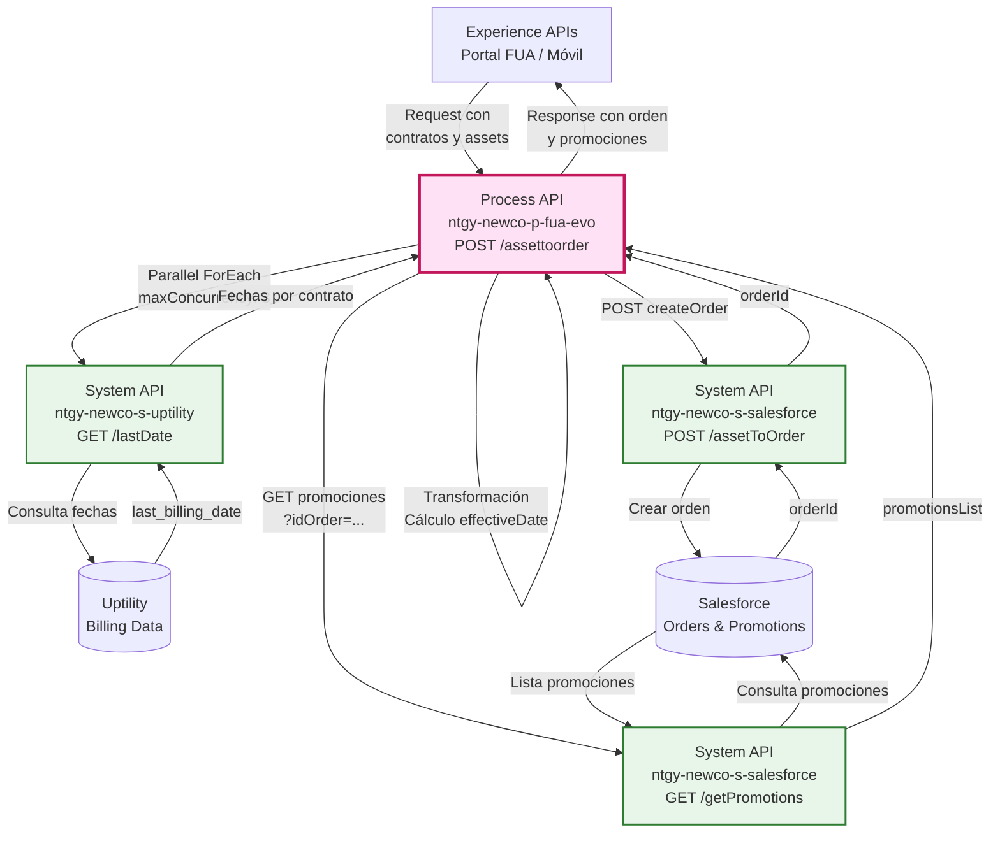
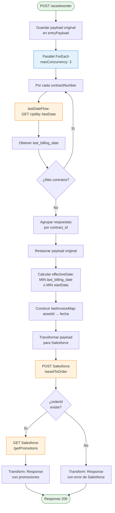
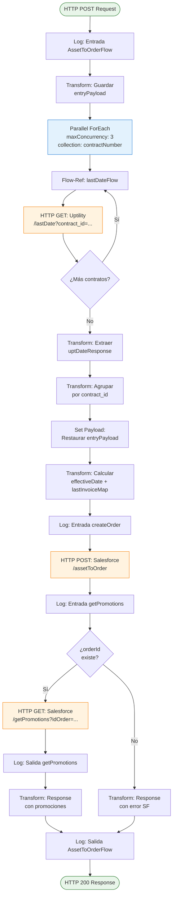
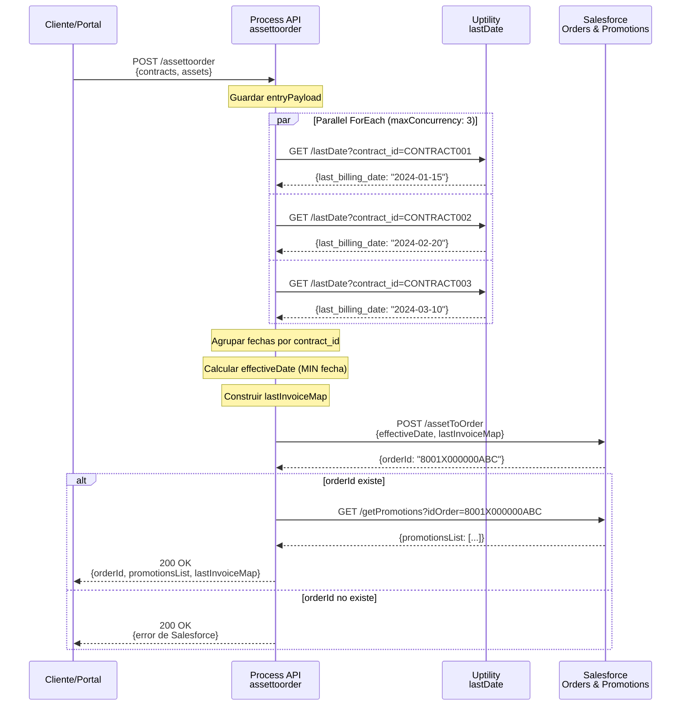

# POST /assettoorder

## 📌 Descripción General

### Propósito del Endpoint

Este endpoint orquesta el proceso de **creación de una orden en Salesforce a partir de assets existentes**, con las siguientes características clave:

1. **Procesamiento Paralelo**: Consulta fechas de facturación de múltiples contratos simultáneamente (maxConcurrency: 3)
2. **Cálculo de Fechas Inteligente**: Determina la fecha efectiva de la orden basándose en la última facturación o fecha de inicio
3. **Mapeo de Fechas por Asset**: Crea un diccionario con la fecha de última factura para cada asset
4. **Obtención de Promociones**: Si la orden se crea exitosamente, obtiene las promociones disponibles

**Flujo de Alto Nivel:**
```
Contratos → Parallel ForEach (Uptility) → Calcular Fechas → Salesforce (createOrder) → Salesforce (getPromotions)
```

### Tipo de API

**Capa:** Process API (API-Led Connectivity)

**Función:** Orquestación de creación de órdenes con agregación de datos de facturación

### Patrón de Integración

**Tipo:** Orquestación con Procesamiento Paralelo y Transformación Compleja

**Descripción:** Ejecuta consultas paralelas a Uptility para obtener fechas de facturación, calcula la fecha efectiva óptima, crea la orden en Salesforce y obtiene promociones disponibles.

### Arquitectura API-Led Connectivity



---

## 💼 Propósito del Negocio

### Casos de Uso Principales

1. **Cambio de Producto con Promoción**
   - Cliente solicita cambio de tarifa/producto
   - Sistema crea orden con fecha efectiva calculada
   - Muestra promociones disponibles para el nuevo producto
   - **Beneficio:** Proceso guiado con opciones de descuento

2. **Aplicación de Descuentos a Contratos Existentes**
   - Agente o cliente inicia proceso de aplicación de promoción
   - Sistema crea orden base desde assets actuales
   - Obtiene lista de promociones aplicables
   - **Beneficio:** Transparencia en descuentos disponibles

3. **Renovación de Contrato con Incentivos**
   - Al finalizar periodo promocional, crear nueva orden
   - Calcular fecha efectiva basada en última facturación
   - Mostrar nuevas promociones disponibles
   - **Beneficio:** Retención de clientes con ofertas personalizadas

### 🔗 Endpoints Dependientes

Este Process API consume los siguientes System APIs:

| System API | Endpoint | Método | Propósito |
|------------|----------|--------|-----------|
| `ntgy-newco-s-uptility` | `/lastDate` | GET | Obtener última fecha de facturación por contrato (parallel) |
| `ntgy-newco-s-salesforce` | `/assetToOrder` | POST | Crear orden en Salesforce desde assets |
| `ntgy-newco-s-salesforce` | `/getPromotions` | GET | Obtener promociones disponibles para la orden |

### Lógica de Orquestación



**Pasos del Proceso:**

1. **Guardar Payload Original**: Almacena el payload de entrada en variable `entryPayload`
2. **Parallel ForEach**: Procesa hasta 3 contratos simultáneamente
   - Por cada `contractNumber` en la lista
   - Llama a `lastDateFlow` (Uptility) para obtener `last_billing_date`
3. **Agrupación de Fechas**: Agrupa respuestas de Uptility por `contract_id`
4. **Cálculo de Fecha Efectiva**:
   - Busca la fecha de facturación más antigua entre todos los contratos
   - Si no hay fechas de facturación, usa la fecha de inicio (`startDate`) más antigua
5. **Construcción de Mapa**: Crea `lastInvoiceMap` con formato `assetId: fecha`
6. **Creación de Orden**: POST a Salesforce con fechas calculadas
7. **Obtención de Promociones**: Si `orderId` existe, GET promociones disponibles

### Transformaciones Aplicadas

#### Transformación 1: Agrupación de Fechas por Contrato

**Archivo:** Inline en XML (líneas 18-26)

**Lógica DataWeave:**
```dataweave
vars.uptDateResponse groupBy $.contract_id
```

**Resultado:** Diccionario con estructura:
```json
{
  "CONTRACT001": [{"contract_id": "CONTRACT001", "last_billing_date": "2024-01-15"}],
  "CONTRACT002": [{"contract_id": "CONTRACT002", "last_billing_date": "2024-02-20"}]
}
```

#### Transformación 2: Cálculo de Fecha Efectiva y Mapa de Facturas

**Archivo:** Inline en XML (líneas 27-47)

**Lógica Compleja:**

```dataweave
%dw 2.0
output application/json

// 1. Extraer todas las fechas de facturación que no sean null
var lastBillingDate = (vars.uptDateResponse filter ((item, index) -> !isEmpty(item.last_billing_date))).last_billing_date

// 2. Calcular fecha efectiva: la más antigua de las fechas de facturación
var aux = if(!isEmpty(lastBillingDate)) 
            (lastBillingDate orderBy ($))[0] as Date {format:'dd/MM/yyyy'} 
          else 
            null

---
{
  "serviceAccountId": payload.serviceAccountId,
  "billingAccountId": payload.billingAccountId,
  "accountId": payload.accountId,
  "contactId": payload.contactId,
  
  // 3. effectiveDate: usa fecha de facturación más antigua o startDate más antigua
  "effectiveDate": if(!isEmpty(aux)) 
                     aux 
                   else 
                     (payload.contractLastDatePromoList.startDate orderBy ($ as Date))[0] as Date as String {format:'dd/MM/YYYY'},
  
  // 4. lastInvoiceMap: mapea cada assetId con su fecha de facturación
  "lastInvoiceMap": {
    (payload.contractLastDatePromoList map {
      ($.assetId): if(!isEmpty(vars.invoiceDateContract[$.contractNumber][0].last_billing_date)) 
                     vars.invoiceDateContract[$.contractNumber][0].last_billing_date as Date {format:'dd/MM/yyyy'} as String {format:'yyyy-MM-dd'} 
                   else 
                     $.startDate as Date
    })
  }
}
```

**Campos Transformados:**

| Campo Entrada | Campo Salesforce | Transformación |
|---------------|------------------|----------------|
| `serviceAccountId` | `serviceAccountId` | Directo |
| `billingAccountId` | `billingAccountId` | Directo |
| `accountId` | `accountId` | Directo |
| `contactId` | `contactId` | Directo |
| `last_billing_date[]` | `effectiveDate` | MIN(fechas) o MIN(startDate) |
| `assetId + last_billing_date` | `lastInvoiceMap` | Diccionario `{assetId: fecha}` |

#### Transformación 3: Response con Promociones

**Archivo:** Inline en XML (líneas 60-77)

**Estructura de Respuesta:**
```json
{
  "result": {
    "codResult": "0000",
    "msgResult": "No hay error"
  },
  "orderId": "string",
  "promotionsList": [
    {
      "promotionId": "string",
      "promotionName": "string",
      "promotionDesc": "string"
    }
  ],
  "lastInvoiceMap": [
    {
      "contractNumber": "string",
      "startDate": "date"
    }
  ]
}
```

#### Transformación 4: Response con Error

**Archivo:** Inline en XML (líneas 80-90)

**Estructura de Error:**
```json
{
  "result": {
    "codResult": "ERROR_CODE",
    "msgResult": "ERROR_MESSAGE"
  }
}
```

### Contexto Empresarial

- **Dominio:** Gestión de Órdenes y Promociones
- **Sector:** Energía - Utilities
- **División:** Naturgy España - NewCo
- **Proceso de Negocio:** Creación de órdenes para cambios de producto y aplicación de promociones

### Stakeholders

- **Clientes Finales**: Solicitan cambios de producto con promociones
- **Agentes de Call Center**: Gestionan cambios de producto para clientes
- **Equipo Comercial**: Define promociones y estrategias de retención
- **Equipo de Facturación**: Necesita fechas efectivas correctas para facturación

### Valor de Negocio

- **Optimización de Performance**: Procesamiento paralelo de contratos (hasta 3 simultáneos)
- **Precisión en Fechas**: Cálculo automático de fecha efectiva basado en facturación real
- **Transparencia Comercial**: Muestra promociones disponibles inmediatamente
- **Experiencia de Usuario**: Proceso guiado con opciones claras
- **Retención de Clientes**: Facilita aplicación de descuentos y promociones

### Consumidores Potenciales

Este endpoint puede ser consumido por:
- Portal web FUA
- Aplicaciones móviles de clientes
- Sistemas de agentes de call center
- Herramientas de gestión comercial

---

## 🔧 Especificación Técnica

### URLs por Ambiente

| Ambiente | URL Base | URL Completa |
|----------|----------|--------------|
| **Local** | `http://localhost:8081` | `http://localhost:8081/api/assettoorder` |
| **Development** | `https://ntgy-newco-p-fua-evo-dev.us-e2.cloudhub.io` | `https://ntgy-newco-p-fua-evo-dev.us-e2.cloudhub.io/api/assettoorder` |
| **UAT** | `https://ntgy-newco-p-fua-evo-uat.us-e2.cloudhub.io` | `https://ntgy-newco-p-fua-evo-uat.us-e2.cloudhub.io/api/assettoorder` |
| **Production** | `https://ntgy-newco-p-fua-evo-pro.us-e2.cloudhub.io` | `https://ntgy-newco-p-fua-evo-pro.us-e2.cloudhub.io/api/assettoorder` |

### Método HTTP

```
POST /api/assettoorder
```

### Headers Requeridos

| Header | Tipo | Obligatorio | Descripción |
|--------|------|-------------|-------------|
| `Content-Type` | string | ✅ | Debe ser `application/json` |
| `client_id` | string | ✅ | Client ID de Anypoint Platform |
| `client_secret` | string | ✅ | Client Secret de Anypoint Platform |

### Parámetros de Entrada

#### Request Body

```json
{
  "serviceAccountId": "string",
  "billingAccountId": "string",
  "accountId": "string",
  "contactId": "string",
  "contractLastDatePromoList": {
    "contractNumber": ["string"],
    "startDate": ["date"],
    "assetId": ["string"]
  }
}
```

#### Descripción de Campos

| Campo | Tipo | Obligatorio | Descripción |
|-------|------|-------------|-------------|
| `serviceAccountId` | string | ✅ | ID de la cuenta de servicio en Salesforce |
| `billingAccountId` | string | ✅ | ID de la cuenta de facturación en Salesforce |
| `accountId` | string | ✅ | ID de la cuenta del cliente en Salesforce |
| `contactId` | string | ✅ | ID del contacto en Salesforce |
| `contractLastDatePromoList` | object | ✅ | Contenedor de información de contratos y assets |
| `contractLastDatePromoList.contractNumber` | array[string] | ✅ | Lista de números de contrato |
| `contractLastDatePromoList.startDate` | array[date] | ✅ | Lista de fechas de inicio de contrato |
| `contractLastDatePromoList.assetId` | array[string] | ✅ | Lista de IDs de assets en Salesforce |

**Nota:** Los arrays `contractNumber`, `startDate` y `assetId` deben tener la misma longitud y estar correlacionados por índice.

### Respuestas

#### 200 OK - Orden Creada con Promociones

```json
{
  "result": {
    "codResult": "0000",
    "msgResult": "No hay error"
  },
  "orderId": "8001X000000ABC123",
  "promotionsList": [
    {
      "promotionId": "a0X1X000000DEF456",
      "promotionName": "Descuento 20% primer año",
      "promotionDesc": "Promoción especial para nuevos clientes con descuento del 20% durante el primer año"
    },
    {
      "promotionId": "a0X1X000000GHI789",
      "promotionName": "Bono bienvenida 50€",
      "promotionDesc": "Bono de 50€ aplicable en la primera factura"
    }
  ],
  "lastInvoiceMap": [
    {
      "contractNumber": "CONTRACT001",
      "startDate": "2024-01-15"
    },
    {
      "contractNumber": "CONTRACT002",
      "startDate": "2024-02-20"
    }
  ]
}
```

| Campo | Tipo | Descripción |
|-------|------|-------------|
| `result.codResult` | string | Código de resultado: "0000" para éxito |
| `result.msgResult` | string | Mensaje descriptivo del resultado |
| `orderId` | string | ID de la orden creada en Salesforce |
| `promotionsList` | array | Lista de promociones disponibles para la orden |
| `promotionsList[].promotionId` | string | ID de la promoción en Salesforce |
| `promotionsList[].promotionName` | string | Nombre de la promoción |
| `promotionsList[].promotionDesc` | string | Descripción detallada de la promoción |
| `lastInvoiceMap` | array | Mapa de fechas de última factura por contrato |
| `lastInvoiceMap[].contractNumber` | string | Número de contrato |
| `lastInvoiceMap[].startDate` | date | Fecha de última facturación o fecha de inicio |

#### 200 OK - Orden No Creada (Error de Salesforce)

```json
{
  "result": {
    "codResult": "SF001",
    "msgResult": "Error al crear orden: Asset no válido"
  }
}
```

#### 400 Bad Request - Validación de Request

```json
{
  "code": "BAD_REQUEST",
  "message": "Invalid request format",
  "details": "Missing required field: accountId"
}
```

#### 500 Internal Server Error - Error Técnico

```json
{
  "code": "INTERNAL_SERVER_ERROR",
  "message": "Error al consultar fechas de facturación",
  "details": "Timeout en llamada a Uptility"
}
```

### Autenticación

- **Tipo:** Client ID & Client Secret (Anypoint Platform)
- **Headers:** `client_id` y `client_secret`

### Timeouts

| Tipo | Valor | Descripción |
|------|-------|-------------|
| **Request Timeout** | 60 segundos | Timeout total del endpoint |
| **Uptility Timeout** | 30 segundos | Timeout para cada llamada paralela |
| **Salesforce Timeout** | 60 segundos | Timeout para createOrder y getPromotions |

### Validaciones

1. **Estructura de Request**: Validación de schema JSON según RAML
2. **IDs de Salesforce**: Validación de formato de IDs
3. **Correlación de Arrays**: contractNumber, startDate y assetId deben tener misma longitud
4. **Fechas**: Formato de fechas válido

---

## 🏗️ Implementación Técnica

### Arquitectura del Flow



### Componentes del Flow

#### 1. Guardar Payload Original

**Ubicación:** Líneas 3-8 del XML

**Propósito:** Preservar el payload original antes del parallel foreach

**Lógica:**
```dataweave
vars.entryPayload = payload
```

#### 2. Parallel ForEach con lastDateFlow

**Ubicación:** Líneas 9-11 del XML

**Configuración:**
- **Collection:** `payload.contractLastDatePromoList.contractNumber`
- **maxConcurrency:** 3 (procesa hasta 3 contratos simultáneamente)

**Subflow lastDateFlow** (recommendedRate.xml, línea 222):
```xml
<sub-flow name="lastDateFlow">
    <http:request 
        method="GET" 
        config-ref="HTTP_Request_configuration_ntgy_newco_s_uptility"
        path="${ntgy-newco-s-uptility.pathLastDate}">
        <http:query-params>
            contract_id: payload
        </http:query-params>
    </http:request>
</sub-flow>
```

**Backend:** Uptility
- **Endpoint:** GET `${ntgy-newco-s-uptility.pathLastDate}`
- **Query Param:** `contract_id`
- **Response:** `{"contract_id": "string", "last_billing_date": "date"}`

**Optimización:** Procesa múltiples contratos en paralelo para reducir tiempo de respuesta total.

#### 3. Agrupación y Transformación de Fechas

**Ubicación:** Líneas 12-26 del XML

**Paso 1: Extraer Respuestas**
```dataweave
vars.uptDateResponse = payload.payload
```

**Paso 2: Agrupar por Contract ID**
```dataweave
vars.invoiceDateContract = vars.uptDateResponse groupBy $.contract_id
```

**Resultado:**
```json
{
  "CONTRACT001": [{"contract_id": "CONTRACT001", "last_billing_date": "2024-01-15"}],
  "CONTRACT002": [{"contract_id": "CONTRACT002", "last_billing_date": "2024-02-20"}]
}
```

#### 4. Cálculo de Fecha Efectiva

**Ubicación:** Líneas 27-47 del XML

**Lógica Compleja:**

1. **Filtrar fechas válidas:**
```dataweave
var lastBillingDate = (vars.uptDateResponse filter ((item, index) -> !isEmpty(item.last_billing_date))).last_billing_date
```

2. **Calcular fecha más antigua:**
```dataweave
var aux = if(!isEmpty(lastBillingDate)) 
            (lastBillingDate orderBy ($))[0] as Date {format:'dd/MM/yyyy'} 
          else 
            null
```

3. **Determinar effectiveDate:**
```dataweave
"effectiveDate": if(!isEmpty(aux)) 
                   aux 
                 else 
                   (payload.contractLastDatePromoList.startDate orderBy ($ as Date))[0] as Date as String {format:'dd/MM/YYYY'}
```

**Lógica de Negocio:**
- **Prioridad 1:** Fecha de facturación más antigua (si existe)
- **Prioridad 2:** Fecha de inicio más antigua (fallback)

4. **Construir lastInvoiceMap:**
```dataweave
"lastInvoiceMap": {
  (payload.contractLastDatePromoList map {
    ($.assetId): if(!isEmpty(vars.invoiceDateContract[$.contractNumber][0].last_billing_date)) 
                   vars.invoiceDateContract[$.contractNumber][0].last_billing_date as Date {format:'dd/MM/yyyy'} as String {format:'yyyy-MM-dd'} 
                 else 
                   $.startDate as Date
  })
}
```

#### 5. Salesforce createOrder

**Ubicación:** Líneas 49-50 del XML

**Endpoint:** `POST ${ntgy-newco-s-salesforce.pathAssetToOrder}`

**Payload Enviado:**
```json
{
  "serviceAccountId": "string",
  "billingAccountId": "string",
  "accountId": "string",
  "contactId": "string",
  "effectiveDate": "dd/MM/yyyy",
  "lastInvoiceMap": {
    "assetId1": "yyyy-MM-dd",
    "assetId2": "yyyy-MM-dd"
  }
}
```

**Response Esperado:**
```json
{
  "AssetToOrderWithContractOutput": {
    "orderId": "string",
    "codeError": "string",
    "descError": "string"
  }
}
```

#### 6. Condicional: Obtener Promociones

**Ubicación:** Líneas 51-77 del XML

**Condición:**
```
!isEmpty(payload.AssetToOrderWithContractOutput.orderId)
```

**Si orderId existe:**

1. **GET Promociones:**
```xml
<http:request 
    method="GET" 
    path="${ntgy-newco-s-salesforce.pathGetPromotion}">
    <http:query-params>
        idOrder: payload.AssetToOrderWithContractOutput.orderId
    </http:query-params>
</http:request>
```

2. **Transform Response:**
```dataweave
{
  "result": {
    "codResult": "0000",
    "msgResult": "No hay error"
  },
  orderId: payload.idOrder,
  promotionsList: payload.getPromotionsOutput.records map {
    promotionId: $.Id,
    promotionName: $.Name,
    promotionDesc: $.vlocity_cmt__Description__c
  },
  "lastInvoiceMap": vars.entryPayload.contractLastDatePromoList map {
    contractNumber: $.contractNumber,
    startDate: if(!isEmpty(vars.invoiceDateContract[$.contractNumber][0].last_billing_date)) 
                 vars.invoiceDateContract[$.contractNumber][0].last_billing_date 
               else 
                 $.startDate as Date
  }
}
```

**Si orderId NO existe:**

```dataweave
{
  "result": {
    "codResult": payload.AssetToOrderWithContractOutput.codeError,
    "msgResult": payload.AssetToOrderWithContractOutput.descError
  }
}
```

### Patrones de Diseño

#### Patrón 1: Parallel ForEach

**Justificación:** Optimización de performance al consultar múltiples contratos simultáneamente

**Implementación:**
- maxConcurrency: 3
- Reduce tiempo de respuesta de O(n) a O(n/3)
- Ideal para consultas independientes

**Ventajas:**
- Tiempo de respuesta reducido significativamente
- Mejor utilización de recursos
- Escalable para múltiples contratos

#### Patrón 2: Preserve and Restore Payload

**Justificación:** El parallel foreach modifica el payload, necesitamos preservar el original

**Implementación:**
1. Guardar payload original en `entryPayload` antes del foreach
2. Después del foreach, restaurar el payload original
3. Usar el payload original para transformaciones posteriores

**Ventajas:**
- Mantiene integridad de datos
- Permite usar datos originales después del foreach
- Evita pérdida de información

#### Patrón 3: Conditional Enrichment

**Justificación:** Solo obtener promociones si la orden se creó exitosamente

**Implementación:**
- Verificar existencia de `orderId` en respuesta de Salesforce
- Si existe: Enriquecer con promociones
- Si no existe: Devolver error de Salesforce

**Ventajas:**
- Evita llamadas innecesarias
- Respuesta más rápida en caso de error
- Lógica de negocio clara

### Configuración

#### Propiedades de Uptility

```yaml
ntgy-newco-s-uptility:
  pathLastDate: "/lastDate"
```

#### Propiedades de Salesforce

```yaml
ntgy-newco-s-salesforce:
  pathAssetToOrder: "/assetToOrder"
  pathGetPromotion: "/getPromotions"
```

### Manejo de Errores

#### Error en Uptility (Parallel ForEach)

**Escenario:** Fallo en consulta de fechas de facturación

**Comportamiento:**
- El parallel foreach continúa con los contratos restantes
- Los contratos con error no tendrán `last_billing_date`
- Se usa `startDate` como fallback para esos contratos

#### Error en Salesforce createOrder

**Escenario:** Fallo al crear orden

**Comportamiento:**
- Salesforce devuelve `codeError` y `descError`
- No se consultan promociones
- Se devuelve error al cliente con códigos de Salesforce

#### Error en Salesforce getPromotions

**Escenario:** Fallo al obtener promociones (orden creada exitosamente)

**Comportamiento:**
- La orden ya fue creada (no se revierte)
- Se propaga error al cliente
- Cliente puede consultar promociones posteriormente

---

## 💻 Ejemplos de Uso

### Ejemplo 1: Creación de Orden con Múltiples Contratos

#### Request

```bash
curl -X POST "https://ntgy-newco-p-fua-evo-dev.us-e2.cloudhub.io/api/assettoorder" \
  -H "Content-Type: application/json" \
  -H "client_id: YOUR_CLIENT_ID" \
  -H "client_secret: YOUR_CLIENT_SECRET" \
  -d '{
    "serviceAccountId": "0011X00000ABC123",
    "billingAccountId": "0011X00000DEF456",
    "accountId": "0011X00000GHI789",
    "contactId": "0031X00000JKL012",
    "contractLastDatePromoList": {
      "contractNumber": ["CONTRACT001", "CONTRACT002", "CONTRACT003"],
      "startDate": ["2024-01-15", "2024-02-20", "2024-03-10"],
      "assetId": ["02i1X000000MNO345", "02i1X000000PQR678", "02i1X000000STU901"]
    }
  }'
```

#### Response (200 OK)

```json
{
  "result": {
    "codResult": "0000",
    "msgResult": "No hay error"
  },
  "orderId": "8001X000000VWX234",
  "promotionsList": [
    {
      "promotionId": "a0X1X000000YZA567",
      "promotionName": "Descuento 20% primer año",
      "promotionDesc": "Promoción especial para nuevos clientes con descuento del 20% durante el primer año"
    },
    {
      "promotionId": "a0X1X000000BCD890",
      "promotionName": "Bono bienvenida 50€",
      "promotionDesc": "Bono de 50€ aplicable en la primera factura"
    },
    {
      "promotionId": "a0X1X000000EFG123",
      "promotionName": "Tarifa plana verano",
      "promotionDesc": "Tarifa plana durante los meses de verano con consumo ilimitado"
    }
  ],
  "lastInvoiceMap": [
    {
      "contractNumber": "CONTRACT001",
      "startDate": "2024-01-15"
    },
    {
      "contractNumber": "CONTRACT002",
      "startDate": "2024-02-20"
    },
    {
      "contractNumber": "CONTRACT003",
      "startDate": "2024-03-10"
    }
  ]
}
```

**Interpretación:** 
- Orden creada exitosamente con ID `8001X000000VWX234`
- 3 promociones disponibles para aplicar
- Fechas de facturación obtenidas para los 3 contratos

### Ejemplo 2: Error al Crear Orden (Asset Inválido)

#### Request

```bash
curl -X POST "https://ntgy-newco-p-fua-evo-dev.us-e2.cloudhub.io/api/assettoorder" \
  -H "Content-Type: application/json" \
  -H "client_id: YOUR_CLIENT_ID" \
  -H "client_secret: YOUR_CLIENT_SECRET" \
  -d '{
    "serviceAccountId": "0011X00000ABC123",
    "billingAccountId": "0011X00000DEF456",
    "accountId": "0011X00000GHI789",
    "contactId": "0031X00000JKL012",
    "contractLastDatePromoList": {
      "contractNumber": ["CONTRACT001"],
      "startDate": ["2024-01-15"],
      "assetId": ["INVALID_ASSET_ID"]
    }
  }'
```

#### Response (200 OK con Error de Salesforce)

```json
{
  "result": {
    "codResult": "SF001",
    "msgResult": "Asset ID no válido o no encontrado"
  }
}
```

### Ejemplo 3: JavaScript (Fetch API)

```javascript
const createOrderWithPromotions = async (orderData) => {
  try {
    const response = await fetch(
      'https://ntgy-newco-p-fua-evo-dev.us-e2.cloudhub.io/api/assettoorder',
      {
        method: 'POST',
        headers: {
          'Content-Type': 'application/json',
          'client_id': 'YOUR_CLIENT_ID',
          'client_secret': 'YOUR_CLIENT_SECRET'
        },
        body: JSON.stringify(orderData)
      }
    );

    const data = await response.json();
    
    if (data.result.codResult === '0000' && data.orderId) {
      console.log('✅ Orden creada exitosamente:', data.orderId);
      console.log(`📋 ${data.promotionsList.length} promociones disponibles:`);
      
      data.promotionsList.forEach((promo, index) => {
        console.log(`  ${index + 1}. ${promo.promotionName}`);
        console.log(`     ${promo.promotionDesc}`);
      });
      
      return {
        success: true,
        orderId: data.orderId,
        promotions: data.promotionsList,
        invoiceMap: data.lastInvoiceMap
      };
    } else {
      console.error('❌ Error al crear orden:', data.result.msgResult);
      return {
        success: false,
        error: data.result.msgResult
      };
    }
  } catch (error) {
    console.error('❌ Error en la solicitud:', error);
    throw error;
  }
};

// Ejemplo de uso
const orderData = {
  serviceAccountId: '0011X00000ABC123',
  billingAccountId: '0011X00000DEF456',
  accountId: '0011X00000GHI789',
  contactId: '0031X00000JKL012',
  contractLastDatePromoList: {
    contractNumber: ['CONTRACT001', 'CONTRACT002'],
    startDate: ['2024-01-15', '2024-02-20'],
    assetId: ['02i1X000000MNO345', '02i1X000000PQR678']
  }
};

createOrderWithPromotions(orderData)
  .then(result => {
    if (result.success) {
      console.log('Orden creada:', result.orderId);
      // Mostrar promociones al usuario para que seleccione
    }
  });
```

### Ejemplo 4: Python (Requests)

```python
import requests
from typing import Dict, List, Any

def create_order_with_promotions(order_data: Dict[str, Any]) -> Dict[str, Any]:
    """
    Crea una orden en Salesforce y obtiene promociones disponibles
    
    Args:
        order_data: Datos de la orden con contratos y assets
    
    Returns:
        dict: Resultado con orderId y promociones o error
    """
    url = 'https://ntgy-newco-p-fua-evo-dev.us-e2.cloudhub.io/api/assettoorder'
    
    headers = {
        'Content-Type': 'application/json',
        'client_id': 'YOUR_CLIENT_ID',
        'client_secret': 'YOUR_CLIENT_SECRET'
    }
    
    try:
        response = requests.post(url, json=order_data, headers=headers, timeout=60)
        response.raise_for_status()
        
        data = response.json()
        
        if data['result']['codResult'] == '0000' and 'orderId' in data:
            print(f"✅ Orden creada exitosamente: {data['orderId']}")
            print(f"📋 {len(data['promotionsList'])} promociones disponibles:")
            
            for i, promo in enumerate(data['promotionsList'], 1):
                print(f"  {i}. {promo['promotionName']}")
                print(f"     {promo['promotionDesc']}")
            
            return {
                'success': True,
                'order_id': data['orderId'],
                'promotions': data['promotionsList'],
                'invoice_map': data['lastInvoiceMap']
            }
        else:
            print(f"❌ Error al crear orden: {data['result']['msgResult']}")
            return {
                'success': False,
                'error': data['result']['msgResult']
            }
            
    except requests.exceptions.Timeout:
        print('❌ Timeout en la solicitud')
        raise
    except requests.exceptions.RequestException as e:
        print(f'❌ Error en la solicitud: {e}')
        raise

# Ejemplo de uso
order_data = {
    'serviceAccountId': '0011X00000ABC123',
    'billingAccountId': '0011X00000DEF456',
    'accountId': '0011X00000GHI789',
    'contactId': '0031X00000JKL012',
    'contractLastDatePromoList': {
        'contractNumber': ['CONTRACT001', 'CONTRACT002'],
        'startDate': ['2024-01-15', '2024-02-20'],
        'assetId': ['02i1X000000MNO345', '02i1X000000PQR678']
    }
}

result = create_order_with_promotions(order_data)

if result['success']:
    print(f"\n🎉 Orden creada: {result['order_id']}")
    print(f"💰 Promociones disponibles: {len(result['promotions'])}")
    
    # Siguiente paso: Permitir al usuario seleccionar una promoción
    # y llamar a POST /assettoorder/checkout
```

### Ejemplo 5: Flujo Completo con Checkout

```javascript
// Paso 1: Crear orden y obtener promociones
const step1_createOrder = async () => {
  const orderData = {
    serviceAccountId: '0011X00000ABC123',
    billingAccountId: '0011X00000DEF456',
    accountId: '0011X00000GHI789',
    contactId: '0031X00000JKL012',
    contractLastDatePromoList: {
      contractNumber: ['CONTRACT001'],
      startDate: ['2024-01-15'],
      assetId: ['02i1X000000MNO345']
    }
  };

  const response = await fetch(
    'https://ntgy-newco-p-fua-evo-dev.us-e2.cloudhub.io/api/assettoorder',
    {
      method: 'POST',
      headers: {
        'Content-Type': 'application/json',
        'client_id': 'YOUR_CLIENT_ID',
        'client_secret': 'YOUR_CLIENT_SECRET'
      },
      body: JSON.stringify(orderData)
    }
  );

  return await response.json();
};

// Paso 2: Usuario selecciona promoción y hace checkout
const step2_checkout = async (orderId, promotionId) => {
  const checkoutData = {
    orderId: orderId,
    promotionId: promotionId
  };

  const response = await fetch(
    'https://ntgy-newco-p-fua-evo-dev.us-e2.cloudhub.io/api/assettoorder/checkout',
    {
      method: 'POST',
      headers: {
        'Content-Type': 'application/json',
        'client_id': 'YOUR_CLIENT_ID',
        'client_secret': 'YOUR_CLIENT_SECRET'
      },
      body: JSON.stringify(checkoutData)
    }
  );

  return await response.json();
};

// Flujo completo
const completeOrderFlow = async () => {
  try {
    // Paso 1: Crear orden
    console.log('📝 Creando orden...');
    const orderResult = await step1_createOrder();
    
    if (orderResult.result.codResult !== '0000') {
      throw new Error(`Error al crear orden: ${orderResult.result.msgResult}`);
    }
    
    console.log(`✅ Orden creada: ${orderResult.orderId}`);
    console.log(`📋 Promociones disponibles: ${orderResult.promotionsList.length}`);
    
    // Mostrar promociones al usuario
    orderResult.promotionsList.forEach((promo, index) => {
      console.log(`  ${index + 1}. ${promo.promotionName} - ${promo.promotionDesc}`);
    });
    
    // Paso 2: Usuario selecciona promoción (simulado)
    const selectedPromotion = orderResult.promotionsList[0]; // Primera promoción
    console.log(`\n🎯 Aplicando promoción: ${selectedPromotion.promotionName}`);
    
    const checkoutResult = await step2_checkout(
      orderResult.orderId,
      selectedPromotion.promotionId
    );
    
    if (checkoutResult.result.codResult === '0000') {
      console.log('✅ Checkout completado exitosamente');
      console.log('🎉 Promoción aplicada a la orden');
    } else {
      console.error(`❌ Error en checkout: ${checkoutResult.result.msgResult}`);
    }
    
  } catch (error) {
    console.error('❌ Error en el flujo:', error.message);
  }
};

// Ejecutar flujo completo
completeOrderFlow();
```

### Diagrama de Secuencia Completo



### Métricas de Performance

| Escenario | Contratos | Tiempo Estimado | Observaciones |
|-----------|-----------|-----------------|---------------|
| 1 contrato | 1 | ~2-3 segundos | Uptility + Salesforce secuencial |
| 3 contratos | 3 | ~3-4 segundos | Parallel processing (maxConcurrency: 3) |
| 6 contratos | 6 | ~4-5 segundos | 2 lotes paralelos de 3 |
| 9 contratos | 9 | ~5-6 segundos | 3 lotes paralelos de 3 |

**Optimización:** El procesamiento paralelo reduce significativamente el tiempo de respuesta comparado con procesamiento secuencial.
