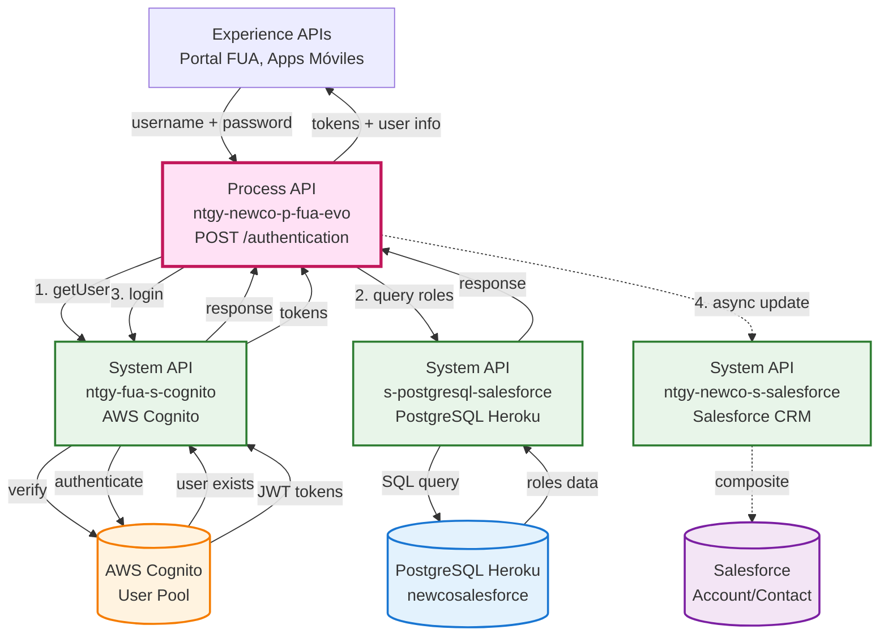
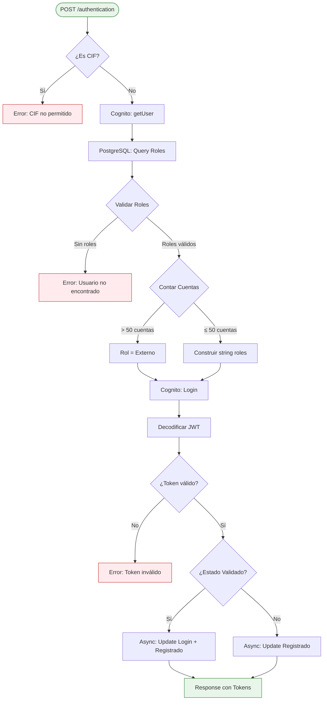
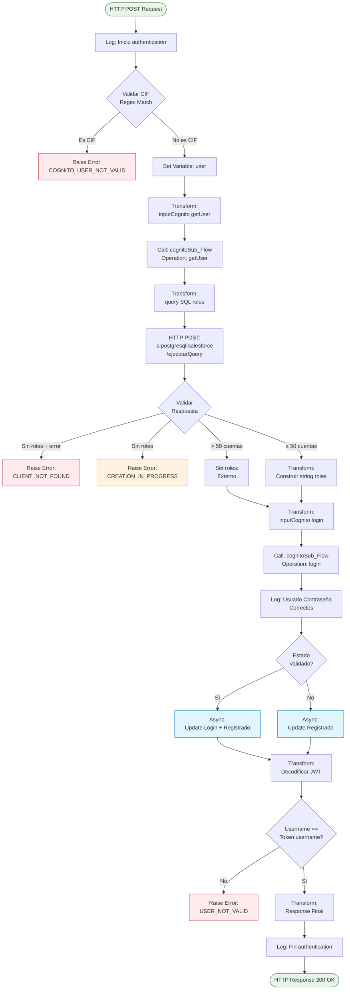
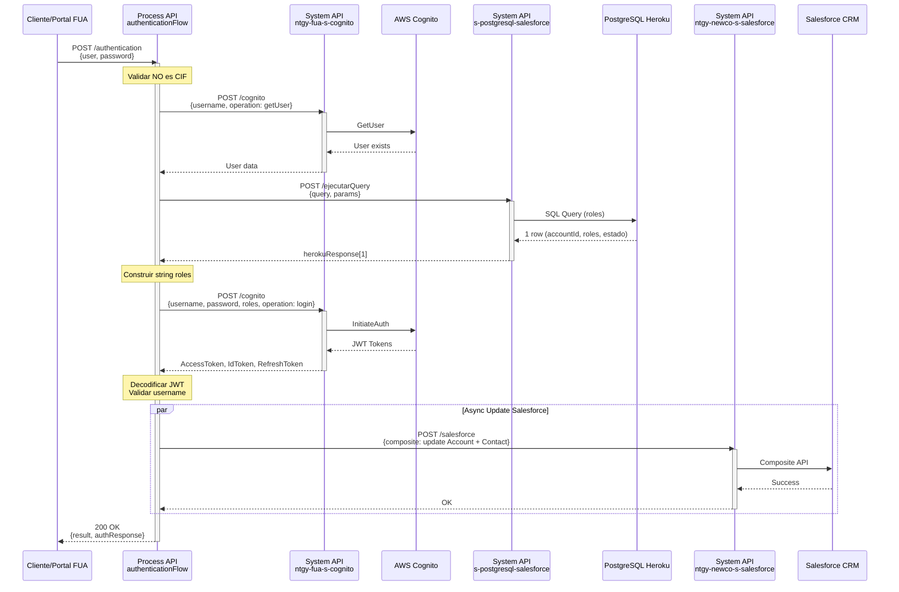
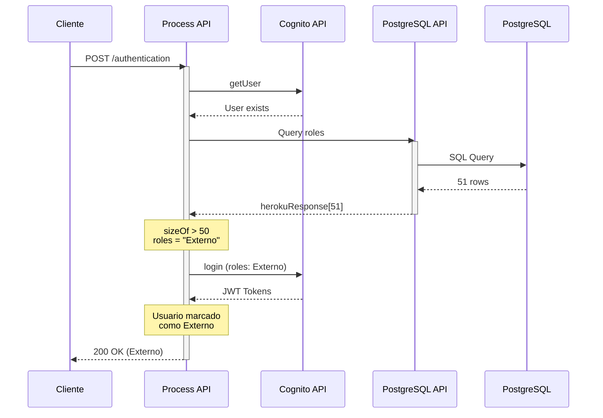
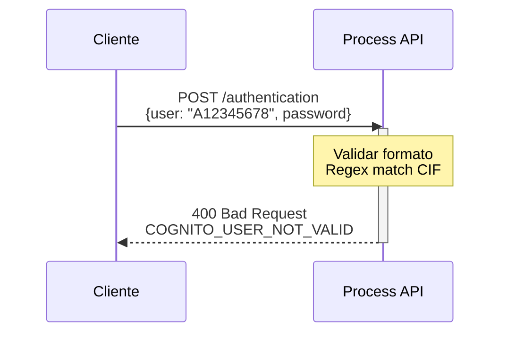
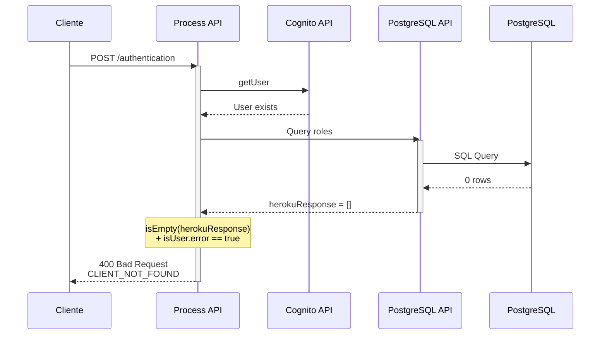
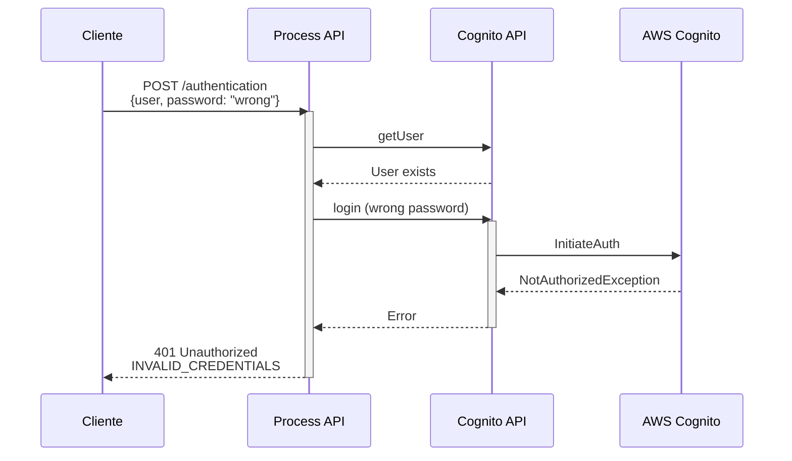

# POST /authentication

## 📌 Descripción General

### Propósito del Endpoint

Este endpoint orquesta el proceso completo de autenticación de usuarios del portal FUA contra AWS Cognito, validando roles y permisos en PostgreSQL Heroku, y actualizando el estado de login en Salesforce de forma asíncrona. Es el punto de entrada crítico para el acceso seguro al portal.

### Tipo de API

**Capa:** Process API (API-Led Connectivity)

**Función:** Orquestación del proceso de autenticación multi-backend con validación de roles, generación de tokens JWT y actualización de estado

### Patrón de Integración

**Tipo:** Orquestación Compleja con Transformación y Procesamiento Asíncrono

**Descripción:** El endpoint coordina tres backends diferentes (AWS Cognito, PostgreSQL Heroku y Salesforce) en un flujo secuencial con validaciones de negocio, transformaciones de datos y actualizaciones asíncronas de estado.

### Arquitectura API-Led Connectivity



---

## 💼 Propósito del Negocio

### Casos de Uso Principales

1. **Autenticación Segura de Clientes**
   - Validación de credenciales contra AWS Cognito
   - Generación de tokens JWT (AccessToken, IdToken, RefreshToken)
   - Soporte para múltiples cuentas por usuario

2. **Validación de Roles y Permisos**
   - Consulta de roles en PostgreSQL Heroku
   - Validación de roles permitidos (01, 03, 04, 05, 06)
   - Detección de usuarios externos (>50 cuentas)
   - Verificación de estado de login en Omega

3. **Trazabilidad de Accesos**
   - Actualización de fecha de último login en Salesforce
   - Marcado de contacto como registrado
   - Registro de actividad de usuario

4. **Prevención de Fraude**
   - Bloqueo de CIF (solo DNI/NIE permitidos)
   - Validación de existencia de usuario en Cognito
   - Verificación de coherencia entre username y token JWT

### 🔗 Endpoints Dependientes

Este Process API consume los siguientes System APIs:

| System API | Endpoint | Método | Propósito | Secuencia |
|------------|----------|--------|-----------|-----------|
| `ntgy-fua-s-cognito` | `/getUser` | POST | Verificar existencia del usuario en AWS Cognito | 1 |
| `s-postgresql-salesforce` | `/ejecutarQuery` | POST | Consulta de roles y permisos en PostgreSQL Heroku | 2 |
| `ntgy-fua-s-cognito` | `/login` | POST | Autenticar usuario y obtener tokens JWT (AccessToken, IdToken, RefreshToken) | 3 |
| `ntgy-newco-s-salesforce` | `/postComposite` | POST | Actualización asíncrona de estado en Salesforce (fecha último login, marca registrado) | 4 (async) |

### Lógica de Orquestación



**Pasos del Proceso:**

1. **Validación de Formato**: Verificar que el usuario NO sea un CIF (solo DNI/NIE permitidos)
2. **Verificación en Cognito**: Confirmar que el usuario existe en AWS Cognito (operación `getUser`)
3. **Consulta de Roles**: Obtener roles y permisos del usuario desde PostgreSQL Heroku
4. **Validación de Roles**: 
   - Si no tiene roles → Error (usuario no encontrado o en proceso de creación)
   - Si tiene > 50 cuentas → Marcar como "Externo"
   - Si tiene ≤ 50 cuentas → Construir string de roles
5. **Autenticación**: Login en AWS Cognito con username, password y roles
6. **Validación de Token**: Decodificar JWT y verificar coherencia con username
7. **Actualización Asíncrona**: Actualizar estado en Salesforce según estado del usuario
8. **Respuesta**: Retornar tokens JWT y datos del usuario

### Transformaciones Aplicadas

#### Transformación 1: Preparación para getUser (líneas 27-35)

| Campo Original (Input) | Campo Transformado (Cognito) | Transformación |
|------------------------|------------------------------|----------------|
| `payload.user` | `username` | Pass-through |
| N/A | `operation` | Hardcoded: `"getUser"` |

#### Transformación 2: Query SQL para Roles (líneas 37-47)

| Campo Original | Campo Transformado | Transformación |
|----------------|-------------------|----------------|
| `payload.user` | `params[0]` | Pass-through como parámetro SQL |
| N/A | `query` | Query SQL complejo con JOINs |

**Query SQL Ejecutado:**
```sql
SELECT 
  accountcontactrelation.accountid,
  accountcontactrelation.roles,
  accountcontactrelation.newco_estadologinomega__c,
  account.acn_fld_documentnumber__c as docNumber,
  contact.sfid as contactid
FROM newcosalesforce.accountcontactrelation
INNER JOIN newcosalesforce.Contact 
  ON contact.sfid = accountcontactrelation.contactid
INNER JOIN newcosalesforce.account 
  ON account.sfid = accountcontactrelation.accountid
WHERE accountcontactrelation.roles IN ('01','03','04','05','06')
  AND accountcontactrelation.roles IS NOT NULL
  AND contact.newco_documentnumber__c = :param1
```

#### Transformación 3: Construcción de Roles (líneas 68-76)

| Condición | Transformación |
|-----------|----------------|
| `sizeOf(herokuResponse) > 50` | `roles = "Externo"` |
| `sizeOf(herokuResponse) ≤ 50` | `roles = accountid,docnumber,roles,estado # accountid,docnumber,roles,estado # ...` |

#### Transformación 4: Preparación para Login (líneas 78-88)

| Campo Original | Campo Transformado (Cognito) | Transformación |
|----------------|------------------------------|----------------|
| `payload.user` | `username` | Pass-through |
| `payload.password` | `password` | Pass-through |
| `vars.roles` | `roles` | String construido en paso anterior |
| N/A | `operation` | Hardcoded: `"login"` |

#### Transformación 5: Decodificación de Token JWT (líneas 93-103)

| Campo Original | Transformación |
|----------------|----------------|
| `loginOutput.AccessToken` | Split por ".", extraer parte [1], decodificar Base64, parsear JSON |

#### Transformación 6: Respuesta Final (líneas 107-123)

| Campo Original | Campo Transformado | Transformación |
|----------------|-------------------|----------------|
| `loginOutput.AccessToken` | `authResponse.token` | Pass-through |
| `loginOutput.IdToken` | `authResponse.idToken` | Pass-through |
| `loginOutput.RefreshToken` | `authResponse.refreshToken` | Pass-through |
| `tokenOutput.body.username` | `authResponse.user.userId` | Uppercase |
| `tokenOutput.body.username` | `authResponse.user.clientCode` | Uppercase |
| N/A | `authResponse.user.roleTypeId` | Hardcoded: `"newcoClient"` |
| N/A | `result.codResult` | Hardcoded: `"0000"` |
| N/A | `result.msgResult` | Hardcoded: `"No hay error"` |

### Contexto Empresarial

- **Dominio:** Autenticación y Gestión de Accesos
- **Sector:** Energía - Utilities
- **División:** Naturgy España - NewCo
- **Proceso de Negocio:** Acceso seguro al portal FUA

### Stakeholders

- **Clientes Finales**: Usuarios del portal FUA que necesitan acceso seguro
- **Equipo de Seguridad**: Gestión de políticas de autenticación y prevención de fraude
- **Equipo de Desarrollo FUA**: Mantenimiento del flujo de login
- **Administradores de Cognito**: Gestión del User Pool de AWS
- **Administradores de Salesforce**: Seguimiento de actividad de usuarios

### Valor de Negocio

- **Seguridad**: Autenticación robusta con AWS Cognito y validación multi-capa
- **Experiencia de Usuario**: Login rápido con soporte para múltiples cuentas
- **Trazabilidad**: Registro completo de accesos y actividad
- **Prevención de Fraude**: Validaciones de formato, roles y coherencia de tokens
- **Escalabilidad**: Uso de servicios cloud (AWS Cognito) para alto volumen

### Consumidores Potenciales

Este endpoint puede ser consumido por:
- Portal web FUA (página de login)
- Aplicaciones móviles de Naturgy
- Sistemas de agentes de call center
- Aplicaciones de terceros autorizados (con OAuth)

---

## 🔧 Especificación Técnica

### URLs por Ambiente

| Ambiente | URL Base | URL Completa |
|----------|----------|--------------|
| **Local** | `http://localhost:8081` | `http://localhost:8081/api/authentication` |
| **Development** | `https://ntgy-newco-p-fua-evo-des.de-c1.cloudhub.io` | `https://ntgy-newco-p-fua-evo-des.de-c1.cloudhub.io/api/authentication` |
| **UAT** | `https://ntgy-newco-p-fua-evo-uat.de-c1.cloudhub.io` | `https://ntgy-newco-p-fua-evo-uat.de-c1.cloudhub.io/api/authentication` |
| **Production** | `https://ntgy-newco-p-fua-evo-pro.de-c1.cloudhub.io` | `https://ntgy-newco-p-fua-evo-pro.de-c1.cloudhub.io/api/authentication` |

### Método HTTP

```
POST /api/authentication
```

### Headers Requeridos

| Header | Tipo | Obligatorio | Descripción |
|--------|------|-------------|-------------|
| `Content-Type` | string | ✅ Sí | Debe ser `application/json` |

### Parámetros de Entrada

#### Request Body (application/json)

```json
{
  "user": "string",
  "password": "string"
}
```

#### Descripción de Campos

| Campo | Tipo | Obligatorio | Descripción | Validación |
|-------|------|-------------|-------------|------------|
| `user` | string | ✅ Sí | Número de documento del usuario (DNI/NIE) | NO debe ser CIF (regex: `/^[ABCDEFGHJKLMNPQRSUVW][0-9]{7}[0-9A-J]$/`) |
| `password` | string | ✅ Sí | Contraseña del usuario en AWS Cognito | Mínimo 8 caracteres (validado por Cognito) |

**⚠️ IMPORTANTE - Validación de CIF:**
- Los CIF (Certificados de Identificación Fiscal) NO están permitidos
- Solo se aceptan DNI (Documento Nacional de Identidad) y NIE (Número de Identidad de Extranjero)
- Patrón de CIF: Letra inicial + 7 dígitos + dígito/letra de control
- Si se detecta un CIF, se retorna error `APP:COGNITO_USER_NOT_VALID`

### Respuestas

#### 200 OK - Autenticación Exitosa

```json
{
  "result": {
    "codResult": "0000",
    "msgResult": "No hay error"
  },
  "authResponse": {
    "token": "eyJraWQiOiJ...",
    "idToken": "eyJraWQiOiJ...",
    "refreshToken": "eyJjdHkiOiJ...",
    "user": {
      "userId": "12345678A",
      "clientCode": "12345678A",
      "roleTypeId": "newcoClient"
    }
  }
}
```

**Descripción de Campos de Respuesta:**

| Campo | Tipo | Descripción |
|-------|------|-------------|
| `result.codResult` | string | Código de resultado (`"0000"` = éxito) |
| `result.msgResult` | string | Mensaje descriptivo del resultado |
| `authResponse.token` | string | JWT AccessToken para autenticación en APIs |
| `authResponse.idToken` | string | JWT IdToken con información del usuario |
| `authResponse.refreshToken` | string | JWT RefreshToken para renovar tokens |
| `authResponse.user.userId` | string | ID del usuario (documento en mayúsculas) |
| `authResponse.user.clientCode` | string | Código de cliente (documento en mayúsculas) |
| `authResponse.user.roleTypeId` | string | Tipo de rol (`"newcoClient"`) |

#### 400 Bad Request - CIF No Permitido

```json
{
  "error": "APP:COGNITO_USER_NOT_VALID",
  "message": "Los CIF no están permitidos para autenticación"
}
```

#### 400 Bad Request - Usuario No Encontrado

```json
{
  "error": "APP:POSTGRESQL_SALESFORCE_CLIENT_NOT_FOUND",
  "message": "Usuario no encontrado en el sistema"
}
```

#### 400 Bad Request - Usuario en Proceso de Creación

```json
{
  "error": "APP:POSTGRESQL_SALESFORCE_CREATION_IN_PROGRESS",
  "message": "Usuario en proceso de creación, intente más tarde"
}
```

#### 401 Unauthorized - Credenciales Inválidas

```json
{
  "error": "COGNITO:INVALID_CREDENTIALS",
  "message": "Usuario o contraseña incorrectos"
}
```

#### 500 Internal Server Error - Error del Sistema

```json
{
  "error": "SYSTEM_ERROR",
  "message": "Error al procesar la autenticación"
}
```

### Autenticación

- **Tipo:** Ninguna (este ES el endpoint de autenticación)
- **Descripción:** Este endpoint genera los tokens de autenticación que se usarán en otros endpoints

### Timeouts

| Tipo | Valor | Descripción |
|------|-------|-------------|
| **Request Timeout** | 30 segundos | Timeout general del endpoint |
| **Cognito Timeout** | 30 segundos | Timeout para operaciones en AWS Cognito |
| **PostgreSQL Timeout** | 240 segundos | Timeout para consultas en Heroku |
| **Salesforce Timeout** | Asíncrono | No bloquea la respuesta |

---

## 🏗️ Implementación Técnica

### Arquitectura del Flow



### Transformaciones DataWeave

#### Transformación 1: Preparación para getUser (líneas 27-35)

```dataweave
%dw 2.0
output application/json
---
{
	"username": payload.user,
	"operation": "getUser"
}
```

#### Transformación 2: Query SQL para Roles (líneas 37-47)

```dataweave
%dw 2.0
output application/json
---
{
    "query": "select accountcontactrelation.accountid, accountcontactrelation.roles, accountcontactrelation.newco_estadologinomega__c, account.acn_fld_documentnumber__c as docNumber, contact.sfid as contactid from newcosalesforce.accountcontactrelation as accountcontactrelation inner join newcosalesforce.Contact as contact on contact.sfid = accountcontactrelation.contactid inner join newcosalesforce.account as account on account.sfid = accountcontactrelation.accountid where (accountcontactrelation.roles in ('01','03','04','05','06') and accountcontactrelation.roles is not null) and contact.newco_documentnumber__c = :param1",
    "params": [payload.user]
}
```

#### Transformación 3: Construcción de Roles (líneas 68-76)

**Caso 1: Usuario Externo (>50 cuentas)**
```dataweave
%dw 2.0
output text/plain
---
"Externo"
```

**Caso 2: Usuario Normal (≤50 cuentas)**
```dataweave
%dw 2.0
output text/plain
---
(vars.herokuResponse map ( $.accountid ++ "," ++ $.docnumber ++ "," ++ $.roles ++ "," ++ $.newco_estadologinomega__c) joinBy "#")
```

**Ejemplo de Output:**
```
0011234567890ABC,12345678A,01,Validado#0019876543210XYZ,12345678A,03,Pendiente
```

#### Transformación 4: Preparación para Login (líneas 78-88)

```dataweave
%dw 2.0
output application/json
---
{
  "username": payload.user,
  "password": payload.password,
  "roles": vars.roles,
  "operation": "login"
}
```

#### Transformación 5: Decodificación de Token JWT (líneas 93-103)

```dataweave
%dw 2.0
import fromBase64 from dw::core::Binaries
output application/json
var AccessToken = (vars.loginOutput.AccessToken splitBy ".")

---
{
    body:read(fromBase64(AccessToken[1]),"application/json")
}
```

**Explicación:**
1. Split del JWT por "." → `[header, payload, signature]`
2. Extraer parte [1] (payload)
3. Decodificar Base64
4. Parsear como JSON

#### Transformación 6: Respuesta Final (líneas 107-123)

```dataweave
%dw 2.0
output application/json
---
{
	"result": {
		"codResult": "0000",
		"msgResult": "No hay error"
	},
	"authResponse": {
		"token": vars.loginOutput.AccessToken,
		"idToken": vars.loginOutput.IdToken,
		"refreshToken": vars.loginOutput.RefreshToken,
		"user": {
			"userId": upper(vars.tokenOutput.body.username),
			"clientCode": upper(vars.tokenOutput.body.username),
			"roleTypeId": "newcoClient"
		}
	}
}
```

### Patrones de Diseño

**Patrón 1: Orchestration Pattern**

**Justificación:** El endpoint coordina múltiples servicios (Cognito, PostgreSQL, Salesforce) en un flujo secuencial con lógica de negocio compleja.

**Patrón 2: Async Fire-and-Forget**

**Justificación:** Las actualizaciones en Salesforce se ejecutan de forma asíncrona para no bloquear la respuesta al usuario, mejorando el tiempo de respuesta.

**Patrón 3: Validation Chain**

**Justificación:** Múltiples validaciones en cascada (CIF, usuario existe, roles válidos, token coherente) aseguran la integridad del proceso de autenticación.

**Patrón 4: Token Verification**

**Justificación:** Decodificación y validación del JWT generado por Cognito para asegurar coherencia entre el username solicitado y el token emitido.

### Diagramas de Secuencia

#### 1. Flujo Normal de Éxito - Usuario con Cuenta Única



#### 2. Flujo con Usuario Externo (>50 Cuentas)



#### 3. Flujo con Error - CIF No Permitido



#### 4. Flujo con Error - Usuario No Encontrado



#### 5. Flujo con Error - Credenciales Inválidas



### Manejo de Errores

**Estrategia:** Error handler global `login-errorsError_Handler`

**Tipos de Errores Manejados:**

1. **Errores de Validación (400)**
   - `APP:COGNITO_USER_NOT_VALID`: CIF detectado o token inválido
   - `APP:POSTGRESQL_SALESFORCE_CLIENT_NOT_FOUND`: Usuario sin roles en PostgreSQL
   - `APP:POSTGRESQL_SALESFORCE_CREATION_IN_PROGRESS`: Usuario en proceso de creación

2. **Errores de Autenticación (401)**
   - `COGNITO:INVALID_CREDENTIALS`: Usuario o contraseña incorrectos
   - `COGNITO:USER_NOT_FOUND`: Usuario no existe en Cognito
   - `COGNITO:USER_NOT_CONFIRMED`: Usuario no confirmado

3. **Errores de Conectividad (500)**
   - `APP:POSTGRESQL_SALESFORCE`: Error de conexión con PostgreSQL
   - `COGNITO:SERVICE_ERROR`: Error del servicio AWS Cognito
   - `SALESFORCE:SERVICE_ERROR`: Error del servicio Salesforce (no bloquea respuesta)

**Respuesta de Error Estandarizada:**

```json
{
  "error": "ERROR_CODE",
  "message": "Descripción del error",
  "timestamp": "2026-01-24T14:30:00Z"
}
```

### Configuración de Propiedades

**Archivo:** `properties-dev.yaml`

```yaml
s-cognito:
  host: "mule-worker-internal-ntgy-fua-s-cognito-dev.de-c1.cloudhub.io"
  port: "8091"
  timeout: "30000"
  basePath: "api"
  userPoolId: "eu-west-1_WWZbMSd5k"

s-postgresql-salesforce:
  host: "mule-worker-internal-ntgy-newco-s-postgresql-salesforce-des.de-c1.cloudhub.io"
  port: "8091"
  timeout: "240000"
  pathejecutarQuery: "/ejecutarQuery"

ntgy-newco-s-salesforce:
  host: "mule-worker-internal-ntgy-newco-s-salesforce-des.de-c1.cloudhub.io"
  port: "8091"
  protocol: "HTTP"
  timeout: "60000"
  basePath: "/api"
```

---

## 💻 Ejemplos de Uso

### Ejemplo 1: Login Exitoso - Usuario con Cuenta Única

#### cURL

```bash
curl -X POST "https://ntgy-newco-p-fua-evo-des.de-c1.cloudhub.io/api/authentication" \
  -H "Content-Type: application/json" \
  -d '{
    "user": "12345678A",
    "password": "MySecurePassword123!"
  }'
```

#### Respuesta (200 OK)

```json
{
  "result": {
    "codResult": "0000",
    "msgResult": "No hay error"
  },
  "authResponse": {
    "token": "eyJraWQiOiJxN3JYc0RcL0pqXC9cL0tEQnNcL0tqXC9cL0tEQnNcL0tqXC9cL0tEQnNcL0tqXC9cL0tEQnNcL0tqXC9cL0tEQnNcL0tqXC9cL0tEQnNcL0tqXC9cL0tEQnNcL0tqXC9cL0tEQnNcL0tqXC9cL0tEQnNcL0tqXC9cL0tEQnNcL0tqXC9cL0tEQnNcL0tqXC9cL0tEQnNcL0tqXC9cL0tEQnNcL0tqXC9cL0tEQnNcL0tqXC9cL0tEQnNcL0tqXC9cL0tEQnNcL0tqXC9cL0tEQnNcL0tqXC9cL0tEQnNcL0tqXC9cL0tEQnNcL0tqXC9cL0tEQnNcL0tqXC9cL0tEQnNcL0tqXC9cL0tEQnNcL0tqXC9cL0tEQnNcL0tqXC9cL0tEQnNcL0tqXC9cL0tEQnNcL0tqXC9cL0tEQnNcL0tqXC9cL0tEQnNcL0tqXC9cL0tEQnNcL0tqXC9cL0tEQnNcL0tqXC9cL0tEQnNcL0tqXC9cL0tEQnNcL0tqXC9cL0tEQnNcL0tqXC9cL0tEQnNcL0tqXC9cL0tEQnNcL0tqXC9cL0tEQnNcL0tqXC9cL0tEQnNcL0tqXC9cL0tEQnNcL0tqXC9cL0tEQnNcL0tqXC9cL0tEQnNcL0tqXC9cL0tEQnNcL0tqXC9cL0tEQnNcL0tqXC9cL0tEQnNcL0tqXC9cL0tEQnNcL0tqXC9cL0tEQnNcL0tqXC9cL0tEQnNcL0tqXC9cL0tEQnNcL0tqXC9cL0tEQnNcL0tqXC9cL0tEQnNcL0tqXC9cL0tEQnNcL0tqXC9cL0tEQnNcL0tqXC9cL0tEQnNcL0tqXC9cL0tEQnNcL0tqXC9cL0tEQnNcL0tqXC9cL0tEQnNcL0tqXC9cL0tEQnNcL0tqXC9cL0tEQnNcL0tqXC9cL0tEQnNcL0tqXC9cL0tEQnNcL0tqXC9cL0tEQnNcL0tqXC9cL0tEQnNcL0tqXC9cL0tEQnNcL0tqXC9cL0tEQnNcL0tqXC9cL0tEQnNcL0tqXC9cL0tEQnNcL0tqXC9cL0tEQnNcL0tqXC9cL0tEQnNcL0tqXC9cL0tEQnNcL0tqXC9cL0tEQnNcL0tqXC9cL0tEQnNcL0tqXC9cL0tEQnNcL0tqXC9cL0tEQnNcL0tqXC9cL0tEQnNcL0tqXC9cL0tEQnNcL0tqXC9cL0tEQnNcL0tqXC9cL0tEQnNcL0tqXC9cL0tEQnNcL0tqXC9cL0tEQnNcL0tqXC9cL0tEQnNcL0tqXC9cL0tEQnNcL0tqXC9cL0tEQnNcL0tqXC9cL0tEQnNcL0tqXC9cL0tEQnNcL0tqXC9cL0tEQnNcL0tqXC9cL0tEQnNcL0tqXC9cL0tEQnNcL0tqXC9cL0tEQnNcL0tqXC9cL0tEQnNcL0tqXC9cL0tEQnNcL0tqXC9cL0tEQnNcL0tqXC9cL0tEQnNcL0tqXC9cL0tEQnNcL0tqXC9cL0tEQnNcL0tqXC9cL0tEQnNcL0tqXC9cL0tEQnNcL0tqXC9cL0tEQnNcL0tqXC9cL0tEQnNcL0tqXC9cL0tEQnNcL0tqXC9cL0tEQnNcL0tqXC9cL0tEQnNcL0tqXC9cL0tEQnNcL0tqXC9cL0tEQnNcL0tqXC9cL0tEQnNcL0tqXC9cL0tEQnNcL0tqXC9cL0tEQnNcL0tqXC9cL0tEQnNcL0tqXC9cL0tEQnNcL0tqXC9cL0tEQnNcL0tqXC9cL0tEQnNcL0tqXC9cL0tEQnNcL0tqXC9cL0tEQnNcL0tqXC9cL0tEQnNcL0tqXC9cL0tEQnNcL0tqXC9cL0tEQnNcL0tqXC9cL0tEQnNcL0tqXC9cL0tEQnNcL0tqXC9cL0tEQnNcL0tqXC9cL0tEQnNcL0tqXC9cL0tEQnNcL0tqXC9cL0tEQnNcL0tqXC9cL0tEQnNcL0tqXC9cL0tEQnNcL0tqXC9cL0tEQnNcL0tqXC9cL0tEQnNcL0tqXC9cL0tEQnNcL0tqXC9cL0tEQnNcL0tqXC9cL0tEQnNcL0tqXC9cL0tEQnNcL0tqXC9cL0tEQnNcL0tqXC9cL0tEQnNcL0tqXC9cL0tEQnNcL0tqXC9cL0tEQnNcL0tqXC9cL0tEQnNcL0tqXC9cL0tEQnNcL0tqXC9cL0tEQnNcL0tqXC9cL0tEQnNcL0tqXC9cL0tEQnNcL0tqXC9cL0tEQnNcL0tqXC9cL0tEQnNcL0tqXC9cL0tEQnNcL0tqXC9cL0tEQnNcL0tqXC9cL0tEQnNcL0tqXC9cL0tEQnNcL0tqXC9cL0tEQnNcL0tqXC9cL0tEQnNcL0tqXC9cL0tEQnNcL0tqXC9cL0tEQnNcL0tqXC9cL0tEQnNcL0tqXC9cL0tEQnNcL0tqXC9cL0tEQnNcL0tqXC9cL0tEQnNcL0tqXC9cL0tEQnNcL0tqXC9cL0tEQnNcL0tqXC9cL0tEQnNcL0tqXC9cL0tEQnNcL0tqXC9cL0tEQnNcL0tqXC9cL0tEQnNcL0tqXC9cL0tEQnNcL0tqXC9cL0tEQnNcL0tqXC9cL0tEQnNcL0tqXC9cL0tEQnNcL0tqXC9cL0tEQnNcL0tqXC9cL0tEQnNcL0tqXC9cL0tEQnNcL0tqXC9cL0tEQnNcL0tqXC9cL0tEQnNcL0tqXC9cL0tEQnNcL0tqXC9cL0tEQnNcL0tqXC9cL0tEQnNcL0tqXC9cL0tEQnNcL0tqXC9cL0tEQnNcL0tqXC9cL0tEQnNcL0tqXC9cL0tEQnNcL0tqXC9cL0tEQnNcL0tqXC9cL0tEQnNcL0tqXC9cL0tEQnNcL0tqXC9cL0tEQnNcL0tqXC9cL0tEQnNcL0tqXC9cL0tEQnNcL0tqXC9cL0tEQnNcL0tqXC9cL0tEQnNcL0tqXC9cL0tEQnNcL0tqXC9cL0tEQnNcL0tqXC9cL0tEQnNcL0tqXC9cL0tEQnNcL0tqXC9cL0tEQnNcL0tqXC9cL0tEQnNcL0tqXC9cL0tEQnNcL0tqXC9cL0tEQnNcL0tqXC9cL0tEQnNcL0tqXC9cL0tEQnNcL0tqXC9cL0tEQnNcL0tqXC9cL0tEQnNcL0tqXC9cL0tEQnNcL0tqXC9cL0tEQnNcL0tqXC9cL0tEQnNcL0tqXC9cL0tEQnNcL0tqXC9cL0tEQnNcL0tqXC9cL0tEQnNcL0tqXC9cL0tEQnNcL0tqXC9cL0tEQnNcL0tqXC9cL0tEQnNcL0tqXC9cL0tEQnNcL0tqXC9cL0tEQnNcL0tqXC9cL0tEQnNcL0tqXC9cL0tEQnNcL0tqXC9cL0tEQnNcL0tqXC9cL0tEQnNcL0tqXC9cL0tEQnNcL0tqXC9cL0tEQnNcL0tqXC9cL0tEQnNcL0tqXC9cL0tEQnNcL0tqXC9cL0tEQnNcL0tqXC9cL0tEQnNcL0tqXC9cL0tEQnNcL0tqXC9cL0tEQnNcL0tqXC9cL0tEQnNcL0tqXC9cL0tEQnNcL0tqXC9cL0tEQnNcL0tqXC9cL0tEQnNcL0tqXC9cL0tEQnNcL0tqXC9cL0tEQnNcL0tqXC9cL0tEQnNcL0tqXC9cL0tEQnNcL0tqXC9cL0tEQnNcL0tqXC9cL0tEQnNcL0tqXC9cL0tEQnNcL0tqXC9cL0tEQnNcL0tqXC9cL0tEQnNcL0tqXC9cL0tEQnNcL0tqXC9cL0tEQnNcL0tqXC9cL0tEQnNcL0tqXC9cL0tEQnNcL0tqXC9cL0tEQnNcL0tqXC9cL0tEQnNcL0tqXC9cL0tEQnNcL0tqXC9cL0tEQnNcL0tqXC9cL0tEQnNcL0tqXC9cL0tEQnNcL0tqXC9cL0tEQnNcL0tqXC9cL0tEQnNcL0tqXC9cL0tEQnNcL0tqXC9cL0tEQnNcL0tqXC9cL0tEQnNcL0tqXC9cL0tEQnNcL0tqXC9cL0tEQnNcL0tqXC9cL0tEQnNcL0tqXC9cL0tEQnNcL0tqXC9cL0tEQnNcL0tqXC9cL0tEQnNcL0tqXC9cL0tEQnNcL0tqXC9cL0tEQnNcL0tqXC9cL0tEQnNcL0tqXC9cL0tEQnNcL0tqXC9cL0tEQnNcL0tqXC9cL0tEQnNcL0tqXC9cL0tEQnNcL0tqXC9cL0tEQnNcL0tqXC9cL0tEQnNcL0tqXC9cL0tEQnNcL0tqXC9cL0tEQnNcL0tqXC9cL0tEQnNcL0tqXC9cL0tEQnNcL0tqXC9cL0tEQnNcL0tqXC9cL0tEQnNcL0tqXC9cL0tEQnNcL0tqXC9cL0tEQnNcL0tqXC9cL0tEQnNcL0tqXC9cL0tEQnNcL0tqXC9cL0tEQnNcL0tqXC9cL0tEQnNcL0tqXC9cL0tEQnNcL0tqXC9cL0tEQnNcL0tqXC9cL0tEQnNcL0tqXC9cL0tEQnNcL0tqXC9cL0tEQnNcL0tqXC9cL0tEQnNcL0tqXC9cL0tEQnNcL0tqXC9cL0tEQnNcL0tqXC9cL0tEQnNcL0tqXC9cL0tEQnNcL0tqXC9cL0tEQnNcL0tqXC9cL0tEQnNcL0tqXC9cL0tEQnNcL0tqXC9cL0tEQnNcL0tqXC9cL0tEQnNcL0tqXC9cL0tEQnNcL0tqXC9cL0tEQnNcL0tqXC9cL0tEQnNcL0tqXC9cL0tEQnNcL0tqXC9cL0tEQnNcL0tqXC9cL0tEQnNcL0tqXC9cL0tEQnNcL0tqXC9cL0tEQnNcL0tqXC9cL0tEQnNcL0tqXC9cL0tEQnNcL0tqXC9cL0tEQnNcL0tqXC9cL0tEQnNcL0tqXC9cL0tEQnNcL0tqXC9cL0tEQnNcL0tqXC9cL0tEQnNcL0tqXC9cL0tEQnNcL0tqXC9cL0tEQnNcL0tqXC9cL0tEQnNcL0tqXC9cL0tEQnNcL0tqXC9cL0tEQnNcL0tqXC9cL0tEQnNcL0tqXC9cL0tEQnNcL0tqXC9cL0tEQnNcL0tqXC9cL0tEQnNcL0tqXC9cL0tEQnNcL0tqXC9cL0tEQnNcL0tqXC9cL0tEQnNcL0tqXC9cL0tEQnNcL0tqXC9cL0tEQnNcL0tqXC9cL0tEQnNcL0tqXC9cL0tEQnNcL0tqXC9cL0tEQnNcL0tqXC9cL0tEQnNcL0tqXC9cL0tEQnNcL0tqXC9cL0tEQnNcL0tqXC9cL0tEQnNcL0tqXC9cL0tEQnNcL0tqXC9cL0tEQnNcL0tqXC9cL0tEQnNcL0tqXC9cL0tEQnNcL0tqXC9cL0tEQnNcL0tqXC9cL0tEQnNcL0tqXC9cL0tEQnNcL0tqXC9cL0tEQnNcL0tqXC9cL0tEQnNcL0tqXC9cL0tEQnNcL0tqXC9cL0tEQnNcL0tqXC9cL0tEQnNcL0tqXC9cL0tEQnNcL0tqXC9cL0tEQnNcL0tqXC9cL0tEQnNcL0tqXC9cL0tEQnNcL0tqXC9cL0tEQnNcL0tqXC9cL0tEQnNcL0tqXC9cL0tEQnNcL0tqXC9cL0tEQnNcL0tqXC9cL0tEQnNcL0tqXC9cL0tEQnNcL0tqXC9cL0tEQnNcL0tqXC9cL0tEQnNcL0tqXC9cL0tEQnNcL0tqXC9cL0tEQnNcL0tqXC9cL0tEQnNcL0tqXC9cL0tEQnNcL0tqXC9cL0tEQnNcL0tqXC9cL0tEQnNcL0tqXC9cL0tEQnNcL0tqXC9cL0tEQnNcL0tqXC9cL0tEQnNcL0tqXC9cL0tEQnNcL0tqXC9cL0tEQnNcL0tqXC9cL0tEQnNcL0tqXC9cL0tEQnNcL0tqXC9cL0tEQnNcL0tqXC9cL0tEQnNcL0tqXC9cL0tEQnNcL0tqXC9cL0tEQnNcL0tqXC9cL0tEQnNcL0tqXC9cL0tEQnNcL0tqXC9cL0tEQnNcL0tqXC9cL0tEQnNcL0tqXC9cL0tEQnNcL0tqXC9cL0tEQnNcL0tqXC9cL0tEQnNcL0tqXC9cL0tEQnNcL0tqXC9cL0tEQnNcL0tqXC9cL0tEQnNcL0tqXC9cL0tEQnNcL0tqXC9cL0tEQnNcL0tqXC9cL0tEQnNcL0tqXC9cL0tEQnNcL0tqXC9cL0tEQnNcL0tqXC9cL0tEQnNcL0tqXC9cL0tEQnNcL0tqXC9cL0tEQnNcL0tqXC9cL0tEQnNcL0tqXC9cL0tEQnNcL0tqXC9cL0tEQnNcL0tqXC9cL0tEQnNcL0tqXC9cL0tEQnNcL0tqXC9cL0tEQnNcL0tqXC9cL0tEQnNcL0tqXC9cL0tEQnNcL0tqXC9cL0tEQnNcL0tqXC9cL0tEQnNcL0tqXC9cL0tEQnNcL0tqXC9cL0tEQnNcL0tqXC9cL0tEQnNcL0tqXC9cL0tEQnNcL0tqXC9cL0tEQnNcL0tqXC9cL0tEQnNcL0tqXC9cL0tEQnNcL0tqXC9cL0tEQnNcL0tqXC9cL0tEQnNcL0tqXC9cL0tEQnNcL0tqXC9cL0tEQnNcL0tqXC9cL0tEQnNcL0tqXC9cL0tEQnNcL0tqXC9cL0tEQnNcL0tqXC9cL0tEQnNcL0tqXC9cL0tEQnNcL0tqXC9cL0tEQnNcL0tqXC9cL0tEQnNcL0tqXC9cL0tEQnNcL0tqXC9cL0tEQnNcL0tqXC9cL0tEQnNcL0tqXC9cL0tEQnNcL0tqXC9cL0tEQnNcL0tqXC9cL0tEQnNcL0tqXC9cL0tEQnNcL0tqXC9cL0tEQnNcL0tqXC9cL0tEQnNcL0tqXC9cL0tEQnNcL0tqXC9cL0tEQnNcL0tqXC9cL0tEQnNcL0tqXC9cL0tEQnNcL0tqXC9cL0tEQnNcL0tqXC9cL0tEQnNcL0tqXC9cL0tEQnNcL0tqXC9cL0tEQnNcL0tqXC9cL0tE
