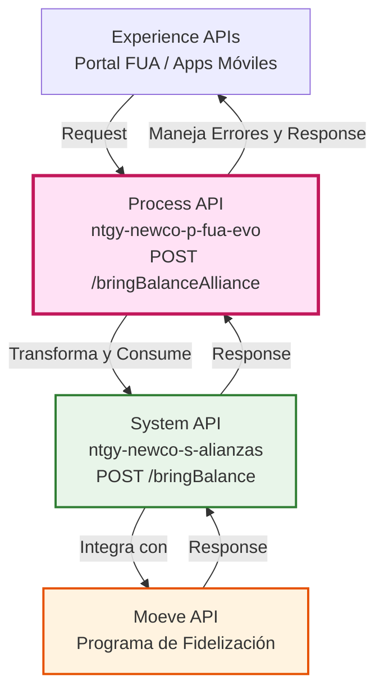
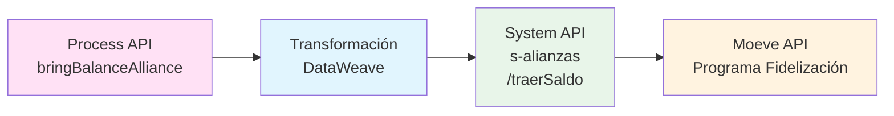
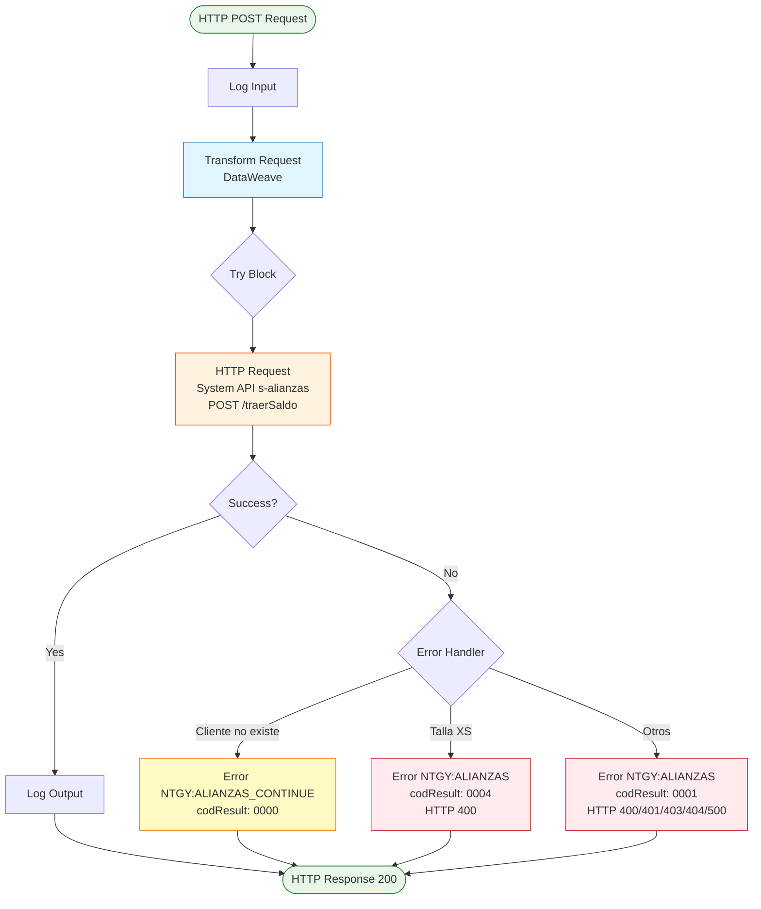
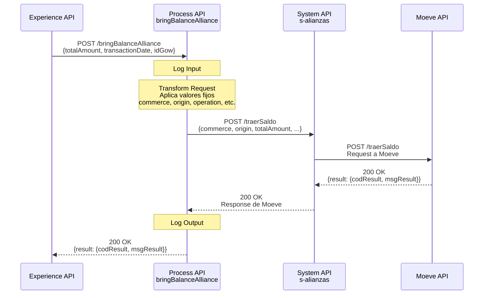
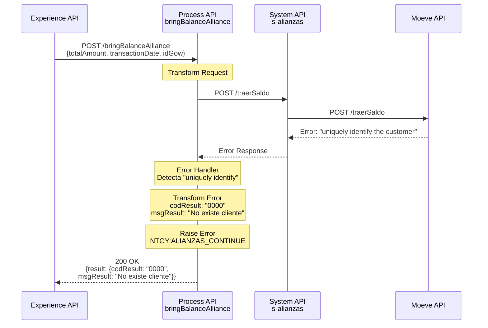
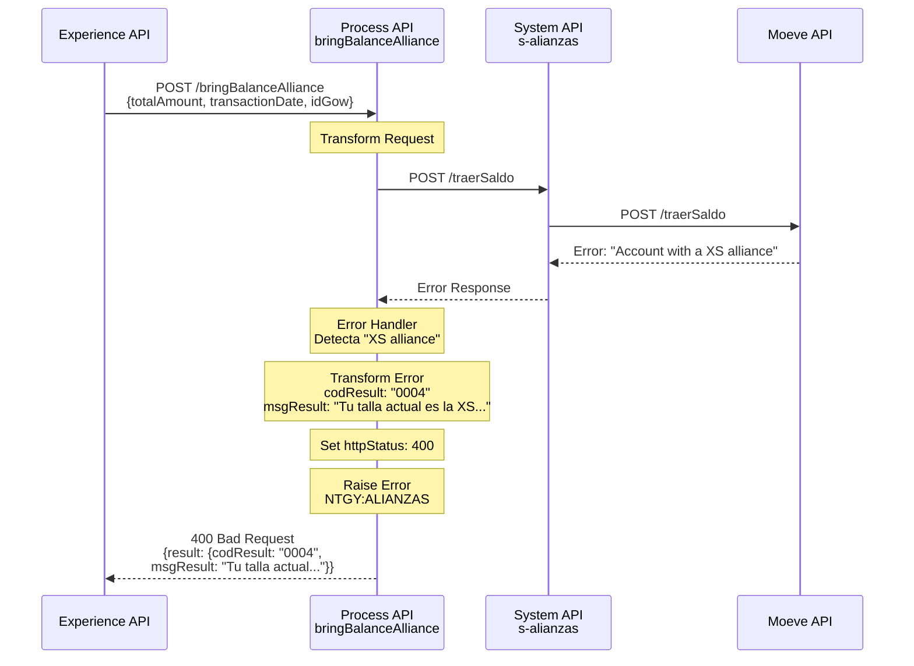
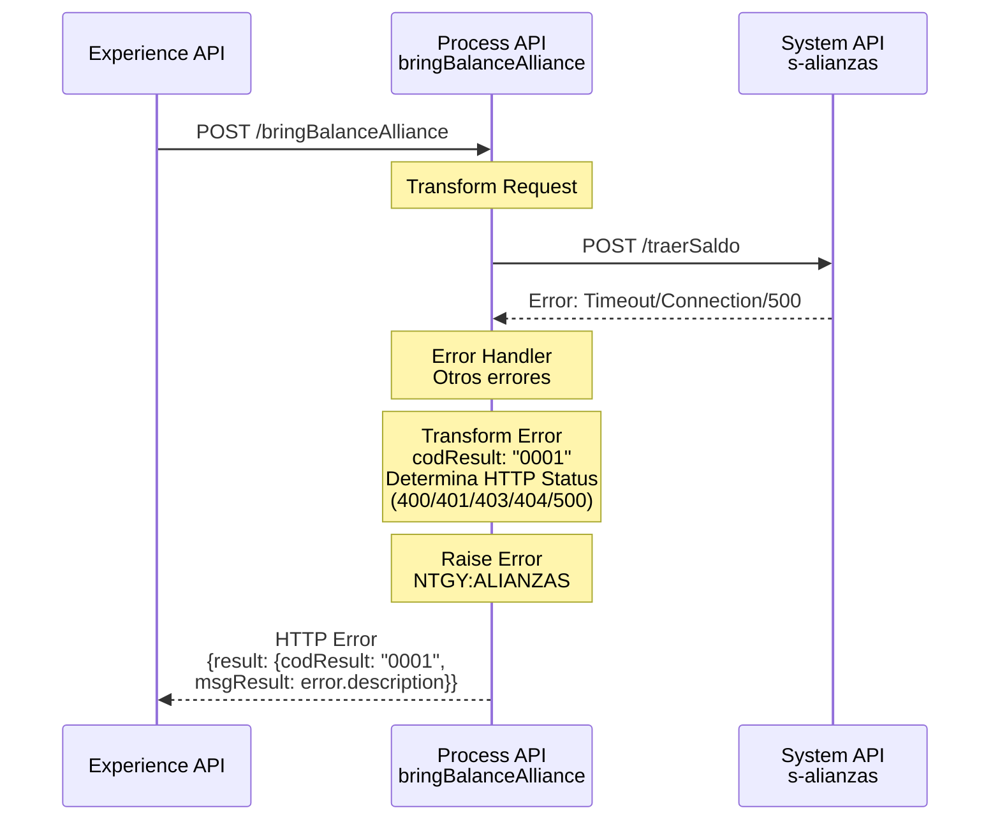

# POST /bringBalanceAlliance

## 📌 Descripción General

### Propósito del Endpoint

Este endpoint orquesta el proceso de traer saldo de batería desde el programa de fidelización Moeve para transferirlo a Naturgy. Actúa como capa de orquestación entre las Experience APIs y el System API de alianzas, aplicando transformaciones específicas y manejando casos de error particulares del negocio.

### Tipo de API

**Capa:** Process API (API-Led Connectivity)

**Función:** Orquestación de transferencia de saldo desde programa de alianzas Moeve

### Patrón de Integración

**Tipo:** Orquestación con Transformación

**Descripción:** El endpoint recibe una solicitud de transferencia de saldo, la transforma al formato requerido por Moeve (incluyendo valores fijos del acuerdo comercial), invoca al System API de alianzas, y maneja casos de error específicos del negocio (cliente no existe, restricción por talla XS).

### Arquitectura API-Led Connectivity



---

## 💼 Propósito del Negocio

### Casos de Uso Principales

1. **Transferencia de Saldo de Batería**
   - Cliente solicita transferir saldo acumulado en Moeve a su cuenta Naturgy
   - Permite monetizar puntos de fidelización del programa de alianzas
   - Beneficio: Mejora la experiencia del cliente y fomenta la lealtad

2. **Validación de Elegibilidad**
   - Verifica que el cliente existe en el sistema Moeve
   - Valida que el cliente no tenga restricciones (talla XS)
   - Beneficio: Previene operaciones inválidas y mejora la calidad de datos

3. **Gestión de Alianzas Comerciales**
   - Implementa reglas específicas del acuerdo Naturgy-Moeve
   - Aplica valores fijos definidos en el contrato comercial
   - Beneficio: Asegura cumplimiento de términos contractuales

### 🔗 Endpoints Dependientes

Este Process API consume el siguiente System API:

| System API | Endpoint | Método | Propósito |
|------------|----------|--------|-----------|
| `ntgy-newco-s-alianzas` | `/traerSaldo` | POST | Traer saldo de batería desde Moeve |

### Lógica de Orquestación



**Pasos del Proceso:**

1. **Recepción y Validación**: Recibe solicitud con totalAmount, transactionDate, idGow
2. **Transformación**: Aplica valores fijos del acuerdo comercial y mapea campos
3. **Invocación**: Llama al System API de alianzas con payload transformado
4. **Manejo de Errores Específicos**: 
   - Cliente no existe → Retorna código 0000 con mensaje específico
   - Talla XS → Retorna código 0004 con restricción de transferencia
   - Otros errores → Retorna código 0001 con mensaje del backend

### Transformaciones Aplicadas

**Transformación de Request:**

| Campo Entrada (Process API) | Campo Salida (System API) | Transformación |
|-----------------------------|---------------------------|----------------|
| `totalAmount` | `totalAmount` | Pass-through - Importe a transferir |
| `transactionDate` | `transactionDate` | Pass-through con default "" |
| `idGow` | `idGow` | Pass-through - Identificador Moeve |
| N/A | `commerce` | Valor fijo: "001" |
| N/A | `origin` | Propiedad: `s-alianzas.origin` |
| N/A | `originType` | Valor fijo: "015" |
| N/A | `originId` | Propiedad: `s-alianzas.originId` |
| N/A | `country` | Valor fijo: "ES" |
| N/A | `operation` | Valor fijo: "003" |
| N/A | `partnerId` | Valor fijo: "NATURGY" |
| N/A | `actionCode` | Valor fijo: "15112" |
| `correlationId` | `externalId` | Identificador único de operación |

**Valores Fijos del Acuerdo Comercial:**
- `commerce`: "001" - Código de comercio Naturgy
- `originType`: "015" - Tipo de origen de la operación
- `operation`: "003" - Código de operación de transferencia
- `partnerId`: "NATURGY" - Identificador del partner
- `actionCode`: "15112" - Código de acción específica

### Contexto Empresarial

- **Dominio:** Gestión de Alianzas y Programas de Fidelización
- **Sector:** Energía - Utilities
- **División:** Naturgy España - NewCo
- **Proceso de Negocio:** Transferencia de saldo desde programa de fidelización Moeve

### Stakeholders

- **Clientes Naturgy**: Usuarios del programa de fidelización que desean transferir saldo
- **Equipo de Marketing**: Gestiona el programa de alianzas y fidelización
- **Moeve**: Partner del programa de fidelización
- **Equipo de Facturación**: Procesa los créditos transferidos

### Valor de Negocio

- **Fidelización de Clientes**: Incentiva la participación en programas de lealtad
- **Diferenciación Competitiva**: Ofrece beneficios únicos a través de alianzas
- **Reducción de Churn**: Aumenta el engagement del cliente con la marca
- **Monetización de Alianzas**: Convierte puntos de fidelización en valor real

### Consumidores Potenciales

Este endpoint puede ser consumido por:
- Portal web FUA
- Aplicaciones móviles de Naturgy
- Sistemas de agentes de call center
- Integraciones de terceros autorizados

---

## 🔧 Especificación Técnica

### URLs por Ambiente

| Ambiente | URL Base | URL Completa |
|----------|----------|--------------|
| **Local** | `http://localhost:8081` | `http://localhost:8081/api/bringBalanceAlliance` |
| **Development** | `https://ntgy-newco-p-fua-evo-dev.us-e2.cloudhub.io` | `https://ntgy-newco-p-fua-evo-dev.us-e2.cloudhub.io/api/bringBalanceAlliance` |
| **UAT** | `https://ntgy-newco-p-fua-evo-uat.us-e2.cloudhub.io` | `https://ntgy-newco-p-fua-evo-uat.us-e2.cloudhub.io/api/bringBalanceAlliance` |
| **Production** | `https://ntgy-newco-p-fua-evo-pro.us-e2.cloudhub.io` | `https://ntgy-newco-p-fua-evo-pro.us-e2.cloudhub.io/api/bringBalanceAlliance` |

### Método HTTP

```
POST /api/bringBalanceAlliance
```

### Headers Requeridos

| Header | Tipo | Requerido | Descripción |
|--------|------|-----------|-------------|
| `Content-Type` | string | Sí | Debe ser `application/json` |
| `client_id` | string | Sí | Client ID de Anypoint Platform |
| `client_secret` | string | Sí | Client Secret de Anypoint Platform |

### Parámetros de Entrada

#### Request Body (application/json)

```json
{
  "totalAmount": "number",
  "transactionDate": "string (opcional)",
  "idGow": "string"
}
```

| Campo | Tipo | Requerido | Descripción |
|-------|------|-----------|-------------|
| `totalAmount` | number | Sí | Importe del saldo a transferir desde Moeve |
| `transactionDate` | string | No | Fecha del movimiento (formato: YYYY-MM-DD). Default: "" |
| `idGow` | string | Sí | Identificador único del cliente en Moeve |

### Respuestas

#### 200 OK - Transferencia Exitosa

```json
{
  "result": {
    "codResult": "0000",
    "msgResult": "Operación exitosa"
  }
}
```

#### 200 OK - Cliente No Existe

```json
{
  "result": {
    "codResult": "0000",
    "msgResult": "No existe cliente"
  }
}
```

**Nota:** Este caso retorna 200 OK pero con código de resultado específico para indicar que el cliente no existe en Moeve.

#### 400 Bad Request - Talla XS (Restricción de Negocio)

```json
{
  "result": {
    "codResult": "0004",
    "msgResult": "Tu talla actual es la XS por lo que no puedes realizar transferencia de saldo a Naturgy."
  }
}
```

#### 400/401/403/404/500 - Errores Generales

```json
{
  "result": {
    "codResult": "0001",
    "msgResult": "Descripción del error"
  }
}
```

**Códigos HTTP de Error:**
- `400`: Bad Request - Error en los datos de entrada
- `401`: Unauthorized - Error de autenticación
- `403`: Forbidden - Sin permisos
- `404`: Not Found - Recurso no encontrado
- `500`: Internal Server Error - Error del sistema

### Autenticación

- **Tipo:** Client ID & Client Secret (Anypoint Platform)
- **Headers:** `client_id` y `client_secret`

### Timeouts

| Tipo | Valor |
|------|-------|
| **Request Timeout** | Configurado en `${s-alianzas.timeout}` |
| **Connection Timeout** | 10 segundos (default) |

---

## 🏗️ Implementación Técnica

### Arquitectura del Flow



### Transformaciones DataWeave

#### Transformación de Request (input bringBalanceAlliance)

**Ubicación:** Inline en `alianzaBringBalanceAlliance.xml`

```dataweave
%dw 2.0
output application/json
---
{
    "commerce": "001", // valor fijo
    "origin": p('s-alianzas.origin'), // texto identificativo del origen
    "originType": "015", // valor fijo
    "originId": p('s-alianzas.originId'), // valor que identifica al origen
    "country": "ES", // valor fijo para España
    "operation": "003", // fijo 
    "partnerId": "NATURGY", // fijo
    "actionCode": "15112", // fijo
    "totalAmount": payload.totalAmount, // importe del saldo a transferir
    "transactionDate": payload.transactionDate default "", // fecha del movimiento
    "externalId": correlationId, // identificador único de la operación
    "idGow": payload.idGow // uriParams a Moeve
}
```

**Campos Clave:**
- **Valores Fijos**: Definidos por el acuerdo comercial Naturgy-Moeve
- **Propiedades Configurables**: `origin` y `originId` (pendientes de valor final PRO)
- **correlationId**: Generado automáticamente por el flow, asegura unicidad de operación

#### Transformación de Error - Cliente No Existe

```dataweave
%dw 2.0
output application/json
---
{
    "result": {
        "codResult": "0000",
        "msgResult": "No existe cliente"
    }
}
```

#### Transformación de Error - Control de Errores

```dataweave
%dw 2.0
output application/json
---
{
    "result": {
        "codResult": if(error.errorMessage.payload.result.msgResult contains("Account with a XS alliance with Naturgy"))
                        "0004"
                     else
                        "0001",
        "msgResult": if(error.errorMessage.payload.result.msgResult contains("Account with a XS alliance with Naturgy")) 
                        "Tu talla actual es la XS por lo que no puedes realizar transferencia de saldo a Naturgy." 
                     else if(error.errorMessage.payload.result.msgResult != null)
                        error.errorMessage.payload.result.msgResult
                     else 
                        error.description
    }
}
```

**Lógica de Códigos HTTP:**
```dataweave
%dw 2.0
output application/java
---
if((error.errorMessage.payload.result.codResult contains ("400")) or (error.description contains ("400")))
    400
else if((error.errorMessage.payload.result.codResult contains ("401")) or (error.description contains ("401")))
    401
else if((error.errorMessage.payload.result.codResult contains ("403")) or (error.description contains ("403")))
    403
else if((error.errorMessage.payload.result.codResult contains ("404")) or (error.description contains ("404")))
    404
else
    500
```

### Patrones de Diseño

**Patrón:** Try-Catch con Manejo de Errores Específicos

**Justificación:** 
- Permite diferenciar entre errores de negocio (cliente no existe, talla XS) y errores técnicos
- Proporciona mensajes de error específicos y accionables para el usuario
- Mantiene la disponibilidad del servicio incluso cuando el backend retorna errores

**Patrón:** Transformación con Valores Fijos

**Justificación:**
- Encapsula la complejidad del contrato con Moeve
- Asegura que los valores del acuerdo comercial se apliquen consistentemente
- Facilita el mantenimiento al centralizar los valores en el Process API

### Diagramas de Secuencia

#### 1. Flujo Normal de Éxito



#### 2. Flujo con Error de Negocio - Cliente No Existe



#### 3. Flujo con Error de Negocio - Talla XS



#### 4. Flujo con Error Técnico



### Manejo de Errores

**Estrategia de 3 Niveles:**

1. **Error de Negocio - Cliente No Existe (NTGY:ALIANZAS_CONTINUE)**
   - **Detección:** Mensaje contiene "uniquely identify the customer"
   - **Código:** 0000
   - **HTTP Status:** 200 OK
   - **Mensaje:** "No existe cliente"
   - **Acción:** Permite continuar el flujo, no es un error crítico

2. **Error de Negocio - Talla XS (NTGY:ALIANZAS)**
   - **Detección:** Mensaje contiene "Account with a XS alliance with Naturgy"
   - **Código:** 0004
   - **HTTP Status:** 400 Bad Request
   - **Mensaje:** "Tu talla actual es la XS por lo que no puedes realizar transferencia de saldo a Naturgy."
   - **Acción:** Bloquea la operación, restricción de negocio

3. **Errores Técnicos (NTGY:ALIANZAS)**
   - **Detección:** Cualquier otro error
   - **Código:** 0001
   - **HTTP Status:** Determinado dinámicamente (400/401/403/404/500)
   - **Mensaje:** Mensaje del backend o descripción del error
   - **Acción:** Propaga el error al consumidor

**Error Handler Reference:**
- Usa el error handler global: `general-errorsError_Handler`

### Configuración

**Propiedades Requeridas (archivo de configuración):**

```yaml
s-alianzas:
  origin: "[VALOR_PENDIENTE_PRO]"
  originId: "[VALOR_PENDIENTE_PRO]"
  pathTraerSaldo: "/bringBalance"
  timeout: "30000"
```

**HTTP Request Configuration:**
- **Config Reference:** `HTTP_Request_ntgy-newco-s-alianzas`
- **Method:** POST
- **Path:** `${s-alianzas.pathTraerSaldo}` → `/traerSaldo`
- **Response Timeout:** `${s-alianzas.timeout}` → `30000ms`

---

## 💻 Ejemplos de Uso

### Ejemplo 1: Transferencia Exitosa

#### cURL

```bash
curl -X POST "https://ntgy-newco-p-fua-evo-dev.us-e2.cloudhub.io/api/bringBalanceAlliance" \
  -H "Content-Type: application/json" \
  -H "client_id: YOUR_CLIENT_ID" \
  -H "client_secret: YOUR_CLIENT_SECRET" \
  -d '{
    "totalAmount": 50.00,
    "transactionDate": "2026-08-31",
    "idGow": "GOW123456789"
  }'
```

#### Respuesta (200 OK)

```json
{
  "result": {
    "codResult": "0000",
    "msgResult": "Operación exitosa"
  }
}
```

### Ejemplo 2: Cliente No Existe

#### cURL

```bash
curl -X POST "https://ntgy-newco-p-fua-evo-dev.us-e2.cloudhub.io/api/bringBalanceAlliance" \
  -H "Content-Type: application/json" \
  -H "client_id: YOUR_CLIENT_ID" \
  -H "client_secret: YOUR_CLIENT_SECRET" \
  -d '{
    "totalAmount": 50.00,
    "transactionDate": "2026-08-31",
    "idGow": "GOW_NO_EXISTE"
  }'
```

#### Respuesta (200 OK)

```json
{
  "result": {
    "codResult": "0000",
    "msgResult": "No existe cliente"
  }
}
```

**Nota:** Retorna 200 OK pero con código específico para indicar que el cliente no existe.

### Ejemplo 3: Error Talla XS

#### cURL

```bash
curl -X POST "https://ntgy-newco-p-fua-evo-dev.us-e2.cloudhub.io/api/bringBalanceAlliance" \
  -H "Content-Type: application/json" \
  -H "client_id: YOUR_CLIENT_ID" \
  -H "client_secret: YOUR_CLIENT_SECRET" \
  -d '{
    "totalAmount": 50.00,
    "transactionDate": "2026-08-31",
    "idGow": "GOW_TALLA_XS"
  }'
```

#### Respuesta (400 Bad Request)

```json
{
  "result": {
    "codResult": "0004",
    "msgResult": "Tu talla actual es la XS por lo que no puedes realizar transferencia de saldo a Naturgy."
  }
}
```

### Ejemplo 4: JavaScript (Fetch API)

```javascript
const transferirSaldo = async () => {
  try {
    const response = await fetch(
      'https://ntgy-newco-p-fua-evo-dev.us-e2.cloudhub.io/api/bringBalanceAlliance',
      {
        method: 'POST',
        headers: {
          'Content-Type': 'application/json',
          'client_id': 'YOUR_CLIENT_ID',
          'client_secret': 'YOUR_CLIENT_SECRET'
        },
        body: JSON.stringify({
          totalAmount: 50.00,
          transactionDate: '2026-08-31',
          idGow: 'GOW123456789'
        })
      }
    );

    const data = await response.json();
    
    if (data.result.codResult === '0000') {
      if (data.result.msgResult === 'No existe cliente') {
        console.log('Cliente no encontrado en Moeve');
      } else {
        console.log('Transferencia exitosa:', data);
      }
    } else if (data.result.codResult === '0004') {
      console.error('Restricción de talla XS:', data.result.msgResult);
    } else {
      console.error('Error en la transferencia:', data.result.msgResult);
    }
  } catch (error) {
    console.error('Error de conexión:', error);
  }
};

transferirSaldo();
```

### Ejemplo 5: Python (Requests)

```python
import requests
import json

def transferir_saldo(total_amount, transaction_date, id_gow):
    url = 'https://ntgy-newco-p-fua-evo-dev.us-e2.cloudhub.io/api/bringBalanceAlliance'
    
    headers = {
        'Content-Type': 'application/json',
        'client_id': 'YOUR_CLIENT_ID',
        'client_secret': 'YOUR_CLIENT_SECRET'
    }
    
    payload = {
        'totalAmount': total_amount,
        'transactionDate': transaction_date,
        'idGow': id_gow
    }
    
    try:
        response = requests.post(url, headers=headers, json=payload)
        data = response.json()
        
        if response.status_code == 200:
            if data['result']['codResult'] == '0000':
                if data['result']['msgResult'] == 'No existe cliente':
                    print('Cliente no encontrado en Moeve')
                else:
                    print('Transferencia exitosa:', data)
            else:
                print('Error en la transferencia:', data['result']['msgResult'])
        elif response.status_code == 400:
            if data['result']['codResult'] == '0004':
                print('Restricción de talla XS:', data['result']['msgResult'])
            else:
                print('Error de validación:', data['result']['msgResult'])
        else:
            print(f'Error HTTP {response.status_code}:', data)
            
    except requests.exceptions.RequestException as e:
        print('Error de conexión:', e)

# Ejemplo de uso
transferir_saldo(50.00, '2026-08-31', 'GOW123456789')
```

### Ejemplo 6: Java (HttpClient)

```java
import java.net.URI;
import java.net.http.HttpClient;
import java.net.http.HttpRequest;
import java.net.http.HttpResponse;
import com.google.gson.Gson;
import com.google.gson.JsonObject;

public class BringBalanceAllianceClient {
    
    private static final String API_URL = 
        "https://ntgy-newco-p-fua-evo-dev.us-e2.cloudhub.io/api/bringBalanceAlliance";
    private static final String CLIENT_ID = "YOUR_CLIENT_ID";
    private static final String CLIENT_SECRET = "YOUR_CLIENT_SECRET";
    
    public static void transferirSaldo(double totalAmount, String transactionDate, String idGow) {
        try {
            HttpClient client = HttpClient.newHttpClient();
            Gson gson = new Gson();
            
            // Crear payload
            JsonObject payload = new JsonObject();
            payload.addProperty("totalAmount", totalAmount);
            payload.addProperty("transactionDate", transactionDate);
            payload.addProperty("idGow", idGow);
            
            // Crear request
            HttpRequest request = HttpRequest.newBuilder()
                .uri(URI.create