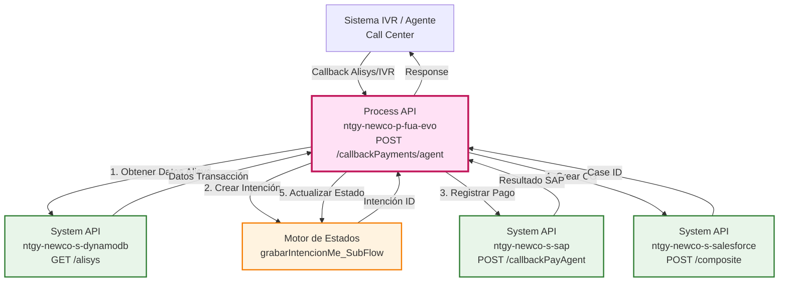
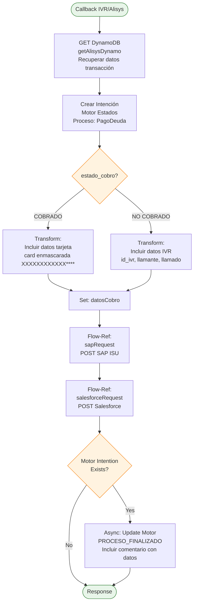
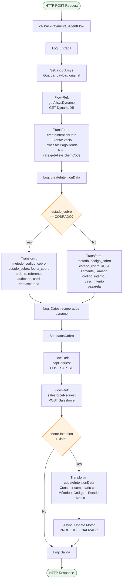
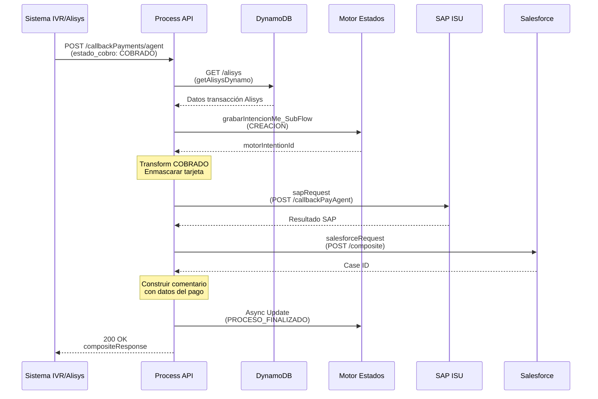
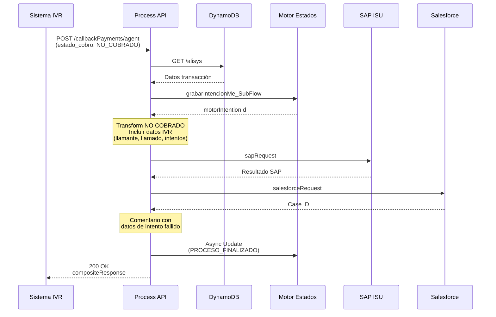
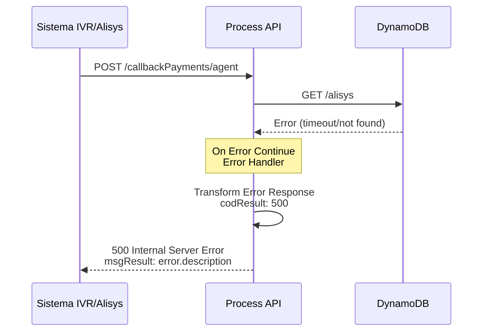

# POST /callbackPayments/agent

## 📌 Descripción General

### Propósito del Endpoint

Este endpoint procesa callbacks de pagos realizados por agentes de call center o sistemas IVR (Interactive Voice Response). A diferencia del endpoint `/customer` que procesa pagos desde el portal FUA, este endpoint gestiona pagos asistidos donde un agente ayuda al cliente o el cliente paga a través de IVR telefónico.

**Flujo completo:**

1. **Recuperación de datos de Alisys** desde DynamoDB
2. **Creación de intención** en Motor de Estados para tracking
3. **Procesamiento condicional** según estado del cobro (COBRADO vs NO COBRADO)
4. **Registro del pago en SAP ISU** mediante System API
5. **Creación de Caso de Gestión en Salesforce** con resultado del pago
6. **Actualización final** en Motor de Estados (PROCESO_FINALIZADO)

### Tipo de API

**Capa:** Process API (API-Led Connectivity)

**Función:** Orquestación de proceso de callback de pagos asistidos con integración multi-sistema y tracking de estados

### Patrón de Integración

**Tipo:** Orquestación con Recuperación de Contexto desde DynamoDB

**Descripción:** Este endpoint implementa un patrón de orquestación que primero recupera el contexto de la transacción desde DynamoDB (datos de Alisys) y luego procesa el pago:
- **DynamoDB**: Recuperación de datos de la transacción Alisys
- **SAP ISU**: Registro del pago en sistema de facturación
- **Salesforce**: Creación de caso de gestión con resultado
- **Motor de Estados**: Tracking completo del proceso

### Arquitectura API-Led Connectivity



---

## 💼 Propósito del Negocio

### Casos de Uso Principales

1. **Pago Asistido por Agente de Call Center**
   - Cliente llama al call center para realizar un pago
   - Agente procesa el pago usando sistema Alisys
   - Sistema registra resultado en SAP y crea caso de gestión
   - **Beneficio:** Soporte personalizado para clientes que prefieren asistencia telefónica

2. **Pago a través de IVR Telefónico**
   - Cliente realiza pago mediante sistema IVR automatizado
   - Sistema registra intentos y resultado del pago
   - Tracking completo de llamadas (llamante, llamado, códigos de intento)
   - **Beneficio:** Canal de pago 24/7 sin necesidad de agente humano

3. **Tracking de Transacciones Alisys**
   - Cada transacción Alisys genera registro en DynamoDB
   - Motor de Estados proporciona trazabilidad completa
   - Diferenciación entre pagos cobrados y no cobrados
   - **Beneficio:** Visibilidad completa del proceso de pago asistido

### 🔗 Endpoints Dependientes

Este Process API consume los siguientes System APIs:

| System API | Endpoint | Método | Propósito |
|------------|----------|--------|-----------|
| `ntgy-newco-s-dynamodb` | `/alisys` | GET | Recuperar datos de transacción Alisys desde DynamoDB |
| `ntgy-newco-s-sap` | `/callbackPayAgent` | POST | Registrar resultado del pago en SAP ISU (FICA) |
| `ntgy-newco-s-salesforce` | `/composite` | POST | Crear Caso de Gestión con resultado del pago |

### Lógica de Orquestación



**Pasos del Proceso:**

1. **Recuperación de Datos Alisys**: Llamada a DynamoDB para obtener datos de la transacción
2. **Creación de Intención**: Registro en Motor de Estados con proceso PagoDeuda
3. **Procesamiento Condicional**: 
   - Si `estado_cobro == "COBRADO"`: Incluye datos de tarjeta (enmascarada)
   - Si `estado_cobro != "COBRADO"`: Incluye datos de IVR (llamadas, intentos)
4. **Registro en SAP**: Llamada a sapRequest subflow
5. **Creación de CG**: Llamada a salesforceRequest subflow
6. **Actualización Final**: Evento PROCESO_FINALIZADO con comentario detallado

### Transformaciones Aplicadas

| Campo Original (Alisys) | Campo Transformado | Transformación |
|-------------------------|-------------------|----------------|
| `estado_cobro` | Lógica condicional | Determina qué campos incluir en response |
| `tarjeta` | `card` | Enmascaramiento: `XXXXXXXXXXXX` + últimos 4 dígitos |
| `metodo` | `metodo` | Pass-through |
| `codigo_cobro` | `codigo_cobro` | Pass-through |
| `fecha_cobro` | `fecha_cobro` | Solo si COBRADO |
| `id_ivr` | `id_ivr` | Solo si NO COBRADO |
| `llamante` | `llamante` | Solo si NO COBRADO |
| `llamado` | `llamado` | Solo si NO COBRADO |

### Contexto Empresarial

- **Dominio:** Gestión de Pagos y Cobros Asistidos
- **Sector:** Energía - Utilities
- **División:** Naturgy España - NewCo
- **Proceso de Negocio:** Callback de Pagos desde Agentes/IVR

### Stakeholders

- **Agentes de Call Center**: Procesan pagos asistidos para clientes
- **Sistema IVR**: Procesa pagos automatizados telefónicos
- **Equipo de Cobros**: Monitorea pagos recibidos y casos de gestión
- **Equipo SAP ISU**: Gestiona registros de pago en sistema de facturación
- **Equipo Salesforce**: Gestiona casos de gestión y seguimiento

### Valor de Negocio

- **Canal Alternativo de Pago**: Opción para clientes sin acceso digital
- **Soporte Personalizado**: Asistencia de agentes para pagos complejos
- **Disponibilidad 24/7**: IVR permite pagos fuera de horario de atención
- **Trazabilidad Completa**: Motor de Estados registra cada paso
- **Reducción de Errores**: Automatización del registro en SAP y Salesforce

### Consumidores Potenciales

Este endpoint es consumido por:
- Sistema Alisys (plataforma de gestión de agentes)
- Sistema IVR telefónico
- Aplicaciones de call center
- Sistemas de monitoreo de pagos asistidos

---

## 🔧 Especificación Técnica

### URLs por Ambiente

| Ambiente | URL Base | URL Completa |
|----------|----------|--------------|
| **Local** | `http://localhost:8081` | `http://localhost:8081/api/callbackPayments/agent` |
| **Development** | `https://ntgy-newco-p-fua-evo-dev.us-e2.cloudhub.io` | `https://ntgy-newco-p-fua-evo-dev.us-e2.cloudhub.io/api/callbackPayments/agent` |
| **UAT** | `https://ntgy-newco-p-fua-evo-uat.us-e2.cloudhub.io` | `https://ntgy-newco-p-fua-evo-uat.us-e2.cloudhub.io/api/callbackPayments/agent` |
| **Production** | `https://ntgy-newco-p-fua-evo-pro.us-e2.cloudhub.io` | `https://ntgy-newco-p-fua-evo-pro.us-e2.cloudhub.io/api/callbackPayments/agent` |

### Método HTTP

```
POST /api/callbackPayments/agent
```

### Parámetros de Entrada

#### Headers

| Header | Tipo | Requerido | Descripción |
|--------|------|-----------|-------------|
| `Content-Type` | string | Sí | `application/json` |
| `x-correlation-id` | string | Sí | ID de correlación para tracking |

#### Body (JSON)

**Estructura del Payload de Alisys/IVR:**

```json
{
  "metodo": "TARJETA",
  "codigo_cobro": "COB123456",
  "estado_cobro": "COBRADO",
  "fecha_cobro": "2026-08-24T10:30:00Z",
  "orderid": "ORD789012",
  "reference": "REF345678",
  "authcode": "AUTH901234",
  "tarjeta": "1234567890123456",
  "id_ivr": null,
  "llamante": null,
  "llamado": null,
  "codigo_intento": null,
  "desc_intento": null,
  "pasarela": null
}
```

**Campos Clave:**

| Campo | Tipo | Requerido | Descripción |
|-------|------|-----------|-------------|
| `metodo` | string | Sí | Método de pago: "TARJETA", "BIZUM", "IVR" |
| `codigo_cobro` | string | Sí | Código único del cobro en Alisys |
| `estado_cobro` | string | Sí | Estado: "COBRADO" o "NO_COBRADO" |
| `fecha_cobro` | string | Condicional | Fecha del cobro (solo si COBRADO) |
| `orderid` | string | Condicional | ID de orden (solo si COBRADO) |
| `reference` | string | Condicional | Referencia de pago (solo si COBRADO) |
| `authcode` | string | Condicional | Código de autorización (solo si COBRADO) |
| `tarjeta` | string | Condicional | Número de tarjeta completo (solo si COBRADO) |
| `id_ivr` | string | Condicional | ID de sesión IVR (solo si NO COBRADO) |
| `llamante` | string | Condicional | Número del llamante (solo si NO COBRADO) |
| `llamado` | string | Condicional | Número llamado (solo si NO COBRADO) |
| `codigo_intento` | string | Condicional | Código del intento de pago (solo si NO COBRADO) |
| `desc_intento` | string | Condicional | Descripción del intento (solo si NO COBRADO) |
| `pasarela` | string | Condicional | Pasarela utilizada (solo si NO COBRADO) |

### Respuestas

#### 200 OK - Pago Procesado Exitosamente (COBRADO)

```json
{
  "result": {
    "codResult": "0000",
    "msgResult": "No hay error"
  },
  "compositeResponse": [
    {
      "body": {
        "id": "5001234567890XYZ",
        "success": true,
        "errors": []
      },
      "httpHeaders": {
        "Location": "/services/data/v52.0/sobjects/Case/5001234567890XYZ"
      },
      "httpStatusCode": 201,
      "referenceId": "refCaseGestion"
    }
  ]
}
```

#### 200 OK - Pago No Procesado (NO COBRADO)

```json
{
  "result": {
    "codResult": "0000",
    "msgResult": "No hay error"
  },
  "compositeResponse": [
    {
      "body": {
        "id": "5009876543210ABC",
        "success": true,
        "errors": []
      },
      "httpHeaders": {
        "Location": "/services/data/v52.0/sobjects/Case/5009876543210ABC"
      },
      "httpStatusCode": 201,
      "referenceId": "refCaseGestion"
    }
  ]
}
```

#### 500 Internal Server Error - Error en Procesamiento

```json
{
  "result": {
    "id": "",
    "caseNumber": "",
    "codResult": "500",
    "msgResult": "Error description from error handler"
  }
}
```

### Autenticación

- **Tipo:** Client ID & Client Secret (Anypoint Platform)
- **Headers requeridos:**
  - `client_id`: ID de cliente de Anypoint
  - `client_secret`: Secret de cliente de Anypoint

### Timeouts

| Tipo | Valor | Configuración |
|------|-------|---------------|
| **DynamoDB Query Timeout** | 240 segundos | `${fua-s-dynamo.timeout}` |
| **SAP Request Timeout** | 30 segundos | Configuración HTTP connector |
| **Salesforce Request Timeout** | 60 segundos | Configuración Salesforce connector |

---

## 🏗️ Implementación Técnica

### Arquitectura del Flow



### Transformaciones DataWeave Clave

#### 1. Creación de Intención en Motor de Estados

```dataweave
%dw 2.0
output application/java

---
{
  evento: "",
  proceso: "PagoDeuda",
  nif: vars.getAlisys.clientCode,
  billingAccount: "",
  contrato: "",
  casoGestion: "",
  jsonPayload: {}
}
```

#### 2. Transformación para Pago COBRADO

```dataweave
%dw 2.0
output application/json

var cardInput = if(isEmpty(payload.tarjeta)) (null) else payload.tarjeta [12 to 15]

---
{
  "metodo": payload.metodo,
  "codigo_cobro": payload.codigo_cobro,
  "estado_cobro": payload.estado_cobro,
  "fecha_cobro": payload.fecha_cobro,
  "orderid": payload.orderid,
  "reference": payload.reference,
  "authcode": payload.authcode,
  "card": if(cardInput == null) (null) else "XXXXXXXXXXXX" ++ cardInput
}
```

**Nota:** La tarjeta se enmascara mostrando solo los últimos 4 dígitos precedidos por 12 X.

#### 3. Transformación para Pago NO COBRADO

```dataweave
%dw 2.0
output application/json

---
{
  "metodo": payload.metodo,
  "codigo_cobro": payload.codigo_cobro,
  "estado_cobro": payload.estado_cobro,
  "id_ivr": payload.id_ivr,
  "llamante": payload.llamante,
  "llamado": payload.llamado,
  "codigo_intento": payload.codigo_intento,
  "desc_intento": payload.desc_intento,
  "pasarela": payload.pasarela
}
```

#### 4. Actualización Final del Motor de Estados

```dataweave
%dw 2.0
output application/json

var medioPago = if (!isEmpty(vars.datosCobro.card)) 
  vars.datosCobro.card 
else 
  vars.datosCobro.pasarela

var comentario = "Método: " ++ (vars.datosCobro.metodo default "") ++ " | " ++ 
                 "Código: " ++ (vars.datosCobro.codigo_cobro default "") ++ " | " ++ 
                 "Estado: " ++ (vars.datosCobro.estado_cobro default "") ++ " | " ++ 
                 "Medio: " ++ (medioPago default "")

---
{
  "evento": "PROCESO_FINALIZADO",
  "jsonPayload": {
    "comentario": comentario 
  }
}
```

### Patrones de Diseño

**Patrón:** Orquestación con Recuperación de Contexto

**Justificación:** 
- Necesidad de recuperar datos de transacción desde DynamoDB antes de procesar
- Lógica condicional basada en estado del cobro
- Subflows reutilizables para SAP y Salesforce
- Motor de Estados proporciona trazabilidad completa

### Diagramas de Secuencia

#### 1. Flujo Normal de Éxito (Pago COBRADO)



#### 2. Flujo con Pago NO COBRADO (IVR)



#### 3. Flujo con Error General



### Manejo de Errores

**Estrategia de Manejo de Errores:**

1. **Error en getAlisysDynamo:**
   - Si no se encuentran datos en DynamoDB
   - Error handler global captura la excepción
   - Retorna respuesta 500 con descripción del error

2. **Error en sapRequest:**
   - Manejado dentro del subflow sapRequest
   - Puede continuar el flujo o detenerlo según criticidad
   - Se registra en logs para análisis

3. **Error en salesforceRequest:**
   - Manejado dentro del subflow salesforceRequest
   - Similar a sapRequest
   - Se registra en logs

4. **Error General:**
   - Error handler global en el flow principal
   - Captura cualquier excepción no manejada
   - Retorna respuesta estándar con código 500

**Códigos de Error Comunes:**

| Código | Descripción | Acción |
|--------|-------------|--------|
| `500` | Error interno del servidor | Revisar logs, verificar conectividad con DynamoDB |
| `400` | Datos inválidos en request | Verificar payload de Alisys/IVR |
| `timeout` | Timeout en backend | Verificar conectividad con System APIs |

---

## 💻 Ejemplos de Uso

### Ejemplo 1: Pago Exitoso con Tarjeta (COBRADO)

#### Request (desde Alisys)

```bash
curl -X POST "https://ntgy-newco-p-fua-evo-uat.us-e2.cloudhub.io/api/callbackPayments/agent" \
  -H "Content-Type: application/json" \
  -H "x-correlation-id: CORR-AGENT-123456" \
  -H "client_id: YOUR_CLIENT_ID" \
  -H "client_secret: YOUR_CLIENT_SECRET" \
  -d '{
    "metodo": "TARJETA",
    "codigo_cobro": "COB123456",
    "estado_cobro": "COBRADO",
    "fecha_cobro": "2026-08-24T10:30:00Z",
    "orderid": "ORD789012",
    "reference": "REF345678",
    "authcode": "AUTH901234",
    "tarjeta": "1234567890123456"
  }'
```

#### Response (200 OK)

```json
{
  "result": {
    "codResult": "0000",
    "msgResult": "No hay error"
  },
  "compositeResponse": [
    {
      "body": {
        "id": "5001234567890XYZ",
        "success": true,
        "errors": []
      },
      "httpHeaders": {
        "Location": "/services/data/v52.0/sobjects/Case/5001234567890XYZ"
      },
      "httpStatusCode": 201,
      "referenceId": "refCaseGestion"
    }
  ]
}
```

**Nota:** La tarjeta en el payload interno se enmascara como `XXXXXXXXXXXX3456`.

### Ejemplo 2: Pago No Cobrado desde IVR

#### Request

```bash
curl -X POST "https://ntgy-newco-p-fua-evo-uat.us-e2.cloudhub.io/api/callbackPayments/agent" \
  -H "Content-Type: application/json" \
  -H "x-correlation-id: CORR-IVR-987654" \
  -d '{
    "metodo": "IVR",
    "codigo_cobro": "COB987654",
    "estado_cobro": "NO_COBRADO",
    "id_ivr": "IVR_SESSION_12345",
    "llamante": "612345678",
    "llamado": "900123456",
    "codigo_intento": "ERR_001",
    "desc_intento": "Tarjeta rechazada por banco emisor",
    "pasarela": "REDSYS"
  }'
```

#### Response (200 OK)

```json
{
  "result": {
    "codResult": "0000",
    "msgResult": "No hay error"
  },
  "compositeResponse": [
    {
      "body": {
        "id": "5009876543210ABC",
        "success": true,
        "errors": []
      },
      "httpHeaders": {
        "Location": "/services/data/v52.0/sobjects/Case/5009876543210ABC"
      },
      "httpStatusCode": 201,
      "referenceId": "refCaseGestion"
    }
  ]
}
```

**Nota:** El caso de gestión se crea con información del intento fallido para seguimiento.

### Ejemplo 3: Pago con Bizum desde Agente

#### Request

```bash
curl -X POST "https://ntgy-newco-p-fua-evo-uat.us-e2.cloudhub.io/api/callbackPayments/agent" \
  -H "Content-Type: application/json" \
  -H "x-correlation-id: CORR-BIZUM-555666" \
  -d '{
    "metodo": "BIZUM",
    "codigo_cobro": "COB555666",
    "estado_cobro": "COBRADO",
    "fecha_cobro": "2026-08-24T11:00:00Z",
    "orderid": "ORD555666",
    "reference": "REF555666",
    "authcode": "BIZUM_AUTH_777",
    "tarjeta": null
  }'
```

#### Response (200 OK)

```json
{
  "result": {
    "codResult": "0000",
    "msgResult": "No hay error"
  },
  "compositeResponse": [
    {
      "body": {
        "id": "5005556667778ABC",
        "success": true,
        "errors": []
      },
      "httpHeaders": {
        "Location": "/services/data/v52.0/sobjects/Case/5005556667778ABC"
      },
      "httpStatusCode": 201,
      "referenceId": "refCaseGestion"
    }
  ]
}
```

### Ejemplo 4: Error en Procesamiento

#### Response (500 Internal Server Error)

```json
{
  "result": {
    "id": "",
    "caseNumber": "",
    "codResult": "500",
    "msgResult": "Error al recuperar datos de DynamoDB: Connection timeout"
  }
}
```

### Ejemplo 5: JavaScript (Node.js)

```javascript
const axios = require('axios');

async function processAgentPaymentCallback() {
  try {
    const response = await axios.post(
      'https://ntgy-newco-p-fua-evo-uat.us-e2.cloudhub.io/api/callbackPayments/agent',
      {
        metodo: "TARJETA",
        codigo_cobro: "COB123456",
        estado_cobro: "COBRADO",
        fecha_cobro: new Date().toISOString(),
        orderid: "ORD789012",
        reference: "REF345678",
        authcode: "AUTH901234",
        tarjeta: "1234567890123456"
      },
      {
        headers: {
          'Content-Type': 'application/json',
          'x-correlation-id': 'CORR-AGENT-' + Date.now(),
          'client_id': process.env.CLIENT_ID,
          'client_secret': process.env.CLIENT_SECRET
        }
      }
    );

    console.log('Agent payment callback processed:', response.data);
    console.log('Case ID:', response.data.compositeResponse[0].body.id);
    
    // Verificar estado del cobro
    if (response.data.result.codResult === "0000") {
      console.log('✓ Pago procesado exitosamente');
    }
  } catch (error) {
    console.error('Error processing agent payment callback:', error.response?.data || error.message);
  }
}

processAgentPaymentCallback();
```

### Ejemplo 6: Python

```python
import requests
import json
from datetime import datetime

def process_agent_payment_callback(estado_cobrado=True):
    url = "https://ntgy-newco-p-fua-evo-uat.us-e2.cloudhub.io/api/callbackPayments/agent"
    
    headers = {
        "Content-Type": "application/json",
        "x-correlation-id": f"CORR-AGENT-{int(datetime.now().timestamp())}",
        "client_id": "YOUR_CLIENT_ID",
        "client_secret": "YOUR_CLIENT_SECRET"
    }
    
    if estado_cobrado:
        # Pago exitoso con tarjeta
        payload = {
            "metodo": "TARJETA",
            "codigo_cobro": "COB123456",
            "estado_cobro": "COBRADO",
            "fecha_cobro": datetime.now().isoformat(),
            "orderid": "ORD789012",
            "reference": "REF345678",
            "authcode": "AUTH901234",
            "tarjeta": "1234567890123456"
        }
    else:
        # Pago no cobrado desde IVR
        payload = {
            "metodo": "IVR",
            "codigo_cobro": "COB987654",
            "estado_cobro": "NO_COBRADO",
            "id_ivr": "IVR_SESSION_12345",
            "llamante": "612345678",
            "llamado": "900123456",
            "codigo_intento": "ERR_001",
            "desc_intento": "Tarjeta rechazada por banco emisor",
            "pasarela": "REDSYS"
        }
    
    try:
        response = requests.post(url, headers=headers, json=payload)
        response.raise_for_status()
        
        data = response.json()
        print("Agent payment callback processed:", json.dumps(data, indent=2))
        
        if data.get("compositeResponse"):
            case_id = data["compositeResponse"][0]["body"]["id"]
            print(f"✓ Case ID created: {case_id}")
            
        # Mostrar estado del cobro
        estado = "COBRADO" if estado_cobrado else "NO_COBRADO"
        print(f"Estado del cobro: {estado}")
            
    except requests.exceptions.RequestException as e:
        print(f"Error processing agent payment callback: {e}")
        if hasattr(e.response, 'text'):
            print(f"Response: {e.response.text}")

if __name__ == "__main__":
    # Ejemplo 1: Pago cobrado
    print("=== Procesando pago COBRADO ===")
    process_agent_payment_callback(estado_cobrado=True)
    
    print("\n=== Procesando pago NO COBRADO ===")
    process_agent_payment_callback(estado_cobrado=False)
```

### Ejemplo 7: Comparación con Endpoint Customer

**Diferencias Clave:**

| Aspecto | /callbackPayments/customer | /callbackPayments/agent |
|---------|---------------------------|------------------------|
| **Origen** | Portal FUA (Payfrex) | Alisys/IVR |
| **Fuente de Datos** | PostgreSQL (NIF) | DynamoDB (Alisys) |
| **Payload** | Complejo (optionalTransactionParams) | Simple (campos directos) |
| **Lógica Condicional** | Procesamiento de facturas/OPBELs | Estado cobro (COBRADO/NO_COBRADO) |
| **Enmascaramiento** | No aplica | Tarjeta enmascarada |
| **Datos IVR** | No incluye | Incluye llamante, llamado, intentos |

**Cuándo usar cada uno:**
- **Customer**: Pagos desde portal web/móvil del cliente
- **Agent**: Pagos asistidos por call center o IVR telefónico
