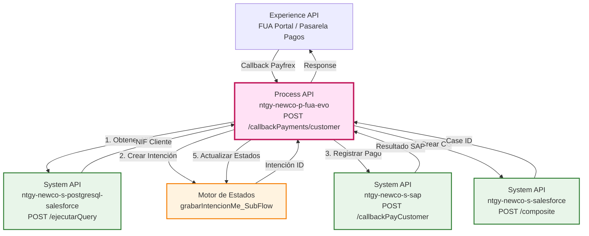
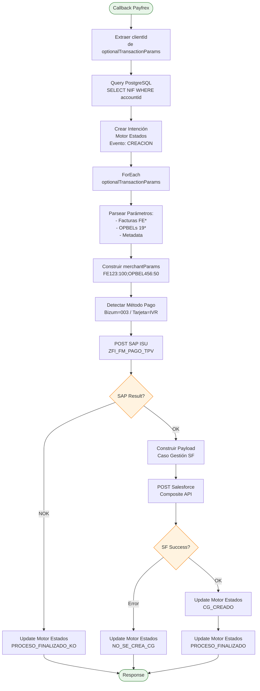
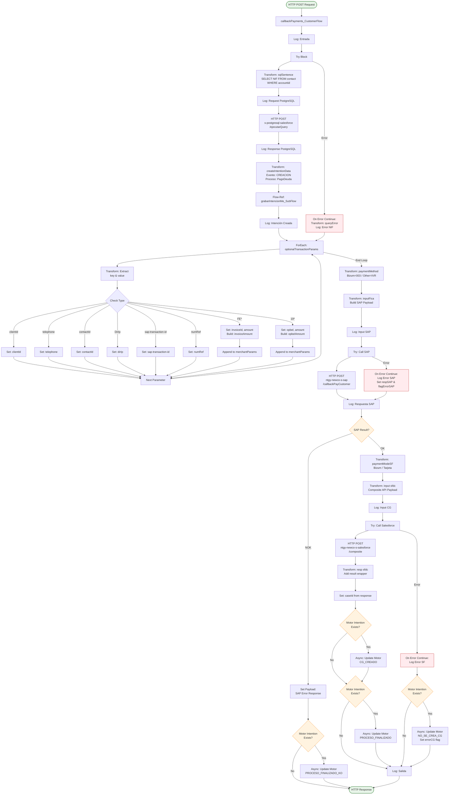
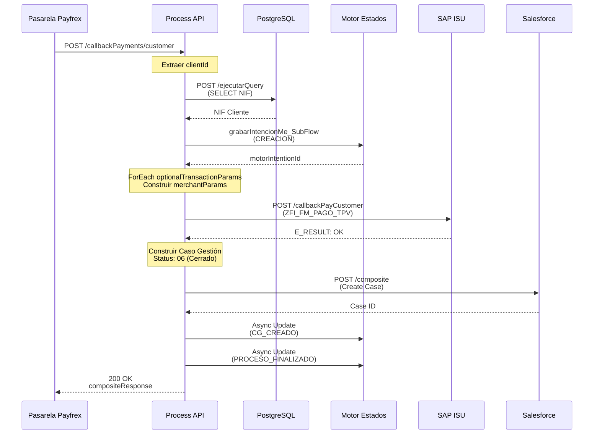
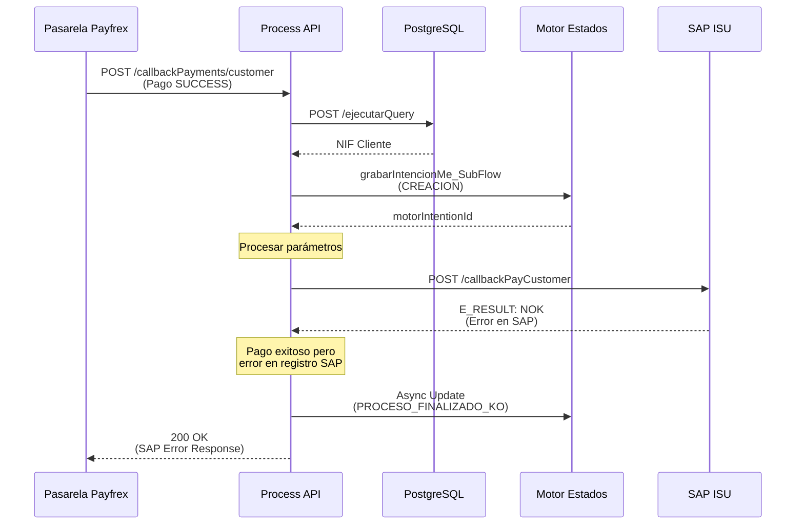
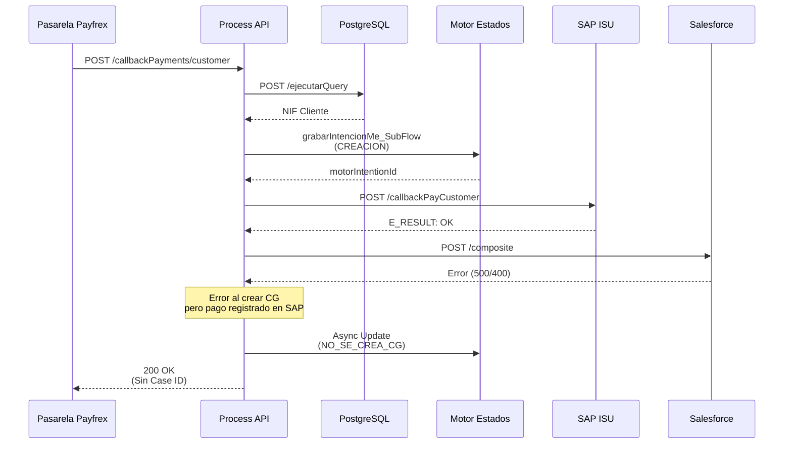

# POST /callbackPayments/customer

## 📌 Descripción General

### Propósito del Endpoint

Este endpoint procesa callbacks de pagos de clientes provenientes de la pasarela de pagos externa (Payfrex). Orquesta un flujo completo que incluye:

1. **Obtención de NIF del cliente** desde PostgreSQL (réplica Salesforce en Heroku)
2. **Creación de intención** en el Motor de Estados para tracking
3. **Procesamiento de parámetros de pago** (facturas, OPBELs, método de pago)
4. **Registro del pago en SAP ISU** mediante System API
5. **Creación de Caso de Gestión en Salesforce** con resultado del pago
6. **Actualización de estados** en Motor de Estados (CG_CREADO, PROCESO_FINALIZADO)

### Tipo de API

**Capa:** Process API (API-Led Connectivity)

**Función:** Orquestación de proceso de callback de pagos con integración multi-sistema y tracking de estados

### Patrón de Integración

**Tipo:** Orquestación Compleja con Gestión de Estados

**Descripción:** Este endpoint implementa un patrón de orquestación secuencial con múltiples backends:
- **PostgreSQL (Heroku)**: Obtención de datos del cliente
- **SAP ISU**: Registro del pago en sistema de facturación
- **Salesforce**: Creación de caso de gestión con resultado
- **Motor de Estados**: Tracking completo del proceso

### Arquitectura API-Led Connectivity



---

## 💼 Propósito del Negocio

### Casos de Uso Principales

1. **Confirmación de Pago de Deuda**
   - Cliente realiza pago de facturas/deuda desde portal FUA
   - Pasarela externa (Payfrex) procesa el pago
   - Sistema registra resultado en SAP y crea caso de gestión
   - **Beneficio:** Automatización completa del proceso de pago con trazabilidad

2. **Tracking de Intenciones de Pago**
   - Cada pago genera una intención en Motor de Estados
   - Se registran todos los eventos del proceso (creación, CG creado, finalización)
   - **Beneficio:** Visibilidad completa del ciclo de vida del pago

3. **Gestión de Pagos Bizum y Tarjeta**
   - Soporte para múltiples métodos de pago (Bizum código 003, Tarjeta IVR)
   - Procesamiento diferenciado según método
   - **Beneficio:** Flexibilidad en medios de pago para clientes

### 🔗 Endpoints Dependientes

Este Process API consume los siguientes System APIs:

| System API | Endpoint | Método | Propósito |
|------------|----------|--------|-----------|
| `ntgy-newco-s-postgresql-salesforce` | `/ejecutarQuery` | POST | Obtener NIF del cliente desde réplica Salesforce en Heroku |
| `ntgy-newco-s-sap` | `/callbackPayCustomer` | POST | Registrar resultado del pago en SAP ISU (FICA) |
| `ntgy-newco-s-salesforce` | `/composite` | POST | Crear Caso de Gestión con resultado del pago |

### Lógica de Orquestación



**Pasos del Proceso:**

1. **Obtención de NIF**: Query a PostgreSQL para obtener NIF del cliente usando accountId de Salesforce
2. **Creación de Intención**: Registro en Motor de Estados con evento CREACION y proceso PagoDeuda
3. **Procesamiento de Parámetros**: Iteración sobre optionalTransactionParams para extraer facturas, OPBELs y metadata
4. **Construcción de merchantParams**: Formato `FE123:100;OPBEL456:50;` con facturas y OPBELs
5. **Detección de Método de Pago**: Bizum (003) o Tarjeta (IVR) según paymentSolution
6. **Registro en SAP**: Llamada a ZFI_FM_PAGO_TPV con datos del pago
7. **Creación de CG**: Caso de Gestión en Salesforce con resultado (estados 02, 06, 08)
8. **Actualización de Estados**: Eventos CG_CREADO y PROCESO_FINALIZADO en Motor de Estados

### Transformaciones Aplicadas

| Campo Original (Payfrex) | Campo Transformado (SAP/SF) | Transformación |
|--------------------------|----------------------------|----------------|
| `operations.operation.amount` | `amount` (Number) | Conversión a número |
| `operations.operation.merchantTransactionId` | `merchantTransactionId` | Uso de sap-transaction-id extraído |
| `operations.operation.status` | `status` | SUCCESS → "1", otros → "2" |
| `operations.operation.paymentSolution` | `operationType` | Bizum → "003", otros → "IVR" |
| `optionalTransactionParams` | `merchantParams` | Construcción de string `FE*:amount;OPBEL*:amount;` |
| `operations.operation.status` | `Status` (SF Case) | SUCCESS+SAP_OK → "06", SUCCESS+SAP_KO → "02", FAIL → "08" |

### Contexto Empresarial

- **Dominio:** Gestión de Pagos y Cobros
- **Sector:** Energía - Utilities
- **División:** Naturgy España - NewCo
- **Proceso de Negocio:** Callback de Pagos de Deuda desde Portal FUA

### Stakeholders

- **Clientes Naturgy**: Realizan pagos de facturas/deuda desde portal FUA
- **Equipo de Cobros**: Monitorea pagos recibidos y casos de gestión
- **Equipo SAP ISU**: Gestiona registros de pago en sistema de facturación
- **Equipo Salesforce**: Gestiona casos de gestión y seguimiento

### Valor de Negocio

- **Automatización Completa**: Proceso end-to-end sin intervención manual
- **Trazabilidad Total**: Motor de Estados registra cada paso del proceso
- **Reducción de Errores**: Validaciones y manejo de errores en cada etapa
- **Visibilidad en Tiempo Real**: Casos de gestión creados automáticamente
- **Soporte Multi-Canal**: Bizum y tarjeta en mismo flujo

### Consumidores Potenciales

Este endpoint es consumido por:
- Pasarela de pagos externa (Payfrex) mediante callback
- Portal FUA (indirectamente, a través de pasarela)
- Sistemas de monitoreo de pagos

---

## 🔧 Especificación Técnica

### URLs por Ambiente

| Ambiente | URL Base | URL Completa |
|----------|----------|--------------|
| **Local** | `http://localhost:8081` | `http://localhost:8081/api/callbackPayments/customer` |
| **Development** | `https://ntgy-newco-p-fua-evo-dev.us-e2.cloudhub.io` | `https://ntgy-newco-p-fua-evo-dev.us-e2.cloudhub.io/api/callbackPayments/customer` |
| **UAT** | `https://ntgy-newco-p-fua-evo-uat.us-e2.cloudhub.io` | `https://ntgy-newco-p-fua-evo-uat.us-e2.cloudhub.io/api/callbackPayments/customer` |
| **Production** | `https://ntgy-newco-p-fua-evo-pro.us-e2.cloudhub.io` | `https://ntgy-newco-p-fua-evo-pro.us-e2.cloudhub.io/api/callbackPayments/customer` |

### Método HTTP

```
POST /api/callbackPayments/customer
```

### Parámetros de Entrada

#### Headers

| Header | Tipo | Requerido | Descripción |
|--------|------|-----------|-------------|
| `Content-Type` | string | Sí | `application/json` |
| `x-correlation-id` | string | Sí | ID de correlación para tracking |

#### Body (JSON)

**Estructura del Payload de Payfrex:**

```json
{
  "payfrex-response": {
    "operations": {
      "operation": {
        "amount": "150.50",
        "merchantTransactionId": "TXN123456",
        "status": "SUCCESS",
        "message": "Payment approved",
        "paymentSolution": "Bizum"
      }
    },
    "optionalTransactionParams": [
      {
        "entry": {
          "key": "clientId",
          "value": "0011234567890ABC"
        }
      },
      {
        "entry": {
          "key": "FE123456789",
          "value": "100.50"
        }
      },
      {
        "entry": {
          "key": "1912345678",
          "value": "50.00"
        }
      },
      {
        "entry": {
          "key": "telephone",
          "value": "612345678"
        }
      },
      {
        "entry": {
          "key": "contactId",
          "value": "0031234567890DEF"
        }
      },
      {
        "entry": {
          "key": "DirIp",
          "value": "192.168.1.100"
        }
      },
      {
        "entry": {
          "key": "sap-transaction-id",
          "value": "SAP_TXN_789"
        }
      },
      {
        "entry": {
          "key": "numRef",
          "value": "REF_CAMBIO_TITULAR_123"
        }
      }
    ]
  },
  "x-user-id": "USER123",
  "DirIp": "192.168.1.100",
  "returnAddon": {
    "amount": "150.50",
    "merchantTransactionId": "TXN123456",
    "status": "SUCCESS"
  }
}
```

**Campos Clave:**

| Campo | Tipo | Descripción |
|-------|------|-------------|
| `operations.operation.status` | string | Estado del pago: "SUCCESS" o error |
| `operations.operation.amount` | string | Importe total del pago |
| `operations.operation.paymentSolution` | string | Método de pago: "Bizum", "Tarjeta", etc. |
| `optionalTransactionParams` | array | Parámetros adicionales con metadata del pago |
| `optionalTransactionParams[].entry.key` | string | Tipo de parámetro (clientId, FE*, 19*, telephone, etc.) |
| `optionalTransactionParams[].entry.value` | string | Valor del parámetro |

**Tipos de Parámetros en optionalTransactionParams:**

- **clientId**: ID de cuenta de Salesforce (AccountId)
- **FE\***: Facturas (comienzan con "FE"), valor es el importe
- **19\***: OPBELs (comienzan con "19"), valor es el importe
- **telephone**: Teléfono del cliente
- **contactId**: ID de contacto de Salesforce
- **DirIp**: Dirección IP del cliente
- **sap-transaction-id**: ID de transacción SAP
- **numRef**: Número de referencia (ej: cambio de titular)

### Respuestas

#### 200 OK - Pago Procesado Exitosamente

```json
{
  "result": {
    "codResult": "0000",
    "msgResult": "No hay error"
  },
  "compositeResponse": [
    {
      "body": {
        "id": "5001234567890XYZ",
        "success": true,
        "errors": []
      },
      "httpHeaders": {},
      "httpStatusCode": 201,
      "referenceId": "refCaseGestion"
    }
  ]
}
```

#### 500 Internal Server Error - Error en Procesamiento

```json
{
  "result": {
    "id": "",
    "caseNumber": "",
    "codResult": "500",
    "msgResult": "Error description from error handler"
  }
}
```

**Códigos de Estado del Caso de Gestión (Salesforce):**

| Código | Descripción | Condición |
|--------|-------------|-----------|
| `02` | En Proceso | Error en SAP pero pago exitoso, o error general |
| `06` | Cerrado | Pago exitoso y registrado correctamente en SAP |
| `08` | Cancelado | Pago fallido en pasarela |

### Autenticación

- **Tipo:** Client ID & Client Secret (Anypoint Platform)
- **Headers requeridos:**
  - `client_id`: ID de cliente de Anypoint
  - `client_secret`: Secret de cliente de Anypoint

### Timeouts

| Tipo | Valor | Configuración |
|------|-------|---------------|
| **PostgreSQL Query Timeout** | Variable | `${s-rds-postgres.timeoutEventoMotorEstados}` |
| **SAP Request Timeout** | 30 segundos | Configuración HTTP connector |
| **Salesforce Request Timeout** | 60 segundos | Configuración Salesforce connector |

---

## 🏗️ Implementación Técnica

### Arquitectura del Flow



### Transformaciones DataWeave Clave

#### 1. Construcción de Query SQL para Obtener NIF

```dataweave
%dw 2.0
output application/json

var salesforceAccountId = trim((payload."payfrex-response".optionalTransactionParams 
    filterObject ((value, key, index) -> value.key == "clientId")).entry.value) default ""
    
var sqlStr = "SELECT cn.newco_documentnumber__c FROM newcosalesforce.contact cn where accountid = '" ++ salesforceAccountId ++ "'"

---
{
  "query": sqlStr
}
```

#### 2. Creación de Intención en Motor de Estados

```dataweave
%dw 2.0
output application/java

---
{
  evento: "CREACION",
  proceso: "PagoDeuda",
  nif: vars.rdsQueryResult[0].newco_documentnumber__c default "",
  billingAccount: "",
  contrato: "",
  casoGestion: "",
  jsonPayload: payload
}
```

#### 3. Detección de Método de Pago

```dataweave
%dw 2.0
output application/java

var minus = lower(payload."payfrex-response".operations.operation.paymentSolution)

---
if(minus contains("bizum")) "003" else "IVR"
```

#### 4. Construcción de Input para SAP ISU

```dataweave
%dw 2.0
output application/json

var statusAddon = if(payload.'payfrex-response'.operations.operation.status == "SUCCESS") "1" else "2"
var statusDescAddon = if(payload.'payfrex-response'.operations.operation.status == "SUCCESS") 
  "Approved" 
else 
  "Unexpected Gateway Response: 103 - Card in Blacklist or suspected of fraud"

---
{
  amount: payload.'payfrex-response'.operations.operation.amount as Number,
  paymentDate: now() as String {format: "uuuuMMdd"},
  merchantTransactionId: trim(vars.'sap-transaction-id'),
  status: statusAddon,
  statusDescription: statusDescAddon,
  telephone: trim(if(isEmpty(vars.telephone)) (null) else vars.telephone),
  operationType: vars.paymentMethod,
  source: "W" // viene de addon
}
```

#### 5. Construcción de Caso de Gestión para Salesforce

```dataweave
%dw 2.0
output application/json

var ok = "Pago finalizado con éxito. Id de Transacción " ++ vars.inputFica.merchantTransactionId ++ " – Importe " ++ vars.inputFica.amount
var ko = payload.'payfrex-response'.operations.operation.message
var operationResult = if(payload.'payfrex-response'.operations.operation.status == "SUCCESS") "OK" else "KO"
var sapResult = if(vars.respSAP.ZFI_FM_PAGO_TPV.export.E_RESULT == "OK") "OK" else "KO"

---
{
  "allOrNone": true,
  "collateSubrequests": false,
  "compositeRequest": [
    {
      "method": "POST",
      "url": "/services/data/v52.0/sobjects/Case",
      "referenceId": "refCaseGestion",
      "body": { 
        "NewCo_Recordtype__c": "Gestion",
        "AccountId": vars.clientId,
        "ContactId": vars.contactId,
        "Status": 
          if((vars.flagErrorSAP == true or sapResult != "OK") and operationResult == "OK") 
            "02"
          else if(operationResult == "OK" and sapResult == "OK")
            "06"
          else if(operationResult == "KO")
            "08"
          else 
            "02",
        "Priority": "02",
        "Origin": "FUA",
        "NewCo_Creado_por__c": vars.clientId,
        "NewCo_Ip__c": vars.dirIp,
        "NewCo_CorrelationId__c": correlationId,
        "NewCo_PaymentBreakdown__c": vars.merchantParams,
        "NewCo_OperationAmount__c": payload.'payfrex-response'.operations.operation.amount,
        "NewCo_OperationDate__c": now() as String {format: "uuuu-MM-dd'T'HH:mm:ss'Z'"},
        "NewCo_OperationResult__c": operationResult,
        "NewCo_ResultDescription__c": if(payload.'payfrex-response'.operations.operation.status == "SUCCESS") ok else ko,
        "NewCo_PaymentMode__c": vars.paymentModeSF,
        "NewCo_PaymentDocument__c": vars.'sap-transaction-id',
        "acn_fld_Tittle__r": {
          "NewCo_ExternalId__c": "PagoDeuda"
        },
        ("NewCo_IdentificadorDeIntencion__c": vars.motorIntentionId) if (!isEmpty(vars.motorIntentionId)),
        "comments": if (vars.numRef != null and vars.numRef != "") 
          "Caso Gestión relacionado con el proceso de cambio de titular de la cuenta contrato con código: " ++ vars.numRef
        else
          ""
      }
    }
  ]
}
```

### Patrones de Diseño

**Patrón:** Orquestación Secuencial con Gestión de Estados

**Justificación:** 
- Múltiples sistemas backend requieren coordinación secuencial
- Motor de Estados proporciona trazabilidad completa del proceso
- Manejo de errores en cada etapa con actualización de estados
- Operaciones asíncronas para actualización de estados (no bloquean flujo principal)

### Diagramas de Secuencia

#### 1. Flujo Normal de Éxito



#### 2. Flujo con Error en SAP



#### 3. Flujo con Error en Salesforce



### Manejo de Errores

**Estrategia de Manejo de Errores:**

1. **Error en Query PostgreSQL:**
   - Capturado en try-catch
   - Se registra error pero continúa el flujo
   - Variable `queryError` almacena detalles del error

2. **Error en SAP ISU:**
   - Capturado en try-catch
   - Se establece `flagErrorSAP = true`
   - Respuesta de error se almacena en `respSAP`
   - Si existe intención, se actualiza con evento `PROCESO_FINALIZADO_KO`

3. **Error en Salesforce:**
   - Capturado en try-catch
   - Se establece `errorCG = true`
   - Si existe intención, se actualiza con evento `NO_SE_CREA_CG`
   - El flujo continúa y retorna respuesta

4. **Error General:**
   - Error handler global captura excepciones no manejadas
   - Retorna respuesta 500 con descripción del error

**Códigos de Error Comunes:**

| Código | Descripción | Acción |
|--------|-------------|--------|
| `500` | Error interno del servidor | Revisar logs, reintentar |
| `400` | Datos inválidos en request | Verificar payload de Payfrex |
| `timeout` | Timeout en backend | Verificar conectividad con System APIs |

---

## 💻 Ejemplos de Uso

### Ejemplo 1: Pago Exitoso con Bizum

#### Request (desde Payfrex)

```bash
curl -X POST "https://ntgy-newco-p-fua-evo-uat.us-e2.cloudhub.io/api/callbackPayments/customer" \
  -H "Content-Type: application/json" \
  -H "x-correlation-id: CORR-123456-789" \
  -H "client_id: YOUR_CLIENT_ID" \
  -H "client_secret: YOUR_CLIENT_SECRET" \
  -d '{
    "payfrex-response": {
      "operations": {
        "operation": {
          "amount": "150.50",
          "merchantTransactionId": "TXN123456",
          "status": "SUCCESS",
          "message": "Payment approved",
          "paymentSolution": "Bizum"
        }
      },
      "optionalTransactionParams": [
        {
          "entry": {
            "key": "clientId",
            "value": "0011234567890ABC"
          }
        },
        {
          "entry": {
            "key": "FE123456789",
            "value": "100.50"
          }
        },
        {
          "entry": {
            "key": "1912345678",
            "value": "50.00"
          }
        },
        {
          "entry": {
            "key": "telephone",
            "value": "612345678"
          }
        },
        {
          "entry": {
            "key": "contactId",
            "value": "0031234567890DEF"
          }
        },
        {
          "entry": {
            "key": "DirIp",
            "value": "192.168.1.100"
          }
        },
        {
          "entry": {
            "key": "sap-transaction-id",
            "value": "SAP_TXN_789"
          }
        }
      ]
    },
    "x-user-id": "USER123",
    "DirIp": "192.168.1.100",
    "returnAddon": {
      "amount": "150.50",
      "merchantTransactionId": "TXN123456",
      "status": "SUCCESS"
    }
  }'
```

#### Response (200 OK)

```json
{
  "result": {
    "codResult": "0000",
    "msgResult": "No hay error"
  },
  "compositeResponse": [
    {
      "body": {
        "id": "5001234567890XYZ",
        "success": true,
        "errors": []
      },
      "httpHeaders": {
        "Location": "/services/data/v52.0/sobjects/Case/5001234567890XYZ"
      },
      "httpStatusCode": 201,
      "referenceId": "refCaseGestion"
    }
  ]
}
```

### Ejemplo 2: Pago con Tarjeta

#### Request

```bash
curl -X POST "https://ntgy-newco-p-fua-evo-uat.us-e2.cloudhub.io/api/callbackPayments/customer" \
  -H "Content-Type: application/json" \
  -H "x-correlation-id: CORR-987654-321" \
  -d '{
    "payfrex-response": {
      "operations": {
        "operation": {
          "amount": "250.75",
          "merchantTransactionId": "TXN987654",
          "status": "SUCCESS",
          "message": "Card payment approved",
          "paymentSolution": "Tarjeta Visa"
        }
      },
      "optionalTransactionParams": [
        {
          "entry": {
            "key": "clientId",
            "value": "0019876543210XYZ"
          }
        },
        {
          "entry": {
            "key": "FE987654321",
            "value": "250.75"
          }
        },
        {
          "entry": {
            "key": "contactId",
            "value": "0039876543210ABC"
          }
        },
        {
          "entry": {
            "key": "sap-transaction-id",
            "value": "SAP_TXN_456"
          }
        }
      ]
    },
    "x-user-id": "USER456",
    "DirIp": "10.0.0.50"
  }'
```

#### Response (200 OK)

```json
{
  "result": {
    "codResult": "0000",
    "msgResult": "No hay error"
  },
  "compositeResponse": [
    {
      "body": {
        "id": "5009876543210ABC",
        "success": true,
        "errors": []
      },
      "httpHeaders": {
        "Location": "/services/data/v52.0/sobjects/Case/5009876543210ABC"
      },
      "httpStatusCode": 201,
      "referenceId": "refCaseGestion"
    }
  ]
}
```

### Ejemplo 3: Pago Fallido

#### Request

```bash
curl -X POST "https://ntgy-newco-p-fua-evo-uat.us-e2.cloudhub.io/api/callbackPayments/customer" \
  -H "Content-Type: application/json" \
  -H "x-correlation-id: CORR-111222-333" \
  -d '{
    "payfrex-response": {
      "operations": {
        "operation": {
          "amount": "100.00",
          "merchantTransactionId": "TXN111222",
          "status": "FAILED",
          "message": "Insufficient funds",
          "paymentSolution": "Tarjeta"
        }
      },
      "optionalTransactionParams": [
        {
          "entry": {
            "key": "clientId",
            "value": "0011112222333ABC"
          }
        },
        {
          "entry": {
            "key": "contactId",
            "value": "0031112222333DEF"
          }
        },
        {
          "entry": {
            "key": "sap-transaction-id",
            "value": "SAP_TXN_111"
          }
        }
      ]
    }
  }'
```

#### Response (200 OK - Caso Gestión con Status 08)

```json
{
  "result": {
    "codResult": "0000",
    "msgResult": "No hay error"
  },
  "compositeResponse": [
    {
      "body": {
        "id": "5001112222333XYZ",
        "success": true,
        "errors": []
      },
      "httpHeaders": {
        "Location": "/services/data/v52.0/sobjects/Case/5001112222333XYZ"
      },
      "httpStatusCode": 201,
      "referenceId": "refCaseGestion"
    }
  ]
}
```

**Nota:** El caso de gestión se crea con Status "08" (Cancelado) porque el pago falló en la pasarela.

### Ejemplo 4: Error en SAP

#### Response (200 OK - Error SAP)

```json
{
  "ZFI_FM_PAGO_TPV": {
    "export": {
      "E_RESULT": "NOK",
      "E_MESSAGE": "Error al registrar pago en SAP ISU"
    }
  }
}
```

**Nota:** Cuando SAP retorna error, el Motor de Estados se actualiza con evento `PROCESO_FINALIZADO_KO` y no se crea caso de gestión en Salesforce.

### Ejemplo 5: JavaScript (Node.js)

```javascript
const axios = require('axios');

async function processPaymentCallback() {
  try {
    const response = await axios.post(
      'https://ntgy-newco-p-fua-evo-uat.us-e2.cloudhub.io/api/callbackPayments/customer',
      {
        "payfrex-response": {
          "operations": {
            "operation": {
              "amount": "150.50",
              "merchantTransactionId": "TXN123456",
              "status": "SUCCESS",
              "message": "Payment approved",
              "paymentSolution": "Bizum"
            }
          },
          "optionalTransactionParams": [
            {
              "entry": {
                "key": "clientId",
                "value": "0011234567890ABC"
              }
            },
            {
              "entry": {
                "key": "FE123456789",
                "value": "100.50"
              }
            },
            {
              "entry": {
                "key": "sap-transaction-id",
                "value": "SAP_TXN_789"
              }
            }
          ]
        }
      },
      {
        headers: {
          'Content-Type': 'application/json',
          'x-correlation-id': 'CORR-' + Date.now(),
          'client_id': process.env.CLIENT_ID,
          'client_secret': process.env.CLIENT_SECRET
        }
      }
    );

    console.log('Payment callback processed:', response.data);
    console.log('Case ID:', response.data.compositeResponse[0].body.id);
  } catch (error) {
    console.error('Error processing payment callback:', error.response?.data || error.message);
  }
}

processPaymentCallback();
```

### Ejemplo 6: Python

```python
import requests
import json
from datetime import datetime

def process_payment_callback():
    url = "https://ntgy-newco-p-fua-evo-uat.us-e2.cloudhub.io/api/callbackPayments/customer"
    
    headers = {
        "Content-Type": "application/json",
        "x-correlation-id": f"CORR-{int(datetime.now().timestamp())}",
        "client_id": "YOUR_CLIENT_ID",
        "client_secret": "YOUR_CLIENT_SECRET"
    }
    
    payload = {
        "payfrex-response": {
            "operations": {
                "operation": {
                    "amount": "150.50",
                    "merchantTransactionId": "TXN123456",
                    "status": "SUCCESS",
                    "message": "Payment approved",
                    "paymentSolution": "Bizum"
                }
            },
            "optionalTransactionParams": [
                {
                    "entry": {
                        "key": "clientId",
                        "value": "0011234567890ABC"
                    }
                },
                {
                    "entry": {
                        "key": "FE123456789",
                        "value": "100.50"
                    }
                },
                {
                    "entry": {
                        "key": "sap-transaction-id",
                        "value": "SAP_TXN_789"
                    }
                }
            ]
        }
    }
    
    try:
        response = requests.post(url, headers=headers, json=payload)
        response.raise_for_status()
        
        data = response.json()
        print("Payment callback processed:", json.dumps(data, indent=2))
        
        if data.get("compositeResponse"):
            case_id = data["compositeResponse"][0]["body"]["id"]
            print(f"Case ID created: {case_id}")
            
    except requests.exceptions.RequestException as e:
        print(f"Error processing payment callback: {e}")
        if hasattr(e.response, 'text'):
            print(f"Response: {e.response.text}")

if __name__ == "__main__":
    process_payment_callback()
```
