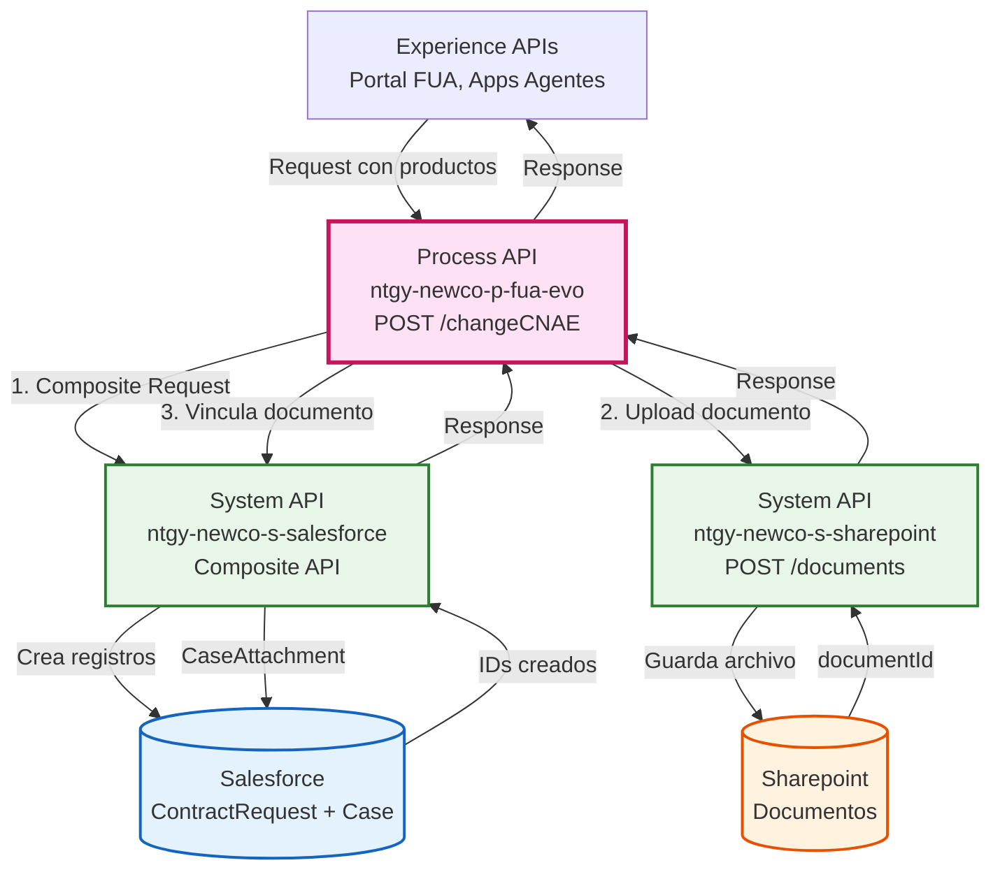
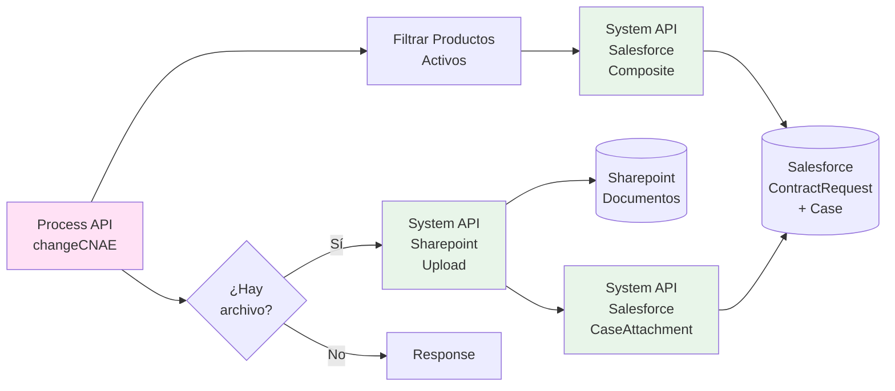
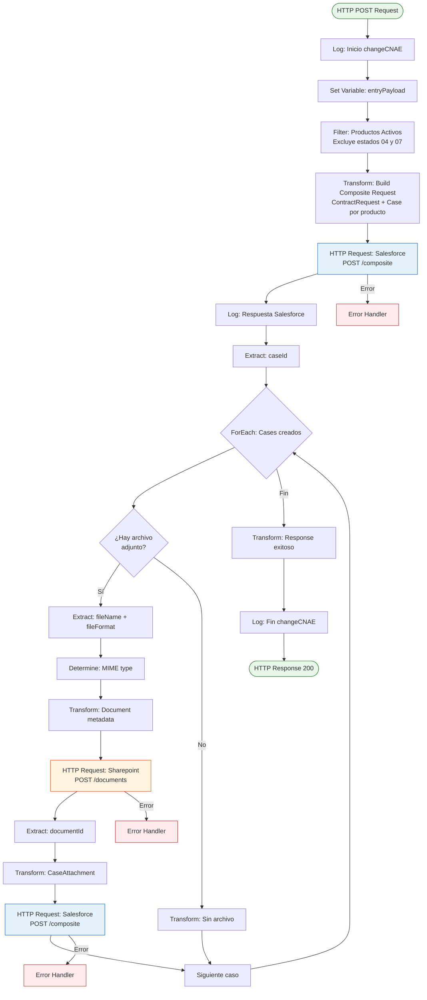
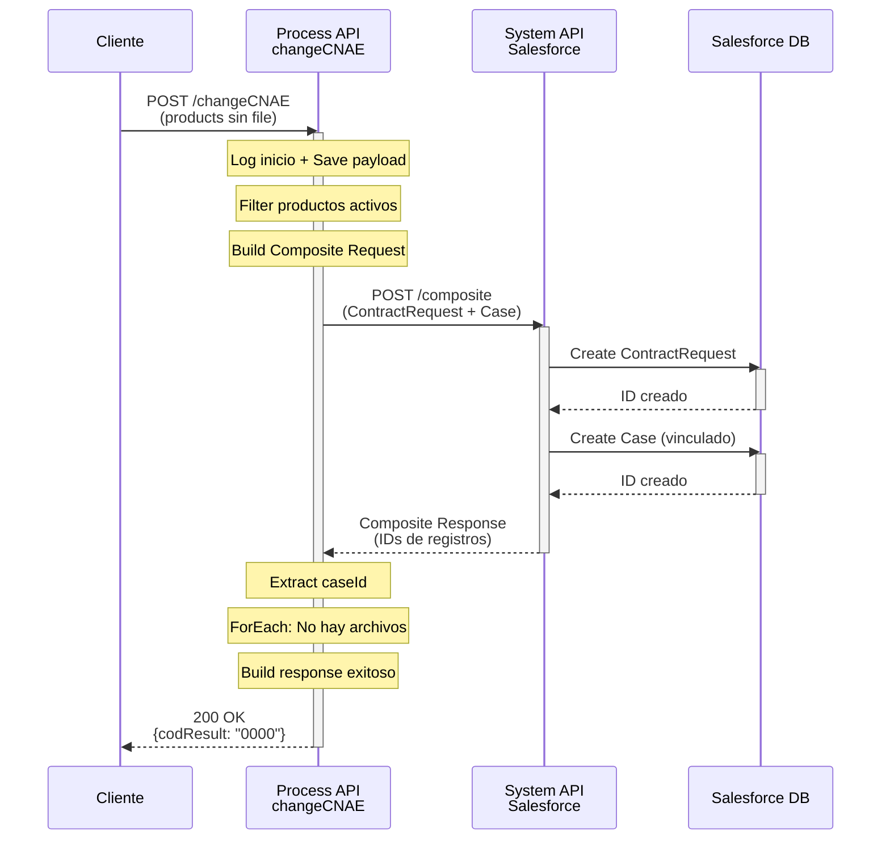
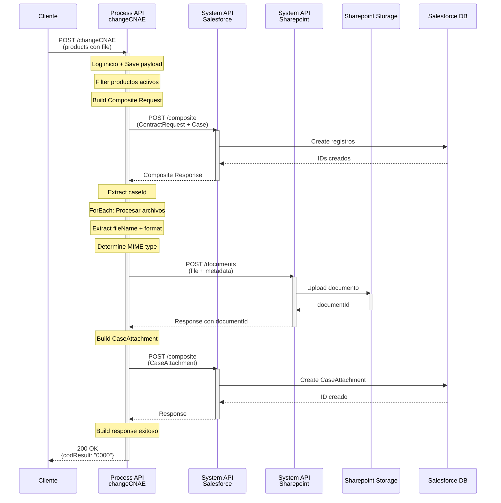
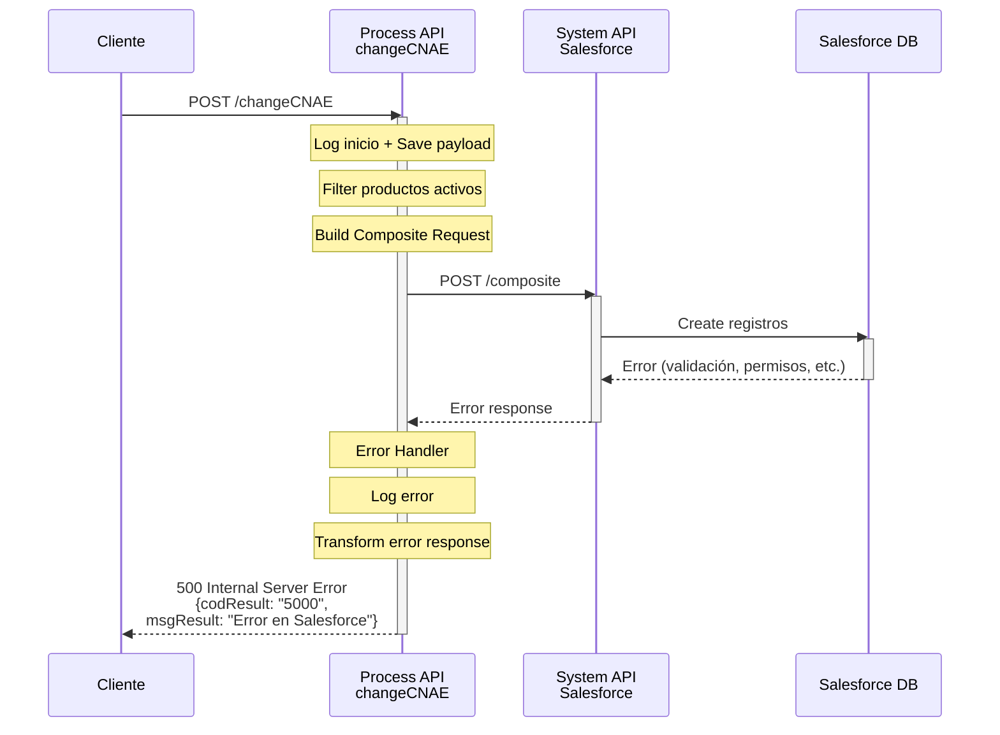

# POST /changeCNAE

## 📌 Descripción General

### Propósito del Endpoint

Este endpoint permite modificar el código CNAE (Clasificación Nacional de Actividades Económicas) de uno o varios contratos de clientes PYMEs. Utiliza Salesforce Composite API para crear solicitudes de contrato y casos de gestión de forma atómica, con soporte opcional para adjuntar documentación justificativa.

### Tipo de API

**Capa:** Process API (API-Led Connectivity)

**Función:** Orquestación de cambios de CNAE con gestión documental integrada

### Patrón de Integración

**Tipo:** Orquestación Compleja con Composite API

**Descripción:** 
1. Filtra productos activos (excluye estados inactivos)
2. Crea múltiples ContractRequest y Cases en Salesforce mediante Composite API
3. Opcionalmente sube documentos a Sharepoint y los vincula a los casos
4. Retorna resultado consolidado

### Arquitectura API-Led Connectivity



---

## 💼 Propósito del Negocio

### Casos de Uso Principales

1. **Cambio de Actividad Económica de PYME**
   - Permite actualizar el CNAE cuando una empresa cambia de actividad
   - Genera automáticamente la solicitud de contrato y caso de gestión
   - Facilita el seguimiento del proceso de modificación

2. **Gestión Documental Integrada**
   - Permite adjuntar documentación justificativa del cambio
   - Vincula automáticamente los documentos al caso de gestión
   - Soporta múltiples formatos de archivo (PDF, DOC, DOCX, imágenes, etc.)

3. **Procesamiento Masivo**
   - Permite modificar el CNAE de múltiples contratos en una sola operación
   - Utiliza Composite API para garantizar atomicidad
   - Optimiza el rendimiento mediante operaciones batch

### 🔗 Endpoints Dependientes

Este Process API consume los siguientes System APIs:

| System API | Endpoint | Método | Propósito |
|------------|----------|--------|-----------|
| `ntgy-newco-s-salesforce` | `/services/data/v52.0/composite` | POST | Crea ContractRequest y Cases mediante Composite API |
| `ntgy-newco-s-sharepoint` | `/documents` | POST | Sube documentos justificativos (condicional) |

### Lógica de Orquestación



**Pasos del Proceso:**

1. **Paso 1 - Validación y Filtrado**: Filtra productos con estados '04' y '07' (inactivos)
2. **Paso 2 - Construcción Composite Request**: Crea estructura para ContractRequest y Cases
3. **Paso 3 - Ejecución en Salesforce**: Ejecuta Composite API (operación atómica)
4. **Paso 4 - Procesamiento de Archivos** (condicional): Sube documentos a Sharepoint
5. **Paso 5 - Vinculación de Documentos** (condicional): Crea CaseAttachments en Salesforce
6. **Paso 6 - Respuesta**: Retorna resultado consolidado

### Transformaciones Aplicadas

| Campo Original | Campo Transformado | Transformación |
|----------------|-------------------|----------------|
| `products[]` | `compositeRequest[]` | Mapea cada producto a ContractRequest + Case |
| `products[].contractStatus` | Filtrado | Excluye estados '04' y '07' |
| `file` (base64) | Documento en Sharepoint | Decodifica y sube a Sharepoint |
| `fileNameWithExtension` | `fileName` + `fileFormat` | Separa nombre y extensión |
| `fileFormat` | `typeMIME` | Mapea extensión a MIME type |

### Contexto Empresarial

- **Dominio:** Gestión de Contratos y Modificaciones
- **Sector:** Energía - Utilities
- **División:** Naturgy España - NewCo
- **Proceso de Negocio:** Modificación de datos contractuales de PYMEs

### Stakeholders

- **Agentes de Call Center**: Procesan cambios de CNAE solicitados por clientes
- **Clientes PYME**: Solicitan cambios cuando modifican su actividad económica
- **Equipo de Gestión Contractual**: Supervisan y aprueban las modificaciones
- **Distribuidoras**: Reciben notificación del cambio mediante documentación

### Valor de Negocio

- **Automatización**: Elimina procesos manuales de cambio de CNAE
- **Trazabilidad**: Genera casos de gestión para seguimiento completo
- **Atomicidad**: Garantiza consistencia mediante Composite API
- **Eficiencia**: Procesa múltiples contratos en una sola operación

### Consumidores Potenciales

Este endpoint puede ser consumido por:
- Portal de agentes de call center
- Aplicaciones de gestión contractual
- Sistemas de back-office
- Herramientas de administración

---

## 🔧 Especificación Técnica

### URLs por Ambiente

| Ambiente | URL Base | URL Completa |
|----------|----------|--------------|
| **Local** | `http://localhost:8081` | `http://localhost:8081/api/changeCNAE` |
| **Development** | `https://ntgy-newco-p-fua-evo-dev.us-e2.cloudhub.io` | `https://ntgy-newco-p-fua-evo-dev.us-e2.cloudhub.io/api/changeCNAE` |
| **UAT** | `https://ntgy-newco-p-fua-evo-uat.us-e2.cloudhub.io` | `https://ntgy-newco-p-fua-evo-uat.us-e2.cloudhub.io/api/changeCNAE` |
| **Production** | `https://ntgy-newco-p-fua-evo-pro.us-e2.cloudhub.io` | `https://ntgy-newco-p-fua-evo-pro.us-e2.cloudhub.io/api/changeCNAE` |

### Método HTTP

```
POST /api/changeCNAE
```

### Parámetros de Entrada

#### Request Body (application/json)

**Estructura Principal:**

| Campo | Tipo | Requerido | Descripción |
|-------|------|-----------|-------------|
| `x-client-id` | string | ✅ Sí | ID del cliente (Account) en Salesforce |
| `x-contact-id` | string | ✅ Sí | ID del contacto en Salesforce |
| `x-client-code` | string | ✅ Sí | NIF/CIF del cliente |
| `x-user-id` | string | ❌ No | ID del usuario/agente (si aplica) |
| `x-agent-mail` | string | ❌ No | Email del agente |
| `x-interaction-id` | string | ✅ Sí | ID de la interacción padre (Case) |
| `contractAccountID` | string | ✅ Sí | ID de la cuenta de contrato |
| `DirIp` | string | ✅ Sí | Dirección IP del origen |
| `products` | array | ✅ Sí | Array de productos a modificar |
| `file` | string | ❌ No | Archivo adjunto en base64 (se adjunta a TODOS los casos creados) |
| `fileNameWithExtension` | string | ❌ No | Nombre del archivo con extensión (ej: "documento.pdf") |

**Estructura de Productos (products[]):**

| Campo | Tipo | Requerido | Descripción |
|-------|------|-----------|-------------|
| `contractId` | string | ✅ Sí | ID del contrato en Salesforce |
| `contractStatus` | string | ✅ Sí | Estado del contrato (se filtran '04' y '07') |
| `CUPS` | string | ✅ Sí | Código CUPS del punto de suministro |
| `newCNAE` | string | ✅ Sí | Nuevo código CNAE a asignar |
| `motive` | string | ✅ Sí | Motivo del cambio (Subject del Case) |
| `descriptionMotive` | string | ✅ Sí | Descripción detallada del motivo |

**Formatos de Archivo Soportados:**
- Documentos: PDF, DOC, DOCX, ODT, TXT, CSV
- Imágenes: PNG, JPEG, JPG
- Comprimidos: ZIP
- Hojas de cálculo: XLS, XLSX
- Audio: MP3
- Otros: AFP

### Estructura de Request

#### Ejemplo Completo

```json
{
  "x-client-id": "0011t00000ABC123",
  "x-contact-id": "0031t00000DEF456",
  "x-client-code": "B12345678",
  "x-user-id": "0051t00000GHI789",
  "x-agent-mail": "agente@naturgy.com",
  "x-interaction-id": "5001t00000JKL012",
  "contractAccountID": "1234567890",
  "DirIp": "192.168.1.100",
  "products": [
    {
      "contractId": "8001t00000MNO345",
      "contractStatus": "01",
      "CUPS": "ES0021000000000001JN",
      "newCNAE": "4711",
      "motive": "Cambio de actividad comercial",
      "descriptionMotive": "La empresa ha cambiado su actividad principal de restauración a comercio minorista"
    }
  ],
  "file": "JVBERi0xLjQKJeLjz9MKMSAwIG9iago8PC9UeXBlL...",
  "fileNameWithExtension": "justificante_cnae.pdf"
}
```

### Respuestas

#### ✅ Respuesta Exitosa (200 OK)

```json
{
  "result": {
    "codResult": "0000",
    "msgResult": "No hay error"
  }
}
```

**Campos de la respuesta:**

| Campo | Tipo | Descripción |
|-------|------|-------------|
| `result.codResult` | string | Código de resultado (`"0000"` = éxito) |
| `result.msgResult` | string | Mensaje descriptivo del resultado |

**Nota:** El endpoint NO retorna el `interactionId` (caseId) en la respuesta. Los casos se crean internamente pero no se devuelven al cliente.

#### ❌ Error - Fallo en Salesforce (500)

```json
{
  "result": {
    "codResult": "5000",
    "msgResult": "Error al crear registros en Salesforce"
  }
}
```

#### ❌ Error - Fallo en Sharepoint (500)

```json
{
  "result": {
    "codResult": "5000",
    "msgResult": "Error al subir documento a Sharepoint"
  }
}
```

### Códigos de Estado HTTP

| Código | Descripción | Escenario |
|--------|-------------|-----------|
| `200` | OK | Cambio de CNAE procesado exitosamente |
| `400` | Bad Request | Datos de entrada inválidos o incompletos |
| `500` | Internal Server Error | Error en Salesforce o Sharepoint |

### Autenticación

- **Tipo:** Client ID & Client Secret (Anypoint Platform)
- **Headers requeridos:**
  - `client_id`: Client ID de la aplicación
  - `client_secret`: Client Secret de la aplicación
  - `Content-Type`: `application/json`

### Timeouts

| Tipo | Valor |
|------|-------|
| **Request Timeout** | 90 segundos |
| **Salesforce Timeout** | Configurado en properties |
| **Sharepoint Timeout** | 60 segundos |

---

## 🏗️ Implementación Técnica

### Arquitectura del Flow



### Transformaciones DataWeave

#### 1. Construcción de Composite Request

```dataweave
%dw 2.0
output application/json

var products = vars.entryPayload.products filter !(['04','07'] contains $.contractStatus)

---
{
  "allOrNone": true,
  "collateSubrequests": false,
  "compositeRequest": flatten((products map ((item, index) -> {
    "method": "POST",
    "url": "/services/data/v52.0/sobjects/acn_obj_ContractRequest__c",
    "referenceId": "refSolContratacion" ++ index,
    "body": { 
      "NewCo_Recordtype__c": "acn_rt_With_Switching",
      "acn_fld_Contract__c": item.contractId,
      "acn_fld_Sctype__c": "03",                
      "acn_fld_Category__c": "70",
      "acn_fld_ReleaseDate__c": now()[0 to 9],
      "acn_fld_CUPS__r": {
        "acn_fld_Name__c": item.CUPS
      },
      "NewCo_cnae__c": item.newCNAE,
      "acn_fld_Status__c": "01",
      "acn_fld_Asset__c": "", 
      "acn_fld_newCommertialAgreement__c": false,
      "acn_fld_Account__c": vars.entryPayload."x-client-id",                  
      "NewCo_Creado_por__c": if(!isEmpty(vars.entryPayload.'x-user-id')) 
                               vars.entryPayload.'x-user-id' 
                             else vars.entryPayload.'x-contact-id'
    }
  })) +
  (products map ((item, index) -> {
    "method": "POST",
    "url": "/services/data/v52.0/sobjects/Case",
    "referenceId": "refCaseGestion" ++ index,
    "body": { 
      "NewCo_Recordtype__c": "Gestion",
      "AccountId": vars.entryPayload."x-client-id",
      "ContactId": vars.entryPayload."x-contact-id",
      "Status": "02",
      "Priority": "02",
      "Origin": "FUA",
      ("OwnerId": vars.entryPayload."x-user-id") if(!isEmpty(vars.entryPayload."x-user-id")),
      "NewCo_Creado_por__c": if(vars.entryPayload.'x-user-id' != null) 
                               vars.entryPayload.'x-user-id' 
                             else vars.entryPayload.'x-contact-id',
      "ParentId": vars.entryPayload."x-interaction-id",
      "NewCo_Contract__c": item.contractId,
      "NewCo_Ip__c": vars.entryPayload.DirIp,
      "NewCo_CorrelationId__c": correlationId,
      "Subject": item.motive,
      "NewCo_cnae__c": item.newCNAE,
      "Description": item.descriptionMotive,
      "acn_fld_Tittle__r": {
        "NewCo_ExternalId__c": "InformarModificarCNAE"                    
      },
      "acn_fld_ContractRequest__c": ("@{refSolContratacion" ++ index ++ ".id}")
    }
  })))
}
```

**Propósito:** 
- Filtra productos activos (excluye estados '04' y '07')
- Crea un ContractRequest por cada producto
- Crea un Case de Gestión por cada producto
- Vincula el Case con el ContractRequest mediante referencias

#### 2. Determinación de MIME Type

```dataweave
%dw 2.0
output application/java
var formato = lower(vars.fileFormat)
---
if(formato == "pdf") "application/pdf" 
else if(formato == "doc") "application/msword"
else if(formato == "docx") "application/vnd.openxmlformats-officedocument.wordprocessingml.document"
else if(formato == "png") "image/png"
else if(formato == "jpeg") "image/jpeg"
else if(formato == "jpg") "image/jpg"
else if(formato == "zip") "application/zip"
else if(formato == "xls") "application/vnd.ms-excel"
else if(formato == "odt") "application/vnd.oasis.opendocument.text"
else if(formato == "mp3") "audio/mpeg"
else if(formato == "afp") "application/vnd.ibm.modcap"
else if(formato == "txt") "text/plain"
else if(formato == "csv") "application/csv"
else if(formato == "xlsx") "application/xlsx"
else (null)
```

**Propósito:** Mapea la extensión del archivo al MIME type correspondiente para Sharepoint.

#### 3. Construcción de Metadata para Sharepoint

```dataweave
%dw 2.0
output application/json
---
{
  "docType": "06.02",
  "metadata": {
    "t_file_id": vars.fileName,
    "t_doctp": "06.02",
    "c_customer_id": vars.entryPayload."x-client-id",
    "t_nif_nie": "",
    "m_contract_id": "",
    "m_cup": "",
    "d_sending_date": "",
    "case_num": payload,
    "m_document_id": ""
  },
  "typeMIME": vars.typeMIME,
  "file": vars.inputFile
}
```

**Propósito:** Prepara la estructura de metadata requerida por Sharepoint para la gestión documental.

### Configuración de HTTP Requests

#### Request a Salesforce Composite API

```xml
<http:request 
    method="POST" 
    doc:name="ntgy-newco-s-salesforce" 
    config-ref="HTTP_Request_configuration_ntgy_newco_s_salesforce" 
    path="${ntgy-newco-s-salesforce.pathGenericComposite}" 
    responseTimeout="${ntgy-newco-s-salesforce.timeout}">
    <http:headers>
        <![CDATA[#[output application/java
---
{
    ("username": vars.entryPayload.'x-agent-mail') if (!isEmpty(vars.entryPayload.'x-agent-mail'))
}]]]>
    </http:headers>
</http:request>
```

**Configuración:**
- **Método:** POST
- **Path:** `/services/data/v52.0/composite` (desde properties)
- **Header condicional:** `username` (si hay agente)
- **Body:** Composite Request con ContractRequest + Cases

#### Request a Sharepoint

```xml
<http:request 
    method="POST" 
    doc:name="sharepoint" 
    config-ref="HTTP_Request_ntgy-newco-s-sharepoint" 
    path="${ntgy-newco-s-sharepoint.functions.documents}" 
    target="resultSharepoint">
    <http:headers>
        <![CDATA[#[output application/java
---
{
    "Content-Type": "application/json"
}]]]>
    </http:headers>
</http:request>
```

**Configuración:**
- **Método:** POST
- **Path:** `/documents` (desde properties)
- **Target Variable:** `resultSharepoint`
- **Body:** Metadata + archivo en base64

### Patrones de Diseño

**Patrón 1: Composite API Pattern**

**Justificación:** 
- Garantiza atomicidad en la creación de múltiples registros
- Reduce el número de llamadas a Salesforce
- Permite vincular registros mediante referencias
- Mejora el rendimiento en operaciones batch

**Patrón 2: Conditional Processing**

**Justificación:**
- Procesa archivos solo si están presentes
- Evita llamadas innecesarias a Sharepoint
- Optimiza el flujo para casos sin documentación

**Patrón 3: Filter Pattern**

**Justificación:**
- Filtra productos inactivos antes de procesarlos
- Previene errores en Salesforce
- Mejora la calidad de los datos

### Diagramas de Secuencia

#### 1. Flujo Normal de Éxito (Sin Archivos)



#### 2. Flujo Normal de Éxito (Con Archivos)



#### 3. Flujo con Error en Salesforce



### Manejo de Errores

#### Error Handlers Configurados

**1. Error en Salesforce Composite API**
- **Trigger:** Fallo al crear ContractRequest o Case
- **Acción:** 
  - Log del error con detalles
  - Retorna código `"5000"` con mensaje descriptivo
  - Rollback automático por `allOrNone: true`
- **Tipo:** `on-error-propagate`

**2. Error en Sharepoint**
- **Trigger:** Fallo al subir documento
- **Acción:**
  - Log del error con detalles del archivo
  - Retorna código `"5000"` con mensaje descriptivo
- **Tipo:** `on-error-propagate`

**3. Error en Vinculación de Documentos**
- **Trigger:** Fallo al crear CaseAttachment
- **Acción:**
  - Log del error
  - Retorna código `"5000"` con mensaje descriptivo
- **Tipo:** `on-error-propagate`

#### Estrategia de Logging

El flow incluye logging extensivo en cada paso:
1. **Inicio:** Log del payload completo de entrada
2. **Post-Salesforce:** Log de la respuesta de Composite API
3. **CaseId:** Log del ID del caso creado
4. **Pre-Sharepoint:** Log del formato y nombre del archivo
5. **Post-Sharepoint:** Log del documentId obtenido
6. **Fin:** Log de finalización del proceso

---

## 💻 Ejemplos de Uso

### Ejemplo 1: Cambio de CNAE Simple (Sin Archivo)

#### cURL

```bash
curl -X POST "https://ntgy-newco-p-fua-evo-dev.us-e2.cloudhub.io/api/changeCNAE" \
  -H "Content-Type: application/json" \
  -H "client_id: YOUR_CLIENT_ID" \
  -H "client_secret: YOUR_CLIENT_SECRET" \
  -d '{
    "x-client-id": "0011t00000ABC123",
    "x-contact-id": "0031t00000DEF456",
    "x-client-code": "B12345678",
    "x-user-id": "0051t00000GHI789",
    "x-agent-mail": "agente@naturgy.com",
    "x-interaction-id": "5001t00000JKL012",
    "contractAccountID": "1234567890",
    "DirIp": "192.168.1.100",
    "products": [
      {
        "contractId": "8001t00000MNO345",
        "contractStatus": "01",
        "CUPS": "ES0021000000000001JN",
        "newCNAE": "4711",
        "motive": "Cambio de actividad comercial",
        "descriptionMotive": "La empresa ha cambiado su actividad principal de restauración a comercio minorista"
      }
    ]
  }'
```

#### Respuesta (200 OK)

```json
{
  "result": {
    "codResult": "0000",
    "msgResult": "No hay error"
  }
}
```

### Ejemplo 2: Cambio de CNAE con Documento Adjunto

#### cURL

```bash
curl -X POST "https://ntgy-newco-p-fua-evo-dev.us-e2.cloudhub.io/api/changeCNAE" \
  -H "Content-Type: application/json" \
  -H "client_id: YOUR_CLIENT_ID" \
  -H "client_secret: YOUR_CLIENT_SECRET" \
  -d '{
    "x-client-id": "0011t00000ABC123",
    "x-contact-id": "0031t00000DEF456",
    "x-client-code": "B12345678",
    "x-interaction-id": "5001t00000JKL012",
    "contractAccountID": "1234567890",
    "DirIp": "192.168.1.100",
    "products": [
      {
        "contractId": "8001t00000MNO345",
        "contractStatus": "01",
        "CUPS": "ES0021000000000001JN",
        "newCNAE": "4711",
        "motive": "Cambio de actividad comercial",
        "descriptionMotive": "La empresa ha cambiado su actividad principal"
      }
    ],
    "file": "JVBERi0xLjQKJeLjz9MKMSAwIG9iago8PC9UeXBlL0NhdGFsb2cvUGFnZXMgMiAwIFI+PgplbmRvYmoKMiAwIG9iago8PC9UeXBlL1BhZ2VzL0tpZHNbMyAwIFJdL0NvdW50IDE+PgplbmRvYmoKMyAwIG9iago8PC9UeXBlL1BhZ2UvTWVkaWFCb3hbMCAwIDYxMiA3OTJdL1BhcmVudCAyIDAgUi9SZXNvdXJjZXM8PC9Gb250PDwvRjEgNCAwIFI+Pj4+L0NvbnRlbnRzIDUgMCBSPj4KZW5kb2JqCjQgMCBvYmoKPDwvVHlwZS9Gb250L1N1YnR5cGUvVHlwZTEvQmFzZUZvbnQvSGVsdmV0aWNhPj4KZW5kb2JqCjUgMCBvYmoKPDwvTGVuZ3RoIDQ0Pj4Kc3RyZWFtCkJUCi9GMSA0OCBUZgoxMCA3MDAgVGQKKEhlbGxvIFdvcmxkKSBUagpFVAplbmRzdHJlYW0KZW5kb2JqCnhyZWYKMCA2CjAwMDAwMDAwMDAgNjU1MzUgZiAKMDAwMDAwMDAxNSAwMDAwMCBuIAowMDAwMDAwMDY0IDAwMDAwIG4gCjAwMDAwMDAxMjEgMDAwMDAgbiAKMDAwMDAwMDI0NyAwMDAwMCBuIAowMDAwMDAwMzI2IDAwMDAwIG4gCnRyYWlsZXIKPDwvU2l6ZSA2L1Jvb3QgMSAwIFI+PgpzdGFydHhyZWYKNDE4CiUlRU9G",
    "fileNameWithExtension": "justificante_cnae.pdf"
  }'
```

#### Respuesta (200 OK)

```json
{
  "result": {
    "codResult": "0000",
    "msgResult": "No hay error"
  }
}
```

### Ejemplo 3: Cambio de CNAE Múltiples Contratos

#### cURL

```bash
curl -X POST "https://ntgy-newco-p-fua-evo-dev.us-e2.cloudhub.io/api/changeCNAE" \
  -H "Content-Type: application/json" \
  -H "client_id: YOUR_CLIENT_ID" \
  -H "client_secret: YOUR_CLIENT_SECRET" \
  -d '{
    "x-client-id": "0011t00000ABC123",
    "x-contact-id": "0031t00000DEF456",
    "x-client-code": "B12345678",
    "x-interaction-id": "5001t00000JKL012",
    "contractAccountID": "1234567890",
    "DirIp": "192.168.1.100",
    "products": [
      {
        "contractId": "8001t00000MNO345",
        "contractStatus": "01",
        "CUPS": "ES0021000000000001JN",
        "newCNAE": "4711",
        "motive": "Cambio de actividad - Electricidad",
        "descriptionMotive": "Cambio de restauración a comercio"
      },
      {
        "contractId": "8001t00000PQR678",
        "contractStatus": "01",
        "CUPS": "ES0031000000000002GN",
        "newCNAE": "4711",
        "motive": "Cambio de actividad - Gas",
        "descriptionMotive": "Cambio de restauración a comercio"
      }
    ]
  }'
```

#### Respuesta (200 OK)

```json
{
  "result": {
    "codResult": "0000",
    "msgResult": "No hay error"
  }
}
```

### Ejemplo 4: Error - Fallo en Salesforce

#### Respuesta (500 Internal Server Error)

```json
{
  "result": {
    "codResult": "5000",
    "msgResult": "Error al crear registros en Salesforce"
  }
}
```

### Ejemplo 5: JavaScript (Fetch API)

```javascript
const changeCNAE = async () => {
  const payload = {
    "x-client-id": "0011t00000ABC123",
    "x-contact-id": "0031t00000DEF456",
    "x-client-code": "B12345678",
    "x-user-id": "0051t00000GHI789",
    "x-agent-mail": "agente@naturgy.com",
    "x-interaction-id": "5001t00000JKL012",
    "contractAccountID": "1234567890",
    "DirIp": "192.168.1.100",
    "products": [
      {
        "contractId": "8001t00000MNO345",
        "contractStatus": "01",
        "CUPS": "ES0021000000000001JN",
        "newCNAE": "4711",
        "motive": "Cambio de actividad comercial",
        "descriptionMotive": "La empresa ha cambiado su actividad principal"
      }
    ]
  };

  const response = await fetch(
    'https://ntgy-newco-p-fua-evo-dev.us-e2.cloudhub.io/api/changeCNAE',
    {
      method: 'POST',
      headers: {
        'Content-Type': 'application/json',
        'client_id': 'YOUR_CLIENT_ID',
        'client_secret': 'YOUR_CLIENT_SECRET'
      },
      body: JSON.stringify(payload)
    }
  );

  const data = await response.json();

  if (data.result.codResult === '0000') {
    console.log('Cambio de CNAE procesado exitosamente');
  } else {
    console.error('Error:', data.result.msgResult);
  }
};

changeCNAE();
```

### Ejemplo 6: Python (Requests)

```python
import requests
import base64

# Leer archivo y convertir a base64
with open('justificante_cnae.pdf', 'rb') as file:
    file_content = base64.b64encode(file.read()).decode('utf-8')

payload = {
    "x-client-id": "0011t00000ABC123",
    "x-contact-id": "0031t00000DEF456",
    "x-client-code": "B12345678",
    "x-user-id": "0051t00000GHI789",
    "x-agent-mail": "agente@naturgy.com",
    "x-interaction-id": "5001t00000JKL012",
    "contractAccountID": "1234567890",
    "DirIp": "192.168.1.100",
    "products": [
        {
            "contractId": "8001t00000MNO345",
            "contractStatus": "01",
            "CUPS": "ES0021000000000001JN",
            "newCNAE": "4711",
            "motive": "Cambio de actividad comercial",
            "descriptionMotive": "La empresa ha cambiado su actividad principal"
        }
    ],
    "file": file_content,
    "fileNameWithExtension": "justificante_cnae.pdf"
}

headers = {
    'Content-Type': 'application/json',
    'client_id': 'YOUR_CLIENT_ID',
    'client_secret': 'YOUR_CLIENT_SECRET'
}

url = 'https://ntgy-newco-p-fua-evo-dev.us-e2.cloudhub.io/api/changeCNAE'
response = requests.post(url, json=payload, headers=headers)
data = response.json()

if data['result']['codResult'] == '0000':
    print('Cambio de CNAE procesado exitosamente')
else:
    print(f"Error: {data['result']['msgResult']}")
```
