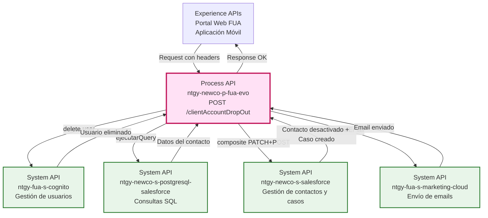
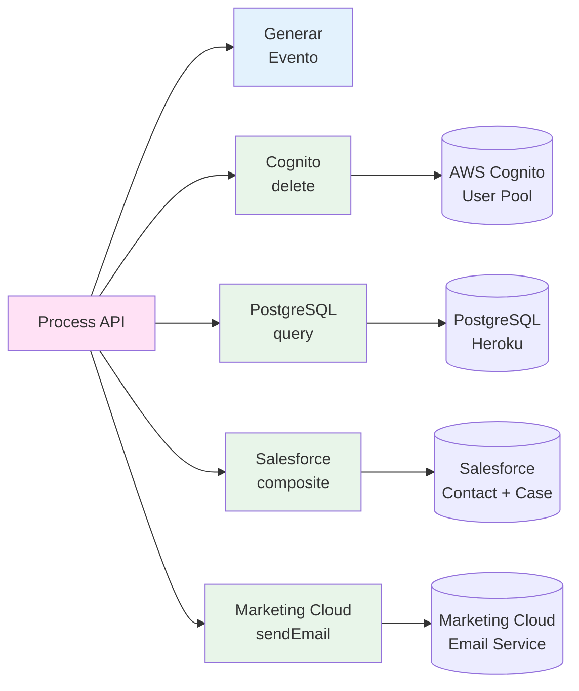
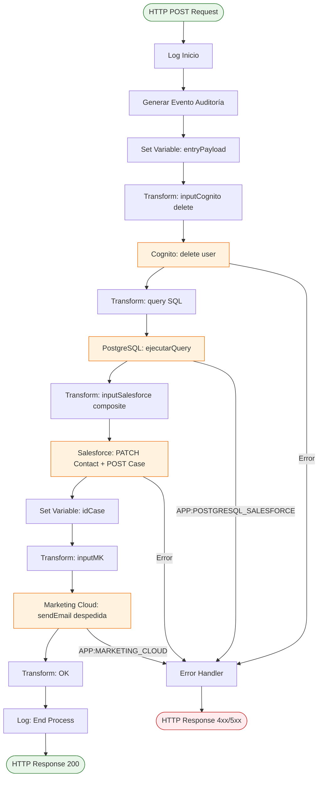
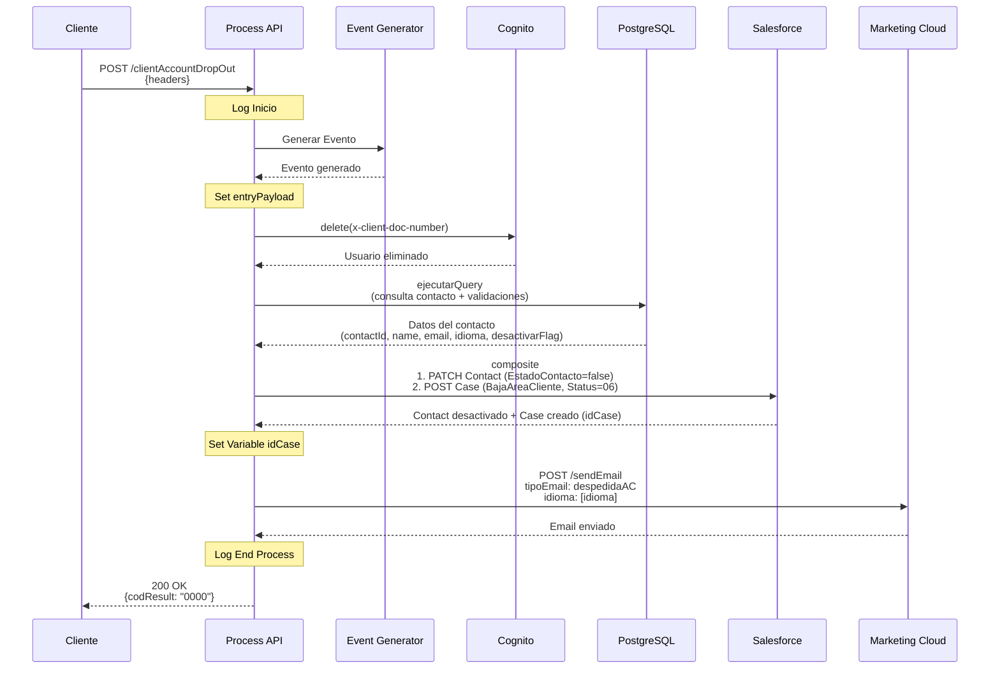
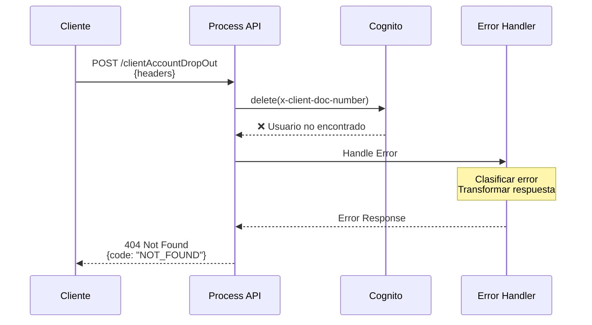
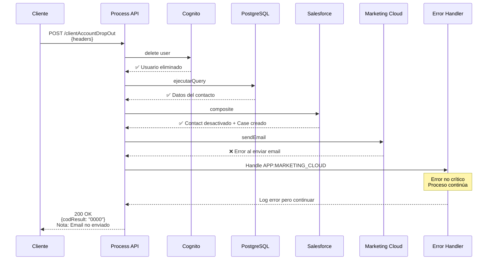

# POST /clientAccountDropOut

## 📌 Descripción General

### Propósito del Endpoint

Este endpoint gestiona el proceso completo de baja de un cliente del área de cliente FUA. Orquesta múltiples operaciones en diferentes sistemas para:

1. Generar evento de auditoría del proceso
2. Eliminar el usuario de AWS Cognito
3. Consultar datos del contacto en PostgreSQL/Salesforce
4. Desactivar el contacto en Salesforce
5. Crear un caso de gestión de baja en Salesforce
6. Enviar un email de despedida vía Marketing Cloud

### Tipo de API

**Capa:** Process API (API-Led Connectivity)

**Función:** Orquestación del proceso de baja de cliente del área de autoservicio

### Patrón de Integración

**Tipo:** Orquestación Secuencial con Validación

**Descripción:** Ejecuta una secuencia de operaciones en 4 sistemas diferentes (Cognito, PostgreSQL, Salesforce, Marketing Cloud) para completar el proceso de baja, incluyendo validaciones de relaciones de cuenta.

### Arquitectura API-Led Connectivity



---

## 💼 Propósito del Negocio

### Casos de Uso Principales

1. **Baja Voluntaria del Cliente**
   - El cliente solicita darse de baja del área de cliente
   - El sistema elimina su acceso y desactiva su perfil
   - Se mantiene trazabilidad del proceso
   - **Beneficio:** Cumplimiento con derecho de baja del usuario

2. **Eliminación de Acceso en Cognito**
   - Elimina completamente el usuario del User Pool de AWS Cognito
   - Impide futuros accesos al área de cliente
   - **Beneficio:** Seguridad y control de acceso

3. **Validación de Relaciones de Cuenta**
   - Consulta si el cliente tiene múltiples cuentas activas
   - Determina si se debe desactivar completamente el contacto
   - **Beneficio:** Gestión correcta de clientes multi-cuenta

4. **Trazabilidad del Proceso**
   - Crea un caso de gestión en Salesforce
   - Registra la baja en el área de cliente
   - **Beneficio:** Auditoría y seguimiento del proceso

5. **Comunicación con el Cliente**
   - Envía email de despedida personalizado
   - Soporta múltiples idiomas (castellano, euskera, gallego, catalán)
   - **Beneficio:** Experiencia de usuario profesional

### 🔗 Endpoints Dependientes

Este Process API consume los siguientes System APIs:

| System API | Endpoint | Método | Propósito |
|------------|----------|--------|-----------|
| `ntgy-fua-s-cognito` | `/deleteUser` | POST | Eliminar usuario de Cognito |
| `ntgy-newco-s-postgresql-salesforce` | `/ejecutarQuery` | POST | Consultar datos del contacto y validar relaciones |
| `ntgy-newco-s-salesforce` | `/postComposite` | POST | Desactivar contacto + Crear caso "BajaAreaCliente" (composite) |
| `ntgy-fua-s-marketing-cloud` | `/sendEmail` | POST | Enviar email de despedida |

### Lógica de Orquestación



**Pasos del Proceso:**

1. **Generación de Evento**: Crea evento de auditoría para trazabilidad
2. **Eliminación en Cognito**: Elimina el usuario del User Pool de AWS Cognito
3. **Consulta PostgreSQL**: Obtiene datos del contacto y valida relaciones de cuenta
4. **Actualización Salesforce**: 
   - Desactiva el contacto (`NewCo_EstadoContacto__c = false`)
   - Crea caso de gestión "BajaAreaCliente" con estado "06"
5. **Envío de Email**: Envía email de despedida personalizado según el idioma del cliente

### Transformaciones Aplicadas

Este Process API aplica las siguientes transformaciones:

| Transformación | Origen | Destino | Descripción |
|----------------|--------|---------|-------------|
| **Headers a Cognito Delete** | `x-client-doc-number` | `inputCognito.username` | Identifica usuario a eliminar |
| **Headers a SQL Query** | `x-client-id`, `x-client-doc-number` | `query` | Construye query SQL compleja |
| **Query Result a Salesforce** | `respQuery[0]` | `inputSalesforce.body` | Prepara operación composite |
| **Idioma a Marketing Cloud** | `respQuery[0].idioma` | `inputMK.data.idioma` | Mapeo de idiomas (Euskera→euskera, etc.) |
| **Headers a Salesforce Case** | `x-client-id`, `x-contact-id`, `traceparent` | `inputSalesforce.body` | Construye caso con datos de trazabilidad |

### Query SQL Compleja

El endpoint ejecuta una query SQL que:
- Obtiene datos del contacto (contactId, name, email, idioma)
- Valida si el contacto tiene múltiples relaciones de cuenta activas
- Determina si se debe desactivar completamente (`desactivarFlag`)

**Query SQL extraída del código:**

```sql
SELECT 
  contact.sfid contactId,
  contact.name,
  contact.email,
  contact.newco_preferredlanguage__c as idioma,
  (SELECT count(1) <= 1 as desactivarFlag 
   FROM newcosalesforce.accountcontactrelation a 
   INNER JOIN newcosalesforce.account as account 
     ON account.sfid = a.accountid 
   WHERE account.sfid = '{x-client-id}' 
     AND a.newco_estadologinomega__c = 'Validado') 
FROM newcosalesforce.contact contact 
WHERE contact.newco_documentnumber__c = '{x-client-doc-number}'
```

**Propósito de la Query:**
- Obtiene información del contacto desde Salesforce replicado en PostgreSQL
- Calcula `desactivarFlag`: `true` si el contacto tiene 1 o menos relaciones de cuenta validadas
- Permite decidir si se debe desactivar completamente el contacto

### Contexto Empresarial

- **Dominio:** Gestión de Clientes y Autoservicio
- **Sector:** Energía - Utilities
- **División:** Naturgy España - NewCo
- **Proceso de Negocio:** Baja de Cliente del Área de Autoservicio FUA

### Stakeholders

- **Clientes Finales**: Solicitan baja del área de cliente
- **Equipo de Atención al Cliente**: Monitorea casos de gestión de bajas
- **Equipo de Seguridad**: Valida la eliminación de accesos
- **Equipo de Marketing**: Gestiona las comunicaciones de despedida
- **Equipo Legal**: Asegura cumplimiento con normativas de protección de datos

### Valor de Negocio

- **Cumplimiento Legal**: Derecho del usuario a darse de baja (GDPR)
- **Seguridad**: Eliminación completa de acceso
- **Trazabilidad**: Registro completo del proceso en Salesforce
- **Experiencia de Usuario**: Email de despedida profesional
- **Automatización**: Proceso completamente automatizado sin intervención manual
- **Multiidioma**: Soporte para las lenguas oficiales de España

### Consumidores Potenciales

Este endpoint puede ser consumido por:
- Portal web de autoservicio FUA
- Aplicaciones móviles de Naturgy
- Sistemas de gestión de clientes
- Herramientas de administración de usuarios

---

## 🔧 Especificación Técnica

### URLs por Ambiente

| Ambiente | URL Base | URL Completa |
|----------|----------|--------------|
| **Local** | `http://localhost:8081` | `http://localhost:8081/api/clientAccountDropOut` |
| **Development** | `https://ntgy-newco-p-fua-evo-dev.us-e2.cloudhub.io` | `https://ntgy-newco-p-fua-evo-dev.us-e2.cloudhub.io/api/clientAccountDropOut` |
| **UAT** | `https://ntgy-newco-p-fua-evo-uat.us-e2.cloudhub.io` | `https://ntgy-newco-p-fua-evo-uat.us-e2.cloudhub.io/api/clientAccountDropOut` |
| **Production** | `https://ntgy-newco-p-fua-evo-pro.us-e2.cloudhub.io` | `https://ntgy-newco-p-fua-evo-pro.us-e2.cloudhub.io/api/clientAccountDropOut` |

### Método HTTP

```
POST /api/clientAccountDropOut
```

### Parámetros de Entrada

#### Request Headers (Requeridos)

| Header | Tipo | Requerido | Descripción |
|--------|------|-----------|-------------|
| `x-client-code` | string | ✅ Sí | Código del cliente |
| `x-client-doc-number` | string | ✅ Sí | Número de documento del cliente (DNI/NIE) |
| `x-client-id` | string | ✅ Sí | ID de la cuenta (Account ID en Salesforce) |
| `x-contact-id` | string | ✅ Sí | ID del contacto en Salesforce |
| `traceparent` | string | ✅ Sí | Trace ID para trazabilidad distribuida |
| `Content-Type` | string | ✅ Sí | `application/json` |
| `client_id` | string | ✅ Sí | Client ID de Anypoint Platform |
| `client_secret` | string | ✅ Sí | Client Secret de Anypoint Platform |

#### Request Body (application/json)

El body puede estar vacío o contener datos adicionales opcionales.

**Ejemplo de Request:**

```json
{}
```

**Nota:** Los datos necesarios se obtienen de los headers HTTP.

### Respuestas

#### ✅ 200 OK - Baja Exitosa

```json
{
  "result": {
    "codResult": "0000",
    "msgResult": "No hay error"
  }
}
```

**Campos de Respuesta:**

| Campo | Tipo | Descripción |
|-------|------|-------------|
| `result.codResult` | string | Código de resultado ("0000" = éxito) |
| `result.msgResult` | string | Mensaje descriptivo del resultado |

#### ❌ 400 Bad Request - Headers Faltantes

```json
{
  "code": "VALIDATION_ERROR",
  "message": "Headers requeridos faltantes",
  "details": "Se requieren los headers: x-client-doc-number, x-client-id, x-contact-id"
}
```

#### ❌ 404 Not Found - Cliente No Encontrado

```json
{
  "code": "NOT_FOUND",
  "message": "Cliente no encontrado",
  "details": "No se encontró el cliente con el documento proporcionado"
}
```

#### ❌ 500 Internal Server Error - Error en Sistema Backend

```json
{
  "code": "INTERNAL_ERROR",
  "message": "Error al procesar la baja",
  "details": "Error en la comunicación con Cognito/PostgreSQL/Salesforce"
}
```

### Autenticación

- **Tipo:** Client ID & Client Secret (Anypoint Platform)
- **Ubicación:** Headers HTTP

### Timeouts

| Tipo | Valor |
|------|-------|
| **Request Timeout** | 60 segundos |
| **Connection Timeout** | 10 segundos |

**Nota:** El timeout es mayor debido a las múltiples llamadas secuenciales a diferentes sistemas.

---

## 🏗️ Implementación Técnica

### Arquitectura del Flow



### Transformaciones DataWeave

#### 1. Transformación: inputCognito delete

**Ubicación en código:** Línea 16-26 del flow XML

```dataweave
%dw 2.0
output application/json
---
{
    "username": vars.entryPayload.'x-client-doc-number',
    "operation": "delete"
}
```

**Propósito:** Prepara la eliminación del usuario en Cognito usando el número de documento.

#### 2. Transformación: query SQL

**Ubicación en código:** Línea 29-37 del flow XML

```dataweave
%dw 2.0
output application/json
---
{
    "query": "select contact.sfid contactId,contact.name,contact.email,contact.newco_preferredlanguage__c as idioma, (select count(1) <= 1 as desactivarFlag from newcosalesforce.accountcontactrelation a inner join newcosalesforce.account as account on account.sfid = a.accountid where account.sfid = '" ++ vars.entryPayload.'x-client-id' ++ "' and a.newco_estadologinomega__c = 'Validado') from newcosalesforce.contact contact where contact.newco_documentnumber__c = '" ++ vars.entryPayload.'x-client-doc-number' ++ "'"
}
```

**Propósito:** Construye la query SQL compleja para obtener datos del contacto y validar relaciones de cuenta.

**Desglose de la Query:**
- **SELECT principal**: Obtiene contactId, name, email, idioma del contacto
- **Subquery**: Calcula `desactivarFlag` basándose en el número de relaciones de cuenta validadas
- **WHERE**: Filtra por número de documento del cliente

#### 3. Transformación: inputSalesforce composite

**Ubicación en código:** Línea 44-82 del flow XML

```dataweave
%dw 2.0
output application/json
---
{
    "body": {
        "allOrNone": true,
        "collateSubrequests": false,
        "compositeRequest": [
            {
                "method": "PATCH",
                "url": "/services/data/v52.0/sobjects/Contact/" ++ vars.entryPayload.'x-contact-id',
                "referenceId": "refContact",
                "body": {
                    "NewCo_EstadoContacto__c": false
                }
            },
            {
                "method": "POST",
                "url": "/services/data/v52.0/sobjects/Case",
                "referenceId": "refCaseGestion",
                "body": {
                    "NewCo_Recordtype__c": "Gestion",
                    "AccountId": vars.entryPayload.'x-client-id',
                    "ContactId": vars.entryPayload.'x-contact-id',
                    "Priority": "02",
                    "Origin": "FUA",
                    "Status": "06",
                    "NewCo_Creado_por__c": vars.entryPayload.'x-contact-id',
                    "acn_fld_Tittle__r": {
                        "NewCo_ExternalId__c": "BajaAreaCliente"
                    },
                    "NewCo_TraceId__c": splitBy(vars.entryPayload.traceparent, "-")[1],
                    ("NewCo_IdentificadorDeIntencion__c": vars.motorIntentionId) if (!isEmpty(vars.motorIntentionId))
                }
            }
        ]
    },
    "operationSalesforce": "composite"
}
```

**Propósito:** Ejecuta dos operaciones en Salesforce en una transacción:
1. **PATCH Contact**: Desactiva el contacto (`NewCo_EstadoContacto__c = false`)
2. **POST Case**: Crea caso de gestión "BajaAreaCliente" con estado "06"

#### 4. Transformación: inputMK (Marketing Cloud)

**Ubicación en código:** Línea 87-110 del flow XML

```dataweave
%dw 2.0
output application/json

var idioma = vars.respQuery[0].idioma match {
    case "Euskera" -> "euskera"
    case "Gallego" -> "gallego"
    case "Catalán" -> "catalan"
    else -> "castellano"
}

---
{
    "contactKey": vars.respQuery[0].contactid,
    "eventDefinitionKey": p('s-marketing-cloud.eventDefinitionKeyLog'),
    "data": {
        "subscriberKey": vars.respQuery[0].contactid,
        "ContactKey": vars.respQuery[0].contactid,
        "emailAddress": vars.respQuery[0].email,
        "nombre": vars.respQuery[0].name,
        "tipoEmail": p('s-marketing-cloud.emailType.despedidaAC'),
        "idioma": idioma
    }
}
```

**Propósito:** Prepara el envío del email de despedida con mapeo de idiomas.

**Nota:** Usa `despedidaAC` en lugar de `bienvenidaAC` (diferencia clave con el endpoint de confirmación).

#### 5. Transformación: OK

**Ubicación en código:** Línea 116-126 del flow XML

```dataweave
%dw 2.0
output application/json
---
{
    "result": {
        "codResult": "0000",
        "msgResult": "No hay error"
    }
}
```

**Propósito:** Construye la respuesta exitosa estándar.

### Patrones de Diseño

**Patrón:** Orquestación Secuencial con Validación (Sequential Orchestration with Validation)

**Justificación:** 
- Cada operación depende del resultado de la anterior
- Se necesita validar relaciones de cuenta antes de desactivar
- El proceso debe completarse en orden específico
- Permite rollback manual en caso de error

**Patrón Secundario:** Compensating Transaction (implícito)

**Justificación:**
- Si falla la desactivación en Salesforce, el usuario ya fue eliminado de Cognito
- Requiere intervención manual para revertir cambios
- Los errores se manejan de forma centralizada

### Diagramas de Secuencia

#### 1. Flujo Normal de Éxito



#### 2. Flujo con Error en Cognito



#### 3. Flujo con Error en Marketing Cloud (No Crítico)



### Manejo de Errores

#### Estrategia de Error Handling

**Error Handler:** `login-errorsError_Handler` (referenciado en línea 3 del flow principal)

**Tipos de Errores Manejados:**

1. **Errores de Validación (400)**
   - Headers requeridos faltantes
   - Formato de datos inválido

2. **Errores de No Encontrado (404)**
   - Usuario no existe en Cognito
   - Cliente no encontrado en PostgreSQL

3. **Errores de Sistema (500)**
   - Error de conexión con Cognito
   - Error de conexión con PostgreSQL (APP:POSTGRESQL_SALESFORCE)
   - Error de conexión con Salesforce

4. **Errores de Marketing Cloud (APP:MARKETING_CLOUD)**
   - Error al enviar email (no crítico)
   - El proceso continúa aunque falle el email

**Política de Reintentos:**
- Cognito: 2 reintentos
- PostgreSQL: 3 reintentos con backoff exponencial
- Salesforce: 2 reintentos
- Marketing Cloud: 1 intento (error no crítico)

### Configuración de Propiedades

**Propiedades utilizadas del archivo de configuración:**

```yaml
s-marketing-cloud:
  eventDefinitionKeyLog: "event-key-log"
  emailType:
    despedidaAC: "despedida-area-cliente"
```

### Datos Almacenados en Variables

| Variable | Tipo | Descripción | Uso |
|----------|------|-------------|-----|
| `vars.entryPayload` | Object | Payload de entrada con todos los headers | Usado en todas las transformaciones |
| `vars.inputCognito` | Object | Input preparado para Cognito | Parámetros de eliminación de usuario |
| `vars.query` | Object | Query SQL construida | Consulta a PostgreSQL |
| `vars.respQuery` | Array | Respuesta de PostgreSQL | Contiene datos del contacto y validaciones |
| `vars.inputSalesforce` | Object | Input preparado para Salesforce | Datos del composite (PATCH + POST) |
| `vars.salesforceResp` | Object | Respuesta de Salesforce | Contiene el ID del caso creado |
| `vars.idCase` | String | ID del caso creado en Salesforce | Usado para logging y trazabilidad |
| `vars.inputMK` | Object | Input preparado para Marketing Cloud | Datos del email a enviar |
| `vars.motorIntentionId` | String | ID de intención del motor de estados (opcional) | Usado si existe integración con motor de estados |

---

## 💻 Ejemplos de Uso

### Ejemplo 1: Baja Exitosa

#### cURL

```bash
curl -X POST "https://ntgy-newco-p-fua-evo-dev.us-e2.cloudhub.io/api/clientAccountDropOut" \
  -H "Content-Type: application/json" \
  -H "client_id: YOUR_CLIENT_ID" \
  -H "client_secret: YOUR_CLIENT_SECRET" \
  -H "x-client-code: CLI001" \
  -H "x-client-doc-number: 12345678A" \
  -H "x-client-id: 0011234567890ABCDE" \
  -H "x-contact-id: 0031234567890ABCDE" \
  -H "traceparent: 00-0af7651916cd43dd8448eb211c80319c-b7ad6b7169203331-01" \
  -d '{}'
```

#### Respuesta (200 OK)

```json
{
  "result": {
    "codResult": "0000",
    "msgResult": "No hay error"
  }
}
```

**Resultado del Proceso:**
- ✅ Usuario eliminado de Cognito
- ✅ Contacto desactivado en Salesforce
- ✅ Caso de gestión creado en Salesforce
- ✅ Email de despedida enviado

### Ejemplo 2: Headers Faltantes

#### cURL

```bash
curl -X POST "https://ntgy-newco-p-fua-evo-dev.us-e2.cloudhub.io/api/clientAccountDropOut" \
  -H "Content-Type: application/json" \
  -H "client_id: YOUR_CLIENT_ID" \
  -H "client_secret: YOUR_CLIENT_SECRET" \
  -d '{}'
```

#### Respuesta (400 Bad Request)

```json
{
  "code": "VALIDATION_ERROR",
  "message": "Headers requeridos faltantes",
  "details": "Se requieren los headers: x-client-doc-number, x-client-id, x-contact-id",
  "timestamp": "2026-01-09T16:28:30.123Z"
}
```

### Ejemplo 3: JavaScript (Frontend)

```javascript
async function darDeBajaCliente(clientData) {
  try {
    const response = await fetch(
      'https://ntgy-newco-p-fua-evo-dev.us-e2.cloudhub.io/api/clientAccountDropOut',
      {
        method: 'POST',
        headers: {
          'Content-Type': 'application/json',
          'client_id': 'YOUR_CLIENT_ID',
          'client_secret': 'YOUR_CLIENT_SECRET',
          'x-client-code': clientData.clientCode,
          'x-client-doc-number': clientData.docNumber,
          'x-client-id': clientData.accountId,
          'x-contact-id': clientData.contactId,
          'traceparent': generateTraceParent()
        },
        body: JSON.stringify({})
      }
    );

    if (!response.ok) {
      throw new Error(`Error: ${response.status}`);
    }

    const data = await response.json();
    
    if (data.result.codResult === "0000") {
      console.log('✅ Baja procesada exitosamente');
      // Cerrar sesión y redirigir
      await cerrarSesion();
      window.location.href = '/';
    }
    
    return data;
  } catch (error) {
    console.error('❌ Error al procesar la baja:', error);
    throw error;
  }
}

function generateTraceParent() {
  // Generar trace ID según formato W3C Trace Context
  const version = '00';
  const traceId = Array.from({length: 32}, () => 
    Math.floor(Math.random() * 16).toString(16)).join('');
  const spanId = Array.from({length: 16}, () => 
    Math.floor(Math.random() * 16).toString(16)).join('');
  const flags = '01';
  
  return `${version}-${traceId}-${spanId}-${flags}`;
}

// Uso: Confirmar baja con el usuario
async function confirmarYProcesarBaja() {
  const confirmacion = confirm(
    '¿Estás seguro de que deseas darte de baja del área de cliente?\n\n' +
    'Esta acción:\n' +
    '- Eliminará tu acceso al área de cliente\n' +
    '- Desactivará tu perfil\n' +
    '- Enviará un email de confirmación\n\n' +
    'Podrás volver a registrarte en cualquier momento.'
  );
  
  if (confirmacion) {
    try {
      const clientData = {
        clientCode: sessionStorage.getItem('clientCode'),
        docNumber: sessionStorage.getItem('docNumber'),
        accountId: sessionStorage.getItem('accountId'),
        contactId: sessionStorage.getItem('contactId')
      };
      
      await darDeBajaCliente(clientData);
      
      alert('Tu baja ha sido procesada correctamente. Recibirás un email de confirmación.');
    } catch (error) {
      alert('Error al procesar la baja. Por favor, contacta con soporte.');
    }
  }
}
```

### Ejemplo 4: Python

```python
import requests
import json
import uuid

def dar_baja_cliente(client_data):
    """
    Procesa la baja de un cliente del área de cliente.
    
    Args:
        client_data (dict): Datos del cliente con las claves:
            - client_code: Código del cliente
            - doc_number: Número de documento
            - account_id: ID de la cuenta en Salesforce
            - contact_id: ID del contacto en Salesforce
            
    Returns:
        dict: Respuesta del API con el resultado
    """
    url = "https://ntgy-newco-p-fua-evo-dev.us-e2.cloudhub.io/api/clientAccountDropOut"
    
    # Generar trace ID
    trace_id = uuid.uuid4().hex
    span_id = uuid.uuid4().hex[:16]
    traceparent = f"00-{trace_id}-{span_id}-01"
    
    headers = {
        'Content-Type': 'application/json',
        'client_id': 'YOUR_CLIENT_ID',
        'client_secret': 'YOUR_CLIENT_SECRET',
        'x-client-code': client_data['client_code'],
        'x-client-doc-number': client_data['doc_number'],
        'x-client-id': client_data['account_id'],
        'x-contact-id': client_data['contact_id'],
        'traceparent': traceparent
    }
    
    try:
        response = requests.post(url, headers=headers, json={}, timeout=60)
        response.raise_for_status()
        
        data = response.json()
        
        if data['result']['codResult'] == '0000':
            print(f"✅ Baja procesada exitosamente")
            print(f"Trace ID: {trace_id}")
            return data
        else:
            print(f"⚠️ Respuesta inesperada: {data}")
            return data
            
    except requests.exceptions.HTTPError as e:
        print(f"❌ Error HTTP: {e}")
        print(f"Respuesta: {e.response.text}")
        raise
    except requests.exceptions.Timeout:
        print("❌ Timeout: La petición tardó más de 60 segundos")
        raise
    except requests.exceptions.RequestException as e:
        print(f"❌ Error en la petición: {e}")
        raise

# Uso
if __name__ == "__main__":
    client_data = {
        'client_code': 'CLI001',
        'doc_number': '12345678A',
        'account_id': '0011234567890ABCDE',
        'contact_id': '0031234567890ABCDE'
    }
    
    # Confirmar con el usuario
    confirmacion = input("¿Confirmas la baja del cliente? (s/n): ")
    
    if confirmacion.lower() == 's':
        resultado = dar_baja_cliente(client_data)
        print(json.dumps(resultado, indent=2))
    else:
        print("Operación cancelada")
```

### Ejemplo 5: Flujo Completo desde Portal Web

**Escenario:** Cliente solicita baja desde su área de cliente

```javascript
// dropout.js - Página de baja del área de cliente
class ClientDropoutManager {
  constructor() {
    this.apiUrl = 'https://ntgy-newco-p-fua-evo-pro.us-e2.cloudhub.io/api/clientAccountDropOut';
    this.clientData = this.loadClientData();
  }
  
  loadClientData() {
    // Cargar datos del cliente desde la sesión
    return {
      clientCode: sessionStorage.getItem('clientCode'),
      docNumber: sessionStorage.getItem('docNumber'),
      accountId: sessionStorage.getItem('accountId'),
      contactId: sessionStorage.getItem('contactId')
    };
  }
  
  validateClientData() {
    const required = ['clientCode', 'docNumber', 'accountId', 'contactId'];
    const missing = required.filter(field => !this.clientData[field]);
    
    if (missing.length > 0) {
      throw new Error(`Datos faltantes: ${missing.join(', ')}`);
    }
  }
  
  async procesarBaja() {
    try {
      // Validar datos
      this.validateClientData();
      
      // Mostrar loading
      this.showLoading();
      
      // Generar trace ID
      const traceparent = this.generateTraceParent();
      
      // Llamar al API
      const response = await fetch(this.apiUrl, {
        method: 'POST',
        headers: {
          'Content-Type': 'application/json',
          'client_id': CONFIG.CLIENT_ID,
          'client_secret': CONFIG.CLIENT_SECRET,
          'x-client-code': this.clientData.clientCode,
          'x-client-doc-number': this.clientData.docNumber,
          'x-client-id': this.clientData.accountId,
          'x-contact-id': this.clientData.contactId,
          'traceparent': traceparent
        },
        body: JSON.stringify({})
      });
      
      const data = await response.json();
      
      if (response.ok && data.result.codResult === '0000') {
        // Éxito
        this.showSuccess();
        
        // Limpiar sesión
        await this.clearSession();
        
        // Redirigir después de 5 segundos
        setTimeout(() => {
          window.location.href = '/';
        }, 5000);
      } else {
        // Error de negocio
        this.showError(data.message || 'Error al procesar la baja');
      }
      
    } catch (error) {
      // Error técnico
      console.error('Error:', error);
      this.showError('Error de conexión. Por favor, inténtelo más tarde.');
    }
  }
  
  generateTraceParent() {
    const version = '00';
    const traceId = Array.from({length: 32}, () => 
      Math.floor(Math.random() * 16).toString(16)).join('');
    const spanId = Array.from({length: 16}, () => 
      Math.floor(Math.random() * 16).toString(16)).join('');
    const flags = '01';
    
    return `${version}-${traceId}-${spanId}-${flags}`;
  }
  
  async clearSession() {
    // Limpiar datos de sesión
    sessionStorage.clear();
    localStorage.removeItem('authToken');
    
    // Llamar a logout si existe
    if (typeof logout === 'function') {
      await logout();
    }
  }
  
  showLoading() {
    document.getElementById('loading').style.display = 'block';
    document.getElementById('form').style.display = 'none';
    document.getElementById('result').style.display = 'none';
  }
  
  showSuccess() {
    document.getElementById('loading').style.display = 'none';
    document.getElementById('result').style.display = 'block';
    document.getElementById('result').innerHTML = `
      <div class="success">
        <h2>✅ Baja procesada correctamente</h2>
        <p>Tu baja del área de cliente ha sido procesada exitosamente.</p>
        <p>Recibirás un email de confirmación en breve.</p>
        <p><strong>Gracias por confiar en Naturgy.</strong></p>
        <p>Redirigiendo a la página principal...</p>
      </div>
    `;
  }
  
  showError(mensaje) {
    document.getElementById('loading').style.display = 'none';
    document.getElementById('result').style.display = 'block';
    document.getElementById('result').innerHTML = `
      <div class="error">
        <h2>❌ Error</h2>
        <p>${mensaje}</p>
        <button onclick="location.reload()">Reintentar</button>
        <a href="/soporte">Contactar con soporte</a>
      </div>
    `;
  }
}

// Inicializar cuando se carga la página
document.addEventListener('DOMContentLoaded', () => {
  const manager = new ClientDropoutManager();
  
  // Botón de confirmación
  document.getElementById('btnConfirmarBaja').addEventListener('click', () => {
    const confirmacion = confirm(
      '¿Estás seguro de que deseas darte de baja del área de cliente?\n\n' +
      'Esta acción:\n' +
      '• Eliminará tu acceso al área de cliente\n' +
      '• Desactivará tu perfil\n' +
      '• Enviará un email de confirmación\n\n' +
      'Podrás volver a registrarte en cualquier momento.'
    );
    
    if (confirmacion) {
      manager.procesarBaja();
    }
  });
  
  // Botón de cancelar
  document.getElementById('btnCancelar').addEventListener('click', () => {
    window.location.href = '/area-cliente';
  });
});
```

---

## 📋 Notas Adicionales

### Código Comentado (Motor de Estados)

El código fuente contiene secciones comentadas relacionadas con un "Motor de Estados" (`grabarIntencionMe_SubFlow`). Esta funcionalidad está actualmente deshabilitada pero planificada para futuras versiones:

**Funcionalidad Planificada:**
- Crear intención "BajaAreaCliente" al inicio del proceso
- Actualizar intención con evento "ByPass" (TODO: cambiar a "CasoGestionCreado")
- Marcar intención como "PROCESO_FINALIZADO" al completar

**Estado Actual:** Deshabilitado (comentado con `[STUDIO:...]`)

### Diferencias con clientRegistrationConfirmation

**Similitudes:**
- Ambos son Process APIs de orquestación
- Ambos usan Cognito, Salesforce y Marketing Cloud
- Ambos crean casos de gestión en Salesforce
- Ambos envían emails personalizados por idioma
- Estructura similar de transformaciones DataWeave

**Diferencias Clave:**

| Aspecto | clientRegistrationConfirmation | clientAccountDropOut |
|---------|-------------------------------|----------------------|
| **Propósito** | Alta/Confirmación | Baja/Desactivación |
| **Operación Cognito** | updateUser (activar) | delete (eliminar) |
| **Operación Salesforce Contact** | No modifica | PATCH (desactivar) |
| **Tipo de Email** | bienvenidaAC | despedidaAC |
| **Backend de Datos** | DynamoDB | PostgreSQL |
| **Query SQL** | No ejecuta | Sí (validación multi-cuenta) |
| **Estado del Caso** | Sin estado específico | Estado "06" |

### Consideraciones de Seguridad

1. **Confirmación del Usuario**: Siempre solicitar confirmación explícita antes de procesar la baja
2. **Validación de Sesión**: Verificar que el usuario autenticado coincide con los datos de la baja
3. **Auditoría**: El evento generado permite trazabilidad completa del proceso
4. **Irreversibilidad**: La eliminación en Cognito es permanente
5. **HTTPS**: Todas las comunicaciones deben ser sobre HTTPS

### Consideraciones de Negocio

1. **Clientes Multi-Cuenta**: La query SQL valida si el cliente tiene múltiples cuentas
2. **Reactivación**: El cliente puede volver a registrarse en cualquier momento
3. **Datos en Salesforce**: El contacto se desactiva pero no se elimina (cumplimiento legal)
4. **Email de Despedida**: Mantiene una comunicación profesional con el cliente
5. **Caso de Gestión**: Permite seguimiento y análisis de bajas

### Monitoreo y Alertas

**Métricas Clave a Monitorear:**
- Tasa de bajas por día/semana/mes
- Tiempo de respuesta del endpoint
- Errores por sistema backend (Cognito, PostgreSQL, Salesforce, Marketing Cloud)
- Ratio de bajas vs altas (churn rate)

**Alertas Recomendadas:**
- Tasa de error > 5%
- Tiempo de respuesta > 60 segundos
- Pico inusual de bajas (> 2x promedio)
- Fallos en envío de emails > 10%

### Mejoras Futuras

1. **Encuesta de Salida**: Capturar motivo de la baja
2. **Período de Gracia**: Permitir cancelar la baja en 24-48 horas
3. **Retención**: Ofrecer alternativas antes de procesar la baja
4. **Motor de Estados**: Activar integración con motor de intenciones
5. **Analytics**: Dashboard con análisis de bajas y motivos
6. **Notificaciones**: SMS adicional al email de despedida
