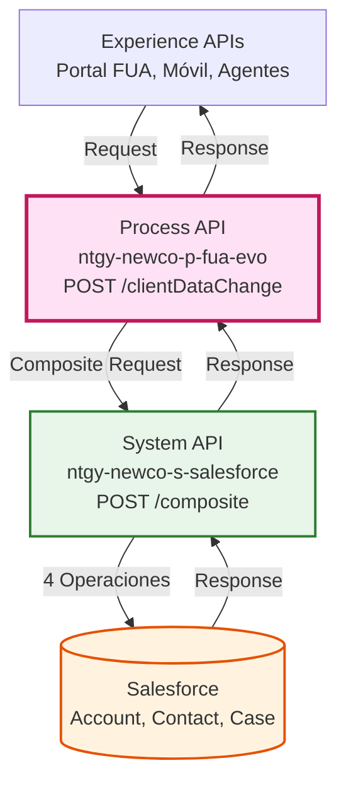
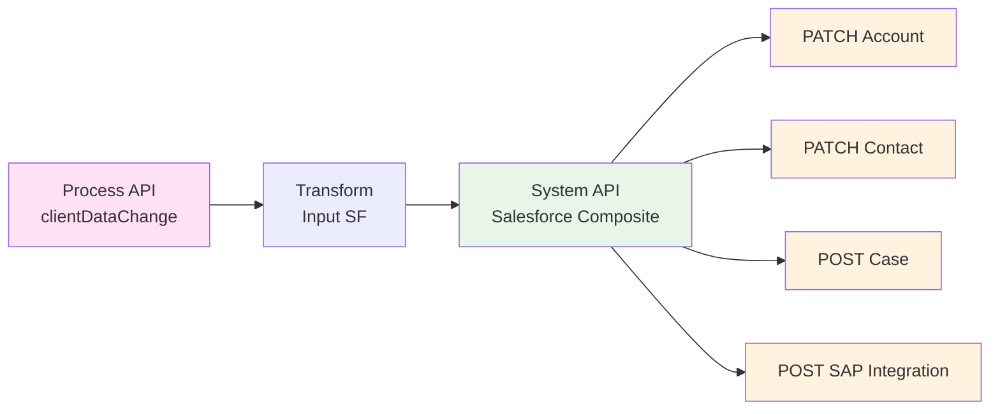
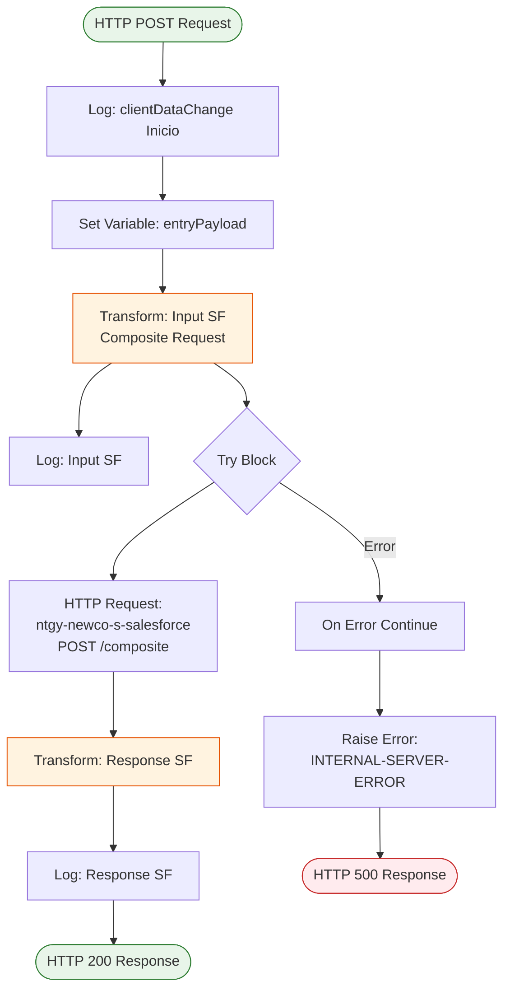
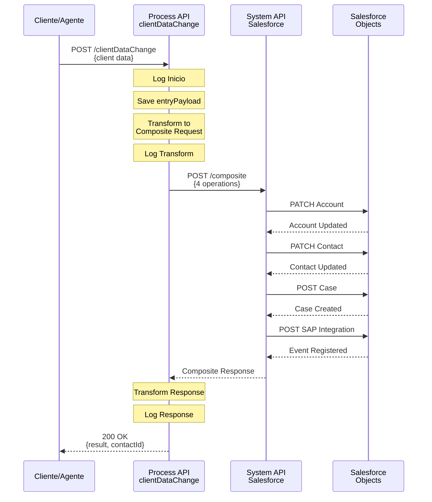
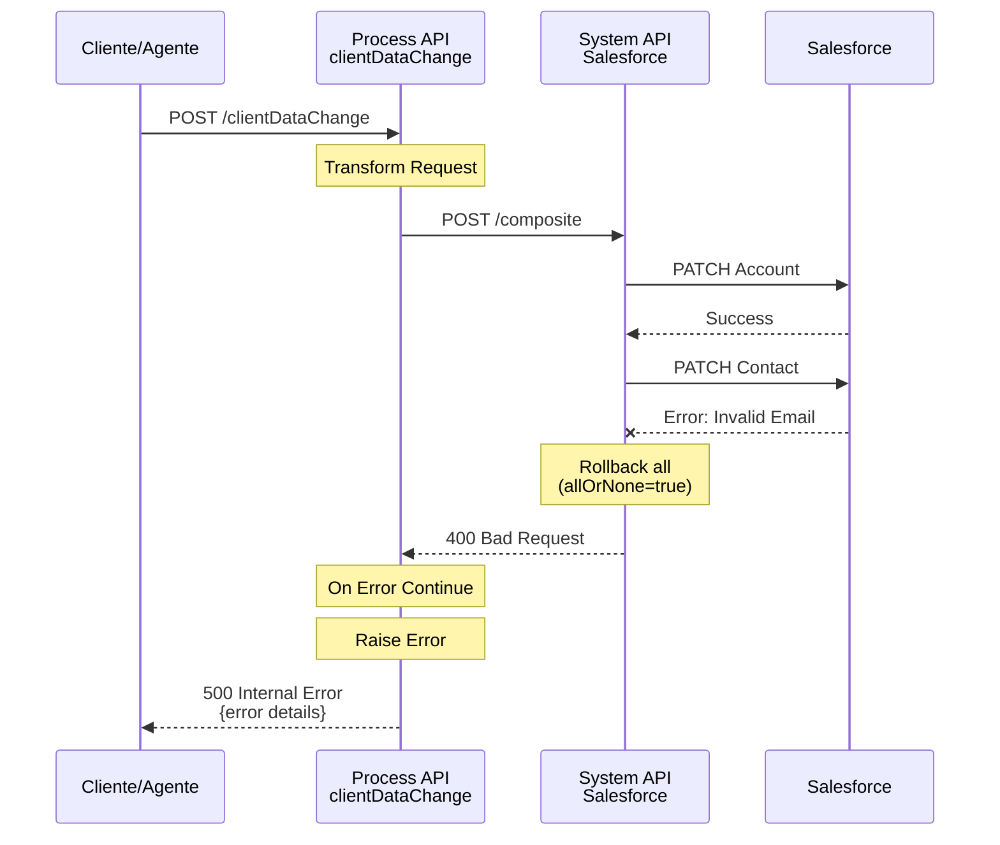
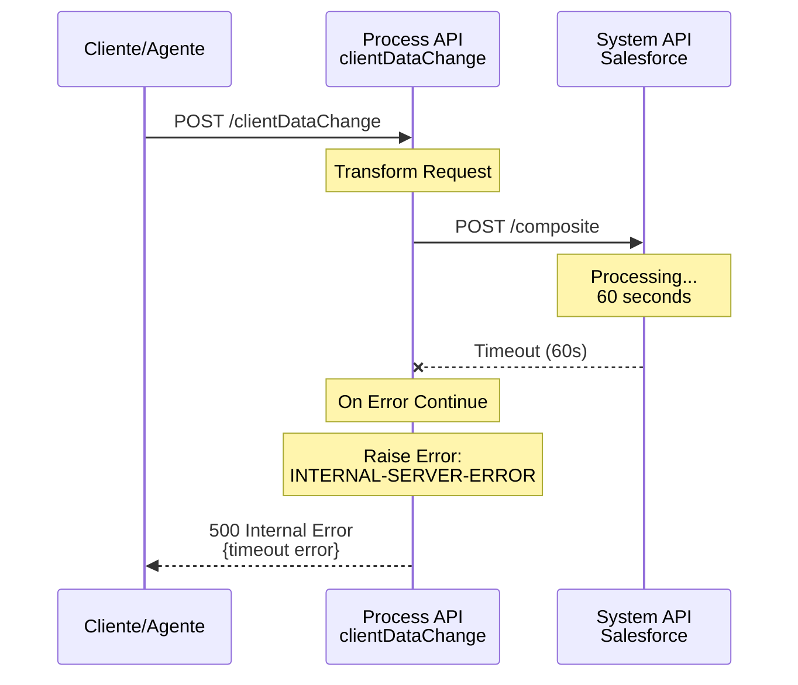

# POST /clientDataChange

## 📌 Descripción General

### Propósito del Endpoint

Este endpoint orquesta la actualización de datos de cliente titular en Salesforce mediante una operación composite que actualiza simultáneamente el Account, Contact, crea un Case de gestión y registra un evento de integración SAP.

### Tipo de API

**Capa:** Process API (API-Led Connectivity)

**Función:** Orquestación de actualización de datos de cliente titular con múltiples operaciones atómicas en Salesforce

### Patrón de Integración

**Tipo:** Orquestación con Composite Request

**Descripción:** Utiliza el patrón Salesforce Composite Request para ejecutar 4 operaciones en una sola transacción atómica, garantizando consistencia de datos.

### Arquitectura API-Led Connectivity



---

## 💼 Propósito del Negocio

### Casos de Uso Principales

1. **Actualización de Datos Personales del Cliente**
   - Permite al cliente actualizar su información personal (nombre, apellidos, email, teléfono)
   - Mantiene sincronizados los datos entre Account y Contact
   - Beneficio: Datos actualizados en tiempo real en todos los sistemas

2. **Actualización de Preferencias de Contacto**
   - Actualiza canal preferente y horario de contacto
   - Registra quién realizó el cambio (usuario o contacto)
   - Beneficio: Mejora la experiencia de comunicación con el cliente

3. **Registro de Gestión y Trazabilidad**
   - Crea automáticamente un Case de gestión tipo "Modificación datos cliente titular"
   - Registra evento para integración con SAP
   - Beneficio: Auditoría completa de cambios y sincronización con backend

### 🔗 Endpoints Dependientes

Este Process API consume el siguiente System API:

| System API | Endpoint | Método | Propósito |
|------------|----------|--------|-----------|
| `ntgy-newco-s-salesforce` | `/modificaciones/contacto` | POST | Ejecuta operaciones composite en Salesforce |

### Lógica de Orquestación



**Pasos del Proceso:**

1. **Validación y Transformación**: Transforma el payload de entrada al formato Salesforce Composite Request
2. **Operación 1 - PATCH Account**: Actualiza datos del Account (Name, Phone, Email, Nacionalidad)
3. **Operación 2 - PATCH Contact**: Actualiza datos del Contact (nombre, apellidos, email, teléfono, preferencias)
4. **Operación 3 - POST Case**: Crea Case de gestión tipo "Modificación datos cliente titular"
5. **Operación 4 - POST SAP Integration**: Registra evento "DatosClienteTitularApellidoCambiados" para integración SAP
6. **Respuesta**: Retorna resultado de la operación con código de éxito y contactId

### Transformaciones Aplicadas

**Transformación de Entrada (Request → Salesforce Composite):**

| Campo Original | Campo Salesforce | Objeto | Transformación |
|----------------|------------------|--------|----------------|
| `client.name` | `Name` (parcial) | Account | Concatenación de name + surname + surname2 |
| `client.surname` | `Name` (parcial) | Account | Concatenación de name + surname + surname2 |
| `client.surname2` | `Name` (parcial) | Account | Concatenación de name + surname + surname2 |
| `client.phone` | `Phone` | Account | Directo |
| `client.email` | `NewCo_Email__c` | Account | Directo |
| `client.nationalityId` | `NewCo_Nacionalidad__c` | Account | Directo |
| `client.name` | `FirstName` / `LastName` | Contact | Condicional según isIndividualClient |
| `client.surname` | `NewCo_Apellido1__c` | Contact | Solo si isIndividualClient |
| `client.surname2` | `NewCo_Apellido2__c` | Contact | Solo si isIndividualClient |
| `client.email` | `Email` | Contact | Directo |
| `client.phone` | `MobilePhone` | Contact | Directo |
| `client.channel` | `NewCo_CanalPreferente__c` | Contact | Directo |
| `client.scheduleId` | `NewCo_HorarioPreferente__c` | Contact | Directo |
| `x-user-id` / `x-contact-id` | `NewCo_Creado_por__c` | Account/Contact/Case | Prioriza user-id, fallback a contact-id |

**Lógica Condicional:**

- **Cliente Individual vs Empresa**: Si `isIndividualClient = true`, usa FirstName + apellidos separados; si false, usa LastName completo
- **Registro de Operación**: Si `operationType = "contact_reg"` o `preferredEmail` está vacío, marca el Case como registro (`NewCo_IsRegistration__c = true`)
- **Asignación de Case**: Si existe `x-user-id`, asigna el Case al usuario; si no, queda sin asignar

### Contexto Empresarial

- **Dominio:** Gestión de Clientes
- **Sector:** Energía - Utilities
- **División:** Naturgy España - NewCo
- **Proceso de Negocio:** Actualización de datos de cliente titular con trazabilidad completa

### Stakeholders

- **Clientes Finales**: Necesitan actualizar sus datos personales y preferencias de contacto
- **Agentes de Call Center**: Actualizan datos en nombre del cliente durante interacciones
- **Equipo de CRM**: Mantiene la calidad y consistencia de datos en Salesforce
- **Equipo de Integración SAP**: Recibe eventos de cambios para sincronización con sistemas backend

### Valor de Negocio

- **Consistencia de Datos**: Actualización atómica de Account y Contact garantiza integridad
- **Trazabilidad Completa**: Cada cambio genera un Case de gestión para auditoría
- **Integración SAP**: Evento automático para sincronización con sistemas de facturación
- **Experiencia de Usuario**: Actualización inmediata visible en todos los canales

### Consumidores Potenciales

Este endpoint puede ser consumido por:
- Portal web FUA
- Aplicación móvil de clientes
- Sistema de agentes de call center
- Aplicaciones de autoservicio

---

## 🔧 Especificación Técnica

### URLs por Ambiente

| Ambiente | URL Base | URL Completa |
|----------|----------|--------------|
| **Local** | `http://localhost:8081` | `http://localhost:8081/api/clientDataChange` |
| **Development** | `https://ntgy-newco-p-fua-evo-dev.us-e2.cloudhub.io` | `https://ntgy-newco-p-fua-evo-dev.us-e2.cloudhub.io/api/clientDataChange` |
| **UAT** | `https://ntgy-newco-p-fua-evo-uat.us-e2.cloudhub.io` | `https://ntgy-newco-p-fua-evo-uat.us-e2.cloudhub.io/api/clientDataChange` |
| **Production** | `https://ntgy-newco-p-fua-evo-pro.us-e2.cloudhub.io` | `https://ntgy-newco-p-fua-evo-pro.us-e2.cloudhub.io/api/clientDataChange` |

### Método HTTP

```
POST /api/clientDataChange
```

### Headers Requeridos

| Header | Tipo | Obligatorio | Descripción |
|--------|------|-------------|-------------|
| `Content-Type` | string | ✅ Sí | Debe ser `application/json` |
| `client_id` | string | ✅ Sí | Client ID de Anypoint Platform |
| `client_secret` | string | ✅ Sí | Client Secret de Anypoint Platform |
| `x-client-id` | string | ✅ Sí | ID del Account en Salesforce |
| `x-contact-id` | string | ✅ Sí | ID del Contact en Salesforce |
| `x-user-id` | string | ⚠️ Opcional | ID del usuario que realiza la operación (agente) |
| `x-agent-mail` | string | ⚠️ Opcional | Email del agente (para auditoría) |
| `x-interaction-id` | string | ⚠️ Opcional | ID de interacción padre (para casos relacionados) |

### Parámetros de Entrada

#### Request Body

```json
{
  "client": {
    "name": "string",
    "surname": "string",
    "surname2": "string",
    "phone": "string",
    "email": "string",
    "nationalityId": "string",
    "channel": "string",
    "scheduleId": "string",
    "contactId": "string",
    "isIndividualClient": boolean,
    "preferredEmail": "string"
  },
  "operationType": "string",
  "DirIp": "string"
}
```

#### Descripción de Campos

| Campo | Tipo | Obligatorio | Descripción |
|-------|------|-------------|-------------|
| `client.name` | string | ✅ Sí | Nombre del cliente |
| `client.surname` | string | ✅ Sí | Primer apellido |
| `client.surname2` | string | ⚠️ Opcional | Segundo apellido |
| `client.phone` | string | ✅ Sí | Teléfono móvil |
| `client.email` | string | ✅ Sí | Email del cliente |
| `client.nationalityId` | string | ✅ Sí | ID de nacionalidad |
| `client.channel` | string | ✅ Sí | Canal preferente de contacto |
| `client.scheduleId` | string | ✅ Sí | ID de horario preferente |
| `client.contactId` | string | ✅ Sí | ID del Contact en Salesforce |
| `client.isIndividualClient` | boolean | ✅ Sí | true = persona física, false = empresa |
| `client.preferredEmail` | string | ⚠️ Opcional | Email preferido (para validación de registro) |
| `operationType` | string | ⚠️ Opcional | Tipo de operación (ej: "contact_reg") |
| `DirIp` | string | ✅ Sí | Dirección IP del cliente (auditoría) |

### Respuestas

#### 200 OK - Éxito

```json
{
  "result": {
    "codResult": "0000",
    "msgResult": "Ejecución correcta"
  },
  "contactId": "003XXXXXXXXXXXXXXX"
}
```

| Campo | Tipo | Descripción |
|-------|------|-------------|
| `result.codResult` | string | Código de resultado ("0000" = éxito) |
| `result.msgResult` | string | Mensaje descriptivo del resultado |
| `contactId` | string | ID del Contact actualizado en Salesforce |

#### 400 Bad Request - Error de Validación

```json
{
  "code": "BAD_REQUEST",
  "message": "Error de validación en los datos de entrada",
  "details": "Campo 'client.email' es obligatorio"
}
```

#### 500 Internal Server Error - Error del Sistema

```json
{
  "code": "INTERNAL_SERVER_ERROR",
  "message": "Error interno del servidor",
  "details": "Error al conectar con Salesforce"
}
```

### Autenticación

- **Tipo:** Client ID & Client Secret (Anypoint Platform)
- **Headers:** `client_id` y `client_secret`

### Timeouts

| Tipo | Valor |
|------|-------|
| **Request Timeout** | 60 segundos (configurado en `${ntgy-newco-s-salesforce.timeout}`) |
| **Connection Timeout** | 10 segundos |

### Validaciones

- ✅ Todos los campos obligatorios deben estar presentes
- ✅ El email debe tener formato válido
- ✅ El teléfono debe tener formato válido
- ✅ Los IDs de Salesforce (x-client-id, x-contact-id, client.contactId) deben ser válidos
- ✅ El campo isIndividualClient debe ser booleano

---

## 🏗️ Implementación Técnica

### Arquitectura del Flow



### Componentes del Flow

#### 1. Flow Principal: `post:\clientDataChange:application\json:ntgy-newco-p-fua-config`

**Ubicación:** `src/main/mule/ntgy-newco-p-fua.xml`

**Función:** Flow de entrada generado por APIKit que delega al subflow `accountFlow`

```xml
<flow name="post:\clientDataChange:application\json:ntgy-newco-p-fua-config">
    <flow-ref name="accountFlow" />
</flow>
```

#### 2. Subflow: `accountFlow`

**Ubicación:** `src/main/mule/ntgy-newco-p-fua.xml` (código proporcionado)

**Función:** Orquesta la actualización de datos del cliente en Salesforce

**Componentes:**

1. **Logger Inicio**: Registra inicio del flujo con payload completo
2. **Set Variable**: Guarda payload original en `entryPayload` para referencia posterior
3. **Transform Input SF**: Transforma request a formato Salesforce Composite
4. **Logger Transform**: Registra payload transformado antes de enviar a Salesforce
5. **Try Block**: Manejo de errores con on-error-continue
6. **HTTP Request**: Llamada al System API de Salesforce
7. **Transform Response**: Transforma respuesta de Salesforce a formato estándar
8. **Logger Response**: Registra respuesta final

### Transformaciones DataWeave

#### Transformación 1: Input SF (Request → Salesforce Composite)

**Ubicación:** Inline en el flow `accountFlow`

**Propósito:** Construir el Composite Request con 4 operaciones atómicas

```dataweave
%dw 2.0
output application/json

fun checkEmpty(value) =
  if (!isEmpty(value)) value ++ " " else "" 

---
{
  "allOrNone": true,
  "collateSubrequests": false,
  "compositeRequest": [
    {
      "method": "PATCH",
      "url": "/services/data/v52.0/sobjects/Account/" ++ payload."x-client-id",
      "referenceId": "refAccount",
      "body": {
        "Name": trim(checkEmpty(payload.client.name) ++ 
                     checkEmpty(payload.client.surname) ++ 
                     checkEmpty(payload.client.surname2)),
        "Phone": payload.client.phone,
        "NewCo_Email__c": payload.client.email,
        "NewCo_Nacionalidad__c": payload.client.nationalityId,
        "NewCo_Creado_por__c": if(payload.'x-user-id' != null) 
                                  payload.'x-user-id' 
                                else 
                                  payload.'x-contact-id'
      }   
    },
    {
      "method": "PATCH",
      "url": "/services/data/v52.0/sobjects/Contact/" ++ payload.client."contactId",
      "referenceId": "refContact",
      "body": {
        ("LastName": trim(checkEmpty(payload.client.name) ++ 
                         checkEmpty(payload.client.surname) ++ 
                         checkEmpty(payload.client.surname2))) 
          if !(payload.client.isIndividualClient),
        ("FirstName": payload.client.name) 
          if (payload.client.isIndividualClient),
        ("NewCo_Apellido1__c": payload.client.surname) 
          if (payload.client.isIndividualClient),
        ("NewCo_Apellido2__c": payload.client.surname2) 
          if (payload.client.isIndividualClient),
        "Email": payload.client.email,
        "MobilePhone": payload.client.phone,
        "NewCo_CanalPreferente__c": payload.client.channel,
        "NewCo_HorarioPreferente__c": payload.client.scheduleId,
        "NewCo_Creado_por__c": if(payload.'x-user-id' != null) 
                                  payload.'x-user-id' 
                                else 
                                  payload.'x-contact-id'
      }   
    },
    {
      "method": "POST",
      "url": "/services/data/v52.0/sobjects/Case",
      "referenceId": "refCaseGestion",
      "body": {
        "NewCo_Recordtype__c": "Gestion",
        "ContactId": payload.'x-contact-id',
        "AccountId": payload."x-client-id",
        "Status": "06",
        "Priority": "02",
        "Origin": "FUA",
        ("OwnerId": payload."x-user-id") if(!isEmpty(payload."x-user-id")),
        "NewCo_Creado_por__c": if (payload.'x-user-id' != null) 
                                  payload.'x-user-id' 
                                else 
                                  payload."x-contact-id",
        ("ParentId": payload."x-interaction-id") if(payload."x-interaction-id"?),
        "acn_fld_Tittle__r": {
          "NewCo_ExternalId__c": "ModifDatosTitular"
        },
        "Subject": "Modificación datos cliente titular",
        "Description": "Modificación datos cliente titular",
        "NewCo_Ip__c": payload.DirIp,
        "NewCo_CorrelationId__c": correlationId,
        ("NewCo_IsRegistration__c": "true") 
          if(payload.operationType == "contact_reg" or 
             isEmpty(payload.client.preferredEmail))
      }
    },
    {
      "method": "POST",
      "url": "/services/data/v52.0/sobjects/NewCo_SAP_Integration__c",
      "referenceId": "refNewCo_SAP_Integration__c",
      "body": {
        "NewCo_fld_EventName__c": "DatosClienteTitularApellidoCambiados",
        "NewCo_fld_Account__c": payload."x-client-id"
      }
    }
  ]
}
```

**Funciones Auxiliares:**

- `checkEmpty(value)`: Añade espacio si el valor no está vacío, retorna string vacío si está vacío
- Usado para concatenar nombre completo con espacios correctos

**Lógica Condicional:**

1. **Account Name**: Concatena name + surname + surname2 con espacios, aplicando trim final
2. **Contact Name**: 
   - Si `isIndividualClient = false`: Usa LastName con nombre completo
   - Si `isIndividualClient = true`: Usa FirstName + NewCo_Apellido1__c + NewCo_Apellido2__c separados
3. **Case Owner**: Solo asigna OwnerId si existe x-user-id
4. **Case Parent**: Solo asigna ParentId si existe x-interaction-id
5. **Case Registration**: Marca como registro si operationType es "contact_reg" o preferredEmail está vacío

#### Transformación 2: Response SF (Salesforce → Response)

**Ubicación:** Inline en el flow `accountFlow`

**Propósito:** Transformar respuesta de Salesforce a formato estándar de la API

```dataweave
%dw 2.0
output application/json 
--- 
{ 
  "result": { 
    "codResult": '0000', 
    "msgResult": "Ejecución correcta" 
  },
  "contactId": if(isEmpty(vars.contactId)) 
                 payload.compositeResponse[0].body.id 
               else 
                 vars.contactId
}
```

**Lógica:**

- Retorna código de éxito estándar "0000"
- Extrae contactId de la respuesta del composite (primera operación) o usa variable si existe

### Configuración HTTP Request

**Config Reference:** `HTTP_Request_configuration_ntgy_newco_s_salesforce`

**Propiedades:**

- **Method:** POST
- **Path:** `${ntgy-newco-s-salesforce.pathContactos}` (configurado en properties)
- **Response Timeout:** `${ntgy-newco-s-salesforce.timeout}` (60 segundos)
- **Headers:** 
  - `username`: Condicional, solo si existe `x-agent-mail` en el request original

```xml
<http:request 
    method="POST" 
    config-ref="HTTP_Request_configuration_ntgy_newco_s_salesforce" 
    path="${ntgy-newco-s-salesforce.pathContactos}" 
    responseTimeout="${ntgy-newco-s-salesforce.timeout}">
  <http:headers>
    <![CDATA[#[output application/java
    ---
    {
      ("username" : vars.entryPayload.'x-agent-mail') 
        if (!isEmpty(vars.entryPayload.'x-agent-mail'))
    }]]]>
  </http:headers>
</http:request>
```

### Manejo de Errores

#### Try-Catch Block

**Estrategia:** On Error Continue con raise-error

```xml
<try>
  <http:request ... />
  <error-handler>
    <on-error-continue enableNotifications="true" logException="true">
      <raise-error 
          type="NTGY: INTERNAL-SERVER-ERROR" 
          description="Internal server error" />
    </on-error-continue>
  </error-handler>
</try>
```

**Comportamiento:**

1. Si la llamada HTTP falla, captura el error
2. Registra el error en logs (logException="true")
3. Lanza un error personalizado tipo "NTGY: INTERNAL-SERVER-ERROR"
4. El error es manejado por el error handler global del API

#### Códigos de Error

| Código | Descripción | Causa |
|--------|-------------|-------|
| `NTGY: INTERNAL-SERVER-ERROR` | Error interno del servidor | Fallo en comunicación con Salesforce |
| `BAD_REQUEST` | Error de validación | Datos de entrada inválidos |
| `UNAUTHORIZED` | No autorizado | Credenciales inválidas |

### Patrones de Diseño

#### 1. Composite Request Pattern

**Justificación:** Garantiza atomicidad de las 4 operaciones en Salesforce. Si una falla, todas se revierten.

**Configuración:**
- `allOrNone: true` - Todas las operaciones deben tener éxito o todas fallan
- `collateSubrequests: false` - Las operaciones se ejecutan en orden secuencial

#### 2. Variable Storage Pattern

**Justificación:** Guarda el payload original en `entryPayload` para poder acceder a headers y datos originales después de transformaciones.

#### 3. Conditional Field Mapping

**Justificación:** Maneja diferentes estructuras de nombre según tipo de cliente (individual vs empresa).

### Diagramas de Secuencia

#### 1. Flujo Normal de Éxito



#### 2. Flujo con Error de Salesforce



#### 3. Flujo con Timeout



### Objetos Salesforce Involucrados

#### 1. Account

**Campos Actualizados:**

| Campo Salesforce | Tipo | Descripción |
|------------------|------|-------------|
| `Name` | Text | Nombre completo del cliente (concatenado) |
| `Phone` | Phone | Teléfono del cliente |
| `NewCo_Email__c` | Email | Email del cliente (campo custom) |
| `NewCo_Nacionalidad__c` | Text | ID de nacionalidad (campo custom) |
| `NewCo_Creado_por__c` | Text | ID del usuario/contacto que realizó el cambio |

#### 2. Contact

**Campos Actualizados:**

| Campo Salesforce | Tipo | Descripción |
|------------------|------|-------------|
| `FirstName` | Text | Nombre (solo si isIndividualClient) |
| `LastName` | Text | Apellidos completos (si no es individual) o solo apellido |
| `NewCo_Apellido1__c` | Text | Primer apellido (solo si isIndividualClient) |
| `NewCo_Apellido2__c` | Text | Segundo apellido (solo si isIndividualClient) |
| `Email` | Email | Email del contacto |
| `MobilePhone` | Phone | Teléfono móvil |
| `NewCo_CanalPreferente__c` | Text | Canal preferente de contacto (campo custom) |
| `NewCo_HorarioPreferente__c` | Text | ID de horario preferente (campo custom) |
| `NewCo_Creado_por__c` | Text | ID del usuario/contacto que realizó el cambio |

#### 3. Case

**Campos Creados:**

| Campo Salesforce | Tipo | Descripción |
|------------------|------|-------------|
| `NewCo_Recordtype__c` | Text | Tipo de registro: "Gestion" |
| `ContactId` | Lookup | ID del Contact asociado |
| `AccountId` | Lookup | ID del Account asociado |
| `Status` | Picklist | Estado del caso: "06" |
| `Priority` | Picklist | Prioridad: "02" |
| `Origin` | Picklist | Origen: "FUA" |
| `OwnerId` | Lookup | ID del propietario (usuario) - condicional |
| `NewCo_Creado_por__c` | Text | ID del usuario/contacto que creó el caso |
| `ParentId` | Lookup | ID del caso padre (interacción) - condicional |
| `acn_fld_Tittle__r.NewCo_ExternalId__c` | Text | ID externo del título: "ModifDatosTitular" |
| `Subject` | Text | Asunto: "Modificación datos cliente titular" |
| `Description` | Text | Descripción: "Modificación datos cliente titular" |
| `NewCo_Ip__c` | Text | Dirección IP del cliente |
| `NewCo_CorrelationId__c` | Text | ID de correlación para trazabilidad |
| `NewCo_IsRegistration__c` | Checkbox | Marca si es un registro nuevo - condicional |

#### 4. NewCo_SAP_Integration__c

**Campos Creados:**

| Campo Salesforce | Tipo | Descripción |
|------------------|------|-------------|
| `NewCo_fld_EventName__c` | Text | Nombre del evento: "DatosClienteTitularApellidoCambiados" |
| `NewCo_fld_Account__c` | Lookup | ID del Account asociado |

---

## 💻 Ejemplos de Uso

### Ejemplo 1: Actualización de Cliente Individual

#### Request

```bash
curl -X POST "https://ntgy-newco-p-fua-evo-dev.us-e2.cloudhub.io/api/clientDataChange" \
  -H "Content-Type: application/json" \
  -H "client_id: YOUR_CLIENT_ID" \
  -H "client_secret: YOUR_CLIENT_SECRET" \
  -H "x-client-id: 001XXXXXXXXXXXXXXX" \
  -H "x-contact-id: 003XXXXXXXXXXXXXXX" \
  -H "x-user-id: 005XXXXXXXXXXXXXXX" \
  -H "x-agent-mail: agente@naturgy.com" \
  -d '{
    "client": {
      "name": "Juan",
      "surname": "García",
      "surname2": "López",
      "phone": "+34600123456",
      "email": "juan.garcia@example.com",
      "nationalityId": "ES",
      "channel": "Email",
      "scheduleId": "MORNING",
      "contactId": "003XXXXXXXXXXXXXXX",
      "isIndividualClient": true,
      "preferredEmail": "juan.garcia@example.com"
    },
    "operationType": "update",
    "DirIp": "192.168.1.100"
  }'
```

#### Response (200 OK)

```json
{
  "result": {
    "codResult": "0000",
    "msgResult": "Ejecución correcta"
  },
  "contactId": "003XXXXXXXXXXXXXXX"
}
```

### Ejemplo 2: Actualización de Cliente Empresa

#### Request

```bash
curl -X POST "https://ntgy-newco-p-fua-evo-dev.us-e2.cloudhub.io/api/clientDataChange" \
  -H "Content-Type: application/json" \
  -H "client_id: YOUR_CLIENT_ID" \
  -H "client_secret: YOUR_CLIENT_SECRET" \
  -H "x-client-id: 001XXXXXXXXXXXXXXX" \
  -H "x-contact-id: 003XXXXXXXXXXXXXXX" \
  -d '{
    "client": {
      "name": "Empresa",
      "surname": "Ejemplo",
      "surname2": "S.L.",
      "phone": "+34910123456",
      "email": "contacto@empresa.com",
      "nationalityId": "ES",
      "channel": "Phone",
      "scheduleId": "AFTERNOON",
      "contactId": "003XXXXXXXXXXXXXXX",
      "isIndividualClient": false,
      "preferredEmail": "contacto@empresa.com"
    },
    "operationType": "update",
    "DirIp": "192.168.1.101"
  }'
```

#### Response (200 OK)

```json
{
  "result": {
    "codResult": "0000",
    "msgResult": "Ejecución correcta"
  },
  "contactId": "003XXXXXXXXXXXXXXX"
}
```

### Ejemplo 3: Registro de Nuevo Contacto

#### Request

```bash
curl -X POST "https://ntgy-newco-p-fua-evo-dev.us-e2.cloudhub.io/api/clientDataChange" \
  -H "Content-Type: application/json" \
  -H "client_id: YOUR_CLIENT_ID" \
  -H "client_secret: YOUR_CLIENT_SECRET" \
  -H "x-client-id: 001XXXXXXXXXXXXXXX" \
  -H "x-contact-id: 003XXXXXXXXXXXXXXX" \
  -d '{
    "client": {
      "name": "María",
      "surname": "Rodríguez",
      "surname2": "Martínez",
      "phone": "+34611223344",
      "email": "maria.rodriguez@example.com",
      "nationalityId": "ES",
      "channel": "SMS",
      "scheduleId": "EVENING",
      "contactId": "003XXXXXXXXXXXXXXX",
      "isIndividualClient": true
    },
    "operationType": "contact_reg",
    "DirIp": "192.168.1.102"
  }'
```

#### Response (200 OK)

```json
{
  "result": {
    "codResult": "0000",
    "msgResult": "Ejecución correcta"
  },
  "contactId": "003XXXXXXXXXXXXXXX"
}
```

**Nota:** En este caso, el Case creado tendrá `NewCo_IsRegistration__c = true` porque `operationType = "contact_reg"`.

### Ejemplo 4: JavaScript (Fetch API)

```javascript
const updateClientData = async () => {
  const response = await fetch(
    'https://ntgy-newco-p-fua-evo-dev.us-e2.cloudhub.io/api/clientDataChange',
    {
      method: 'POST',
      headers: {
        'Content-Type': 'application/json',
        'client_id': 'YOUR_CLIENT_ID',
        'client_secret': 'YOUR_CLIENT_SECRET',
        'x-client-id': '001XXXXXXXXXXXXXXX',
        'x-contact-id': '003XXXXXXXXXXXXXXX',
        'x-user-id': '005XXXXXXXXXXXXXXX'
      },
      body: JSON.stringify({
        client: {
          api_name: 'Pedro',
          surname: 'Sánchez',
          surname2: 'Pérez',
          phone: '+34622334455',
          email: 'pedro.sanchez@example.com',
          nationalityId: 'ES',
          channel: 'Email',
          scheduleId: 'MORNING',
          contactId: '003XXXXXXXXXXXXXXX',
          isIndividualClient: true,
          preferredEmail: 'pedro.sanchez@example.com'
        },
        operationType: 'update',
        DirIp: '192.168.1.103'
      })
    }
  );

  const data = await response.json();
  console.log('Resultado:', data);
  return data;
};

// Uso
updateClientData()
  .then(result => console.log('Cliente actualizado:', result.contactId))
  .catch(error => console.error('Error:', error));
```

### Ejemplo 5: Python (Requests)

```python
import requests

def update_client_data():
    url = 'https://ntgy-newco-p-fua-evo-dev.us-e2.cloudhub.io/api/clientDataChange'
    
    headers = {
        'Content-Type': 'application/json',
        'client_id': 'YOUR_CLIENT_ID',
        'client_secret': 'YOUR_CLIENT_SECRET',
        'x-client-id': '001XXXXXXXXXXXXXXX',
        'x-contact-id': '003XXXXXXXXXXXXXXX',
        'x-user-id': '005XXXXXXXXXXXXXXX'
    }
    
    payload = {
        'client': {
            'name': 'Ana',
            'surname': 'Martín',
            'surname2': 'González',
            'phone': '+34633445566',
            'email': 'ana.martin@example.com',
            'nationalityId': 'ES',
            'channel': 'Phone',
            'scheduleId': 'AFTERNOON',
            'contactId': '003XXXXXXXXXXXXXXX',
            'isIndividualClient': True,
            'preferredEmail': 'ana.martin@example.com'
        },
        'operationType': 'update',
        'DirIp': '192.168.1.104'
    }
    
    response = requests.post(url, json=payload, headers=headers)
    
    if response.status_code == 200:
        data = response.json()
        print(f"Cliente actualizado: {data['contactId']}")
        return data
    else:
        print(f"Error: {response.status_code}")
        print(response.text)
        return None

# Uso
result = update_client_data()
```

### Ejemplo 6: Error - Email Inválido

#### Request

```bash
curl -X POST "https://ntgy-newco-p-fua-evo-dev.us-e2.cloudhub.io/api/clientDataChange" \
  -H "Content-Type: application/json" \
  -H "client_id: YOUR_CLIENT_ID" \
  -H "client_secret: YOUR_CLIENT_SECRET" \
  -H "x-client-id: 001XXXXXXXXXXXXXXX" \
  -H "x-contact-id: 003XXXXXXXXXXXXXXX" \
  -d '{
    "client": {
      "name": "Test",
      "surname": "User",
      "phone": "+34600000000",
      "email": "email-invalido",
      "nationalityId": "ES",
      "channel": "Email",
      "scheduleId": "MORNING",
      "contactId": "003XXXXXXXXXXXXXXX",
      "isIndividualClient": true
    },
    "DirIp": "192.168.1.105"
  }'
```

#### Response (500 Internal Server Error)

```json
{
  "code": "INTERNAL_SERVER_ERROR",
  "message": "Error al actualizar datos en Salesforce",
  "details": "Invalid email format"
}
```

### Ejemplo 7: Error - Timeout

#### Response (500 Internal Server Error)

```json
{
  "code": "INTERNAL_SERVER_ERROR",
  "message": "Error interno del servidor",
  "details": "Timeout al conectar con Salesforce después de 60 segundos"
}
```

---

## 📊 Consideraciones de Rendimiento

### Tiempos de Respuesta Esperados

| Escenario | Tiempo Esperado | Notas |
|-----------|-----------------|-------|
| **Actualización Normal** | 2-4 segundos | 4 operaciones Salesforce en secuencia |
| **Con Interacción Padre** | 2.5-4.5 segundos | Incluye lookup de ParentId |
| **Primer Registro** | 3-5 segundos | Marca como registro nuevo |

### Optimizaciones Aplicadas

1. **Composite Request**: Reduce 4 llamadas HTTP a 1 sola
2. **allOrNone=true**: Garantiza atomicidad sin lógica adicional de rollback
3. **Variable Storage**: Evita re-parseo del payload original
4. **Conditional Fields**: Solo envía campos necesarios según tipo de cliente

### Límites y Restricciones

- **Salesforce API Limits**: Sujeto a límites diarios de API de Salesforce
- **Composite Request Limit**: Máximo 25 subrequests por composite (este endpoint usa 4)
- **Timeout**: 60 segundos máximo de espera
- **Retry Policy**: No implementado (falla rápido)

---

## 🔐 Seguridad y Auditoría

### Trazabilidad

Cada operación registra:

1. **NewCo_Creado_por__c**: ID del usuario o contacto que realizó el cambio
2. **NewCo_Ip__c**: Dirección IP del cliente (en el Case)
3. **NewCo_CorrelationId__c**: ID de correlación para seguimiento end-to-end
4. **Case de Gestión**: Registro completo de la modificación
5. **Evento SAP**: Notificación para sincronización con sistemas backend

### Datos Sensibles

- **Email**: Validado por Salesforce
- **Teléfono**: Almacenado sin validación adicional
- **Dirección IP**: Registrada para auditoría
- **IDs de Salesforce**: Validados por existencia en Salesforce

### Cumplimiento GDPR

- ✅ Registro de quién modificó los datos
- ✅ Registro de cuándo se modificaron (timestamp automático de Salesforce)
- ✅ Trazabilidad completa mediante Case
- ✅ Posibilidad de auditoría mediante NewCo_CorrelationId__c

---

## 🧪 Testing

### Casos de Prueba Recomendados

1. **Cliente Individual - Actualización Completa**
   - Verificar que FirstName, NewCo_Apellido1__c y NewCo_Apellido2__c se actualizan correctamente
   - Verificar que Account.Name se concatena correctamente

2. **Cliente Empresa - Actualización Completa**
   - Verificar que LastName contiene el nombre completo
   - Verificar que FirstName NO se actualiza

3. **Registro Nuevo (contact_reg)**
   - Verificar que Case tiene NewCo_IsRegistration__c = true
   - Verificar que se crea el evento SAP

4. **Con Usuario Agente**
   - Verificar que Case.OwnerId se asigna al usuario
   - Verificar que header username se envía a Salesforce

5. **Con Interacción Padre**
   - Verificar que Case.ParentId se asigna correctamente

6. **Error de Validación**
   - Email inválido → Verificar rollback de todas las operaciones
   - ID de Salesforce inválido → Verificar error 500

7. **Timeout**
   - Simular timeout de Salesforce → Verificar error 500 con mensaje apropiado
