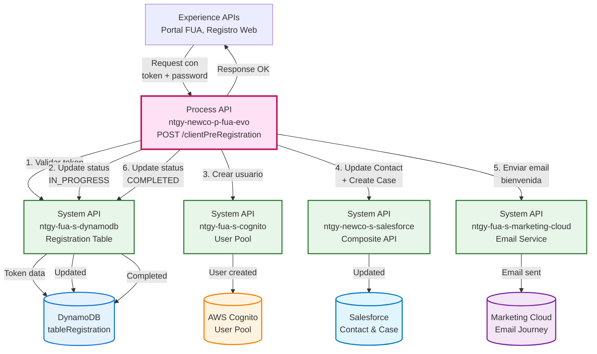
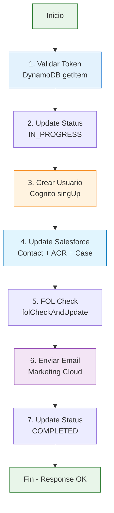
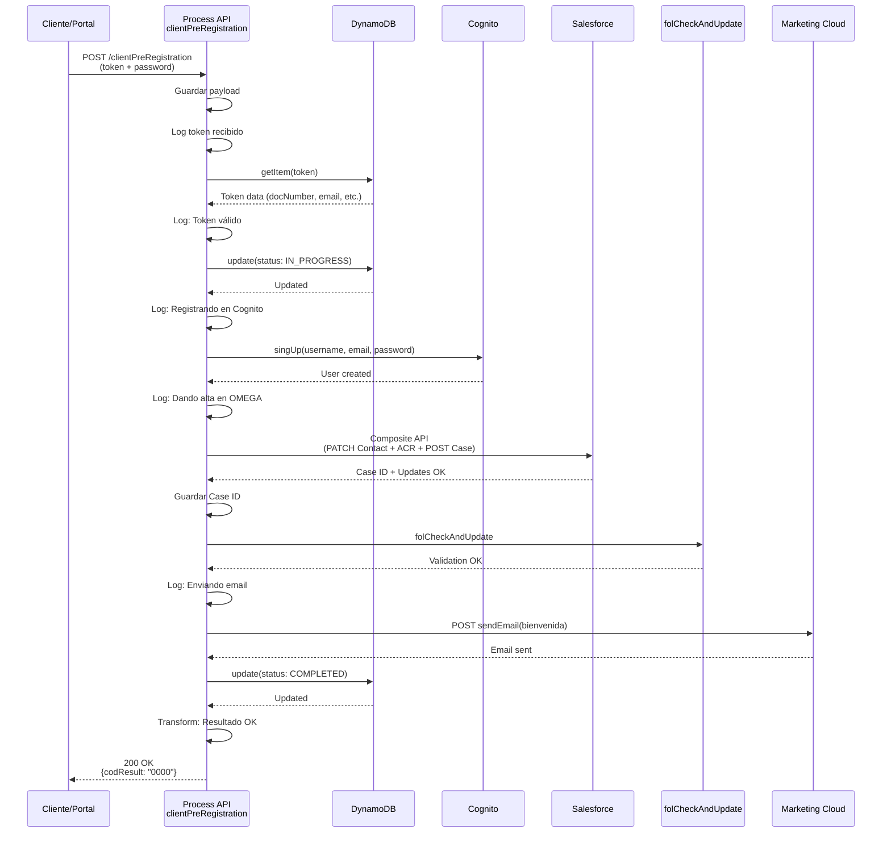
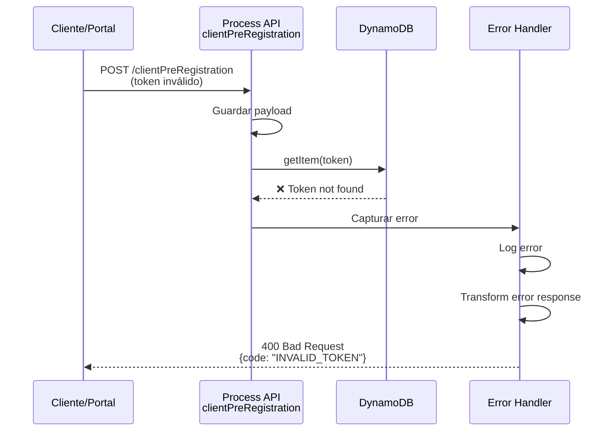
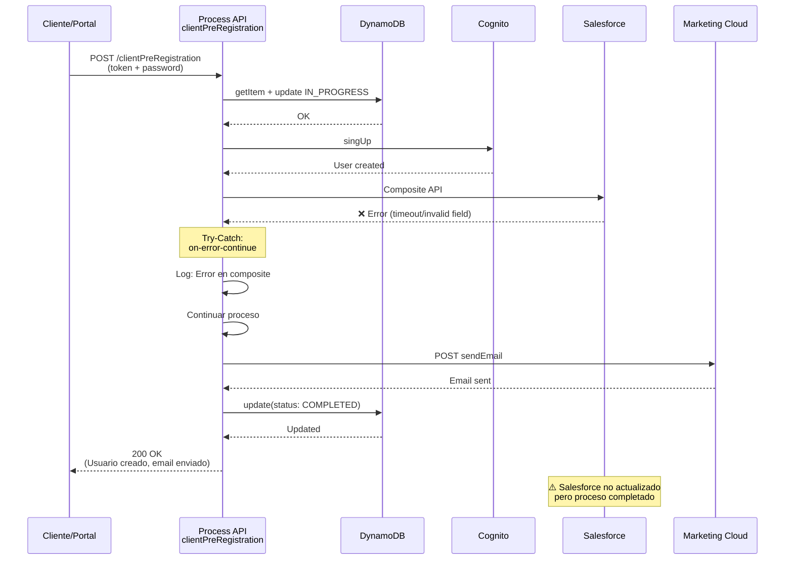

# POST /clientPreRegistration

## 📌 Descripción General

### Propósito del Endpoint

Este endpoint orquesta el proceso completo de pre-registro de clientes en el área de cliente de Naturgy. Valida el token de pre-registro, crea el usuario en AWS Cognito, actualiza el estado del contacto en Salesforce, crea un caso de gestión "AltaAreaCliente" y envía un email de bienvenida multiidioma vía Marketing Cloud.

### Tipo de API

**Capa:** Process API (API-Led Connectivity)

**Función:** Orquestación de proceso de negocio para alta de clientes en área de autoservicio

### Patrón de Integración

**Tipo:** Orquestación Compleja con Transformación

**Descripción:** Orquesta llamadas secuenciales a 4 sistemas diferentes (DynamoDB, Cognito, Salesforce, Marketing Cloud) con transformaciones de datos, validaciones y manejo de errores específico por sistema.

### Arquitectura API-Led Connectivity



---

## 💼 Propósito del Negocio

### Casos de Uso Principales

1. **Completar Registro de Cliente en Área de Cliente**
   - Cliente recibe token de pre-registro por email
   - Accede al portal y establece su contraseña
   - Sistema valida token y crea usuario en Cognito
   - **Beneficio:** Proceso de registro seguro y automatizado

2. **Activación de Contacto en Salesforce**
   - Actualiza estado del contacto a activo (`NewCo_EstadoContacto__c: true`)
   - Marca relación Account-Contact como validada en Omega
   - Crea caso de gestión "AltaAreaCliente" para seguimiento
   - **Beneficio:** Trazabilidad completa del proceso de alta

3. **Comunicación de Bienvenida Multiidioma**
   - Envía email de bienvenida en el idioma del cliente
   - Soporta 4 idiomas: castellano, euskera, gallego, catalán
   - Personalizado con nombre del cliente
   - **Beneficio:** Experiencia de usuario personalizada y profesional

### 🔗 Endpoints Dependientes

Este Process API consume los siguientes System APIs:

| System API | Endpoint | Método | Propósito |
|------------|----------|--------|-----------|
| `ntgy-fua-s-dynamodb` | `/getItem` | GET | Validar token de pre-registro |
| `ntgy-fua-s-dynamodb` | `/update` | UPDATE | Actualizar estado del registro (IN_PROGRESS, COMPLETED) |
| `ntgy-fua-s-cognito` | `/singUp` | POST | Crear usuario en AWS Cognito User Pool |
| `ntgy-newco-s-salesforce` | `/composite` | POST | Actualizar Contact, AccountContactRelation y crear Case |
| `ntgy-fua-s-marketing-cloud` | `/api/sendEmail` | POST | Enviar email de bienvenida |

### Lógica de Orquestación



**Pasos del Proceso:**

1. **Validación de Token**: Consulta DynamoDB para verificar token válido y obtener datos del pre-registro
2. **Actualización a IN_PROGRESS**: Marca el registro como en proceso con timestamp
3. **Creación de Usuario en Cognito**: 
   - Username: Número de documento (NIF/NIE)
   - Email, nombre, teléfono del pre-registro
   - Usuario confirmado automáticamente
4. **Actualización en Salesforce (Composite API)**:
   - PATCH Contact: Activa estado del contacto
   - PATCH AccountContactRelation: Marca como "Validado" en Omega
   - POST Case: Crea caso de gestión "AltaAreaCliente"
5. **Verificación FOL**: Ejecuta subflow `folCheckAndUpdate` (validación adicional)
6. **Email de Bienvenida**: Envía email personalizado en idioma del cliente
7. **Finalización**: Actualiza estado a COMPLETED en DynamoDB

### Transformaciones Aplicadas

| Campo Original (DynamoDB) | Campo Transformado (Destino) | Sistema | Transformación |
|---------------------------|------------------------------|---------|----------------|
| `token` | Token de búsqueda | DynamoDB | Directo (del request) |
| `password` | Password de usuario | Cognito | Directo (del request) |
| `docNumber` | `username` | Cognito | Del token validado |
| `email` | `email` | Cognito | Del token validado |
| `name` | `name` | Cognito | Del token validado |
| `phone` | `phoneNumber` | Cognito | Del token validado |
| `contactId` | `ContactId` | Salesforce | Del token validado |
| `accountId` | `AccountId` | Salesforce | Del token validado |
| `contactId` | `subscriberKey` | Marketing Cloud | Del token validado |
| `idioma` | `idioma` | Marketing Cloud | Mapeo condicional (ver abajo) |

**Transformación de Idioma:**
```dataweave
idioma match {
  case "Euskera" -> "euskera"
  case "Gallego" -> "gallego"
  case "Catalán" -> "catalan"
  else -> "castellano"
}
```

### Contexto Empresarial

- **Dominio:** Gestión de Clientes y Autenticación
- **Sector:** Energía - Utilities
- **División:** Naturgy España - NewCo
- **Proceso de Negocio:** Alta de clientes en área de autoservicio (FUA)

### Stakeholders

- **Clientes Finales**: Completan su registro en el área de cliente
- **Departamento de Marketing**: Gestiona comunicaciones de bienvenida
- **Equipo de CRM**: Mantiene datos actualizados en Salesforce
- **Soporte Técnico**: Resuelve incidencias de registro

### Valor de Negocio

- **Automatización**: Proceso de alta completamente automatizado sin intervención manual
- **Seguridad**: Autenticación mediante AWS Cognito con estándares de seguridad
- **Trazabilidad**: Caso de gestión en Salesforce para seguimiento
- **Experiencia del Cliente**: Email de bienvenida personalizado en su idioma
- **Reducción de Costes**: Elimina procesos manuales de alta de usuarios

### Consumidores Potenciales

Este endpoint puede ser consumido por:
- Portal web de registro FUA
- Aplicaciones móviles de registro
- Procesos de onboarding de clientes
- Sistemas de migración de clientes legacy

---

## 🔧 Especificación Técnica

### URLs por Ambiente

| Ambiente | URL Base | URL Completa |
|----------|----------|--------------|
| **Local** | `http://localhost:8081` | `http://localhost:8081/api/clientPreRegistration` |
| **Development** | `https://ntgy-newco-p-fua-evo-dev.us-e2.cloudhub.io` | `https://ntgy-newco-p-fua-evo-dev.us-e2.cloudhub.io/api/clientPreRegistration` |
| **UAT** | `https://ntgy-newco-p-fua-evo-uat.us-e2.cloudhub.io` | `https://ntgy-newco-p-fua-evo-uat.us-e2.cloudhub.io/api/clientPreRegistration` |
| **Production** | `https://ntgy-newco-p-fua-evo-pro.us-e2.cloudhub.io` | `https://ntgy-newco-p-fua-evo-pro.us-e2.cloudhub.io/api/clientPreRegistration` |

### Método HTTP

```
POST /api/clientPreRegistration
```

### Headers Requeridos

| Header | Tipo | Obligatorio | Descripción |
|--------|------|-------------|-------------|
| `Content-Type` | string | ✅ Sí | Debe ser `application/json` |
| `client_id` | string | ✅ Sí | Client ID de Anypoint Platform |
| `client_secret` | string | ✅ Sí | Client Secret de Anypoint Platform |

### Parámetros de Entrada

#### Request Body

```json
{
  "token": "string",
  "password": "string",
  "DirIp": "string"
}
```

#### Descripción de Campos

| Campo | Tipo | Obligatorio | Descripción | Ejemplo |
|-------|------|-------------|-------------|---------|
| `token` | string | ✅ Sí | Token de pre-registro recibido por email | `"abc123def456ghi789"` |
| `password` | string | ✅ Sí | Contraseña elegida por el usuario (mínimo 8 caracteres) | `"MySecureP@ss123"` |
| `DirIp` | string | ❌ No | Dirección IP del cliente (para auditoría) | `"192.168.1.100"` |

**Requisitos de Contraseña:**
- Mínimo 8 caracteres
- Al menos una letra mayúscula
- Al menos una letra minúscula
- Al menos un número
- Al menos un carácter especial

**Validación de Token:**
- El token debe existir en DynamoDB tabla `tableRegistration`
- El token no debe estar expirado
- El estado del registro debe permitir completar el proceso

### Respuestas

#### 200 OK - Éxito

```json
{
  "result": {
    "codResult": "0000",
    "msgResult": "No hay error"
  }
}
```

| Campo | Tipo | Descripción |
|-------|------|-------------|
| `result.codResult` | string | Código de resultado ("0000" = éxito) |
| `result.msgResult` | string | Mensaje descriptivo del resultado |

#### 400 Bad Request - Token Inválido o Expirado

```json
{
  "code": "INVALID_TOKEN",
  "message": "Token de pre-registro inválido o expirado",
  "details": "El token proporcionado no existe en el sistema o ha caducado"
}
```

#### 400 Bad Request - Contraseña No Cumple Requisitos

```json
{
  "code": "INVALID_PASSWORD",
  "message": "La contraseña no cumple los requisitos de seguridad",
  "details": "La contraseña debe tener al menos 8 caracteres, incluir mayúsculas, minúsculas, números y caracteres especiales"
}
```

#### 409 Conflict - Usuario Ya Existe en Cognito

```json
{
  "code": "USER_ALREADY_EXISTS",
  "message": "El usuario ya está registrado en el sistema",
  "details": "Ya existe un usuario con este número de documento en AWS Cognito"
}
```

#### 500 Internal Server Error - Error en Cognito

```json
{
  "code": "COGNITO_ERROR",
  "message": "Error al crear usuario en Cognito",
  "details": "UsernameExistsException: User already exists"
}
```

#### 500 Internal Server Error - Error en Salesforce

```json
{
  "code": "SALESFORCE_ERROR",
  "message": "Error al actualizar datos en Salesforce",
  "details": "INVALID_FIELD: No such column 'NewCo_EstadoContacto__c' on entity 'Contact'"
}
```

#### 503 Service Unavailable - Sistema Backend No Disponible

```json
{
  "code": "SERVICE_UNAVAILABLE",
  "message": "Servicio temporalmente no disponible",
  "details": "DynamoDB connection timeout after 30000ms"
}
```

### Autenticación

- **Tipo:** Client ID & Client Secret (Anypoint Platform)
- **Headers:** `client_id` y `client_secret`

### Timeouts

| Tipo | Valor | Descripción |
|------|-------|-------------|
| **Request Timeout (DynamoDB)** | 30 segundos | Timeout para operaciones en DynamoDB |
| **Request Timeout (Cognito)** | 30 segundos | Timeout para creación de usuario |
| **Request Timeout (Salesforce)** | 60 segundos | Timeout para operaciones composite |
| **Request Timeout (Marketing Cloud)** | 30 segundos | Timeout para envío de email |
| **Connection Timeout** | 10 segundos | Timeout de conexión HTTP |

---

## 🏗️ Implementación Técnica

### Arquitectura del Flow

```mermaid
flowchart TD
    Start([HTTP POST Request]) --> LogStart[Log: Inicio flujo]
    LogStart --> SavePayload[Guardar payload<br/>en entryPayload]
    SavePayload --> LogToken[Log: Token recibido]
    LogToken --> SetDirIp[Set variable DirIp]
    SetDirIp --> PrepDynGet[Transform: Input<br/>DynamoDB getItem]
    PrepDynGet --> GetToken[DynamoDB: getItem<br/>Validar token]
    GetToken --> LogValid[Log: Token válido]
    LogValid --> PrepDynUpd1[Transform: Update<br/>status IN_PROGRESS]
    PrepDynUpd1 --> UpdateIP[DynamoDB: update<br/>Status IN_PROGRESS]
    UpdateIP --> LogReg[Log: Registrando<br/>cliente en Cognito]
    LogReg --> PrepCog[Transform: Input<br/>Cognito singUp]
    PrepCog --> CreateUser[Cognito: singUp<br/>Crear usuario]
    CreateUser --> LogOmega[Log: Dando alta<br/>en OMEGA]
    LogOmega --> TrySF{Try Block<br/>Salesforce}
    
    TrySF --> PrepSF[Transform: Input<br/>Salesforce Composite]
    PrepSF --> CallSF[Salesforce: Composite<br/>Update + Create]
    CallSF --> ExtractCase[Extraer Case ID<br/>de respuesta]
    ExtractCase --> SaveCase[Guardar Case ID<br/>en variable]
    SaveCase --> SetVars[Set accountId<br/>y contactId]
    SetVars --> CallFOL[Flow-ref:<br/>folCheckAndUpdate]
    CallFOL --> LogFin[Log: Fin proceso<br/>registro Omega]
    LogFin --> LogEmail[Log: Enviando<br/>mail bienvenida]
    LogEmail --> PrepEmail[Transform: Mapeo<br/>idioma + payload]
    PrepEmail --> SendEmail[Marketing Cloud:<br/>POST sendEmail]
    SendEmail --> PrepDynUpd2[Transform: Update<br/>status COMPLETED]
    PrepDynUpd2 --> UpdateComp[DynamoDB: update<br/>Status COMPLETED]
    UpdateComp --> RespOK[Transform:<br/>Resultado OK]
    RespOK --> LogEnd[Log: Fin flujo]
    LogEnd --> RecoverCase[Recuperar Case ID]
    RecoverCase --> End([HTTP Response 200])
    
    TrySF -->|Error| LogErr[Log: Error en<br/>composite]
    LogErr --> ExtractCase
    
    style Start fill:#e8f5e9,stroke:#2e7d32
    style End fill:#e8f5e9,stroke:#2e7d32
    style TrySF fill:#fff9c4,stroke:#f57f17
    style GetToken fill:#e3f2fd,stroke:#1976d2
    style CreateUser fill:#fff3e0,stroke:#f57c00
    style CallSF fill:#e1f5fe,stroke:#0277bd
    style SendEmail fill:#f3e5f5,stroke:#7b1fa2
```



### Transformaciones DataWeave

#### 1. Transformación: Input DynamoDB getItem

**Ubicación en código:** Inline en `clientPreRegistrationFlow`

```dataweave
%dw 2.0
output application/json
---
{
    "key": "token",
    "keyValue": vars.entryPayload.token,
    "table": p('fua-s-dynamo.tables.tableRegistration'),
    "operationDynamo": "getItem"
}
```

**Propósito:** Preparar consulta para validar token de pre-registro en DynamoDB

#### 2. Transformación: Update Status IN_PROGRESS

**Ubicación en código:** Inline en `clientPreRegistrationFlow`

```dataweave
%dw 2.0
output application/json

var updatedDate = ((now()) >> "CET") as String {format: "dd-MM-yyyy HH:mm:ss"}

---
{
    "body":{
        "keys": {
            "token": vars.dynamoItem.item.token
        },
        "updateValues":[
            {
                "name": "status",
                "value": "IN_PROGRESS"
            },
            {
                "name": "updatedDate",
                "value": updatedDate
            }
        ]
    },
    "operationDynamo":"update",
    "table": p('fua-s-dynamo.tables.tableRegistration')
}
```

**Lógica Destacada:**
- Genera timestamp en zona horaria CET
- Actualiza estado y fecha de modificación

#### 3. Transformación: Input Cognito singUp

**Ubicación en código:** Inline en `clientPreRegistrationFlow`

```dataweave
%dw 2.0
output application/json
---
{
    "username": vars.dynamoItem.item.docNumber,
    "email": vars.dynamoItem.item.email,
    "name": vars.dynamoItem.item.name,
    "password": vars.entryPayload.password,
    "phoneNumber": vars.dynamoItem.item.phone,
    "confirmedUser": "true",
    "operation": "singUp"
}
```

**Campos Clave:**
- **username**: Número de documento (NIF/NIE) del cliente
- **confirmedUser**: "true" para confirmar automáticamente (sin verificación de email)
- **password**: Contraseña proporcionada por el usuario en el request

#### 4. Transformación: Input Salesforce Composite

**Ubicación en código:** Inline en `clientPreRegistrationFlow`

```dataweave
%dw 2.0
output application/json
---
{
    "body":{
        "allOrNone" : true,
        "collateSubrequests": false,
        "compositeRequest" : [
            {
                "method": "PATCH",
                "url":"/services/data/v52.0/sobjects/Contact/" ++ vars.dynamoItem.item.contactId,
                "referenceId":"refContact",
                "body":{
                    "NewCo_EstadoContacto__c": true
                }
            },
            {
                "method" : "PATCH",
                "url" : "/services/data/v52.0/sobjects/AccountContactRelation/NewCo_ExternalACRId__c/"++ 
                        vars.dynamoItem.item.accountId ++ "_" ++ vars.dynamoItem.item.contactId,
                "referenceId" : "refAccountContactRelation",
                "body" : {
                    "newco_estadologinomega__c": "Validado",
                    "NewCo_FechaMod__c": now() as DateTime as String {format: 'uuuu-MM-dd'}
                }
            },
            {
                "method" : "POST",
                "url" : "/services/data/v52.0/sobjects/Case",
                "referenceId" : "refCaseGestion",
                "body" : { 
                    "NewCo_Recordtype__c" : "Gestion",
                    "AccountId": vars.dynamoItem.item.accountId,
                    "ContactId" : vars.dynamoItem.item.contactId,
                    "Priority" : "02",
                    "Origin" : "FUA",
                    "NewCo_CorrelationId__c": correlationId,
                    "acn_fld_Tittle__r": { 
                        "NewCo_ExternalId__c": "AltaAreaCliente"
                    },
                    ("NewCo_IdentificadorDeIntencion__c": vars.motorIntentionId) 
                        if (!isEmpty(vars.motorIntentionId))
                }
            }
        ]
    },
    "operationSalesforce":"composite"
}
```

**Operaciones en Composite:**
1. **PATCH Contact**: Activa estado del contacto
2. **PATCH AccountContactRelation**: Marca como "Validado" con fecha de modificación
3. **POST Case**: Crea caso de gestión "AltaAreaCliente"

#### 5. Transformación: Mapeo de Idioma para Marketing Cloud

**Ubicación en código:** Inline en `clientPreRegistrationFlow`

```dataweave
%dw 2.0
output application/json

var idioma = vars.dynamoItem.item.idioma match {
  case "Euskera" -> "euskera"
  case "Gallego" -> "gallego"
  case "Catalán" -> "catalan"
  else -> "castellano"
}

---
{
    "contactKey": vars.dynamoItem.item.contactId,
    "eventDefinitionKey":  p('s-marketing-cloud.eventDefRegistro'),
    "data":{
        "subscriberKey": vars.dynamoItem.item.contactId,
        "ContactKey": vars.dynamoItem.item.contactId,
        "emailAddress": vars.dynamoItem.item.email,
        "nombre": vars.dynamoItem.item.name,
        "tipoEmail": p('s-marketing-cloud.emailType.bienvenidaAC'),
        "idioma": idioma
    }
}
```

**Lógica de Idioma:**
- Mapea nombres de idiomas a códigos lowercase
- Default: "castellano" si no coincide con ninguno

#### 6. Transformación: Update Status COMPLETED

**Ubicación en código:** Inline en `clientPreRegistrationFlow`

```dataweave
%dw 2.0
output application/json

var updatedDate = ((now()) >> "CET") as String {format: "dd-MM-yyyy HH:mm:ss"}

---
{
    "body":{
        "keys": {
            "token": vars.dynamoItem.item.token
        },
        "updateValues":[
            {
                "name": "status",
                "value": "COMPLETED"
            },
            {
                "name": "updatedDate",
                "value": updatedDate
            }
        ]
    },
    "operationDynamo":"update",
    "table": p('fua-s-dynamo.tables.tableRegistration')
}
```

### Patrones de Diseño

**Patrón:** Saga Pattern (Orquestación Secuencial)

**Justificación:** 
- El proceso involucra múltiples sistemas con dependencias secuenciales
- Cada paso depende del éxito del anterior
- Se mantiene estado en DynamoDB (IN_PROGRESS → COMPLETED)
- No hay rollback automático, pero el estado permite reintentos manuales

**Patrón:** Try-Catch con Continuación

**Justificación:**
- La llamada a Salesforce está en un bloque try-catch con `on-error-continue`
- Si falla Salesforce, el proceso continúa (no bloquea el registro)
- Permite completar el registro incluso si hay problemas temporales en Salesforce

**Patrón:** Content Enrichment

**Justificación:**
- El token inicial se enriquece con todos los datos del pre-registro desde DynamoDB
- Los datos se propagan a través de variables a todos los sistemas downstream

### Diagramas de Secuencia

#### 1. Flujo Normal de Éxito



#### 2. Flujo con Token Inválido



#### 3. Flujo con Error en Salesforce (Continuación)



### Manejo de Errores

**Estrategia:** Error handling con logging detallado, try-catch selectivo y respuestas estandarizadas

**Tipos de Errores Manejados:**

1. **Errores de DynamoDB (Token)**
   - Token no encontrado
   - Token expirado
   - Error de conexión a DynamoDB
   - **Acción:** Retornar 400 con mensaje de token inválido

2. **Errores de Cognito**
   - Usuario ya existe (`UsernameExistsException`)
   - Contraseña no cumple requisitos
   - Error de conexión a Cognito
   - **Acción:** Retornar 409 (usuario existe) o 500 (error técnico)

3. **Errores de Salesforce**
   - Campos inválidos
   - IDs no encontrados
   - Timeout de conexión
   - **Acción:** Log error pero continuar proceso (try-catch con `on-error-continue`)

4. **Errores de Marketing Cloud**
   - Email no enviado
   - Timeout de conexión
   - **Acción:** Retornar 500, pero usuario ya está creado

**Logging:**
- Todos los pasos principales se registran con nivel INFO
- Errores se registran con nivel ERROR
- Se incluye información de contexto (token, docNumber)

**Manejo Especial de Salesforce:**
- Bloque try-catch con `on-error-continue`
- Si falla Salesforce, el proceso continúa
- Permite completar el registro incluso con problemas en CRM
- El usuario puede usar el sistema aunque Salesforce falle

---

## 💻 Ejemplos de Uso

### Ejemplo 1: Registro Exitoso Completo

#### Request

**Headers:**
```http
POST /api/clientPreRegistration HTTP/1.1
Host: ntgy-newco-p-fua-evo-dev.us-e2.cloudhub.io
Content-Type: application/json
client_id: YOUR_CLIENT_ID
client_secret: YOUR_CLIENT_SECRET
```

**Body:**
```json
{
  "token": "abc123def456ghi789jkl012mno345",
  "password": "MySecureP@ss123",
  "DirIp": "192.168.1.100"
}
```

#### Response (200 OK)

```json
{
  "result": {
    "codResult": "0000",
    "msgResult": "No hay error"
  }
}
```

#### cURL

```bash
curl -X POST "https://ntgy-newco-p-fua-evo-dev.us-e2.cloudhub.io/api/clientPreRegistration" \
  -H "Content-Type: application/json" \
  -H "client_id: YOUR_CLIENT_ID" \
  -H "client_secret: YOUR_CLIENT_SECRET" \
  -d '{
    "token": "abc123def456ghi789jkl012mno345",
    "password": "MySecureP@ss123",
    "DirIp": "192.168.1.100"
  }'
```

---

### Ejemplo 2: Error - Token Inválido

#### Request

**Body con token inexistente:**
```json
{
  "token": "invalid_token_12345",
  "password": "MySecureP@ss123"
}
```

#### Response (400 Bad Request)

```json
{
  "code": "INVALID_TOKEN",
  "message": "Token de pre-registro inválido o expirado",
  "details": "El token proporcionado no existe en el sistema o ha caducado"
}
```

---

### Ejemplo 3: Error - Usuario Ya Existe

#### Request

**Body con token de usuario ya registrado:**
```json
{
  "token": "abc123def456ghi789jkl012mno345",
  "password": "MySecureP@ss123"
}
```

#### Response (409 Conflict)

```json
{
  "code": "USER_ALREADY_EXISTS",
  "message": "El usuario ya está registrado en el sistema",
  "details": "Ya existe un usuario con este número de documento en AWS Cognito"
}
```

---

### Ejemplo 4: JavaScript (Fetch API)

```javascript
const completeRegistration = async (token, password) => {
  try {
    const response = await fetch(
      'https://ntgy-newco-p-fua-evo-dev.us-e2.cloudhub.io/api/clientPreRegistration',
      {
        method: 'POST',
        headers: {
          'Content-Type': 'application/json',
          'client_id': 'YOUR_CLIENT_ID',
          'client_secret': 'YOUR_CLIENT_SECRET'
        },
        body: JSON.stringify({
          token: token,
          password: password,
          DirIp: window.location.hostname // IP del cliente
        })
      }
    );

    if (!response.ok) {
      const error = await response.json();
      
      // Manejar errores específicos
      if (error.code === 'INVALID_TOKEN') {
        throw new Error('El enlace de registro ha expirado. Solicita uno nuevo.');
      } else if (error.code === 'USER_ALREADY_EXISTS') {
        throw new Error('Ya tienes una cuenta. Intenta iniciar sesión.');
      } else if (error.code === 'INVALID_PASSWORD') {
        throw new Error('La contraseña no cumple los requisitos de seguridad.');
      } else {
        throw new Error('Error al completar el registro. Inténtalo de nuevo.');
      }
    }

    const data = await response.json();
    console.log('Registro completado exitosamente');
    return data;
    
  } catch (error) {
    console.error('Error en registro:', error);
    throw error;
  }
};

// Uso en formulario de registro
document.getElementById('registrationForm').addEventListener('submit', async (e) => {
  e.preventDefault();
  
  const token = new URLSearchParams(window.location.search).get('token');
  const password = document.getElementById('password').value;
  const confirmPassword = document.getElementById('confirmPassword').value;
  
  // Validar contraseñas coinciden
  if (password !== confirmPassword) {
    alert('Las contraseñas no coinciden');
    return;
  }
  
  try {
    await completeRegistration(token, password);
    alert('¡Registro completado! Revisa tu email de bienvenida.');
    window.location.href = '/login';
  } catch (error) {
    alert(error.message);
  }
});
```

---

### Ejemplo 5: Python (Requests)

```python
import requests
import re

def validate_password(password):
    """
    Valida que la contraseña cumpla los requisitos
    
    Returns:
        tuple: (is_valid, error_message)
    """
    if len(password) < 8:
        return False, "La contraseña debe tener al menos 8 caracteres"
    
    if not re.search(r'[A-Z]', password):
        return False, "La contraseña debe incluir al menos una letra mayúscula"
    
    if not re.search(r'[a-z]', password):
        return False, "La contraseña debe incluir al menos una letra minúscula"
    
    if not re.search(r'\d', password):
        return False, "La contraseña debe incluir al menos un número"
    
    if not re.search(r'[!@#$%^&*(),.?":{}|<>]', password):
        return False, "La contraseña debe incluir al menos un carácter especial"
    
    return True, None

def complete_pre_registration(
    client_id,
    client_secret,
    token,
    password,
    dir_ip=None
):
    """
    Completa el proceso de pre-registro de un cliente
    
    Args:
        client_id: Client ID de Anypoint Platform
        client_secret: Client Secret de Anypoint Platform
        token: Token de pre-registro recibido por email
        password: Contraseña elegida por el usuario
        dir_ip: Dirección IP del cliente (opcional)
    
    Returns:
        dict: Respuesta del servidor
    
    Raises:
        ValueError: Si la contraseña no cumple requisitos
        Exception: Si hay error en el registro
    """
    # Validar contraseña antes de enviar
    is_valid, error_msg = validate_password(password)
    if not is_valid:
        raise ValueError(error_msg)
    
    url = 'https://ntgy-newco-p-fua-evo-dev.us-e2.cloudhub.io/api/clientPreRegistration'
    
    headers = {
        'Content-Type': 'application/json',
        'client_id': client_id,
        'client_secret': client_secret
    }
    
    payload = {
        'token': token,
        'password': password
    }
    
    if dir_ip:
        payload['DirIp'] = dir_ip
    
    try:
        response = requests.post(url, headers=headers, json=payload, timeout=60)
        
        if response.status_code == 200:
            data = response.json()
            print(f"✅ Registro completado exitosamente")
            print(f"   Revisa tu email para el mensaje de bienvenida")
            return data
            
        elif response.status_code == 400:
            error = response.json()
            if error.get('code') == 'INVALID_TOKEN':
                raise Exception("❌ Token inválido o expirado. Solicita un nuevo enlace de registro.")
            elif error.get('code') == 'INVALID_PASSWORD':
                raise Exception("❌ La contraseña no cumple los requisitos de seguridad.")
            else:
                raise Exception(f"❌ Error de validación: {error.get('message')}")
                
        elif response.status_code == 409:
            raise Exception("❌ Ya existe una cuenta con estos datos. Intenta iniciar sesión.")
            
        elif response.status_code == 500:
            error = response.json()
            raise Exception(f"❌ Error del servidor: {error.get('message')}")
            
        else:
            raise Exception(f"❌ Error inesperado: {response.status_code}")
            
    except requests.exceptions.Timeout:
        raise Exception("❌ Timeout: El servidor tardó demasiado en responder. Inténtalo de nuevo.")
    except requests.exceptions.ConnectionError:
        raise Exception("❌ Error de conexión: No se pudo conectar con el servidor.")
    except Exception as e:
        raise

# Ejemplo de uso
if __name__ == '__main__':
    import sys
    
    # Simular recepción de token desde URL o email
    token_from_email = "abc123def456ghi789jkl012mno345"
    
    # Solicitar contraseña al usuario
    print("=== Completar Registro de Cliente ===\n")
    print("Requisitos de contraseña:")
    print("  - Mínimo 8 caracteres")
    print("  - Al menos una mayúscula")
    print("  - Al menos una minúscula")
    print("  - Al menos un número")
    print("  - Al menos un carácter especial\n")
    
    password = input("Ingresa tu contraseña: ")
    confirm_password = input("Confirma tu contraseña: ")
    
    if password != confirm_password:
        print("❌ Las contraseñas no coinciden")
        sys.exit(1)
    
    try:
        result = complete_pre_registration(
            client_id='YOUR_CLIENT_ID',
            client_secret='YOUR_CLIENT_SECRET',
            token=token_from_email,
            password=password,
            dir_ip='192.168.1.100'
        )
        
        print("\n🎉 ¡Registro completado con éxito!")
        print("   Ahora puedes iniciar sesión en el área de cliente")
        
    except ValueError as e:
        print(f"\n❌ Error de validación: {e}")
        sys.exit(1)
    except Exception as e:
        print(f"\n{e}")
        sys.exit(1)
```

---

### Ejemplo 6: Postman Collection

```json
{
  "info": {
    "name": "Client Pre-Registration API",
    "schema": "https://schema.getpostman.com/json/collection/v2.1.0/collection.json"
  },
  "item": [
    {
      "name": "Complete Pre-Registration",
      "request": {
        "method": "POST",
        "header": [
          {
            "key": "Content-Type",
            "value": "application/json"
          },
          {
            "key": "client_id",
            "value": "{{client_id}}"
          },
          {
            "key": "client_secret",
            "value": "{{client_secret}}"
          }
        ],
        "body": {
          "mode": "raw",
          "raw": "{\n  \"token\": \"{{registration_token}}\",\n  \"password\": \"{{user_password}}\",\n  \"DirIp\": \"{{$randomIP}}\"\n}"
        },
        "url": {
          "raw": "{{base_url}}/api/clientPreRegistration",
          "host": ["{{base_url}}"],
          "path": ["api", "clientPreRegistration"]
        }
      },
      "response": []
    }
  ]
}
```

**Variables de entorno sugeridas:**
```json
{
  "base_url": "https://ntgy-newco-p-fua-evo-dev.us-e2.cloudhub.io",
  "client_id": "YOUR_CLIENT_ID",
  "client_secret": "YOUR_CLIENT_SECRET",
  "registration_token": "abc123def456ghi789jkl012mno345",
  "user_password": "MySecureP@ss123"
}
```

---

### Ejemplo 7: Validación de Contraseña (Frontend)

```javascript
/**
 * Valida requisitos de contraseña en tiempo real
 */
class PasswordValidator {
  constructor() {
    this.requirements = {
      minLength: {
        test: (pwd) => pwd.length >= 8,
        message: 'Mínimo 8 caracteres'
      },
      hasUpperCase: {
        test: (pwd) => /[A-Z]/.test(pwd),
        message: 'Al menos una letra mayúscula'
      },
      hasLowerCase: {
        test: (pwd) => /[a-z]/.test(pwd),
        message: 'Al menos una letra minúscula'
      },
      hasNumber: {
        test: (pwd) => /\d/.test(pwd),
        message: 'Al menos un número'
      },
      hasSpecialChar: {
        test: (pwd) => /[!@#$%^&*(),.?":{}|<>]/.test(pwd),
        message: 'Al menos un carácter especial'
      }
    };
  }

  validate(password) {
    const results = {};
    let allValid = true;

    for (const [key, requirement] of Object.entries(this.requirements)) {
      const isValid = requirement.test(password);
      results[key] = {
        valid: isValid,
        message: requirement.message
      };
      if (!isValid) allValid = false;
    }

    return {
      isValid: allValid,
      requirements: results
    };
  }

  getStrength(password) {
    const validation = this.validate(password);
    const validCount = Object.values(validation.requirements)
      .filter(r => r.valid).length;
    
    if (validCount === 0) return 'muy-debil';
    if (validCount <= 2) return 'debil';
    if (validCount <= 3) return 'media';
    if (validCount <= 4) return 'fuerte';
    return 'muy-fuerte';
  }
}

// Uso en formulario
const validator = new PasswordValidator();
const passwordInput = document.getElementById('password');
const strengthIndicator = document.getElementById('strength');
const requirementsList = document.getElementById('requirements');

passwordInput.addEventListener('input', (e) => {
  const password = e.target.value;
  const validation = validator.validate(password);
  const strength = validator.getStrength(password);

  // Actualizar indicador de fortaleza
  strengthIndicator.className = `strength-${strength}`;
  strengthIndicator.textContent = strength.replace('-', ' ').toUpperCase();

  // Actualizar lista de requisitos
  requirementsList.innerHTML = Object.entries(validation.requirements)
    .map(([key, req]) => `
      <li class="${req.valid ? 'valid' : 'invalid'}">
        ${req.valid ? '✓' : '✗'} ${req.message}
      </li>
    `).join('');
});
```
