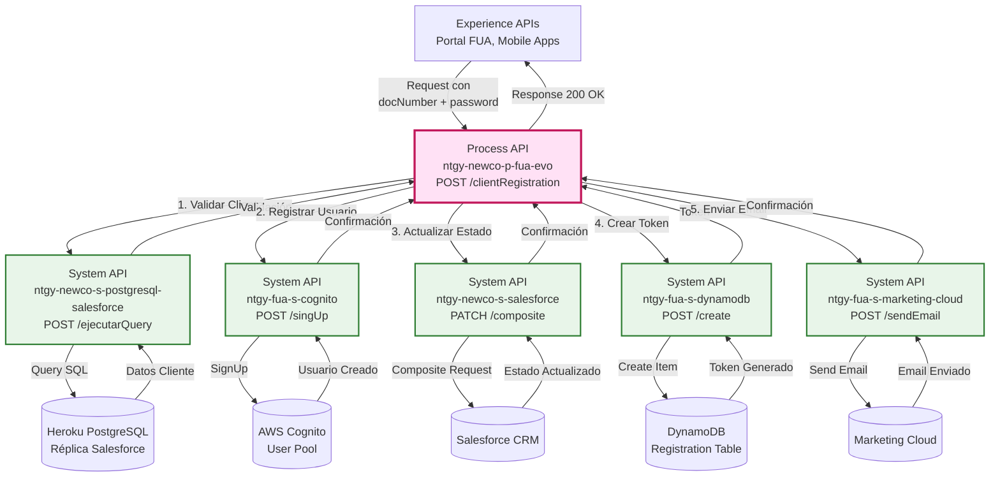
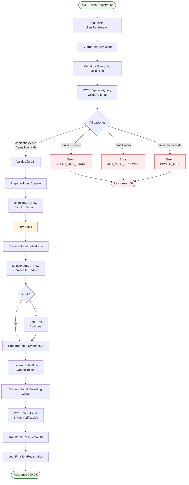
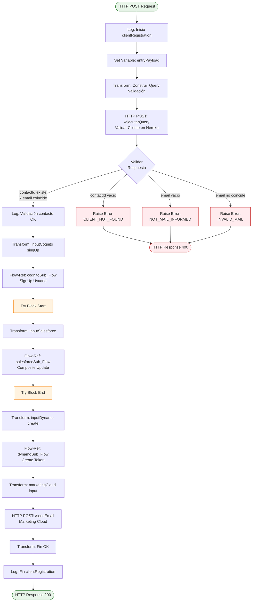
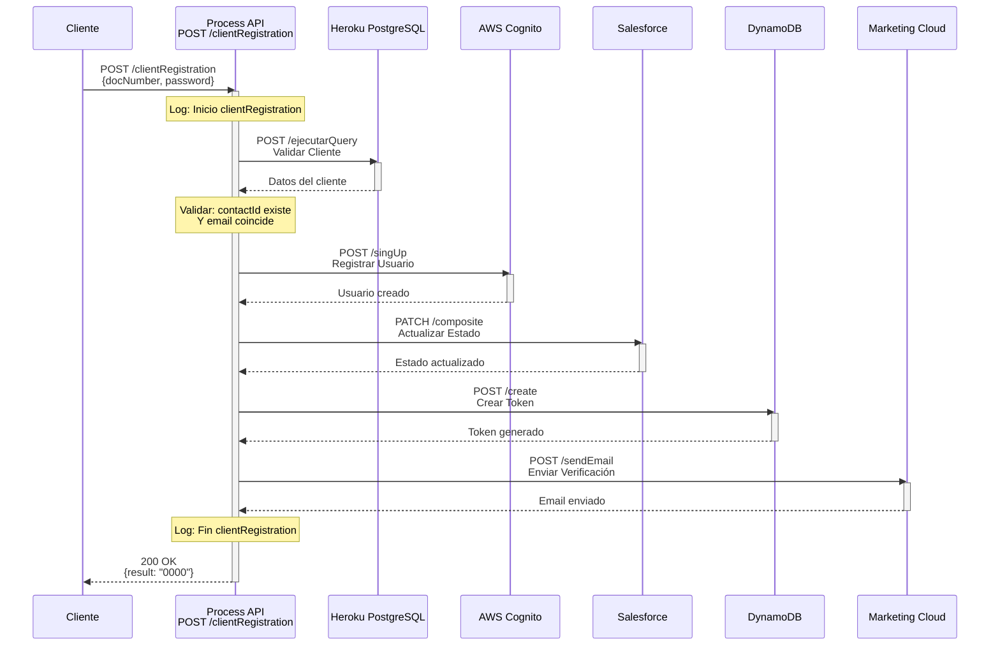
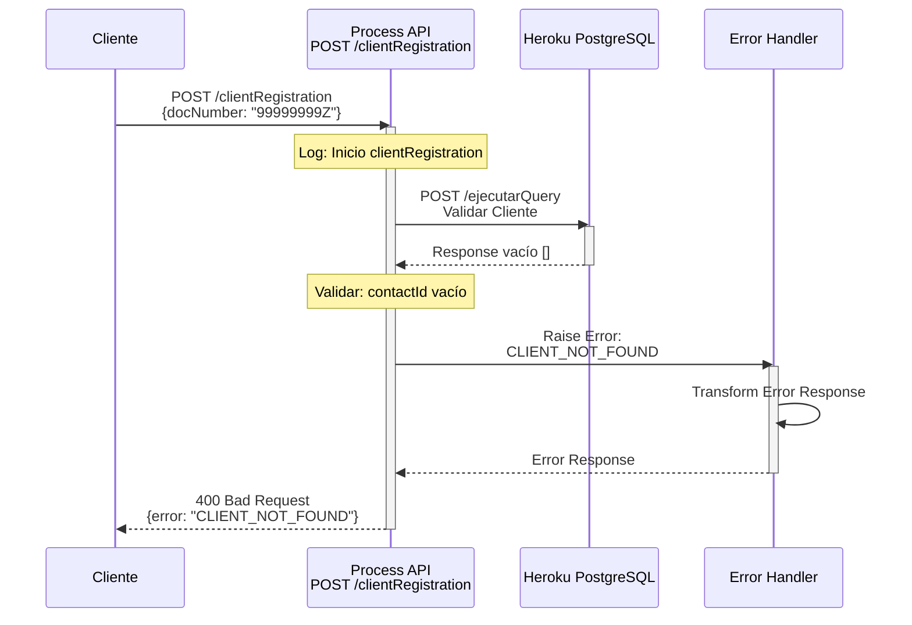
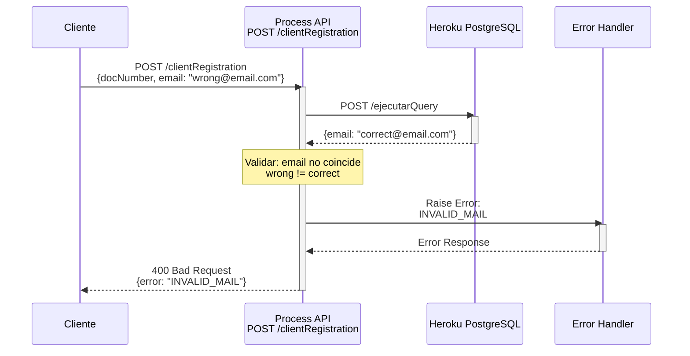
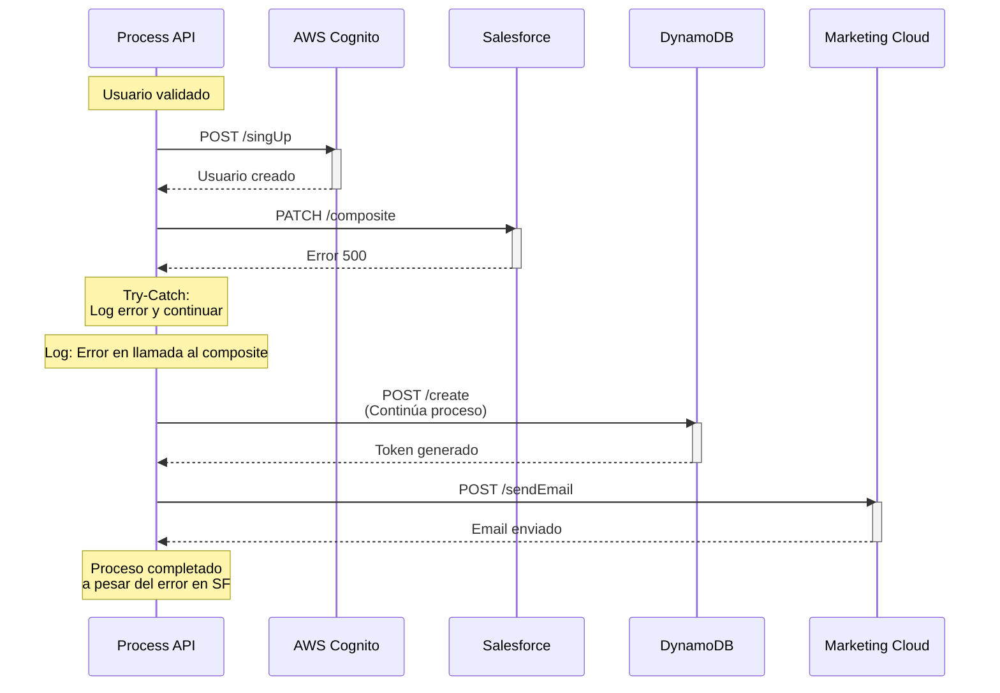

# POST /clientRegistration

## 📌 Descripción General

### Propósito del Endpoint

Este endpoint gestiona el proceso completo de registro de un nuevo usuario en el portal FUA. Orquesta múltiples sistemas para validar la identidad del cliente, crear su cuenta de usuario, actualizar su estado en Salesforce, generar un token de verificación y enviar un email de confirmación. Es un proceso crítico que garantiza la seguridad y consistencia de datos a través de todo el ecosistema.

### Tipo de API

**Capa:** Process API (API-Led Connectivity)

**Función:** Orquestación completa del proceso de registro de usuarios

### Patrón de Integración

**Tipo:** Orquestación Multi-Sistema con Validaciones

**Descripción:** Ejecuta un flujo secuencial que valida al cliente en Salesforce, registra el usuario en Cognito, actualiza estados en Salesforce, crea un registro de token en DynamoDB y envía un email de verificación via Marketing Cloud. Implementa validaciones de negocio estrictas y manejo de errores específico.

### Arquitectura API-Led Connectivity



---

## 💼 Propósito del Negocio

### Casos de Uso Principales

1. **Registro de Nuevo Usuario en Portal FUA**
   - Cliente existente en Salesforce solicita acceso al portal
   - Validación de identidad mediante documento y email
   - Creación de credenciales de acceso seguras

2. **Verificación de Identidad Multi-Factor**
   - Validación de datos en Salesforce (cliente debe existir)
   - Verificación de email (debe coincidir con Salesforce)
   - Confirmación via email con token de verificación

3. **Activación de Cuenta de Usuario**
   - Registro en AWS Cognito para autenticación
   - Actualización de estado en Salesforce
   - Generación de token temporal para verificación

### 🔗 Endpoints Dependientes

Este Process API consume los siguientes System APIs:

| System API | Endpoint | Método | Propósito |
|------------|----------|--------|-----------|
| `ntgy-newco-s-postgresql-salesforce` | `/ejecutarQuery` | POST | Valida existencia del cliente y obtiene datos |
| `ntgy-fua-s-cognito` | `/singUp` | POST | Registra usuario en AWS Cognito |
| `ntgy-newco-s-salesforce` | `/composite` | PATCH | Actualiza estado de contacto y relaciones |
| `ntgy-fua-s-dynamodb` | `/create` | POST | Crea registro de token de verificación |
| `ntgy-fua-s-marketing-cloud` | `/sendEmail` | POST | Envía email de verificación al usuario |

### Lógica de Orquestación



**Pasos del Proceso:**

1. **Validación de Cliente**: Consulta en Heroku PostgreSQL para verificar existencia y datos del cliente
2. **Validaciones de Negocio**: Verifica que el cliente existe, tiene email y coincide con el proporcionado
3. **Registro en Cognito**: Crea usuario en AWS Cognito con username = docNumber
4. **Actualización Salesforce**: Marca contacto como activo y actualiza estado de login (try-catch)
5. **Generación de Token**: Crea registro en DynamoDB con token UUID y fecha de expiración
6. **Envío de Email**: Envía email de verificación via Marketing Cloud con el token
7. **Respuesta Exitosa**: Retorna confirmación de registro completado

### Transformaciones Aplicadas

#### Validación de Cliente (Heroku → Variables)

| Campo Original (PostgreSQL) | Variable Interna | Uso |
|-----------------------------|------------------|-----|
| `contactid` | `respValidation[0].contactid` | Identificador del contacto |
| `accountid` | `respValidation[0].accountid` | Identificador de la cuenta |
| `email` | `respValidation[0].email` | Email para validación |
| `newco_preferredlanguage__c` | `respValidation[0].idioma` | Idioma preferido |
| `mobilephone` | `respValidation[0].mobilephone` | Teléfono móvil |
| `name` | `respValidation[0].name` | Nombre completo |
| `newco_estadologinomega__c` | `respValidation[0].newco_estadologinomega__c` | Estado del login |
| `roles` | `respValidation[0].roles` | Rol del cliente |

#### Request → Cognito SignUp

| Campo Request | Campo Cognito | Transformación |
|---------------|---------------|----------------|
| `docNumber` | `username` | Directo |
| `email` (validado) | `email` | Desde Salesforce |
| `password` | `password` | Directo |
| N/A | `name` | Desde Salesforce |
| N/A | `phoneNumber` | Desde Salesforce |
| N/A | `confirmedUser` | Fijo: "false" |
| N/A | `operation` | Fijo: "singUp" |

#### Salesforce Composite Update

| Operación | Objeto | Campo | Valor |
|-----------|--------|-------|-------|
| PATCH | Contact | `NewCo_EstadoContacto__c` | `true` |
| PATCH (condicional) | AccountContactRelation | `newco_estadologinomega__c` | `"Pendiente"` |
| PATCH (condicional) | AccountContactRelation | `NewCo_FechaMod__c` | Fecha actual |

**Condición:** Solo actualiza AccountContactRelation si `newco_estadologinomega__c == "Baja"`

#### DynamoDB Token Creation

| Campo | Valor | Origen |
|-------|-------|--------|
| `docNumber` | Request | Directo |
| `docType` | "NIF" | Fijo |
| `accountId` | Salesforce | Cuenta principal (rol 01) o contactAccountId |
| `contactId` | Salesforce | contactid |
| `idioma` | Salesforce | idioma |
| `phone` | Salesforce | mobilephone |
| `email` | Salesforce | email |
| `name` | Salesforce | name |
| `status` | "IN_PROGRESS" | Fijo |
| `token` | UUID generado | uuid() |
| `operation` | "registration" | Fijo |
| `emailUpdated` | "Y" | Fijo |
| `tokenExpirationDate` | Calculado | now() + caducidad |

#### Marketing Cloud Email

| Campo | Valor | Transformación |
|-------|-------|----------------|
| `contactKey` | contactid | Directo |
| `eventDefinitionKey` | Configuración | Property |
| `subscriberKey` | contactid | Directo |
| `emailAddress` | email | Directo |
| `nombre` | name | Directo |
| `tipoEmail` | Configuración | Property: verificacionAC |
| `token` | Token generado | Desde DynamoDB |
| `idioma` | Idioma mapeado | Euskera/Gallego/Catalán/Castellano |

### Contexto Empresarial

- **Dominio:** Gestión de Usuarios y Autenticación
- **Sector:** Energía - Utilities
- **División:** Naturgy España - NewCo
- **Proceso de Negocio:** Onboarding de clientes al portal de autoservicio FUA

### Stakeholders

- **Clientes Finales**: Necesitan registrarse para acceder al portal FUA
- **Equipo de Seguridad**: Gestiona políticas de autenticación y verificación
- **Equipo de Marketing**: Gestiona comunicaciones de bienvenida
- **Equipo de Soporte**: Asiste en problemas de registro

### Valor de Negocio

- **Seguridad**: Validación multi-factor antes de crear cuenta
- **Automatización**: Proceso completamente automatizado sin intervención manual
- **Trazabilidad**: Registro completo del proceso en múltiples sistemas
- **Experiencia de Usuario**: Proceso simple con verificación por email

### Consumidores Potenciales

Este endpoint puede ser consumido por:
- Portal web FUA
- Aplicaciones móviles de clientes
- Formularios de registro en sitios web corporativos
- Sistemas de onboarding de clientes

---

## 🔧 Especificación Técnica

### URLs por Ambiente

| Ambiente | URL Base | URL Completa |
|----------|----------|--------------|
| **Local** | `http://localhost:8081` | `http://localhost:8081/api/clientRegistration` |
| **Development** | `https://ntgy-newco-p-fua-evo-dev.us-e2.cloudhub.io` | `https://ntgy-newco-p-fua-evo-dev.us-e2.cloudhub.io/api/clientRegistration` |
| **UAT** | `https://ntgy-newco-p-fua-evo-uat.us-e2.cloudhub.io` | `https://ntgy-newco-p-fua-evo-uat.us-e2.cloudhub.io/api/clientRegistration` |
| **Production** | `https://ntgy-newco-p-fua-evo-pro.us-e2.cloudhub.io` | `https://ntgy-newco-p-fua-evo-pro.us-e2.cloudhub.io/api/clientRegistration` |

### Método HTTP

```
POST /api/clientRegistration
```

### Parámetros de Entrada

#### Request Body (application/json)

```json
{
  "docNumber": "string",
  "nombre": "string",
  "apellido1": "string",
  "apellido2": "string",
  "email": "string",
  "birthDate": "datetime",
  "preferredPhone": {
    "prefix": "string",
    "number": "string"
  },
  "preferredLanguage": "string",
  "password": "string"
}
```

**Descripción de Campos:**

| Campo | Tipo | Requerido | Descripción | Ejemplo |
|-------|------|-----------|-------------|---------|
| `docNumber` | string | ✅ Sí | Número de documento del cliente (NIF/NIE) | `"12345678A"` |
| `nombre` | string | ❌ No | Nombre del cliente | `"Juan"` |
| `apellido1` | string | ❌ No | Primer apellido del cliente | `"Pérez"` |
| `apellido2` | string | ❌ No | Segundo apellido del cliente | `"García"` |
| `email` | string | ❌ No | Email del usuario (debe coincidir con Salesforce) | `"juan.perez@example.com"` |
| `birthDate` | datetime | ❌ No | Fecha de nacimiento | `"1990-01-15T00:00:00"` |
| `preferredPhone.prefix` | string | ❌ No | Prefijo de país del teléfono | `"+34"` |
| `preferredPhone.number` | string | ❌ No | Número de teléfono | `"600123456"` |
| `preferredLanguage` | string | ❌ No | Idioma preferido | `"Castellano"` |
| `password` | string | ✅ Sí | Contraseña del usuario (mínimo 8 caracteres) | `"SecurePass123!"` |

**Validaciones:**
- `docNumber` es obligatorio y debe existir en Salesforce
- `password` es obligatorio y debe cumplir políticas de Cognito
- `email` debe coincidir con el registrado en Salesforce
- El cliente debe tener roles válidos (01, 03, 04, 05, 06) en Salesforce

### Respuestas

#### 200 OK - Registro Exitoso

**Estructura de Respuesta:**

```json
{
  "result": {
    "codResult": "0000",
    "msgResult": "No hay error"
  }
}
```

**Descripción:** El usuario ha sido registrado exitosamente en todos los sistemas y se ha enviado el email de verificación.

**Proceso Completado:**
- ✅ Cliente validado en Salesforce
- ✅ Usuario creado en AWS Cognito
- ✅ Estado actualizado en Salesforce
- ✅ Token generado en DynamoDB
- ✅ Email de verificación enviado

#### 400 Bad Request - Cliente No Encontrado

```json
{
  "error": {
    "code": "APP:POSTGRESQL_SALESFORCE_CLIENT_NOT_FOUND",
    "message": "Cliente no encontrado en Salesforce"
  }
}
```

**Descripción:** El número de documento proporcionado no existe en Salesforce o no tiene roles válidos.

**Causa:** `contactid` vacío en la respuesta de Heroku PostgreSQL.

#### 400 Bad Request - Email No Informado

```json
{
  "error": {
    "code": "APP:POSTGRESQL_SALESFORCE_NOT_MAIL_INFORMED",
    "message": "El cliente no tiene email registrado en Salesforce"
  }
}
```

**Descripción:** El cliente existe pero no tiene email registrado en Salesforce.

**Causa:** Campo `email` vacío en Salesforce.

#### 400 Bad Request - Email Inválido

```json
{
  "error": {
    "code": "APP:POSTGRESQL_SALESFORCE_INVALID_MAIL",
    "message": "El email proporcionado no coincide con el registrado en Salesforce"
  }
}
```

**Descripción:** El email proporcionado en el request no coincide con el registrado en Salesforce.

**Causa:** `respValidation[0].email != entryPayload.email`

#### 500 Internal Server Error - Error de Sistema

```json
{
  "error": {
    "code": "APP:COGNITO_ERROR | APP:SALESFORCE_ERROR | APP:DYNAMODB_ERROR | APP:MARKETING_CLOUD",
    "message": "Error al procesar el registro en [sistema]"
  }
}
```

**Descripción:** Error al comunicarse con alguno de los sistemas backend.

### Autenticación

- **Tipo:** Client ID & Client Secret (Anypoint Platform)
- **Headers Requeridos:**
  - `client_id`: ID del cliente de Anypoint Platform
  - `client_secret`: Secret del cliente de Anypoint Platform
  - `Content-Type`: application/json

### Timeouts

| Tipo | Valor |
|------|-------|
| **Request Timeout** | 120 segundos (proceso largo) |
| **Connection Timeout** | 30 segundos |

---

## 🏗️ Implementación Técnica

### Arquitectura del Flow



### Query SQL de Validación

**Ubicación en código:** Línea 7 del flow `clientRegistrationFlow`

```sql
SELECT 
    accountcontactrelation.contactid AS contactId,
    accountcontactrelation.accountid AS accountid, 
    contact.email, 
    contact.newco_preferredlanguage__c AS idioma, 
    contact.mobilephone, 
    contact.name, 
    accountcontactrelation.newco_estadologinomega__c,
    accountcontactrelation.roles AS roles,
    contact.AccountId AS contactAccountId 
FROM newcosalesforce.accountcontactrelation AS accountcontactrelation 
INNER JOIN newcosalesforce.Contact AS contact 
    ON contact.sfid = accountcontactrelation.contactid 
INNER JOIN newcosalesforce.account AS account 
    ON account.sfid = accountcontactrelation.accountid 
WHERE accountcontactrelation.roles IN ('01','03','04','05','06') 
    AND contact.newco_documentnumber__c = :docNumber
```

**Propósito:** Valida que el cliente existe en Salesforce con roles válidos y obtiene sus datos.

**Tablas Consultadas:**
- `newcosalesforce.accountcontactrelation` (relaciones contacto-cuenta)
- `newcosalesforce.Contact` (datos del contacto)
- `newcosalesforce.account` (datos de la cuenta)

**Roles Válidos:**
- `01`: Titular
- `03`: Autorizado
- `04`: Representante Legal
- `05`: Apoderado
- `06`: Otro rol específico

### Transformaciones DataWeave

#### 1. Construcción de Query de Validación

**Ubicación:** Línea 7-14 del flow

```dataweave
%dw 2.0
output application/json
---
{
    "query": "select accountcontactrelation.contactid AS contactId,accountcontactrelation.accountid AS accountid, contact.email, contact.newco_preferredlanguage__c AS idioma, contact.mobilephone, contact.name, accountcontactrelation.newco_estadologinomega__c,accountcontactrelation.roles as roles,contact.AccountId as contactAccountId FROM newcosalesforce.accountcontactrelation AS accountcontactrelation INNER JOIN newcosalesforce.Contact AS contact ON contact.sfid = accountcontactrelation.contactid INNER JOIN newcosalesforce.account AS account ON account.sfid = accountcontactrelation.accountid WHERE accountcontactrelation.roles in ('01','03','04','05','06') AND contact.newco_documentnumber__c = '" ++ vars.entryPayload.docNumber ++ "'"
}
```

#### 2. Preparación para Cognito SignUp

**Ubicación:** Línea 34-46 del flow

```dataweave
%dw 2.0
output application/json
---
{
    "username": vars.entryPayload.docNumber,
    "email": vars.respValidation[0].email,
    "password": vars.entryPayload.password,
    "name": vars.respValidation[0].name,
    "phoneNumber": vars.respValidation[0].mobilephone,
    "confirmedUser": "false",
    "operation": "singUp"
}
```

**Nota:** Los datos del usuario provienen de Salesforce, no del request.

#### 3. Preparación para Salesforce Composite

**Ubicación:** Línea 49-77 del flow

```dataweave
%dw 2.0
output application/json
var accountTitular = vars.respValidation filter ((item) -> item.roles == "01")
---
{
    "body": {
        "allOrNone": true,
        "collateSubrequests": false,
        "compositeRequest": [
            {
                "method": "PATCH",
                "url": "/services/data/v52.0/sobjects/Contact/" ++ vars.respValidation[0].contactid,
                "referenceId": "refContact",
                "body": {
                    "NewCo_EstadoContacto__c": true
                }
            },
            ({
                "method": "PATCH",
                "url": "/services/data/v52.0/sobjects/AccountContactRelation/NewCo_ExternalACRId__c/" ++ accountTitular[0].accountid ++ "_" ++ accountTitular[0].contactid,
                "referenceId": "refAccountContactRelationRep",
                "body": {
                    "newco_estadologinomega__c": "Pendiente",
                    "NewCo_FechaMod__c": now() as DateTime as String {format: 'uuuu-MM-dd'}
                }
            }) if (accountTitular[0].newco_estadologinomega__c == "Baja")
        ]
    },
    "operationSalesforce": "composite"
}
```

**Lógica Condicional:**
- Siempre actualiza el Contact (`NewCo_EstadoContacto__c = true`)
- Solo actualiza AccountContactRelation si el estado actual es "Baja"

#### 4. Preparación para DynamoDB

**Ubicación:** Línea 79-106 del flow

```dataweave
%dw 2.0
output application/json

var caducidad = Mule::p('s-marketing-cloud.caducidad') as Period

var expirationDate = ((now() + caducidad) >> "CET") as String {
    format: "dd-MM-yyyy HH:mm:ss"
}

var principalContact = vars.respValidation filter ($.roles == '01')

---
{
    "body": {
        "docNumber": vars.entryPayload.docNumber,
        "docType": "NIF",
        "accountId": if (!isEmpty(principalContact)) principalContact[0].accountid else vars.respValidation[0].contactaccountid,
        "contactId": vars.respValidation[0].contactid,
        "idioma": vars.respValidation[0].idioma,
        "phone": vars.respValidation[0].mobilephone,
        "email": vars.respValidation[0].email default "",
        "name": vars.respValidation[0].name default "",
        "status": "IN_PROGRESS",
        "token": uuid(),
        "operation": "registration",
        "emailUpdated": "Y",
        "rol": "",    
        "tokenExpirationDate": expirationDate
    },
    "operationDynamo": "create",
    "table": p('fua-s-dynamo.tables.tableRegistration')
}
```

**Lógica de Token:**
- Genera UUID único
- Calcula fecha de expiración (now() + período de caducidad)
- Prioriza accountId del titular (rol 01)

#### 5. Preparación para Marketing Cloud

**Ubicación:** Línea 108-128 del flow

```dataweave
%dw 2.0
output application/json

var idioma = vars.respValidation[0].idioma match {
    case "Euskera" -> "euskera"
    case "Gallego" -> "gallego"
    case "Catalán" -> "catalan"
    else -> "castellano"
}

---
{
    "contactKey": vars.respValidation[0].contactid,
    "eventDefinitionKey": p('s-marketing-cloud.eventDefinitionKeyLog'),
    "data": {
        "subscriberKey": vars.respValidation[0].contactid,
        "ContactKey": vars.respValidation[0].contactid,
        "emailAddress": vars.respValidation[0].email,
        "nombre": vars.respValidation[0].name,
        "tipoEmail": p('s-marketing-cloud.emailType.verificacionAC'),
        "token": vars.inputDynamo.body.token,
        "idioma": idioma
    }
}
```

**Mapeo de Idiomas:**
- Euskera → "euskera"
- Gallego → "gallego"
- Catalán → "catalan"
- Otros → "castellano" (default)

#### 6. Respuesta Final

**Ubicación:** Línea 129-139 del flow

```dataweave
%dw 2.0
output application/json
---
{
    "result": {
        "codResult": "0000",
        "msgResult": "No hay error"
    }
}
```

### Patrones de Diseño

**Patrón 1:** Orquestación Secuencial con Validaciones

**Justificación:**
- Garantiza que cada paso se complete antes del siguiente
- Permite validaciones de negocio en cada etapa
- Facilita el rollback en caso de error

**Patrón 2:** Try-Catch para Operaciones No Críticas

**Justificación:**
- La actualización de Salesforce no debe bloquear el registro
- Si falla, se registra el error pero el proceso continúa
- Mejora la resiliencia del sistema

**Patrón 3:** Token-Based Verification

**Justificación:**
- Seguridad adicional mediante verificación por email
- Token con expiración temporal
- Previene registros fraudulentos

### Diagramas de Secuencia

#### 1. Flujo Normal de Éxito



#### 2. Flujo con Error de Validación (Cliente No Encontrado)



#### 3. Flujo con Error de Email



#### 4. Flujo con Error en Salesforce (Try-Catch)



### Manejo de Errores

#### Error Handler Utilizado

**Referencia:** `login-errorsError_Handler`

**Ubicación en código:** Línea 3 del flow principal

```xml
<error-handler ref="login-errorsError_Handler" />
```

#### Errores Manejados

| Tipo de Error | Código | Descripción | HTTP Status | Acción |
|---------------|--------|-------------|-------------|--------|
| `APP:POSTGRESQL_SALESFORCE_CLIENT_NOT_FOUND` | Custom | Cliente no existe en Salesforce | 400 | Detener proceso |
| `APP:POSTGRESQL_SALESFORCE_NOT_MAIL_INFORMED` | Custom | Cliente sin email en Salesforce | 400 | Detener proceso |
| `APP:POSTGRESQL_SALESFORCE_INVALID_MAIL` | Custom | Email no coincide | 400 | Detener proceso |
| `APP:POSTGRESQL_SALESFORCE` | Custom | Error en query Heroku | 500 | Detener proceso |
| `APP:COGNITO_ERROR` | Custom | Error al crear usuario en Cognito | 500 | Detener proceso |
| `APP:SALESFORCE_ERROR` | Custom | Error en Salesforce composite | N/A | Continuar (try-catch) |
| `APP:DYNAMODB_ERROR` | Custom | Error al crear token | 500 | Detener proceso |
| `APP:MARKETING_CLOUD` | Custom | Error al enviar email | 500 | Detener proceso |

#### Estrategia de Recuperación

1. **Errores de Validación (400)**: No hay recuperación, retornar error al cliente
2. **Error en Cognito**: Detener proceso, no crear registros adicionales
3. **Error en Salesforce**: Continuar proceso (try-catch), registrar error en logs
4. **Error en DynamoDB**: Detener proceso, usuario creado en Cognito pero sin token
5. **Error en Marketing Cloud**: Detener proceso, usuario creado pero sin email de verificación

#### Consideraciones de Rollback

⚠️ **IMPORTANTE:** Este proceso NO implementa rollback automático. Si falla después de crear el usuario en Cognito, el usuario quedará creado pero sin completar el proceso.

**Escenarios Problemáticos:**
- Usuario creado en Cognito pero falla DynamoDB → Usuario sin token de verificación
- Usuario creado en Cognito pero falla Marketing Cloud → Usuario sin email de verificación

**Recomendación:** Implementar proceso de limpieza o reintento manual para estos casos.

---

## 💻 Ejemplos de Uso

### Ejemplo 1: Registro Exitoso

#### cURL

```bash
curl -X POST "https://ntgy-newco-p-fua-evo-dev.us-e2.cloudhub.io/api/clientRegistration" \
  -H "Content-Type: application/json" \
  -H "client_id: YOUR_CLIENT_ID" \
  -H "client_secret: YOUR_CLIENT_SECRET" \
  -d '{
    "docNumber": "12345678A",
    "nombre": "Juan",
    "apellido1": "Pérez",
    "apellido2": "García",
    "email": "juan.perez@example.com",
    "birthDate": "1990-01-15T00:00:00",
    "preferredPhone": {
      "prefix": "+34",
      "number": "600123456"
    },
    "preferredLanguage": "Castellano",
    "password": "SecurePass123!"
  }'
```

#### Respuesta (200 OK)

```json
{
  "result": {
    "codResult": "0000",
    "msgResult": "No hay error"
  }
}
```

**Nota:** El usuario recibirá un email de verificación con un token para completar el registro.

### Ejemplo 2: Error - Cliente No Encontrado

#### cURL

```bash
curl -X POST "https://ntgy-newco-p-fua-evo-dev.us-e2.cloudhub.io/api/clientRegistration" \
  -H "Content-Type: application/json" \
  -H "client_id: YOUR_CLIENT_ID" \
  -H "client_secret: YOUR_CLIENT_SECRET" \
  -d '{
    "docNumber": "99999999Z",
    "password": "SecurePass123!"
  }'
```

#### Respuesta (400 Bad Request)

```json
{
  "error": {
    "code": "APP:POSTGRESQL_SALESFORCE_CLIENT_NOT_FOUND",
    "message": "Cliente no encontrado en Salesforce"
  }
}
```

### Ejemplo 3: Error - Email Inválido

#### cURL

```bash
curl -X POST "https://ntgy-newco-p-fua-evo-dev.us-e2.cloudhub.io/api/clientRegistration" \
  -H "Content-Type: application/json" \
  -H "client_id: YOUR_CLIENT_ID" \
  -H "client_secret: YOUR_CLIENT_SECRET" \
  -d '{
    "docNumber": "12345678A",
    "email": "wrong.email@example.com",
    "password": "SecurePass123!"
  }'
```

#### Respuesta (400 Bad Request)

```json
{
  "error": {
    "code": "APP:POSTGRESQL_SALESFORCE_INVALID_MAIL",
    "message": "El email proporcionado no coincide con el registrado en Salesforce"
  }
}
```

### Ejemplo 4: JavaScript (Fetch API)

```javascript
const registerClient = async (registrationData) => {
  try {
    const response = await fetch(
      'https://ntgy-newco-p-fua-evo-dev.us-e2.cloudhub.io/api/clientRegistration',
      {
        method: 'POST',
        headers: {
          'Content-Type': 'application/json',
          'client_id': 'YOUR_CLIENT_ID',
          'client_secret': 'YOUR_CLIENT_SECRET'
        },
        body: JSON.stringify({
          docNumber: registrationData.docNumber,
          nombre: registrationData.nombre,
          apellido1: registrationData.apellido1,
          apellido2: registrationData.apellido2,
          email: registrationData.email,
          birthDate: registrationData.birthDate,
          preferredPhone: {
            prefix: registrationData.phonePrefix,
            number: registrationData.phoneNumber
          },
          preferredLanguage: registrationData.language,
          password: registrationData.password
        })
      }
    );

    if (!response.ok) {
      const error = await response.json();
      throw new Error(error.error.message);
    }

    const data = await response.json();
    console.log('Registro exitoso:', data);
    alert('Registro completado. Por favor, verifica tu email.');
    
    return data;
  } catch (error) {
    console.error('Error en el registro:', error);
    alert(`Error: ${error.message}`);
    throw error;
  }
};

// Uso
const userData = {
  docNumber: '12345678A',
  nombre: 'Juan',
  apellido1: 'Pérez',
  apellido2: 'García',
  email: 'juan.perez@example.com',
  birthDate: '1990-01-15T00:00:00',
  phonePrefix: '+34',
  phoneNumber: '600123456',
  language: 'Castellano',
  password: 'SecurePass123!'
};

registerClient(userData);
```

### Ejemplo 5: Python (Requests)

```python
import requests
from typing import Dict, Optional

def register_client(
    doc_number: str,
    password: str,
    nombre: Optional[str] = None,
    apellido1: Optional[str] = None,
    apellido2: Optional[str] = None,
    email: Optional[str] = None,
    birth_date: Optional[str] = None,
    phone_prefix: Optional[str] = None,
    phone_number: Optional[str] = None,
    preferred_language: Optional[str] = None
) -> Dict:
    """
    Registra un nuevo cliente en el portal FUA
    
    Args:
        doc_number: Número de documento del cliente (requerido)
        password: Contraseña del usuario (requerido)
        nombre: Nombre del cliente (opcional)
        apellido1: Primer apellido (opcional)
        apellido2: Segundo apellido (opcional)
        email: Email del usuario (opcional)
        birth_date: Fecha de nacimiento (opcional)
        phone_prefix: Prefijo del teléfono (opcional)
        phone_number: Número de teléfono (opcional)
        preferred_language: Idioma preferido (opcional)
        
    Returns:
        dict: Respuesta del servidor
        
    Raises:
        requests.exceptions.HTTPError: Si hay un error HTTP
    """
    url = "https://ntgy-newco-p-fua-evo-dev.us-e2.cloudhub.io/api/clientRegistration"
    
    headers = {
        'Content-Type': 'application/json',
        'client_id': 'YOUR_CLIENT_ID',
        'client_secret': 'YOUR_CLIENT_SECRET'
    }
    
    payload = {
        "docNumber": doc_number,
        "password": password
    }
    
    # Añadir campos opcionales si están presentes
    if nombre:
        payload["nombre"] = nombre
    if apellido1:
        payload["apellido1"] = apellido1
    if apellido2:
        payload["apellido2"] = apellido2
    if email:
        payload["email"] = email
    if birth_date:
        payload["birthDate"] = birth_date
    if phone_prefix or phone_number:
        payload["preferredPhone"] = {
            "prefix": phone_prefix,
            "number": phone_number
        }
    if preferred_language:
        payload["preferredLanguage"] = preferred_language
    
    try:
        response = requests.post(url, headers=headers, json=payload, timeout=120)
        response.raise_for_status()
        
        data = response.json()
        print(f"✅ Registro exitoso para {doc_number}")
        print("📧 Se ha enviado un email de verificación")
        
        return data
        
    except requests.exceptions.HTTPError as e:
        if e.response.status_code == 400:
            error_data = e.response.json()
            error_code = error_data.get('error', {}).get('code', '')
            
            if 'CLIENT_NOT_FOUND' in error_code:
                print(f"❌ Cliente no encontrado: {doc_number}")
            elif 'NOT_MAIL_INFORMED' in error_code:
                print(f"❌ Cliente sin email en Salesforce: {doc_number}")
            elif 'INVALID_MAIL' in error_code:
                print(f"❌ Email no coincide con Salesforce: {email}")
            else:
                print(f"❌ Error de validación: {error_data}")
        else:
            print(f"❌ Error HTTP {e.response.status_code}: {e}")
        raise
    except requests.exceptions.RequestException as e:
        print(f"❌ Error de conexión: {e}")
        raise

# Uso
if __name__ == "__main__":
    try:
        result = register_client(
            doc_number='12345678A',
            password='SecurePass123!',
            nombre='Juan',
            apellido1='Pérez',
            apellido2='García',
            email='juan.perez@example.com',
            birth_date='1990-01-15T00:00:00',
            phone_prefix='+34',
            phone_number='600123456',
            preferred_language='Castellano'
        )
        print(f"Resultado: {result}")
    except Exception as e:
        print(f"Error en el registro: {e}")
```

### Notas de Implementación

#### Mejores Prácticas

1. **Validación de Contraseña**: Implementar validación client-side antes de enviar
   - Mínimo 8 caracteres
   - Al menos una mayúscula
   - Al menos un número
   - Al menos un carácter especial

2. **Manejo de Timeouts**: El proceso puede tardar hasta 120 segundos
   - Mostrar indicador de progreso al usuario
   - No permitir múltiples envíos simultáneos

3. **Verificación de Email**: Informar al usuario que debe verificar su email
   - El token expira después de un período configurado
   - Proporcionar opción de reenvío de email

4. **Logging**: Registrar todos los intentos de registro para auditoría
   - Éxitos y fallos
   - Timestamp y documento
   - No registrar contraseñas

#### Consideraciones de Seguridad

- **Contraseñas**: Nunca almacenar en logs ni transmitir sin HTTPS
- **Rate Limiting**: Implementar límite de intentos por IP/documento
- **Validación de Documento**: Verificar formato antes de enviar
- **CAPTCHA**: Considerar implementar para prevenir bots
- **Token de Verificación**: Usar HTTPS para el link de verificación

#### Performance

- **Tiempo de Respuesta Esperado**: 5-15 segundos
  - Validación Heroku: ~1s
  - Registro Cognito: ~2s
  - Actualización Salesforce: ~2s
  - Creación DynamoDB: ~1s
  - Envío Email: ~2s
  - Overhead y transformaciones: ~2s

- **Optimizaciones Posibles**:
  - Ejecutar Salesforce y DynamoDB en paralelo
  - Enviar email de forma asíncrona
  - Cachear configuraciones (idiomas, properties)

#### Troubleshooting

**Problema**: Timeout en el registro
- **Causa**: Uno de los sistemas backend está lento
- **Solución**: Verificar logs para identificar el sistema problemático, aumentar timeout si es necesario

**Problema**: Usuario creado en Cognito pero sin email
- **Causa**: Fallo en Marketing Cloud después de crear usuario
- **Solución**: Implementar proceso de reenvío de email de verificación

**Problema**: Error CLIENT_NOT_FOUND para cliente válido
- **Causa**: Cliente no tiene roles válidos (01, 03, 04, 05, 06) en Salesforce
- **Solución**: Verificar y corregir roles en Salesforce

**Problema**: Error INVALID_MAIL constante
- **Causa**: Email en Salesforce desactualizado
- **Solución**: Actualizar email en Salesforce antes de intentar registro
