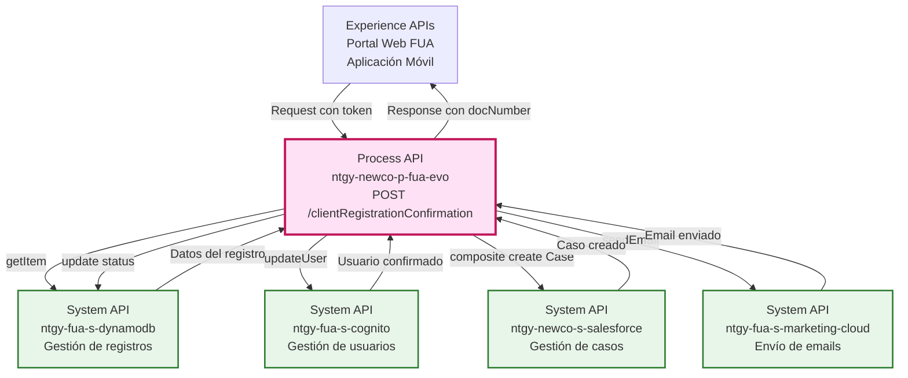
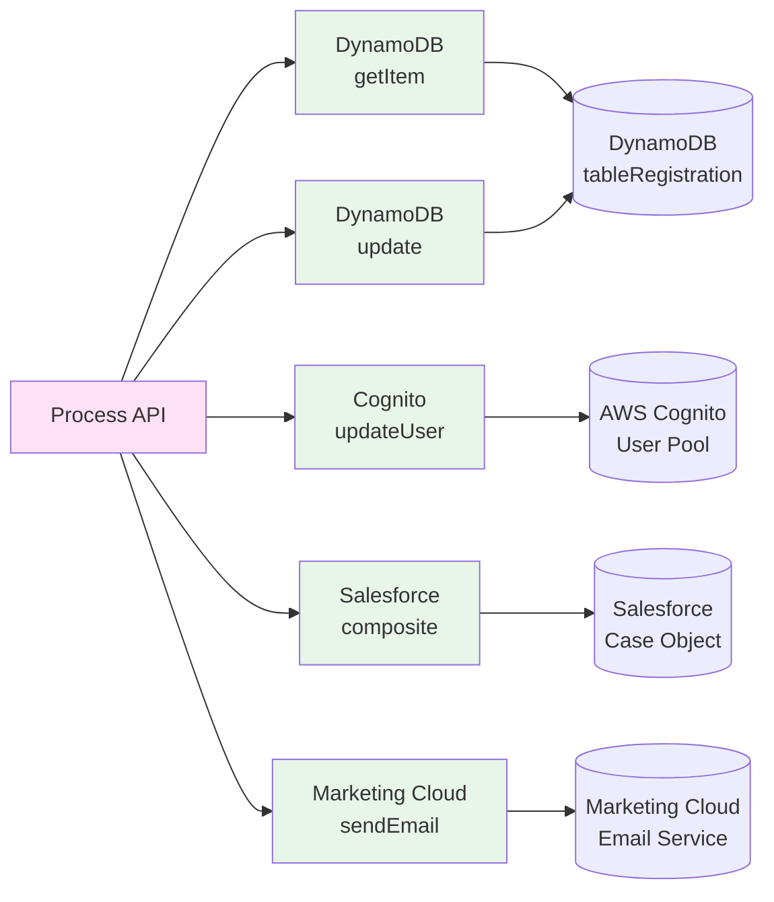
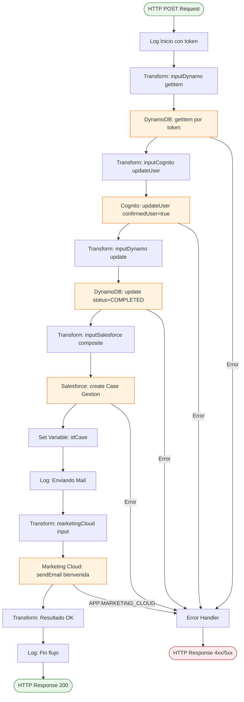
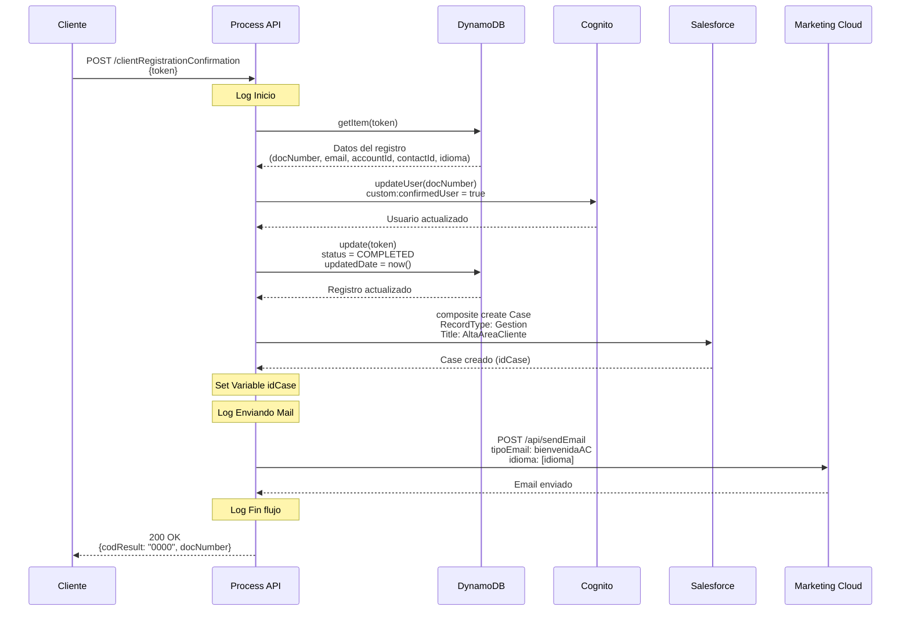
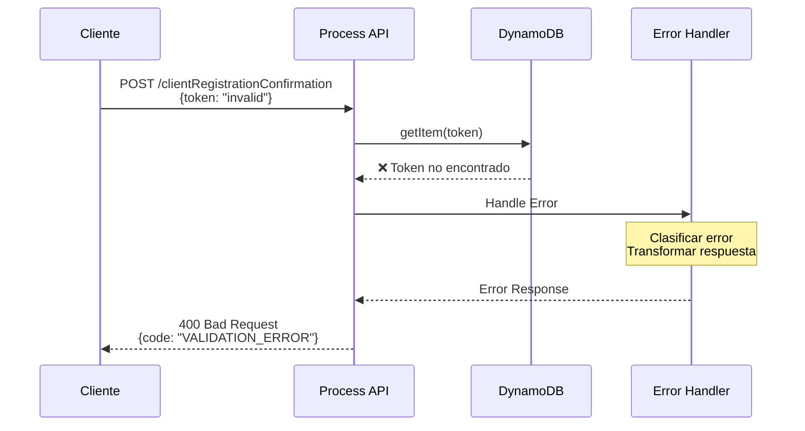
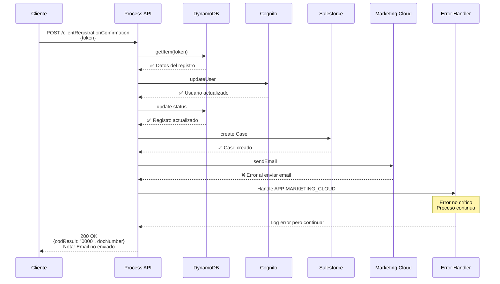

# POST /clientRegistrationConfirmation

## 📌 Descripción General

### Propósito del Endpoint

Este endpoint completa el proceso de confirmación de registro de un cliente en el área de cliente FUA. Orquesta múltiples operaciones en diferentes sistemas para:

1. Validar el token de confirmación en DynamoDB
2. Activar el usuario en AWS Cognito
3. Actualizar el estado del registro en DynamoDB
4. Crear un caso de gestión en Salesforce
5. Enviar un email de bienvenida vía Marketing Cloud

### Tipo de API

**Capa:** Process API (API-Led Connectivity)

**Función:** Orquestación del proceso de confirmación de registro de cliente

### Patrón de Integración

**Tipo:** Orquestación Secuencial

**Descripción:** Ejecuta una secuencia de operaciones en 4 sistemas diferentes (DynamoDB, Cognito, Salesforce, Marketing Cloud) para completar el proceso de confirmación de registro.

### Arquitectura API-Led Connectivity



---

## 💼 Propósito del Negocio

### Casos de Uso Principales

1. **Confirmación de Registro de Cliente**
   - El cliente recibe un email con un token de confirmación
   - Hace clic en el enlace de confirmación
   - El sistema valida el token y activa su cuenta
   - **Beneficio:** Verificación de email y activación segura de cuenta

2. **Activación de Usuario en Cognito**
   - Marca el usuario como confirmado en AWS Cognito
   - Permite el acceso al área de cliente
   - **Beneficio:** Seguridad y control de acceso

3. **Trazabilidad del Proceso**
   - Crea un caso de gestión en Salesforce
   - Registra el alta en el área de cliente
   - **Beneficio:** Auditoría y seguimiento del proceso

4. **Comunicación con el Cliente**
   - Envía email de bienvenida personalizado
   - Soporta múltiples idiomas (castellano, euskera, gallego, catalán)
   - **Beneficio:** Experiencia de usuario mejorada

### 🔗 Endpoints Dependientes

Este Process API consume los siguientes System APIs:

| System API | Endpoint | Método | Propósito |
|------------|----------|--------|-----------|
| `ntgy-fua-s-dynamodb` | `/item` | GET | Obtener datos del registro por token |
| `ntgy-fua-s-cognito` | `/updateUser` | POST | Actualizar atributo de usuario confirmado |
| `ntgy-fua-s-dynamodb` | `/item/update` | POST | Actualizar estado del registro a COMPLETED |
| `ntgy-newco-s-salesforce` | `/postComposite` | POST | Crear caso de gestión "AltaAreaCliente" |
| `ntgy-fua-s-marketing-cloud` | `/sendEmail` | POST | Enviar email de bienvenida |

### Lógica de Orquestación



**Pasos del Proceso:**

1. **Validación del Token**: Consulta DynamoDB para obtener los datos del registro asociados al token
2. **Activación en Cognito**: Actualiza el atributo `custom:confirmedUser` a "true" para el usuario
3. **Actualización de Estado**: Marca el registro en DynamoDB como "COMPLETED" con fecha de actualización
4. **Creación de Caso**: Crea un caso de gestión en Salesforce con RecordType "Gestion" y título "AltaAreaCliente"
5. **Envío de Email**: Envía email de bienvenida personalizado según el idioma del cliente

### Transformaciones Aplicadas

Este Process API aplica las siguientes transformaciones:

| Transformación | Origen | Destino | Descripción |
|----------------|--------|---------|-------------|
| **Token a DynamoDB Query** | `payload.token` | `inputDynamo.keyValue` | Prepara consulta por token |
| **DocNumber a Cognito Username** | `vars.dynamoItem.item.docNumber` | `inputCognito.username` | Identifica usuario por documento |
| **Estado a COMPLETED** | Constante | `inputDynamo.updateValues[0].value` | Actualiza estado del registro |
| **Fecha de Actualización** | `now() >> "CET"` | `inputDynamo.updateValues[1].value` | Timestamp en formato CET |
| **Idioma a Marketing Cloud** | `vars.dynamoItem.item.idioma` | `inputMKTC.data.idioma` | Mapeo de idiomas (Euskera→euskera, etc.) |
| **Datos del Caso Salesforce** | `vars.dynamoItem.item` | `inputSalesforce.body` | Construye caso con accountId, contactId, traceId |

### Contexto Empresarial

- **Dominio:** Gestión de Clientes y Autoservicio
- **Sector:** Energía - Utilities
- **División:** Naturgy España - NewCo
- **Proceso de Negocio:** Alta y Confirmación de Registro en Área de Cliente FUA

### Stakeholders

- **Clientes Finales**: Necesitan confirmar su registro para acceder al área de cliente
- **Equipo de Marketing**: Gestiona las comunicaciones de bienvenida
- **Equipo de Atención al Cliente**: Monitorea casos de gestión de altas
- **Equipo de Seguridad**: Valida el proceso de confirmación de usuarios

### Valor de Negocio

- **Seguridad**: Verificación de email antes de activar cuenta
- **Trazabilidad**: Registro completo del proceso en Salesforce
- **Experiencia de Usuario**: Email de bienvenida personalizado
- **Automatización**: Proceso completamente automatizado sin intervención manual
- **Multiidioma**: Soporte para las lenguas oficiales de España

### Consumidores Potenciales

Este endpoint puede ser consumido por:
- Portal web de autoservicio FUA
- Aplicaciones móviles de Naturgy
- Emails de confirmación con enlaces directos
- Sistemas de gestión de registros

---

## 🔧 Especificación Técnica

### URLs por Ambiente

| Ambiente | URL Base | URL Completa |
|----------|----------|--------------|
| **Local** | `http://localhost:8081` | `http://localhost:8081/api/clientRegistrationConfirmation` |
| **Development** | `https://ntgy-newco-p-fua-evo-dev.us-e2.cloudhub.io` | `https://ntgy-newco-p-fua-evo-dev.us-e2.cloudhub.io/api/clientRegistrationConfirmation` |
| **UAT** | `https://ntgy-newco-p-fua-evo-uat.us-e2.cloudhub.io` | `https://ntgy-newco-p-fua-evo-uat.us-e2.cloudhub.io/api/clientRegistrationConfirmation` |
| **Production** | `https://ntgy-newco-p-fua-evo-pro.us-e2.cloudhub.io` | `https://ntgy-newco-p-fua-evo-pro.us-e2.cloudhub.io/api/clientRegistrationConfirmation` |

### Método HTTP

```
POST /api/clientRegistrationConfirmation
```

### Parámetros de Entrada

#### Request Body (application/json)

| Campo | Tipo | Requerido | Descripción |
|-------|------|-----------|-------------|
| `token` | string | ✅ Sí | Token de confirmación enviado por email al cliente |

**Ejemplo de Request:**

```json
{
  "token": "abc123def456ghi789jkl012mno345pqr678stu901vwx234yz"
}
```

### Respuestas

#### ✅ 200 OK - Confirmación Exitosa

```json
{
  "result": {
    "codResult": "0000",
    "msgResult": "No hay error"
  },
  "docNumber": "12345678A"
}
```

**Campos de Respuesta:**

| Campo | Tipo | Descripción |
|-------|------|-------------|
| `result.codResult` | string | Código de resultado ("0000" = éxito) |
| `result.msgResult` | string | Mensaje descriptivo del resultado |
| `docNumber` | string | Número de documento del cliente confirmado |

#### ❌ 400 Bad Request - Token Inválido

```json
{
  "code": "VALIDATION_ERROR",
  "message": "Token no encontrado o inválido",
  "details": "El token proporcionado no existe en el sistema o ha expirado"
}
```

#### ❌ 500 Internal Server Error - Error en Sistema Backend

```json
{
  "code": "INTERNAL_ERROR",
  "message": "Error al procesar la confirmación",
  "details": "Error en la comunicación con Cognito/DynamoDB/Salesforce"
}
```

### Headers Requeridos

| Header | Valor | Descripción |
|--------|-------|-------------|
| `Content-Type` | `application/json` | Formato del body de la petición |
| `client_id` | `{your_client_id}` | Client ID de Anypoint Platform |
| `client_secret` | `{your_client_secret}` | Client Secret de Anypoint Platform |

### Autenticación

- **Tipo:** Client ID & Client Secret (Anypoint Platform)
- **Ubicación:** Headers HTTP

### Timeouts

| Tipo | Valor |
|------|-------|
| **Request Timeout** | 60 segundos |
| **Connection Timeout** | 10 segundos |

**Nota:** El timeout es mayor debido a las múltiples llamadas secuenciales a diferentes sistemas.

---

## 🏗️ Implementación Técnica

### Arquitectura del Flow



### Transformaciones DataWeave

#### 1. Transformación: inputDynamo getItem

**Ubicación en código:** Línea 13-24 del flow XML

```dataweave
%dw 2.0
output application/json
---
{
    "key": "token",
    "keyValue": payload.token,
    "table": p('fua-s-dynamo.tables.tableRegistration'),
    "operationDynamo": "getItem"
}
```

**Propósito:** Prepara la consulta a DynamoDB para obtener los datos del registro por token.

#### 2. Transformación: inputCognito updateUser

**Ubicación en código:** Línea 32-44 del flow XML

```dataweave
%dw 2.0
output application/json
---
{
    "username": vars.dynamoItem.item.docNumber,
    "nameAttribute": "custom:confirmedUser",
    "value": "true",
    "operation": "updateUser"
}
```

**Propósito:** Prepara la actualización del usuario en Cognito para marcarlo como confirmado.

#### 3. Transformación: inputDynamo update

**Ubicación en código:** Línea 47-70 del flow XML

```dataweave
%dw 2.0
output application/json

var updatedDate = ((now()) >> "CET") as String {format: "dd-MM-yyyy HH:mm:ss"}

---
{
    "body": {
        "keys": {
            "token": vars.dynamoItem.item.token
        },
        "updateValues": [
            {
                "name": "status",
                "value": "COMPLETED"
            },
            {
                "name": "updatedDate",
                "value": updatedDate
            }
        ]
    },
    "operationDynamo": "update",
    "table": p('fua-s-dynamo.tables.tableRegistration')
}
```

**Propósito:** Actualiza el estado del registro a "COMPLETED" con timestamp en zona horaria CET.

#### 4. Transformación: inputSalesforce composite

**Ubicación en código:** Línea 73-103 del flow XML

```dataweave
%dw 2.0
output application/json
---
{
    "body": {
        "allOrNone": true,
        "collateSubrequests": false,
        "compositeRequest": [
            {
                "method": "POST",
                "url": "/services/data/v52.0/sobjects/Case",
                "referenceId": "refCaseGestion",
                "body": { 
                    "NewCo_Recordtype__c": "Gestion",
                    "AccountId": vars.dynamoItem.item.accountId,
                    "ContactId": vars.dynamoItem.item.contactId,
                    "Priority": "02",
                    "Origin": "FUA",
                    "NewCo_TraceId__c": splitBy(vars.entryPayload.traceparent, "-")[1], 
                    "NewCo_CorrelationId__c": correlationId,
                    "acn_fld_Tittle__r": {
                        "NewCo_ExternalId__c": "AltaAreaCliente"
                    },
                    ("NewCo_IdentificadorDeIntencion__c": vars.motorIntentionId) if (!isEmpty(vars.motorIntentionId))
                }
            }
        ]
    },
    "operationSalesforce": "composite"
}
```

**Propósito:** Crea un caso de gestión en Salesforce con tipo "AltaAreaCliente".

#### 5. Transformación: marketingCloud input

**Ubicación en código:** Línea 110-131 del flow XML

```dataweave
%dw 2.0
output application/json

var idioma = vars.dynamoItem.item.idioma match {
    case "Euskera" -> "euskera"
    case "Gallego" -> "gallego"
    case "Catalán" -> "catalan"
    else -> "castellano"
}

---
{
    "contactKey": vars.dynamoItem.item.contactId,
    "eventDefinitionKey": p('s-marketing-cloud.eventDefinitionKeyLog'),
    "data": {
        "subscriberKey": vars.dynamoItem.item.contactId,
        "ContactKey": vars.dynamoItem.item.contactId,
        "emailAddress": vars.dynamoItem.item.email,
        "nombre": vars.dynamoItem.item.name,
        "tipoEmail": p('s-marketing-cloud.emailType.bienvenidaAC'),
        "idioma": idioma
    }
}
```

**Propósito:** Prepara el envío del email de bienvenida con mapeo de idiomas.

#### 6. Transformación: Resultado OK

**Ubicación en código:** Línea 138-149 del flow XML

```dataweave
%dw 2.0
output application/json
---
{
    "result": {
        "codResult": "0000",
        "msgResult": "No hay error"
    },
    "docNumber": vars.dynamoItem.item.docNumber
}
```

**Propósito:** Construye la respuesta exitosa con el número de documento del cliente.

### Patrones de Diseño

**Patrón:** Orquestación Secuencial (Sequential Orchestration)

**Justificación:** 
- Cada operación depende del resultado de la anterior
- Se necesita mantener el estado entre llamadas (variables)
- El proceso debe completarse en orden específico
- Permite rollback manual en caso de error

**Patrón Secundario:** Saga Pattern (implícito)

**Justificación:**
- Aunque no hay compensación automática, el proceso está diseñado para ser idempotente
- Cada paso puede ser reintentado de forma segura
- Los errores se manejan de forma centralizada

### Diagramas de Secuencia

#### 1. Flujo Normal de Éxito



#### 2. Flujo con Error en DynamoDB (Token No Encontrado)



#### 3. Flujo con Error en Marketing Cloud



### Manejo de Errores

#### Estrategia de Error Handling

**Error Handler:** `login-errorsError_Handler` (referenciado en línea 3 del flow principal)

**Tipos de Errores Manejados:**

1. **Errores de Validación (400)**
   - Token no encontrado en DynamoDB
   - Token expirado
   - Datos incompletos en el registro

2. **Errores de Sistema (500)**
   - Error de conexión con Cognito
   - Error de conexión con DynamoDB
   - Error de conexión con Salesforce

3. **Errores de Marketing Cloud (APP:MARKETING_CLOUD)**
   - Error al enviar email (no crítico)
   - El proceso continúa aunque falle el email

**Política de Reintentos:**
- DynamoDB: 3 reintentos con backoff exponencial
- Cognito: 2 reintentos
- Salesforce: 2 reintentos
- Marketing Cloud: 1 intento (error no crítico)

### Configuración de Propiedades

**Propiedades utilizadas del archivo de configuración:**

```yaml
fua-s-dynamo:
  tables:
    tableRegistration: "registration-table-{env}"

s-marketing-cloud:
  eventDefinitionKeyLog: "event-key-log"
  emailType:
    bienvenidaAC: "bienvenida-area-cliente"
```

### Datos Almacenados en Variables

| Variable | Tipo | Descripción | Uso |
|----------|------|-------------|-----|
| `vars.dynamoItem` | Object | Datos completos del registro obtenidos de DynamoDB | Usado en todas las transformaciones posteriores |
| `vars.inputDynamo` | Object | Input preparado para llamadas a DynamoDB | Parámetros de consulta y actualización |
| `vars.inputCognito` | Object | Input preparado para Cognito | Parámetros de actualización de usuario |
| `vars.inputSalesforce` | Object | Input preparado para Salesforce | Datos del caso a crear |
| `vars.inputMKTC` | Object | Input preparado para Marketing Cloud | Datos del email a enviar |
| `vars.salesforceResp` | Object | Respuesta de Salesforce | Contiene el ID del caso creado |
| `vars.idCase` | String | ID del caso creado en Salesforce | Usado para logging y trazabilidad |
| `vars.motorIntentionId` | String | ID de intención del motor de estados (opcional) | Usado si existe integración con motor de estados |

---

## 💻 Ejemplos de Uso

### Ejemplo 1: Confirmación Exitosa

#### cURL

```bash
curl -X POST "https://ntgy-newco-p-fua-evo-dev.us-e2.cloudhub.io/api/clientRegistrationConfirmation" \
  -H "Content-Type: application/json" \
  -H "client_id: YOUR_CLIENT_ID" \
  -H "client_secret: YOUR_CLIENT_SECRET" \
  -d '{
    "token": "abc123def456ghi789jkl012mno345pqr678stu901vwx234yz"
  }'
```

#### Respuesta (200 OK)

```json
{
  "result": {
    "codResult": "0000",
    "msgResult": "No hay error"
  },
  "docNumber": "12345678A"
}
```

**Resultado del Proceso:**
- ✅ Usuario confirmado en Cognito
- ✅ Registro actualizado a COMPLETED en DynamoDB
- ✅ Caso de gestión creado en Salesforce
- ✅ Email de bienvenida enviado

### Ejemplo 2: Token Inválido

#### cURL

```bash
curl -X POST "https://ntgy-newco-p-fua-evo-dev.us-e2.cloudhub.io/api/clientRegistrationConfirmation" \
  -H "Content-Type: application/json" \
  -H "client_id: YOUR_CLIENT_ID" \
  -H "client_secret: YOUR_CLIENT_SECRET" \
  -d '{
    "token": "token-invalido-o-expirado"
  }'
```

#### Respuesta (400 Bad Request)

```json
{
  "code": "VALIDATION_ERROR",
  "message": "Token no encontrado o inválido",
  "details": "El token proporcionado no existe en el sistema o ha expirado",
  "timestamp": "2026-01-09T16:15:30.123Z"
}
```

### Ejemplo 3: JavaScript (Frontend)

```javascript
async function confirmarRegistro(token) {
  try {
    const response = await fetch(
      'https://ntgy-newco-p-fua-evo-dev.us-e2.cloudhub.io/api/clientRegistrationConfirmation',
      {
        method: 'POST',
        headers: {
          'Content-Type': 'application/json',
          'client_id': 'YOUR_CLIENT_ID',
          'client_secret': 'YOUR_CLIENT_SECRET'
        },
        body: JSON.stringify({ token })
      }
    );

    if (!response.ok) {
      throw new Error(`Error: ${response.status}`);
    }

    const data = await response.json();
    
    if (data.result.codResult === "0000") {
      console.log('✅ Registro confirmado exitosamente');
      console.log('Documento del cliente:', data.docNumber);
      // Redirigir al login o área de cliente
      window.location.href = '/login';
    }
    
    return data;
  } catch (error) {
    console.error('❌ Error al confirmar registro:', error);
    throw error;
  }
}

// Uso: Obtener token de URL query params
const urlParams = new URLSearchParams(window.location.search);
const token = urlParams.get('token');

if (token) {
  confirmarRegistro(token)
    .then(() => {
      // Mostrar mensaje de éxito
      alert('¡Registro confirmado! Redirigiendo al login...');
    })
    .catch(error => {
      // Mostrar mensaje de error
      alert('Error al confirmar el registro. Por favor, contacte con soporte.');
    });
}
```

### Ejemplo 4: Python

```python
import requests
import json

def confirmar_registro(token):
    """
    Confirma el registro de un cliente usando el token proporcionado.
    
    Args:
        token (str): Token de confirmación
        
    Returns:
        dict: Respuesta del API con el resultado
    """
    url = "https://ntgy-newco-p-fua-evo-dev.us-e2.cloudhub.io/api/clientRegistrationConfirmation"
    
    headers = {
        'Content-Type': 'application/json',
        'client_id': 'YOUR_CLIENT_ID',
        'client_secret': 'YOUR_CLIENT_SECRET'
    }
    
    payload = {
        'token': token
    }
    
    try:
        response = requests.post(url, headers=headers, json=payload, timeout=60)
        response.raise_for_status()
        
        data = response.json()
        
        if data['result']['codResult'] == '0000':
            print(f"✅ Registro confirmado exitosamente")
            print(f"Documento del cliente: {data['docNumber']}")
            return data
        else:
            print(f"⚠️ Respuesta inesperada: {data}")
            return data
            
    except requests.exceptions.HTTPError as e:
        print(f"❌ Error HTTP: {e}")
        print(f"Respuesta: {e.response.text}")
        raise
    except requests.exceptions.Timeout:
        print("❌ Timeout: La petición tardó más de 60 segundos")
        raise
    except requests.exceptions.RequestException as e:
        print(f"❌ Error en la petición: {e}")
        raise

# Uso
if __name__ == "__main__":
    token = "abc123def456ghi789jkl012mno345pqr678stu901vwx234yz"
    resultado = confirmar_registro(token)
    print(json.dumps(resultado, indent=2))
```

### Ejemplo 5: Flujo Completo desde Email

**Escenario:** Cliente recibe email de confirmación y hace clic en el enlace

```html
<!-- Email de confirmación enviado al cliente -->
<html>
<body>
  <h1>¡Bienvenido a Naturgy!</h1>
  <p>Hola {{nombre}},</p>
  <p>Para completar tu registro en el área de cliente, haz clic en el siguiente enlace:</p>
  <a href="https://portal-fua.naturgy.es/confirmar?token={{token}}">
    Confirmar mi registro
  </a>
  <p>Este enlace expirará en 24 horas.</p>
</body>
</html>
```

**Página de confirmación (Frontend):**

```javascript
// confirmar.js - Página de confirmación
document.addEventListener('DOMContentLoaded', async () => {
  // Obtener token de la URL
  const urlParams = new URLSearchParams(window.location.search);
  const token = urlParams.get('token');
  
  if (!token) {
    mostrarError('Token no proporcionado');
    return;
  }
  
  // Mostrar loading
  mostrarLoading();
  
  try {
    // Llamar al API
    const response = await fetch(
      'https://ntgy-newco-p-fua-evo-pro.us-e2.cloudhub.io/api/clientRegistrationConfirmation',
      {
        method: 'POST',
        headers: {
          'Content-Type': 'application/json',
          'client_id': CONFIG.CLIENT_ID,
          'client_secret': CONFIG.CLIENT_SECRET
        },
        body: JSON.stringify({ token })
      }
    );
    
    const data = await response.json();
    
    if (response.ok && data.result.codResult === '0000') {
      // Éxito
      mostrarExito(data.docNumber);
      
      // Redirigir al login después de 3 segundos
      setTimeout(() => {
        window.location.href = '/login';
      }, 3000);
    } else {
      // Error de negocio
      mostrarError(data.message || 'Error al confirmar el registro');
    }
    
  } catch (error) {
    // Error técnico
    console.error('Error:', error);
    mostrarError('Error de conexión. Por favor, inténtelo más tarde.');
  }
});

function mostrarLoading() {
  document.getElementById('loading').style.display = 'block';
  document.getElementById('result').style.display = 'none';
}

function mostrarExito(docNumber) {
  document.getElementById('loading').style.display = 'none';
  document.getElementById('result').style.display = 'block';
  document.getElementById('result').innerHTML = `
    <div class="success">
      <h2>✅ ¡Registro confirmado!</h2>
      <p>Tu cuenta ha sido activada exitosamente.</p>
      <p>Documento: ${docNumber}</p>
      <p>Recibirás un email de bienvenida en breve.</p>
      <p>Redirigiendo al login...</p>
    </div>
  `;
}

function mostrarError(mensaje) {
  document.getElementById('loading').style.display = 'none';
  document.getElementById('result').style.display = 'block';
  document.getElementById('result').innerHTML = `
    <div class="error">
      <h2>❌ Error</h2>
      <p>${mensaje}</p>
      <a href="/soporte">Contactar con soporte</a>
    </div>
  `;
}
```

---

## 📋 Notas Adicionales

### Código Comentado (Motor de Estados)

El código fuente contiene secciones comentadas relacionadas con un "Motor de Estados" (`grabarIntencionMe_SubFlow`). Esta funcionalidad está actualmente deshabilitada pero planificada para futuras versiones:

**Funcionalidad Planificada:**
- Crear intención al inicio del proceso
- Actualizar intención con el ID del caso de Salesforce
- Marcar intención como "PROCESO_FINALIZADO"

**Estado Actual:** Deshabilitado (comentado con `[STUDIO:...]`)

### Consideraciones de Seguridad

1. **Validación de Token**: El token debe ser único y de un solo uso
2. **Expiración**: Los tokens deben tener un tiempo de vida limitado (recomendado: 24 horas)
3. **HTTPS**: Todas las comunicaciones deben ser sobre HTTPS
4. **Rate Limiting**: Implementar límite de intentos por IP para prevenir ataques de fuerza bruta

### Monitoreo y Alertas

**Métricas Clave a Monitorear:**
- Tasa de éxito de confirmaciones
- Tiempo de respuesta del endpoint
- Errores por sistema backend (DynamoDB, Cognito, Salesforce, Marketing Cloud)
- Tokens expirados o inválidos

**Alertas Recomendadas:**
- Tasa de error > 5%
- Tiempo de respuesta > 60 segundos
- Fallos en envío de emails > 10%

### Mejoras Futuras

1. **Reintentos Automáticos**: Implementar reintentos para el envío de email
2. **Notificaciones Alternativas**: SMS si falla el email
3. **Motor de Estados**: Activar integración con motor de intenciones
4. **Métricas de Negocio**: Dashboard con KPIs de confirmaciones
5. **A/B Testing**: Diferentes versiones de emails de bienvenida
