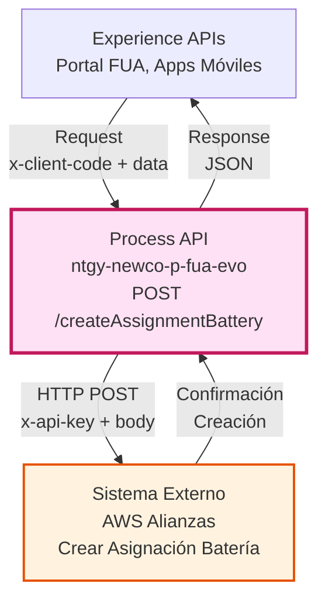
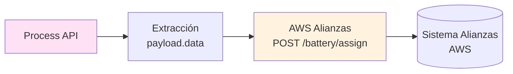
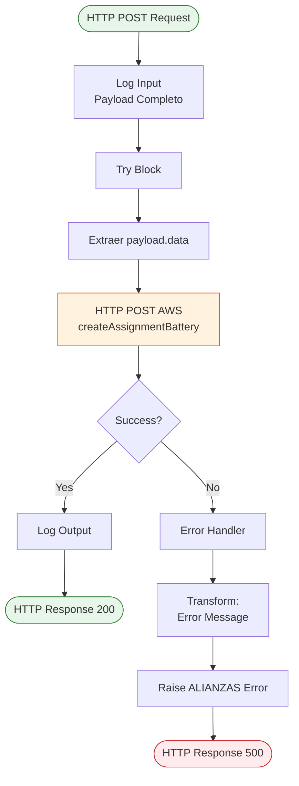
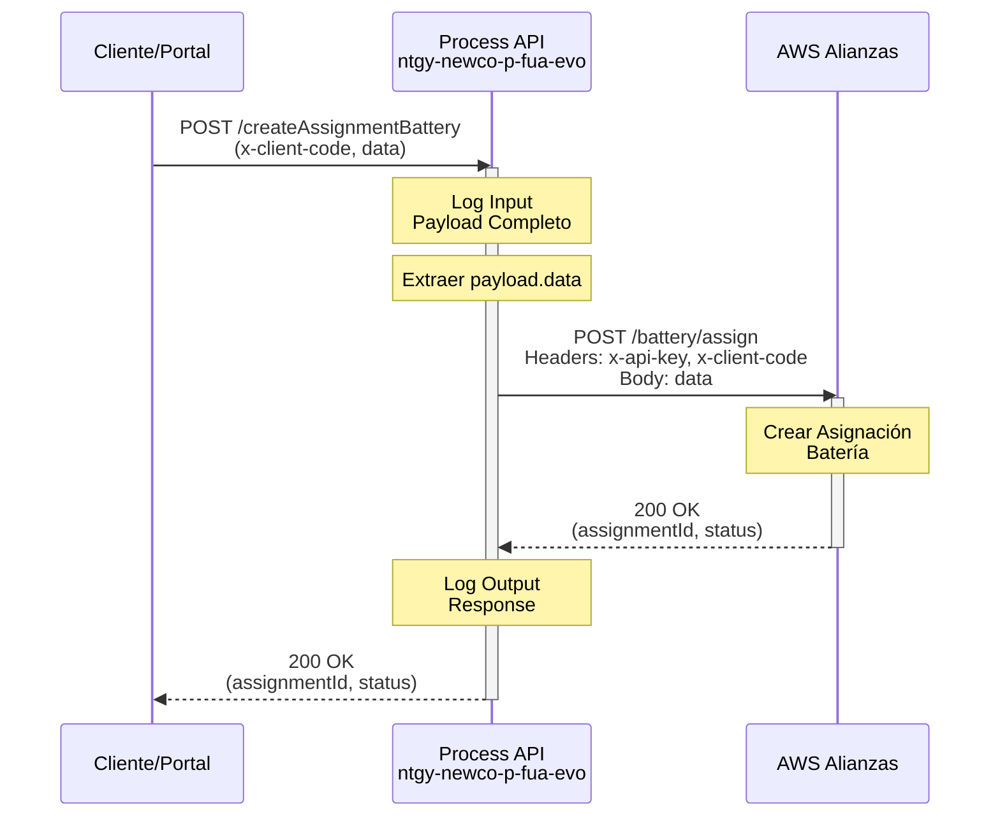
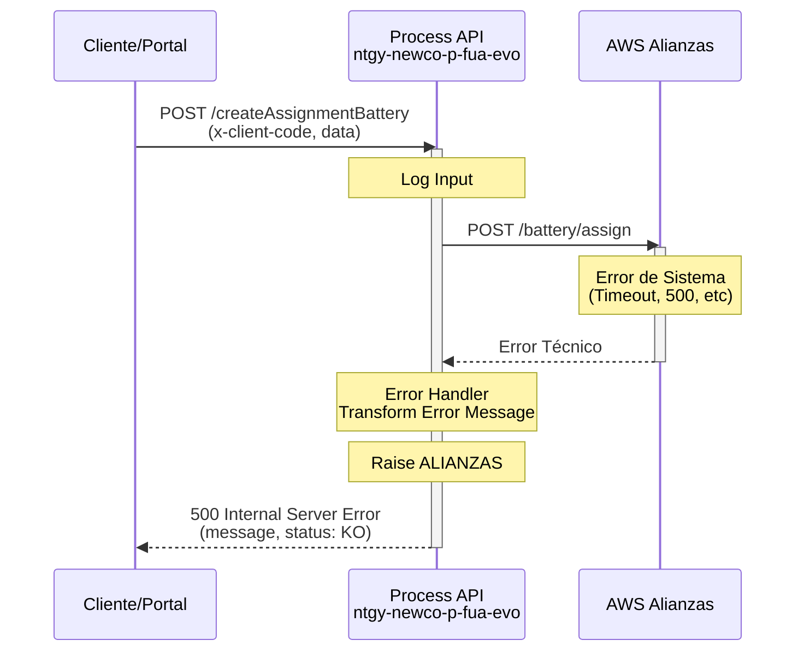
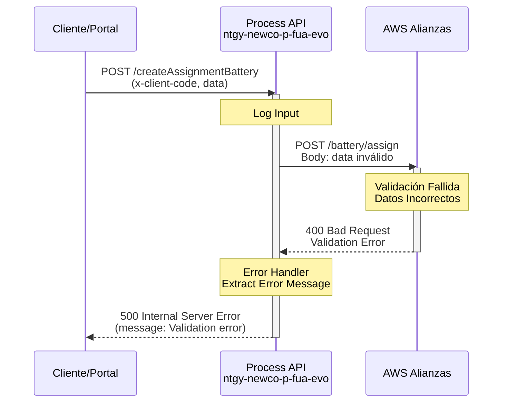

# POST /createAssignmentBattery

## 📌 Descripción General

### Propósito del Endpoint

Este endpoint crea y asigna una nueva configuración de saldo de batería para un cliente específico en el sistema de alianzas alojado en AWS. Actúa como un orquestador que valida la solicitud, transforma el payload y realiza la llamada al sistema externo para persistir la configuración.

### Tipo de API

**Capa:** Process API (API-Led Connectivity)

**Función:** Orquestación de creación de configuración de batería en sistema de alianzas AWS

### Patrón de Integración

**Tipo:** Pass-Through con Transformación de Payload

**Descripción:** Este endpoint actúa como proxy hacia el sistema de alianzas en AWS, extrayendo el objeto `data` del payload de entrada y agregando autenticación mediante API Key. Transforma la estructura del request para adaptarla al formato esperado por el sistema AWS.

### Arquitectura API-Led Connectivity



---

## 💼 Propósito del Negocio

### Casos de Uso Principales

1. **Creación de Configuración de Batería**
   - Permite asignar una nueva configuración de batería virtual a un cliente
   - Establece los parámetros iniciales de saldo y tipo de batería
   - Beneficio: Activación de servicios de batería para clientes

2. **Gestión de Alianzas Energéticas**
   - Registra la participación del cliente en programas de batería virtual
   - Configura los términos de la alianza energética
   - Beneficio: Facilita la gestión de programas de energía compartida

3. **Onboarding de Clientes en Batería Virtual**
   - Proceso de alta de clientes en el sistema de batería
   - Configuración inicial de parámetros de saldo
   - Beneficio: Automatización del proceso de incorporación

### 🔗 Endpoints Dependientes

Este Process API consume el siguiente sistema externo:

| Sistema | Endpoint | Método | Propósito |
|---------|----------|--------|-----------|
| `AWS Alianzas` | `/battery/assign` | POST | Crea asignación de configuración de batería |

### Lógica de Orquestación



**Pasos del Proceso:**

1. **Extracción de Datos**: Extrae `x-client-code` y objeto `data` del payload
2. **Autenticación AWS**: Agrega `x-api-key` en headers para autenticación
3. **Transformación de Body**: Envía solo el objeto `data` al sistema AWS
4. **Llamada HTTP POST**: Crea la asignación en el sistema de alianzas
5. **Respuesta**: Devuelve confirmación de creación al consumidor

### Transformaciones Aplicadas

| Campo Original (Request) | Campo Transformado (AWS) | Transformación |
|--------------------------|--------------------------|----------------|
| `payload.x-client-code` | `header.x-client-code` | Movido a header |
| `payload.data` | `body` | Extraído como body completo |
| N/A | `header.x-api-key` | Agregado desde properties |

### Contexto Empresarial

- **Dominio:** Gestión de Alianzas y Servicios de Batería Virtual
- **Sector:** Energía - Utilities
- **División:** Naturgy España - NewCo
- **Proceso de Negocio:** Creación y asignación de configuraciones de batería

### Stakeholders

- **Clientes Naturgy**: Solicitan activación de servicios de batería virtual
- **Agentes de Call Center**: Gestionan altas de clientes en programas de batería
- **Sistema de Alianzas**: Persiste y gestiona configuraciones de batería

### Valor de Negocio

- **Automatización**: Proceso automatizado de alta en batería virtual
- **Eficiencia Operativa**: Reduce tiempo de activación de servicios
- **Gestión Centralizada**: Configuraciones centralizadas en sistema AWS
- **Experiencia del Cliente**: Activación rápida de servicios de batería

### Consumidores Potenciales

Este endpoint puede ser consumido por:
- Portal web FUA
- Aplicaciones móviles de clientes
- Sistemas de agentes de call center
- Procesos de onboarding automatizados

---

## 🔧 Especificación Técnica

### URLs por Ambiente

| Ambiente | URL Base | URL Completa |
|----------|----------|--------------|
| **Local** | `http://localhost:8081` | `http://localhost:8081/api/createAssignmentBattery` |
| **Development** | `https://ntgy-newco-p-fua-evo-dev.us-e2.cloudhub.io` | `https://ntgy-newco-p-fua-evo-dev.us-e2.cloudhub.io/api/createAssignmentBattery` |
| **UAT** | `https://ntgy-newco-p-fua-evo-uat.us-e2.cloudhub.io` | `https://ntgy-newco-p-fua-evo-uat.us-e2.cloudhub.io/api/createAssignmentBattery` |
| **Production** | `https://ntgy-newco-p-fua-evo-pro.us-e2.cloudhub.io` | `https://ntgy-newco-p-fua-evo-pro.us-e2.cloudhub.io/api/createAssignmentBattery` |

### Método HTTP

```
POST /api/createAssignmentBattery
```

### Parámetros de Entrada

#### Headers

| Header | Tipo | Requerido | Descripción |
|--------|------|-----------|-------------|
| `Content-Type` | String | ✅ Sí | Debe ser `application/json` |
| `client_id` | String | ✅ Sí | Client ID de Anypoint Platform |
| `client_secret` | String | ✅ Sí | Client Secret de Anypoint Platform |

#### Body (JSON)

```json
{
  "x-client-code": "string",
  "data": {
    "batteryType": "string",
    "initialBalance": number,
    "configuration": {
      "capacity": "string",
      "model": "string"
    }
  }
}
```

**Campos del Body:**

| Campo | Tipo | Requerido | Descripción | Ejemplo |
|-------|------|-----------|-------------|---------|
| `x-client-code` | String | ✅ Sí | Código único del cliente | `"12345678"` |
| `data` | Object | ✅ Sí | Objeto con configuración de batería | Ver estructura abajo |
| `data.batteryType` | String | ✅ Sí | Tipo de batería a asignar | `"TIPO_A"` |
| `data.initialBalance` | Number | ✅ Sí | Saldo inicial de la batería | `1000` |
| `data.configuration` | Object | ❌ No | Configuración adicional de batería | Ver ejemplo |

**Nota:** La estructura exacta del objeto `data` depende de los requisitos del sistema AWS de alianzas.

### Respuestas

⚠️ **IMPORTANTE: Este Process API es PASS-THROUGH de la respuesta de AWS.**

El Process API NO transforma la respuesta exitosa del backend de Alianzas AWS. La respuesta se devuelve tal cual al consumidor.

#### 200 OK - Creación Exitosa

```json
// Estructura definida por el backend de Alianzas AWS
// El Process API devuelve la respuesta sin transformación
```

**Para conocer la estructura exacta de respuesta:**
- Consultar documentación del sistema de Alianzas AWS
- Revisar logs de respuestas reales del endpoint
- Ejecutar el endpoint en ambiente de desarrollo y capturar la respuesta

**Evidencia del código (líneas 13-23):**
```xml
<http:request method="${aws.alianzas.methodCrearAsignacionBateria}" 
              path="${aws.alianzas.pathCrearAsignacionBateria}">
    <http:body><![CDATA[#[payload.data]]]></http:body>
</http:request>
<!-- NO hay transformación después del http:request -->
<!-- Solo logging: línea 50 -->
```

#### 500 Internal Server Error - Error de Sistema

```json
{
  "message": "Error al crear asignación de batería",
  "status": "KO"
}
```

### Autenticación

- **Tipo:** Client ID & Client Secret (Anypoint Platform)
- **Backend AWS:** API Key (`x-api-key`) configurada en properties

### Timeouts

| Tipo | Valor |
|------|-------|
| **Request Timeout** | Configurado en `${aws.timeout}` (60000ms según properties) |
| **Connection Timeout** | 10 segundos (default HTTP connector) |

---

## 🏗️ Implementación Técnica

### Arquitectura del Flow



### Componentes del Flow

#### 1. Subflow Principal: `alianzaCreateAssignmentBattery`

**Ubicación:** `src/main/mule/services/alianzas/` (o archivo principal)

**Componentes:**

1. **Logger de Entrada** (línea 11)
   - Registra payload completo de entrada
   - Formato: "Input createAssignmentBattery: (payload)"

2. **Try Block** (línea 12-49)
   - Contiene la llamada HTTP POST y manejo de errores

3. **HTTP Request** (línea 13-23)
   - Config: `HTTP_Request__AWS`
   - Método: `${aws.alianzas.methodCrearAsignacionBateria}` (POST)
   - Path: `${aws.alianzas.pathCrearAsignacionBateria}` (/battery/assign)
   - Timeout: `${aws.timeout}` (60000ms)
   - Body: `payload.data`
   - Headers: `x-api-key` y `x-client-code`

4. **Error Handler** (línea 24-48)
   - Manejo de errores genérico tipo `NTGY:ALIANZAS`

5. **Logger de Salida** (línea 50)
   - Registra respuesta del sistema AWS

### Configuración HTTP Request

```xml
<http:request 
    method="${aws.alianzas.methodCrearAsignacionBateria}" 
    config-ref="HTTP_Request__AWS"
    path="${aws.alianzas.pathCrearAsignacionBateria}" 
    responseTimeout="${aws.timeout}">
    <http:body>
        payload.data
    </http:body>
    <http:headers>
        {
            "x-api-key": p('aws.apiKey'),
            "x-client-code": payload.'x-client-code'
        }
    </http:headers>
</http:request>
```

**Headers Enviados:**
- `x-api-key`: API Key para autenticación en AWS (desde properties seguras)
- `x-client-code`: Código del cliente (extraído del payload)

**Body Enviado:**
- Solo el objeto `data` del payload original
- Transformación: `payload` → `payload.data`

### Transformaciones DataWeave

#### Transformación de Error

```dataweave
%dw 2.0
import * from dw::core::Strings
output application/json
---
{
    "message": 
        if(error.errorMessage.payload != null)
            error.errorMessage.payload
        else if(substringAfterLast(error.description, "' ") != "") 
            substringAfterLast(error.description, "' ") 
        else if(error.description != null) 
            error.description 
        else 
            "Internal server error",
    "status": "KO"
}
```

**Lógica de Extracción de Mensaje:**
1. Intenta usar `error.errorMessage.payload`
2. Si no existe, extrae texto después de `' ` en `error.description`
3. Si no existe, usa `error.description` completo
4. Fallback: "Internal server error"

**Acción:** Lanza error tipo `NTGY:ALIANZAS`

### Patrones de Diseño

**Patrón:** Transformación de Payload con Extracción de Datos

**Justificación:** 
- El sistema AWS espera solo el objeto `data`, no el payload completo
- El `x-client-code` se mueve del body al header para autenticación
- Simplifica la estructura enviada al backend
- Mantiene la separación entre datos de negocio y metadatos de autenticación

### Diagramas de Secuencia

#### 1. Flujo Normal de Éxito



#### 2. Flujo con Error de Sistema



#### 3. Flujo con Validación de Datos



### Manejo de Errores

#### Estrategia de Error Handling

**Un Solo Tipo de Error:**

**Error de Sistema: `NTGY:ALIANZAS`**
- **Condición:** Cualquier error en la llamada HTTP (timeout, 400, 500, conexión, etc.)
- **Respuesta:** 500 Internal Server Error
- **Uso:** Errores técnicos, de validación o de sistema
- **Propagación:** Se propaga como error HTTP 500

**Diferencia con GET /assignmentBattery:**
- ❌ NO tiene manejo especial de "Client not found"
- ❌ NO tiene error tipo `NTGY:ALIANZAS_CONTINUE`
- ✅ Todos los errores se tratan como errores de sistema

#### Códigos de Error

| Código | Tipo | Descripción | HTTP Status |
|--------|------|-------------|-------------|
| `NTGY:ALIANZAS` | Técnico | Error al crear asignación en sistema AWS | 500 |

### Logging

**Log de Entrada:**
```
Input createAssignmentBattery: <payload-completo>
```

**Log de Salida:**
```
Ouput createAssignmentBattery: <respuesta-aws>
```

---

## 💻 Ejemplos de Uso

### Ejemplo 1: Creación Exitosa

#### cURL

```bash
curl -X POST "https://ntgy-newco-p-fua-evo-dev.us-e2.cloudhub.io/api/createAssignmentBattery" \
  -H "Content-Type: application/json" \
  -H "client_id: YOUR_CLIENT_ID" \
  -H "client_secret: YOUR_CLIENT_SECRET" \
  -d '{
    "x-client-code": "12345678",
    "data": {
      "batteryType": "TIPO_A",
      "initialBalance": 1000,
      "configuration": {
        "capacity": "10kWh",
        "model": "Tesla Powerwall 2"
      }
    }
  }'
```

#### Respuesta (200 OK)

```json
// Respuesta real del backend AWS Alianzas
// Estructura no transformada por el Process API
// Ejemplo basado en respuesta típica de sistemas de alianzas:
{
  "status": "success",
  "message": "Battery assignment created successfully",
  "assignmentId": "BAT-2026-001234"
}
```

**Nota:** La estructura exacta depende del backend AWS. Este es un ejemplo ilustrativo.

### Ejemplo 2: Error de Validación

#### cURL

```bash
curl -X POST "https://ntgy-newco-p-fua-evo-dev.us-e2.cloudhub.io/api/createAssignmentBattery" \
  -H "Content-Type: application/json" \
  -H "client_id: YOUR_CLIENT_ID" \
  -H "client_secret: YOUR_CLIENT_SECRET" \
  -d '{
    "x-client-code": "12345678",
    "data": {
      "batteryType": "INVALID_TYPE"
    }
  }'
```

#### Respuesta (500 Internal Server Error)

```json
{
  "message": "Invalid battery type: INVALID_TYPE",
  "status": "KO"
}
```

### Ejemplo 3: Error de Sistema

#### cURL

```bash
curl -X POST "https://ntgy-newco-p-fua-evo-dev.us-e2.cloudhub.io/api/createAssignmentBattery" \
  -H "Content-Type: application/json" \
  -H "client_id: YOUR_CLIENT_ID" \
  -H "client_secret: YOUR_CLIENT_SECRET" \
  -d '{
    "x-client-code": "12345678",
    "data": {
      "batteryType": "TIPO_A",
      "initialBalance": 1000
    }
  }'
```

#### Respuesta (500 Internal Server Error)

```json
{
  "message": "Connection timeout to AWS Alianzas system",
  "status": "KO"
}
```

### Ejemplo 4: JavaScript (Fetch API)

```javascript
const clientCode = '12345678';
const batteryData = {
  batteryType: 'TIPO_A',
  initialBalance: 1000,
  configuration: {
    capacity: '10kWh',
    model: 'Tesla Powerwall 2'
  }
};

const response = await fetch(
  'https://ntgy-newco-p-fua-evo-dev.us-e2.cloudhub.io/api/createAssignmentBattery',
  {
    method: 'POST',
    headers: {
      'Content-Type': 'application/json',
      'client_id': 'YOUR_CLIENT_ID',
      'client_secret': 'YOUR_CLIENT_SECRET'
    },
    body: JSON.stringify({
      'x-client-code': clientCode,
      data: batteryData
    })
  }
);

const result = await response.json();

if (response.ok) {
  console.log('Asignación creada:', result.assignmentId);
} else {
  console.error('Error:', result.message);
}
```

### Ejemplo 5: Python (Requests)

```python
import requests

client_code = '12345678'
battery_data = {
    'batteryType': 'TIPO_A',
    'initialBalance': 1000,
    'configuration': {
        'capacity': '10kWh',
        'model': 'Tesla Powerwall 2'
    }
}

url = 'https://ntgy-newco-p-fua-evo-dev.us-e2.cloudhub.io/api/createAssignmentBattery'

headers = {
    'Content-Type': 'application/json',
    'client_id': 'YOUR_CLIENT_ID',
    'client_secret': 'YOUR_CLIENT_SECRET'
}

payload = {
    'x-client-code': client_code,
    'data': battery_data
}

response = requests.post(url, json=payload, headers=headers)

if response.status_code == 200:
    result = response.json()
    print(f"Asignación creada: {result['assignmentId']}")
else:
    error = response.json()
    print(f"Error: {error['message']}")
```

### Ejemplo 6: Postman Collection

```json
{
  "info": {
    "name": "POST /createAssignmentBattery",
    "schema": "https://schema.getpostman.com/json/collection/v2.1.0/collection.json"
  },
  "item": [
    {
      "name": "Crear Asignación de Batería",
      "request": {
        "method": "POST",
        "header": [
          {
            "key": "Content-Type",
            "value": "application/json"
          },
          {
            "key": "client_id",
            "value": "{{client_id}}"
          },
          {
            "key": "client_secret",
            "value": "{{client_secret}}"
          }
        ],
        "body": {
          "mode": "raw",
          "raw": "{\n  \"x-client-code\": \"{{client_code}}\",\n  \"data\": {\n    \"batteryType\": \"TIPO_A\",\n    \"initialBalance\": 1000,\n    \"configuration\": {\n      \"capacity\": \"10kWh\",\n      \"model\": \"Tesla Powerwall 2\"\n    }\n  }\n}"
        },
        "url": {
          "raw": "{{base_url}}/api/createAssignmentBattery",
          "host": ["{{base_url}}"],
          "path": ["api", "createAssignmentBattery"]
        }
      }
    }
  ]
}
```

### Ejemplo 7: Estructura Completa del Request

```json
{
  "x-client-code": "12345678",
  "data": {
    "batteryType": "TIPO_A",
    "initialBalance": 1000,
    "maxCapacity": 5000,
    "configuration": {
      "capacity": "10kWh",
      "model": "Tesla Powerwall 2",
      "installationDate": "2026-01-15",
      "warrantyYears": 10
    },
    "tariff": {
      "type": "FLAT_RATE",
      "pricePerKwh": 0.15
    },
    "metadata": {
      "source": "PORTAL_FUA",
      "createdBy": "AGENT_001",
      "notes": "Cliente nuevo en programa de batería virtual"
    }
  }
}