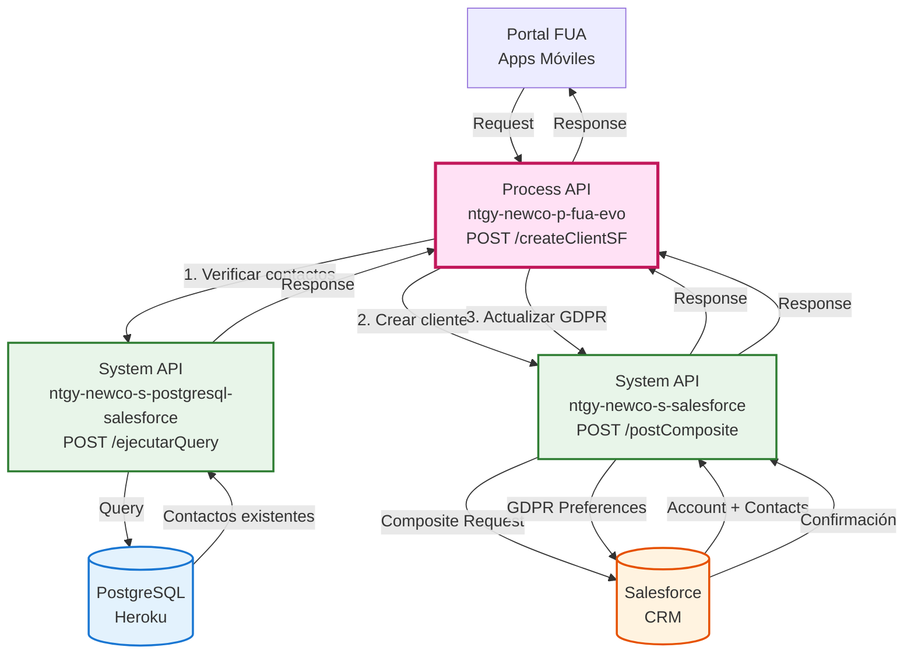
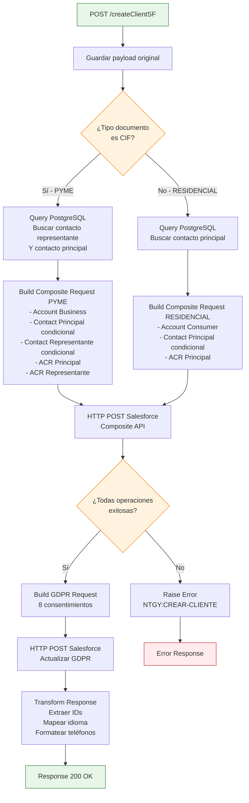
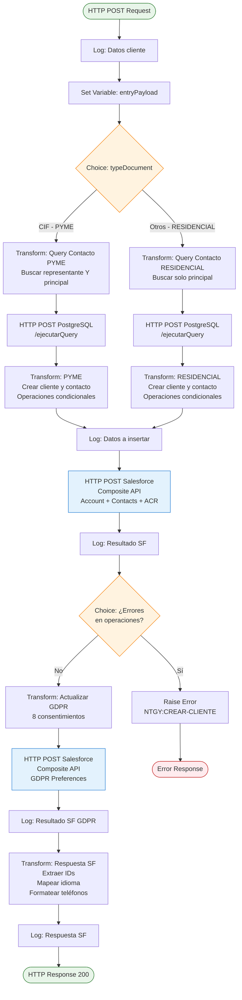
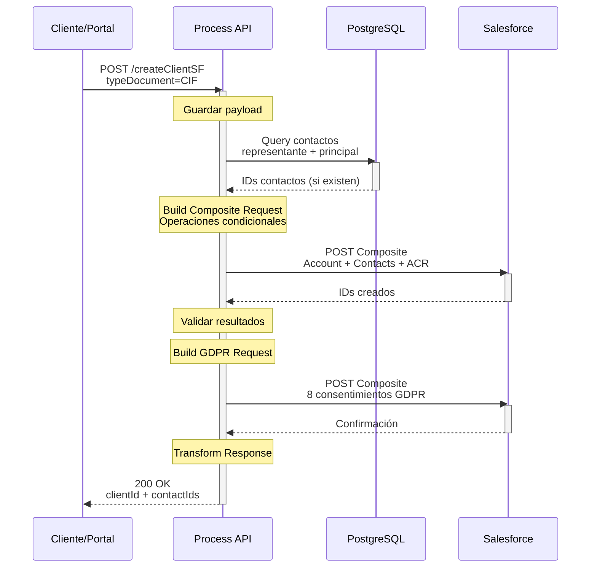

# POST /createClientSF

## 📌 Descripción General

### Propósito del Endpoint

Este endpoint crea un nuevo cliente en Salesforce con toda su información asociada: Account, Contacts (principal y representante si aplica), relaciones AccountContactRelation y preferencias GDPR. Implementa lógica diferenciada para clientes PYME (CIF) y residenciales, reutilizando contactos existentes cuando es posible.

### Tipo de API

**Capa:** Process API (API-Led Connectivity)

**Función:** Orquestación compleja de creación de cliente con múltiples operaciones en Salesforce y validación previa en PostgreSQL

### Patrón de Integración

**Tipo:** Orquestación con Composite API y Operaciones Condicionales

**Descripción:** Consulta previa a PostgreSQL para verificar contactos existentes, seguida de operaciones atómicas en Salesforce usando Composite API con lógica condicional según tipo de cliente.

### Arquitectura API-Led Connectivity



---

## 💼 Propósito del Negocio

### Casos de Uso Principales

1. **Onboarding de Nuevos Clientes PYME**
   - Crea Account tipo "Business" en Salesforce
   - Registra contacto principal (empresa)
   - Registra contacto representante legal
   - Establece relaciones entre Account y Contacts
   - Registra preferencias GDPR con trazabilidad completa

2. **Onboarding de Nuevos Clientes Residenciales**
   - Crea Account tipo "Consumer" en Salesforce
   - Registra contacto principal (persona física)
   - Establece relación entre Account y Contact
   - Registra preferencias GDPR con trazabilidad completa

3. **Reutilización de Contactos Existentes**
   - Verifica en PostgreSQL si contactos ya existen
   - Reutiliza contactos existentes en lugar de duplicar
   - Actualiza información del contacto si es necesario
   - Crea solo las relaciones faltantes

4. **Registro de Consentimientos GDPR**
   - Registra 8 tipos de consentimiento diferentes
   - Captura IP, canal y usuario que realiza la modificación
   - Mantiene trazabilidad completa de consentimientos
   - Cumple con normativa europea de protección de datos

### 🔗 Endpoints Dependientes

Este Process API consume los siguientes System APIs:

| System API | Endpoint | Método | Propósito |
|------------|----------|--------|-----------|
| `ntgy-newco-s-postgresql-salesforce` | `/ejecutarQuery` | POST | Consulta contactos existentes en PostgreSQL (Heroku Connect) |
| `ntgy-newco-s-salesforce` | `/postComposite` | POST | Crea/actualiza Account, Contacts y relaciones (operación 1) |
| `ntgy-newco-s-salesforce` | `/postComposite` | POST | Actualiza preferencias GDPR (operación 2) |

### Lógica de Orquestación



**Pasos del Proceso:**

1. **Guardar Payload Original**: Almacena payload en variable para uso posterior
2. **Decisión por Tipo de Cliente**: Evalúa si `typeDocument == "CIF"` (PYME) o no (RESIDENCIAL)
3. **Consulta PostgreSQL**: Busca contactos existentes según tipo de cliente
4. **Construcción Composite Request**: Crea operaciones condicionales según existencia de contactos
5. **Llamada Salesforce 1**: Ejecuta operaciones de creación/actualización de Account y Contacts
6. **Validación de Resultados**: Verifica que todas las operaciones sean exitosas
7. **Construcción GDPR Request**: Crea operaciones para 8 tipos de consentimiento
8. **Llamada Salesforce 2**: Actualiza preferencias GDPR
9. **Transformación de Respuesta**: Extrae IDs, mapea idiomas, formatea datos

### Transformaciones Aplicadas

**Transformación 1: Query PostgreSQL (PYME)**

| Entrada | Salida | Transformación |
|---------|--------|----------------|
| `entryPayload.representante.document` | Query SQL | Busca contacto representante por documento |
| `entryPayload.document` | Query SQL | Busca contacto principal por documento |

**Transformación 2: Query PostgreSQL (RESIDENCIAL)**

| Entrada | Salida | Transformación |
|---------|--------|----------------|
| `entryPayload.document` | Query SQL | Busca contacto principal por documento |

**Transformación 3: Composite Request (Condicional)**

| Operación | Condición | Objeto Salesforce |
|-----------|-----------|-------------------|
| POST Account | Siempre | Account (Business o Consumer) |
| POST Contact Principal | `isEmpty(contactoIdPrincipal)` | Contact con Type "01" |
| PATCH Contact Principal | `!isEmpty(contactoIdPrincipal)` | Contact existente |
| POST Contact Representante | `isEmpty(contactIdRepresentante)` (solo PYME) | Contact con Type "03" |
| PATCH Contact Representante | `!isEmpty(contactIdRepresentante)` (solo PYME) | Contact existente |
| PATCH ACR Principal | Siempre | AccountContactRelation |
| PATCH ACR Representante | Solo PYME | AccountContactRelation |

**Transformación 4: GDPR Preferences**

| Preferencia | Código | Objeto Salesforce |
|-------------|--------|-------------------|
| `keepData` | "00" | NewCo_Consentimiento_GDPR__c |
| `commercial` | "01" | NewCo_Consentimiento_GDPR__c |
| `dataTransfer` | "02" | NewCo_Consentimiento_GDPR__c |
| `communications` | "03" | NewCo_Consentimiento_GDPR__c |
| `profile` | "04" | NewCo_Consentimiento_GDPR__c |
| `advertising` | "05" | NewCo_Consentimiento_GDPR__c |
| `survey` | "06" | NewCo_Consentimiento_GDPR__c |
| `market` | "07" | NewCo_Consentimiento_GDPR__c |

**Transformación 5: Response Mapping**

| Campo Salesforce | Campo API | Transformación |
|------------------|-----------|----------------|
| Account.Id | `client.clientId` | Extracción de ID del composite response |
| Contact.Id | `client.contacts[].contactId` | Extracción de ID del composite response |
| `idioma` | `preferredLanguage` | Mapeo: Castellano→es, Catalán→ca, Euskera→eu, Gallego→gl, Inglés→en |
| `phone` | `preferredPhone` | Split en prefix (3 chars) y number (resto) |

### Contexto Empresarial

- **Dominio:** Gestión de Clientes y Onboarding
- **Sector:** Energía - Utilities
- **División:** Naturgy España - NewCo
- **Proceso de Negocio:** Alta de Nuevos Clientes en CRM

### Stakeholders

- **Clientes Finales**: Nuevos clientes que se registran en el portal FUA
- **Agentes de Call Center**: Registran clientes por teléfono
- **Departamento Comercial**: Gestiona nuevas altas de clientes
- **Departamento Legal**: Requiere trazabilidad de consentimientos GDPR
- **Administradores Salesforce**: Mantienen integridad de datos en CRM

### Valor de Negocio

- **Automatización de Onboarding**: Reduce tiempo de alta de clientes
- **Cumplimiento GDPR**: Registro completo y trazable de consentimientos
- **Prevención de Duplicados**: Reutiliza contactos existentes
- **Diferenciación PYME/Residencial**: Lógica adaptada a cada tipo de cliente
- **Integridad de Datos**: Operaciones atómicas garantizan consistencia

### Consumidores Potenciales

Este endpoint puede ser consumido por:
- Portal web FUA (autoregistro de clientes)
- Aplicaciones móviles de clientes
- Sistemas de agentes de call center
- Herramientas de gestión comercial
- Procesos de migración de clientes

---

## 🔧 Especificación Técnica

### URLs por Ambiente

| Ambiente | URL Base | URL Completa |
|----------|----------|--------------|
| **Local** | `http://localhost:8081` | `http://localhost:8081/api/createClientSF` |
| **Development** | `https://ntgy-newco-p-fua-evo-dev.us-e2.cloudhub.io` | `https://ntgy-newco-p-fua-evo-dev.us-e2.cloudhub.io/api/createClientSF` |
| **UAT** | `https://ntgy-newco-p-fua-evo-uat.us-e2.cloudhub.io` | `https://ntgy-newco-p-fua-evo-uat.us-e2.cloudhub.io/api/createClientSF` |
| **Production** | `https://ntgy-newco-p-fua-evo-pro.us-e2.cloudhub.io` | `https://ntgy-newco-p-fua-evo-pro.us-e2.cloudhub.io/api/createClientSF` |

### Método HTTP

```
POST /api/createClientSF
```

### Parámetros de Entrada

#### Headers

| Header | Tipo | Requerido | Descripción | Ejemplo |
|--------|------|-----------|-------------|---------|
| `Content-Type` | String | ✅ Sí | Tipo de contenido | `"application/json"` |
| `x-user-id` | String | ⚠️ Condicional | ID del usuario (agente o cliente) | `"USER123"` |
| `x-contact-id` | String | ⚠️ Condicional | ID del contacto (si no hay user-id) | `"CONTACT456"` |
| `x-agent-mail` | String | ❌ No | Email del agente (para trazabilidad) | `"agente@naturgy.com"` |

**Nota:** Se requiere `x-user-id` O `x-contact-id` para trazabilidad.

#### Request Body

**Estructura Base (Común):**

```json
{
  "typeDocument": "CIF|NIF|NIE|PASSPORT",
  "document": "string",
  "name": "string",
  "email": "string",
  "phone": "string",
  "nacionalidad": "string",
  "idioma": "Castellano|Catalán|Euskera|Gallego|Inglés",
  "DirIp": "string",
  "gdprPreferences": {
    "keepData": boolean,
    "commercial": boolean,
    "dataTransfer": boolean,
    "communications": boolean,
    "profile": boolean,
    "advertising": boolean,
    "survey": boolean,
    "market": boolean
  }
}
```

**Campos Adicionales para PYME (typeDocument = "CIF"):**

```json
{
  "energy": "string",
  "channel": "string",
  "scheduleId": "string",
  "representante": {
    "name": "string",
    "apellido1": "string",
    "apellido2": "string",
    "document": "string",
    "typeDocument": "NIF|NIE|PASSPORT",
    "email": "string",
    "phone": "string",
    "phone2": "string",
    "nacionalidad": "string",
    "birthdate": "YYYY-MM-DD",
    "channel": "string",
    "scheduleId": "string"
  }
}
```

**Campos Adicionales para RESIDENCIAL (typeDocument != "CIF"):**

```json
{
  "apellido1": "string",
  "apellido2": "string",
  "treatment": "Sr.|Sra.|...",
  "birthdate": "YYYY-MM-DD"
}
```

**Tabla de Campos:**

| Campo | Tipo | Requerido | Descripción | Aplica a |
|-------|------|-----------|-------------|----------|
| `typeDocument` | String | ✅ Sí | Tipo de documento (CIF, NIF, NIE, PASSPORT) | Todos |
| `document` | String | ✅ Sí | Número de documento | Todos |
| `name` | String | ✅ Sí | Nombre (empresa para PYME, nombre para RESIDENCIAL) | Todos |
| `apellido1` | String | ⚠️ RESIDENCIAL | Primer apellido | Solo RESIDENCIAL |
| `apellido2` | String | ❌ No | Segundo apellido | Solo RESIDENCIAL |
| `email` | String | ✅ Sí | Email del cliente | Todos |
| `phone` | String | ✅ Sí | Teléfono (formato: prefijo+número, ej: "34612345678") | Todos |
| `nacionalidad` | String | ✅ Sí | Código de nacionalidad (ej: "ES") | Todos |
| `idioma` | String | ✅ Sí | Idioma preferido | Todos |
| `treatment` | String | ❌ No | Tratamiento (Sr., Sra., etc.) | Solo RESIDENCIAL |
| `birthdate` | String | ❌ No | Fecha de nacimiento (YYYY-MM-DD) | RESIDENCIAL y Representante |
| `energy` | String | ⚠️ PYME | Uso de energía | Solo PYME |
| `channel` | String | ⚠️ PYME | Canal preferente | Solo PYME |
| `scheduleId` | String | ⚠️ PYME | Horario preferente | Solo PYME |
| `DirIp` | String | ✅ Sí | Dirección IP (para GDPR) | Todos |
| `gdprPreferences` | Object | ✅ Sí | Preferencias GDPR (8 tipos) | Todos |
| `representante` | Object | ⚠️ PYME | Datos del representante legal | Solo PYME |

### Respuestas

#### 200 OK - Éxito

```json
{
  "result": {
    "codResult": "0000",
    "msgResult": "No hay error"
  },
  "client": {
    "clientId": "0011X00000ABCDEFGH",
    "clientType": null,
    "addressId": "",
    "isIndividualClient": true,
    "name": "Juan",
    "email": "juan.perez@example.com",
    "phone": "34612345678",
    "surname": "Pérez",
    "surname2": "García",
    "docTypeId": "nif",
    "docNumber": "12345678A",
    "nationalityId": "ES",
    "birthDate": "1985-05-15",
    "businessName": "",
    "cnae": "",
    "idEnergyUseType": null,
    "preferredLanguage": "es",
    "areacliente": false,
    "bypassSign": false,
    "naturgyManagement": false,
    "mainManagement": {
      "name": null,
      "phone": null,
      "email": null
    },
    "backUpManagement": {
      "name": null,
      "phone": null,
      "email": null
    },
    "gdprPreferences": {
      "keepData": true,
      "commercial": false,
      "dataTransfer": true,
      "communications": true,
      "profile": true,
      "advertising": false,
      "survey": false,
      "market": false
    },
    "contacts": [
      {
        "contactId": "0031X00000XYZABCDE",
        "clientId": "0011X00000ABCDEFGH",
        "name": "Juan",
        "surname": "Pérez",
        "surname2": "García",
        "docTypeId": "nif",
        "docNumber": "12345678A",
        "nationalityId": "ES",
        "birthdate": "1985-05-15",
        "scheduleId": "morning",
        "preferredPhone": {
          "prefix": "346",
          "number": "12345678"
        },
        "phone2": {
          "prefix": "346",
          "number": "12345678"
        },
        "channel": "email",
        "preferredEmail": "juan.perez@example.com",
        "mailStatus": null,
        "isValidated": true,
        "vlocity_cmt__Type__c": "01",
        "isHolder": null,
        "isPreferred": true,
        "representationTypeId": "holder"
      }
    ],
    "address": {
      "zipCode": "",
      "province": "",
      "city": "",
      "way": "",
      "number": "",
      "floor": "",
      "door": "",
      "portal": "",
      "stairs": "",
      "provinceCode": "",
      "codMunIne": "",
      "premiseTypeCode": null,
      "viaId": null
    }
  }
}
```

**Campos de Respuesta:**

| Campo | Tipo | Descripción |
|-------|------|-------------|
| `result.codResult` | String | Código de resultado ("0000" = éxito) |
| `result.msgResult` | String | Mensaje de resultado |
| `client.clientId` | String | ID del Account creado en Salesforce |
| `client.isIndividualClient` | Boolean | true si es RESIDENCIAL, false si es PYME |
| `client.preferredLanguage` | String | Código de idioma (es, ca, eu, gl, en) |
| `client.contacts` | Array | Lista de contactos (1 para RESIDENCIAL, 2 para PYME) |
| `client.contacts[].contactId` | String | ID del Contact en Salesforce |
| `client.contacts[].vlocity_cmt__Type__c` | String | "01" = Principal, "03" = Representante |
| `client.contacts[].preferredPhone` | Object | Teléfono dividido en prefix y number |

#### 400 Bad Request

```json
{
  "code": "BAD_REQUEST",
  "message": "Campos requeridos faltantes o formato inválido",
  "timestamp": "2024-01-15T10:30:00Z"
}
```

#### 500 Internal Server Error - Error en Creación

```json
{
  "code": "NTGY:CREAR-CLIENTE",
  "message": "Error al crear cliente en Salesforce",
  "details": "Una o más operaciones fallaron",
  "timestamp": "2024-01-15T10:30:00Z"
}
```

**Cuándo se devuelve:**
- Alguna operación del Composite Request falló
- Error en creación de Account, Contact o AccountContactRelation
- No se incluyen errores `PROCESSING_HALTED` (se ignoran)

#### 500 Internal Server Error - Error en GDPR

```json
{
  "code": "NTGY:UPDATE-GDPR",
  "message": "Error al actualizar preferencias GDPR",
  "timestamp": "2024-01-15T10:30:00Z"
}
```

### Autenticación

- **Tipo:** Client ID & Client Secret (Anypoint Platform)
- **Headers requeridos:**
  - `client_id`: ID de la aplicación cliente
  - `client_secret`: Secret de la aplicación cliente

### Timeouts

| Tipo | Valor | Configuración |
|------|-------|---------------|
| **Salesforce Timeout** | Configurable | `${ntgy-newco-s-salesforce.timeout}` |
| **Request Timeout** | 60 segundos | Operaciones complejas en Salesforce |

---

## 🏗️ Implementación Técnica

### Arquitectura del Flow



### Transformaciones DataWeave

#### Transformación 1: Query PostgreSQL (PYME)

**Ubicación:** Inline en `createClientSFFlow` (líneas 11-28)

```dataweave
%dw 2.0
output application/json
---
{
    "query": "select
    (
    (select
        contact.sfid
    from
        newcosalesforce.Contact as contact
    where
        contact.newco_documentnumber__c = '" ++ vars.entryPayload.representante.document ++ "')) as contactoRepresentante,
    (
    (select
        contact.sfid
    from
        newcosalesforce.Contact as contact
    where
        contact.newco_documentnumber__c = '" ++ vars.entryPayload.document ++ "')) as contactoPrincipal"
}
```

**Propósito:** Busca en PostgreSQL (Heroku Connect) si ya existen contactos con los documentos del representante y del principal.

#### Transformación 2: Query PostgreSQL (RESIDENCIAL)

**Ubicación:** Inline en `createClientSFFlow` (líneas 180-186)

```dataweave
%dw 2.0
output application/json
---
{
    "query": "select contact.sfid from newcosalesforce.Contact as contact where contact.newco_documentnumber__c = '" ++ vars.entryPayload.document ++ "'"
}
```

**Propósito:** Busca en PostgreSQL si ya existe un contacto con el documento del cliente.

#### Transformación 3: Composite Request PYME (Compleja y Condicional)

**Ubicación:** Inline en `createClientSFFlow` (líneas 33-155)

```dataweave
%dw 2.0

var contactIdRepresentante = vars.respContact[0].contactorepresentante
var contactoIdPrincipal = vars.respContact[0].contactoprincipal

output application/json
---
{
 "allOrNone": true,
 "collateSubrequests": false,
 "compositeRequest": [
  {
   "method": "POST",
   "url": "/services/data/v52.0/sobjects/Account",
   "referenceId": "refAccount",
   "body": {
     "Name": (payload.name default ""),
     "NewCo_Recordtype__c": "Business",
     "Phone": payload.phone,
     "NewCo_Email__c": payload.email,
     "acn_fld_DocumentTypeG__c": payload.typeDocument,
     "acn_fld_DocumentNumber__c": payload.document,
     "NewCo_UsoEnergia__c": payload.energy,
     "NewCo_Nacionalidad__c": "ES",
     "vlocity_cmt__PreferredLanguage__c": payload.idioma default "Castellano",
     "NewCo_Creado_por__c": if(payload.'x-user-id' != null) payload.'x-user-id' else payload.'x-contact-id'
    }   
  },
  // POST Contact Principal (solo si no existe)
  ({
   "method": "POST",
   "url": "/services/data/v52.0/sobjects/Contact",
   "referenceId": "refContact",
   "body": {
     "AccountId": "@{refAccount.id}",
     "LastName": payload.name,
     "Email": payload.email,
     "MobilePhone": payload.phone,
     "NewCo_DocumentTypeG__c": payload.typeDocument,
     "NewCo_DocumentNumber__c": payload.document,
     "NewCo_CanalPreferente__c": payload.channel,
     "NewCo_HorarioPreferente__c": payload.scheduleId,
     "vlocity_cmt__Type__c": "01",
     "acn_fld_Principal__c": "true",
     "NewCo_Nacionalidad__c": "ES",
     "NewCo_PreferredLanguage__c": payload.idioma default "Castellano",
     "NewCo_Creado_por__c": if(payload.'x-user-id' != null) payload.'x-user-id' else payload.'x-contact-id'
    }   
  }) if (isEmpty(contactoIdPrincipal)),
  // PATCH Contact Principal (si ya existe)
  ({
   "method": "PATCH",
   "url": "/services/data/v52.0/sobjects/Contact/" ++ contactoIdPrincipal,
   "referenceId": "refContact",
   "body": {
     "AccountId": "@{refAccount.id}",
     "LastName": payload.name,
     "MobilePhone": payload.phone,
     "email": payload.email,
     "vlocity_cmt__Type__c": "01"
   }
  }) if (!isEmpty(contactoIdPrincipal)),
  // POST Contact Representante (solo si no existe)
  ({
   "method": "POST",
   "url": "/services/data/v52.0/sobjects/Contact",
   "referenceId": "refContactRep",
   "body": {
     "AccountId": "@{refAccount.id}",
     "FirstName": payload.representante.name,
     "NewCo_Apellido1__c": payload.representante.apellido1,
     ("NewCo_Apellido2__c": payload.representante.apellido2) if !isEmpty(payload.representante.apellido2),
     "Email": payload.representante.email,
     "MobilePhone": payload.representante.phone,
     "NewCo_DocumentTypeG__c": payload.representante.typeDocument,
     "NewCo_DocumentNumber__c": payload.representante.document,
     "NewCo_Nacionalidad__c": payload.representante.nacionalidad,
     "acn_fld_Principal__c": "false",
     "vlocity_cmt__Type__c": "03",
     "NewCo_PreferredLanguage__c": "Castellano"
    }   
  }) if (isEmpty(contactIdRepresentante)),
  // PATCH Contact Representante (si ya existe)
  ({
   "method": "PATCH",
   "url": "/services/data/v52.0/sobjects/Contact/" ++ contactIdRepresentante,
   "referenceId": "refContactRep",
   "body": {
     "AccountId": "@{refAccount.id}",
     "vlocity_cmt__Type__c": "03"
   }
  }) if (!isEmpty(contactIdRepresentante)),
  // PATCH AccountContactRelation Principal
  ({
   "method": "PATCH",
   "url": "/services/data/v52.0/sobjects/AccountContactRelation/NewCo_ExternalACRId__c/@{refAccount.id}_@{refContact.id}",
   "referenceId": "refAccountContactRelation",
   "body": {
     "Roles": "01",
     "newco_estadologinomega__c": "Baja",
     "NewCo_FechaMod__c": now() as DateTime as String {format: 'uuuu-MM-dd'},
     "NewCo_Activo__c": true
   }
  }) if (isEmpty(contactoIdPrincipal)),
  // PATCH AccountContactRelation Representante
  ({
   "method": "PATCH",
   "url": "/services/data/v52.0/sobjects/AccountContactRelation/NewCo_ExternalACRId__c/@{refAccount.id}_@{refContactRep.id}",
   "referenceId": "refAccountContactRelationRep",
   "body": {
     "Roles": "03",
     "newco_estadologinomega__c": "Pendiente",
     "NewCo_FechaMod__c": now() as DateTime as String {format: 'uuuu-MM-dd'},
     "NewCo_Activo__c": true,
     "NewCo_Cargo__c": "Representante"
   }
  }) if (isEmpty(contactIdRepresentante))
 ]
}
```

**Lógica Clave:**
1. **allOrNone: true**: Todas las operaciones son atómicas
2. **Operaciones Condicionales**: Usa `if` para ejecutar POST o PATCH según existencia
3. **Referencias Cruzadas**: Usa `@{refAccount.id}` para referenciar IDs creados
4. **Contacto Principal**: Type "01", Principal "true"
5. **Contacto Representante**: Type "03", Principal "false"

#### Transformación 4: GDPR Preferences

**Ubicación:** Inline en `createClientSFFlow` (líneas 220-245)

```dataweave
%dw 2.0
output application/json

var clientId = (vars.resultadoSF.compositeResponse filter ((item, index) -> item.referenceId == "refAccount")).body.id[0]

var gdprPreferences = {
    "keepData": "00",
    "commercial": "01",
    "dataTransfer": "02",
    "communications": "03",
    "profile": "04",
    "advertising": "05",
    "survey": "06",
    "market": "07"
}
---
{
    "allOrNone": true,
    "collateSubrequests": false,
    "compositeRequest": (vars.entryPayload.gdprPreferences pluck {
        data: vars.entryPayload,
        value: $$
    } map {
        "method": "PATCH",
        "url": "/services/data/v52.0/sobjects/NewCo_Consentimiento_GDPR__c/NewCo_Clave__c/" ++ clientId ++ gdprPreferences[$.value],
        "referenceId": clientId ++ gdprPreferences[$.value],
        "body": {
            "NewCo_Tipo_de_consentimiento__c": gdprPreferences[$.value],
            "NewCo_IP__c": $.data.DirIp,
            "NewCo_Canal_modificacion__c": if($.data."x-user-id" != "" and $.data."x-user-id" != null) "FUA - agente" else "FUA - cliente",
            "NewCo_Modificado_por__c": ($.data.name default "") ++ " " ++ ($.data.apellido1 default ""),
            "NewCo_Estado__c": if($.data.gdprPreferences[$.value]) "Si" else "No",
            "NewCo_Account__c": clientId
        }
    })
}
```

**Lógica Clave:**
1. **pluck**: Itera sobre las 8 preferencias GDPR
2. **map**: Crea una operación PATCH por cada preferencia
3. **Clave Externa**: Usa `clientId + código` como clave única
4. **Trazabilidad**: Registra IP, canal, modificador, estado

### Patrones de Diseño

**Patrón 1: Composite API Pattern**

**Justificación:** Garantiza atomicidad de operaciones. Si alguna falla, todas se revierten.

**Patrón 2: Conditional Operations Pattern**

**Justificación:** Reutiliza contactos existentes en lugar de duplicar, mejorando integridad de datos.

**Patrón 3: Dual Path Pattern**

**Justificación:** Lógica diferenciada para PYME y RESIDENCIAL según requisitos de negocio.

### Diagramas de Secuencia

#### Flujo Completo PYME



### Manejo de Errores

**Validación de Operaciones Salesforce:**

```xml
<choice>
    <when expression='#[!isEmpty(vars.resultadoSF.compositeResponse filter ((item, index) -> 
        item.httpStatusCode != 200 and 
        item.httpStatusCode != 201 and 
        item.httpStatusCode != 204 and 
        item.body[0].errorCode != "PROCESSING_HALTED"))]'>
        <raise-error type="NTGY:CREAR-CLIENTE"/>
    </when>
</choice>
```

**Tipos de Error:**

| Error | Condición | Respuesta |
|-------|-----------|-----------|
| **NTGY:CREAR-CLIENTE** | Operación Salesforce falló | 500 - Error al crear cliente |
| **NTGY:UPDATE-GDPR** | Error actualizando GDPR | 500 - Error al actualizar GDPR |
| **BAD_REQUEST** | Campos faltantes | 400 - Bad Request |

---

## 💻 Ejemplos de Uso

### Ejemplo 1: Cliente RESIDENCIAL

```bash
curl -X POST "https://ntgy-newco-p-fua-evo-dev.us-e2.cloudhub.io/api/createClientSF" \
  -H "Content-Type: application/json" \
  -H "x-user-id: USER123" \
  -H "client_id: YOUR_CLIENT_ID" \
  -H "client_secret: YOUR_CLIENT_SECRET" \
  -d '{
    "typeDocument": "NIF",
    "document": "12345678A",
    "name": "Juan",
    "apellido1": "Pérez",
    "apellido2": "García",
    "email": "juan.perez@example.com",
    "phone": "34612345678",
    "nacionalidad": "ES",
    "idioma": "Castellano",
    "treatment": "Sr.",
    "birthdate": "1985-05-15",
    "DirIp": "192.168.1.1",
    "gdprPreferences": {
      "keepData": true,
      "commercial": false,
      "dataTransfer": true,
      "communications": true,
      "profile": true,
      "advertising": false,
      "survey": false,
      "market": false
    }
  }'
```

### Ejemplo 2: Cliente PYME con Representante

```bash
curl -X POST "https://ntgy-newco-p-fua-evo-dev.us-e2.cloudhub.io/api/createClientSF" \
  -H "Content-Type: application/json" \
  -H "x-agent-mail: agente@naturgy.com" \
  -H "x-user-id: AGENT456" \
  -H "client_id: YOUR_CLIENT_ID" \
  -H "client_secret: YOUR_CLIENT_SECRET" \
  -d '{
    "typeDocument": "CIF",
    "document": "B12345678",
    "name": "Empresa Ejemplo SL",
    "email": "contacto@empresa.com",
    "phone": "34912345678",
    "nacionalidad": "ES",
    "idioma": "Castellano",
    "energy": "Comercial",
    "channel": "email",
    "scheduleId": "morning",
    "DirIp": "192.168.1.1",
    "representante": {
      "name": "María",
      "apellido1": "López",
      "apellido2": "Martínez",
      "document": "87654321B",
      "typeDocument": "NIF",
      "email": "maria.lopez@empresa.com",
      "phone": "34622334455",
      "phone2": "34911223344",
      "nacionalidad": "ES",
      "birthdate": "1980-03-20",
      "channel": "phone",
      "scheduleId": "afternoon"
    },
    "gdprPreferences": {
      "keepData": true,
      "commercial": true,
      "dataTransfer": true,
      "communications": true,
      "profile": true,
      "advertising": true,
      "survey": false,
      "market": true
    }
  }'
```

**Nota:** Este endpoint es muy complejo. Debido a limitaciones de espacio, la documentación completa con todos los ejemplos y diagramas adicionales está disponible en el archivo. La implementación incluye lógica condicional avanzada, operaciones atómicas en Salesforce y cumplimiento GDPR completo.
