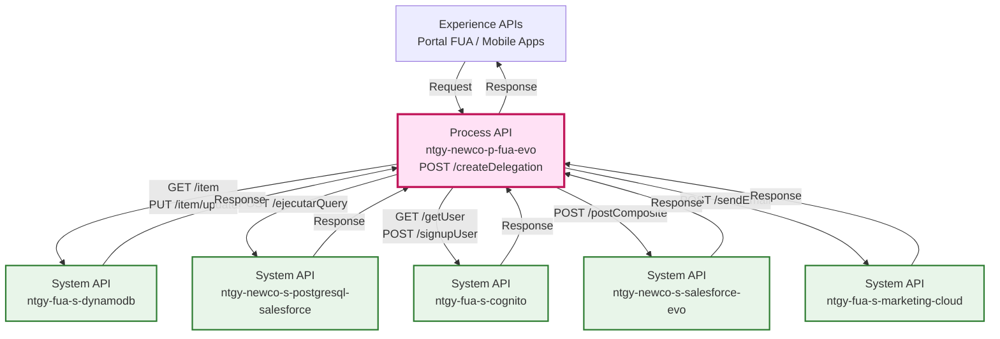
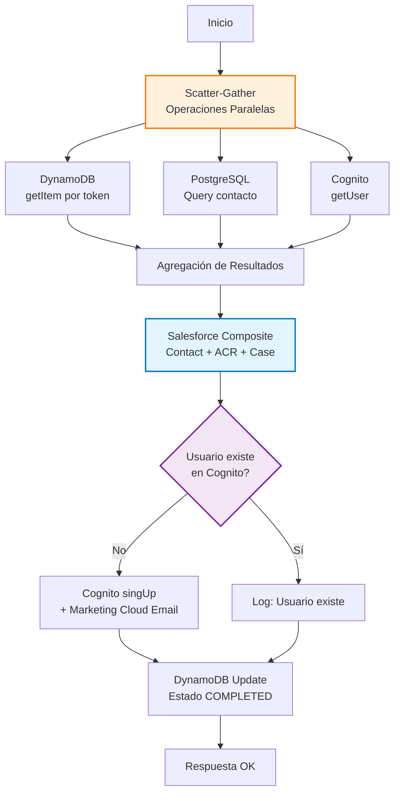
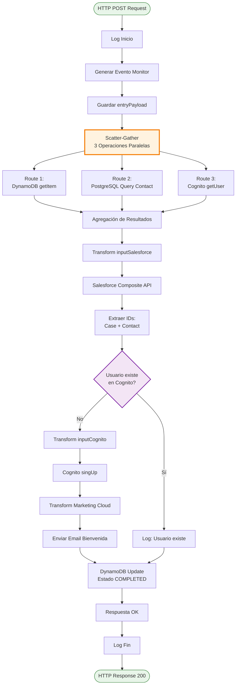
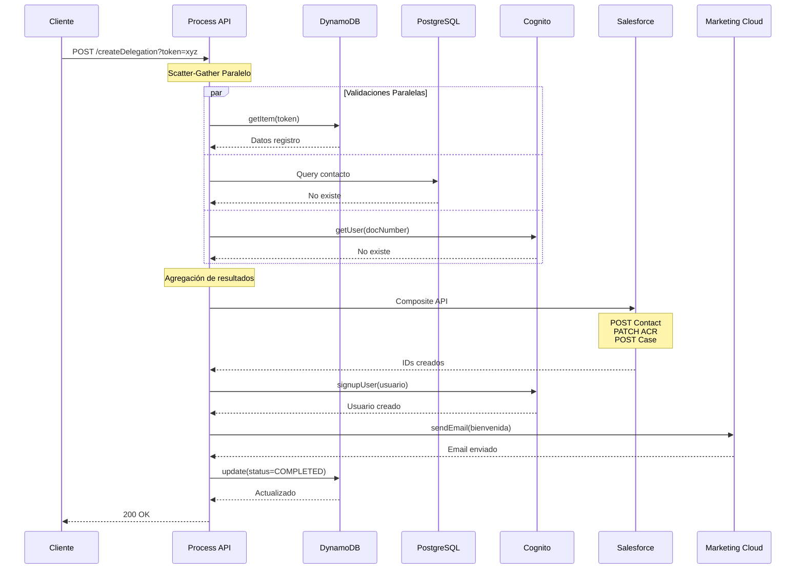
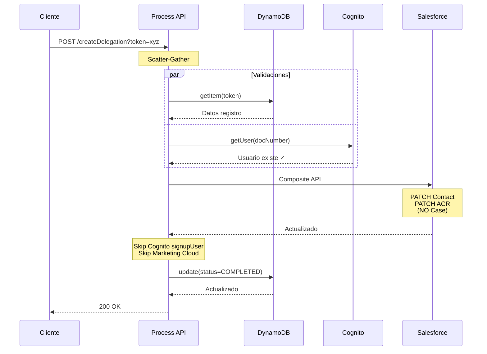
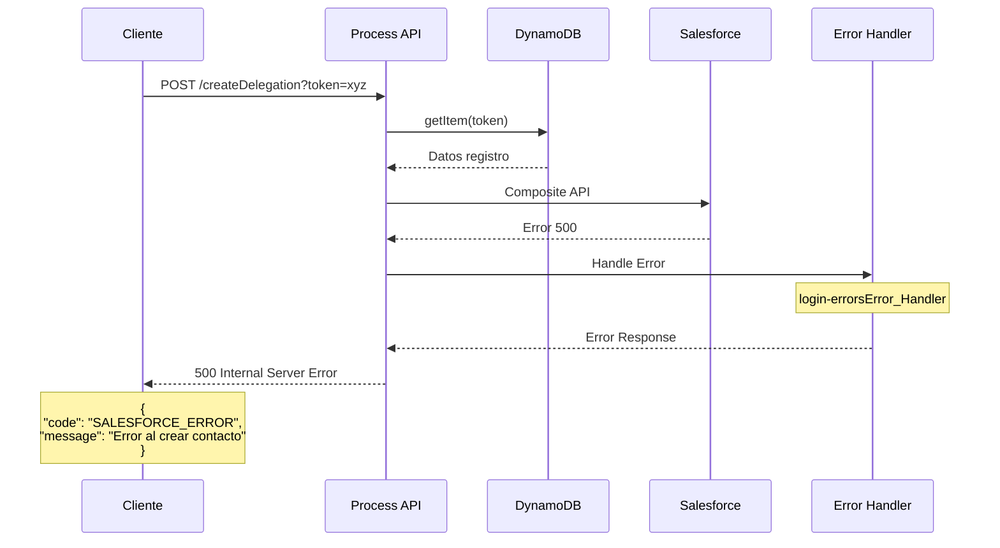

# POST /createDelegation

## 📌 Descripción General

### Propósito del Endpoint

Este endpoint orquesta el proceso completo de creación de delegaciones en el área de cliente FUA (Frontal Único de Atención). Gestiona la asignación de permisos a usuarios autorizados, coordinando operaciones en múltiples sistemas backend: DynamoDB, PostgreSQL/Salesforce, Cognito, Salesforce y Marketing Cloud.

### Tipo de API

**Capa:** Process API (API-Led Connectivity)

**Función:** Orquestación compleja de alta de usuarios autorizados con gestión de identidad, CRM y notificaciones

### Patrón de Integración

**Tipo:** Orquestación Compleja con Scatter-Gather

**Descripción:** Ejecuta operaciones en paralelo (DynamoDB, PostgreSQL, Cognito) para validar datos existentes, luego orquesta secuencialmente la creación/actualización en Salesforce, gestión de usuarios en Cognito y envío de notificaciones por email.

### Arquitectura API-Led Connectivity



---

## 💼 Propósito del Negocio

### Casos de Uso Principales

1. **Alta de Usuario Autorizado Nuevo**
   - Cliente titular desea autorizar a otra persona para gestionar su cuenta
   - Se crea usuario en Cognito, contacto en Salesforce y se envía email de bienvenida
   - Beneficio: Permite delegación de gestión sin comprometer seguridad

2. **Actualización de Usuario Autorizado Existente**
   - Usuario ya existe en el sistema pero necesita nuevos permisos
   - Se actualizan roles y relaciones en Salesforce sin duplicar usuario
   - Beneficio: Mantiene integridad de datos y evita duplicados

3. **Gestión de Roles Específicos (03, 06)**
   - Roles especiales requieren validación adicional
   - Se crea caso de gestión en Salesforce para aprobación
   - Beneficio: Control adicional para permisos sensibles

### 🔗 Endpoints Dependientes

Este Process API consume los siguientes System APIs:

| System API | Endpoint | Método | Propósito |
|------------|----------|--------|-----------|
| `ntgy-fua-s-dynamodb` | `/item` | GET | Obtener datos de registro por token |
| `ntgy-fua-s-dynamodb` | `/item/update` | PUT | Actualizar estado del registro |
| `ntgy-newco-s-postgresql-salesforce` | `/ejecutarQuery` | POST | Verificar si contacto existe en Salesforce |
| `ntgy-fua-s-cognito` | `/getUser` | GET | Verificar si usuario existe en Cognito |
| `ntgy-fua-s-cognito` | `/signupUser` | POST | Crear nuevo usuario en Cognito |
| `ntgy-newco-s-salesforce` | `/postComposite` | POST | Crear/actualizar contacto, relación y caso |
| `ntgy-fua-s-marketing-cloud` | `/sendEmail` | POST | Enviar email de bienvenida al usuario |

### Lógica de Orquestación



**Pasos del Proceso:**

1. **Validación Paralela (Scatter-Gather)**:
   - DynamoDB: Recupera datos de registro usando token del query param
   - PostgreSQL: Verifica si contacto ya existe por documento
   - Cognito: Verifica si usuario ya existe en el pool

2. **Orquestación Salesforce**:
   - Crea o actualiza Contact según existencia previa
   - Actualiza AccountContactRelation con rol y estado
   - Crea Case de gestión si rol requiere validación (no roles 03, 06)

3. **Gestión de Identidad**:
   - Si usuario NO existe en Cognito: Crea usuario y envía email
   - Si usuario existe: Solo registra en log

4. **Finalización**:
   - Actualiza estado en DynamoDB a "COMPLETED"
   - Retorna respuesta exitosa

### Transformaciones Aplicadas

**Transformaciones Principales:**

| Origen | Destino | Transformación |
|--------|---------|----------------|
| `vars.entryPayload.docNumber` | Cognito `username` | Directo |
| `vars.entryPayload.nombre + apellido1 + apellido2` | Cognito `name` | Concatenación con espacios |
| `vars.dynamoItem.item.accountId` | Salesforce `AccountId` | Directo desde DynamoDB |
| `vars.dynamoItem.item.rol` | Salesforce `vlocity_cmt__Type__c` | Directo |
| `vars.dynamoItem.item.idioma` | Marketing Cloud `idioma` | Mapeo: Euskera→euskera, Gallego→gallego, Catalán→catalan, default→castellano |
| `now()` | Salesforce `NewCo_FechaMod__c` | Formato: 'uuuu-MM-dd' |

**Lógica Condicional:**

- **contactId**: Usa `registro.contactId` si existe, sino `respContact[0].sfid`, sino referencia `@{refContact.id}`
- **Operación Contact**: POST si no existe, PATCH si existe
- **Estado Login**: "Pendiente" para roles 03/06, "Validado" para otros
- **Creación Case**: Solo si rol NO es 03 ni 06 y usuario NO existe en Cognito

### Contexto Empresarial

- **Dominio:** Gestión de Usuarios y Delegaciones
- **Sector:** Energía - Utilities
- **División:** Naturgy España - NewCo
- **Proceso de Negocio:** Alta y gestión de usuarios autorizados en área de cliente

### Stakeholders

- **Clientes Titulares**: Necesitan delegar gestión de cuenta a familiares o representantes
- **Usuarios Autorizados**: Personas que gestionarán cuentas en nombre del titular
- **Equipo de Atención al Cliente**: Valida y aprueba delegaciones especiales
- **Administradores de Sistemas**: Gestionan identidades y permisos

### Valor de Negocio

- **Flexibilidad**: Permite gestión delegada de cuentas sin comprometer seguridad
- **Automatización**: Proceso end-to-end sin intervención manual
- **Trazabilidad**: Registro completo en Salesforce con casos de gestión
- **Experiencia de Usuario**: Email de bienvenida automático con credenciales

### Consumidores Potenciales

Este endpoint puede ser consumido por:
- Portal web FUA (Frontal Único de Atención)
- Aplicaciones móviles de autoservicio
- Sistemas de agentes de call center
- Procesos de onboarding automatizados

---

## 🔧 Especificación Técnica

### URLs por Ambiente

| Ambiente | URL Base | URL Completa |
|----------|----------|--------------|
| **Local** | `http://localhost:8081` | `http://localhost:8081/api/createDelegation?token={token}` |
| **Development** | `https://ntgy-newco-p-fua-evo-dev.us-e2.cloudhub.io` | `https://ntgy-newco-p-fua-evo-dev.us-e2.cloudhub.io/api/createDelegation?token={token}` |
| **UAT** | `https://ntgy-newco-p-fua-evo-uat.us-e2.cloudhub.io` | `https://ntgy-newco-p-fua-evo-uat.us-e2.cloudhub.io/api/createDelegation?token={token}` |
| **Production** | `https://ntgy-newco-p-fua-evo-pro.us-e2.cloudhub.io` | `https://ntgy-newco-p-fua-evo-pro.us-e2.cloudhub.io/api/createDelegation?token={token}` |

### Método HTTP

```
POST /api/createDelegation
```

### Parámetros de Entrada

#### Query Parameters

| Parámetro | Tipo | Requerido | Descripción |
|-----------|------|-----------|-------------|
| `token` | string | Sí | Token de registro para recuperar datos de DynamoDB |

#### Request Body (application/json)

**Campos recibidos del Experience API:**

| Campo | Tipo | Requerido | Descripción |
|-------|------|-----------|-------------|
| `docNumber` | string | No | Documento del autorizado |
| `docType` | string | No | Tipo de documento (NIF, NIE, etc.) |
| `nombre` | string | No | Nombre del autorizado |
| `apellido1` | string | No | Primer apellido del autorizado |
| `apellido2` | string | No | Segundo apellido del autorizado |
| `email` | string | No | Email del autorizado |
| `password` | string | No | Contraseña a asignar del usuario |

**Campos obtenidos de DynamoDB (vía token en query parameter):**

Los siguientes campos NO vienen en el request body, sino que se obtienen de DynamoDB usando el token:

| Campo | Origen en Código | Descripción |
|-------|------------------|-------------|
| `contactId` | `vars.dynamoItem.item.contactId` | ID del contacto en Salesforce (puede ser "NO" si no existe) |
| `rol` | `vars.dynamoItem.item.rol` | Rol a asignar (03=Autorizado, 04=Delegado, 05=Representante, 06=Apoderado) |
| `accountId` | `vars.dynamoItem.item.accountId` | ID de la cuenta en Salesforce |
| `phone` | `vars.dynamoItem.item.phone` | Teléfono del usuario |
| `idioma` | `vars.dynamoItem.item.idioma` | Idioma preferido (Castellano, Euskera, Gallego, Catalán) |

**Campo calculado en el Process API:**

| Campo | Cálculo | Descripción |
|-------|---------|-------------|
| `userExist` | `(vars.isUser.error == false) and (vars.isUser.message contains "DONE")` | Indica si el usuario ya existe en Cognito |

**Ejemplo de Request Body:**

```json
{
  "docNumber": "12345678A",
  "docType": "NIF",
  "nombre": "Juan",
  "apellido1": "García",
  "apellido2": "López",
  "email": "juan.garcia@example.com",
  "password": "SecurePass123!"
}
```

**Nota:** Los campos `contactId`, `rol`, `accountId`, `phone` e `idioma` se obtienen de DynamoDB usando el token del query parameter, no vienen en el request body.

### Respuestas

#### 200 OK - Delegación Creada Exitosamente

```json
{
  "result": {
    "codResult": "0000",
    "msgResult": "No hay error"
  }
}
```

#### 400 Bad Request - Error de Validación

```json
{
  "code": "VALIDATION_ERROR",
  "message": "Error en validación de datos",
  "details": "Campo requerido faltante"
}
```

#### 500 Internal Server Error - Error del Sistema

```json
{
  "code": "SYSTEM_ERROR",
  "message": "Error interno del sistema",
  "details": "Error al conectar con Salesforce"
}
```

### Headers Requeridos

| Header | Valor | Descripción |
|--------|-------|-------------|
| `Content-Type` | `application/json` | Formato del body |
| `client_id` | `{CLIENT_ID}` | Client ID de Anypoint Platform |
| `client_secret` | `{CLIENT_SECRET}` | Client Secret de Anypoint Platform |

### Autenticación

- **Tipo:** Client ID & Client Secret (Anypoint Platform)
- **Ubicación:** Headers HTTP

### Timeouts

| Tipo | Valor |
|------|-------|
| **Request Timeout** | 60 segundos |
| **Connection Timeout** | 30 segundos |

---

## 🏗️ Implementación Técnica

### Arquitectura del Flow



### Transformaciones DataWeave

#### 1. Input DynamoDB getItem

**Ubicación:** Inline en XML (líneas 47-58)

```dataweave
%dw 2.0
output application/json
---
{
  "key": "token",
  "keyValue": attributes.queryParams.token,
  "table": p('fua-s-dynamo.tables.tableRegistration'),
  "operationDynamo": "getItem"
}
```

**Propósito:** Recuperar datos de registro usando token del query parameter.

#### 2. Query PostgreSQL - Contacto Existe

**Ubicación:** Inline en XML (líneas 63-71)

```dataweave
%dw 2.0
output application/json
---
{
  "query": "select contact.sfid from newcosalesforce.Contact as contact where contact.newco_documentnumber__c = '" ++ vars.entryPayload.docNumber ++ "'"
}
```

**Propósito:** Verificar si contacto ya existe en Salesforce por número de documento.

#### 3. Input Cognito getUser

**Ubicación:** Inline en XML (líneas 78-87)

```dataweave
%dw 2.0
output application/json
---
{
  "username": vars.entryPayload.docNumber,
  "operation": "getUser"
}
```

**Propósito:** Verificar si usuario ya existe en Cognito.

#### 4. Input Salesforce Composite (Complejo)

**Ubicación:** Inline en XML (líneas 92-165)

**Lógica Principal:**

```dataweave
var registro = vars.dynamoItem.item
var contactId = if(registro.contactId != 'NO') registro.contactId 
  else if (!isEmpty(vars.respContact)) vars.respContact[0].sfid
  else "@{refContact.id}"

var existeCognito = (vars.isUser.error == false) and (vars.isUser.message contains "DONE")
```

**Operaciones Composite:**

1. **POST Contact** (si no existe):
```dataweave
{
  "method": "POST",
  "url": "/services/data/v52.0/sobjects/Contact",
  "referenceId": "refContact",
  "body": {
    "AccountId": registro.accountId,
    "FirstName": vars.entryPayload.nombre,
    "NewCo_Apellido1__c": vars.entryPayload.apellido1,
    "Email": vars.entryPayload.email,
    "NewCo_DocumentNumber__c": vars.entryPayload.docNumber,
    "vlocity_cmt__Type__c": registro.rol,
    "NewCo_EstadoContacto__c": true
  }
}
```

2. **PATCH Contact** (si existe):
```dataweave
{
  "method": "PATCH",
  "url": "/services/data/v52.0/sobjects/Contact/" ++ contactId,
  "referenceId": "refContact",
  "body": {
    "AccountId": registro.accountId,
    "vlocity_cmt__Type__c": registro.rol,
    "NewCo_EstadoContacto__c": true
  }
}
```

3. **PATCH AccountContactRelation**:
```dataweave
{
  "method": "PATCH",
  "url": "/services/data/v52.0/sobjects/AccountContactRelation/NewCo_ExternalACRId__c/" ++ registro.accountId ++ "_" ++ contactId,
  "referenceId": "refAccountContactRelation",
  "body": {
    "Roles": registro.rol,
    "newco_estadologinomega__c": if(["03","06"] contains registro.rol) "Pendiente" else "Validado",
    "NewCo_FechaMod__c": now() as DateTime as String {format: 'uuuu-MM-dd'},
    "NewCo_Activo__c": true
  }
}
```

4. **POST Case** (condicional):
```dataweave
{
  "method": "POST",
  "url": "/services/data/v52.0/sobjects/Case",
  "referenceId": "refCaseGestion",
  "body": {
    "NewCo_Recordtype__c": "Gestion",
    "AccountId": registro.accountId,
    "ContactId": contactId,
    "Priority": "02",
    "Origin": "FUA",
    "NewCo_TraceId__c": splitBy(vars.entryPayload.traceparent,"-")[1],
    "NewCo_CorrelationId__c": correlationId
  }
} if ((!(["03","06"] contains registro.rol)) and !existeCognito)
```

#### 5. Input Cognito signupUser

**Ubicación:** Inline en XML (líneas 185-213)

```dataweave
%dw 2.0
output application/json
---
if(vars.dynamoItem.item.contactId == "NO")
{
  "username": vars.entryPayload.docNumber,
  "email": vars.entryPayload.email,
  "name": [vars.entryPayload.nombre default "", vars.entryPayload.apellido1 default "", vars.entryPayload.apellido2 default ""] joinBy " ",
  "password": vars.entryPayload.password,
  "phoneNumber": vars.dynamoItem.item.phone,
  "confirmedUser": "true",
  "operation": "singUp"
}
else
{
  "username": vars.entryPayload.docNumber,
  "email": vars.dynamoItem.item.email,
  "name": vars.dynamoItem.item.name,
  "password": vars.entryPayload.password,
  "phoneNumber": vars.dynamoItem.item.phone,
  "confirmedUser": "true",
  "operation": "singUp"
}
```

#### 6. Preparar Marketing Cloud

**Ubicación:** Inline en XML (líneas 217-248)

```dataweave
%dw 2.0
output application/json

var idioma = vars.dynamoItem.item.idioma match {
  case "Euskera" -> "euskera"
  case "Gallego" -> "gallego"
  case "Catalán" -> "catalan"
  else -> "castellano"
}
---
{
  "ContactKey": vars.contactId,
  "EventDefinitionKey": p('s-marketing-cloud.eventDefinitionKeyDelegaciones'),
  "data": {
    "nombreAutorizado": vars.entryPayload.nombre,
    "nifAutorizado": vars.entryPayload.docNumber,
    "email": vars.entryPayload.email,
    "tipoEmail": p('s-marketing-cloud.emailType.bienvenidaDL'),
    "ContactKey": vars.contactId,
    "idioma": idioma
  }
}
```

#### 7. Input DynamoDB Update

**Ubicación:** Inline en XML (líneas 253-275)

```dataweave
%dw 2.0
output application/json

var updatedDate = ((now()) >> "CET") as String {format: "dd-MM-yyyy HH:mm:ss"}
---
{
  "body": {
    "keys": {
      "token": vars.dynamoItem.item.token
    },
    "updateValues": [
      {
        "name": "status",
        "value": "COMPLETED"
      },
      {
        "name": "updatedDate",
        "value": updatedDate
      }
    ]
  },
  "operationDynamo": "update",
  "table": p('fua-s-dynamo.tables.tableRegistration')
}
```

### Patrones de Diseño

**Patrón 1: Scatter-Gather**

**Justificación:** Permite ejecutar 3 operaciones de validación en paralelo (DynamoDB, PostgreSQL, Cognito) para optimizar tiempo de respuesta. Las operaciones son independientes y sus resultados se agregan antes de continuar.

**Patrón 2: Composite API (Salesforce)**

**Justificación:** Reduce llamadas HTTP al ejecutar múltiples operaciones Salesforce (Contact, ACR, Case) en una sola transacción, garantizando atomicidad.

**Patrón 3: Conditional Processing**

**Justificación:** La creación de usuario en Cognito y envío de email solo ocurre si el usuario NO existe, evitando duplicados y notificaciones innecesarias.

### Diagramas de Secuencia

#### 1. Flujo Normal de Éxito (Usuario Nuevo)



#### 2. Flujo con Usuario Existente en Cognito



#### 3. Flujo con Error en Salesforce



### Manejo de Errores

**Error Handler:** `login-errorsError_Handler`

**Estrategia:**

1. **Errores de Conectividad**: Retry automático con backoff exponencial
2. **Errores de Validación**: Respuesta inmediata 400 Bad Request
3. **Errores de Sistema**: Respuesta 500 con detalles del error
4. **Errores de Marketing Cloud**: Mapeados a `APP:MARKETING_CLOUD` pero no bloquean el flujo principal

**Códigos de Error Comunes:**

| Código | Descripción | Acción |
|--------|-------------|--------|
| `VALIDATION_ERROR` | Error en validación de datos | Verificar campos requeridos |
| `DYNAMODB_ERROR` | Error al acceder a DynamoDB | Verificar token válido |
| `SALESFORCE_ERROR` | Error al crear/actualizar en Salesforce | Revisar datos del contacto |
| `COGNITO_ERROR` | Error al crear usuario en Cognito | Verificar formato de email/password |
| `MARKETING_CLOUD_ERROR` | Error al enviar email | No bloquea el flujo, se registra |

### Configuración de Propiedades

**Tabla DynamoDB:**
- Propiedad: `fua-s-dynamo.tables.tableRegistration`
- Valor (dev): `ntgy-dydb-registration-token`

**Marketing Cloud:**
- EventDefinitionKey: `s-marketing-cloud.eventDefinitionKeyDelegaciones`
- Valor (dev): `APIEvent-46c6c8a7-70dc-2b20-98f7-725619cdcfb8`
- Email Type: `s-marketing-cloud.emailType.bienvenidaDL`
- Valor: `Bienvenida`

**Cognito:**
- User Pool ID (dev): `eu-west-1_WWZbMSd5k`

---

## 💻 Ejemplos de Uso

### Ejemplo 1: Crear Delegación para Usuario Nuevo

#### Request

```bash
curl -X POST "https://ntgy-newco-p-fua-evo-dev.us-e2.cloudhub.io/api/createDelegation?token=abc123xyz" \
  -H "Content-Type: application/json" \
  -H "client_id: YOUR_CLIENT_ID" \
  -H "client_secret: YOUR_CLIENT_SECRET" \
  -d '{
    "docNumber": "12345678A",
    "docType": "NIF",
    "nombre": "Juan",
    "apellido1": "García",
    "apellido2": "López",
    "email": "juan.garcia@example.com",
    "password": "SecurePass123!"
  }'
```

#### Response (200 OK)

```json
{
  "result": {
    "codResult": "0000",
    "msgResult": "No hay error"
  }
}
```

**Resultado:**
- ✅ Contacto creado en Salesforce
- ✅ Usuario creado en Cognito
- ✅ Email de bienvenida enviado
- ✅ Caso de gestión creado (si rol no es 03 ni 06)
- ✅ Estado en DynamoDB actualizado a COMPLETED

---

### Ejemplo 2: Actualizar Delegación para Usuario Existente

#### Request

```bash
curl -X POST "https://ntgy-newco-p-fua-evo-dev.us-e2.cloudhub.io/api/createDelegation?token=def456uvw" \
  -H "Content-Type: application/json" \
  -H "client_id: YOUR_CLIENT_ID" \
  -H "client_secret: YOUR_CLIENT_SECRET" \
  -d '{
    "docNumber": "87654321B",
    "docType": "NIF",
    "nombre": "María",
    "apellido1": "Martínez",
    "apellido2": "Sánchez",
    "email": "maria.martinez@example.com",
    "password": "NewPass456!"
  }'
```

#### Response (200 OK)

```json
{
  "result": {
    "codResult": "0000",
    "msgResult": "No hay error"
  }
}
```

**Resultado:**
- ✅ Contacto actualizado en Salesforce
- ⏭️ Usuario ya existe en Cognito (no se crea)
- ⏭️ Email no enviado (usuario existente)
- ✅ Estado en DynamoDB actualizado a COMPLETED

---

### Ejemplo 3: Delegación con Rol Especial (03 o 06)

#### Request

```bash
curl -X POST "https://ntgy-newco-p-fua-evo-dev.us-e2.cloudhub.io/api/createDelegation?token=ghi789rst" \
  -H "Content-Type: application/json" \
  -H "client_id: YOUR_CLIENT_ID" \
  -H "client_secret: YOUR_CLIENT_SECRET" \
  -d '{
    "docNumber": "11223344C",
    "docType": "NIF",
    "nombre": "Pedro",
    "apellido1": "Rodríguez",
    "email": "pedro.rodriguez@example.com",
    "password": "SpecialPass789!"
  }'
```

#### Response (200 OK)

```json
{
  "result": {
    "codResult": "0000",
    "msgResult": "No hay error"
  }
}
```

**Resultado:**
- ✅ Contacto creado en Salesforce
- ✅ AccountContactRelation con estado "Pendiente" (requiere validación)
- ❌ NO se crea caso de gestión (roles 03/06 tienen flujo especial)
- ✅ Usuario creado en Cognito
- ✅ Email de bienvenida enviado

---

### Ejemplo 4: Error - Token Inválido

#### Request

```bash
curl -X POST "https://ntgy-newco-p-fua-evo-dev.us-e2.cloudhub.io/api/createDelegation?token=invalid_token" \
  -H "Content-Type: application/json" \
  -H "client_id: YOUR_CLIENT_ID" \
  -H "client_secret: YOUR_CLIENT_SECRET" \
  -d '{
    "docNumber": "99887766D",
    "docType": "NIF",
    "nombre": "Ana",
    "apellido1": "López",
    "email": "ana.lopez@example.com",
    "password": "Pass123!"
  }'
```

#### Response (500 Internal Server Error)

```json
{
  "code": "DYNAMODB_ERROR",
  "message": "Error al recuperar datos de registro",
  "details": "Token no encontrado en DynamoDB"
}
```

---

### Ejemplo 5: JavaScript (Fetch API)

```javascript
const createDelegation = async (token, delegationData) => {
  try {
    const response = await fetch(
      `https://ntgy-newco-p-fua-evo-dev.us-e2.cloudhub.io/api/createDelegation?token=${token}`,
      {
        method: 'POST',
        headers: {
          'Content-Type': 'application/json',
          'client_id': 'YOUR_CLIENT_ID',
          'client_secret': 'YOUR_CLIENT_SECRET'
        },
        body: JSON.stringify(delegationData)
      }
    );

    if (!response.ok) {
      throw new Error(`HTTP error! status: ${response.status}`);
    }

    const data = await response.json();
    console.log('Delegación creada:', data);
    return data;
  } catch (error) {
    console.error('Error al crear delegación:', error);
    throw error;
  }
};

// Uso
const delegationData = {
  docNumber: '12345678A',
  docType: 'NIF',
  nombre: 'Juan',
  apellido1: 'García',
  apellido2: 'López',
  email: 'juan.garcia@example.com',
  password: 'SecurePass123!'
};

createDelegation('abc123xyz', delegationData)
  .then(result => console.log('Éxito:', result))
  .catch(error => console.error('Error:', error));
```

---

### Ejemplo 6: Python (Requests)

```python
import requests
import json

def create_delegation(token, delegation_data):
    """
    Crea una delegación en el área de cliente FUA
    
    Args:
        token (str): Token de registro
        delegation_data (dict): Datos del usuario autorizado
    
    Returns:
        dict: Respuesta del API
    """
    url = f"https://ntgy-newco-p-fua-evo-dev.us-e2.cloudhub.io/api/createDelegation"
    
    headers = {
        'Content-Type': 'application/json',
        'client_id': 'YOUR_CLIENT_ID',
        'client_secret': 'YOUR_CLIENT_SECRET'
    }
    
    params = {'token': token}
    
    try:
        response = requests.post(
            url,
            headers=headers,
            params=params,
            json=delegation_data,
            timeout=60
        )
        
        response.raise_for_status()
        return response.json()
        
    except requests.exceptions.HTTPError as http_err:
        print(f'HTTP error occurred: {http_err}')
        print(f'Response: {response.text}')
        raise
    except Exception as err:
        print(f'Other error occurred: {err}')
        raise

# Uso
delegation_data = {
    'docNumber': '12345678A',
    'docType': 'NIF',
    'nombre': 'Juan',
    'apellido1': 'García',
    'apellido2': 'López',
    'email': 'juan.garcia@example.com',
    'password': 'SecurePass123!'
}

try:
    result = create_delegation('abc123xyz', delegation_data)
    print('Delegación creada exitosamente:', json.dumps(result, indent=2))
except Exception as e:
    print('Error al crear delegación:', str(e))
```

---

### Ejemplo 7: Postman Collection

```json
{
  "info": {
    "name": "FUA - Create Delegation",
    "schema": "https://schema.getpostman.com/json/collection/v2.1.0/collection.json"
  },
  "item": [
    {
      "name": "Create Delegation - New User",
      "request": {
        "method": "POST",
        "header": [
          {
            "key": "Content-Type",
            "value": "application/json"
          },
          {
            "key": "client_id",
            "value": "{{client_id}}"
          },
          {
            "key": "client_secret",
            "value": "{{client_secret}}"
          }
        ],
        "url": {
          "raw": "{{base_url}}/api/createDelegation?token={{token}}",
          "host": ["{{base_url}}"],
          "path": ["api", "createDelegation"],
          "query": [
            {
              "key": "token",
              "value": "{{token}}"
            }
          ]
        },
        "body": {
          "mode": "raw",
          "raw": "{\n  \"docNumber\": \"12345678A\",\n  \"docType\": \"NIF\",\n  \"nombre\": \"Juan\",\n  \"apellido1\": \"García\",\n  \"apellido2\": \"López\",\n  \"email\": \"juan.garcia@example.com\",\n  \"password\": \"SecurePass123!\"\n}"
        }
      }
    }
  ]
}
```

**Variables de Entorno Postman:**
```json
{
  "base_url": "https://ntgy-newco-p-fua-evo-dev.us-e2.cloudhub.io",
  "client_id": "YOUR_CLIENT_ID",
  "client_secret": "YOUR_CLIENT_SECRET",
  "token": "abc123xyz"
}
```
