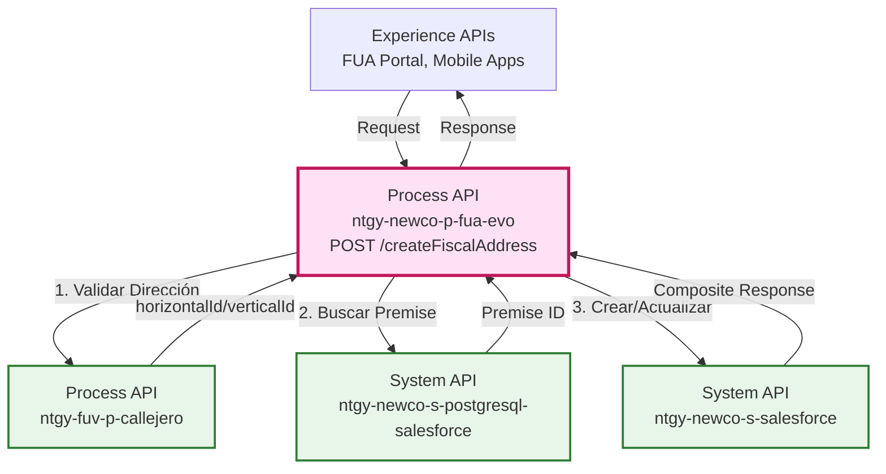
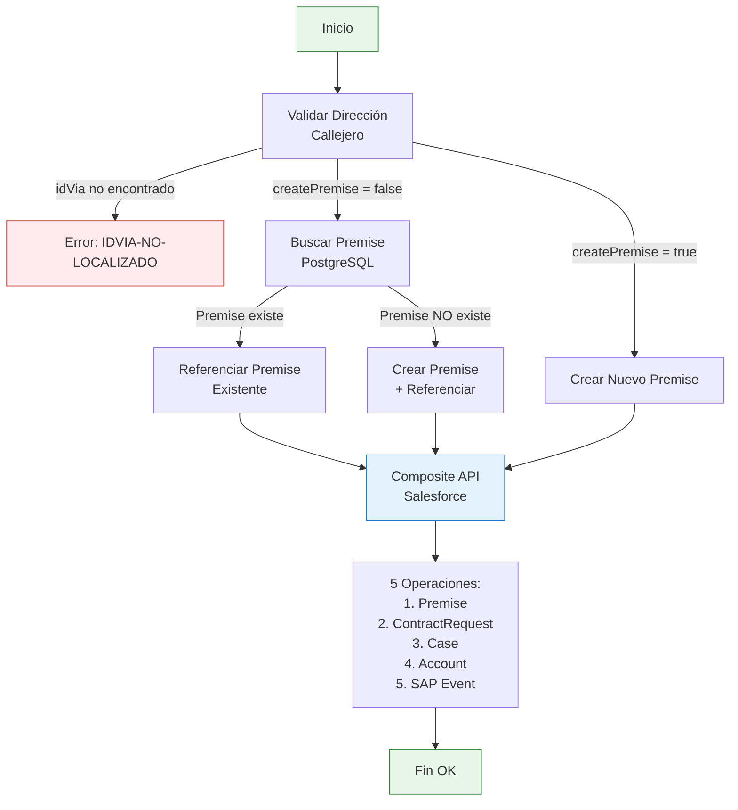
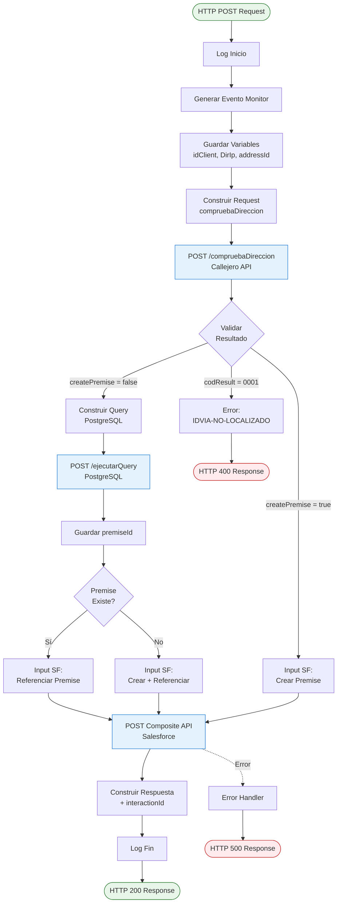
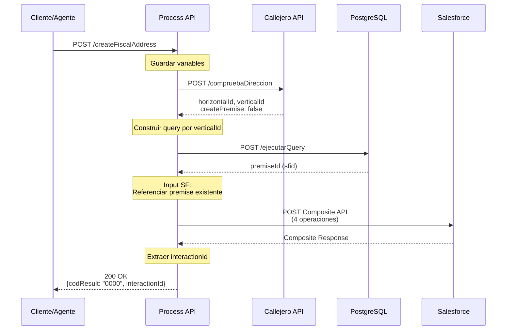
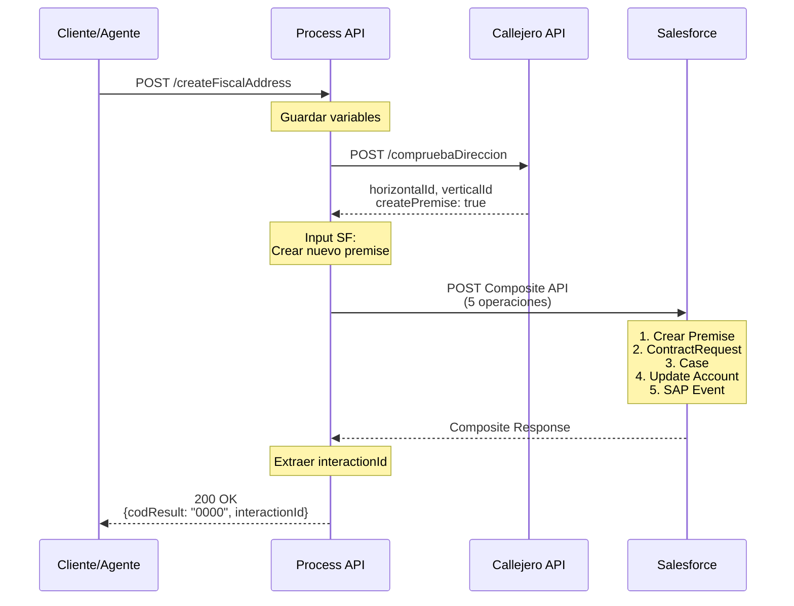
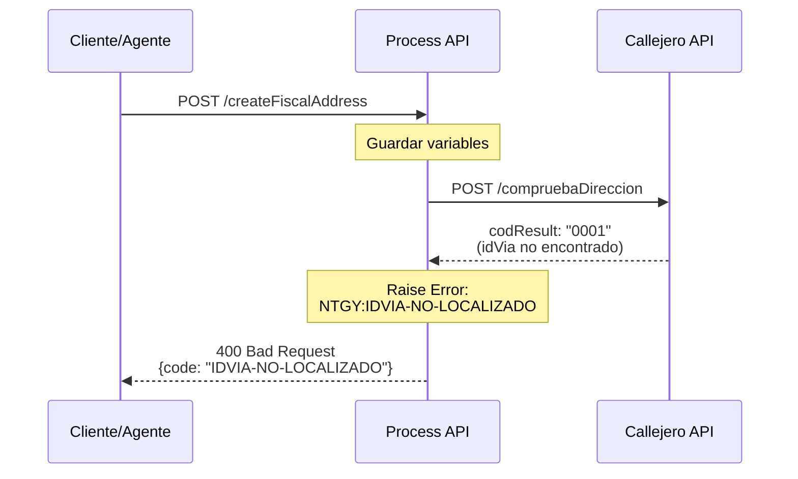
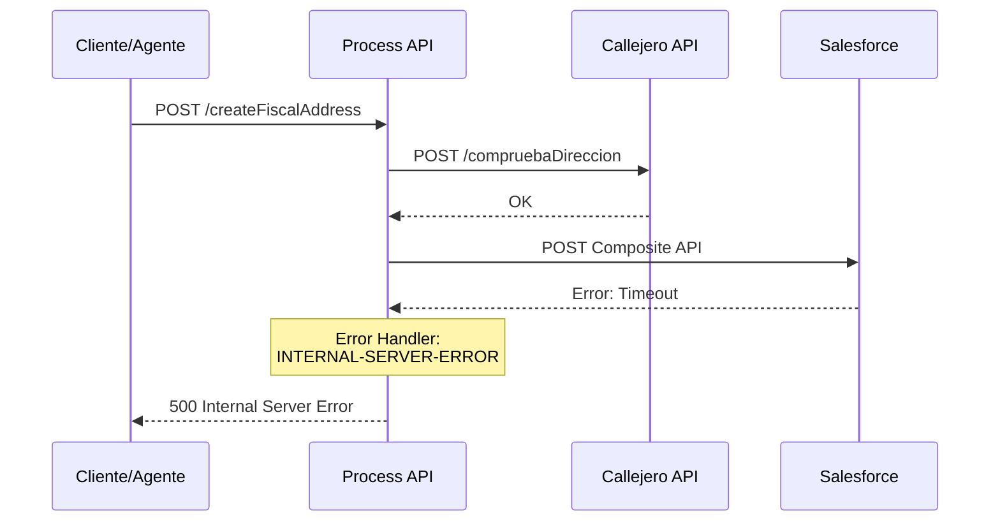

# POST /createFiscalAddress

## 📌 Descripción General

### Propósito del Endpoint

Este endpoint orquesta el proceso completo de creación o actualización de la dirección fiscal de un cliente. Valida la dirección contra el callejero oficial, verifica si la dirección ya existe en Salesforce, y crea o referencia el premise correspondiente. Finalmente, actualiza el cliente y registra el caso de gestión.

### Tipo de API

**Capa:** Process API (API-Led Connectivity)

**Función:** Orquestación del proceso de gestión de direcciones fiscales

### Patrón de Integración

**Tipo:** Orquestación Compleja con Lógica Condicional

**Descripción:** Coordina 3 System APIs con lógica de decisión basada en:
1. Validación de dirección en callejero
2. Existencia de premise en PostgreSQL
3. Creación o referencia de premise en Salesforce
4. Actualización de cliente y registro de caso

### Arquitectura API-Led Connectivity



---

## 💼 Propósito del Negocio

### Casos de Uso Principales

1. **Cambio de Dirección Fiscal por Cliente**
   - Cliente actualiza su dirección fiscal desde el portal FUA
   - Sistema valida la dirección contra callejero oficial
   - Actualiza automáticamente en Salesforce y registra el cambio

2. **Cambio de Dirección Fiscal por Agente**
   - Agente de call center actualiza dirección fiscal del cliente
   - Sistema verifica si la dirección ya existe para reutilizarla
   - Reduce duplicados de premises en Salesforce

3. **Cumplimiento Normativo**
   - Registro automático del caso de gestión
   - Trazabilidad completa del cambio de dirección
   - Generación de evento para sincronización con SAP

### 🔗 Endpoints Dependientes

Este Process API consume los siguientes System APIs:

| System API | Endpoint | Método | Propósito |
|------------|----------|--------|-----------|
| `ntgy-fuv-p-callejero` | `/compruebaDireccion` | POST | Valida dirección y obtiene IDs de callejero |
| `ntgy-newco-s-postgresql-salesforce` | `/ejecutarQuery` | POST | Busca premise existente por verticalId |
| `ntgy-newco-s-salesforce` | `/modificaciones/contacto` | POST | Crea/actualiza premise, caso y cliente (Composite API) |

### Lógica de Orquestación



**Pasos del Proceso:**

1. **Validación de Dirección**: Valida contra callejero y obtiene horizontalId/verticalId
2. **Decisión Condicional**:
   - Si idVia no encontrado → Error NTGY:IDVIA-NO-LOCALIZADO
   - Si createPremise = false → Buscar premise existente
   - Si createPremise = true → Crear nuevo premise
3. **Búsqueda de Premise** (si aplica): Query PostgreSQL por verticalId
4. **Composite API Salesforce**: 5 operaciones en una transacción
5. **Generación de Evento**: Notifica a SAP del cambio de dirección fiscal

### Transformaciones Aplicadas

| Campo Original | Campo Transformado | Transformación |
|----------------|-------------------|----------------|
| `payload.fiscalAddress.*` | `compDireccionRequest.*` | Mapeo para validación de callejero |
| `compruebaDireccionResponse.verticalId` | `query.newco_masterid__c` | Construcción de query SQL |
| `payload.fiscalAddress.*` | `vlocity_cmt__Premises__c.*` | Creación de premise en Salesforce |
| `premiseId` | `Account.NewCo_FiscalAddress__c` | Actualización de cliente |
| `payload.*` | `Case.*` | Creación de caso de gestión |

### Contexto Empresarial

- **Dominio:** Gestión de Clientes y Direcciones
- **Sector:** Energía - Utilities
- **División:** Naturgy España - NewCo
- **Proceso de Negocio:** Actualización de datos maestros de clientes

### Stakeholders

- **Clientes**: Pueden actualizar su dirección fiscal de forma autónoma
- **Agentes de Call Center**: Gestionan cambios de dirección con validación automática
- **Área de Facturación**: Recibe direcciones validadas para envío de facturas
- **Área de Sistemas**: Sincronización automática con SAP mediante eventos

### Valor de Negocio

- **Calidad de Datos**: Validación contra callejero oficial reduce errores
- **Eficiencia Operativa**: Reutilización de premises existentes
- **Reducción de Duplicados**: Búsqueda previa evita premises duplicados
- **Trazabilidad**: Registro automático de todos los cambios
- **Integración SAP**: Sincronización automática mediante eventos

### Consumidores Potenciales

Este endpoint puede ser consumido por:
- Portal web FUA
- Aplicaciones móviles de clientes
- Sistemas de agentes de call center
- Portales de autoservicio

---

## 🔧 Especificación Técnica

### URLs por Ambiente

| Ambiente | URL Base | URL Completa |
|----------|----------|--------------|
| **Local** | `http://localhost:8081` | `http://localhost:8081/api/createFiscalAddress` |
| **Development** | `https://ntgy-newco-p-fua-evo-dev.us-e2.cloudhub.io` | `https://ntgy-newco-p-fua-evo-dev.us-e2.cloudhub.io/api/createFiscalAddress` |
| **UAT** | `https://ntgy-newco-p-fua-evo-uat.us-e2.cloudhub.io` | `https://ntgy-newco-p-fua-evo-uat.us-e2.cloudhub.io/api/createFiscalAddress` |
| **Production** | `https://ntgy-newco-p-fua-evo-pro.us-e2.cloudhub.io` | `https://ntgy-newco-p-fua-evo-pro.us-e2.cloudhub.io/api/createFiscalAddress` |

### Método HTTP

```
POST /api/createFiscalAddress
```

### Headers Requeridos

| Header | Tipo | Obligatorio | Descripción |
|--------|------|-------------|-------------|
| `Content-Type` | string | Sí | Debe ser `application/json` |
| `client_id` | string | Sí | Client ID de Anypoint Platform |
| `client_secret` | string | Sí | Client Secret de Anypoint Platform |
| `x-client-id` | string | Sí | ID del cliente en Salesforce (Account ID) |
| `x-contact-id` | string | Sí | ID del contacto en Salesforce |
| `x-user-id` | string | No | ID del usuario/agente que realiza la acción |
| `x-agent-mail` | string | No | Email del agente (para Salesforce) |
| `x-interaction-id` | string | No | ID del caso de interacción padre |

### Parámetros de Entrada (Body)

```json
{
  "fiscalAddress": {
    "wayId": "string",              // ID de la vía en callejero
    "wayTypeId": "string",          // Tipo de vía (calle, avenida, etc.)
    "way": "string",                // Nombre de la vía
    "number": "string",             // Número
    "portal": "string",             // Portal
    "stairs": "string",             // Escalera
    "floor": "string",              // Piso
    "door": "string",               // Puerta
    "zipCode": "string",            // Código postal
    "city": "string",               // Ciudad
    "province": "string",           // Provincia
    "codMunIne": "string"           // Código INE del municipio
  },
  "addressId": "string",            // ID de dirección (opcional)
  "DirIp": "string"                 // IP del solicitante
}
```

#### Descripción de Campos

| Campo | Tipo | Obligatorio | Descripción | Ejemplo |
|-------|------|-------------|-------------|---------|
| `fiscalAddress.wayId` | string | Sí | ID de la vía en callejero oficial | "280790001234" |
| `fiscalAddress.wayTypeId` | string | Sí | Código tipo de vía | "CL" (Calle) |
| `fiscalAddress.way` | string | Sí | Nombre de la vía | "Gran Vía" |
| `fiscalAddress.number` | string | Sí | Número de la dirección | "28" |
| `fiscalAddress.portal` | string | No | Portal del edificio | "A" |
| `fiscalAddress.stairs` | string | No | Escalera | "1" |
| `fiscalAddress.floor` | string | No | Piso | "3" |
| `fiscalAddress.door` | string | No | Puerta | "B" |
| `fiscalAddress.zipCode` | string | Sí | Código postal | "28013" |
| `fiscalAddress.city` | string | Sí | Ciudad | "Madrid" |
| `fiscalAddress.province` | string | Sí | Provincia | "Madrid" |
| `fiscalAddress.codMunIne` | string | Sí | Código INE del municipio | "28079" |
| `addressId` | string | No | ID de dirección existente | "a1B2c3D4e5F6" |
| `DirIp` | string | Sí | IP del solicitante | "192.168.1.1" |

### Respuestas

#### 200 OK - Éxito

```json
{
  "result": {
    "codResult": "0000",
    "msgResult": "No hay error"
  },
  "interactionId": "500XXXXXXXXXXXXXXX"
}
```

#### 400 Bad Request - idVia No Encontrado

```json
{
  "code": "NTGY:IDVIA-NO-LOCALIZADO",
  "message": "Id via no encontrado en callejero",
  "details": "La vía especificada no existe en el callejero oficial"
}
```

#### 500 Internal Server Error - Error del Sistema

```json
{
  "code": "NTGY:INTERNAL-SERVER-ERROR",
  "message": "Internal server error",
  "details": "Error al procesar la solicitud en Salesforce"
}
```

### Autenticación

- **Tipo:** Client ID & Client Secret (Anypoint Platform)
- **Headers:** `client_id` y `client_secret`

### Timeouts

| Tipo | Valor |
|------|-------|
| **Request Timeout** | 60 segundos |
| **Connection Timeout** | 30 segundos |

### Códigos de Estado HTTP

| Código | Descripción |
|--------|-------------|
| `200` | Dirección fiscal creada/actualizada exitosamente |
| `400` | Error de validación (idVia no encontrado) |
| `401` | Error de autenticación |
| `500` | Error interno del servidor |
| `503` | Servicio no disponible |

---

## 🏗️ Implementación Técnica

### Arquitectura del Flow



### Transformaciones DataWeave

#### 1. Request para Validación de Callejero

```dataweave
%dw 2.0
output application/json
---
{
  "idVia": vars.request.fiscalAddress.wayId,
  "numero": vars.request.fiscalAddress.number,
  "portal": vars.request.fiscalAddress.portal,
  "escalera": vars.request.fiscalAddress.stairs,
  "piso": vars.request.fiscalAddress.floor,
  "puerta": vars.request.fiscalAddress.door
}
```

**Propósito:** Prepara datos para validación de dirección en callejero oficial.

**Campos Enviados:**
- `idVia`: ID de la vía en callejero
- `numero`: Número de la dirección
- `portal`, `escalera`, `piso`, `puerta`: Detalles del inmueble

#### 2. Query PostgreSQL (Buscar Premise Existente)

```dataweave
%dw 2.0
output application/json

var masterId = vars.compruebaDireccionResponse.verticalId
---
{
	"query": "select premise.sfid from newcosalesforce.vlocity_cmt__premises__c as premise where premise.newco_masterid__c = '" ++ masterId ++ "'"
}
```

**Propósito:** Busca premise existente por verticalId (masterId) del callejero.

**Tabla Consultada:** `newcosalesforce.vlocity_cmt__premises__c`

**Campo Buscado:** `newco_masterid__c` (debe coincidir con verticalId)

**Campo Retornado:** `sfid` (Salesforce ID del premise)

#### 3. Input Salesforce - Referenciar Premise Existente

```dataweave
%dw 2.0
output application/json
---
{
	"allOrNone": true,
	"collateSubrequests": false,
	"compositeRequest": [
		{
           "method" : "POST",
           "url" : "/services/data/v52.0/sobjects/acn_obj_ContractRequest__c",
           "referenceId" : "refSolContratacion",
           "body" : {
               "NewCo_Recordtype__c":"acn_rt_Without_Switching",
               "acn_fld_Account__c": vars.idClient, 
               "acn_fld_Sctype__c":"03", 
               "acn_fld_FiscalAddress__c": vars.premiseId,
               "acn_fld_Category__c":"34", 
               "acn_fld_ReleaseDate__c":now() [0 to 9], 
               "acn_fld_newCommertialAgreement__c":false, 
               "acn_fld_ChangeActivationDate__c": now() [0 to 9],
               "acn_fld_ProposedChangeDate__c": now() [0 to 9], 
               "acn_fld_Status__c": "06", 
               "NewCo_Creado_por__c": if(vars.request.'x-user-id' != null) vars.request.'x-user-id' else vars.entryPayload.'x-contact-id'
            }
        },
		{
			"method" : "POST",
			"url" : "/services/data/v52.0/sobjects/Case",
			"referenceId" : "refCaseGestion",
			"body" : {
				"NewCo_Recordtype__c" : "Gestion",
				"AccountId" : vars.idClient,
				"Status" : "06",
				"Priority" : "02",
				"Origin" : "FUA",
				("OwnerId" : vars.request."x-user-id") if(!isEmpty(vars.request."x-user-id")),
				"NewCo_Creado_por__c": if(vars.request.'x-user-id' != null) vars.request.'x-user-id' else vars.entryPayload.'x-contact-id',
				("ParentId": vars.request."x-interaction-id") if(vars.request."x-interaction-id"?),	
				"acn_fld_Tittle__r":{
					"NewCo_ExternalId__c": "CambioDireccionCorrespondencia"
				},
				"acn_fld_ContractRequest__c": "@{refSolContratacion.id}",
				"vlocity_cmt__PremisesId__c": vars.premiseId,
				"Subject": "Cambio dirección fiscal",
				"Description": "Cambio dirección fiscal",
				"NewCo_Ip__c": vars.DirIp,
				"NewCo_CorrelationId__c": correlationId
			}
		},
		{
             "method" : "PATCH",
             "url" : "/services/data/v52.0/sobjects/Account/" ++ vars.idClient,
              "referenceId" : "updatedAccount",
                "body" : {
                               "NewCo_FiscalAddress__c" : vars.premiseId 
                }
		},		
		{
			"method" : "POST",
			"url" : "/services/data/v52.0/sobjects/NewCo_SAP_Integration__c",
			"referenceId" : "refNewCo_SAP_Integration__c",
			"body": {
				"NewCo_fld_EventName__c": "DireccionFiscalCambiada",
				"NewCo_fld_Account__c": vars.idClient			
			}
		}
	]
}
```

**Propósito:** Composite API con 4 operaciones cuando el premise ya existe.

**Operaciones:**
1. **ContractRequest**: Solicitud de contratación tipo "03" (cambio dirección)
2. **Case**: Caso de gestión "Cambio dirección fiscal"
3. **Account**: Actualiza cliente con nuevo premiseId
4. **SAP Integration**: Evento para sincronización con SAP

#### 4. Input Salesforce - Crear Nuevo Premise

```dataweave
%dw 2.0
output application/json
---
{
	"allOrNone": true,
	"collateSubrequests": false,
	"compositeRequest": [
		{
			"method" : "POST",
			"url" : "/services/data/v52.0/sobjects/vlocity_cmt__Premises__c",
			"referenceId" : "refPremise",
			"body" : {
				"NewCo_ProvinceCode__c": vars.request.fiscalAddress.codMunIne [0 to 1],
				"NewCo_codMunIne__c": vars.request.fiscalAddress.codMunIne, 
				"vlocity_cmt__PostalCode__c" : vars.request.fiscalAddress.zipCode,
				"vlocity_cmt__State__c" : vars.request.fiscalAddress.province,
				"vlocity_cmt__City__c" : vars.request.fiscalAddress.city,
				"NewCo_Localidad__c" : vars.request.fiscalAddress.city,
				"vlocity_cmt__StreetAddress__c" : vars.request.fiscalAddress.way,
				"vlocity_cmt__PremisesNumber__c" : vars.request.fiscalAddress.number,
				"NewCo_Portal__c" : vars.request.fiscalAddress.portal,
				"NewCo_Escalera__c" : vars.request.fiscalAddress.stairs,
				"vlocity_cmt__Floor__c" : vars.request.fiscalAddress.floor,
				"NewCo_Puerta__c" : vars.request.fiscalAddress.door,
				"Name" : vars.request.fiscalAddress.way ++ " " ++ vars.request.fiscalAddress.number ++ " " ++ vars.request.fiscalAddress.city,
				"NewCo_PremiseTypeCode__c":vars.request.fiscalAddress.wayTypeId,
				"NewCo_ViaId__c":vars.request.fiscalAddress.wayId,
				"vlocity_cmt__PropertyOwnerAccountId__c" : vars.idClient,
				"NewCo_PlaceId__c": vars.compruebaDireccionResponse.horizontalId,
				"NewCo_MasterId__c": vars.compruebaDireccionResponse.verticalId
			}
		},
		// ... (resto de operaciones similares a la transformación anterior)
	]
}
```

**Propósito:** Composite API con 5 operaciones cuando se crea nuevo premise.

**Operaciones:**
1. **Premise**: Crea nuevo premise con datos completos de dirección
2. **ContractRequest**: Solicitud referenciando `@{refPremise.id}`
3. **Case**: Caso referenciando `@{refPremise.id}`
4. **Account**: Actualiza cliente con `@{refPremise.id}`
5. **SAP Integration**: Evento para sincronización

**Campos Especiales del Premise:**
- `NewCo_PlaceId__c`: horizontalId del callejero
- `NewCo_MasterId__c`: verticalId del callejero
- `Name`: Concatenación de vía + número + ciudad

### Patrones de Diseño

**Patrón:** Conditional Orchestration (Orquestación Condicional)

**Justificación:** 
- Lógica de decisión basada en validación de callejero
- Reutilización de premises existentes para evitar duplicados
- Tres caminos posibles según el resultado de validación
- Transacción atómica en Salesforce (allOrNone: true)

**Patrón:** Composite API Pattern

**Justificación:**
- Múltiples operaciones en Salesforce en una sola transacción
- Garantiza consistencia de datos (todo o nada)
- Reduce latencia al evitar múltiples llamadas HTTP
- Referencias entre objetos usando `@{referenceId.id}`

### Diagramas de Secuencia

#### 1. Flujo Normal - Premise Existente



#### 2. Flujo Normal - Crear Nuevo Premise



#### 3. Flujo con Error - idVia No Encontrado



#### 4. Flujo con Error - Salesforce



### Manejo de Errores

#### Error Mapping

```xml
<!-- Error cuando idVia no se encuentra en callejero -->
<raise-error type="NTGY:IDVIA-NO-LOCALIZADO" 
             description="Id via no encontrado en callejero"/>

<!-- Error en Salesforce -->
<error-handler>
    <on-error-continue type="ANY">
        <raise-error type="NTGY:INTERNAL-SERVER-ERROR" 
                     description="Internal server error"/>
    </on-error-continue>
</error-handler>
```

**Errores Mapeados:**
- **NTGY:IDVIA-NO-LOCALIZADO**: La vía no existe en el callejero oficial
- **NTGY:INTERNAL-SERVER-ERROR**: Error al procesar en Salesforce
- **HTTP:CONNECTIVITY**: Error de conectividad con servicios externos
- **HTTP:TIMEOUT**: Timeout en llamadas a System APIs

#### Estrategia de Recuperación

1. **Error en Callejero (idVia no encontrado)**: Retorna error 400, no continúa el proceso
2. **Error en PostgreSQL**: Continúa con creación de nuevo premise
3. **Error en Salesforce**: Retorna error 500, transacción completa falla (allOrNone: true)

**Nota:** La transacción de Salesforce es atómica. Si falla cualquier operación, todas se revierten.

### Configuración de Timeouts

| Servicio | Timeout | Configuración |
|----------|---------|---------------|
| Callejero API | 30s | Default HTTP connector |
| PostgreSQL/Salesforce | 30s | `${ntgy-newco-s-postgresql-salesforce.timeout}` |
| Salesforce | Variable | `${ntgy-newco-s-salesforce.timeout}` |

---

## 💻 Ejemplos de Uso

### Ejemplo 1: Creación Exitosa de Dirección Fiscal

#### cURL

```bash
curl -X POST "https://ntgy-newco-p-fua-evo-dev.us-e2.cloudhub.io/api/createFiscalAddress" \
  -H "Content-Type: application/json" \
  -H "client_id: YOUR_CLIENT_ID" \
  -H "client_secret: YOUR_CLIENT_SECRET" \
  -H "x-client-id: 001XXXXXXXXXXXXXXX" \
  -H "x-contact-id: 003XXXXXXXXXXXXXXX" \
  -d '{
    "fiscalAddress": {
      "wayId": "280790001234",
      "wayTypeId": "CL",
      "way": "Gran Vía",
      "number": "28",
      "portal": "A",
      "stairs": "1",
      "floor": "3",
      "door": "B",
      "zipCode": "28013",
      "city": "Madrid",
      "province": "Madrid",
      "codMunIne": "28079"
    },
    "addressId": "",
    "DirIp": "192.168.1.100"
  }'
```

#### Respuesta (200 OK)

```json
{
  "result": {
    "codResult": "0000",
    "msgResult": "No hay error"
  },
  "interactionId": "500XXXXXXXXXXXXXXX"
}
```

### Ejemplo 2: JavaScript (Fetch API)

```javascript
const createFiscalAddress = async () => {
  const response = await fetch(
    'https://ntgy-newco-p-fua-evo-dev.us-e2.cloudhub.io/api/createFiscalAddress',
    {
      method: 'POST',
      headers: {
        'Content-Type': 'application/json',
        'client_id': 'YOUR_CLIENT_ID',
        'client_secret': 'YOUR_CLIENT_SECRET',
        'x-client-id': '001XXXXXXXXXXXXXXX',
        'x-contact-id': '003XXXXXXXXXXXXXXX'
      },
      body: JSON.stringify({
        fiscalAddress: {
          wayId: '280790001234',
          wayTypeId: 'CL',
          way: 'Gran Vía',
          number: '28',
          portal: 'A',
          stairs: '1',
          floor: '3',
          door: 'B',
          zipCode: '28013',
          city: 'Madrid',
          province: 'Madrid',
          codMunIne: '28079'
        },
        addressId: '',
        DirIp: '192.168.1.100'
      })
    }
  );

  const data = await response.json();
  console.log(data);
};

createFiscalAddress();
```

### Ejemplo 3: Python (Requests)

```python
import requests

url = 'https://ntgy-newco-p-fua-evo-dev.us-e2.cloudhub.io/api/createFiscalAddress'

headers = {
    'Content-Type': 'application/json',
    'client_id': 'YOUR_CLIENT_ID',
    'client_secret': 'YOUR_CLIENT_SECRET',
    'x-client-id': '001XXXXXXXXXXXXXXX',
    'x-contact-id': '003XXXXXXXXXXXXXXX'
}

payload = {
    'fiscalAddress': {
        'wayId': '280790001234',
        'wayTypeId': 'CL',
        'way': 'Gran Vía',
        'number': '28',
        'portal': 'A',
        'stairs': '1',
        'floor': '3',
        'door': 'B',
        'zipCode': '28013',
        'city': 'Madrid',
        'province': 'Madrid',
        'codMunIne': '28079'
    },
    'addressId': '',
    'DirIp': '192.168.1.100'
}

response = requests.post(url, json=payload, headers=headers)
print(response.json())
```

### Ejemplo 4: Error - idVia No Encontrado

#### Request

```bash
curl -X POST "https://ntgy-newco-p-fua-evo-dev.us-e2.cloudhub.io/api/createFiscalAddress" \
  -H "Content-Type: application/json" \
  -H "client_id: YOUR_CLIENT_ID" \
  -H "client_secret: YOUR_CLIENT_SECRET" \
  -H "x-client-id: 001XXXXXXXXXXXXXXX" \
  -H "x-contact-id: 003XXXXXXXXXXXXXXX" \
  -d '{
    "fiscalAddress": {
      "wayId": "999999999999",
      "wayTypeId": "CL",
      "way": "Calle Inexistente",
      "number": "1",
      "zipCode": "28013",
      "city": "Madrid",
      "province": "Madrid",
      "codMunIne": "28079"
    },
    "DirIp": "192.168.1.100"
  }'
```

#### Respuesta (400 Bad Request)

```json
{
  "code": "NTGY:IDVIA-NO-LOCALIZADO",
  "message": "Id via no encontrado en callejero",
  "details": "La vía especificada no existe en el callejero oficial"
}
```
