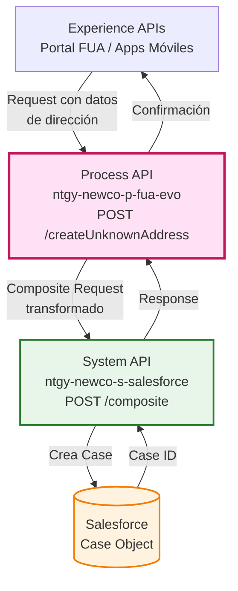
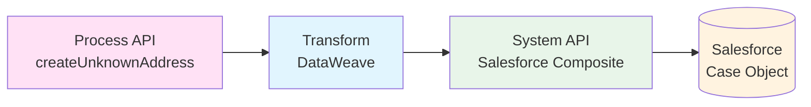
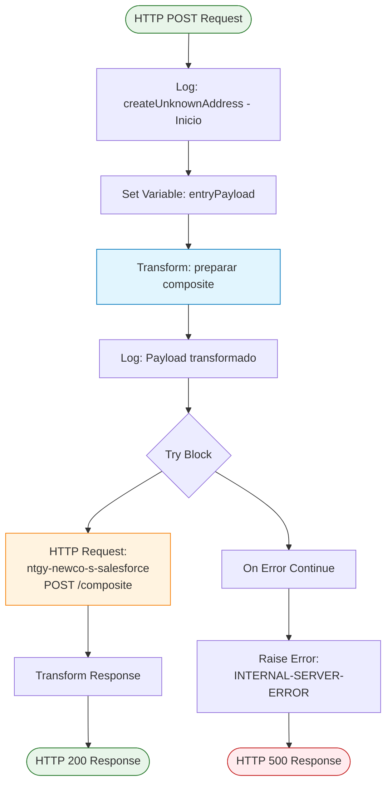
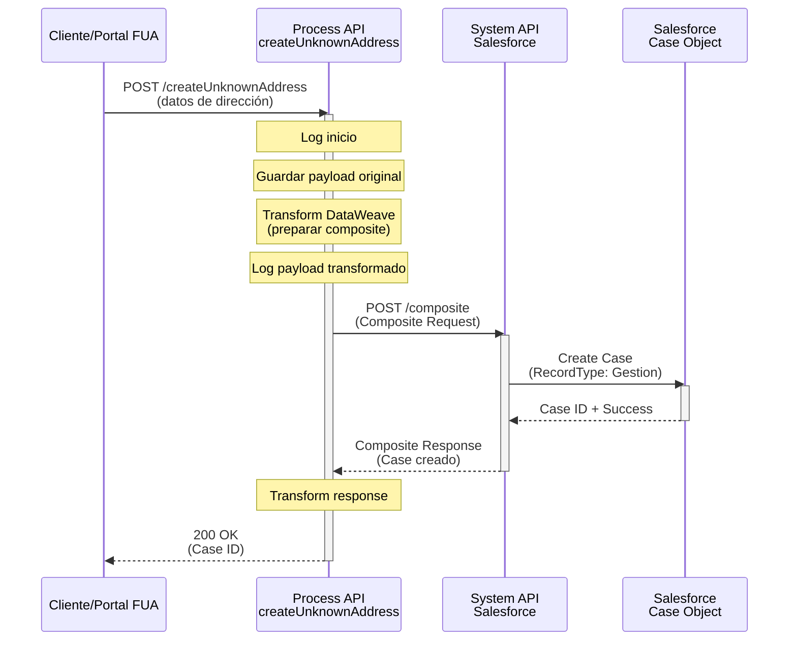
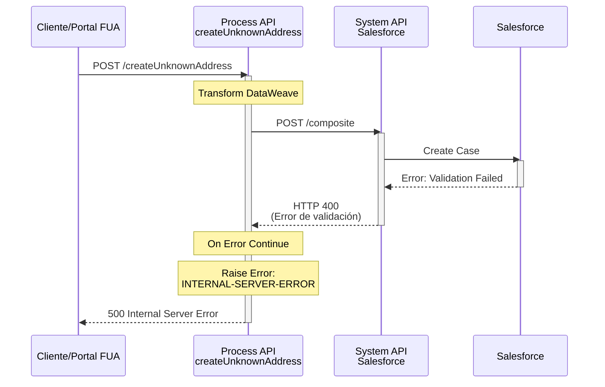
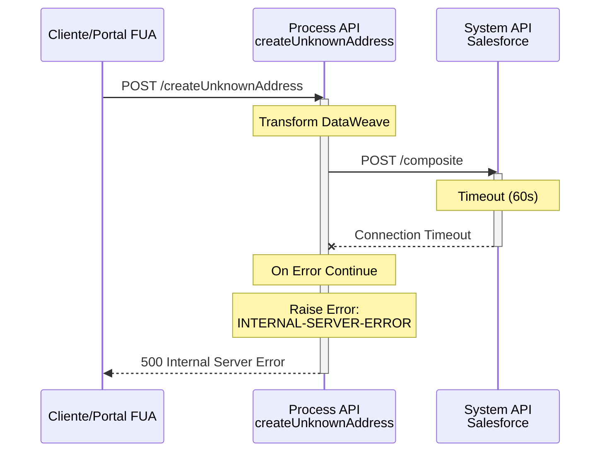

# POST /createUnknownAddress

## 📌 Descripción General

### Propósito del Endpoint

Este endpoint crea un **Case de tipo Gestión en Salesforce** cuando un cliente reporta una dirección que no está disponible o no se encuentra en el sistema. Es parte del flujo de gestión de direcciones desconocidas en el proceso FUA (Frontal Único de Atención), permitiendo registrar y dar seguimiento a solicitudes de actualización de direcciones.

### Tipo de API

**Capa:** Process API (API-Led Connectivity)

**Función:** Orquestación de creación de casos de gestión en Salesforce mediante Composite API

### Patrón de Integración

**Tipo:** Orquestación con Transformación

**Descripción:** El endpoint recibe datos de dirección desconocida del cliente, los transforma al formato requerido por Salesforce Composite API, y crea un Case de tipo "Gestión" con toda la información de la dirección reportada.

### Arquitectura API-Led Connectivity



---

## 💼 Propósito del Negocio

### Casos de Uso Principales

1. **Registro de Dirección Desconocida**
   - Cliente reporta una dirección que no existe en el sistema
   - Se crea un caso de gestión para investigación y actualización
   - Permite dar seguimiento al proceso de validación de la dirección

2. **Gestión de Solicitudes de Actualización**
   - Centraliza las solicitudes de direcciones no encontradas
   - Facilita el trabajo del equipo de gestión de datos
   - Mejora la calidad de la base de datos de direcciones

3. **Trazabilidad de Interacciones**
   - Vincula el caso con la interacción del cliente (si existe)
   - Registra el origen de la solicitud (FUA)
   - Mantiene historial de solicitudes por cliente

### 🔗 Endpoints Dependientes

Este Process API consume el siguiente System API:

| System API | Endpoint | Método | Propósito |
|------------|----------|--------|-----------|
| `ntgy-newco-s-salesforce` | `/postComposite` | POST | Crea Case de Gestión en Salesforce mediante Composite API |

### Lógica de Orquestación



**Pasos del Proceso:**

1. **Recepción de Datos**: Recibe información de la dirección desconocida y datos del cliente
2. **Transformación DataWeave**: Construye el payload para Salesforce Composite API con:
   - Datos del Case (RecordType, Status, Priority, Origin)
   - Información del cliente (AccountId, ContactId, OwnerId)
   - Detalles de la dirección desconocida (calle, número, portal, código postal, etc.)
   - Metadatos de trazabilidad (IP, CorrelationId)
3. **Invocación a Salesforce**: Llama al System API de Salesforce con Composite API
4. **Manejo de Respuesta**: Retorna la respuesta de Salesforce o maneja errores

### Transformaciones Aplicadas

**Transformación Principal: Request → Salesforce Composite API**

| Campo Original (Request) | Campo Salesforce (Case) | Transformación |
|--------------------------|-------------------------|----------------|
| `x-client-id` | `AccountId` | Directo |
| `x-contact-id` | `ContactId` | Directo |
| `x-user-id` | `OwnerId` | Condicional (si existe) |
| `x-user-id` | `NewCo_Creado_por__c` | Si existe, sino usa `x-contact-id` |
| `x-interaction-id` | `ParentId` | Condicional (si existe) |
| `DirIp` | `NewCo_Ip__c` | Directo |
| `data.way` | `NewCo_StreetAddress__c` | Directo |
| `data.number` | `NewCo_PremiseNumber__c` | Directo |
| `data.portal` | `NewCo_Portal__c` | Directo |
| `data.zipCode` | `NewCo_PostalCode__c` | Directo |
| `data.stairs` | `NewCo_Staircase__c` | Directo |
| `data.floor` | `NewCo_Floor__c` | Directo |
| `data.door` | `NewCo_Door__c` | Directo |
| `data.city` | `NewCo_Locality__c` y `NewCo_City__c` | Directo (ambos campos) |
| `data.province` | `NewCo_AddressState__c` | Directo |
| `data.wayTypeId` | `NewCo_PremiseTypeCode__c` | Directo |

**Campos Fijos del Case:**
- `NewCo_Recordtype__c`: "Gestion"
- `Status`: "06"
- `Priority`: "02"
- `Origin`: "FUA"
- `Subject`: "Creación de caso gestión de dirección desconocido"
- `Description`: "Creación de caso gestión de dirección desconocido"
- `acn_fld_Tittle__r.NewCo_ExternalId__c`: "IncCambioDireccionCorrespondenciaFiscal"

### Contexto Empresarial

- **Dominio:** Gestión de Casos y Direcciones
- **Sector:** Energía - Utilities
- **División:** Naturgy España - NewCo
- **Proceso de Negocio:** Gestión de Direcciones Desconocidas en FUA

### Stakeholders

- **Clientes de Naturgy**: Reportan direcciones no encontradas en el sistema
- **Equipo de Gestión de Datos**: Investiga y valida las direcciones reportadas
- **Agentes de Call Center**: Pueden crear casos en nombre de clientes
- **Administradores de Salesforce**: Gestionan y dan seguimiento a los casos

### Valor de Negocio

- **Mejora de Calidad de Datos**: Identifica y corrige direcciones faltantes en el sistema
- **Experiencia del Cliente**: Permite reportar problemas de dirección de forma estructurada
- **Trazabilidad**: Mantiene registro completo de solicitudes de actualización de direcciones
- **Eficiencia Operativa**: Centraliza la gestión de direcciones desconocidas en Salesforce

### Consumidores Potenciales

Este endpoint puede ser consumido por:
- Portal web FUA
- Aplicaciones móviles de clientes
- Sistemas de agentes de call center
- Integraciones de terceros autorizados

---

## 🔧 Especificación Técnica

### URLs por Ambiente

| Ambiente | URL Base | URL Completa |
|----------|----------|--------------|
| **Local** | `http://localhost:8081` | `http://localhost:8081/api/createUnknownAddress` |
| **Development** | `https://ntgy-newco-p-fua-evo-dev.us-e2.cloudhub.io` | `https://ntgy-newco-p-fua-evo-dev.us-e2.cloudhub.io/api/createUnknownAddress` |
| **UAT** | `https://ntgy-newco-p-fua-evo-uat.us-e2.cloudhub.io` | `https://ntgy-newco-p-fua-evo-uat.us-e2.cloudhub.io/api/createUnknownAddress` |
| **Production** | `https://ntgy-newco-p-fua-evo-pro.us-e2.cloudhub.io` | `https://ntgy-newco-p-fua-evo-pro.us-e2.cloudhub.io/api/createUnknownAddress` |

### Método HTTP

```
POST /api/createUnknownAddress
```

### Headers Requeridos

| Header | Tipo | Requerido | Descripción |
|--------|------|-----------|-------------|
| `Content-Type` | string | ✅ Sí | Debe ser `application/json` |
| `x-client-id` | string | ✅ Sí | ID del cliente (AccountId en Salesforce) |
| `x-contact-id` | string | ✅ Sí | ID del contacto en Salesforce |
| `x-user-id` | string | ⚠️ Opcional | ID del usuario/agente (si aplica) |
| `x-interaction-id` | string | ⚠️ Opcional | ID de la interacción padre (si existe) |
| `x-agent-mail` | string | ⚠️ Opcional | Email del agente (para auditoría) |

### Parámetros de Entrada

#### Request Body

```json
{
  "x-client-id": "string",
  "x-contact-id": "string",
  "x-user-id": "string",
  "x-interaction-id": "string",
  "DirIp": "string",
  "data": {
    "way": "string",
    "number": "string",
    "portal": "string",
    "zipCode": "string",
    "stairs": "string",
    "floor": "string",
    "door": "string",
    "city": "string",
    "province": "string",
    "wayTypeId": "string"
  }
}
```

#### Descripción de Campos

| Campo | Tipo | Requerido | Descripción | Ejemplo |
|-------|------|-----------|-------------|---------|
| `x-client-id` | string | ✅ Sí | ID del cliente en Salesforce | "0011t00000ABC123" |
| `x-contact-id` | string | ✅ Sí | ID del contacto en Salesforce | "0031t00000XYZ456" |
| `x-user-id` | string | ⚠️ Opcional | ID del usuario/agente | "0051t00000DEF789" |
| `x-interaction-id` | string | ⚠️ Opcional | ID de la interacción padre | "5001t00000GHI012" |
| `DirIp` | string | ✅ Sí | Dirección IP del cliente | "192.168.1.100" |
| `data.way` | string | ✅ Sí | Nombre de la vía | "Calle Mayor" |
| `data.number` | string | ✅ Sí | Número de la dirección | "123" |
| `data.portal` | string | ⚠️ Opcional | Portal | "A" |
| `data.zipCode` | string | ✅ Sí | Código postal | "28001" |
| `data.stairs` | string | ⚠️ Opcional | Escalera | "1" |
| `data.floor` | string | ⚠️ Opcional | Piso | "3" |
| `data.door` | string | ⚠️ Opcional | Puerta | "B" |
| `data.city` | string | ✅ Sí | Ciudad | "Madrid" |
| `data.province` | string | ✅ Sí | Provincia | "Madrid" |
| `data.wayTypeId` | string | ✅ Sí | Tipo de vía | "CL" |

### Respuestas

#### 200 OK - Éxito

```json
{
  "compositeResponse": [
    {
      "body": {
        "id": "5001t00000ABC123",
        "success": true,
        "errors": []
      },
      "httpHeaders": {
        "Location": "/services/data/v52.0/sobjects/Case/5001t00000ABC123"
      },
      "httpStatusCode": 201,
      "referenceId": "refCaseGestion"
    }
  ]
}
```

#### 400 Bad Request - Error de Validación

```json
{
  "error": {
    "code": "VALIDATION_ERROR",
    "message": "Datos de entrada inválidos",
    "details": "Campo requerido faltante: x-client-id"
  }
}
```

#### 500 Internal Server Error - Error del Sistema

```json
{
  "error": {
    "code": "INTERNAL_SERVER_ERROR",
    "message": "Error interno del servidor",
    "details": "Error al crear el caso en Salesforce"
  }
}
```

### Códigos de Estado HTTP

| Código | Descripción | Cuándo Ocurre |
|--------|-------------|---------------|
| `200` | OK | Case creado exitosamente en Salesforce |
| `400` | Bad Request | Datos de entrada inválidos o faltantes |
| `401` | Unauthorized | Credenciales inválidas o faltantes |
| `500` | Internal Server Error | Error en Salesforce o en el procesamiento |
| `503` | Service Unavailable | Salesforce no disponible |

### Autenticación

- **Tipo:** Client ID & Client Secret (Anypoint Platform)
- **Salesforce:** OAuth 2.0 (gestionado por el System API)

### Timeouts

| Tipo | Valor |
|------|-------|
| **Request Timeout** | 60 segundos |
| **Connection Timeout** | 30 segundos |

---

## 🏗️ Implementación Técnica

### Arquitectura del Flow



### Componentes del Flow

#### 1. Logger Inicial
```xml
<logger level="INFO" message="createUnknownAddress - Inicio: #[payload]"/>
```
- Registra el inicio del proceso con el payload recibido

#### 2. Guardar Payload Original
```xml
<set-variable value="#[payload]" variableName="entryPayload"/>
```
- Guarda el payload original para uso posterior (ej: header x-agent-mail)

#### 3. Transformación DataWeave

**Archivo:** Inline en el flow (líneas 13-42)

```dataweave
%dw 2.0
output application/json
---
{
	"allOrNone" : true,
	"collateSubrequests": false,
	"compositeRequest" : [
		{
			"method" : "POST",
			"url" : "/services/data/v52.0/sobjects/Case",
			"referenceId" : "refCaseGestion",
			"body" : {
				"NewCo_Recordtype__c" : "Gestion",
				"Status" : "06",
				"Priority" : "02",
				"Origin" : "FUA",
				"AccountId": payload."x-client-id",
				"ContactId": payload.'x-contact-id',
				("OwnerId" : payload."x-user-id") if(!isEmpty(payload."x-user-id")),
				"NewCo_Creado_por__c": if(payload.'x-user-id' != null) 
					payload.'x-user-id' 
					else payload."x-contact-id",
				("ParentId": payload."x-interaction-id") if(payload."x-interaction-id"?),
				"acn_fld_Tittle__r":{
					"NewCo_ExternalId__c":"IncCambioDireccionCorrespondenciaFiscal"
				},
				"Subject":"Creación de caso gestión de dirección desconocido",
				"Description":"Creación de caso gestión de dirección desconocido",
				"NewCo_Ip__c": payload.DirIp,
				"NewCo_CorrelationId__c": correlationId,
				"NewCo_StreetAddress__c": payload.data.way,
				"NewCo_PremiseNumber__c": payload.data.number,
				"NewCo_Portal__c": payload.data.portal,
				"NewCo_PostalCode__c": payload.data.zipCode,
				"NewCo_Staircase__c": payload.data.stairs,
				"NewCo_Floor__c": payload.data.floor,
				"NewCo_Door__c": payload.data.door,
				"NewCo_Locality__c": payload.data.city,
				"NewCo_City__c": payload.data.city,
				"NewCo_AddressState__c": payload.data.province,
				"NewCo_PremiseTypeCode__c": payload.data.wayTypeId
			}
		}
	]
}
```

**Características de la Transformación:**
- **allOrNone: true**: Si falla, revierte toda la operación
- **collateSubrequests: false**: No agrupa subrequests
- **Campos Condicionales**: OwnerId y ParentId solo se incluyen si existen
- **Lógica de NewCo_Creado_por__c**: Usa x-user-id si existe, sino usa x-contact-id
- **External ID Lookup**: Usa acn_fld_Tittle__r.NewCo_ExternalId__c para vincular el título del caso

#### 4. Llamada HTTP a Salesforce

```xml
<http:request 
    method="POST" 
    config-ref="HTTP_Request_configuration_ntgy_newco_s_salesforce" 
    path="${ntgy-newco-s-salesforce.pathGenericComposite}">
    <http:headers>
        <![CDATA[#[output application/java
        ---
        {
            ("username" : vars.entryPayload.'x-agent-mail') 
                if (!isEmpty(vars.entryPayload.'x-agent-mail'))
        }]]]>
    </http:headers>
</http:request>
```

**Configuración:**
- **Config:** HTTP_Request_configuration_ntgy_newco_s_salesforce
- **Path:** `${ntgy-newco-s-salesforce.pathGenericComposite}` → `/postComposite`
- **Header Condicional**: Incluye username (x-agent-mail) si está presente

#### 5. Manejo de Errores

```xml
<error-handler>
    <on-error-continue>
        <raise-error 
            type="NTGY: INTERNAL-SERVER-ERROR" 
            description="Internal server error"/>
    </on-error-continue>
</error-handler>
```

**Estrategia:**
- Captura cualquier error durante la llamada HTTP
- Convierte el error a un error estándar NTGY
- Permite que el error se propague al handler global

### Patrones de Diseño

**Patrón:** API Composition con Salesforce Composite API

**Justificación:** 
- Permite crear el Case en una sola llamada HTTP
- Reduce latencia al evitar múltiples round-trips
- Garantiza atomicidad con allOrNone: true
- Facilita el uso de External ID lookups

### Diagramas de Secuencia

#### 1. Flujo Normal de Éxito



#### 2. Flujo con Error de Salesforce



#### 3. Flujo con Timeout



### Configuración de Salesforce Composite API

**Endpoint:** `/services/data/v52.0/composite`

**Características:**
- **Versión API:** v52.0
- **Método:** POST
- **Content-Type:** application/json
- **Autenticación:** OAuth 2.0 (Bearer token)

**Ventajas del Composite API:**
- Reduce el número de llamadas HTTP
- Permite operaciones atómicas (allOrNone)
- Soporta External ID lookups
- Mejora el rendimiento

### Manejo de Errores

#### Estrategia de Error Handling

1. **Try-Catch Block**: Envuelve la llamada HTTP a Salesforce
2. **On Error Continue**: Captura errores sin detener el flow
3. **Raise Error**: Convierte errores a formato estándar NTGY
4. **Global Error Handler**: Procesa el error y retorna respuesta HTTP apropiada

#### Tipos de Errores Manejados

| Error | Causa | Respuesta |
|-------|-------|-----------|
| Validation Error | Datos inválidos en Salesforce | 500 Internal Server Error |
| Connection Timeout | Salesforce no responde | 500 Internal Server Error |
| Authentication Error | Token OAuth inválido | 500 Internal Server Error |
| Salesforce API Error | Error en Salesforce | 500 Internal Server Error |

---

## 💻 Ejemplos de Uso

### Ejemplo 1: Creación Exitosa de Case

#### Request

```bash
curl -X POST "https://ntgy-newco-p-fua-evo-dev.us-e2.cloudhub.io/api/createUnknownAddress" \
  -H "Content-Type: application/json" \
  -H "client_id: YOUR_CLIENT_ID" \
  -H "client_secret: YOUR_CLIENT_SECRET" \
  -d '{
    "x-client-id": "0011t00000ABC123",
    "x-contact-id": "0031t00000XYZ456",
    "x-user-id": "0051t00000DEF789",
    "DirIp": "192.168.1.100",
    "data": {
      "way": "Calle Mayor",
      "number": "123",
      "portal": "A",
      "zipCode": "28001",
      "stairs": "1",
      "floor": "3",
      "door": "B",
      "city": "Madrid",
      "province": "Madrid",
      "wayTypeId": "CL"
    }
  }'
```

#### Response (200 OK)

```json
{
  "compositeResponse": [
    {
      "body": {
        "id": "5001t00000ABC123",
        "success": true,
        "errors": []
      },
      "httpHeaders": {
        "Location": "/services/data/v52.0/sobjects/Case/5001t00000ABC123"
      },
      "httpStatusCode": 201,
      "referenceId": "refCaseGestion"
    }
  ]
}
```

### Ejemplo 2: Creación sin Usuario (Cliente Directo)

#### Request

```bash
curl -X POST "https://ntgy-newco-p-fua-evo-dev.us-e2.cloudhub.io/api/createUnknownAddress" \
  -H "Content-Type: application/json" \
  -H "client_id: YOUR_CLIENT_ID" \
  -H "client_secret: YOUR_CLIENT_SECRET" \
  -d '{
    "x-client-id": "0011t00000ABC123",
    "x-contact-id": "0031t00000XYZ456",
    "DirIp": "192.168.1.100",
    "data": {
      "way": "Avenida de la Constitución",
      "number": "45",
      "zipCode": "41001",
      "city": "Sevilla",
      "province": "Sevilla",
      "wayTypeId": "AV"
    }
  }'
```

**Nota:** En este caso, `NewCo_Creado_por__c` usará el valor de `x-contact-id` ya que `x-user-id` no está presente.

### Ejemplo 3: JavaScript (Fetch API)

```javascript
const createUnknownAddress = async (addressData) => {
  const response = await fetch(
    'https://ntgy-newco-p-fua-evo-dev.us-e2.cloudhub.io/api/createUnknownAddress',
    {
      method: 'POST',
      headers: {
        'Content-Type': 'application/json',
        'client_id': 'YOUR_CLIENT_ID',
        'client_secret': 'YOUR_CLIENT_SECRET'
      },
      body: JSON.stringify({
        'x-client-id': addressData.clientId,
        'x-contact-id': addressData.contactId,
        'x-user-id': addressData.userId,
        'DirIp': addressData.ipAddress,
        'data': {
          'way': addressData.street,
          'number': addressData.number,
          'portal': addressData.portal,
          'zipCode': addressData.zipCode,
          'stairs': addressData.stairs,
          'floor': addressData.floor,
          'door': addressData.door,
          'city': addressData.city,
          'province': addressData.province,
          'wayTypeId': addressData.streetType
        }
      })
    }
  );

  if (!response.ok) {
    throw new Error(`HTTP error! status: ${response.status}`);
  }

  const data = await response.json();
  console.log('Case creado:', data.compositeResponse[0].body.id);
  return data;
};

// Uso
const addressData = {
  clientId: '0011t00000ABC123',
  contactId: '0031t00000XYZ456',
  userId: '0051t00000DEF789',
  ipAddress: '192.168.1.100',
  street: 'Calle Mayor',
  number: '123',
  portal: 'A',
  zipCode: '28001',
  stairs: '1',
  floor: '3',
  door: 'B',
  city: 'Madrid',
  province: 'Madrid',
  streetType: 'CL'
};

createUnknownAddress(addressData)
  .then(result => console.log('Éxito:', result))
  .catch(error => console.error('Error:', error));
```

### Ejemplo 4: Python (Requests)

```python
import requests
import json

def create_unknown_address(address_data):
    """
    Crea un Case de dirección desconocida en Salesforce
    
    Args:
        address_data (dict): Diccionario con los datos de la dirección
        
    Returns:
        dict: Respuesta de Salesforce con el Case ID
    """
    url = 'https://ntgy-newco-p-fua-evo-dev.us-e2.cloudhub.io/api/createUnknownAddress'
    
    headers = {
        'Content-Type': 'application/json',
        'client_id': 'YOUR_CLIENT_ID',
        'client_secret': 'YOUR_CLIENT_SECRET'
    }
    
    payload = {
        'x-client-id': address_data['client_id'],
        'x-contact-id': address_data['contact_id'],
        'x-user-id': address_data.get('user_id'),
        'DirIp': address_data['ip_address'],
        'data': {
            'way': address_data['street'],
            'number': address_data['number'],
            'portal': address_data.get('portal'),
            'zipCode': address_data['zip_code'],
            'stairs': address_data.get('stairs'),
            'floor': address_data.get('floor'),
            'door': address_data.get('door'),
            'city': address_data['city'],
            'province': address_data['province'],
            'wayTypeId': address_data['street_type']
        }
    }
    
    try:
        response = requests.post(url, headers=headers, json=payload, timeout=60)
        response.raise_for_status()
        
        result = response.json()
        case_id = result['compositeResponse'][0]['body']['id']
        print(f'Case creado exitosamente: {case_id}')
        return result
        
    except requests.exceptions.HTTPError as http_err:
        print(f'Error HTTP: {http_err}')
        print(f'Response: {response.text}')
        raise
    except requests.exceptions.Timeout:
        print('Error: Timeout al conectar con el API')
        raise
    except requests.exceptions.RequestException as err:
        print(f'Error: {err}')
        raise

# Uso
address_data = {
    'client_id': '0011t00000ABC123',
    'contact_id': '0031t00000XYZ456',
    'user_id': '0051t00000DEF789',
    'ip_address': '192.168.1.100',
    'street': 'Calle Mayor',
    'number': '123',
    'portal': 'A',
    'zip_code': '28001',
    'stairs': '1',
    'floor': '3',
    'door': 'B',
    'city': 'Madrid',
    'province': 'Madrid',
    'street_type': 'CL'
}

try:
    result = create_unknown_address(address_data)
    print('Resultado:', json.dumps(result, indent=2))
except Exception as e:
    print(f'Error al crear dirección desconocida: {e}')
```

### Ejemplo 5: Error - Datos Faltantes

#### Request (sin x-client-id)

```bash
curl -X POST "https://ntgy-newco-p-fua-evo-dev.us-e2.cloudhub.io/api/createUnknownAddress" \
  -H "Content-Type: application/json" \
  -H "client_id: YOUR_CLIENT_ID" \
  -H "client_secret: YOUR_CLIENT_SECRET" \
  -d '{
    "x-contact-id": "0031t00000XYZ456",
    "DirIp": "192.168.1.100",
    "data": {
      "way": "Calle Mayor",
      "number": "123",
      "zipCode": "28001",
      "city": "Madrid",
      "province": "Madrid",
      "wayTypeId": "CL"
    }
  }'
```

#### Response (500 Internal Server Error)

```json
{
  "error": {
    "code": "INTERNAL_SERVER_ERROR",
    "message": "Error interno del servidor",
    "details": "Error al crear el caso en Salesforce"
  }
}
```
