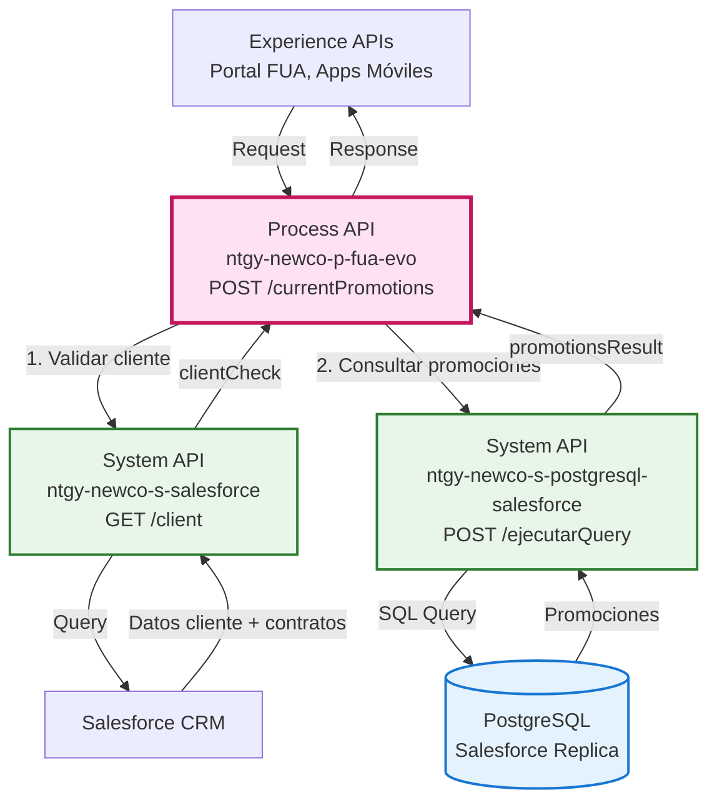
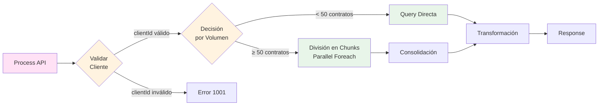
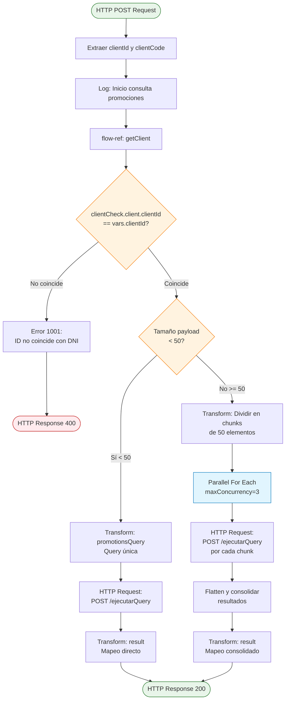
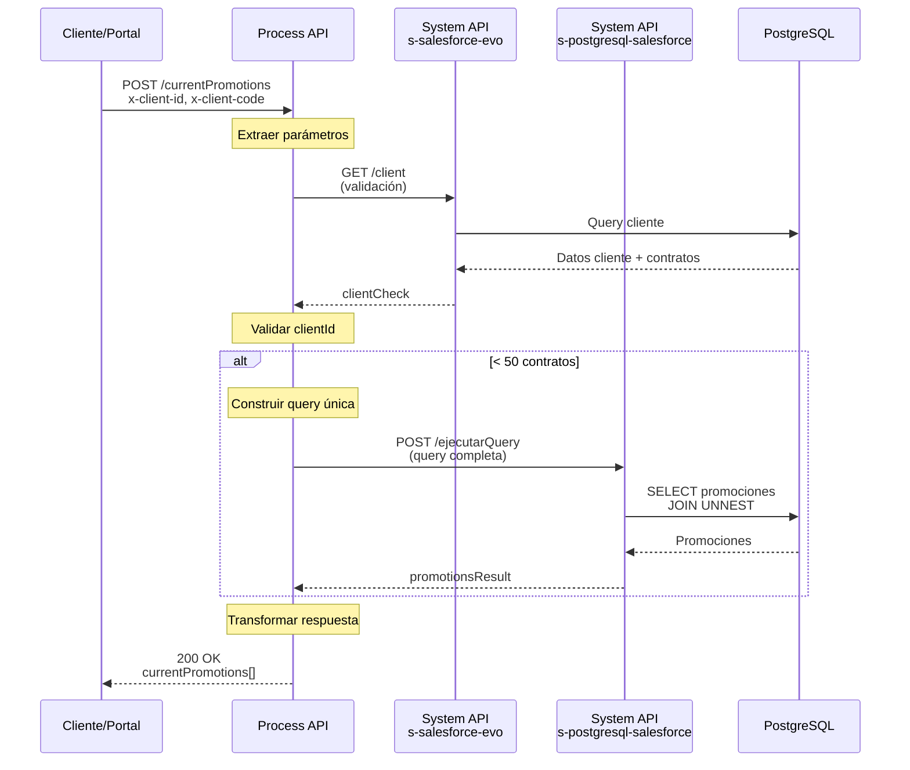
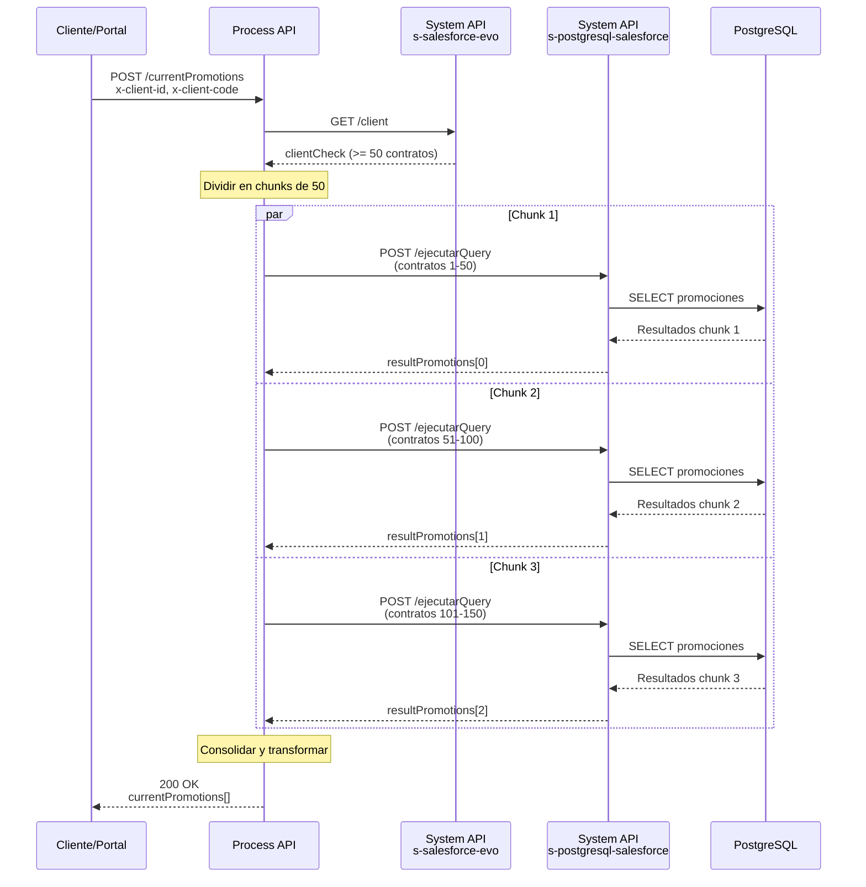
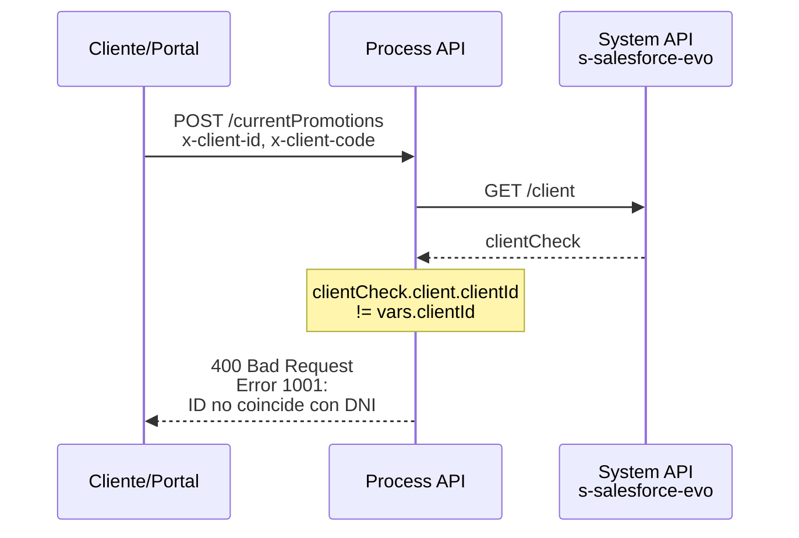

# POST /currentPromotions

## 📌 Descripción General

### Propósito del Endpoint

Este endpoint recupera todas las promociones activas asociadas a los contratos de un cliente específico. Orquesta llamadas a múltiples System APIs para validar la existencia del cliente, obtener sus contratos y consultar las promociones vigentes en la base de datos replicada de Salesforce.

### Tipo de API

**Capa:** Process API (API-Led Connectivity)

**Función:** Orquestación de consulta de promociones con validación de cliente y optimización por volumen

### Patrón de Integración

**Tipo:** Orquestación con Transformación

**Descripción:** 
- Valida la existencia del cliente mediante System API de Salesforce
- Consulta promociones en PostgreSQL (réplica de Salesforce)
- Implementa lógica de optimización por volumen:
  - **< 50 contratos:** Query directa única
  - **≥ 50 contratos:** División en chunks de 50 con procesamiento paralelo (maxConcurrency=3)

### Arquitectura API-Led Connectivity



---

## 💼 Propósito del Negocio

### Casos de Uso Principales

1. **Consulta de Promociones Activas**
   - El cliente visualiza todas las promociones vigentes en sus contratos
   - Beneficio: Transparencia sobre descuentos y beneficios aplicados

2. **Gestión de Beneficios Comerciales**
   - Los agentes consultan promociones para asesorar al cliente
   - Beneficio: Mejor servicio al cliente con información actualizada

3. **Auditoría de Promociones**
   - Verificación de promociones aplicadas correctamente
   - Beneficio: Control de calidad en la aplicación de descuentos

### 🔗 Endpoints Dependientes

Este Process API consume los siguientes System APIs:

| System API | Endpoint | Método | Propósito |
|------------|----------|--------|-----------|
| `ntgy-newco-s-salesforce` | `/client` | GET | Validar existencia del cliente y obtener lista de contratos con assetIds |
| `ntgy-newco-s-postgresql-salesforce` | `/ejecutarQuery` | POST | Ejecutar query SQL para obtener promociones de la tabla replicada de Salesforce |

### Lógica de Orquestación



**Pasos del Proceso:**

1. **Extracción de Parámetros**: Se obtienen `x-client-id` y `x-client-code` de los query params
2. **Validación de Cliente**: Llamada a `GET /client` para verificar existencia y obtener contratos
3. **Verificación de Coincidencia**: Se valida que `clientCheck.client.clientId == vars.clientId`
4. **Decisión por Volumen**:
   - **< 50 contratos**: Query SQL única con todos los contractIds y assetIds
   - **≥ 50 contratos**: División en chunks de 50 elementos, procesamiento paralelo (max 3 concurrentes)
5. **Transformación**: Mapeo de campos de Salesforce a estructura de respuesta estándar

### Transformaciones Aplicadas

| Campo Original (PostgreSQL/Salesforce) | Campo Transformado (Response) | Transformación |
|----------------------------------------|-------------------------------|----------------|
| `newco_contract__c` | `contractId` | Mapeo directo |
| `vlocity_cmt__assetid__c` | `assetId` | Mapeo directo |
| `newco_promotionname__c` | `promotionDesc` | Mapeo directo |
| `vlocity_cmt__effectivestartdate__c` | `promotionStartDate` | Mapeo directo (formato fecha) |
| `vlocity_cmt__effectiveenddate__c` | `promotionEndDate` | Mapeo directo (formato fecha) |

### Contexto Empresarial

- **Dominio:** Gestión de Clientes y Promociones
- **Sector:** Energía - Utilities
- **División:** Naturgy España - NewCo
- **Proceso de Negocio:** Consulta de beneficios comerciales activos

### Stakeholders

- **Clientes Finales**: Consultan sus promociones activas desde el portal FUA
- **Agentes de Call Center**: Verifican promociones para asesorar al cliente
- **Equipo Comercial**: Auditan la correcta aplicación de promociones

### Valor de Negocio

- **Transparencia**: El cliente conoce todos los descuentos aplicados
- **Fidelización**: Visibilidad de beneficios aumenta satisfacción del cliente
- **Eficiencia Operativa**: Reducción de consultas al call center sobre promociones
- **Control de Calidad**: Verificación de correcta aplicación de descuentos comerciales

### Consumidores Potenciales

Este endpoint puede ser consumido por:
- Portales web de autoservicio (FUA)
- Aplicaciones móviles de clientes
- Sistemas de agentes de call center
- Herramientas de auditoría comercial

---

## 🔧 Especificación Técnica

### URLs por Ambiente

| Ambiente | URL Base | URL Completa |
|----------|----------|--------------|
| **Local** | `http://localhost:8082` | `http://localhost:8082/api/currentPromotions` |
| **Development** | `https://ntgy-newco-p-fua-evo-des.de-c1.cloudhub.io` | `https://ntgy-newco-p-fua-evo-des.de-c1.cloudhub.io/api/currentPromotions` |
| **UAT** | `https://ntgy-newco-p-fua-evo-uat.de-c1.cloudhub.io` | `https://ntgy-newco-p-fua-evo-uat.de-c1.cloudhub.io/api/currentPromotions` |
| **Production** | `https://ntgy-newco-p-fua-evo-pro.de-c1.cloudhub.io` | `https://ntgy-newco-p-fua-evo-pro.de-c1.cloudhub.io/api/currentPromotions` |

### Método HTTP

```
POST /api/currentPromotions
```

### Parámetros de Entrada

#### Query Parameters (Obligatorios)

| Parámetro | Tipo | Obligatorio | Descripción | Ejemplo |
|-----------|------|-------------|-------------|---------|
| `x-client-id` | String | Sí | Identificador único del cliente en Salesforce | `"0013X00000ABC123"` |
| `x-client-code` | String | Sí | Código de identificación del cliente (DNI/NIF) | `"12345678A"` |

#### Request Body

```json
{}
```

**Nota:** El body está vacío, todos los parámetros se envían como query params.

### Respuestas

#### 200 OK - Éxito

**Descripción:** Promociones recuperadas exitosamente

**Estructura de Respuesta:**

```json
{
  "result": {
    "codResult": "0000",
    "msgResult": "No hay error"
  },
  "currentPromotions": [
    {
      "contractId": "string",
      "assetId": "string",
      "promotionDesc": "string",
      "promotionStartDate": "date",
      "promotionEndDate": "date"
    }
  ]
}
```

**Campos de Respuesta:**

| Campo | Tipo | Descripción |
|-------|------|-------------|
| `result.codResult` | String | Código de resultado ("0000" = éxito) |
| `result.msgResult` | String | Mensaje descriptivo del resultado |
| `currentPromotions` | Array | Lista de promociones activas |
| `currentPromotions[].contractId` | String | ID del contrato asociado |
| `currentPromotions[].assetId` | String | ID del asset en Salesforce |
| `currentPromotions[].promotionDesc` | String | Descripción de la promoción |
| `currentPromotions[].promotionStartDate` | Date | Fecha de inicio de la promoción |
| `currentPromotions[].promotionEndDate` | Date | Fecha de fin de la promoción |

#### 400 Bad Request - Error de Validación

**Código de Error:** `1001`

**Descripción:** El clientId no coincide con el clientCode proporcionado

```json
{
  "result": {
    "codResult": "1001",
    "msgResult": "El id no coincide con el DNI del cliente: 12345678A y clientId: 0013X00000ABC123"
  }
}
```

#### 500 Internal Server Error

**Descripción:** Error interno del servidor o en la comunicación con System APIs

```json
{
  "result": {
    "codResult": "500",
    "msgResult": "Error interno del servidor"
  }
}
```

### Autenticación

- **Tipo:** Client ID & Client Secret (Anypoint Platform)
- **Headers requeridos:**
  - `client_id`: ID de la aplicación cliente
  - `client_secret`: Secret de la aplicación cliente

### Timeouts

| Tipo | Valor |
|------|-------|
| **Request Timeout** | 240 segundos (s-postgresql-salesforce) |
| **Connection Timeout** | 30 segundos |

---

## 🏗️ Implementación Técnica

### Arquitectura del Flow



### Query SQL Ejecutada

#### Para < 50 contratos (Query Directa)

```sql
SELECT DISTINCT 
  accountpriceadj.newco_contract__c, 
  accountpriceadj.newco_promotionname__c, 
  accountpriceadj.vlocity_cmt__effectivestartdate__c, 
  accountpriceadj.vlocity_cmt__effectiveenddate__c, 
  accountpriceadj.vlocity_cmt__assetid__c, 
  accountpriceadj.newco_parentasset__c 
FROM newcosalesforce.vlocity_cmt__AccountPriceAdjustment__c accountpriceadj 
JOIN UNNEST(
  ARRAY['contractId1','contractId2',...], 
  ARRAY['assetId1','assetId2',...]
) AS t(contract_id, asset_id) 
  ON accountpriceadj.newco_contract__c = t.contract_id 
  AND accountpriceadj.vlocity_cmt__assetid__c = t.asset_id 
WHERE accountpriceadj.newco_promotionname__c IS NOT NULL
```

**Explicación:**
- Utiliza `UNNEST` para crear una tabla temporal con los pares contractId-assetId
- Hace JOIN con la tabla de ajustes de precio para encontrar promociones
- Filtra solo registros con nombre de promoción no nulo

#### Para ≥ 50 contratos (División en Chunks)

**Lógica de División:**

```dataweave
%dw 2.0
output application/json
var chunkSize = 50
var pairs = payload  // Array de {contractId, assetId}

fun chunkArray(arr, size) =
    if (arr is Array and sizeOf(arr) > 0)
        if (sizeOf(arr) <= size) [arr]
        else [arr[0 to (size-1)]] ++ chunkArray(arr[size to -1], size)
    else []

var chunks = chunkArray(pairs, chunkSize)
---
chunks map ((chunk, index) -> {
    "chunkIndex": index + 1,
    "query": "SELECT DISTINCT ... WHERE ... IN (" ++ 
             ((chunk map $.contractId) joinBy ",") ++ 
             ") ..."
})
```

**Procesamiento Paralelo:**
- `maxConcurrency=3`: Máximo 3 queries simultáneas
- Cada chunk genera una query independiente
- Los resultados se consolidan al final con `flatten()`

### Transformaciones DataWeave

#### Transformación 1: Construcción de Query (< 50 contratos)

```dataweave
%dw 2.0
output application/json

var contractIds = payload map $.contractId joinBy "','"
var assetIds = payload map $.assetId joinBy "','"
---
{
  "query": "SELECT DISTINCT accountpriceadj.newco_contract__c, " ++
           "accountpriceadj.newco_promotionname__c, " ++
           "accountpriceadj.vlocity_cmt__effectivestartdate__c, " ++
           "accountpriceadj.vlocity_cmt__effectiveenddate__c, " ++
           "accountpriceadj.vlocity_cmt__assetid__c, " ++
           "accountpriceadj.newco_parentasset__c " ++
           "FROM newcosalesforce.vlocity_cmt__AccountPriceAdjustment__c accountpriceadj " ++
           "JOIN UNNEST(ARRAY['" ++ contractIds ++ "'], ARRAY['" ++ assetIds ++ "']) " ++
           "AS t(contract_id, asset_id) " ++
           "ON accountpriceadj.newco_contract__c = t.contract_id " ++
           "AND accountpriceadj.vlocity_cmt__assetid__c = t.asset_id " ++
           "WHERE accountpriceadj.newco_promotionname__c IS NOT NULL"
}
```

#### Transformación 2: Mapeo de Respuesta

```dataweave
%dw 2.0
output application/json
---
{
  "result": {
    "codResult": "0000",
    "msgResult": "No hay error"
  },
  "currentPromotions": vars.promotionsResult map ((item, index) -> {
    "contractId": item.newco_contract__c,
    "assetId": item.vlocity_cmt__assetid__c,
    "promotionDesc": item.newco_promotionname__c,
    "promotionStartDate": item.vlocity_cmt__effectivestartdate__c,
    "promotionEndDate": item.vlocity_cmt__effectiveenddate__c
  }) default []
}
```

#### Transformación 3: Consolidación de Chunks (≥ 50 contratos)

```dataweave
%dw 2.0
output application/json
---
{
  "result": {
    "codResult": "0000",
    "msgResult": "No hay error"
  },
  "currentPromotions": (flatten(vars.resultPromotions map $.payload)) map ((item, index) -> {
    "contractId": item.newco_contract__c,
    "assetId": item.vlocity_cmt__assetid__c,
    "promotionDesc": item.newco_promotionname__c,
    "promotionStartDate": item.vlocity_cmt__effectivestartdate__c,
    "promotionEndDate": item.vlocity_cmt__effectiveenddate__c
  }) default []
}
```

### Patrones de Diseño

**Patrón:** Orquestación con Optimización por Volumen

**Justificación:** 
- Para volúmenes pequeños (< 50 contratos), una query única es más eficiente
- Para volúmenes grandes (≥ 50 contratos), el procesamiento paralelo mejora el rendimiento
- La división en chunks evita timeouts en queries muy grandes
- El límite de concurrencia (3) previene sobrecarga del System API

### Diagramas de Secuencia

#### 1. Flujo Normal de Éxito (< 50 contratos)



#### 2. Flujo con Volumen Alto (≥ 50 contratos)



#### 3. Flujo con Error de Validación



### Manejo de Errores

#### Errores de Negocio

| Código | Descripción | Acción |
|--------|-------------|--------|
| `1001` | El clientId no coincide con el clientCode | Verificar credenciales del cliente |

#### Errores Técnicos

| Tipo de Error | Manejo | Retry |
|---------------|--------|-------|
| Timeout en System API | Error 500 | No |
| Error de conexión PostgreSQL | Error 500 | No |
| Error en validación de cliente | Error 400 | No |

**Estrategia de Logging:**
- Log de inicio con clientId
- Log de cada llamada a System API
- Log de errores con stack trace completo

---

## 💻 Ejemplos de Uso

### Ejemplo 1: Llamada Exitosa (< 50 contratos)

#### cURL

```bash
curl -X POST "https://ntgy-newco-p-fua-evo-des.de-c1.cloudhub.io/api/currentPromotions?x-client-id=0013X00000ABC123&x-client-code=12345678A" \
  -H "Content-Type: application/json" \
  -H "client_id: YOUR_CLIENT_ID" \
  -H "client_secret: YOUR_CLIENT_SECRET" \
  -d '{}'
```

#### Respuesta (200 OK)

```json
{
  "result": {
    "codResult": "0000",
    "msgResult": "No hay error"
  },
  "currentPromotions": [
    {
      "contractId": "8003X000000XYZ1",
      "assetId": "02i3X000000ABC1",
      "promotionDesc": "Descuento 20% primer año",
      "promotionStartDate": "2024-01-01",
      "promotionEndDate": "2024-12-31"
    },
    {
      "contractId": "8003X000000XYZ2",
      "assetId": "02i3X000000ABC2",
      "promotionDesc": "Bono bienvenida 50€",
      "promotionStartDate": "2024-01-15",
      "promotionEndDate": "2024-06-30"
    }
  ]
}
```

### Ejemplo 2: Cliente sin Promociones

#### cURL

```bash
curl -X POST "https://ntgy-newco-p-fua-evo-des.de-c1.cloudhub.io/api/currentPromotions?x-client-id=0013X00000DEF456&x-client-code=87654321B" \
  -H "Content-Type: application/json" \
  -H "client_id: YOUR_CLIENT_ID" \
  -H "client_secret: YOUR_CLIENT_SECRET" \
  -d '{}'
```

#### Respuesta (200 OK)

```json
{
  "result": {
    "codResult": "0000",
    "msgResult": "No hay error"
  },
  "currentPromotions": []
}
```

### Ejemplo 3: Error de Validación

#### cURL

```bash
curl -X POST "https://ntgy-newco-p-fua-evo-des.de-c1.cloudhub.io/api/currentPromotions?x-client-id=0013X00000WRONG&x-client-code=12345678A" \
  -H "Content-Type: application/json" \
  -H "client_id: YOUR_CLIENT_ID" \
  -H "client_secret: YOUR_CLIENT_SECRET" \
  -d '{}'
```

#### Respuesta (400 Bad Request)

```json
{
  "result": {
    "codResult": "1001",
    "msgResult": "El id no coincide con el DNI del cliente: 12345678A y clientId: 0013X00000WRONG"
  }
}
```

### Ejemplo 4: JavaScript (Fetch API)

```javascript
const getCurrentPromotions = async (clientId, clientCode) => {
  const url = new URL('https://ntgy-newco-p-fua-evo-des.de-c1.cloudhub.io/api/currentPromotions');
  url.searchParams.append('x-client-id', clientId);
  url.searchParams.append('x-client-code', clientCode);

  const response = await fetch(url, {
    method: 'POST',
    headers: {
      'Content-Type': 'application/json',
      'client_id': 'YOUR_CLIENT_ID',
      'client_secret': 'YOUR_CLIENT_SECRET'
    },
    body: JSON.stringify({})
  });

  if (!response.ok) {
    const error = await response.json();
    throw new Error(`Error ${error.result.codResult}: ${error.result.msgResult}`);
  }

  const data = await response.json();
  return data.currentPromotions;
};

// Uso
try {
  const promotions = await getCurrentPromotions('0013X00000ABC123', '12345678A');
  console.log('Promociones activas:', promotions);
} catch (error) {
  console.error('Error al obtener promociones:', error.message);
}
```

### Ejemplo 5: Python (Requests)

```python
import requests

def get_current_promotions(client_id, client_code):
    url = "https://ntgy-newco-p-fua-evo-des.de-c1.cloudhub.io/api/currentPromotions"
    
    params = {
        'x-client-id': client_id,
        'x-client-code': client_code
    }
    
    headers = {
        'Content-Type': 'application/json',
        'client_id': 'YOUR_CLIENT_ID',
        'client_secret': 'YOUR_CLIENT_SECRET'
    }
    
    response = requests.post(url, params=params, headers=headers, json={})
    
    if response.status_code == 200:
        data = response.json()
        return data['currentPromotions']
    else:
        error = response.json()
        raise Exception(f"Error {error['result']['codResult']}: {error['result']['msgResult']}")

# Uso
try:
    promotions = get_current_promotions('0013X00000ABC123', '12345678A')
    print(f"Promociones activas: {len(promotions