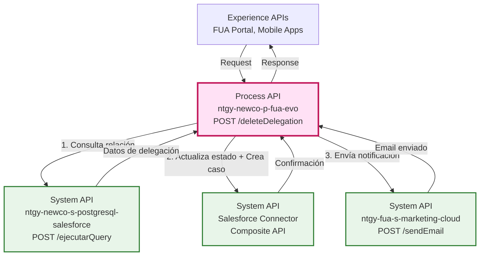
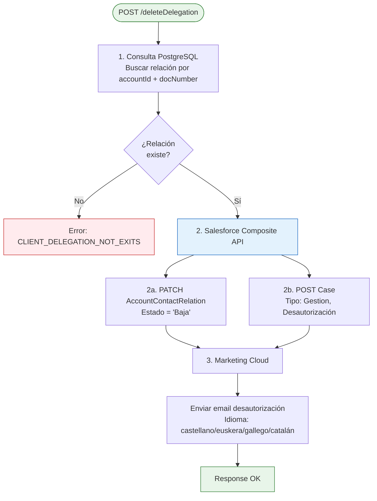
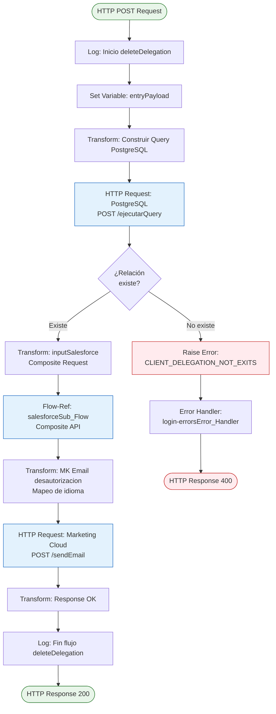
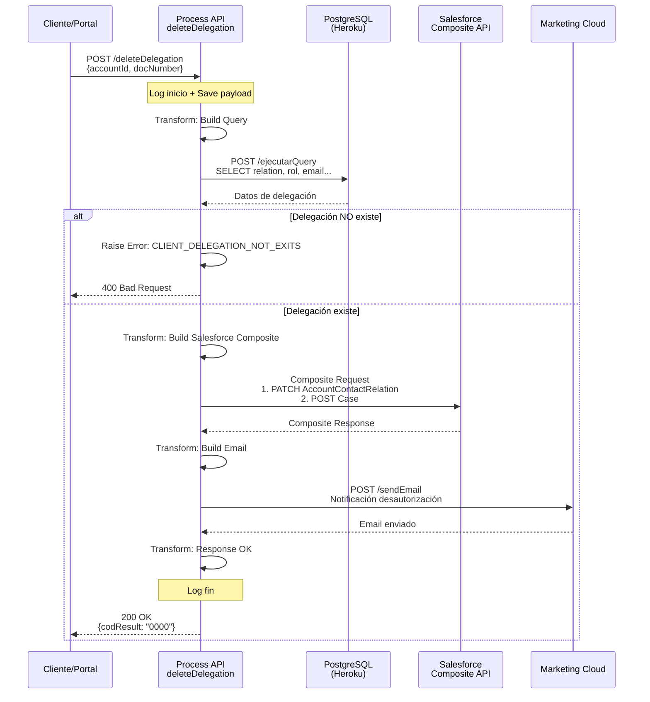
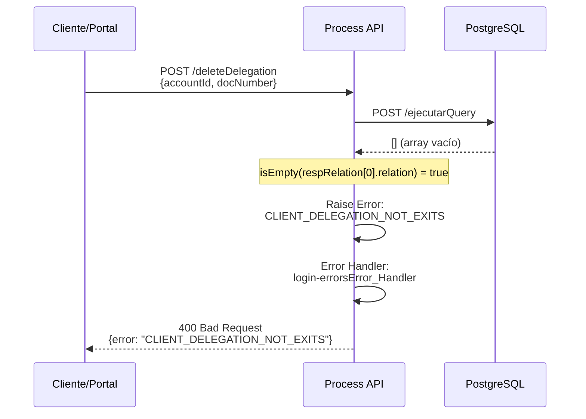
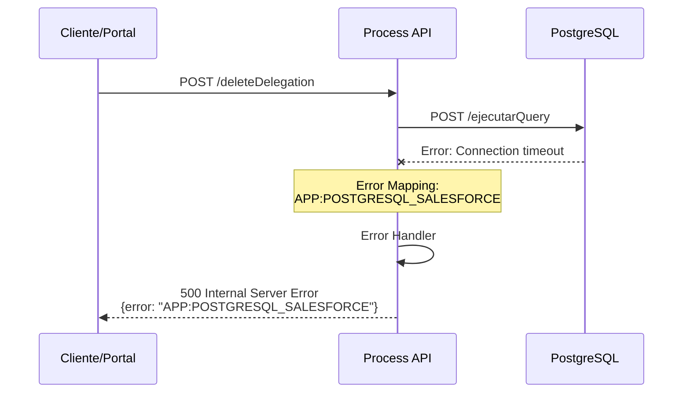

# POST /deleteDelegation

## 📌 Descripción General

### Propósito del Endpoint

Este endpoint orquesta el proceso completo de eliminación (desautorización) de un usuario delegado de una cuenta de cliente. Realiza la consulta de la relación de delegación en PostgreSQL, actualiza el estado en Salesforce, crea un caso de gestión y envía una notificación por email al usuario desautorizado.

### Tipo de API

**Capa:** Process API (API-Led Connectivity)

**Función:** Orquestación del proceso de desautorización de usuarios delegados

### Patrón de Integración

**Tipo:** Orquestación Multi-Sistema

**Descripción:** Coordina operaciones en PostgreSQL (consulta), Salesforce (actualización + creación de caso) y Marketing Cloud (notificación)

### Arquitectura API-Led Connectivity



---

## 💼 Propósito del Negocio

### Casos de Uso Principales

1. **Desautorización de Usuario Delegado**
   - Un titular de cuenta desea revocar el acceso de un usuario autorizado
   - Se elimina la delegación manteniendo trazabilidad del proceso
   - Beneficio: Control total sobre quién puede acceder a la cuenta

2. **Gestión de Seguridad de Cuenta**
   - Revocación inmediata de accesos no deseados
   - Registro automático del cambio en Salesforce
   - Beneficio: Seguridad y auditoría de cambios en delegaciones

3. **Notificación Automática**
   - El usuario desautorizado recibe notificación por email
   - Comunicación en el idioma preferido del usuario
   - Beneficio: Transparencia en la gestión de accesos

### 🔗 Endpoints Dependientes

Este Process API consume los siguientes System APIs:

| System API | Endpoint | Método | Propósito |
|------------|----------|--------|-----------|
| `ntgy-newco-s-postgresql-salesforce` | `/ejecutarQuery` | POST | Consulta relación de delegación en PostgreSQL |
| `Salesforce Connector` | `/services/data/v52.0/sobjects/AccountContactRelation/:id` | PATCH | Actualiza estado de la relación a "Baja" |
| `Salesforce Connector` | `/services/data/v52.0/sobjects/Case` | POST | Crea caso de gestión de desautorización |
| `ntgy-fua-s-marketing-cloud` | `/sendEmail` | POST | Envía email de notificación |

### Lógica de Orquestación



**Pasos del Proceso:**

1. **Consulta de Relación**: Busca en PostgreSQL la relación AccountContactRelation por accountId y docNumber
2. **Validación**: Verifica que la delegación existe, si no existe retorna error
3. **Actualización Salesforce**: Ejecuta operación composite con dos sub-operaciones:
   - PATCH: Cambia estado de AccountContactRelation a "Baja"
   - POST: Crea caso de gestión con detalles de la desautorización
4. **Notificación**: Envía email al usuario desautorizado en su idioma preferido

### Transformaciones Aplicadas

| Campo Original (PostgreSQL) | Campo Transformado (Salesforce) | Transformación |
|-----------------------------|----------------------------------|----------------|
| `relation` (sfid) | `AccountContactRelation/:id` | ID para PATCH |
| `rol` | `Case.Description` | Concatenación: "Desautorización usuario: [docNumber] con el rol: [rol]" |
| `idioma` (newco_preferredlanguage__c) | `data.idioma` (Marketing Cloud) | Mapeo: Euskera→euskera, Gallego→gallego, Catalán→catalan, default→castellano |
| `email` | `data.email` (Marketing Cloud) | Pass-through |
| `contactid` (sfid) | `ContactKey` (Marketing Cloud) | Pass-through |

### Contexto Empresarial

- **Dominio:** Gestión de Usuarios y Delegaciones
- **Sector:** Energía - Utilities
- **División:** Naturgy España - NewCo
- **Proceso de Negocio:** Administración de accesos y seguridad de cuentas

### Stakeholders

- **Clientes Titulares**: Necesitan controlar quién tiene acceso a su cuenta
- **Usuarios Delegados**: Deben ser notificados cuando se revoca su acceso
- **Equipo de Atención al Cliente**: Gestiona casos de desautorización
- **Equipo de Seguridad**: Audita cambios en delegaciones

### Valor de Negocio

- **Seguridad**: Control granular sobre accesos a cuentas de cliente
- **Trazabilidad**: Registro automático de todas las desautorizaciones en Salesforce
- **Transparencia**: Notificación automática al usuario afectado
- **Cumplimiento**: Auditoría completa de cambios en delegaciones

### Consumidores Potenciales

Este endpoint puede ser consumido por:
- Portal web FUA (Frontal Único de Atención)
- Aplicaciones móviles de clientes
- Sistemas de agentes de call center
- Herramientas de administración de cuentas

---

## 🔧 Especificación Técnica

### URLs por Ambiente

| Ambiente | URL Base | URL Completa |
|----------|----------|--------------|
| **Local** | `http://localhost:8081` | `http://localhost:8081/api/deleteDelegation` |
| **Development** | `https://ntgy-newco-p-fua-evo-dev.us-e2.cloudhub.io` | `https://ntgy-newco-p-fua-evo-dev.us-e2.cloudhub.io/api/deleteDelegation` |
| **UAT** | `https://ntgy-newco-p-fua-evo-uat.us-e2.cloudhub.io` | `https://ntgy-newco-p-fua-evo-uat.us-e2.cloudhub.io/api/deleteDelegation` |
| **Production** | `https://ntgy-newco-p-fua-evo-pro.us-e2.cloudhub.io` | `https://ntgy-newco-p-fua-evo-pro.us-e2.cloudhub.io/api/deleteDelegation` |

### Método HTTP

```
POST /api/deleteDelegation
```

### Headers Requeridos

| Header | Tipo | Obligatorio | Descripción |
|--------|------|-------------|-------------|
| `Content-Type` | string | ✅ Sí | Debe ser `application/json` |
| `x-client-id` | string | ✅ Sí | ID de la cuenta (accountId) |
| `x-contact-id` | string | ✅ Sí | ID del contacto que realiza la operación |
| `x-client-code` | string | ✅ Sí | Código del cliente (NIF/CIF) |
| `businessName` | string | ✅ Sí | Nombre del negocio/cliente |

### Parámetros de Entrada

#### Request Body

```json
{
  "docNumber": "string"
}
```

| Campo | Tipo | Obligatorio | Descripción | Ejemplo |
|-------|------|-------------|-------------|---------|
| `docNumber` | string | ✅ Sí | Número de documento del usuario a desautorizar | "12345678A" |

**Validaciones:**
- `docNumber`: Debe corresponder a un usuario delegado existente en la cuenta especificada en el header `x-client-id`

**Nota:** El `accountId` se obtiene del header `x-client-id`, no del body del request.

### Respuestas

#### 200 OK - Desautorización Exitosa

```json
{
  "result": {
    "codResult": "0000",
    "msgResult": "No hay error"
  }
}
```

| Campo | Tipo | Descripción |
|-------|------|-------------|
| `result.codResult` | string | Código de resultado ("0000" = éxito) |
| `result.msgResult` | string | Mensaje descriptivo del resultado |

#### 400 Bad Request - Delegación No Existe

```json
{
  "error": {
    "code": "APP:CLIENT_DELEGATION_NOT_EXITS",
    "message": "La delegación especificada no existe para esta cuenta",
    "timestamp": "2026-09-02T13:04:26Z"
  }
}
```

#### 500 Internal Server Error - Error en PostgreSQL

```json
{
  "error": {
    "code": "APP:POSTGRESQL_SALESFORCE",
    "message": "Error al consultar la base de datos PostgreSQL",
    "timestamp": "2026-09-02T13:04:26Z"
  }
}
```

#### 500 Internal Server Error - Error en Marketing Cloud

```json
{
  "error": {
    "code": "APP:MARKETING_CLOUD",
    "message": "Error al enviar email de notificación",
    "timestamp": "2026-09-02T13:04:26Z"
  }
}
```

### Autenticación

- **Tipo:** Client ID & Client Secret (Anypoint Platform)
- **Headers:** `client_id` y `client_secret` en cada request

### Timeouts

| Tipo | Valor |
|------|-------|
| **Request Timeout** | 60 segundos |
| **Connection Timeout** | 30 segundos |
| **PostgreSQL Query Timeout** | 30 segundos |
| **Salesforce Timeout** | 60 segundos |
| **Marketing Cloud Timeout** | 30 segundos |

---

## 🏗️ Implementación Técnica

### Arquitectura del Flow



### Transformaciones DataWeave

#### 1. Construcción de Query PostgreSQL (Líneas 18-23)

```dataweave
%dw 2.0
output application/json
---
{
    "query": "select a.sfid relation, a.roles rol, contact.email as email,
              contact.newco_preferredlanguage__c as idioma, contact.name as name, 
              contact.sfid as contactid, 
              exists (
                select 1 from newcosalesforce.accountcontactrelation a 
                where a.accountid = '" ++ vars.entryPayload."x-client-id" ++ "' 
                and a.contactid != contact.sfid 
                and a.newco_estadologinomega__c = 'Validado'
              ) as flagActivado 
              from newcosalesforce.accountcontactrelation a 
              inner join newcosalesforce.Contact as contact on contact.sfid = a.contactid 
              where a.accountid = '" ++ vars.entryPayload."x-client-id" ++ "' 
              and contact.newco_documentnumber__c = '" ++ vars.entryPayload.docNumber ++ "'"
}
```

**Propósito:** Construye query SQL para buscar la relación de delegación y verificar si existen otros usuarios validados.

**Tablas Consultadas:**
- `newcosalesforce.accountcontactrelation`: Relaciones cuenta-contacto
- `newcosalesforce.Contact`: Datos del contacto

#### 2. Construcción de Request Salesforce Composite (Líneas 30-62)

```dataweave
%dw 2.0
output application/json

var docNumber = vars.entryPayload.docNumber
var rol = vars.respRelation[0].rol
var flagactivado = vars.respRelation[0].flagactivado
---
{
    "body": {
        "allOrNone": true,
        "collateSubrequests": false,
        "compositeRequest": [
            {
                "method": "PATCH",
                "url": "/services/data/v52.0/sobjects/AccountContactRelation/" ++ vars.respRelation[0].relation,
                "referenceId": "refAccountContactRelation",
                "body": {
                    "newco_estadologinomega__c": "Baja",
                    "NewCo_FechaMod__c": now() as DateTime as String {format: 'uuuu-MM-dd'}
                }
            },
            {
                "method": "POST",
                "url": "/services/data/v52.0/sobjects/Case",
                "referenceId": "refCaseGestion",
                "body": {
                    "NewCo_Recordtype__c": "Gestion",
                    "AccountId": vars.entryPayload."x-client-id",
                    "ContactId": vars.entryPayload."x-contact-id",
                    "acn_fld_Tittle__r": {
                        "NewCo_ExternalId__c": "ModifDatosClienteProcesoAlta"
                    },
                    "Subject": "Desautorización usuario",
                    "Description": "Desautorización usuario: " ++ docNumber ++ " con el rol: " ++ rol,
                    "Status": "06",
                    "Origin": "FUA"
                }
            }
        ]
    },
    "operationSalesforce": "composite"
}
```

**Propósito:** Crea request composite para Salesforce con dos operaciones:
1. **PATCH**: Actualiza estado de AccountContactRelation a "Baja"
2. **POST**: Crea caso de gestión con detalles de la desautorización

#### 3. Construcción de Email Marketing Cloud (Líneas 68-88)

```dataweave
%dw 2.0
output application/json

var idioma = vars.respRelation[0].idioma match {
    case "Euskera" -> "euskera"
    case "Gallego" -> "gallego"
    case "Catalán" -> "catalan"
    else -> "castellano"
}
---
{
    "ContactKey": vars.respRelation[0].contactid,
    "EventDefinitionKey": p('s-marketing-cloud.eventDefinitionKeyDelegaciones'),
    "data": {
        "nombreAutorizado": vars.respRelation[0].name,
        "nifAutorizado": vars.entryPayload.docNumber,
        "nifCliente": vars.entryPayload."x-client-code",
        "nombreCliente": vars.entryPayload.businessName,
        "email": vars.respRelation[0].email,
        "tipoEmail": p('s-marketing-cloud.emailType.desautorizacionDL'),
        "ContactKey": vars.respRelation[0].contactid,
        "idioma": idioma
    }
}
```

**Propósito:** Construye payload para Marketing Cloud con mapeo de idioma y datos del usuario desautorizado.

**Mapeo de Idiomas:**
- Euskera → euskera
- Gallego → gallego
- Catalán → catalan
- Otros → castellano (default)

### Operaciones de Base de Datos

#### Query PostgreSQL (Línea 24)

**Endpoint:** `POST /ejecutarQuery` (System API: ntgy-newco-s-postgresql-salesforce)

**Query SQL:**
```sql
SELECT 
    a.sfid AS relation,
    a.roles AS rol,
    contact.email AS email,
    contact.newco_preferredlanguage__c AS idioma,
    contact.name AS name,
    contact.sfid AS contactid,
    EXISTS (
        SELECT 1 
        FROM newcosalesforce.accountcontactrelation a 
        WHERE a.accountid = :accountId 
        AND a.contactid != contact.sfid 
        AND a.newco_estadologinomega__c = 'Validado'
    ) AS flagActivado
FROM newcosalesforce.accountcontactrelation a
INNER JOIN newcosalesforce.Contact AS contact 
    ON contact.sfid = a.contactid
WHERE a.accountid = :accountId 
AND contact.newco_documentnumber__c = :docNumber
```

**Tablas:**
- `newcosalesforce.accountcontactrelation`: Relaciones cuenta-contacto
- `newcosalesforce.Contact`: Datos de contactos

**Operaciones:** READ

### Operaciones Salesforce

#### 1. PATCH AccountContactRelation (Línea 44)

**Objeto:** `AccountContactRelation`

**Campos Actualizados:**
- `newco_estadologinomega__c`: "Baja"
- `NewCo_FechaMod__c`: Fecha actual (formato: yyyy-MM-dd)

**Propósito:** Marca la relación como dada de baja

#### 2. POST Case (Línea 50)

**Objeto:** `Case`

**Campos:**
- `NewCo_Recordtype__c`: "Gestion"
- `AccountId`: ID de la cuenta
- `ContactId`: ID del contacto que realiza la operación
- `acn_fld_Tittle__r.NewCo_ExternalId__c`: "ModifDatosClienteProcesoAlta"
- `Subject`: "Desautorización usuario"
- `Description`: "Desautorización usuario: [docNumber] con el rol: [rol]"
- `Status`: "06"
- `Origin`: "FUA"

**Propósito:** Crea caso de gestión para trazabilidad

### Integración Marketing Cloud

**Endpoint:** `POST /sendEmail` (System API: ntgy-fua-s-marketing-cloud)

**Parámetros:**
- `ContactKey`: ID del contacto en Salesforce
- `EventDefinitionKey`: Clave del evento de delegaciones (configurado en properties)
- `data.tipoEmail`: Tipo de email (desautorizacionDL)
- `data.idioma`: Idioma del email (castellano/euskera/gallego/catalan)

### Patrones de Diseño

**Patrón:** Saga Pattern (Orquestación)

**Justificación:** 
- Coordina múltiples operaciones en diferentes sistemas
- Mantiene consistencia entre PostgreSQL, Salesforce y Marketing Cloud
- Manejo de errores centralizado en el Process API

**Patrón:** Error Handling con Raise Error

**Justificación:**
- Validación de negocio (delegación existe) antes de proceder
- Error específico `CLIENT_DELEGATION_NOT_EXITS` para casos de negocio
- Separación de errores técnicos vs errores de negocio

### Diagramas de Secuencia

#### 1. Flujo Normal de Éxito



#### 2. Flujo con Error de Negocio (Delegación No Existe)



#### 3. Flujo con Error Técnico (PostgreSQL)



### Manejo de Errores

#### Errores de Negocio

| Error Type | HTTP Status | Descripción | Acción |
|------------|-------------|-------------|--------|
| `APP:CLIENT_DELEGATION_NOT_EXITS` | 400 | La delegación no existe para la cuenta | Verificar accountId y docNumber |

#### Errores Técnicos

| Error Type | HTTP Status | Descripción | Acción |
|------------|-------------|-------------|--------|
| `APP:POSTGRESQL_SALESFORCE` | 500 | Error al consultar PostgreSQL | Reintentar, verificar conectividad |
| `APP:MARKETING_CLOUD` | 500 | Error al enviar email | Revisar configuración de Marketing Cloud |
| `SALESFORCE:*` | 500 | Error en operaciones Salesforce | Verificar credenciales y permisos |

#### Error Handler

**Referencia:** `login-errorsError_Handler`

**Estrategia:**
- Errores de negocio: Retornar 400 con mensaje descriptivo
- Errores técnicos: Retornar 500 con código de error específico
- Logging completo de todos los errores para auditoría

---

## 💻 Ejemplos de Uso

### Ejemplo 1: Desautorización Exitosa

#### cURL

```bash
curl -X POST "https://ntgy-newco-p-fua-evo-dev.us-e2.cloudhub.io/api/deleteDelegation" \
  -H "Content-Type: application/json" \
  -H "client_id: YOUR_CLIENT_ID" \
  -H "client_secret: YOUR_CLIENT_SECRET" \
  -H "x-client-id: 0011t00000ABC123" \
  -H "x-contact-id: 0031t00000XYZ789" \
  -H "x-client-code: 12345678Z" \
  -H "businessName: Empresa Ejemplo SL" \
  -d '{
    "docNumber": "87654321B"
  }'
```

#### Respuesta (200 OK)

```json
{
  "result": {
    "codResult": "0000",
    "msgResult": "No hay error"
  }
}
```

**Resultado:**
- ✅ Relación AccountContactRelation actualizada a estado "Baja"
- ✅ Caso de gestión creado en Salesforce
- ✅ Email de notificación enviado al usuario desautorizado

### Ejemplo 2: Error - Delegación No Existe

#### cURL

```bash
curl -X POST "https://ntgy-newco-p-fua-evo-dev.us-e2.cloudhub.io/api/deleteDelegation" \
  -H "Content-Type: application/json" \
  -H "client_id: YOUR_CLIENT_ID" \
  -H "client_secret: YOUR_CLIENT_SECRET" \
  -H "x-client-id: 0011t00000ABC123" \
  -H "x-contact-id: 0031t00000XYZ789" \
  -H "x-client-code: 12345678Z" \
  -H "businessName: Empresa Ejemplo SL" \
  -d '{
    "docNumber": "99999999X"
  }'
```

#### Respuesta (400 Bad Request)

```json
{
  "error": {
    "code": "APP:CLIENT_DELEGATION_NOT_EXITS",
    "message": "La delegación especificada no existe para esta cuenta",
    "timestamp": "2026-09-02T13:04:26Z"
  }
}
```

### Ejemplo 3: JavaScript (Fetch API)

```javascript
const deleteDelegation = async (docNumber, headers) => {
  try {
    const response = await fetch(
      'https://ntgy-newco-p-fua-evo-dev.us-e2.cloudhub.io/api/deleteDelegation',
      {
        method: 'POST',
        headers: {
          'Content-Type': 'application/json',
          'client_id': 'YOUR_CLIENT_ID',
          'client_secret': 'YOUR_CLIENT_SECRET',
          'x-client-id': headers.clientId,
          'x-contact-id': headers.contactId,
          'x-client-code': headers.clientCode,
          'businessName': headers.businessName
        },
        body: JSON.stringify({
          docNumber: docNumber
        })
      }
    );

    if (!response.ok) {
      const error = await response.json();
      throw new Error(`Error ${response.status}: ${error.error.message}`);
    }

    const data = await response.json();
    console.log('Delegación eliminada exitosamente:', data);
    return data;
  } catch (error) {
    console.error('Error al eliminar delegación:', error);
    throw error;
  }
};

// Uso
const headers = {
  clientId: '0011t00000ABC123',
  contactId: '0031t00000XYZ789',
  clientCode: '12345678Z',
  businessName: 'Empresa Ejemplo SL'
};

deleteDelegation('87654321B', headers)
  .then(result => console.log('Éxito:', result))
  .catch(error => console.error('Error:', error));
```

### Ejemplo 4: Python (Requests)

```python
import requests
import json
from datetime import datetime

def delete_delegation(doc_number, headers_data):
    """
    Elimina una delegación de usuario
    
    Args:
        doc_number (str): Número de documento del usuario a desautorizar
        headers_data (dict): Headers adicionales (x-client-id, x-contact-id, etc.)
    
    Returns:
        dict: Respuesta del API
    """
    url = "https://ntgy-newco-p-fua-evo-dev.us-e2.cloudhub.io/api/deleteDelegation"
    
    headers = {
        'Content-Type': 'application/json',
        'client_id': 'YOUR_CLIENT_ID',
        'client_secret': 'YOUR_CLIENT_SECRET',
        'x-client-id': headers_data['client_id'],
        'x-contact-id': headers_data['contact_id'],
        'x-client-code': headers_data['client_code'],
        'businessName': headers_data['business_name']
    }
    
    payload = {
        'docNumber': doc_number
    }
    
    try:
        response = requests.post(url, headers=headers, json=payload, timeout=60)
        response.raise_for_status()
        
        result = response.json()
        print(f"✅ Delegación eliminada exitosamente")
        print(f"Código: {result['result']['codResult']}")
        print(f"Mensaje: {result['result']['msgResult']}")
        return result
        
    except requests.exceptions.HTTPError as e:
        if response.status_code == 400:
            error_data = response.json()
            print(f"❌ Error de negocio: {error_data['error']['message']}")
        elif response.status_code == 500:
            error_data = response.json()
            print(f"❌ Error técnico: {error_data['error']['message']}")
        raise
    except requests.exceptions.RequestException as e:
        print(f"❌ Error de conexión: {str(e)}")
        raise

# Uso
headers_data = {
    'client_id': '0011t00000ABC123',
    'contact_id': '0031t00000XYZ789',
    'client_code': '12345678Z',
    'business_name': 'Empresa Ejemplo SL'
}

try:
    result = delete_delegation('87654321B', headers_data)
    print(f"Resultado: {json.dumps(result, indent=2)}")
except Exception as e:
    print(f"Error: {str(e)}")
```

### Ejemplo 5: Postman Collection

```json
{
  "info": {
    "name": "Delete Delegation",
    "schema": "https://schema.getpostman.com/json/collection/v2.1.0/collection.json"
  },
  "item": [
    {
      "name": "Delete Delegation - Success",
      "request": {
        "method": "POST",
        "header": [
          {
            "key": "Content-Type",
            "value": "application/json"
          },
          {
            "key": "client_id",
            "value": "{{client_id}}"
          },
          {
            "key": "client_secret",
            "value": "{{client_secret}}"
          },
          {
            "key": "x-client-id",
            "value": "0011t00000ABC123"
          },
          {
            "key": "x-contact-id",
            "value": "0031t00000XYZ789"
          },
          {
            "key": "x-client-code",
            "value": "12345678Z"
          },
          {
            "key": "businessName",
            "value": "Empresa Ejemplo SL"
          }
        ],
        "body": {
          "mode": "raw",
          "raw": "{\n  \"docNumber\": \"87654321B\"\n}"
        },
        "url": {
          "raw": "{{base_url}}/api/deleteDelegation",
          "host": ["{{base_url}}"],
          "path": ["api", "deleteDelegation"]
        }
      }
    }
  ]
}
```
