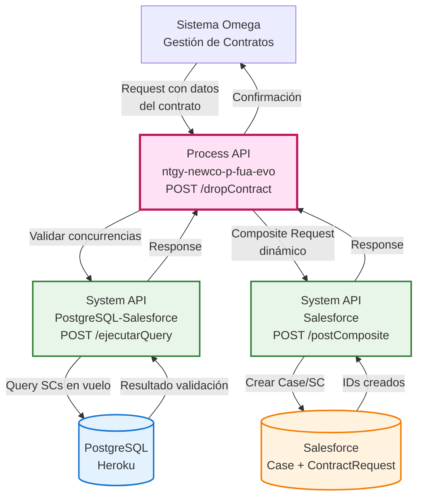
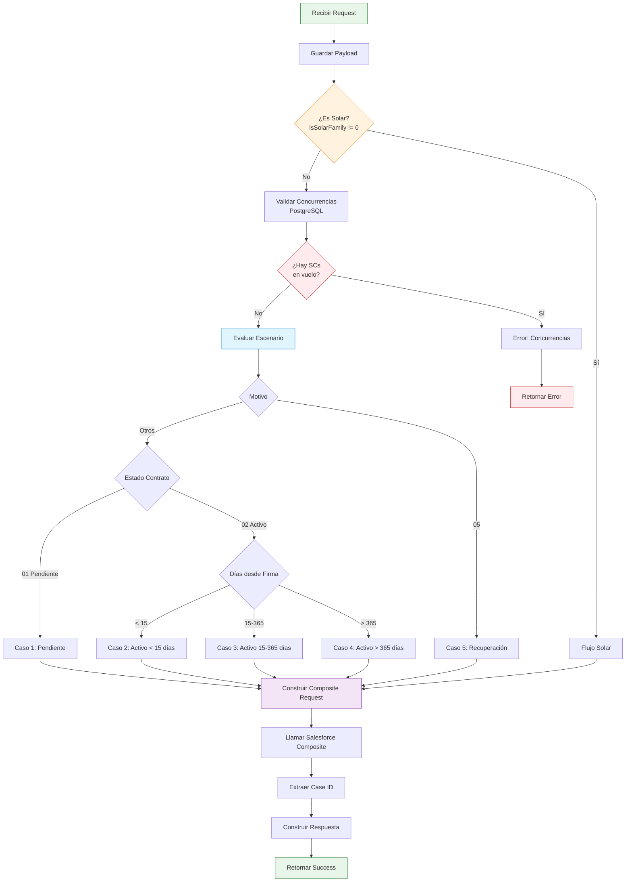
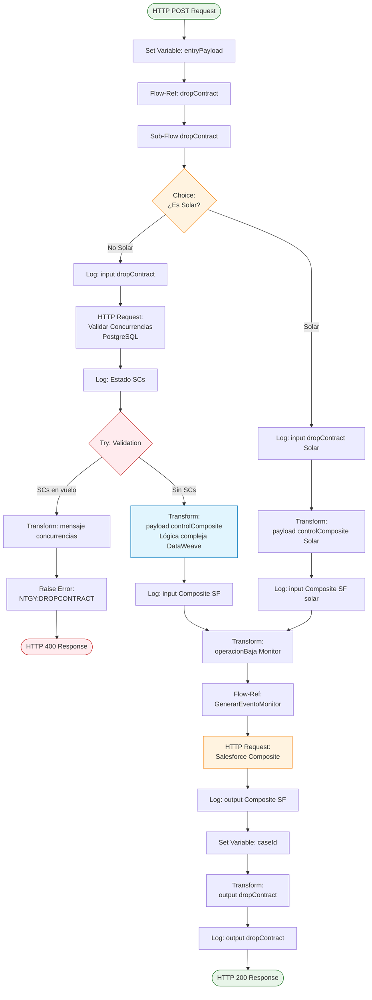
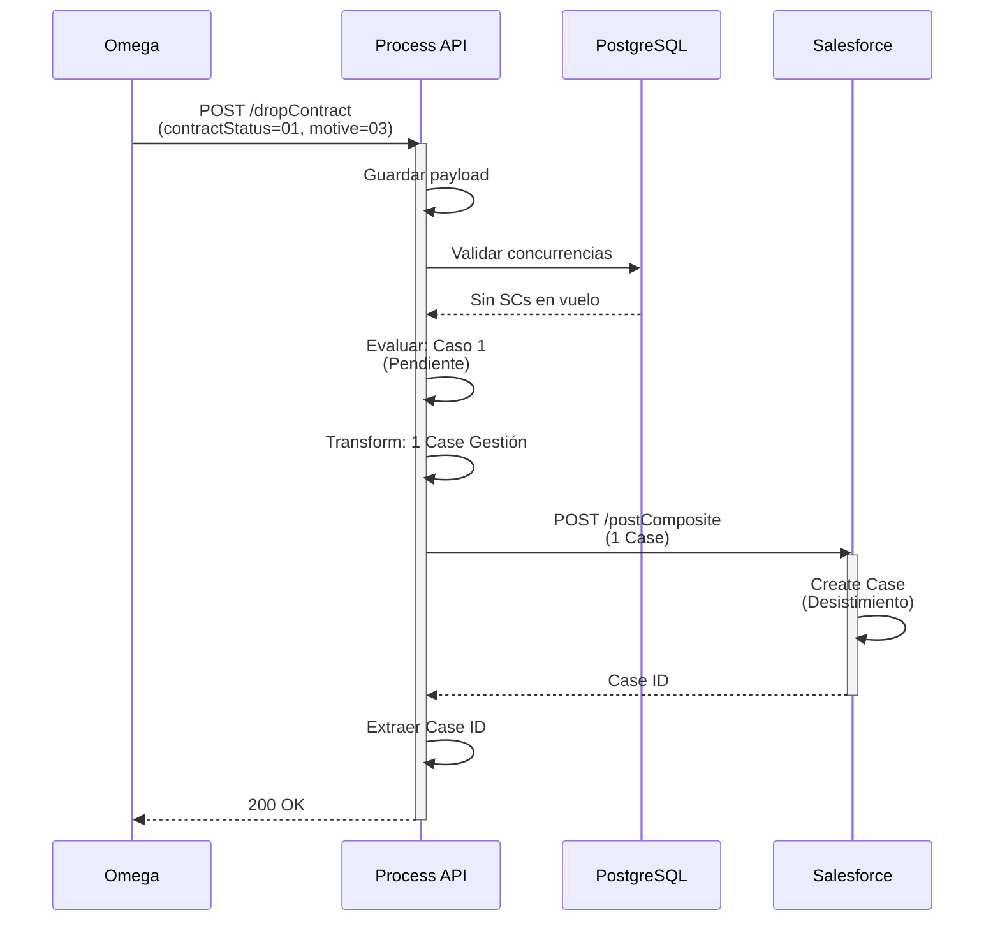
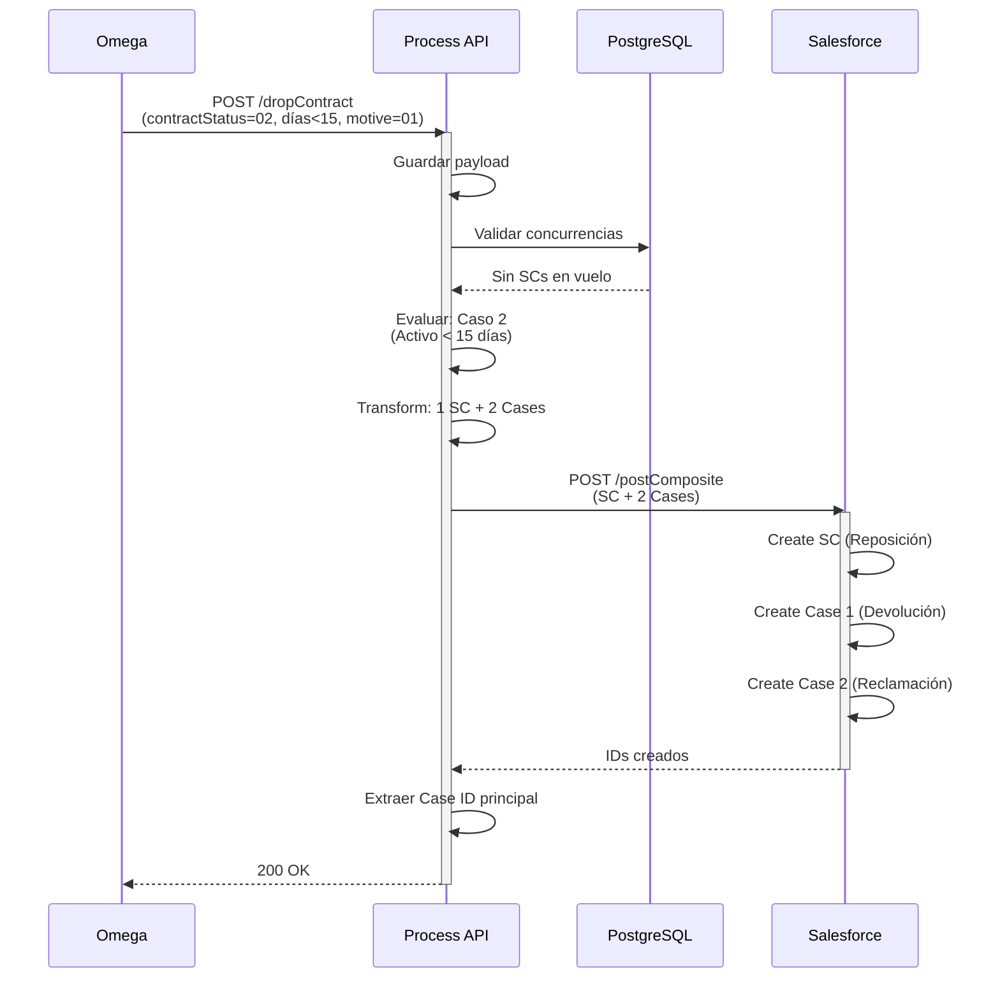
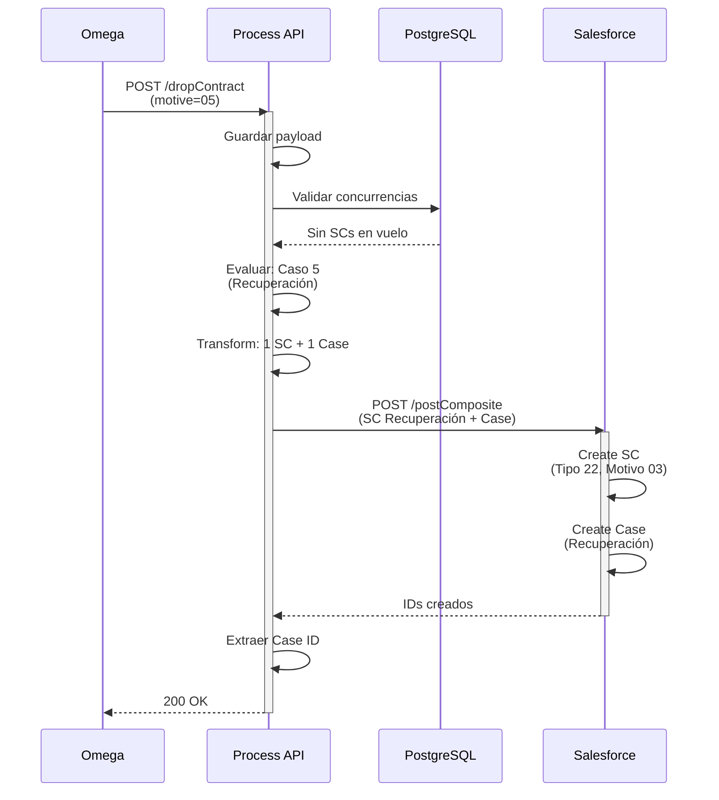
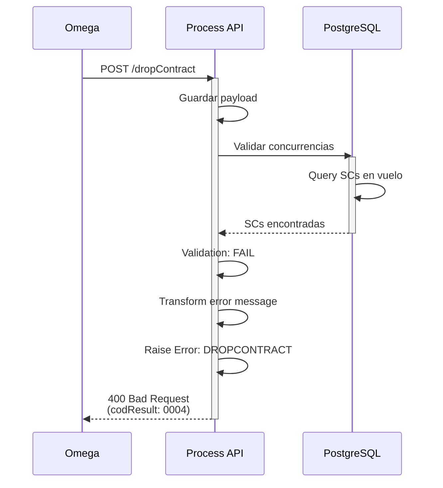

# POST /dropContract

## 📌 Descripción General

### Propósito del Endpoint

Este endpoint gestiona el **proceso completo de reposiciones y bajas de contratos** desde el sistema Omega hacia Salesforce. Es uno de los endpoints más complejos del API, ya que maneja múltiples escenarios de negocio basados en el estado del contrato, motivo de baja, tipo de cliente, tipo de producto y días desde la firma del contrato.

El endpoint determina automáticamente qué operaciones realizar en Salesforce (creación de Cases de Gestión y/o Solicitudes de Contratación) según las reglas de negocio establecidas.

### Tipo de API

**Capa:** Process API (API-Led Connectivity)

**Función:** Orquestación compleja de procesos de baja y reposición de contratos con lógica de negocio avanzada

### Patrón de Integración

**Tipo:** Orquestación Compleja con Transformación y Validación

**Descripción:** El endpoint:
1. Valida concurrencias de Solicitudes de Contratación en PostgreSQL
2. Evalúa múltiples condiciones de negocio (estado, motivo, días, tipo de cliente/producto)
3. Determina el escenario aplicable (5 casos principales)
4. Construye dinámicamente el payload para Salesforce Composite API
5. Crea Cases de Gestión y/o Solicitudes de Contratación según el caso

### Arquitectura API-Led Connectivity



---

## 💼 Propósito del Negocio

### Casos de Uso Principales

1. **Anulación de Contrato Pendiente**
   - Cliente solicita anular un contrato que aún no está activo
   - Se crea Case de Gestión para tramitar la anulación
   - Aplica para contratos en estado "01" (pendiente)

2. **Desistimiento de Contrato Activo**
   - Cliente ejerce derecho de desistimiento (primeros 14 días)
   - Se crea Case de Gestión con motivo "Desistimiento"
   - Aplica para contratos activos con menos de 15 días desde firma

3. **Reposición de Contrato**
   - Devolución de contrato a comercializadora anterior
   - Se crea Solicitud de Contratación (SC) tipo "22" (Reposición)
   - Se crean Cases de Gestión asociados
   - Aplica para reclamaciones y cruces de CUPS en contratos activos ≤365 días

4. **Baja de Servicio (SVA)**
   - Cliente solicita baja de servicios de valor añadido
   - Se crea Case de Gestión específico para servicios
   - Aplica solo para productTypeFamily="servicios"

5. **Cese de Suministro**
   - Cliente solicita cese definitivo del suministro
   - Se crea Case de Gestión con motivo "Cese"
   - Aplica para motive="04"

6. **Recuperación de Contrato**
   - Recuperación de contrato previamente dado de baja
   - Se crea SC tipo "22" con motivo de reposición "03"
   - Aplica para motive="05" (botón recuperación en Omega)

7. **Baja de Contrato Solar**
   - Proceso específico para contratos de familia solar
   - Se crea Case de Gestión con título "BajaContratoSolar"
   - Aplica cuando isSolarFamily != "0"

### 🔗 Endpoints Dependientes

Este Process API consume los siguientes System APIs:

| System API | Endpoint | Método | Propósito |
|------------|----------|--------|-----------|
| `ntgy-newco-s-postgresql-salesforce` | `/ejecutarQuery` | POST | Valida concurrencias de SCs en vuelo en PostgreSQL |
| `ntgy-newco-s-salesforce` | `/postComposite` | POST | Crea Cases y Solicitudes de Contratación en Salesforce |

### 📊 Matriz de Decisión de Escenarios

Esta tabla muestra cómo se determina el escenario aplicable:

| Estado Contrato | Días desde Firma | Motivo | Tipo Producto | Acción Principal |
|-----------------|------------------|--------|---------------|------------------|
| 01 (Pendiente) | N/A | 01, 02, 03 | Luz/Gas | Anulación o Desistimiento |
| 01 (Pendiente) | N/A | 01, 03 | Servicios | Baja de Servicio |
| 02 (Activo) | < 15 | 01, 02 | Luz/Gas | Reposición + Cases |
| 02 (Activo) | < 15 | 03 | Luz/Gas | Desistimiento |
| 02 (Activo) | 15-365 | 01, 02 | Luz/Gas | Reposición + Cases |
| 02 (Activo) | 15-365 | 03 | Luz/Gas | Desistimiento |
| 02 (Activo) | > 365 | 01, 02, 03 | Luz/Gas | Desistimiento |
| 02 (Activo) | N/A | 04 | Cualquiera | Cese de Suministro |
| 02 (Activo) | N/A | 05 | Luz/Gas | Recuperación (SC + Case) |
| N/A | N/A | N/A | Solar | Baja Contrato Solar |

### Lógica de Orquestación



### Contexto Empresarial

- **Dominio:** Gestión de Contratos y Reposiciones
- **Sector:** Energía - Utilities
- **División:** Naturgy España - NewCo
- **Proceso de Negocio:** Bajas, Reposiciones y Recuperaciones de Contratos Energéticos
- **Sistema Origen:** Omega (Sistema de Gestión de Contratos)

### Stakeholders

- **Clientes de Naturgy**: Solicitan bajas, desistimientos o cambios de contrato
- **Agentes de Call Center**: Gestionan solicitudes de clientes
- **Equipo de Gestión de Contratos**: Tramita las solicitudes en Salesforce
- **Comercializadoras**: Reciben contratos en reposición
- **Equipo de Facturación**: Gestiona ceses y cambios de suministro

### Valor de Negocio

- **Automatización**: Reduce intervención manual en procesos de baja/reposición
- **Cumplimiento Normativo**: Gestiona correctamente desistimientos y reposiciones según normativa
- **Trazabilidad**: Registra todas las operaciones en Salesforce con Cases de Gestión
- **Prevención de Errores**: Valida concurrencias antes de crear nuevas solicitudes
- **Flexibilidad**: Maneja múltiples escenarios de negocio con lógica centralizada

### Consumidores Potenciales

Este endpoint es consumido por:
- Sistema Omega (principal consumidor)
- Portales de gestión interna
- Sistemas de agentes de call center

---

## 🔧 Especificación Técnica

### URLs por Ambiente

| Ambiente | URL Base | URL Completa |
|----------|----------|--------------|
| **Local** | `http://localhost:8081` | `http://localhost:8081/api/dropContract` |
| **Development** | `https://ntgy-newco-p-fua-evo-dev.us-e2.cloudhub.io` | `https://ntgy-newco-p-fua-evo-dev.us-e2.cloudhub.io/api/dropContract` |
| **UAT** | `https://ntgy-newco-p-fua-evo-uat.us-e2.cloudhub.io` | `https://ntgy-newco-p-fua-evo-uat.us-e2.cloudhub.io/api/dropContract` |
| **Production** | `https://ntgy-newco-p-fua-evo-pro.us-e2.cloudhub.io` | `https://ntgy-newco-p-fua-evo-pro.us-e2.cloudhub.io/api/dropContract` |

### Método HTTP

```
POST /api/dropContract
```

### Headers Requeridos

| Header | Tipo | Requerido | Descripción |
|--------|------|-----------|-------------|
| `Content-Type` | string | ✅ Sí | Debe ser `application/json` |
| `x-client-id` | string | ✅ Sí | ID del cliente (AccountId en Salesforce) |
| `x-contact-id` | string | ✅ Sí | ID del contacto en Salesforce |
| `x-user-id` | string | ⚠️ Opcional | ID del usuario/agente (si aplica) |
| `x-interaction-id` | string | ✅ Sí | ID de la interacción padre |
| `x-agent-mail` | string | ⚠️ Opcional | Email del agente (para auditoría) |
| `x-client-code` | string | ✅ Sí | NIF/CIF del cliente |

### Parámetros de Entrada

#### Request Body

```json
{
  "x-client-id": "string",
  "x-contact-id": "string",
  "x-user-id": "string",
  "x-interaction-id": "string",
  "x-client-code": "string",
  "x-agent-mail": "string",
  "contractId": "string",
  "contractAccountId": "string",
  "contractStatus": "string",
  "motive": "string",
  "signatureDate": "string",
  "cups": "string",
  "productTypeFamily": "string",
  "isIndividualClient": boolean,
  "isSolarFamily": "string",
  "DirIp": "string",
  "traceparent": "string"
}
```

#### Descripción de Campos

| Campo | Tipo | Requerido | Descripción | Valores Posibles | Ejemplo |
|-------|------|-----------|-------------|------------------|---------|
| `x-client-id` | string | ✅ Sí | ID del cliente en Salesforce | AccountId | "0011t00000ABC123" |
| `x-contact-id` | string | ✅ Sí | ID del contacto en Salesforce | ContactId | "0031t00000XYZ456" |
| `x-user-id` | string | ⚠️ Opcional | ID del usuario/agente | UserId | "0051t00000DEF789" |
| `x-interaction-id` | string | ✅ Sí | ID de la interacción padre | CaseId | "5001t00000GHI012" |
| `x-client-code` | string | ✅ Sí | NIF/CIF del cliente | NIF/CIF | "12345678A" |
| `x-agent-mail` | string | ⚠️ Opcional | Email del agente | Email | "agente@naturgy.com" |
| `contractId` | string | ✅ Sí | ID del contrato en Salesforce | ContractId | "8001t00000JKL345" |
| `contractAccountId` | string | ✅ Sí | ID de la cuenta de contrato | BillingAccountId | "BA123456" |
| `contractStatus` | string | ✅ Sí | Estado del contrato | "01"=Pendiente<br/>"02"=Activo | "02" |
| `motive` | string | ✅ Sí | Motivo de la baja | "01"=Reclamación<br/>"02"=Cruce CUPS<br/>"03"=Baja/Cancelar<br/>"04"=Cese<br/>"05"=Recuperación | "03" |
| `signatureDate` | string | ✅ Sí | Fecha de firma del contrato | Formato: yyyy-MM-dd | "2026-01-15" |
| `cups` | string | ✅ Sí | Código CUPS del suministro | CUPS | "ES0021000000000001JN" |
| `productTypeFamily` | string | ✅ Sí | Familia del producto | "luz", "gas", "servicios" | "luz" |
| `isIndividualClient` | boolean | ✅ Sí | ¿Es cliente individual? | true/false | true |
| `isSolarFamily` | string | ✅ Sí | ¿Es familia solar? | "0"=No, "1"=Sí | "0" |
| `DirIp` | string | ✅ Sí | Dirección IP del cliente | IP Address | "192.168.1.100" |
| `traceparent` | string | ✅ Sí | Trace ID para trazabilidad | Trace format | "00-abc123-def456-01" |

### Códigos de Estado del Contrato

| Código | Descripción | Cuándo Aplica |
|--------|-------------|---------------|
| `01` | Pendiente | Contrato firmado pero no activado |
| `02` | Activo | Contrato en vigor |

### Motivos de Baja

| Código | Descripción | Escenario |
|--------|-------------|-----------|
| `01` | Reclamación condiciones contractuales | Cliente reclama error en contratación |
| `02` | Cruce de CUPS | Contrato duplicado en mismo CUPS |
| `03` | Baja/Cancelar | Cliente solicita baja o desistimiento |
| `04` | Cese | Cese definitivo del suministro |
| `05` | Recuperación | Recuperar contrato previamente dado de baja |

### Respuestas

#### 200 OK - Éxito

```json
{
  "result": {
    "codResult": "0000",
    "msgResult": "No hay error"
  }
}
```

#### 400 Bad Request - Concurrencias Detectadas

```json
{
  "result": {
    "codResult": "0004",
    "msgResult": "Existen concurrencias"
  }
}
```

#### 500 Internal Server Error - Error del Sistema

```json
{
  "error": {
    "code": "INTERNAL_SERVER_ERROR",
    "message": "Error interno del servidor",
    "details": "Error al procesar la solicitud"
  }
}
```

### Códigos de Estado HTTP

| Código | Descripción | Cuándo Ocurre |
|--------|-------------|---------------|
| `200` | OK | Operación completada exitosamente |
| `400` | Bad Request | Existen SCs en vuelo (concurrencias) |
| `401` | Unauthorized | Credenciales inválidas o faltantes |
| `500` | Internal Server Error | Error en Salesforce o en el procesamiento |
| `503` | Service Unavailable | Salesforce o PostgreSQL no disponibles |

### Autenticación

- **Tipo:** Client ID & Client Secret (Anypoint Platform)
- **Salesforce:** OAuth 2.0 (gestionado por el System API)
- **PostgreSQL:** Credenciales gestionadas por el System API

### Timeouts

| Tipo | Valor |
|------|-------|
| **Request Timeout** | Configurable por ambiente |
| **Connection Timeout** | 30 segundos |
| **PostgreSQL Query Timeout** | 30 segundos |
| **Salesforce Composite Timeout** | 60 segundos |

---

## 🏗️ Implementación Técnica

### Arquitectura del Flow Principal



### Componentes del Flow

#### 1. Guardar Payload Original
```xml
<set-variable value="#[payload]" variableName="entryPayload"/>
```
- Guarda el payload original para uso en todo el flow

#### 2. Choice: ¿Es Familia Solar?

El flow se divide en dos ramas principales:

**Rama A: Productos NO Solares (Luz/Gas/Servicios)**
- Validación de concurrencias
- Lógica compleja de 5 casos
- Múltiples escenarios de negocio

**Rama B: Productos Solares**
- Sin validación de concurrencias
- Lógica simplificada
- Solo crea Case de Gestión

#### 3. Validación de Concurrencias (Solo NO Solar)

**Query a PostgreSQL:**
```sql
SELECT acn_fld_Status__c, acn_fld_sctype__c, acn_fld_category__c 
FROM newcosalesforce.acn_obj_contractrequest__c 
WHERE acn_fld_contract__c = '{contractId}' 
  AND ((acn_fld_sctype__c = '14') 
    OR (acn_fld_sctype__c = '16') 
    OR (acn_fld_sctype__c = '22') 
    OR (acn_fld_sctype__c = '02')) 
  AND acn_fld_status__c IN ('01','02','03')
```

**Propósito:** Verificar si existen Solicitudes de Contratación (SC) en vuelo para el contrato

**Tipos de SC validados:**
- `14`: Tipo específico de SC
- `16`: Tipo específico de SC
- `22`: Reposición
- `02`: Tipo específico de SC

**Estados validados:**
- `01`: Pendiente
- `02`: En proceso
- `03`: Otro estado activo

**Validación:**
```xml
<validation:is-true 
    expression="#[(sizeOf(vars.responseConcurrenciaHeroku) > 0) == false]" 
    message='"Existen concurrencias de SCs en vuelo"' />
```

Si hay SCs en vuelo → Error 400 con código "0004"

#### 4. Transformación DataWeave Compleja (NO Solar)

Esta es la parte más compleja del endpoint. La transformación tiene ~400 líneas de código DataWeave que:

1. **Define funciones auxiliares:**
   - `filtroCIFevitarDesistimiento()`: Valida si PYME debe ir a Anulación en vez de Desistimiento
   - `crearCasoGestion()`: Construye objeto Case de Gestión
   - `crearSolicitudContratacion()`: Construye objeto SC
   - `evaluarSVA()`: Lógica específica para servicios
   - `caso1()` a `caso5()`: Lógica de cada escenario

2. **Calcula variables:**
   - `fechaContrato`: Días transcurridos desde firma
   - `text_ExternalId_Description`: Título del Case según escenario
   - `ownerIdColaPautom`: Owner ID para casos automáticos

3. **Determina el caso aplicable:**
   - Evalúa motive, contractStatus, fechaContrato, productTypeFamily
   - Llama a la función del caso correspondiente
   - Construye array de operaciones para Composite API

**Estructura del Composite Request:**
```dataweave
{
    "allOrNone": true,
    "collateSubrequests": false,
    "compositeRequest": determinarCaso()  // Array dinámico
}
```

#### 5. Transformación DataWeave Simple (Solar)

Para productos solares, la lógica es mucho más simple:

```dataweave
{
  "allOrNone": true,
  "collateSubrequests": false,
  "compositeRequest": [
    {
      "method": "POST",
      "url": "/services/data/v52.0/sobjects/Case",
      "referenceId": "refCaseGestion",
      "httpHeaders": {"Sforce-Auto-Assign": "FALSE"},
      "body": {
        "NewCo_Recordtype__c": "Gestion",
        "AccountId": vars.entryPayload."x-client-id",
        "ContactId": vars.entryPayload."x-contact-id",
        "Status": "02",
        "Priority": "02",
        "Origin": "FUA",
        "NewCo_Contract__c": vars.entryPayload.contractId,
        "acn_fld_Tittle__r": {
          "NewCo_ExternalId__c": "BajaContratoSolar"
        },
        "Description": "Baja de contrato solar",
        // ... más campos
      }
    }
  ]
}
```

#### 6. Transformación para Monitor

Categoriza la operación para el sistema de monitoreo:

```dataweave
if(isSolarFamily != "0") "BajaSolar" 
else if(motive == "05") "Recuperacion" 
else if(motive == "04") "Cese" 
else if(motive == "01" or "03" and productTypeFamily == "servicios") "BajaSVA"
else if(motive == "01" or "02" and contractStatus == "02" and fechaContrato <= 365) "Reposicion" 
else if(motive == "01" or "02" and contractStatus == "01") "Anulacion" 
else "Desistimiento"
```

#### 7. Llamada a Salesforce Composite API

```xml
<http:request 
    method="POST" 
    config-ref="HTTP_Request_configuration_ntgy_newco_s_salesforce" 
    path="${ntgy-newco-s-salesforce.pathCasos}">
    <http:body>#[vars.inputCompositeSF]</http:body>
    <http:headers>
        #[{
            ("username" : vars.entryPayload.'x-agent-mail') 
                if (!isEmpty(vars.entryPayload.'x-agent-mail'))
        }]
    </http:headers>
</http:request>
```

#### 8. Extracción del Case ID

```xml
<set-variable 
    value='#[(payload.compositeResponse filter ((item, index) -> 
        item.referenceId == "refCaseGestion"))[0].body.id]' 
    variableName="caseId" />
```

Extrae el ID del Case de Gestión principal de la respuesta de Salesforce.

### Detalle de los 5 Casos Principales

#### Caso 1: Cliente Pendiente (contractStatus="01")

**Condición:** `contractStatus == "01"`

**Escenarios:**

**1.1. Servicios (SVA):**
- **Condición:** `productTypeFamily == "servicios"`
- **Acción:** 1 Case de Gestión
- **Descripción Case:** Según motivo (Desistimiento o Baja de servicio)

**1.2. PYME con CIF especial:**
- **Condición:** `!isIndividualClient AND motive=="03" AND !(CIF startsWith "H" or "E") AND (luz or gas)`
- **Acción:** 1 Case de Gestión (Anulación)
- **Descripción Case:** Vacía (se rellena en Salesforce)

**1.3. Reclamación o Cruce (motive 01 o 02):**
- **Acción:** 2 Cases de Gestión
- **Case 1:** Devolución a comercializadora anterior (Origin="Comercializadora")
- **Case 2:** Reclamación o Cruce de CUPS (Status="02")

**1.4. Desistimiento normal:**
- **Acción:** 1 Case de Gestión
- **Descripción Case:** "Desistimiento"

#### Caso 2: Cliente Activo < 15 días (contractStatus="02" AND días < 15)

**Condición:** `contractStatus == "02" AND fechaContrato < 15`

**Escenarios:**

**2.1. PYME con CIF especial:**
- **Condición:** Igual que caso 1.2
- **Acción:** 1 Case de Gestión (Anulación)

**2.2. Reclamación o Cruce (motive 01 o 02) - Luz/Gas:**
- **Acción:** 1 SC + 2 Cases de Gestión
- **SC:** Tipo "22" (Reposición), Category "48" o "49"
- **Case 1:** Devolución (Origin="Comercializadora", OwnerId=Cola Automática)
- **Case 2:** Reclamación/Cruce (Status="02")

**2.3. Servicios (SVA):**
- **Acción:** Igual que caso 1.1

**2.4. Desistimiento normal:**
- **Acción:** 1 Case de Gestión

#### Caso 3: Cliente Activo 15-365 días (contractStatus="02" AND 15 ≤ días ≤ 365)

**Condición:** `contractStatus == "02" AND fechaContrato >= 15 AND fechaContrato <= 365`

**Escenarios:**

**3.1. Reclamación o Cruce (motive 01 o 02) - Luz/Gas:**
- **Acción:** 1 SC + 2 Cases de Gestión
- **SC:** Tipo "22" (Reposición), Category "48" o "49"
- **Case 1:** Devolución (Origin="Comercializadora", OwnerId=Cola Automática)
- **Case 2:** Reclamación/Cruce (Status="02")

**3.2. Servicios (SVA):**
- **Acción:** Igual que caso 1.1

**3.3. Desistimiento normal:**
- **Acción:** 1 Case de Gestión

#### Caso 4: Cliente Activo > 365 días (contractStatus="02" AND días > 365)

**Condición:** `contractStatus == "02" AND fechaContrato > 365`

**Escenarios:**

**4.1. Servicios (SVA):**
- **Acción:** Igual que caso 1.1

**4.2. Desistimiento normal:**
- **Acción:** 1 Case de Gestión

#### Caso 5: Recuperación (motive="05")

**Condición:** `motive == "05"`

**Acción:** 1 SC + 1 Case de Gestión
- **SC:** Tipo "22" (Reposición), Category "49", Motivo "03", SendRequest=true
- **Case:** Descripción "Recuperación de contrato inactivo", OwnerId=Cola Automática

### Diagramas de Secuencia por Caso

#### Secuencia Caso 1: Cliente Pendiente - Desistimiento Simple



#### Secuencia Caso 2: Cliente Activo < 15 días - Reposición



#### Secuencia Caso 5: Recuperación



#### Secuencia Error: Concurrencias Detectadas



### Funciones DataWeave Clave

El endpoint utiliza múltiples funciones DataWeave para determinar qué operaciones crear en Salesforce. A continuación se describe cada función:

#### Función: filtroCIFevitarDesistimiento()

**Propósito:** Determina si una PYME con productos luz/gas debe ir a Anulación en lugar de Desistimiento.

**Lógica:**
- Evalúa si el cliente NO es individual (PYME)
- Verifica si el motivo es "03" (Baja/Cancelar)
- Comprueba que el CIF NO empiece con "H" o "E"
- Confirma que el producto sea "luz" o "gas"

**Retorna:** "true" si se cumplen todas las condiciones, "false" en caso contrario.

**Uso:** Esta función se utiliza en los casos 1 y 2 para decidir entre Anulación y Desistimiento.

#### Función: crearCasoGestion()

**Propósito:** Construye el objeto JSON para crear un Case de Gestión en Salesforce mediante Composite API.

**Parámetro:**
- `referenciado` (boolean): Indica si el Case debe vincularse a una Solicitud de Contratación

**Estructura del Case creado:**
- **RecordType:** "Gestion"
- **Status:** "12" para motivos 01, 02, 05; "02" para otros
- **Priority:** "02"
- **Origin:** "FUA"
- **AccountId, ContactId:** Del payload de entrada
- **NewCo_Contract__c:** ID del contrato
- **acn_fld_Tittle__r:** Título del caso mediante External ID
- **Description:** Descripción según el escenario
- **acn_fld_ContractRequest__c:** Referencia a SC (solo si referenciado=true)

**Campos opcionales:**
- OwnerId: Si se proporciona x-user-id
- ParentId: Si existe x-interaction-id
- Subject: Según el tipo de operación
- Grabacion_contractual__c: true para motivos 03 y 04

**Retorna:** Objeto JSON con la estructura completa del Case para Salesforce Composite API.

#### Función: crearSolicitudContratacion()

**Propósito:** Construye el objeto JSON para crear una Solicitud de Contratación (SC) en Salesforce.

**Estructura de la SC creada:**
- **RecordType:** "acn_rt_With_Switching" (luz) o "acn_rt_Without_Switching" (gas)
- **acn_fld_Contract__c:** ID del contrato
- **acn_fld_Sctype__c:** "actualizable" (se actualiza según el caso)
- **acn_fld_Category__c:** "actualizable" (se actualiza según el caso)
- **acn_fld_Status__c:** "01" (Pendiente)
- **acn_fld_CUPS__r:** Referencia al CUPS mediante nombre
- **acn_fld_SendRequest__c:** false (se actualiza a true en reposiciones)
- **acn_fld_ReleaseDate__c:** Fecha actual
- **acn_fld_rateText__c:** "018"
- **NewCo_fld_MotivoReposicion__c:** Motivo de reposición (si aplica)

**Campos actualizables:** Los campos `acn_fld_Sctype__c` y `acn_fld_Category__c` se actualizan mediante el operador `update` según el caso específico:
- **Caso 2 y 3 (Reposición):** Sctype="22", Category="48" o "49"
- **Caso 5 (Recuperación):** Sctype="22", Category="49", SendRequest=true

**Retorna:** Objeto JSON con la estructura completa de la SC para Salesforce Composite API.

#### Función: determinarCaso()

**Propósito:** Función principal que determina qué caso aplicar según las condiciones del contrato.

**Lógica de decisión:**
1. Si `motive == "05"` → Caso 5 (Recuperación)
2. Si `contractStatus == "01"` → Caso 1 (Cliente Pendiente)
3. Si `contractStatus == "02" AND fechaContrato < 15` → Caso 2 (Activo < 15 días)
4. Si `contractStatus == "02" AND fechaContrato >= 15 AND <= 365` → Caso 3 (Activo 15-365 días)
5. Si `contractStatus == "02" AND fechaContrato > 365` → Caso 4 (Activo > 365 días)
6. Caso contrario → Array vacío

**Retorna:** Array de operaciones (Cases y/o SCs) para Salesforce Composite API.

**Nota:** Cada función caso1() a caso5() retorna un array con las operaciones específicas de ese escenario.

#### Variables Calculadas

**fechaContrato:**
```
daysBetween(signatureDate, now())
```
Calcula los días transcurridos desde la firma del contrato.

**text_ExternalId_Description:**
Determina el título y descripción del Case según el escenario:
- "BajaServicio" para servicios
- "SolicitudReposición" para reposiciones
- "AnulacionContrato" para anulaciones
- "CeseSuministro" para ceses
- "Desistimiento" para desistimientos

**ownerIdColaPautom:**
ID del owner para casos que van a cola automática (configurado en properties).

### Manejo de Errores

#### Error Handler Principal

```xml
<error-handler ref="general-errorsError_Handler" />
```

Usa el error handler global del proyecto.

#### Error Específico: NTGY:DROPCONTRACT

```xml
<error-mapping targetType="NTGY:DROPCONTRACT" />
```

Se lanza cuando hay concurrencias detectadas.

**Respuesta:**
```json
{
  "result": {
    "codResult": "0004",
    "msgResult": "Existen concurrencias"
  }
}
```

### Patrones de Diseño

**Patrón 1: Strategy Pattern**
- Diferentes estrategias (caso1 a caso5) según condiciones
- Selección dinámica de estrategia en tiempo de ejecución

**Patrón 2: Builder Pattern**
- Funciones `crearCasoGestion()` y `crearSolicitudContratacion()` construyen objetos complejos
- Permite personalización mediante parámetros y updates

**Patrón 3: Validation Pattern**
- Validación de concurrencias antes de procesar
- Fail-fast para evitar operaciones inválidas

---

## 💻 Ejemplos de Uso

### Ejemplo 1: Desistimiento de Contrato Pendiente

#### Request

```bash
curl -X POST "https://ntgy-newco-p-fua-evo-dev.us-e2.cloudhub.io/api/dropContract" \
  -H "Content-Type: application/json" \
  -H "client_id: YOUR_CLIENT_ID" \
  -H "client_secret: YOUR_CLIENT_SECRET" \
  -d '{
    "x-client-id": "0011t00000ABC123",
    "x-contact-id": "0031t00000XYZ456",
    "x-user-id": "0051t00000DEF789",
    "x-interaction-id": "5001t00000GHI012",
    "x-client-code": "12345678A",
    "contractId": "8001t00000JKL345",
    "contractAccountId": "BA123456",
    "contractStatus": "01",
    "motive": "03",
    "signatureDate": "2026-08-20",
    "cups": "ES0021000000000001JN",
    "productTypeFamily": "luz",
    "isIndividualClient": true,
    "isSolarFamily": "0",
    "DirIp": "192.168.1.100",
    "traceparent": "00-abc123-def456-01"
  }'
```

#### Response (200 OK)

```json
{
  "result": {
    "codResult": "0000",
    "msgResult": "No hay error"
  }
}
```

**Operación realizada:** 1 Case de Gestión creado con título "Desistimiento"

### Ejemplo 2: Reposición - Cliente Activo < 15 días

#### Request

```bash
curl -X POST "https://ntgy-newco-p-fua-evo-dev.us-e2.cloudhub.io/api/dropContract" \
  -H "Content-Type: application/json" \
  -H "client_id: YOUR_CLIENT_ID" \
  -H "client_secret: YOUR_CLIENT_SECRET" \
  -d '{
    "x-client-id": "0011t00000ABC123",
    "x-contact-id": "0031t00000XYZ456",
    "x-interaction-id": "5001t00000GHI012",
    "x-client-code": "12345678A",
    "contractId": "8001t00000JKL345",
    "contractAccountId": "BA123456",
    "contractStatus": "02",
    "motive": "01",
    "signatureDate": "2026-08-25",
    "cups": "ES0021000000000001JN",
    "productTypeFamily": "luz",
    "isIndividualClient": true,
    "isSolarFamily": "0",
    "DirIp": "192.168.1.100",
    "traceparent": "00-abc123-def456-01"
  }'
```

#### Response (200 OK)

```json
{
  "result": {
    "codResult": "0000",
    "msgResult": "No hay error"
  }
}
```

**Operación realizada:** 
- 1 SC tipo "22" (Reposición)
- 2 Cases de Gestión (Devolución + Reclamación)

### Ejemplo 3: Recuperación de Contrato

#### Request

```bash
curl -X POST "https://ntgy-newco-p-fua-evo-dev.us-e2.cloudhub.io/api/dropContract" \
  -H "Content-Type: application/json" \
  -H "client_id: YOUR_CLIENT_ID" \
  -H "client_secret: YOUR_CLIENT_SECRET" \
  -d '{
    "x-client-id": "0011t00000ABC123",
    "x-contact-id": "0031t00000XYZ456",
    "x-interaction-id": "5001t00000GHI012",
    "x-client-code": "12345678A",
    "contractId": "8001t00000JKL345",
    "contractAccountId": "BA123456",
    "contractStatus": "02",
    "motive": "05",
    "signatureDate": "2026-01-15",
    "cups": "ES0021000000000001JN",
    "productTypeFamily": "luz",
    "isIndividualClient": true,
    "isSolarFamily": "0",
    "DirIp": "192.168.1.100",
    "traceparent": "00-abc123-def456-01"
  }'
```

#### Response (200 OK)

```json
{
  "result": {
    "codResult": "0000",
    "msgResult": "No hay error"
  }
}
```

**Operación realizada:** 
- 1 SC tipo "22" con motivo "03" (Recuperación)
- 1 Case de Gestión "Recuperación de contrato inactivo"

### Ejemplo 4: Baja de Contrato Solar

#### Request

```bash
curl -X POST "https://ntgy-newco-p-fua-evo-dev.us-e2.cloudhub.io/api/dropContract" \
  -H "Content-Type: application/json" \
  -H "client_id: YOUR_CLIENT_ID" \
  -H "client_secret: YOUR_CLIENT_SECRET" \
  -d '{
    "x-client-id": "0011t00000ABC123",
    "x-contact-id": "0031t00000XYZ456",
    "x-interaction-id": "5001t00000GHI012",
    "x-client-code": "12345678A",
    "contractId": "8001t00000JKL345",
    "contractAccountId": "BA123456",
    "contractStatus": "02",
    "motive": "03",
    "signatureDate": "2026-01-15",
    "cups": "ES0021000000000001JN",
    "productTypeFamily": "luz",
    "isIndividualClient": true,
    "isSolarFamily": "1",
    "DirIp": "192.168.1.100",
    "traceparent": "00-abc123-def456-01"
  }'
```

#### Response (200 OK)

```json
{
  "result": {
    "codResult": "0000",
    "msgResult": "No hay error"
  }
}
```

**Operación realizada:** 1 Case de Gestión "BajaContratoSolar"

### Ejemplo 5: Error - Concurrencias Detectadas

#### Request

```bash
curl -X POST "https://ntgy-newco-p-fua-evo-dev.us-e2.cloudhub.io/api/dropContract" \
  -H "Content-Type: application/json" \
  -H "client_id: YOUR_CLIENT_ID" \
  -H "client_secret: YOUR_CLIENT_SECRET" \
  -d '{
    "x-client-id": "0011t00000ABC123",
    "x-contact-id": "0031t00000XYZ456",
    "x-interaction-id": "5001t00000GHI012",
    "x-client-code": "12345678A",
    "contractId": "8001t00000JKL345",
    "contractAccountId": "BA123456",
    "contractStatus": "02",
    "motive": "01",
    "signatureDate": "2026-08-25",
    "cups": "ES0021000000000001JN",
    "productTypeFamily": "luz",
    "isIndividualClient": true,
    "isSolarFamily": "0",
    "DirIp": "192.168.1.100",
    "traceparent": "00-abc123-def456-01"
  }'
```

#### Response (400 Bad Request)

```json
{
  "result": {
    "codResult": "0004",
    "msgResult": "Existen concurrencias"
  }
}
```

**Causa:** Existen SCs en estado 01, 02 o 03 para el contrato

### Ejemplo 6: JavaScript (Fetch API)

```javascript
const dropContract = async (contractData) => {
  const response = await fetch(
    'https://ntgy-newco-p-fua-evo-dev.us-e2.cloudhub.io/api/dropContract',
    {
      method: 'POST',
      headers: {
        'Content-Type': 'application/json',
        'client_id': 'YOUR_CLIENT_ID',
        'client_secret': 'YOUR_CLIENT_SECRET'
      },
      body: JSON.stringify({
        'x-client-id': contractData.clientId,
        'x-contact-id': contractData.contactId,
        'x-user-id': contractData.userId,
        'x-interaction-id': contractData.interactionId,
        'x-client-code': contractData.clientCode,
        'contractId': contractData.contractId,
        'contractAccountId': contractData.contractAccountId,
        'contractStatus': contractData.contractStatus,
        'motive': contractData.motive,
        'signatureDate': contractData.signatureDate,
        'cups': contractData.cups,
        'productTypeFamily': contractData.productTypeFamily,
        'isIndividualClient': contractData.isIndividualClient,
        'isSolarFamily': contractData.isSolarFamily,
        'DirIp': contractData.ipAddress,
        'traceparent': contractData.traceparent
      })
    }
  );

  if (!response.ok) {
    const error = await response.json();
    if (error.result && error.result.codResult === '0004') {
      throw new Error('Existen concurrencias de SCs en vuelo');
    }
    throw new Error(`HTTP error! status: ${response.status}`);
  }

  const data = await response.json();
  console.log('Operación completada:', data.result.msgResult);
  return data;
};

// Uso
const contractData = {
  clientId: '0011t00000ABC123',
  contactId: '0031t00000XYZ456',
  userId: '0051t00000DEF789',
  interactionId: '5001t00000GHI012',
  clientCode: '12345678A',
  contractId: '8001t00000JKL345',
  contractAccountId: 'BA123456',
  contractStatus: '01',
  motive: '03',
  signatureDate: '2026-08-20',
  cups: 'ES0021000000000001JN',
  productTypeFamily: 'luz',
  isIndividualClient: true,
  isSolarFamily: '0',
  ipAddress: '192.168.1.100',
  traceparent: '00-abc123-def456-01'
};

dropContract(contractData)
  .then(result => console.log('Éxito:', result))
  .catch(error => console.error('Error:', error));
```

### Ejemplo 7: Python (Requests)

```python
import requests
import json
from datetime import datetime

def drop_contract(contract_data):
    """
    Procesa baja/reposición de contrato
    
    Args:
        contract_data (dict): Datos del contrato
        
    Returns:
        dict: Respuesta del API
    """
    url = 'https://ntgy-newco-p-fua-evo-dev.us-e2.cloudhub.io/api/dropContract'
    
    headers = {
        'Content-Type': 'application/json',
        'client_id': 'YOUR_CLIENT_ID',
        'client_secret': 'YOUR_CLIENT_SECRET'
    }
    
    payload = {
        'x-client-id': contract_data['client_id'],
        'x-contact-id': contract_data['contact_id'],
        'x-user-id': contract_data.get('user_id'),
        'x-interaction-id': contract_data['interaction_id'],
        'x-client-code': contract_data['client_code'],
        'contractId': contract_data['contract_id'],
        'contractAccountId': contract_data['contract_account_id'],
        'contractStatus': contract_data['contract_status'],
        'motive': contract_data['motive'],
        'signatureDate': contract_data['signature_date'],
        'cups': contract_data['cups'],
        'productTypeFamily': contract_data['product_type_family'],
        'isIndividualClient': contract_data['is_individual_client'],
        'isSolarFamily': contract_data['is_solar_family'],
        'DirIp': contract_data['ip_address'],
        'traceparent': contract_data['traceparent']
    }
    
    try:
        response = requests.post(url, headers=headers, json=payload, timeout=60)
        response.raise_for_status()
        
        result = response.json()
        
        if result['result']['codResult'] == '0000':
            print(f'Operación completada: {result["result"]["msgResult"]}')
        else:
            print(f'Advertencia: {result["result"]["msgResult"]}')
            
        return result
        
    except requests.exceptions.HTTPError as http_err:
        if response.status_code == 400:
            error_data = response.json()
            if error_data.get('result', {}).get('codResult') == '0004':
                print('Error: Existen concurrencias de SCs en vuelo')
        print(f'Error HTTP: {http_err}')
        print(f'Response: {response.text}')
        raise
    except requests.exceptions.Timeout:
        print('Error: Timeout al conectar con el API')
        raise
    except requests.exceptions.RequestException as err:
        print(f'Error: {err}')
        raise

# Uso
contract_data = {
    'client_id': '0011t00000ABC123',
    'contact_id': '0031t00000XYZ456',
    'user_id': '0051t00000DEF789',
    'interaction_id': '5001t00000GHI012',
    'client_code': '12345678A',
    'contract_id': '8001t00000JKL345',
    'contract_account_id': 'BA123456',
    'contract_status': '01',
    'motive': '03',
    'signature_date': '2026-08-20',
    'cups': 'ES0021000000000001JN',
    'product_type_family': 'luz',
    'is_individual_client': True,
    'is_solar_family': '0',
    'ip_address': '192.168.1.100',
    'traceparent': '00-abc123-def456-01'
}

try:
    result = drop_contract(contract_data)
    print('Resultado:', json.dumps(result, indent=2))
except Exception as e:
    print(f'Error al procesar baja de contrato: {e}')
```

## 📊 Tabla Resumen de Escenarios

| Caso | Estado | Días | Motivo | Producto | Acción | Objetos Creados |
|------|--------|------|--------|----------|--------|-----------------|
| Caso 1.1 | 01 | N/A | 01,03 | Servicios | Baja SVA | 1 Case |
| Caso 1.2 | 01 | N/A | 03 | Luz/Gas | Anulación PYME | 1 Case |
| Caso 1.3 | 01 | N/A | 01,02 | Luz/Gas | Reclamación/Cruce | 2 Cases |
| Caso 1.4 | 01 | N/A | 03 | Luz/Gas | Desistimiento | 1 Case |
| Caso 2.1 | 02 | &lt;15 | 03 | Luz/Gas | Anulación PYME | 1 Case |
| Caso 2.2 | 02 | &lt;15 | 01,02 | Luz/Gas | Reposición | 1 SC + 2 Cases |
| Caso 2.3 | 02 | &lt;15 | 01,03 | Servicios | Baja SVA | 1 Case |
| Caso 2.4 | 02 | &lt;15 | 03 | Luz/Gas | Desistimiento | 1 Case |
| Caso 3.1 | 02 | 15-365 | 01,02 | Luz/Gas | Reposición | 1 SC + 2 Cases |
| Caso 3.2 | 02 | 15-365 | 01,03 | Servicios | Baja SVA | 1 Case |
| Caso 3.3 | 02 | 15-365 | 03 | Luz/Gas | Desistimiento | 1 Case |
| Caso 4.1 | 02 | &gt;365 | 01,03 | Servicios | Baja SVA | 1 Case |
| Caso 4.2 | 02 | &gt;365 | 01,02,03 | Luz/Gas | Desistimiento | 1 Case |
| Caso 5 | 02 | N/A | 05 | Luz/Gas | Recuperación | 1 SC + 1 Case |
| Solar | N/A | N/A | N/A | Solar | Baja Solar | 1 Case |

**Leyenda:**
- **SC**: Solicitud de Contratación (acn_obj_ContractRequest__c)
- **Case**: Case de Gestión (Case)
- **PYME**: Cliente no individual con CIF que no empieza con H o E
