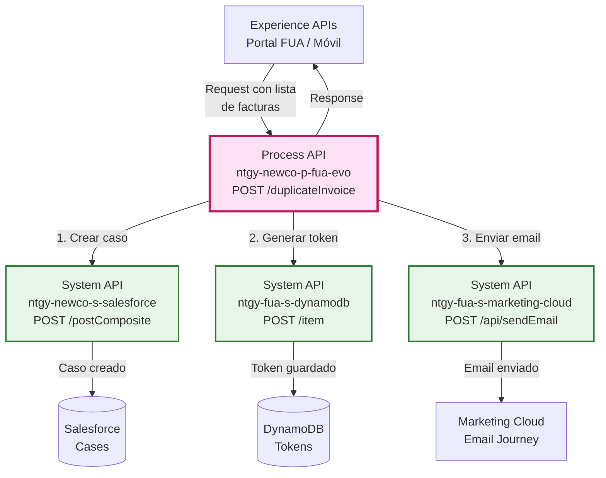
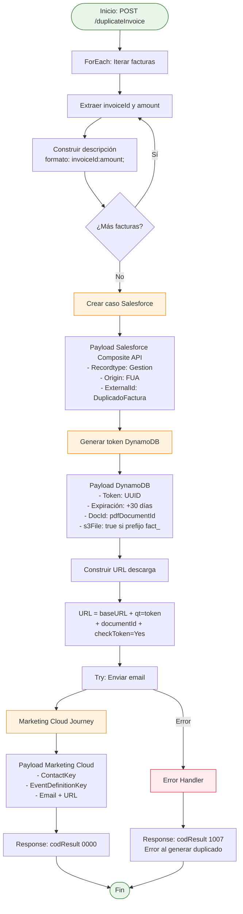
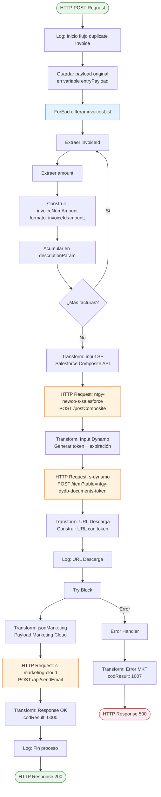
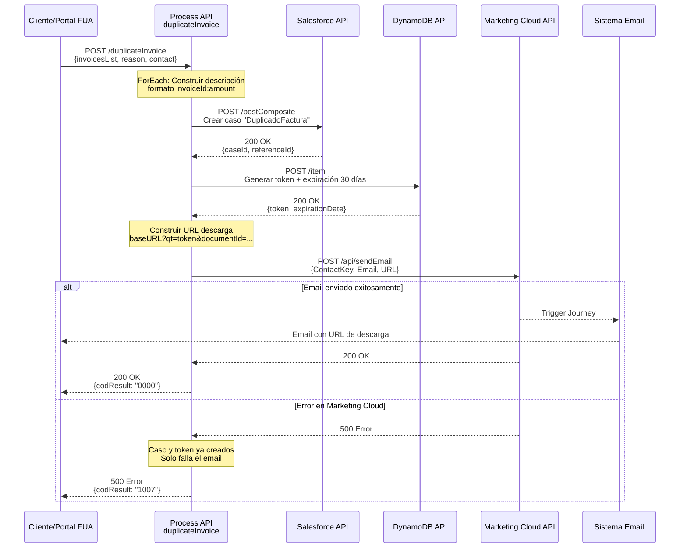

# POST /duplicateInvoice

## 📌 Descripción General

### Propósito del Endpoint

Este endpoint orquesta el proceso completo de gestión de facturas duplicadas, que incluye:
1. Creación de un caso de gestión en Salesforce con el detalle de las facturas
2. Generación de un token de descarga seguro en DynamoDB con expiración de 30 días
3. Construcción de URL de descarga desde S3
4. Envío de email al cliente con la URL de descarga a través de Marketing Cloud

### Tipo de API

**Capa:** Process API (API-Led Connectivity)

**Función:** Orquestación de proceso de negocio para gestión de facturas duplicadas con notificación por email

### Patrón de Integración

**Tipo:** Orquestación Secuencial con Manejo de Errores

**Descripción:** Ejecuta una secuencia de llamadas a tres System APIs diferentes (Salesforce, DynamoDB, Marketing Cloud) con transformaciones DataWeave entre cada paso y manejo específico de errores para Marketing Cloud.

### Arquitectura API-Led Connectivity



---

## 💼 Propósito del Negocio

### Casos de Uso Principales

1. **Solicitud de Factura Duplicada por Cliente**
   - Cliente solicita copia de factura desde portal FUA
   - Sistema genera caso en Salesforce para trazabilidad
   - Cliente recibe email con enlace de descarga seguro
   - **Beneficio:** Autoservicio 24/7 sin intervención de agentes

2. **Gestión de Múltiples Facturas Duplicadas**
   - Cliente puede solicitar varias facturas en una sola petición
   - Sistema procesa lista de facturas y genera descripción consolidada
   - Caso único en Salesforce con detalle de todas las facturas
   - **Beneficio:** Eficiencia en gestión de solicitudes múltiples

3. **Trazabilidad de Solicitudes de Documentos**
   - Cada solicitud genera caso en Salesforce tipo "DuplicadoFactura"
   - Vinculación con caso de interacción padre
   - Registro de agente/contacto que realizó la solicitud
   - **Beneficio:** Auditoría completa de solicitudes de documentos

### 🔗 Endpoints Dependientes

Este Process API consume los siguientes System APIs:

| System API | Endpoint | Método | Propósito |
|------------|----------|--------|-----------|
| `ntgy-newco-s-salesforce` | `/postComposite` | POST | Crear caso de gestión con tipo "DuplicadoFactura" |
| `ntgy-fua-s-dynamodb` | `/item?table=ntgy-dydb-documents-token` | POST | Generar token de descarga con expiración de 30 días |
| `ntgy-fua-s-marketing-cloud` | `/api/sendEmail?credenciales=impresion` | POST | Enviar email con URL de descarga mediante Journey |

### Lógica de Orquestación



**Pasos del Proceso:**

1. **Iteración de Facturas**: ForEach sobre la lista de facturas para construir descripción consolidada
2. **Creación de Caso Salesforce**: Caso tipo "Gestion" con recordtype "DuplicadoFactura"
3. **Generación de Token**: Token UUID con expiración de 30 días en DynamoDB
4. **Construcción de URL**: URL de descarga con parámetros de seguridad
5. **Envío de Email**: Journey de Marketing Cloud con URL de descarga
6. **Manejo de Errores**: Error específico si falla Marketing Cloud (código 1007)

### Transformaciones Aplicadas

#### Transformación 1: Construcción de Descripción de Facturas

**Archivo:** Inline en XML (líneas 18-32)

| Campo Original | Campo Transformado | Transformación |
|----------------|-------------------|----------------|
| `invoicesList[].invoiceId` | `descriptionParam` | Concatenación: `invoiceId:amount;` |
| `invoicesList[].amount` | `descriptionParam` | Acumulación iterativa en foreach |

**Lógica DataWeave:**
```dataweave
vars.descriptionParam ++ vars.invoiceNumAmount default vars.invoiceNumAmount
```

#### Transformación 2: Payload Salesforce Composite API

**Archivo:** Inline en XML (líneas 34-55)

| Campo Entrada | Campo Salesforce | Transformación |
|---------------|------------------|----------------|
| `x-client-id` | `AccountId` | Directo |
| `x-contact-id` | `ContactId` | Directo |
| `descriptionParam + reason` | `Description` | Concatenación |
| `x-user-id` o `x-contact-id` | `NewCo_Creado_por__c` | Condicional: user-id si existe, sino contact-id |
| `x-interaction-id` | `ParentId` | Directo (caso padre) |
| `correlationId` | `NewCo_CorrelationId__c` | Variable de flow |
| `"DuplicadoFactura"` | `acn_fld_Tittle__r.NewCo_ExternalId__c` | Constante |

**Campos Fijos:**
- `Origin`: "FUA"
- `NewCo_Recordtype__c`: "Gestion"
- `NewCo_Ip__c`: "213.94.15.86"

#### Transformación 3: Payload DynamoDB Token

**Archivo:** Inline en XML (líneas 60-75)

| Campo Entrada | Campo DynamoDB | Transformación |
|---------------|----------------|----------------|
| `uuid()` | `token` | Generación de UUID |
| `now() + 30 días` | `tokenExpirationDate` | Cálculo: `(now() + \|P30D\|) >> "CET"` formato "dd-MM-yyyy HH:mm:ss" |
| `pdfDocumentId[0]` | `docId` | Primer elemento del array |
| `preferredContact.docNumber` | `nif` | Directo |
| `invoicesList[0].invoiceId` | `invoiceNumber` | Primer elemento del array |
| `"03.01"` | `documentType` | Constante |
| `pdfDocumentId startsWith "fact_"` | `s3File` | Condicional: true si prefijo "fact_" |

#### Transformación 4: URL de Descarga

**Archivo:** Inline en XML (líneas 77-84)

**Formato:**
```
{s-s3-small.downloadUrl} + "qt=" + {token} + "&documentId=" + {docId} + "&checkToken=Yes"
```

#### Transformación 5: Payload Marketing Cloud

**Archivo:** Inline en XML (líneas 88-100)

| Campo Entrada | Campo Marketing Cloud | Transformación |
|---------------|----------------------|----------------|
| `preferredContact.contactId` | `ContactKey` | Directo |
| `preferredContact.contactId` | `Data.SubscriberKey` | Directo |
| `preferredContact.preferredEmail` | `Data.Email` | Directo |
| `urlDescarga` | `Data.URL` | Variable construida |
| `{marketingCloud.journey.EventDefinitionKey}` | `EventDefinitionKey` | Propiedad de configuración |

### Contexto Empresarial

- **Dominio:** Gestión de Documentos y Facturación
- **Sector:** Energía - Utilities
- **División:** Naturgy España - NewCo
- **Proceso de Negocio:** Autoservicio de solicitud de facturas duplicadas

### Stakeholders

- **Clientes Finales**: Necesitan acceso rápido a copias de facturas
- **Agentes de Call Center**: Pueden solicitar facturas en nombre de clientes
- **Equipo de Facturación**: Trazabilidad de solicitudes de documentos
- **Equipo de Cumplimiento**: Auditoría de acceso a documentos

### Valor de Negocio

- **Reducción de Costes**: Automatización completa sin intervención manual
- **Mejora de Experiencia**: Entrega inmediata por email
- **Trazabilidad**: Registro completo en Salesforce
- **Seguridad**: Tokens con expiración y validación
- **Escalabilidad**: Soporte para múltiples facturas en una solicitud

### Consumidores Potenciales

Este endpoint puede ser consumido por:
- Portal web FUA
- Aplicaciones móviles de clientes
- Sistemas de agentes de call center
- Portales de autoservicio

---

## 🔧 Especificación Técnica

### URLs por Ambiente

| Ambiente | URL Base | URL Completa |
|----------|----------|--------------|
| **Local** | `http://localhost:8081` | `http://localhost:8081/api/duplicateInvoice` |
| **Development** | `https://ntgy-newco-p-fua-evo-dev.us-e2.cloudhub.io` | `https://ntgy-newco-p-fua-evo-dev.us-e2.cloudhub.io/api/duplicateInvoice` |
| **UAT** | `https://ntgy-newco-p-fua-evo-uat.us-e2.cloudhub.io` | `https://ntgy-newco-p-fua-evo-uat.us-e2.cloudhub.io/api/duplicateInvoice` |
| **Production** | `https://ntgy-newco-p-fua-evo-pro.us-e2.cloudhub.io` | `https://ntgy-newco-p-fua-evo-pro.us-e2.cloudhub.io/api/duplicateInvoice` |

### Método HTTP

```
POST /api/duplicateInvoice
```

### Headers Requeridos

| Header | Tipo | Obligatorio | Descripción |
|--------|------|-------------|-------------|
| `Content-Type` | string | ✅ | Debe ser `application/json` |
| `x-client-id` | string | ✅ | ID del cliente (AccountId en Salesforce) |
| `x-contact-id` | string | ✅ | ID del contacto en Salesforce |
| `x-user-id` | string | ⚠️ | ID del agente (opcional, si no se envía se usa x-contact-id) |
| `x-interaction-id` | string | ✅ | ID del caso de interacción padre |
| `x-agent-mail` | string | ⚠️ | Email del agente (opcional, para auditoría) |

### Parámetros de Entrada

#### Request Body

```json
{
  "duplicateInvoicesRelationList": {
    "invoicesList": [
      [
        {
          "invoiceId": "string",
          "amount": "number",
          "pdfDocumentId": "string"
        }
      ]
    ]
  },
  "reason": "string",
  "preferredContact": {
    "contactId": "string",
    "docNumber": "string",
    "preferredEmail": "string"
  }
}
```

#### Descripción de Campos

| Campo | Tipo | Obligatorio | Descripción |
|-------|------|-------------|-------------|
| `duplicateInvoicesRelationList` | object | ✅ | Contenedor de la lista de facturas |
| `duplicateInvoicesRelationList.invoicesList` | array | ✅ | Array de arrays de facturas (estructura anidada) |
| `invoicesList[][].invoiceId` | string | ✅ | Número de factura |
| `invoicesList[][].amount` | number | ✅ | Importe de la factura |
| `invoicesList[][].pdfDocumentId` | string | ✅ | ID del documento PDF en Sharepoint/S3 |
| `reason` | string | ✅ | Motivo de la solicitud de duplicado |
| `preferredContact` | object | ✅ | Información del contacto preferido |
| `preferredContact.contactId` | string | ✅ | ID del contacto en Salesforce |
| `preferredContact.docNumber` | string | ✅ | NIF/NIE del cliente |
| `preferredContact.preferredEmail` | string | ✅ | Email donde enviar la factura |

### Respuestas

#### 200 OK - Éxito

```json
{
  "result": {
    "codResult": "0000",
    "msgResult": "No hay error"
  }
}
```

| Campo | Tipo | Descripción |
|-------|------|-------------|
| `result.codResult` | string | Código de resultado: "0000" para éxito |
| `result.msgResult` | string | Mensaje descriptivo del resultado |

#### 400 Bad Request - Error de Validación

```json
{
  "code": "BAD_REQUEST",
  "message": "Invalid request format",
  "details": "Missing required field: duplicateInvoicesRelationList"
}
```

#### 500 Internal Server Error - Error en Marketing Cloud

```json
{
  "result": {
    "codResult": "1007",
    "msgResult": "Error al generar el duplicado de factura"
  }
}
```

**Nota:** El código 1007 se devuelve específicamente cuando falla el envío del email a través de Marketing Cloud, pero el caso en Salesforce y el token en DynamoDB ya fueron creados exitosamente.

### Autenticación

- **Tipo:** Client ID & Client Secret (Anypoint Platform)
- **Headers:** `client_id` y `client_secret`

### Timeouts

| Tipo | Valor | Descripción |
|------|-------|-------------|
| **Request Timeout** | 60 segundos | Timeout total del endpoint |
| **Salesforce Timeout** | 60 segundos | Timeout para llamada a Salesforce |
| **DynamoDB Timeout** | 30 segundos | Timeout para llamada a DynamoDB |
| **Marketing Cloud Timeout** | Variable | Configurado en System API |

### Validaciones

1. **Estructura de Request**: Validación de schema JSON según RAML
2. **Headers Obligatorios**: Validación de presencia de x-client-id, x-contact-id, x-interaction-id
3. **Email Válido**: Validación de formato de email en preferredContact.preferredEmail
4. **Lista de Facturas**: Debe contener al menos una factura

---

## 🏗️ Implementación Técnica

### Arquitectura del Flow



### Componentes del Flow

#### 1. ForEach: Procesamiento de Facturas

**Ubicación:** Líneas 18-32 del XML

**Propósito:** Iterar sobre la lista de facturas para construir una descripción consolidada

**Lógica:**
```dataweave
// Por cada factura en la lista
collection: vars.entryPayload.duplicateInvoicesRelationList.invoicesList

// Extraer datos
invoiceId = payload[0].invoiceId
amount = payload[0].amount

// Construir formato
invoiceNumAmount = invoiceId ++ ":" ++ amount ++ ";"

// Acumular
descriptionParam = vars.descriptionParam ++ vars.invoiceNumAmount default vars.invoiceNumAmount
```

**Resultado:** Variable `descriptionParam` con formato: `"INV001:150.50;INV002:200.75;"`

#### 2. Salesforce Composite API Call

**Ubicación:** Líneas 34-58 del XML

**Endpoint:** `POST ${ntgy-newco-s-salesforce.pathDuplicateinvoice}` → `/postComposite`

**Payload:**
```json
{
  "allOrNone": true,
  "collateSubrequests": false,
  "compositeRequest": [
    {
      "method": "POST",
      "url": "/services/data/v52.0/sobjects/Case",
      "referenceId": "refCaseGestion",
      "body": {
        "NewCo_Recordtype__c": "Gestion",
        "AccountId": "{x-client-id}",
        "ContactId": "{x-contact-id}",
        "Origin": "FUA",
        "Description": "{descriptionParam} + {reason}",
        "NewCo_Creado_por__c": "{x-user-id o x-contact-id}",
        "ParentId": "{x-interaction-id}",
        "NewCo_Ip__c": "213.94.15.86",
        "NewCo_CorrelationId__c": "{correlationId}",
        "acn_fld_Tittle__r": {
          "NewCo_ExternalId__c": "DuplicadoFactura"
        }
      }
    }
  ]
}
```

**Headers:**
- `username`: `{x-agent-mail}` (si existe)

#### 3. DynamoDB Token Generation

**Ubicación:** Líneas 60-75 del XML

**Endpoint:** `POST /item?table=ntgy-dydb-documents-token`

**Lógica de Token:**
```dataweave
{
  "token": uuid(),  // UUID generado
  "tokenExpirationDate": ((now() + |P30D|) >> "CET") as String {format: "dd-MM-yyyy HH:mm:ss"},
  "docId": pdfDocumentId,
  "nif": vars.entryPayload.preferredContact.docNumber,
  "invoiceNumber": (vars.entryPayload.duplicateInvoicesRelationList.invoicesList flatMap $.invoiceId)[0],
  "documentType": "03.01",
  "s3File": true if pdfDocumentId startsWith "fact_"
}
```

**Validación S3:**
- Si `pdfDocumentId` (decodificado de Base64) comienza con `"fact_"` → `s3File: true`
- Esto indica que el archivo está en S3 en lugar de Sharepoint

#### 4. URL Construction

**Ubicación:** Líneas 77-84 del XML

**Formato:**
```
{s-s3-small.downloadUrl} + "qt=" + {token} + "&documentId=" + {docId} + "&checkToken=Yes"
```

**Ejemplo:**
```
https://s3-download.naturgy.com/download?qt=a1b2c3d4-e5f6-7890&documentId=fact_12345&checkToken=Yes
```

#### 5. Marketing Cloud Email

**Ubicación:** Líneas 88-133 del XML

**Endpoint:** `POST /api/sendEmail?credenciales=impresion`

**Payload:**
```json
{
  "ContactKey": "{contactId}",
  "EventDefinitionKey": "{marketingCloud.journey.EventDefinitionKey}",
  "Data": {
    "SubscriberKey": "{contactId}",
    "Email": "{preferredEmail}",
    "URL": "{urlDescarga}"
  }
}
```

**Error Mapping:**
- Tipo de error: `APP:MARKETING_CLOUD_ERROR`
- Respuesta: `codResult: 1007`

### Transformaciones DataWeave Detalladas

#### Transformación 1: Acumulación de Descripción

```dataweave
%dw 2.0
output application/java
---
vars.descriptionParam ++ vars.invoiceNumAmount default vars.invoiceNumAmount
```

**Comportamiento:**
- Primera iteración: `descriptionParam` no existe → usa `invoiceNumAmount`
- Siguientes iteraciones: concatena al `descriptionParam` existente

#### Transformación 2: Cálculo de Expiración

```dataweave
%dw 2.0
import * from dw::core::Binaries
import * from dw::Runtime
output application/json

var expirationDate = ((now() + |P30D|) >> "CET") as String {format: "dd-MM-yyyy HH:mm:ss"}
```

**Lógica:**
1. `now()`: Fecha/hora actual
2. `+ |P30D|`: Suma 30 días (Period notation)
3. `>> "CET"`: Convierte a zona horaria CET
4. `as String {format: "dd-MM-yyyy HH:mm:ss"}`: Formatea como string

**Ejemplo:** `"23-09-2026 14:30:45"`

#### Transformación 3: Validación S3

```dataweave
("s3File": true) if((try(() -> fromBase64(pdfDocumentId)) orElse pdfDocumentId) startsWith "fact_")
```

**Lógica:**
1. Intenta decodificar `pdfDocumentId` de Base64
2. Si falla, usa el valor original
3. Verifica si comienza con `"fact_"`
4. Si es true, añade campo `s3File: true`

### Patrones de Diseño

#### Patrón 1: Orquestación Secuencial

**Justificación:** Cada paso depende del resultado del anterior (caso → token → URL → email)

#### Patrón 2: Acumulación Iterativa

**Justificación:** Construcción de descripción consolidada de múltiples facturas

#### Patrón 3: Try-Catch Específico

**Justificación:** Manejo diferenciado de errores de Marketing Cloud sin afectar la creación del caso y token

### Manejo de Errores

#### Error en Marketing Cloud

**Ubicación:** Líneas 102-117 del XML

**Comportamiento:**
1. Salesforce y DynamoDB ya ejecutados exitosamente
2. Error solo en envío de email
3. Respuesta: `codResult: 1007`
4. Mensaje: "Error al generar el duplicado de factura"

**Implicación:** El caso y token están creados, pero el email no se envió. El cliente puede intentar nuevamente o contactar soporte.

#### Errores Generales

- **Validación de Request**: Error 400 con detalles del campo faltante
- **Error de Salesforce**: Propagado como error 500
- **Error de DynamoDB**: Propagado como error 500
- **Timeout**: Error 500 con mensaje de timeout

---

## 💻 Ejemplos de Uso

### Ejemplo 1: Solicitud de Factura Única

#### Request

```bash
curl -X POST "https://ntgy-newco-p-fua-evo-dev.us-e2.cloudhub.io/api/duplicateInvoice" \
  -H "Content-Type: application/json" \
  -H "client_id: YOUR_CLIENT_ID" \
  -H "client_secret: YOUR_CLIENT_SECRET" \
  -H "x-client-id: 0011X00000ABC123" \
  -H "x-contact-id: 0031X00000DEF456" \
  -H "x-user-id: 0051X00000GHI789" \
  -H "x-interaction-id: 5001X00000JKL012" \
  -H "x-agent-mail: agente@naturgy.com" \
  -d '{
    "duplicateInvoicesRelationList": {
      "invoicesList": [
        [
          {
            "invoiceId": "FAC2024001234",
            "amount": 150.50,
            "pdfDocumentId": "fact_abc123def456"
          }
        ]
      ]
    },
    "reason": "Cliente solicita copia de factura para trámite bancario",
    "preferredContact": {
      "contactId": "0031X00000DEF456",
      "docNumber": "12345678A",
      "preferredEmail": "cliente@example.com"
    }
  }'
```

#### Response (200 OK)

```json
{
  "result": {
    "codResult": "0000",
    "msgResult": "No hay error"
  }
}
```

### Ejemplo 2: Solicitud de Múltiples Facturas

#### Request

```bash
curl -X POST "https://ntgy-newco-p-fua-evo-dev.us-e2.cloudhub.io/api/duplicateInvoice" \
  -H "Content-Type: application/json" \
  -H "client_id: YOUR_CLIENT_ID" \
  -H "client_secret: YOUR_CLIENT_SECRET" \
  -H "x-client-id: 0011X00000ABC123" \
  -H "x-contact-id: 0031X00000DEF456" \
  -H "x-interaction-id: 5001X00000JKL012" \
  -d '{
    "duplicateInvoicesRelationList": {
      "invoicesList": [
        [
          {
            "invoiceId": "FAC2024001234",
            "amount": 150.50,
            "pdfDocumentId": "fact_abc123def456"
          }
        ],
        [
          {
            "invoiceId": "FAC2024001235",
            "amount": 200.75,
            "pdfDocumentId": "fact_xyz789ghi012"
          }
        ],
        [
          {
            "invoiceId": "FAC2024001236",
            "amount": 89.30,
            "pdfDocumentId": "fact_mno345pqr678"
          }
        ]
      ]
    },
    "reason": "Cliente solicita copias de facturas del último trimestre",
    "preferredContact": {
      "contactId": "0031X00000DEF456",
      "docNumber": "12345678A",
      "preferredEmail": "cliente@example.com"
    }
  }'
```

#### Response (200 OK)

```json
{
  "result": {
    "codResult": "0000",
    "msgResult": "No hay error"
  }
}
```

**Nota:** En este caso, el campo `Description` del caso en Salesforce contendrá:
```
FAC2024001234:150.50;FAC2024001235:200.75;FAC2024001236:89.30;Cliente solicita copias de facturas del último trimestre
```

### Ejemplo 3: Error en Marketing Cloud

#### Request

```bash
curl -X POST "https://ntgy-newco-p-fua-evo-dev.us-e2.cloudhub.io/api/duplicateInvoice" \
  -H "Content-Type: application/json" \
  -H "client_id: YOUR_CLIENT_ID" \
  -H "client_secret: YOUR_CLIENT_SECRET" \
  -H "x-client-id: 0011X00000ABC123" \
  -H "x-contact-id: 0031X00000DEF456" \
  -H "x-interaction-id: 5001X00000JKL012" \
  -d '{
    "duplicateInvoicesRelationList": {
      "invoicesList": [
        [
          {
            "invoiceId": "FAC2024001234",
            "amount": 150.50,
            "pdfDocumentId": "fact_abc123def456"
          }
        ]
      ]
    },
    "reason": "Solicitud de duplicado",
    "preferredContact": {
      "contactId": "0031X00000DEF456",
      "docNumber": "12345678A",
      "preferredEmail": "email-invalido-o-servicio-caido@example.com"
    }
  }'
```

#### Response (500 Internal Server Error)

```json
{
  "result": {
    "codResult": "1007",
    "msgResult": "Error al generar el duplicado de factura"
  }
}
```

**Importante:** Aunque el email falló, el caso en Salesforce y el token en DynamoDB fueron creados exitosamente. El cliente puede:
1. Intentar nuevamente la solicitud
2. Contactar con soporte proporcionando el ID del caso
3. Acceder al documento mediante otro canal

### Ejemplo 4: JavaScript (Fetch API)

```javascript
const duplicateInvoice = async () => {
  try {
    const response = await fetch(
      'https://ntgy-newco-p-fua-evo-dev.us-e2.cloudhub.io/api/duplicateInvoice',
      {
        method: 'POST',
        headers: {
          'Content-Type': 'application/json',
          'client_id': 'YOUR_CLIENT_ID',
          'client_secret': 'YOUR_CLIENT_SECRET',
          'x-client-id': '0011X00000ABC123',
          'x-contact-id': '0031X00000DEF456',
          'x-interaction-id': '5001X00000JKL012'
        },
        body: JSON.stringify({
          duplicateInvoicesRelationList: {
            invoicesList: [
              [
                {
                  invoiceId: 'FAC2024001234',
                  amount: 150.50,
                  pdfDocumentId: 'fact_abc123def456'
                }
              ]
            ]
          },
          reason: 'Cliente solicita copia de factura',
          preferredContact: {
            contactId: '0031X00000DEF456',
            docNumber: '12345678A',
            preferredEmail: 'cliente@example.com'
          }
        })
      }
    );

    const data = await response.json();
    
    if (data.result.codResult === '0000') {
      console.log('✅ Factura duplicada enviada exitosamente');
    } else if (data.result.codResult === '1007') {
      console.warn('⚠️ Caso creado pero error al enviar email');
    }
    
    return data;
  } catch (error) {
    console.error('❌ Error en la solicitud:', error);
    throw error;
  }
};

// Uso
duplicateInvoice()
  .then(result => console.log('Resultado:', result))
  .catch(error => console.error('Error:', error));
```

### Ejemplo 5: Python (Requests)

```python
import requests
import json

def duplicate_invoice(
    client_id: str,
    contact_id: str,
    interaction_id: str,
    invoice_id: str,
    amount: float,
    pdf_document_id: str,
    reason: str,
    email: str,
    doc_number: str
):
    """
    Solicita el duplicado de una factura
    
    Args:
        client_id: ID del cliente en Salesforce
        contact_id: ID del contacto en Salesforce
        interaction_id: ID del caso de interacción padre
        invoice_id: Número de factura
        amount: Importe de la factura
        pdf_document_id: ID del documento PDF
        reason: Motivo de la solicitud
        email: Email donde enviar la factura
        doc_number: NIF/NIE del cliente
    
    Returns:
        dict: Respuesta del API
    """
    url = 'https://ntgy-newco-p-fua-evo-dev.us-e2.cloudhub.io/api/duplicateInvoice'
    
    headers = {
        'Content-Type': 'application/json',
        'client_id': 'YOUR_CLIENT_ID',
        'client_secret': 'YOUR_CLIENT_SECRET',
        'x-client-id': client_id,
        'x-contact-id': contact_id,
        'x-interaction-id': interaction_id
    }
    
    payload = {
        'duplicateInvoicesRelationList': {
            'invoicesList': [
                [
                    {
                        'invoiceId': invoice_id,
                        'amount': amount,
                        'pdfDocumentId': pdf_document_id
                    }
                ]
            ]
        },
        'reason': reason,
        'preferredContact': {
            'contactId': contact_id,
            'docNumber': doc_number,
            'preferredEmail': email
        }
    }
    
    try:
        response = requests.post(url, headers=headers, json=payload, timeout=60)
        response.raise_for_status()
        
        result = response.json()
        
        if result['result']['codResult'] == '0000':
            print('✅ Factura duplicada enviada exitosamente')
        elif result['result']['codResult'] == '1007':
            print('⚠️ Caso creado pero error al enviar email')
        
        return result
        
    except requests.exceptions.Timeout:
        print('❌ Timeout en la solicitud')
        raise
    except requests.exceptions.RequestException as e:
        print(f'❌ Error en la solicitud: {e}')
        raise

# Uso
if __name__ == '__main__':
    result = duplicate_invoice(
        client_id='0011X00000ABC123',
        contact_id='0031X00000DEF456',
        interaction_id='5001X00000JKL012',
        invoice_id='FAC2024001234',
        amount=150.50,
        pdf_document_id='fact_abc123def456',
        reason='Cliente solicita copia de factura',
        email='cliente@example.com',
        doc_number='12345678A'
    )
    
    print(json.dumps(result, indent=2))
```

### Diagrama de Secuencia Completo


