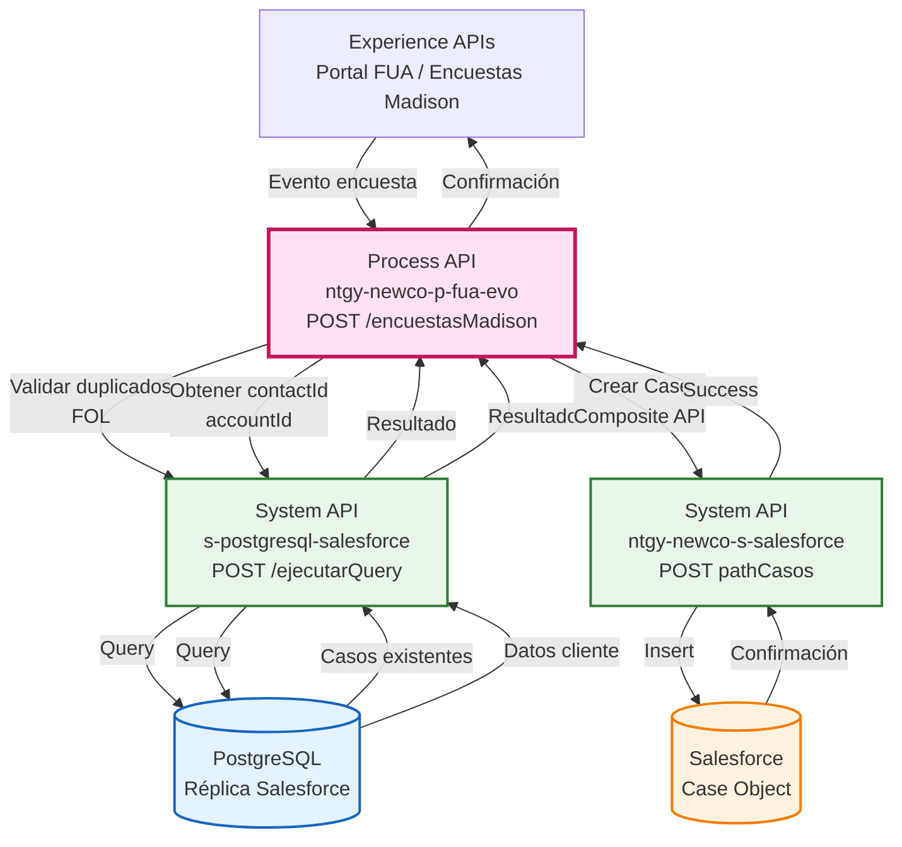
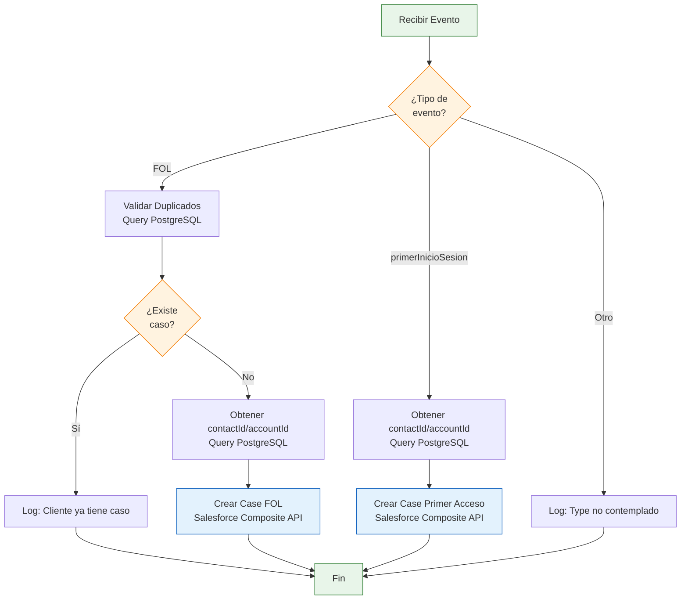
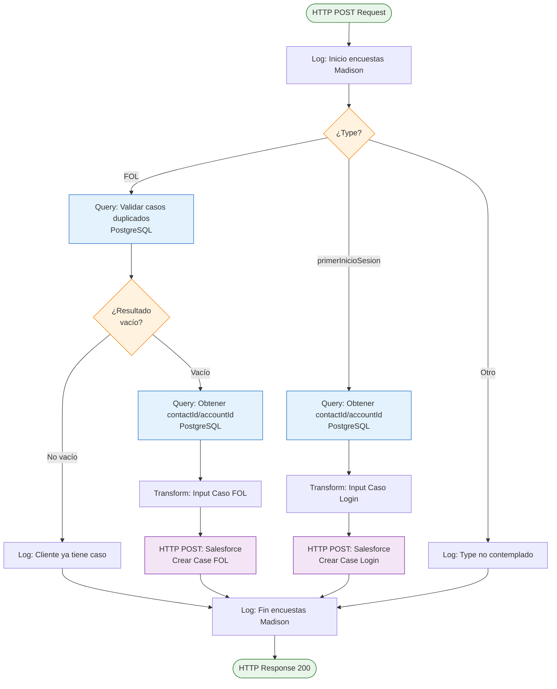
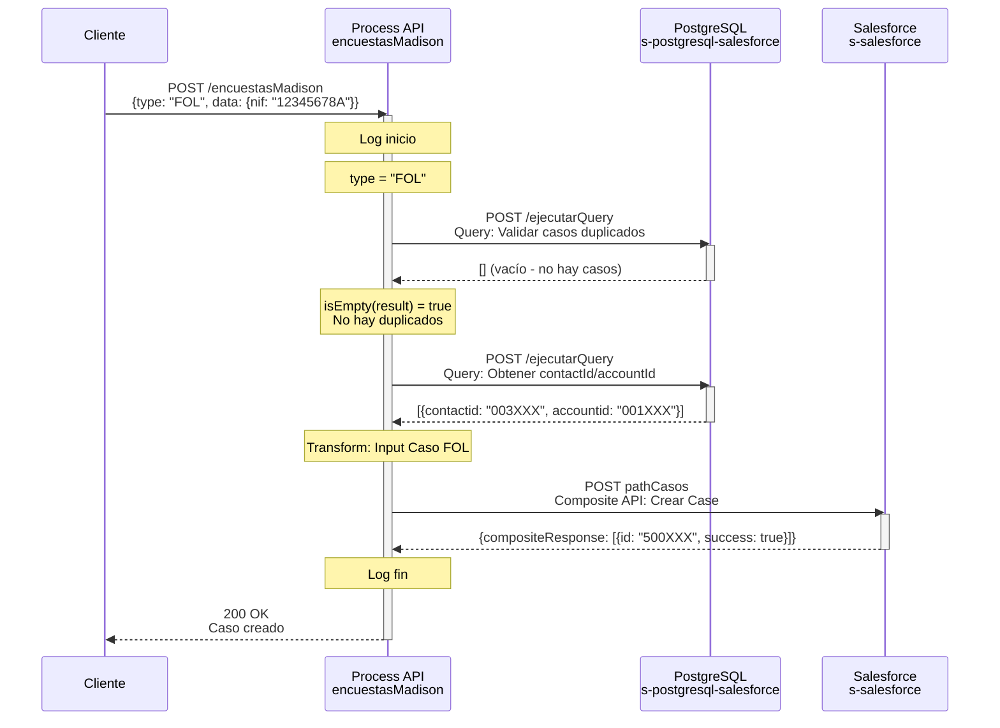
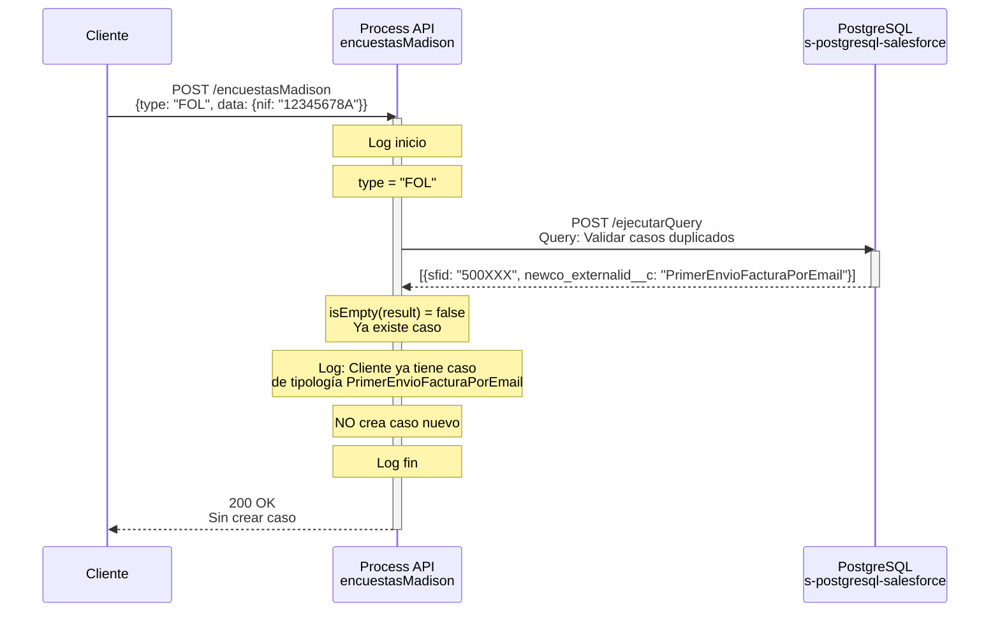
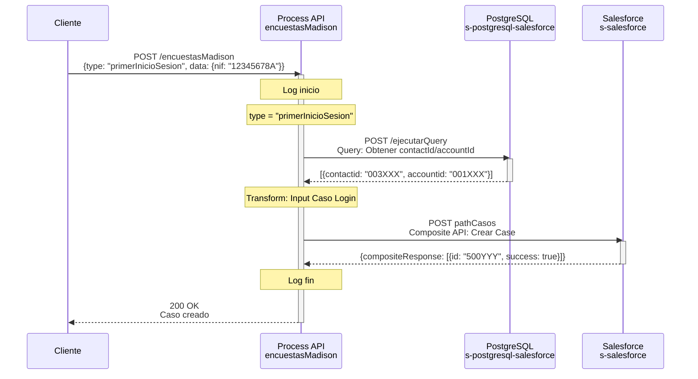

# POST /encuestasMadison

## 📌 Descripción General

### Propósito del Endpoint

Este endpoint registra eventos de encuestas Madison y crea automáticamente casos en Salesforce según el tipo de evento. Soporta dos tipos de eventos: envío de primera factura por email (FOL) y primer acceso al área de clientes. Para el tipo FOL, valida que no existan casos duplicados antes de crear uno nuevo.

### Tipo de API

**Capa:** Process API (API-Led Connectivity)

**Función:** Orquestación compleja con lógica de negocio y validación de duplicados

### Patrón de Integración

**Tipo:** Orquestación con Lógica Condicional

**Descripción:** El Process API recibe el evento de encuesta, consulta PostgreSQL (réplica de Salesforce) para obtener datos del cliente y validar duplicados, y crea casos en Salesforce mediante Composite API según el tipo de evento.

### Arquitectura API-Led Connectivity



---

## 💼 Propósito del Negocio

### Casos de Uso Principales

1. **Registro de Primer Envío de Factura por Email (FOL)**
   - Cuando un cliente recibe su primera factura por email
   - Crea caso en Salesforce para seguimiento
   - Valida que no existan casos duplicados de esta tipología
   - Permite análisis de adopción de factura electrónica

2. **Registro de Primer Acceso al Área de Clientes**
   - Cuando un cliente accede por primera vez al área de clientes
   - Crea caso en Salesforce para trazabilidad
   - Permite medir adopción de canales digitales
   - Facilita seguimiento de onboarding digital

3. **Trazabilidad de Eventos Madison**
   - Todos los eventos quedan registrados como casos en Salesforce
   - Permite análisis de comportamiento de clientes
   - Facilita reporting y métricas de adopción digital

### 🔗 Endpoints Dependientes

Este Process API consume los siguientes System APIs:

| System API | Endpoint | Método | Propósito |
|------------|----------|--------|-----------|
| `ntgy-newco-s-postgresql-salesforce` | `/ejecutarQuery` | POST | Consulta réplica de Salesforce en PostgreSQL |
| `ntgy-newco-s-salesforce` | `${pathCasos}` | POST | Crea casos en Salesforce vía Composite API |

### Lógica de Orquestación



**Pasos del Proceso:**

#### **Flujo FOL (Primer Envío Factura por Email):**
1. **Validación de Duplicados**: Consulta PostgreSQL para verificar casos existentes
2. **Decisión**: Si existe caso, solo logea; si no existe, continúa
3. **Obtención de Datos**: Consulta contactId y accountId por NIF
4. **Creación de Caso**: Crea caso en Salesforce con tipología "PrimerEnvioFacturaPorEmail"

#### **Flujo Primer Inicio Sesión:**
1. **Obtención de Datos**: Consulta contactId y accountId por NIF
2. **Creación de Caso**: Crea caso en Salesforce con tipología "PrimerAccesoAreaCliente"

### Transformaciones Aplicadas

Este Process API NO transforma la respuesta de Salesforce, retorna el resultado directo de la creación del caso.

### Contexto Empresarial

- **Dominio:** Gestión de Encuestas y Eventos de Cliente
- **Sector:** Energía - Utilities
- **División:** Naturgy España - NewCo
- **Proceso de Negocio:** Registro de eventos Madison y creación automática de casos

### Stakeholders

- **Equipo de Encuestas Madison**: Genera eventos de encuestas
- **Equipo de CRM**: Gestiona casos en Salesforce
- **Equipo de Análisis**: Analiza adopción de canales digitales
- **Clientes (indirectamente)**: Beneficiarios de mejor seguimiento

### Valor de Negocio

- **Automatización**: Creación automática de casos sin intervención manual
- **Trazabilidad**: Registro completo de eventos de cliente
- **Prevención de Duplicados**: Validación para tipo FOL
- **Análisis de Adopción**: Métricas de uso de canales digitales
- **Mejora Continua**: Datos para optimizar onboarding

### Consumidores Potenciales

Este endpoint puede ser consumido por:
- Sistema de encuestas Madison
- Portales web de autoservicio
- Aplicaciones móviles
- Sistemas de eventos y notificaciones

---

## 🔧 Especificación Técnica

### URLs por Ambiente

| Ambiente | URL Base | URL Completa |
|----------|----------|--------------|
| **Local** | `http://localhost:8081` | `http://localhost:8081/api/encuestasMadison` |
| **Development** | `https://ntgy-newco-p-fua-evo-dev.us-e2.cloudhub.io` | `https://ntgy-newco-p-fua-evo-dev.us-e2.cloudhub.io/api/encuestasMadison` |
| **UAT** | `https://ntgy-newco-p-fua-evo-uat.us-e2.cloudhub.io` | `https://ntgy-newco-p-fua-evo-uat.us-e2.cloudhub.io/api/encuestasMadison` |
| **Production** | `https://ntgy-newco-p-fua-evo-pro.us-e2.cloudhub.io` | `https://ntgy-newco-p-fua-evo-pro.us-e2.cloudhub.io/api/encuestasMadison` |

### Método HTTP

```
POST /api/encuestasMadison
```

### Parámetros de Entrada

#### Request Body (application/json)

**Estructura:**

```json
{
  "type": "string",
  "data": {
    "nif": "string"
  }
}
```

**Campos:**

| Campo | Tipo | Obligatorio | Descripción | Valores Permitidos |
|-------|------|-------------|-------------|-------------------|
| `type` | String | ✅ Sí | Tipo de evento de encuesta | `"FOL"`, `"primerInicioSesion"` |
| `data` | Object | ✅ Sí | Datos del evento | - |
| `data.nif` | String | ✅ Sí | NIF del cliente | Formato NIF español |

**Tipos de Evento Soportados:**

| Tipo | Descripción | Caso Salesforce Creado | Validación Duplicados |
|------|-------------|------------------------|----------------------|
| `FOL` | Primer envío de factura por email | "Envio primera FOL" | ✅ Sí |
| `primerInicioSesion` | Primer acceso al área de clientes | "Primer acceso area clientes" | ❌ No |

**Notas:**
- Si `type` no es uno de los valores soportados, solo se logea sin crear caso
- El NIF se usa para buscar el cliente en PostgreSQL (réplica de Salesforce)

### Respuestas

#### 200 OK - Éxito

**Respuesta de Salesforce Composite API:**

```json
{
  "compositeResponse": [
    {
      "body": {
        "id": "500XXXXXXXXXXXXXXX",
        "success": true,
        "errors": []
      },
      "httpHeaders": {},
      "httpStatusCode": 201,
      "referenceId": "refCaseGestion"
    }
  ]
}
```

**Descripción de Campos:**

| Campo | Tipo | Descripción |
|-------|------|-------------|
| `compositeResponse` | Array | Array de respuestas de Salesforce |
| `compositeResponse[].body.id` | String | ID del caso creado en Salesforce |
| `compositeResponse[].body.success` | Boolean | Indica si la operación fue exitosa |
| `compositeResponse[].httpStatusCode` | Number | Código HTTP de la operación (201 = Created) |
| `compositeResponse[].referenceId` | String | Referencia de la operación ("refCaseGestion") |

#### 200 OK - Caso Duplicado (solo FOL)

**Cuando ya existe un caso de tipo FOL:**

El endpoint retorna 200 OK pero no crea caso nuevo. Solo logea:
```
"El cliente {NIF} tiene casos de tipologia PrimerEnvioFacturaPorEmail"
```

#### 200 OK - Type No Contemplado

**Cuando type no es "FOL" ni "primerInicioSesion":**

El endpoint retorna 200 OK pero no crea caso. Solo logea:
```
"Type no contemplado o vacio"
```

#### 400 Bad Request - Error de Validación

```json
{
  "code": "400",
  "message": "Campos obligatorios faltantes: type, data.nif"
}
```

#### 500 Internal Server Error - Error del Sistema

```json
{
  "code": "500",
  "message": "Error al crear caso en Salesforce"
}
```

### Autenticación

- **Tipo:** Client ID & Client Secret (Anypoint Platform)
- **Headers requeridos:**
  - `client_id`: ID del cliente registrado en Anypoint Platform
  - `client_secret`: Secret del cliente

### Timeouts

| Tipo | Valor |
|------|-------|
| **Request Timeout** | 60 segundos |
| **Connection Timeout** | 30 segundos |
| **Salesforce Timeout** | Configurado en properties |

---

## 🏗️ Implementación Técnica

### Arquitectura del Flow



### Queries SQL Ejecutadas

#### 1. Query Validación de Duplicados (solo FOL)

```sql
SELECT 
  tableCase.sfid,
  parametricaCasos.newco_externalid__c
FROM newcosalesforce.case AS tableCase,
     newcosalesforce.acn_obj_ParametricaCasos__c parametricaCasos
WHERE tableCase.newco_accountdocumentnumber__c = '{NIF}'
  AND tableCase.acn_fld_Tittle__c = parametricacasos.sfid
  AND parametricacasos.newco_externalid__c = 'PrimerEnvioFacturaPorEmail'
```

**Propósito:** Verificar si ya existe un caso de tipo "PrimerEnvioFacturaPorEmail" para el cliente.

#### 2. Query Obtención de Datos del Cliente

```sql
SELECT 
  contact.sfid AS contactId,
  account.sfid AS accountId
FROM newcosalesforce.Contact AS contact,
     newcosalesforce.Account AS account
WHERE account.sfid = contact.accountid
  AND contact.newco_documentnumber__c = '{NIF}'
```

**Propósito:** Obtener contactId y accountId necesarios para crear el caso en Salesforce.

### Transformaciones DataWeave

#### 1. Query Validación Duplicados (FOL)

```dataweave
%dw 2.0
output application/json
---
{
    "query": "select tableCase.sfid,parametricacasos.newco_externalid__c from newcosalesforce.case as tableCase,newcosalesforce.acn_obj_ParametricaCasos__c parametricaCasos where tableCase.newco_accountdocumentnumber__c = '" ++ payload.data.nif ++ "' and tableCase.acn_fld_Tittle__c  = parametricacasos.sfid and parametricacasos.newco_externalid__c = 'PrimerEnvioFacturaPorEmail'"
}
```

#### 2. Query Obtención de Contacto

```dataweave
%dw 2.0
output application/json
---
{
    "query": "select contact.sfid as contactId, account.sfid as accountId from newcosalesforce.Contact as contact, newcosalesforce.Account as account where account.sfid = contact.accountid and contact.newco_documentnumber__c = '" ++ payload.data.nif ++ "'"
}
```

#### 3. Input Caso FOL (Salesforce Composite API)

```dataweave
%dw 2.0
output application/json

var content = vars.postgresResult[0]
---
{
    "allOrNone" : true,
    "collateSubrequests": false,
    "compositeRequest" : [
        {
            "method" : "POST",
            "url" : "/services/data/v52.0/sobjects/Case",
            "referenceId" : "refCaseGestion",
            "body" : { 
                "NewCo_Recordtype__c" : "Gestion",
                "AccountId" : content.accountid,
                "ContactId" : content.contactid,
                "Origin" : "FUA",
                "Status" : "06",
                "Subject": "Envio primera FOL",
                "Description": "", 
                "NewCo_Creado_por__c" : content.accountid,
                "NewCo_CorrelationId__c": correlationId,    
                "acn_fld_Tittle__r":{
                    "NewCo_ExternalId__c":"PrimerEnvioFacturaPorEmail"
                }
            }
        }
    ]
}
```

#### 4. Input Caso Primer Inicio Sesión (Salesforce Composite API)

```dataweave
%dw 2.0
output application/json

var content = vars.postgresResult[0]
---
{
    "allOrNone" : true,
    "collateSubrequests": false,
    "compositeRequest" : [
        {
            "method" : "POST",
            "url" : "/services/data/v52.0/sobjects/Case",
            "referenceId" : "refCaseGestion",
            "body" : { 
                "NewCo_Recordtype__c" : "Gestion",
                "AccountId" : content.accountid,
                "ContactId" : content.contactid,
                "Origin" : "FUA",
                "Status" : "06",
                "Subject": "Primer acceso area clientes",
                "Description": "", 
                "NewCo_Creado_por__c" : content.accountid,
                "NewCo_CorrelationId__c": correlationId,    
                "acn_fld_Tittle__r":{
                    "NewCo_ExternalId__c":"PrimerAccesoAreaCliente"
                }
            }
        }
    ]
}
```

### Campos del Caso en Salesforce

| Campo Salesforce | Valor | Descripción |
|------------------|-------|-------------|
| `NewCo_Recordtype__c` | "Gestion" | Tipo de registro del caso |
| `AccountId` | Dinámico | ID de la cuenta del cliente |
| `ContactId` | Dinámico | ID del contacto del cliente |
| `Origin` | "FUA" | Origen del caso (Portal FUA) |
| `Status` | "06" | Estado del caso |
| `Subject` | Según tipo | "Envio primera FOL" o "Primer acceso area clientes" |
| `Description` | "" | Descripción vacía |
| `NewCo_Creado_por__c` | AccountId | Creado por (mismo que AccountId) |
| `NewCo_CorrelationId__c` | correlationId | ID de correlación para trazabilidad |
| `acn_fld_Tittle__r.NewCo_ExternalId__c` | Según tipo | "PrimerEnvioFacturaPorEmail" o "PrimerAccesoAreaCliente" |

### Patrones de Diseño

**Patrón:** Orquestación con Validación Condicional

**Justificación:** 
- Requiere consultas a múltiples sistemas (PostgreSQL + Salesforce)
- Lógica de negocio compleja con validación de duplicados
- Diferentes flujos según tipo de evento
- Uso de Composite API de Salesforce para operaciones atómicas

### Diagramas de Secuencia

#### 1. Flujo FOL - Primera Vez (Sin Duplicados)



#### 2. Flujo FOL - Caso Duplicado



#### 3. Flujo Primer Inicio Sesión



### Manejo de Errores

**Estrategia:**

1. **Validación de Payload**: Si faltan campos obligatorios, retorna 400
2. **Cliente No Encontrado**: Si el NIF no existe en PostgreSQL, falla la query
3. **Error de Salesforce**: Si falla la creación del caso, retorna error de Salesforce
4. **Type No Contemplado**: Solo logea, no retorna error

**Logging:**
- Log de inicio con payload completo
- Log de fin
- Log específico para casos duplicados (FOL)
- Log para type no contemplado

---

## 💻 Ejemplos de Uso

### Ejemplo 1: Evento FOL - Primera Vez

#### cURL

```bash
curl -X POST "https://ntgy-newco-p-fua-evo-dev.us-e2.cloudhub.io/api/encuestasMadison" \
  -H "Content-Type: application/json" \
  -H "client_id: YOUR_CLIENT_ID" \
  -H "client_secret: YOUR_CLIENT_SECRET" \
  -d '{
    "type": "FOL",
    "data": {
      "nif": "12345678A"
    }
  }'
```

#### Respuesta (200 OK)

```json
{
  "compositeResponse": [
    {
      "body": {
        "id": "5001234567890ABCDE",
        "success": true,
        "errors": []
      },
      "httpHeaders": {
        "Location": "/services/data/v52.0/sobjects/Case/5001234567890ABCDE"
      },
      "httpStatusCode": 201,
      "referenceId": "refCaseGestion"
    }
  ]
}
```

**Caso creado en Salesforce:**
- Subject: "Envio primera FOL"
- Tipología: "PrimerEnvioFacturaPorEmail"
- Origin: "FUA"
- Status: "06"

### Ejemplo 2: Evento FOL - Caso Duplicado

#### cURL

```bash
curl -X POST "https://ntgy-newco-p-fua-evo-dev.us-e2.cloudhub.io/api/encuestasMadison" \
  -H "Content-Type: application/json" \
  -H "client_id: YOUR_CLIENT_ID" \
  -H "client_secret: YOUR_CLIENT_SECRET" \
  -d '{
    "type": "FOL",
    "data": {
      "nif": "12345678A"
    }
  }'
```

#### Respuesta (200 OK)

```json
{}
```

**Nota:** No se crea caso nuevo. En los logs aparece:
```
"El cliente 12345678A tiene casos de tipologia PrimerEnvioFacturaPorEmail"
```

### Ejemplo 3: Evento Primer Inicio Sesión

#### cURL

```bash
curl -X POST "https://ntgy-newco-p-fua-evo-dev.us-e2.cloudhub.io/api/encuestasMadison" \
  -H "Content-Type: application/json" \
  -H "client_id: YOUR_CLIENT_ID" \
  -H "client_secret: YOUR_CLIENT_SECRET" \
  -d '{
    "type": "primerInicioSesion",
    "data": {
      "nif": "87654321B"
    }
  }'
```

#### Respuesta (200 OK)

```json
{
  "compositeResponse": [
    {
      "body": {
        "id": "5009876543210ZYXWV",
        "success": true,
        "errors": []
      },
      "httpHeaders": {
        "Location": "/services/data/v52.0/sobjects/Case/5009876543210ZYXWV"
      },
      "httpStatusCode": 201,
      "referenceId": "refCaseGestion"
    }
  ]
}
```

**Caso creado en Salesforce:**
- Subject: "Primer acceso area clientes"
- Tipología: "PrimerAccesoAreaCliente"
- Origin: "FUA"
- Status: "06"

### Ejemplo 4: JavaScript (Fetch API)

```javascript
const evento = {
  type: 'FOL',
  data: {
    nif: '12345678A'
  }
};

const response = await fetch('https://ntgy-newco-p-fua-evo-dev.us-e2.cloudhub.io/api/encuestasMadison', {
  method: 'POST',
  headers: {
    'Content-Type': 'application/json',
    'client_id': 'YOUR_CLIENT_ID',
    'client_secret': 'YOUR_CLIENT_SECRET'
  },
  body: JSON.stringify(evento)
});

const result = await response.json();
console.log('Caso creado:', result.compositeResponse[0].body.id);
// Output: Caso creado: 5001234567890ABCDE
```

### Ejemplo 5: Python (Requests)

```python
import requests
import json

evento = {
    'type': 'primerInicioSesion',
    'data': {
        'nif': '87654321B'
    }
}

url = 'https://ntgy-newco-p-fua-evo-dev.us-e2.cloudhub.io/api/encuestasMadison'
headers = {
    'Content-Type': 'application/json',
    'client_id': 'YOUR_CLIENT_ID',
    'client_secret': 'YOUR_CLIENT_SECRET'
}

response = requests.post(url, headers=headers, json=evento)

if response.status_code == 200:
    result = response.json()
    if 'compositeResponse' in result:
        caso_id = result['compositeResponse'][0]['body']['id']
        print(f"Caso creado: {caso_id}")
        # Output: Caso creado: 5009876543210ZYXWV
    else:
        print("Caso duplicado o type no contemplado")
else:
    print(f"Error: {response.status_code}")
    print(response.json())
```

### Ejemplo 6: Type No Contemplado

#### cURL

```bash
curl -X POST "https://ntgy-newco-p-fua-evo-dev.us-e2.cloudhub.io/api/encuestasMadison" \
  -H "Content-Type: application/json" \
  -H "client_id: YOUR_CLIENT_ID" \
  -H "client_secret: YOUR_CLIENT_SECRET" \
  -d '{
    "type": "otroTipo",
    "data": {
      "nif": "12345678A"
    }
  }'
```

#### Respuesta (200 OK)

```json
{}
```

**Nota:** No se crea caso. En los logs aparece:
```
"Type no contemplado o vacio"
```

---

## 📝 Notas Importantes

### Para Desarrolladores

- ✅ **Validación de duplicados solo para FOL** - "primerInicioSesion" no valida
- ✅ **Dos flujos diferentes** - Lógica condicional según type
- ✅ **Composite API de Salesforce** - Operaciones atómicas
- ✅ **Réplica PostgreSQL** - Consulta réplica de Salesforce para mejor performance
- ⚠️ **Type no contemplado** - No retorna error, solo logea

### Mejores Prácticas

1. **Usar types correctos** - Solo "FOL" o "primerInicioSesion"
2. **Validar NIF** - Asegurar formato correcto antes de enviar
3. **Manejar duplicados** - Para FOL, considerar que puede no crear caso
4. **Revisar logs** - Información importante en logs de aplicación
5. **Trazabilidad** - correlationId permite seguimiento end-to-end

### Limitaciones

- **Sin validación de duplicados para "primerInicioSesion"**: Puede crear múltiples casos
- **Type case-sensitive**: Debe ser exactamente "FOL" o "primerInicioSesion"
- **Dependencia de réplica PostgreSQL**: Si la réplica está desactualizada, puede haber inconsistencias
- **Sin respuesta detallada para duplicados**: Solo logea, no retorna información específica

### Diferencias entre Tipos

| Característica | FOL | primerInicioSesion |
|----------------|-----|-------------------|
| **Validación duplicados** | ✅ Sí | ❌ No |
| **Subject del caso** | "Envio primera FOL" | "Primer acceso area clientes" |
| **Tipología** | "PrimerEnvioFacturaPorEmail" | "PrimerAccesoAreaCliente" |
| **Queries PostgreSQL** | 2 (validación + datos) | 1 (solo datos) |

### Monitoreo

**Métricas recomendadas:**
- Tasa de casos FOL duplicados
- Distribución de tipos de eventos
- Tiempo de respuesta por tipo
- Tasa de éxito de creación de casos
- Clientes sin contactId/accountId (errores)

### Troubleshooting

**Problema:** No se crea caso para FOL
- **Causa posible:** Ya existe caso de esa tipología
- **Solución:** Verificar en logs si aparece mensaje de duplicado

**Problema:** Error al crear caso en Salesforce
- **Causa posible:** contactId o accountId no encontrados
- **Solución:** Verificar que el NIF existe en PostgreSQL

**Problema:** Type no contemplado
- **Causa posible:** Typo en el valor de type
- **Solución:** Usar exactamente "FOL" o "primerInicioSesion"
