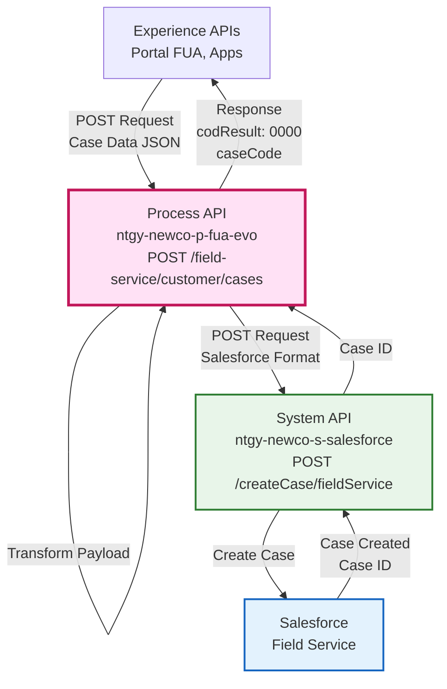
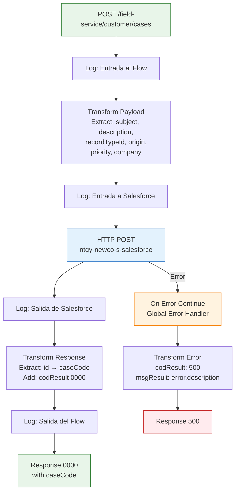
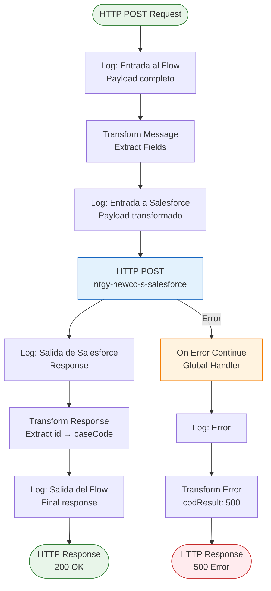
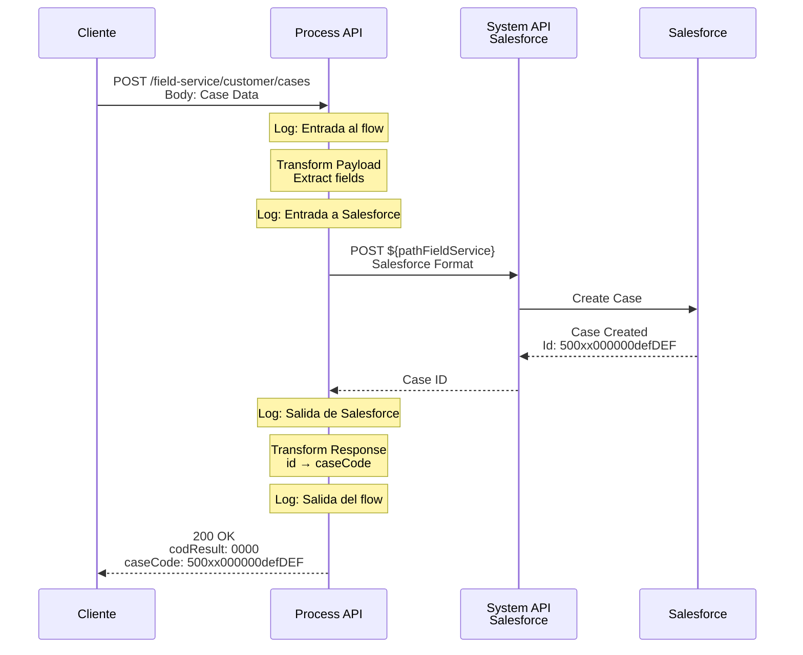
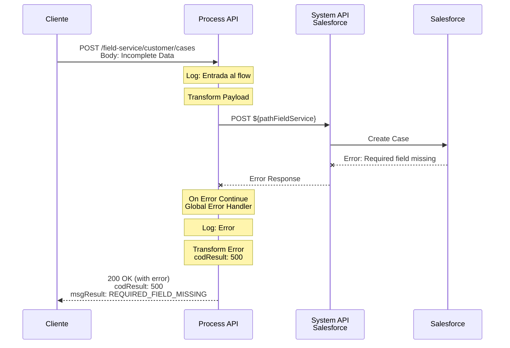
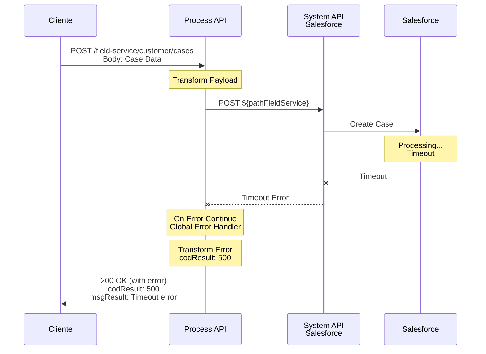

# POST /field-service/customer/cases

## 📌 Descripción General

### Propósito del Endpoint

Este endpoint orquesta la creación de casos de Field Service en Salesforce para gestión de reclamaciones y servicios técnicos. Transforma el payload de entrada al formato requerido por Salesforce, crea el caso mediante el System API, y retorna el ID del caso creado. Implementa un error handler global que captura cualquier excepción y retorna un código de error 500 con la descripción del problema.

### Tipo de API

**Capa:** Process API (API-Led Connectivity)

**Función:** Orquestación de creación de casos con transformación de payload

### Patrón de Integración

**Tipo:** Transformación + Creación

**Descripción:** El endpoint implementa un flujo simple:
1. Recibe payload JSON con datos del caso
2. Transforma payload al formato de Salesforce
3. Crea caso en Salesforce mediante System API
4. Retorna código 0000 con ID del caso creado

### Arquitectura API-Led Connectivity



---

## 💼 Propósito del Negocio

### Casos de Uso Principales

1. **Creación de Reclamaciones**
   - Clientes pueden crear reclamaciones sobre facturación, servicio, etc.
   - Beneficio: Canal digital para registro de incidencias

2. **Solicitud de Servicios Técnicos**
   - Creación de casos para visitas técnicas, revisiones, reparaciones
   - Beneficio: Automatización de solicitudes de Field Service

3. **Registro de Incidencias por Agentes**
   - Agentes de call center crean casos en nombre del cliente
   - Beneficio: Trazabilidad y gestión centralizada de incidencias

### 🔗 Endpoints Dependientes

Este Process API consume el siguiente System API:

| System API | Endpoint | Método | Propósito |
|------------|----------|--------|-----------|
| `ntgy-newco-s-salesforce` | `${pathFieldService}` | POST | Crea caso en Salesforce Field Service con los datos transformados |

### Lógica de Orquestación



**Pasos del Proceso:**

1. **Logging Inicial**: Registra entrada al flow con payload completo
2. **Transformación de Payload**: Extrae campos requeridos por Salesforce
3. **Logging Pre-Salesforce**: Registra payload transformado
4. **Creación en Salesforce**: POST al System API de Salesforce
5. **Logging Post-Salesforce**: Registra respuesta de Salesforce
6. **Transformación de Respuesta**: Extrae ID del caso y construye respuesta
7. **Logging Final**: Registra respuesta final
8. **Error Handling**: Captura cualquier error y retorna código 500

### Transformaciones Aplicadas

**Transformación 1: Request (Input → Salesforce Format)**

| Campo Input | Campo Salesforce | Descripción |
|-------------|------------------|-------------|
| `subject` | `subject` | Asunto del caso |
| `description` | `description` | Descripción detallada del caso |
| `recordTypeId` | `recordTypeId` | Tipo de registro en Salesforce |
| `origin` | `origin` | Origen del caso (Web, Phone, Email) |
| `priority` | `priority` | Prioridad (Low, Medium, High) |
| `company` | `company` | Compañía asociada |

**Transformación 2: Response (Salesforce → Output)**

```dataweave
{
    "result": {
        "codResult": "0000",
        "msgResult": "No hay error"
    },
    "caseCode": payload.id  // ID del caso creado en Salesforce
}
```

**Transformación 3: Error Response**

```dataweave
{
    "result": {
        "id": "",
        "caseNumber": "",
        "codResult": "500",
        "msgResult": error.description
    }
}
```

### Contexto Empresarial

- **Dominio:** Gestión de Casos y Field Service
- **Sector:** Energía - Utilities
- **División:** Naturgy España - NewCo
- **Proceso de Negocio:** Creación de reclamaciones y solicitudes de servicio técnico

### Stakeholders

- **Clientes Finales**: Crean reclamaciones y solicitan servicios
- **Agentes de Call Center**: Registran casos en nombre de clientes
- **Equipo de Field Service**: Reciben y gestionan casos de servicio técnico
- **Equipo de Calidad**: Analizan casos para mejora continua

### Valor de Negocio

- **Automatización**: Registro digital de casos sin intervención manual
- **Trazabilidad**: Cada caso tiene un ID único para seguimiento
- **Eficiencia**: Reducción de tiempo en registro de incidencias
- **Integración**: Casos creados directamente en Salesforce Field Service

### Consumidores Potenciales

Este endpoint puede ser consumido por:
- Portal web FUA
- Aplicaciones móviles de clientes
- Sistemas de agentes de call center
- Chatbots y asistentes virtuales
- Sistemas de terceros autorizados

---

## 🔧 Especificación Técnica

### URLs por Ambiente

| Ambiente | URL Base | URL Completa |
|----------|----------|--------------|
| **Local** | `http://localhost:8081` | `http://localhost:8081/api/field-service/customer/cases` |
| **Development** | `https://ntgy-newco-p-fua-evo-dev.us-e2.cloudhub.io` | `https://ntgy-newco-p-fua-evo-dev.us-e2.cloudhub.io/api/field-service/customer/cases` |
| **UAT** | `https://ntgy-newco-p-fua-evo-uat.us-e2.cloudhub.io` | `https://ntgy-newco-p-fua-evo-uat.us-e2.cloudhub.io/api/field-service/customer/cases` |
| **Production** | `https://ntgy-newco-p-fua-evo-pro.us-e2.cloudhub.io` | `https://ntgy-newco-p-fua-evo-pro.us-e2.cloudhub.io/api/field-service/customer/cases` |

### Método HTTP

```
POST /api/field-service/customer/cases
```

### Parámetros de Entrada

#### Headers

| Header | Tipo | Requerido | Descripción | Ejemplo |
|--------|------|-----------|-------------|---------|
| `Content-Type` | string | Sí | Tipo de contenido | `application/json` |
| `client_id` | string | Sí | Client ID de Anypoint Platform | `abc123...` |
| `client_secret` | string | Sí | Client Secret de Anypoint Platform | `xyz789...` |

#### Body (JSON)

**Content-Type:** `application/json`

**Schema:** `postFieldTypeRequest`

| Campo | Tipo | Requerido | Descripción | Ejemplo |
|-------|------|-----------|-------------|---------|
| `subject` | string | Sí | Asunto del caso | `"Problema con facturación"` |
| `description` | string | Sí | Descripción detallada | `"El cliente reporta discrepancia en factura"` |
| `recordTypeId` | string | Sí | ID del tipo de registro en Salesforce | `"012xx000000abcABC"` |
| `origin` | string | Sí | Origen del caso | `"Web"`, `"Phone"`, `"Email"` |
| `priority` | string | Sí | Prioridad del caso | `"Low"`, `"Medium"`, `"High"` |
| `company` | string | Sí | Compañía asociada | `"Naturgy"` |

**Ejemplo de Body:**
```json
{
  "subject": "Problema con facturación",
  "description": "El cliente reporta una discrepancia en la factura del mes de diciembre. El importe facturado no coincide con el consumo real.",
  "recordTypeId": "012xx000000abcABC",
  "origin": "Web",
  "priority": "Medium",
  "company": "Naturgy"
}
```

### Respuestas

#### 200 OK - Caso Creado Exitosamente

**Descripción:** Caso creado correctamente en Salesforce

**Content-Type:** `application/json`

**Schema:** `postFieldTypeResponse`

```json
{
  "result": {
    "codResult": "0000",
    "msgResult": "No hay error"
  },
  "caseCode": "500xx000000defDEF"
}
```

**Campos:**
- `result.codResult`: Código de resultado (`0000` = éxito)
- `result.msgResult`: Mensaje descriptivo
- `caseCode`: ID del caso creado en Salesforce (Case ID)

#### 500 Internal Server Error - Error en Creación

**Descripción:** Error al crear el caso en Salesforce

**Content-Type:** `application/json`

**Schema:**
```json
{
  "result": {
    "id": "",
    "caseNumber": "",
    "codResult": "500",
    "msgResult": "REQUIRED_FIELD_MISSING: Required fields are missing: [AccountId]"
  }
}
```

**Campos:**
- `result.id`: Vacío en caso de error
- `result.caseNumber`: Vacío en caso de error
- `result.codResult`: Código de error (`500`)
- `result.msgResult`: Descripción del error de Salesforce

#### 400 Bad Request - Payload Inválido

**Descripción:** Payload de entrada no cumple con el schema requerido

**Content-Type:** `application/json`

**Schema:** `generic.response-failed`

```json
{
  "code": "VALIDATION_ERROR",
  "message": "Payload inválido",
  "details": "Campo requerido 'subject' no proporcionado",
  "timestamp": "2024-01-15T10:30:00Z"
}
```

### Autenticación

- **Tipo:** Client ID & Client Secret (Anypoint Platform)
- **Headers requeridos:** `client_id`, `client_secret`

### Timeouts

| Tipo | Valor |
|------|-------|
| **Request Timeout** | 60 segundos |
| **Connection Timeout** | 30 segundos |

---

## 🏗️ Implementación Técnica

### Arquitectura del Flow



### Componentes del Flow

#### 1. Flow Principal: `post:\field-service\customer\cases:application\json:ntgy-newco-p-fua-config`

**Ubicación:** `src/main/mule/ntgy-newco-p-fua.xml`

**Responsabilidades:**
- Recibir request HTTP POST
- Invocar subflow de procesamiento
- Manejar errores globalmente

**Código XML:**
```xml
<flow name="post:\field-service\customer\cases:application\json:ntgy-newco-p-fua-config">
    <logger level="INFO" 
            message="post:\field-service\customer\cases:application\json:ntgy-newco-p-fua-config" />
    <flow-ref doc:name="Flow Reference" name="postCaseFieldServiceSub_Flow" />
    
    <error-handler>
        <on-error-continue enableNotifications="true" logException="true" type="ANY">
            <logger level="INFO" 
                    doc:name="Logger" 
                    message="Entrando en OnErrorContinue" />
            <ee:transform doc:name="Transform Message">
                <ee:set-payload>
                    {
                        result: {
                            id: "",
                            caseNumber: "",
                            codResult: "500",
                            msgResult: error.description
                        }
                    }
                </ee:set-payload>
            </ee:transform>
        </on-error-continue>
    </error-handler>
</flow>
```

#### 2. Subflow: `postCaseFieldServiceSub_Flow`

**Ubicación:** `src/main/mule/services/fieldservice/postCaseFieldServiceSub_Flow.xml` (ubicación estimada)

**Responsabilidades:**
- Transformar payload de entrada
- Crear caso en Salesforce
- Transformar respuesta
- Logging completo

**Logging Inicial:**
```xml
<logger level="INFO" 
        doc:name="Logger" 
        message="Log de entrada a postCaseFieldServiceSub_Flow: #[message.payload]"/>
```

**Transformación 1: Payload de Entrada**
```dataweave
%dw 2.0
output application/json
---
{
    "subject": payload.subject,
    "description": payload.description,
    "recordTypeId": payload.recordTypeId,
    "origin": payload.origin,
    "priority": payload.priority,
    "company": payload.company
}
```

**Logging Pre-Salesforce:**
```xml
<logger level="INFO" 
        doc:name="Logger" 
        message="Log de entrada a ntgy-newco-s-salesforce: #[message.payload]" />
```

**Llamada HTTP POST:**
```xml
<http:request 
    method="POST" 
    doc:name="Request"
    config-ref="HTTP_Request_configuration_ntgy_newco_s_salesforce" 
    path="${ntgy-newco-s-salesforce.pathFieldService}" />
```

**Logging Post-Salesforce:**
```xml
<logger level="INFO" 
        doc:name="Logger" 
        message="Log de salida a ntgy-newco-s-salesforce: #[message.payload]"/>
```

**Transformación 2: Respuesta**
```dataweave
%dw 2.0
output application/json
---
{
    "result": {
        "codResult": "0000",
        "msgResult": "No hay error"
    },
    "caseCode": payload.id
}
```

**Logging Final:**
```xml
<logger level="INFO" 
        doc:name="Logger" 
        message="Log de salida a postCaseFieldServiceSub_Flow: #[message.payload]"/>
```

### Configuración HTTP

**Config Reference:** `HTTP_Request_configuration_ntgy_newco_s_salesforce`

**Propiedades:**
- **Host:** Configurado en properties file por ambiente
- **Port:** 443 (HTTPS)
- **Base Path:** Configurado en properties
- **Path Variable:** `${ntgy-newco-s-salesforce.pathFieldService}` → Path del endpoint de Field Service

### Patrones de Diseño

**Patrón 1: Request-Reply with Transformation**

**Justificación:** 
- Necesidad de adaptar payload de entrada al formato de Salesforce
- Transformación simple de campos sin lógica compleja
- Respuesta directa con ID del caso creado

**Patrón 2: Global Error Handler**

**Justificación:**
- Captura cualquier error en el flow principal
- Retorna código 500 con descripción del error
- Evita que errores no manejados lleguen al cliente sin formato

**Patrón 3: Comprehensive Logging**

**Justificación:**
- Logging en cada paso del proceso para trazabilidad
- Facilita debugging y análisis de problemas
- Registro de payload en entrada y salida de cada componente

### Diagramas de Secuencia

#### 1. Flujo Normal - Creación Exitosa



#### 2. Flujo con Error - Campo Requerido Faltante



#### 3. Flujo con Error - Timeout



### Manejo de Errores

**Estrategia:** Global error handler con `on-error-continue`

**Tipos de Error:**

1. **Errores de Salesforce (500)**
   - Campo requerido faltante
   - Tipo de registro inválido
   - Validaciones de negocio de Salesforce
   - Respuesta: Código 500 con descripción del error de Salesforce

2. **Errores de Conexión (500)**
   - Timeout al conectar con Salesforce
   - Error de red
   - Respuesta: Código 500 con descripción del error

3. **Errores de Transformación (500)**
   - Error en DataWeave
   - Payload inválido
   - Respuesta: Código 500 con descripción del error

**Formato de Error:** Código 500 personalizado con estructura específica

**Logging:**
- Nivel INFO: Request/Response exitosos, cada paso del flujo
- Nivel INFO: Entrada al error handler
- Nivel ERROR: Excepciones (logException="true")

---

## 💻 Ejemplos de Uso

### Ejemplo 1: Creación Exitosa de Caso

#### cURL

```bash
curl -X POST "https://ntgy-newco-p-fua-evo-dev.us-e2.cloudhub.io/api/field-service/customer/cases" \
  -H "Content-Type: application/json" \
  -H "client_id: YOUR_CLIENT_ID" \
  -H "client_secret: YOUR_CLIENT_SECRET" \
  -d '{
    "subject": "Problema con facturación",
    "description": "El cliente reporta una discrepancia en la factura del mes de diciembre. El importe facturado no coincide con el consumo real registrado en el contador.",
    "recordTypeId": "012xx000000abcABC",
    "origin": "Web",
    "priority": "Medium",
    "company": "Naturgy"
  }'
```

#### Respuesta (200 OK)

```json
{
  "result": {
    "codResult": "0000",
    "msgResult": "No hay error"
  },
  "caseCode": "500xx000000defDEF"
}
```

### Ejemplo 2: Solicitud de Servicio Técnico

#### cURL

```bash
curl -X POST "https://ntgy-newco-p-fua-evo-dev.us-e2.cloudhub.io/api/field-service/customer/cases" \
  -H "Content-Type: application/json" \
  -H "client_id: YOUR_CLIENT_ID" \
  -H "client_secret: YOUR_CLIENT_SECRET" \
  -d '{
    "subject": "Solicitud de revisión de contador",
    "description": "Cliente solicita revisión técnica del contador eléctrico debido a lecturas inconsistentes en los últimos 3 meses.",
    "recordTypeId": "012xx000000ghiGHI",
    "origin": "Phone",
    "priority": "High",
    "company": "Naturgy"
  }'
```

#### Respuesta (200 OK)

```json
{
  "result": {
    "codResult": "0000",
    "msgResult": "No hay error"
  },
  "caseCode": "500xx000000jklJKL"
}
```

### Ejemplo 3: Error - Campo Requerido Faltante

#### cURL

```bash
curl -X POST "https://ntgy-newco-p-fua-evo-dev.us-e2.cloudhub.io/api/field-service/customer/cases" \
  -H "Content-Type: application/json" \
  -H "client_id: YOUR_CLIENT_ID" \
  -H "client_secret: YOUR_CLIENT_SECRET" \
  -d '{
    "subject": "Problema con facturación",
    "description": "Descripción del problema",
    "origin": "Web",
    "priority": "Medium",
    "company": "Naturgy"
  }'
```

#### Respuesta (200 OK con Error 500)

```json
{
  "result": {
    "id": "",
    "caseNumber": "",
    "codResult": "500",
    "msgResult": "REQUIRED_FIELD_MISSING: Required fields are missing: [recordTypeId]"
  }
}
```

### Ejemplo 4: JavaScript (Fetch API)

```javascript
const createCase = async (caseData) => {
  try {
    const response = await fetch(
      'https://ntgy-newco-p-fua-evo-dev.us-e2.cloudhub.io/api/field-service/customer/cases',
      {
        method: 'POST',
        headers: {
          'Content-Type': 'application/json',
          'client_id': 'YOUR_CLIENT_ID',
          'client_secret': 'YOUR_CLIENT_SECRET'
        },
        body: JSON.stringify(caseData)
      }
    );

    if (!response.ok) {
      throw new Error(`HTTP error! status: ${response.status}`);
    }

    const data = await response.json();
    
    if (data.result.codResult !== '0000') {
      console.error(`Error al crear caso: ${data.result.msgResult}`);
      return null;
    }

    return data.caseCode;
  } catch (error) {
    console.error('Error al crear caso:', error);
    return null;
  }
};

// Uso
const newCase = {
  subject: 'Problema con facturación',
  description: 'El cliente reporta discrepancia en la factura',
  recordTypeId: '012xx000000abcABC',
  origin: 'Web',
  priority: 'Medium',
  company: 'Naturgy'
};

const caseId = await createCase(newCase);
if (caseId) {
  console.log(`Caso creado exitosamente: ${caseId}`);
} else {
  console.log('Error al crear el caso');
}
```

### Ejemplo 5: Python (Requests)

```python
import requests

def create_case(case_data):
    """
    Crea un caso de Field Service en Salesforce
    
    Args:
        case_data (dict): Datos del caso
    
    Returns:
        str: ID del caso creado o None si hay error
    """
    url = 'https://ntgy-newco-p-fua-evo-dev.us-e2.cloudhub.io/api/field-service/customer/cases'
    
    headers = {
        'Content-Type': 'application/json',
        'client_id': 'YOUR_CLIENT_ID',
        'client_secret': 'YOUR_CLIENT_SECRET'
    }
    
    try:
        response = requests.post(url, json=case_data, headers=headers, timeout=60)
        response.raise_for_status()
        
        data = response.json()
        
        if data['result']['codResult'] != '0000':
            print(f"Error al crear caso: {data['result']['msgResult']}")
            return None
        
        return data.get('caseCode')
        
    except requests.exceptions.RequestException as e:
        print(f"Error al crear caso: {e}")
        return None

# Uso
if __name__ == "__main__":
    new_case = {
        'subject': 'Problema con facturación',
        'description': 'El cliente reporta una discrepancia en la factura del mes de diciembre',
        'recordTypeId': '012xx000000abcABC',
        'origin': 'Web',
        'priority': 'Medium',
        'company': 'Naturgy'
    }
    
    case_id = create_case(new_case)
    
    if case_id:
        print(f"Caso creado exitosamente con ID: {case_id}")
    else:
        print("Error al crear el caso")
```

### Ejemplo 6: Postman Collection

```json
{
  "info": {
    "name": "Process API - Field Service Cases",
    "schema": "https://schema.getpostman.com/json/collection/v2.1.0/collection.json"
  },
  "item": [
    {
      "name": "Create Case - Billing Issue",
      "request": {
        "method": "POST",
        "header": [
          {
            "key": "Content-Type",
            "value": "application/json"
          },
          {
            "key": "client_id",
            "value": "{{client_id}}"
          },
          {
            "key": "client_secret",
            "value": "{{client_secret}}"
          }
        ],
        "body": {
          "mode": "raw",
          "raw": "{\n  \"subject\": \"Problema con facturación\",\n  \"description\": \"El cliente reporta una discrepancia en la factura del mes de diciembre. El importe facturado no coincide con el consumo real.\",\n  \"recordTypeId\": \"012xx000000abcABC\",\n  \"origin\": \"Web\",\n  \"priority\": \"Medium\",\n  \"company\": \"Naturgy\"\n}"
        },
        "url": {
          "raw": "{{base_url}}/api/field-service/customer/cases",
          "host": ["{{base_url}}"],
          "path": ["api", "field-service", "customer", "cases"]
        }
      },
      "response": []
    },
    {
      "name": "Create Case - Technical Service",
      "request": {
        "method": "POST",
        "header": [
          {
            "key": "Content-Type",
            "value": "application/json"
          },
          {
            "key": "client_id",
            "value": "{{client_id}}"
          },
          {
            "key": "client_secret",
            "value": "{{client_secret}}"
          }
        ],
        "body": {
          "mode": "raw",
          "raw": "{\n  \"subject\": \"Solicitud de revisión de contador\",\n  \"description\": \"Cliente solicita revisión técnica del contador eléctrico debido a lecturas inconsistentes.\",\n  \"recordTypeId\": \"012xx000000ghiGHI\",\n  \"origin\": \"Phone\",\n  \"priority\": \"High\",\n  \"company\": \"Naturgy\"\n}"
        },
        "url": {
          "raw": "{{base_url}}/api/field-service/customer/cases",
          "host": ["{{base_url}}"],
          "path": ["api", "field-service", "customer", "cases"]
        }
      },
      "response": []
    }
  ]
}
```
