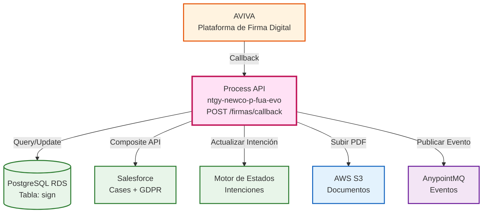
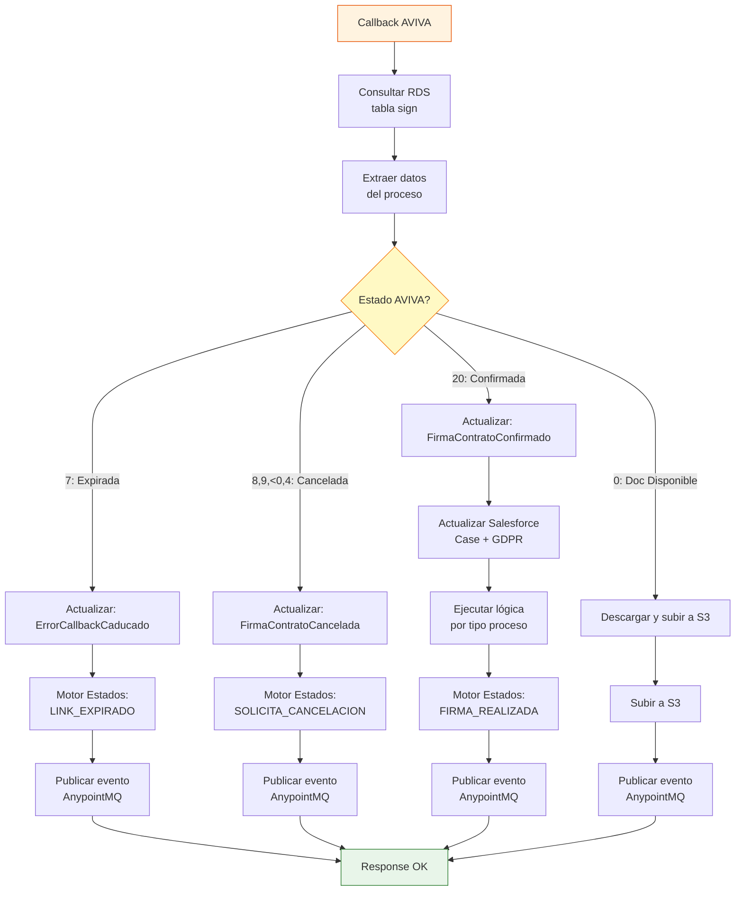
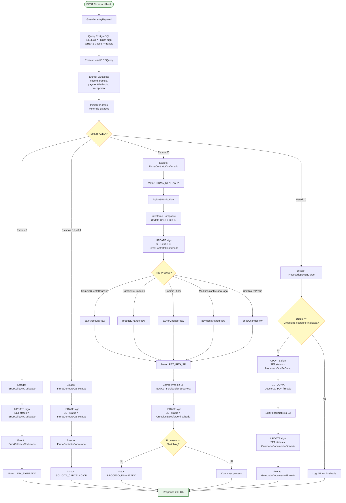
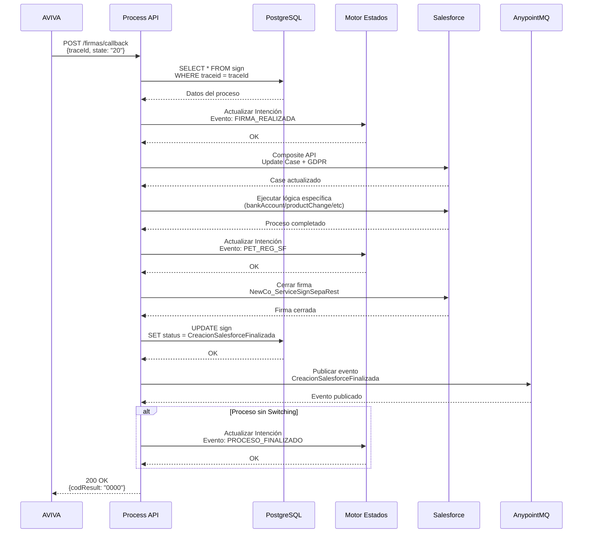
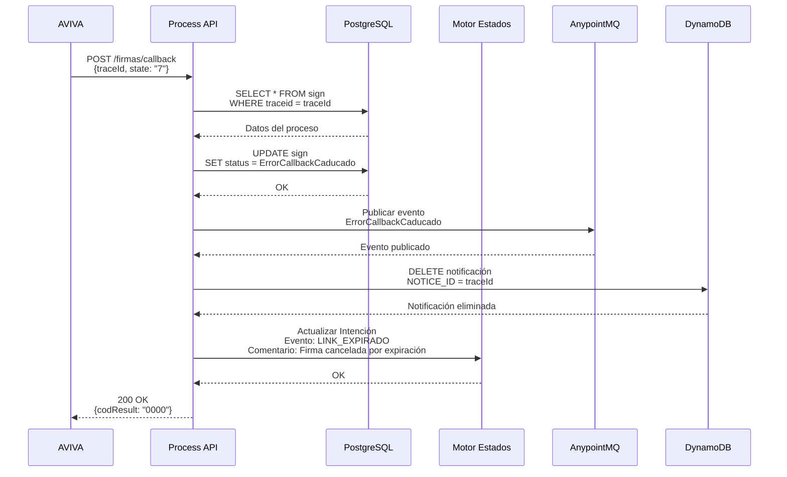
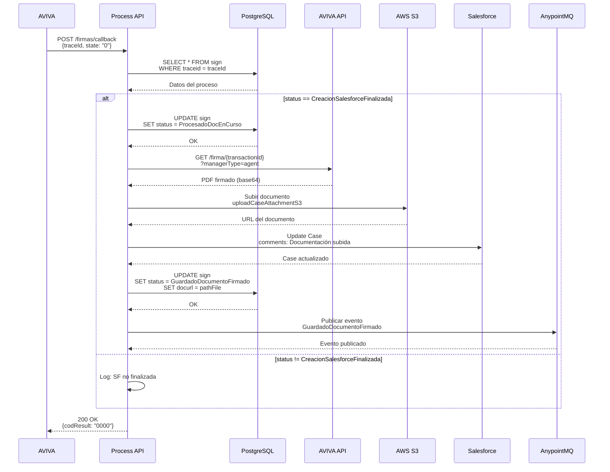

# POST /firmas/callback

## 📌 Descripción General

### Propósito del Endpoint

Este endpoint actúa como **webhook/callback** para recibir notificaciones de AVIVA sobre cambios de estado en procesos de firma digital. Orquesta la actualización de múltiples sistemas (PostgreSQL, Salesforce, S3) según el estado recibido, garantizando la sincronización completa del proceso de firma.

### Tipo de API

**Capa:** Process API (API-Led Connectivity)

**Función:** Orquestación de procesos de firma digital y sincronización de estados entre sistemas

### Patrón de Integración

**Tipo:** Event-Driven Orchestration + Webhook Handler

**Descripción:** Recibe eventos asíncronos de AVIVA y orquesta actualizaciones en múltiples sistemas backend según el estado del proceso de firma. Implementa lógica condicional compleja para manejar 6 estados diferentes de firma.

### Arquitectura API-Led Connectivity



---

## 💼 Propósito del Negocio

### Casos de Uso Principales

1. **Firma Confirmada por Cliente (Estado 20)**
   - Cliente completa exitosamente la firma digital en AVIVA
   - Se actualiza Salesforce con el estado de firma confirmada
   - Se registra en Motor de Estados el evento FIRMA_REALIZADA
   - Se ejecuta la lógica específica del proceso (cambio cuenta, cambio titular, etc.)
   - **Beneficio:** Automatización completa del proceso post-firma

2. **Firma Expirada (Estado 7)**
   - El enlace de firma caduca sin ser completado
   - Se cancela automáticamente el caso en Salesforce
   - Se notifica al Motor de Estados (LINK_EXPIRADO)
   - Se elimina la notificación del cliente
   - **Beneficio:** Gestión automática de procesos no completados

3. **Firma Cancelada (Estados 8, 9, &lt;0, 4)**
   - Cliente o sistema cancela el proceso de firma
   - Se actualiza el estado a FirmaContratoCancelada
   - Se cancela el caso con motivo específico
   - Se registra en Motor de Estados (SOLICITA_CANCELACION)
   - **Beneficio:** Trazabilidad completa de cancelaciones

4. **Documentación Disponible (Estado 0)**
   - AVIVA notifica que el documento firmado está listo
   - Se descarga el PDF firmado desde AVIVA
   - Se sube el documento a S3
   - Se vincula con el Case de Salesforce
   - **Beneficio:** Almacenamiento automático de documentación legal

### 🔗 Endpoints Dependientes

Este Process API consume los siguientes System APIs:

| System API | Endpoint | Método | Propósito |
|------------|----------|--------|-----------|
| `ntgy-fua-s-rds-postgres` | `/ejecutarQuery` | POST | Consultar y actualizar tabla `sign` en PostgreSQL + actualizar intenciones Motor de Estados |
| `ntgy-newco-s-salesforce` | `/postComposite` | POST | Actualizar Cases y registros GDPR en Salesforce mediante Composite API |
| `ntgy-newco-s-aviva-evo` | `/firmas/:traceId` | GET | Descargar documento PDF firmado desde AVIVA |
| `ntgy-newco-s-s3-small` | `/bucket/{bucket}/object` | PUT | Subir documentos PDF firmados a AWS S3 |

### Lógica de Orquestación



**Pasos del Proceso:**

1. **Recepción del Callback**: AVIVA envía notificación con `traceId` y `state`
2. **Consulta de Contexto**: Se consulta PostgreSQL (`ntgy-fua-s-rds-postgres`) para obtener datos del proceso
3. **Enrutamiento por Estado**: Se ejecuta lógica específica según el estado recibido
4. **Actualización de Sistemas**: Se sincronizan PostgreSQL (tabla sign + Motor de Estados) y Salesforce
5. **Gestión de Documentación**: Si aplica, se descarga desde AVIVA y se almacena en S3

### Transformaciones Aplicadas

Este endpoint NO transforma la estructura de datos de AVIVA, pero sí realiza **mapeos de estado** y **enriquecimiento de datos**:

| Estado AVIVA | Estado Interno | Acción Principal |
|--------------|----------------|------------------|
| `"7"` | `ErrorCallbackCaducado` | Cancelar caso por expiración |
| `"8"`, `"9"`, `&lt;0`, `"4"` | `FirmaContratoCancelada` | Cancelar caso por rechazo |
| `"20"` | `FirmaContratoConfirmado` | Confirmar firma y ejecutar lógica SF |
| `"0"` | `GuardadoDocumentoFirmado` | Descargar y almacenar documento |

**Enriquecimiento de Datos:**

- Se obtienen datos del proceso desde PostgreSQL (tabla `sign`) vía `ntgy-fua-s-rds-postgres`
- Se mapea `processType` a eventos del Motor de Estados (misma API `ntgy-fua-s-rds-postgres`)
- Se construyen payloads específicos para Salesforce según tipo de proceso

### Contexto Empresarial

- **Dominio:** Gestión de Procesos de Firma Digital
- **Sector:** Energía - Utilities
- **División:** Naturgy España - NewCo
- **Proceso de Negocio:** Automatización de procesos contractuales con firma digital

### Stakeholders

- **Clientes Naturgy**: Necesitan completar procesos de firma de forma digital y segura
- **Agentes de Call Center**: Requieren visibilidad del estado de firma en tiempo real
- **Equipo de Operaciones**: Necesitan trazabilidad completa de procesos de firma
- **Equipo Legal**: Requieren almacenamiento seguro de documentos firmados

### Valor de Negocio

- **Automatización Completa**: Elimina intervención manual en el proceso post-firma
- **Trazabilidad Total**: Registro completo de estados en múltiples sistemas
- **Cumplimiento Legal**: Almacenamiento seguro de documentación firmada
- **Experiencia de Cliente**: Proceso de firma digital sin fricciones
- **Eficiencia Operativa**: Reducción de tiempos de procesamiento de contratos

### Consumidores Potenciales

Este endpoint es consumido exclusivamente por:
- **AVIVA** (Plataforma de Firma Digital) - Webhook callback

---

## 🔧 Especificación Técnica

### URLs por Ambiente

| Ambiente | URL Base | URL Completa |
|----------|----------|--------------|
| **Local** | `http://localhost:8091` | `http://localhost:8091/api/firmas/callback` |
| **Development** | `https://ntgy-newco-p-fua-evo-dev.us-e2.cloudhub.io` | `https://ntgy-newco-p-fua-evo-dev.us-e2.cloudhub.io/api/firmas/callback` |
| **UAT** | `https://ntgy-newco-p-fua-evo-uat.us-e2.cloudhub.io` | `https://ntgy-newco-p-fua-evo-uat.us-e2.cloudhub.io/api/firmas/callback` |
| **Production** | `https://ntgy-newco-p-fua-evo-pro.us-e2.cloudhub.io` | `https://ntgy-newco-p-fua-evo-pro.us-e2.cloudhub.io/api/firmas/callback` |

### Método HTTP

```
POST /api/firmas/callback
```

### Parámetros de Entrada

#### Request Body (JSON)

```json
{
  "traceId": "string",
  "state": "string",
  "data1": "string (opcional)",
  "data2": "string (opcional)",
  "data3": "string (opcional)"
}
```

| Campo | Tipo | Requerido | Descripción |
|-------|------|-----------|-------------|
| `traceId` | string | ✅ Sí | Identificador único del proceso de firma |
| `state` | string | ✅ Sí | Estado del proceso en AVIVA (ver tabla de estados) |
| `data1` | string | ❌ No | Consentimiento GDPR tipo 02 (on/off) |
| `data2` | string | ❌ No | Consentimiento GDPR tipo 01 (on/off) |
| `data3` | string | ❌ No | Consentimiento GDPR tipo 00 (on/off) |

#### Estados AVIVA Soportados

| Estado | Significado | Acción |
|--------|-------------|--------|
| `"0"` | Documentación disponible | Descargar y almacenar PDF |
| `"4"` | Firma cancelada | Cancelar proceso |
| `"7"` | Firma expirada | Cancelar por expiración |
| `"8"` | Firma cancelada por usuario | Cancelar proceso |
| `"9"` | Firma cancelada por sistema | Cancelar proceso |
| `"20"` | Firma confirmada | Procesar firma exitosa |
| `< 0` | Error en firma | Cancelar proceso |

### Respuestas

#### 200 OK - Callback Procesado Exitosamente

```json
{
  "result": {
    "codResult": "0000",
    "msgResult": "No hay error"
  }
}
```

#### 500 Internal Server Error - Error en Procesamiento

```json
{
  "code": "ERROR_CODE",
  "message": "Descripción del error",
  "details": "Detalles adicionales"
}
```

### Autenticación

- **Tipo:** Client ID & Client Secret (Anypoint Platform)
- **Nota:** AVIVA debe estar configurado con las credenciales correctas para invocar este webhook

### Timeouts

| Tipo | Valor |
|------|-------|
| **Request Timeout** | 120 segundos (proceso complejo) |
| **Connection Timeout** | 30 segundos |
| **Timeout PostgreSQL** | 60 segundos |
| **Timeout Salesforce** | 60 segundos |
| **Timeout AVIVA** | 30 segundos |

---

## 🏗️ Implementación Técnica

### Arquitectura del Flow



### Operaciones PostgreSQL

#### Query SELECT (Línea 21 de callbacksAviva.xml)

```sql
SELECT * FROM public.sign WHERE traceid = '[traceId]'
```

**Campos Retornados:**
- `traceid`, `channel`, `processtype`, `callcenteragent`
- `account`, `contact`, `templateid`, `templatepayload`
- `caseid`, `status`, `expiresin`, `doctype`, `docurl`
- `target`, `language`, `parenttraceid`, `accountidsf`
- `entrypayload`, `paymentmethodid`, `traceparent`
- `createdat`, `updatedat`, `orderid`, `avivarequest`

#### Query UPDATE (Múltiples ubicaciones)

```sql
UPDATE public.sign 
SET status = :status, 
    updatedat = (current_timestamp AT TIME ZONE 'Europe/Madrid') 
WHERE traceid = :traceid
```

**Estados Posibles:**
- `ErrorCallbackCaducado`
- `FirmaContratoCancelada`
- `FirmaContratoConfirmado`
- `ProcesadoDocEnCurso`
- `GuardadoDocumentoFirmado`
- `CreacionSalesforceFinalizada`

### Transformaciones DataWeave

#### 1. Inicialización de Datos para Motor de Estados (Línea 65)

```dataweave
%dw 2.0
output application/java

var tipoProceso = vars.resultRDSQuery.processtype
var entryPayloadResultRDS = vars.resultRDSQuery.entrypayload

// Mapeo de proceso MULE/SF a código proceso Motor de Estados
var proceso = tipoProceso match {
    case "ModificacionMetodoPago" -> "ModificacionMetodoPago"
    case "CambioDeProducto" -> "CambioDeProducto"
    case "CambioCuentaBancaria" -> "CambioIBAN"
    case "CambioTitularConSubrogacion" -> "CambioTitular"
    case "CambioTitularSinSubrogacion" -> "CambioTitular"
    else -> ""
}

var tieneSW = tipoProceso match {
    case "ModificacionMetodoPago" -> false
    case "CambioDeProducto" -> false
    case "CambioCuentaBancaria" -> false
    case "CambioTitularSinSubrogacion" -> true
    case "CambioTitularConSubrogacion" -> true
    else -> ""
}
---
{
    procesoConSW: tieneSW,
    evento: "",
    proceso: proceso,
    nif: vars.resultRDSQuery.account,
    billingAccount: billingAccount,
    contrato: contrato,
    casoGestion: "",
    jsonPayload: {}
}
```

#### 2. Construcción de Payload para Salesforce Composite (Línea 475)

```dataweave
%dw 2.0
output application/json
---
{
    "body": {
        "allOrNone": true,
        "collateSubrequests": false,
        "compositeRequest": [
            {
                "method": "PATCH",
                "url": "/services/data/v52.0/sobjects/Case/" ++ vars.caseId,
                "referenceId": "updatedCase",
                "body": {
                    "status": "02",
                    "comments": "Firma realizada con exito"
                }
            }
        ] ++ (vars.inputGDPR default [])
    },
    "operationSalesforce": "composite"
}
```

### Patrones de Diseño

**Patrón 1: Event-Driven Architecture**

**Justificación:** El endpoint actúa como receptor de eventos asíncronos de AVIVA, procesando cada estado de forma independiente y publicando eventos a sistemas downstream.

**Patrón 2: Saga Pattern (Orquestación)**

**Justificación:** Coordina transacciones distribuidas entre PostgreSQL, Salesforce, Motor de Estados y S3, con compensación en caso de error.

**Patrón 3: Content-Based Router**

**Justificación:** Enruta el flujo de procesamiento según el estado recibido de AVIVA, ejecutando lógica específica para cada caso.

### Diagramas de Secuencia

#### 1. Flujo Estado "20" - Firma Confirmada (Caso Principal)



#### 2. Flujo Estado "7" - Firma Expirada



#### 3. Flujo Estado "0" - Documentación Disponible



### Manejo de Errores

#### Estrategia de Error Handling

1. **Try-Catch Global**: Todo el sub-flow está envuelto en un bloque try-catch
2. **Error Handler Específico**: `firmaCallback-errorsError_Handler`
3. **Compensación**: En caso de error, se registra en logs y se notifica al Motor de Estados
4. **Idempotencia**: El endpoint puede recibir el mismo callback múltiples veces sin efectos adversos

#### Errores Comunes

| Error | Causa | Acción |
|-------|-------|--------|
| `APP:POSTGRESQL_OMEGA_QUERY` | No se encuentra el registro en PostgreSQL (ntgy-fua-s-rds-postgres) | Retornar error 500 |
| `APP:AVIVA_GET_DOCUMENT_ERROR` | Error al descargar documento de AVIVA (ntgy-newco-s-aviva-evo) | Reintentar o registrar error |
| `APP:COMPOSITE_SALESFORCE` | Error al actualizar Salesforce (ntgy-newco-s-salesforce) | Registrar error y continuar |

---

## 💻 Ejemplos de Uso

### Ejemplo 1: Callback de Firma Confirmada (Estado 20)

#### cURL

```bash
curl -X POST "https://ntgy-newco-p-fua-evo-dev.us-e2.cloudhub.io/api/firmas/callback" \
  -H "Content-Type: application/json" \
  -H "client_id: YOUR_CLIENT_ID" \
  -H "client_secret: YOUR_CLIENT_SECRET" \
  -d '{
    "traceId": "abc123-def456-ghi789",
    "state": "20",
    "data1": "on",
    "data2": "off",
    "data3": "on"
  }'
```

#### Respuesta (200 OK)

```json
{
  "result": {
    "codResult": "0000",
    "msgResult": "No hay error"
  }
}
```

### Ejemplo 2: Callback de Firma Expirada (Estado 7)

#### cURL

```bash
curl -X POST "https://ntgy-newco-p-fua-evo-dev.us-e2.cloudhub.io/api/firmas/callback" \
  -H "Content-Type: application/json" \
  -H "client_id: YOUR_CLIENT_ID" \
  -H "client_secret: YOUR_CLIENT_SECRET" \
  -d '{
    "traceId": "abc123-def456-ghi789",
    "state": "7"
  }'
```

#### Respuesta (200 OK)

```json
{
  "result": {
    "codResult": "0000",
    "msgResult": "No hay error"
  }
}
```

### Ejemplo 3: Callback de Firma Cancelada (Estado 8)

#### cURL

```bash
curl -X POST "https://ntgy-newco-p-fua-evo-dev.us-e2.cloudhub.io/api/firmas/callback" \
  -H "Content-Type: application/json" \
  -H "client_id: YOUR_CLIENT_ID" \
  -H "client_secret: YOUR_CLIENT_SECRET" \
  -d '{
    "traceId": "abc123-def456-ghi789",
    "state": "8"
  }'
```

#### Respuesta (200 OK)

```json
{
  "result": {
    "codResult": "0000",
    "msgResult": "No hay error"
  }
}
```

### Ejemplo 4: Callback de Documentación Disponible (Estado 0)

#### cURL

```bash
curl -X POST "https://ntgy-newco-p-fua-evo-dev.us-e2.cloudhub.io/api/firmas/callback" \
  -H "Content-Type: application/json" \
  -H "client_id: YOUR_CLIENT_ID" \
  -H "client_secret: YOUR_CLIENT_SECRET" \
  -d '{
    "traceId": "abc123-def456-ghi789",
    "state": "0"
  }'
```

#### Respuesta (200 OK)

```json
{
  "result": {
    "codResult": "0000",
    "msgResult": "No hay error"
  }
}
```

### Ejemplo 5: JavaScript (Simulación de Callback)

```javascript
// Simulación de callback desde AVIVA
const callbackData = {
  traceId: 'abc123-def456-ghi789',
  state: '20',
  data1: 'on',
  data2: 'off',
  data3: 'on'
};

const response = await fetch('https://ntgy-newco-p-fua-evo-dev.us-e2.cloudhub.io/api/firmas/callback', {
  method: 'POST',
  headers: {
    'Content-Type': 'application/json',
    'client_id': 'YOUR_CLIENT_ID',
    'client_secret': 'YOUR_CLIENT_SECRET'
  },
  body: JSON.stringify(callbackData)
});

const result = await response.json();
console.log('Callback procesado:', result);
```

### Ejemplo 6: Python (Simulación de Callback)

```python
import requests
import json

# Simulación de callback desde AVIVA
callback_data = {
    'traceId': 'abc123-def456-ghi789',
    'state': '20',
    'data1': 'on',
    'data2': 'off',
    'data3': 'on'
}

response = requests.post(
    'https://ntgy-newco-p-fua-evo-dev.us-e2.cloudhub.io/api/firmas/callback',
    headers={
        'Content-Type': 'application/json',
        'client_id': 'YOUR_CLIENT_ID',
        'client_secret': 'YOUR_CLIENT_SECRET'
    },
    json=callback_data
)

print('Status Code:', response.status_code)
print('Response:', response.json())
```

### Tipos de Procesos Soportados

Este callback maneja los siguientes tipos de procesos de firma:

| Tipo de Proceso | Descripción | Switching |
|-----------------|-------------|-----------|
| `ModificacionMetodoPago` | Cambio de método de pago | No |
| `CambioDeProducto` | Cambio de producto energético | No |
| `CambioCuentaBancaria` | Cambio de IBAN | No |
| `CambioTitularConSubrogacion` | Cambio de titular con subrogación de deuda | Sí |
| `CambioTitularSinSubrogacion` | Cambio de titular sin subrogación | Sí |
| `CambioDePrecio` | Cambio de precio del contrato | No |
