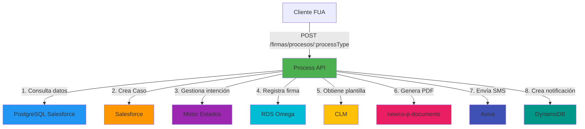
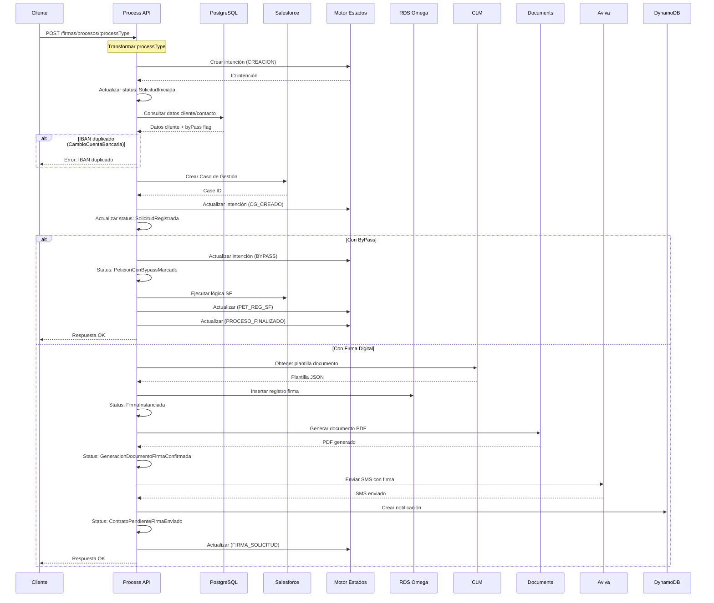
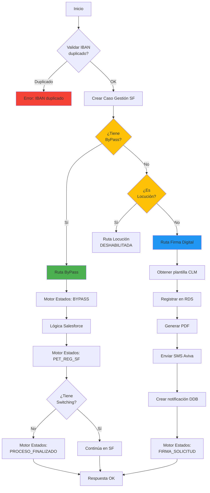
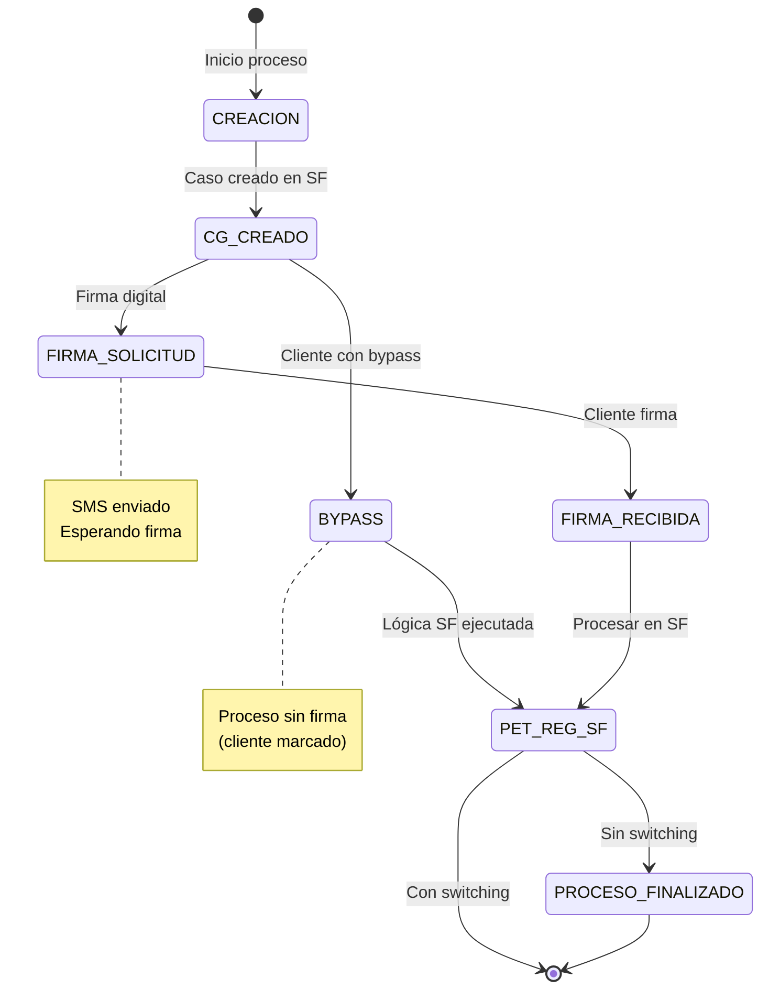

# POST /firmas/procesos/:processType

## 📌 Descripción General

Endpoint orquestador que gestiona procesos de firma digital para diferentes tipos de gestiones del cliente. Coordina la creación de casos de gestión en Salesforce, la generación de documentos, el envío de SMS con firma digital a través de Aviva, y la gestión de estados del proceso a través del Motor de Estados.

### Características Principales

- **Orquestación Compleja**: Integra 7 sistemas backend diferentes
- **Múltiples Tipos de Proceso**: Soporta 6 tipos de gestiones distintas
- **Tres Rutas de Ejecución**: ByPass, Locución (deshabilitada), y Firma Digital
- **Gestión de Estados**: Integración completa con Motor de Estados
- **Firma Digital**: Envío de SMS con documento para firma electrónica

### Tipos de Proceso Soportados

| processType | Descripción | Requiere Firma |
|-------------|-------------|----------------|
| `ModificacionMetodoPago` | Cambio a pago no domiciliado | Sí |
| `CambioDeProducto` | Cambio de producto/tarifa | Sí |
| `CambioCuentaBancaria` | Cambio de IBAN | Sí |
| `CambioTitularConSubrogacion` | Cambio de titular con subrogación de deuda | Sí |
| `CambioTitularSinSubrogacion` | Cambio de titular sin subrogación | Sí |
| `CambioDePrecio` | Cambio de precio de contrato | Sí |

## 💼 Propósito del Negocio

### Problema que Resuelve

Automatiza y digitaliza el proceso de firma para gestiones del cliente que requieren consentimiento formal, eliminando la necesidad de procesos manuales o presenciales. Proporciona trazabilidad completa del proceso desde la solicitud hasta la firma final.

### Casos de Uso

#### 1. Cambio de Cuenta Bancaria
**Escenario**: Cliente desea cambiar el IBAN de domiciliación de sus facturas.

**Flujo**:
1. Cliente solicita cambio desde FUA Portal
2. Sistema valida que el nuevo IBAN sea diferente al actual
3. Se crea caso de gestión en Salesforce
4. Se genera documento SEPA para firma
5. Cliente recibe SMS con enlace para firmar
6. Motor de Estados registra cada paso del proceso

**Validaciones Especiales**:
- Verifica que el IBAN nuevo sea diferente al actual
- Consulta mandato SEPA existente si aplica
- Valida datos del cliente en PostgreSQL

#### 2. Cambio de Titular (Con/Sin Subrogación)
**Escenario**: Cambio de titularidad de contrato de suministro.

**Flujo**:
1. Se determina si hay subrogación de deuda
2. Sistema identifica contratos de luz y/o gas
3. Crea intención en Motor de Estados (proceso con switching)
4. Genera documento de cambio de titular
5. Envía SMS para firma digital
6. Motor de Estados gestiona el switching entre sistemas

**Particularidades**:
- Soporta múltiples contratos (luz + gas)
- Gestiona subrogación de deuda pendiente
- Requiere switching entre Imperial y NewCo

#### 3. Cambio de Producto
**Escenario**: Cliente cambia de tarifa o producto energético.

**Flujo**:
1. Valida producto actual y nuevo producto
2. Crea caso de gestión con detalles del cambio
3. Genera contrato común para firma
4. Envía SMS con documento
5. Actualiza estado en Motor de Estados

#### 4. Modificación Método de Pago
**Escenario**: Cliente cambia de domiciliación bancaria a otros métodos de pago.

**Flujo**:
1. Valida método de pago actual
2. Crea caso de gestión
3. Genera documento de modificación
4. Envía SMS para confirmación
5. Actualiza Salesforce con nuevo método

### Beneficios del Negocio

- **Digitalización**: Elimina procesos en papel
- **Trazabilidad**: Registro completo en Motor de Estados
- **Experiencia Cliente**: Firma desde móvil en minutos
- **Cumplimiento**: Documentación legal completa
- **Eficiencia**: Reducción de tiempos de gestión

## 🔧 Especificación Técnica

### Endpoint

```
POST /firmas/procesos/{processType}
```

### Path Parameters

| Parámetro | Tipo | Requerido | Descripción |
|-----------|------|-----------|-------------|
| `processType` | string | Sí | Tipo de proceso a ejecutar. Valores: `ModificacionMetodoPago`, `CambioDeProducto`, `CambioCuentaBancaria`, `CambioTitularConSubrogacion`, `CambioTitularSinSubrogacion`, `CambioDePrecio` |

### Headers Requeridos

| Header | Tipo | Descripción |
|--------|------|-------------|
| `x-client-id` | string | ID del cliente en Salesforce |
| `x-contact-id` | string | ID del contacto en Salesforce |
| `x-client-code` | string | Código del cliente (NIF/CIF) |
| `x-client-doc-number` | string | Número de documento del cliente |
| `x-user-id` | string | ID del usuario que realiza la operación (opcional) |
| `x-interaction-id` | string | ID de la interacción (caso padre en Salesforce) (opcional) |
| `x-interaction-origin` | string | Origen de la interacción (ej: "Phone", "Llamada Saliente") (opcional) |
| `x-language` | string | Idioma preferido del cliente (es, ca, gl, eu) |
| `Content-Type` | string | `application/json` |

### Request Body

#### Para CambioCuentaBancaria

```json
{
  "digitalSignatureType": "SMS",
  "DirIp": "192.168.1.1",
  "serviceAccountList": {
    "serviceAccountId": "SA-12345",
    "billingAccountList": [
      {
        "billingAccountId": "BA-67890",
        "bankAccount": {
          "iban": "ES9121000418450200051332"
        }
      }
    ]
  }
}
```

#### Para CambioDeProducto

```json
{
  "digitalSignatureType": "SMS",
  "DirIp": "192.168.1.1",
  "serviceAccountId": "SA-12345",
  "billingAccountId": "BA-67890",
  "contractId": "CT-11111"
}
```

#### Para CambioTitular (Con/Sin Subrogación)

```json
{
  "signType": "SMS",
  "DirIp": "192.168.1.1",
  "checkSubrrogation": true,
  "startDate": "2026-09-15",
  "oldClientId": "12345678A",
  "addressId": "AD-99999",
  "orderId": "ORD-88888",
  "contractIdList": [
    {
      "contractId": "CT-11111",
      "productTypeFamily": "luz"
    },
    {
      "contractId": "CT-22222",
      "productTypeFamily": "gas"
    }
  ]
}
```

#### Para ModificacionMetodoPago

```json
{
  "digitalSignatureType": "SMS",
  "DirIp": "192.168.1.1",
  "serviceAccountList": {
    "serviceAccountId": "SA-12345",
    "billingAccountList": [
      {
        "billingAccountId": "BA-67890"
      }
    ]
  }
}
```

#### Para CambioDePrecio

```json
{
  "digitalSignatureType": "SMS",
  "DirIp": "192.168.1.1",
  "serviceAccountId": "SA-12345",
  "billingAccountId": "BA-67890",
  "contractId": "CT-11111",
  "price": {
    "power": ["0.123", "0.456"],
    "energy": ["0.089", "0.098"]
  }
}
```

### Response Body

#### Respuesta Exitosa (200)

```json
{
  "result": {
    "codResult": "0000",
    "msgResult": "No hay error"
  }
}
```

#### Respuesta de Error (400/500)

```json
{
  "code": "ERROR_CODE",
  "message": "Descripción del error",
  "details": "Detalles adicionales del error",
  "timestamp": "2026-09-02T13:52:00Z"
}
```

### Códigos de Estado HTTP

| Código | Descripción |
|--------|-------------|
| 200 | Proceso iniciado correctamente |
| 400 | Error de validación (IBAN duplicado, datos faltantes) |
| 500 | Error interno del servidor |

### Validaciones

1. **Validación de IBAN**: Para `CambioCuentaBancaria`, verifica que el nuevo IBAN sea diferente al actual
2. **Validación de Cliente**: Verifica existencia del cliente en PostgreSQL/Salesforce
3. **Validación de Bypass**: Verifica si el cliente tiene marcado el bypass de firma
4. **Validación de Contratos**: Para `CambioTitular`, valida existencia de contratos de luz/gas

## 🏗️ Implementación Técnica

### Arquitectura de Integración

Este endpoint implementa un patrón de **orquestación compleja** que coordina 7 sistemas backend diferentes:



### Flujo de Ejecución Principal



### Diagrama de Decisión: Routing de Flujos



### Diagrama de Estados: Motor de Estados



### Integraciones Backend

#### 1. PostgreSQL (ntgy-newco-s-postgresql-salesforce)

**Propósito**: Consultar datos del cliente, contacto y validar IBAN

**Operación**:
```sql
-- Para CambioCuentaBancaria
SELECT 
    contact.NewCo_PreferredLanguage__c as language,
    account.NewCo_BypassFirmaOmega__c,
    account.name holderName,
    account.acn_fld_documentnumber__c,
    paymentmethod.vlocity_cmt__iban__c as iban,
    contact.firstname,
    contact.newco_apellido1__c,
    contact.newco_apellido2__c,
    contact.mobilephone
FROM newcosalesforce.accountcontactrelation accr
INNER JOIN newcosalesforce.Contact as contact ON contact.sfid = accr.contactid
INNER JOIN newcosalesforce.Account as account ON account.sfid = accr.accountid
-- ... más joins
WHERE accr.roles = '01' 
  AND accr.accountid = :clientId
  AND billingAccount.sfid = :billingAccountId
```

**Datos Extraídos**:
- Idioma preferido del cliente
- Flag de bypass de firma
- Nombre completo del titular
- IBAN actual (para validación)
- Teléfono móvil (para envío SMS)

**Ubicación en código**: Líneas 134-152 del flow

#### 2. Salesforce (ntgy-newco-s-salesforce)

**Propósito**: Crear Caso de Gestión para tracking del proceso

**Operación**: Composite API - POST /services/data/v52.0/sobjects/Case

**Payload** (las variables entre llaves son placeholders):
```json
{
  "NewCo_Recordtype__c": "Gestion",
  "AccountId": "{x-client-id}",
  "ContactId": "{x-contact-id}",
  "Status": "03",
  "Priority": "02",
  "Origin": "FUA",
  "NewCo_Creado_por__c": "{x-user-id}",
  "acn_fld_Tittle__r": {
    "NewCo_ExternalId__c": "{processType}"
  },
  "NewCo_Metodo_de_firma__c": "{digitalSignatureType}",
  "NewCo_CorrelationId__c": "{correlationId}",
  "NewCo_TraceId__c": "{traceId}",
  "acn_fld_DigitalSign__c": "01",
  "NewCo_IdentificadorDeIntencion__c": "{motorIntentionId}"
}
```

**Campos Específicos por Proceso**:
- **CambioCuentaBancaria**: `vlocity_cmt__ServiceAccountId__c`, `vlocity_cmt__BillingAccountId__c`, `acn_fld_PaymentMethod__c`, `NewCo_NewIBAN__c`
- **CambioDeProducto**: `vlocity_cmt__ServiceAccountId__c`, `vlocity_cmt__BillingAccountId__c`, `NewCo_Contract__c`, `NewCo_DateRequest__c`
- **CambioTitular**: `NewCo_OldCliente__r`, `acn_fld_premise__c`, `NewCo_NewOrder__c`, `NewCo_Debt__c`

**Ubicación en código**: Líneas 253-295 del flow

#### 3. Motor de Estados (ntgy-newco-s-motor-estados)

**Propósito**: Gestionar el ciclo de vida del proceso y sus estados

**Eventos Registrados** (las variables entre llaves son placeholders):

1. **CREACION** (Inicio)
```json
{
  "evento": "CREACION",
  "proceso": "CambioTitular|CambioDeProducto|CambioIBAN|ModificacionMetodoPago",
  "nif": "{x-client-code}",
  "billingAccount": "{billingAccountId}",
  "contrato": "{contractId}",
  "casoGestion": "",
  "jsonPayload": {}
}
```

2. **CG_CREADO** (Caso creado)
```json
{
  "idIntencion": "{motorIntentionId}",
  "evento": "CG_CREADO",
  "casoGestion": "{caseId}",
  "jsonPayload": {
    "comentario": "Caso Gestión: {caseId}"
  }
}
```

3. **BYPASS** (Proceso sin firma)
```json
{
  "idIntencion": "{motorIntentionId}",
  "evento": "BYPASS",
  "jsonPayload": {}
}
```

4. **FIRMA_SOLICITUD** (SMS enviado)
```json
{
  "idIntencion": "{motorIntentionId}",
  "evento": "FIRMA_SOLICITUD",
  "jsonPayload": {
    "comentario": "Firma enviada con exito al telefono: {mobilephone}"
  }
}
```

5. **PET_REG_SF** (Procesado en Salesforce)
```json
{
  "evento": "PET_REG_SF",
  "jsonPayload": {
    "comentario": "{msgMotorEstados}"
  }
}
```

6. **PROCESO_FINALIZADO** (Fin del proceso)
```json
{
  "evento": "PROCESO_FINALIZADO",
  "jsonPayload": {}
}
```

**Ubicación en código**: Múltiples llamadas a `grabarIntencionMe_SubFlow` a lo largo del flow

#### 4. RDS Omega (ntgy-fua-s-rds-postgres)

**Propósito**: Registrar el proceso de firma en base de datos

**Operación**: INSERT en tabla `public.sign`

**Campos Registrados**:
```sql
INSERT INTO public.sign (
  traceid,
  channel,
  processtype,
  callcenteragent,
  account,
  contact,
  templateid,
  templatepayload,
  caseid,
  status,
  expiresin,
  doctype,
  docurl,
  target,
  language,
  parenttraceid,
  accountidsf,
  entrypayload,
  createdat,
  updatedat,
  paymentmethodid,
  traceparent
) VALUES (...)
```

**Tipos de Documento por Proceso**:
- `CambioCuentaBancaria` → `documentoSepa`
- `CambioDeProducto` → `contratoComun`
- `CambioTitularConSubrogacion` → `actaSubrogacion`
- `CambioTitularSinSubrogacion` → `contratoComun`
- `ModificacionMetodoPago` → `modDomBancaria`
- `CambioDePrecio` → `contratoComun`

**Ubicación en código**: Líneas 467-495 del flow

#### 5. CLM (getCLMInfoSub_Flow)

**Propósito**: Obtener plantilla del documento a generar

**Operación**: Consulta de plantilla según tipo de proceso

**Respuesta**:
```json
{
  "jsonAWS": {
    "metadatos": {
      "idPlantilla": "TEMPLATE_ID"
    },
    // ... datos de la plantilla
  }
}
```

**Ubicación en código**: Línea 449 del flow

#### 6. newco-p-documents

**Propósito**: Generar documento PDF para firma

**Operación**: POST al endpoint de generación de documentos

**Request**: Plantilla JSON obtenida de CLM

**Response**:
```json
{
  "message": {
    "file": "base64_encoded_pdf_content"
  }
}
```

**Ubicación en código**: Líneas 509-515 del flow

#### 7. Aviva (ntgy-newco-s-aviva-evo)

**Propósito**: Enviar SMS con enlace para firma digital

**Operación**: POST /firmas?managerType=`{managerType}`

**Request**:
```json
{
  "expiresIn": "86400",
  "retryTransaction": false,
  "sender": "{sender_config}",
  "recipients": "{mobilephone}",
  "text": "{processType}",
  "portal": "{portal_url}",
  "transactionId": "{traceId}",
  "customerData": "[{nombre, apellido1, apellido2, nif_cif, msisdn}]",
  "pdfData": "{base64_pdf}"
}
```

**Response Exitoso**:
```json
{
  "result": "0"
}
```

**Ubicación en código**: Líneas 574-582 del flow

#### 8. DynamoDB (ntgy-fua-s-dynamodb)

**Propósito**: Crear notificación en el portal del cliente

**Operación**: CREATE en tabla de notificaciones

**Payload** (las variables entre llaves son placeholders):
```json
{
  "CLIENT_CODE": "{x-client-code}",
  "TYPE": "notificacionFirmaIniciada",
  "TEXT": "Tienes pendiente la firma de un {proceso}",
  "TITLE": "Firma pendiente",
  "VISIBILITY": "all",
  "NOTICE_ID": "{traceId}",
  "READ": false,
  "DELETE": false,
  "VALIDITY": 90,
  "START_DATE": "2026/09/02",
  "END_DATE": "2026/09/04"
}
```

**Ubicación en código**: Líneas 585-621 del flow

### Transformaciones DataWeave Clave

#### 1. Transformación de processType

**Propósito**: Convertir `CambioTitular` en subtipos según subrogación

```dataweave
%dw 2.0
output application/json
---
if(attributes.uriParams.'processType' == "CambioTitular")
  if(payload.checkSubrrogation default false) 
    "CambioTitularConSubrogacion" 
  else 
    "CambioTitularSinSubrogacion"
else
  attributes.uriParams.'processType'
```

**Ubicación**: Líneas 2-14 del flow

#### 2. Mapeo de Proceso para Motor de Estados

**Propósito**: Traducir nombre del proceso a código del Motor

```dataweave
var proceso = tipoProceso match {
  case "ModificacionMetodoPago" -> "ModificacionMetodoPago"
  case "CambioDeProducto" -> "CambioDeProducto"
  case "CambioCuentaBancaria" -> "CambioIBAN"
  case "CambioTitularConSubrogacion" -> "CambioTitular"
  case "CambioTitularSinSubrogacion" -> "CambioTitular"
  else -> ""
}
```

**Ubicación**: Líneas 38-68 del flow

#### 3. Construcción de Contrato para CambioTitular

**Propósito**: Identificar contratos de luz y gas para cambio de titular

```dataweave
var tipoContrato = vars.entryPayload.contractIdList
var luz = tipoContrato filter ($.productTypeFamily == "luz")
var gas = tipoContrato filter ($.productTypeFamily == "gas")
var contratoCambioTitular = 
    if (!isEmpty(luz) and !isEmpty(gas))
       gas[0].contractId ++ "#" ++ luz[0].contractId
    else
        if (!isEmpty(luz))
            luz[0].contractId
        else if (!isEmpty(gas))
            gas[0].contractId
        else
            tipoContrato[0].contractId
```

**Ubicación**: Líneas 28-42 del flow

#### 4. Mapeo de Idioma

**Propósito**: Convertir idioma de Salesforce a código ISO

```dataweave
vars.postgresResult[0].language match {
  case "Catalán" -> "ca"
  case "Gallego" -> "gl"
  case "Euskera" -> "eu"
  case "Castellano" -> "es"
  else -> "es"
}
```

**Ubicación**: Líneas 177-184 del flow

### Manejo de Errores

El endpoint utiliza un error handler especializado: `firmaSincrono-errorsError_Handler`

**Errores Específicos Manejados**:

| Error Type | Descripción | Acción |
|------------|-------------|--------|
| `APP:POSTGRESQL_SALESFORCE_BYPASS` | Cliente no encontrado en PostgreSQL | Retorna 400 con mensaje de error |
| `APP:POSTGRESQL_SALESFORCE_SAME_IBAN` | IBAN nuevo igual al actual | Retorna 400 indicando IBAN duplicado |
| `APP:GENERATE_DOCUMENT_ERROR` | Error generando documento PDF | Retorna 500 con detalles del error |
| `APP:AVIVA_ERROR` | Error en llamada a Aviva | Retorna 500 con detalles del error |
| `APP:AVIVA_RESULT_ERROR` | Aviva retorna error (result != "0") | Retorna 500 con código de error de Aviva |

**Ubicación en código**: Error handler referenciado al final del sub-flow

### Configuración de Timeouts

| Integración | Timeout | Configuración |
|-------------|---------|---------------|
| PostgreSQL | 30s | Connection timeout |
| Salesforce | 60s | Request timeout |
| Motor Estados | 30s | Request timeout |
| RDS Omega | 30s | Request timeout |
| newco-p-documents | 60s | Request timeout (generación PDF) |
| Aviva | 60s | Request timeout |
| DynamoDB | 30s | Request timeout |

## 💻 Ejemplos de Uso

### Ejemplo 1: Cambio de Cuenta Bancaria

#### Request

```bash
curl -X POST "https://ntgy-newco-p-fua-evo-dev.us-e2.cloudhub.io/api/firmas/procesos/CambioCuentaBancaria" \
  -H "Content-Type: application/json" \
  -H "x-client-id: 0011t00000ABC123" \
  -H "x-contact-id: 0031t00000DEF456" \
  -H "x-client-code: 12345678A" \
  -H "x-client-doc-number: 12345678A" \
  -H "x-language: es" \
  -H "client_id: YOUR_CLIENT_ID" \
  -H "client_secret: YOUR_CLIENT_SECRET" \
  -d '{
    "digitalSignatureType": "SMS",
    "DirIp": "192.168.1.100",
    "serviceAccountList": {
      "serviceAccountId": "SA-12345",
      "billingAccountList": [
        {
          "billingAccountId": "BA-67890",
          "bankAccount": {
            "iban": "ES9121000418450200051332"
          }
        }
      ]
    }
  }'
```

#### Response (200 OK)

```json
{
  "result": {
    "codResult": "0000",
    "msgResult": "No hay error"
  }
}
```

### Ejemplo 2: Cambio de Titular con Subrogación

#### Request

```bash
curl -X POST "https://ntgy-newco-p-fua-evo-dev.us-e2.cloudhub.io/api/firmas/procesos/CambioTitular" \
  -H "Content-Type: application/json" \
  -H "x-client-id: 0011t00000ABC123" \
  -H "x-contact-id: 0031t00000DEF456" \
  -H "x-client-code: 12345678A" \
  -H "x-client-doc-number: 12345678A" \
  -H "x-language: ca" \
  -H "client_id: YOUR_CLIENT_ID" \
  -H "client_secret: YOUR_CLIENT_SECRET" \
  -d '{
    "signType": "SMS",
    "DirIp": "192.168.1.100",
    "checkSubrrogation": true,
    "startDate": "2026-09-15",
    "oldClientId": "87654321B",
    "addressId": "AD-99999",
    "orderId": "ORD-88888",
    "contractIdList": [
      {
        "contractId": "CT-11111",
        "productTypeFamily": "luz"
      },
      {
        "contractId": "CT-22222",
        "productTypeFamily": "gas"
      }
    ]
  }'
```

#### Response (200 OK)

```json
{
  "result": {
    "codResult": "0000",
    "msgResult": "No hay error"
  }
}
```

### Ejemplo 3: Cambio de Producto

#### Request

```bash
curl -X POST "https://ntgy-newco-p-fua-evo-dev.us-e2.cloudhub.io/api/firmas/procesos/CambioDeProducto" \
  -H "Content-Type: application/json" \
  -H "x-client-id: 0011t00000ABC123" \
  -H "x-contact-id: 0031t00000DEF456" \
  -H "x-client-code: 12345678A" \
  -H "x-client-doc-number: 12345678A" \
  -H "x-language: es" \
  -H "client_id: YOUR_CLIENT_ID" \
  -H "client_secret: YOUR_CLIENT_SECRET" \
  -d '{
    "digitalSignatureType": "SMS",
    "DirIp": "192.168.1.100",
    "serviceAccountId": "SA-12345",
    "billingAccountId": "BA-67890",
    "contractId": "CT-11111"
  }'
```

#### Response (200 OK)

```json
{
  "result": {
    "codResult": "0000",
    "msgResult": "No hay error"
  }
}
```

### Ejemplo 4: Error - IBAN Duplicado

#### Request

```bash
curl -X POST "https://ntgy-newco-p-fua-evo-dev.us-e2.cloudhub.io/api/firmas/procesos/CambioCuentaBancaria" \
  -H "Content-Type: application/json" \
  -H "x-client-id: 0011t00000ABC123" \
  -H "x-contact-id: 0031t00000DEF456" \
  -H "x-client-code: 12345678A" \
  -H "x-client-doc-number: 12345678A" \
  -H "x-language: es" \
  -d '{
    "digitalSignatureType": "SMS",
    "DirIp": "192.168.1.100",
    "serviceAccountList": {
      "serviceAccountId": "SA-12345",
      "billingAccountList": [
        {
          "billingAccountId": "BA-67890",
          "bankAccount": {
            "iban": "ES9121000418450200051332"
          }
        }
      ]
    }
  }'
```

#### Response (400 Bad Request)

```json
{
  "code": "APP:POSTGRESQL_SALESFORCE_SAME_IBAN",
  "message": "El IBAN proporcionado es el mismo que el actual",
  "details": "No se puede cambiar a un IBAN idéntico al existente",
  "timestamp": "2026-09-02T13:54:00Z"
}
```

### Ejemplo 5: JavaScript (Fetch API)

```javascript
const firmarProceso = async (processType, payload) => {
  try {
    const response = await fetch(
      `https://ntgy-newco-p-fua-evo-dev.us-e2.cloudhub.io/api/firmas/procesos/${processType}`,
      {
        method: 'POST',
        headers: {
          'Content-Type': 'application/json',
          'x-client-id': '0011t00000ABC123',
          'x-contact-id': '0031t00000DEF456',
          'x-client-code': '12345678A',
          'x-client-doc-number': '12345678A',
          'x-language': 'es',
          'client_id': 'YOUR_CLIENT_ID',
          'client_secret': 'YOUR_CLIENT_SECRET'
        },
        body: JSON.stringify(payload)
      }
    );

    if (!response.ok) {
      throw new Error(`HTTP error! status: ${response.status}`);
    }

    const data = await response.json();
    console.log('Proceso iniciado:', data);
    return data;
  } catch (error) {
    console.error('Error al iniciar proceso de firma:', error);
    throw error;
  }
};

// Uso
const payload = {
  digitalSignatureType: 'SMS',
  DirIp: '192.168.1.100',
  serviceAccountList: {
    serviceAccountId: 'SA-12345',
    billingAccountList: [
      {
        billingAccountId: 'BA-67890',
        bankAccount: {
          iban: 'ES9121000418450200051332'
        }
      }
    ]
  }
};

firmarProceso('CambioCuentaBancaria', payload);
```

### Ejemplo 6: Python (Requests)

```python
import requests
import json

def firmar_proceso(process_type, payload, headers):
    """
    Inicia un proceso de firma digital
    
    Args:
        process_type: Tipo de proceso (CambioCuentaBancaria, CambioDeProducto, etc.)
        payload: Datos del proceso
        headers: Headers de autenticación
    
    Returns:
        dict: Respuesta del API
    """
    url = f"https://ntgy-newco-p-fua-evo-dev.us-e2.cloudhub.io/api/firmas/procesos/{process_type}"
    
    try:
        response = requests.post(
            url,
            headers=headers,
            json=payload,
            timeout=60
        )
        response.raise_for_status()
        return response.json()
    except requests.exceptions.HTTPError as e:
        print(f"Error HTTP: {e}")
        print(f"Respuesta: {e.response.text}")
        raise
    except requests.exceptions.RequestException as e:
        print(f"Error en la petición: {e}")
        raise

# Configuración
headers = {
    'Content-Type': 'application/json',
    'x-client-id': '0011t00000ABC123',
    'x-contact-id': '0031t00000DEF456',
    'x-client-code': '12345678A',
    'x-client-doc-number': '12345678A',
    'x-language': 'es',
    'client_id': 'YOUR_CLIENT_ID',
    'client_secret': 'YOUR_CLIENT_SECRET'
}

payload = {
    'digitalSignatureType': 'SMS',
    'DirIp': '192.168.1.100',
    'serviceAccountList': {
        'serviceAccountId': 'SA-12345',
        'billingAccountList': [
            {
                'billingAccountId': 'BA-67890',
                'bankAccount': {
                    'iban': 'ES9121000418450200051332'
                }
            }
        ]
    }
}

# Ejecutar
result = firmar_proceso('CambioCuentaBancaria', payload, headers)
print(json.dumps(result, indent=2))
```
