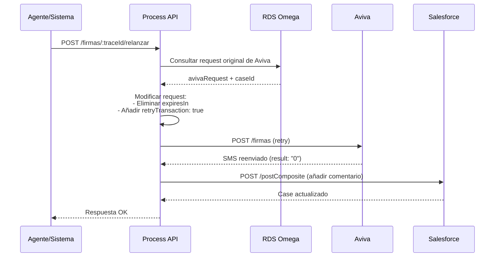
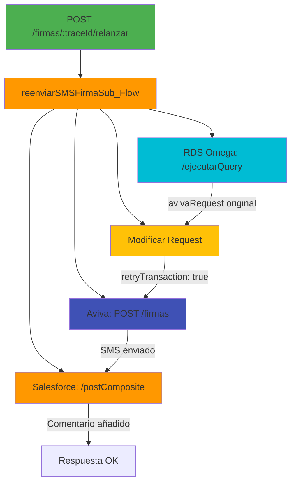
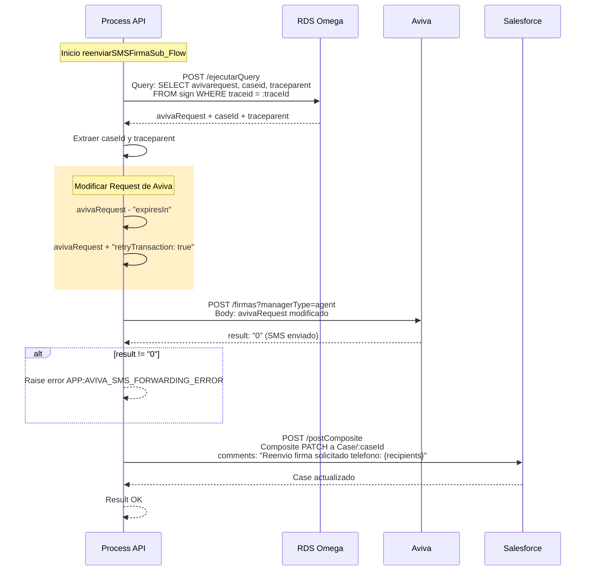

# POST /firmas/:traceId/relanzar

## 📌 Descripción General

Endpoint que permite reenviar el SMS con el enlace de firma digital al cliente. Útil cuando el cliente no recibió el SMS original, lo eliminó por error, o el enlace expiró y se necesita un nuevo intento.

### Características Principales

- **Reenvío de SMS**: Envía nuevamente el SMS con el enlace de firma
- **Retry Transaction**: Marca la transacción como reintento en Aviva
- **Sin Expiración Nueva**: Utiliza la configuración original sin modificar el tiempo de expiración
- **Registro en Salesforce**: Añade comentario al caso indicando el reenvío
- **Mismo Documento**: Reutiliza el PDF generado originalmente

### Casos de Uso

| Escenario | Descripción |
|-----------|-------------|
| **SMS no recibido** | Cliente no recibió el SMS original |
| **SMS eliminado** | Cliente eliminó el SMS por error |
| **Cambio de número** | Se actualizó el número de teléfono del cliente |
| **Solicitud del agente** | Agente reenvía por solicitud del cliente |

## 💼 Propósito del Negocio

### Problema que Resuelve

Permite recuperar procesos de firma que no se completaron por problemas de entrega del SMS, sin necesidad de reiniciar todo el proceso desde cero, ahorrando tiempo y mejorando la experiencia del cliente.

### Flujo de Negocio



### Beneficios del Negocio

- **Recuperación de Procesos**: Evita perder procesos de firma iniciados
- **Experiencia del Cliente**: No requiere reiniciar el proceso completo
- **Eficiencia Operativa**: Reduce tiempo de gestión de agentes
- **Trazabilidad**: Registra cada reenvío en el caso de Salesforce

## 🔧 Especificación Técnica

### Endpoint

```
POST /firmas/:traceId/relanzar
```

### Path Parameters

| Parámetro | Tipo | Requerido | Descripción |
|-----------|------|-----------|-------------|
| `traceId` | string | Sí | Identificador único del proceso de firma a relanzar |

### Headers Requeridos

| Header | Tipo | Descripción |
|--------|------|-------------|
| `Content-Type` | string | `application/json` |
| `client_id` | string | Client ID de Anypoint Platform |
| `client_secret` | string | Client Secret de Anypoint Platform |

### Request Body

No requiere body.

### Response Body

#### Respuesta Exitosa (200)

```json
{
  "result": {
    "codResult": "0000",
    "msgResult": "No hay error"
  }
}
```

#### Respuesta de Error (400/500)

```json
{
  "code": "ERROR_CODE",
  "message": "Descripción del error",
  "details": "Detalles adicionales del error",
  "timestamp": "2026-09-02T15:37:00Z"
}
```

### Códigos de Estado HTTP

| Código | Descripción |
|--------|-------------|
| 200 | SMS reenviado correctamente |
| 400 | TraceId inválido o firma no encontrada |
| 500 | Error interno del servidor o error en Aviva |

### Validaciones

1. **Existencia de Firma**: Verifica que el traceId exista en RDS
2. **Request Original**: Valida que exista el request original de Aviva
3. **Respuesta de Aviva**: Verifica que Aviva confirme el reenvío (result: "0")

## 🏗️ Implementación Técnica

### Arquitectura de Integración



### Flujo de Ejecución Detallado



### Arquitectura de Subflujos Reutilizables

Este endpoint utiliza subflujos genéricos reutilizables que están disponibles para múltiples endpoints del proyecto:

#### Subflujo: rds-omegaSub_Flow

**Ubicación**: `common.xml` (líneas 437-468)

**Propósito**: Subflujo genérico para operaciones con PostgreSQL RDS Omega

**Operaciones Soportadas**:
- `insert`: Ejecuta INSERT en PostgreSQL
- `update`: Ejecuta UPDATE en PostgreSQL
- `query`: Ejecuta SELECT en PostgreSQL

**Configuración**:
```yaml
# properties-pro.yaml
s-rds-postgres:
  host: "mule-worker-internal-ntgy-fua-s-rds-postgres.de-c1.cloudhub.io"
  port: "8091"
  timeout: "240000"  # 4 minutos
```

**Uso en este endpoint**: Operación `query` para consultar tabla `sign`

#### Subflujo: salesforceSub_Flow

**Ubicación**: `common.xml` (líneas 390-436)

**Propósito**: Subflujo genérico para operaciones con Salesforce

**Operaciones Soportadas**:
- `composite`: Ejecuta operaciones composite en Salesforce API

**Configuración**:
```yaml
# properties-pro.yaml
ntgy-newco-s-salesforce:
  host: "mule-worker-internal-ntgy-newco-s-salesforce.de-c1.cloudhub.io"
  port: "8091"
  timeout: "60000"
  response:
    timeout: "120000"
  pathGenericComposite: "/postComposite"
```

**Uso en este endpoint**: Operación `composite` para actualizar Case

---

### Integraciones Backend

#### 1. RDS Omega (ntgy-fua-s-rds-postgres) - Query

**Propósito**: Obtener el request original enviado a Aviva

**Subflujo Utilizado**: `rds-omegaSub_Flow` (genérico reutilizable)

**Endpoint del System API**: POST /ejecutarQuery

**Operación**: Query en tabla `public.sign`

```sql
SELECT avivarequest, caseid, traceparent 
FROM public.sign 
WHERE traceid = :traceId
```

**Datos Extraídos**:
- `avivarequest`: Request JSON original enviado a Aviva (incluye PDF, datos cliente, etc.)
- `caseid`: ID del caso en Salesforce
- `traceparent`: Identificador de trazabilidad distribuida (W3C Trace Context)

**Variable de Salida**: `resultRDSQuery`

**Ubicación en código**: Líneas 1294-1308 de reenviarSMSFirmaSub_Flow (firma.xml)

---

### Trazabilidad Distribuida

#### Variable: traceparent

**Propósito**: Implementa trazabilidad distribuida siguiendo el estándar W3C Trace Context

**Extracción**:
```dataweave
%dw 2.0
output application/json
---
vars.resultRDSQuery[0].traceparent
```

**Formato**: Sigue el estándar W3C Trace Context
```
00-{trace-id}-{parent-id}-{trace-flags}
```

**Uso**:
- Se extrae de la base de datos junto con el request original
- Permite correlacionar requests entre diferentes sistemas
- Facilita el debugging y monitoreo de transacciones distribuidas
- Se propaga a través de todas las llamadas del flujo

**Beneficios**:
- Trazabilidad end-to-end del proceso de firma
- Correlación de logs entre múltiples sistemas
- Análisis de performance distribuido
- Debugging simplificado de errores

**Ubicación en código**: Líneas 1309-1322 de reenviarSMSFirmaSub_Flow (firma.xml)

#### 2. Modificación del Request de Aviva

**Propósito**: Preparar el request para reenvío

**Transformación DataWeave**:
```dataweave
%dw 2.0
import * from dw::util::Values
output application/json

var avivaAux = read(vars.resultRDSQuery[0].avivarequest.value,"application/json")
---
(avivaAux - "expiresIn") update "retryTransaction" with true
```

**Cambios Aplicados**:
1. Elimina el campo `expiresIn` (usa configuración por defecto de Aviva)
2. Añade `retryTransaction: true` (indica que es un reenvío)
3. Mantiene todos los demás campos (PDF, datos cliente, etc.)

**Ubicación en código**: Líneas 40-51 de reenviarSMSFirmaSub_Flow

#### 3. Aviva (ntgy-newco-s-aviva-evo) - Reenvío SMS

**Propósito**: Reenviar SMS con enlace de firma

**Operación**: POST /firmas?managerType=agent

**URL Completa**: `https://mule-worker-internal-ntgy-newco-s-aviva-evo.de-c1.cloudhub.io/api/firmas`

**Request Body** (modificado):
```json
{
  "retryTransaction": true,
  "sender": "{sender_config}",
  "recipients": "{mobilephone}",
  "text": "{processType}",
  "portal": "{portal_url}",
  "transactionId": "{traceId}",
  "customerData": "[{nombre, apellido1, apellido2, nif_cif, msisdn}]",
  "pdfData": "{base64_pdf}"
}
```

**Nota**: El campo `expiresIn` se elimina para usar la configuración por defecto

**Response Exitoso**:
```json
{
  "result": "0"
}
```

**Ubicación en código**: Líneas 53-62 de reenviarSMSFirmaSub_Flow

#### 4. Salesforce (ntgy-newco-s-salesforce) - Actualización de Caso

**Propósito**: Registrar el reenvío en el caso

**Subflujo Utilizado**: `salesforceSub_Flow` (genérico reutilizable)

**Endpoint del System API**: POST /postComposite

**Operación Interna**: El composite request ejecuta un PATCH a `/services/data/v52.0/sobjects/Case/:caseId`

**Payload del Composite Request**:
```json
{
  "allOrNone": true,
  "collateSubrequests": false,
  "compositeRequest": [
    {
      "method": "PATCH",
      "url": "/services/data/v52.0/sobjects/Case/{caseId}",
      "referenceId": "updatedCase",
      "body": {
        "comments": "Reenvio firma solicitado telefono: {recipients}"
      }
    }
  ]
}
```

**Nota Importante**: 
- El System API expone `/postComposite` que recibe un composite request
- El composite request contiene internamente la operación PATCH al objeto Case de Salesforce
- El comentario incluye el número de teléfono del destinatario extraído de `vars.inputAviva.recipients`, que contiene el teléfono al que se reenvió el SMS

**Ubicación en código**: Líneas 1354-1380 de reenviarSMSFirmaSub_Flow (firma.xml)

### Transformaciones DataWeave Clave

#### 1. Extracción de traceId y managerType

**Propósito**: Preparar variables para el proceso

```dataweave
%dw 2.0
output application/json
---
// traceId
attributes.uriParams.'traceId'

// managerType
"agent"
```

**Ubicación**: Flow principal POST /relanzar

#### 2. Modificación del Request de Aviva

**Propósito**: Adaptar el request original para reenvío

```dataweave
%dw 2.0
import * from dw::util::Values
output application/json

var avivaAux = read(vars.resultRDSQuery[0].avivarequest.value,"application/json")
---
(avivaAux - "expiresIn") update "retryTransaction" with true
```

**Explicación**:
- Lee el request original almacenado en RDS
- Elimina el campo `expiresIn`
- Actualiza `retryTransaction` a `true`
- Mantiene todos los demás campos intactos

**Ubicación**: Líneas 40-51 de reenviarSMSFirmaSub_Flow

### Manejo de Errores

**Errores Específicos**:

| Error Type | Descripción | Acción |
|------------|-------------|--------|
| `APP:AVIVA_SMS_FORWARDING_ERROR` | Error al reenviar SMS en Aviva | Retorna 500 con detalles |
| `APP:POSTGRESQL_OMEGA_QUERY` | Firma no encontrada en RDS | Retorna 400 |
| `APP:COMPOSITE_SALESFORCE` | Fallo al actualizar caso | Retorna 500 |

**Error Handler**: `firmaSincrono-errorsError_Handler`

**Ubicación**: `error/firma-errors.xml`

**Funcionalidad**:
- Transforma errores a formato estándar de respuesta
- Maneja errores específicos de firma digital
- Proporciona mensajes de error descriptivos
- Registra errores para auditoría

**Validación de Respuesta de Aviva**:
```dataweave
// Si result != "0" se considera error
when expression='#[vars.resultAviva.result != "0"]'
  raise-error type="APP:AVIVA_SMS_FORWARDING_ERROR"
```

**Condición de Éxito**: `result == "0"` indica que el SMS fue reenviado correctamente.

### Configuración de Timeouts

| Integración | Timeout | Descripción |
|-------------|---------|-------------|
| RDS Omega | 240s (4 minutos) | Timeout para consultas a PostgreSQL |
| Aviva | Default | Sin timeout explícito configurado |
| Salesforce | 60s (connection) / 120s (response) | Timeout de conexión y respuesta |

**Nota**: Los timeouts están configurados en `properties-pro.yaml` y `global.xml`.

## 💻 Ejemplos de Uso

### Ejemplo 1: Reenvío Exitoso

#### Request

```bash
curl -X POST "https://ntgy-newco-p-fua-evo-dev.us-e2.cloudhub.io/api/firmas/abc123-def456-ghi789/relanzar" \
  -H "Content-Type: application/json" \
  -H "client_id: YOUR_CLIENT_ID" \
  -H "client_secret: YOUR_CLIENT_SECRET"
```

#### Response (200 OK)

```json
{
  "result": {
    "codResult": "0000",
    "msgResult": "No hay error"
  }
}
```

### Ejemplo 2: JavaScript (Fetch API)

```javascript
const relanzarFirma = async (traceId) => {
  try {
    const response = await fetch(
      `https://ntgy-newco-p-fua-evo-dev.us-e2.cloudhub.io/api/firmas/${traceId}/relanzar`,
      {
        method: 'POST',
        headers: {
          'Content-Type': 'application/json',
          'client_id': 'YOUR_CLIENT_ID',
          'client_secret': 'YOUR_CLIENT_SECRET'
        }
      }
    );

    if (!response.ok) {
      throw new Error(`HTTP error! status: ${response.status}`);
    }

    const data = await response.json();
    console.log('SMS reenviado:', data);
    return data;
  } catch (error) {
    console.error('Error al reenviar SMS:', error);
    throw error;
  }
};

// Uso
relanzarFirma('abc123-def456-ghi789');
```

### Ejemplo 3: Python (Requests)

```python
import requests

def relanzar_firma(trace_id, client_id, client_secret):
    """
    Reenvía el SMS de firma digital
    
    Args:
        trace_id: ID del proceso de firma
        client_id: Client ID de Anypoint
        client_secret: Client Secret de Anypoint
    
    Returns:
        dict: Respuesta del API
    """
    url = f"https://ntgy-newco-p-fua-evo-dev.us-e2.cloudhub.io/api/firmas/{trace_id}/relanzar"
    
    headers = {
        'Content-Type': 'application/json',
        'client_id': client_id,
        'client_secret': client_secret
    }
    
    try:
        response = requests.post(url, headers=headers, timeout=60)
        response.raise_for_status()
        return response.json()
    except requests.exceptions.HTTPError as e:
        print(f"Error HTTP: {e}")
        print(f"Respuesta: {e.response.text}")
        raise
    except requests.exceptions.RequestException as e:
        print(f"Error en la petición: {e}")
        raise

# Uso
result = relanzar_firma(
    trace_id='abc123-def456-ghi789',
    client_id='YOUR_CLIENT_ID',
    client_secret='YOUR_CLIENT_SECRET'
)
print(result)
```

### Ejemplo 4: Error - Firma No Encontrada

#### Request

```bash
curl -X POST "https://ntgy-newco-p-fua-evo-dev.us-e2.cloudhub.io/api/firmas/invalid-trace-id/relanzar" \
  -H "Content-Type: application/json" \
  -H "client_id: YOUR_CLIENT_ID" \
  -H "client_secret: YOUR_CLIENT_SECRET"
```

#### Response (400 Bad Request)

```json
{
  "code": "APP:FIRMA_NOT_FOUND",
  "message": "No se encontró el proceso de firma",
  "details": "El traceId proporcionado no existe en la base de datos",
  "timestamp": "2026-09-02T15:37:00Z"
}
```

### Ejemplo 5: Error - Aviva No Responde

#### Request

```bash
curl -X POST "https://ntgy-newco-p-fua-evo-dev.us-e2.cloudhub.io/api/firmas/abc123-def456-ghi789/relanzar" \
  -H "Content-Type: application/json" \
  -H "client_id: YOUR_CLIENT_ID" \
  -H "client_secret: YOUR_CLIENT_SECRET"
```

#### Response (500 Internal Server Error)

```json
{
  "code": "APP:AVIVA_SMS_FORWARDING_ERROR",
  "message": "Error al reenviar SMS de firma",
  "details": "El servicio de Aviva no está disponible temporalmente",
  "timestamp": "2026-09-02T15:37:00Z"
}
```

### Ejemplo 6: Uso desde Agente de Call Center

```javascript
// Componente React para agentes
const RelanzarFirmaButton = ({ traceId }) => {
  const [loading, setLoading] = useState(false);
  const [message, setMessage] = useState('');

  const handleRelanzar = async () => {
    setLoading(true);
    setMessage('');
    
    try {
      const response = await fetch(
        `/api/firmas/${traceId}/relanzar`,
        {
          method: 'POST',
          headers: {
            'Content-Type': 'application/json',
            'Authorization': `Bearer ${getAuthToken()}`
          }
        }
      );

      if (response.ok) {
        setMessage('✅ SMS reenviado correctamente');
      } else {
        setMessage('❌ Error al reenviar SMS');
      }
    } catch (error) {
      setMessage('❌ Error de conexión');
    } finally {
      setLoading(false);
    }
  };

  return (
    <div>
      <button 
        onClick={handleRelanzar} 
        disabled={loading}
        className="btn-primary"
      >
        {loading ? 'Reenviando...' : 'Reenviar SMS'}
      </button>
      {message && <p>{message}</p>}
    </div>
  );
};
```
