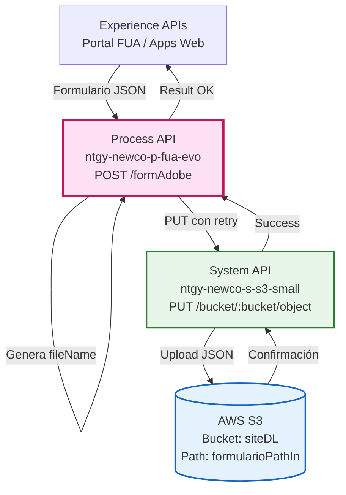
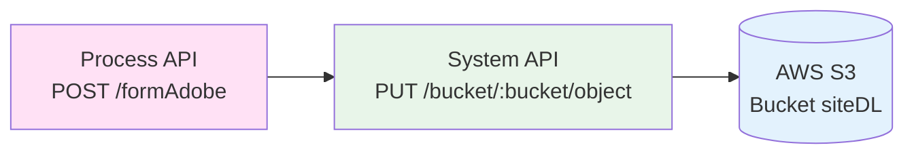
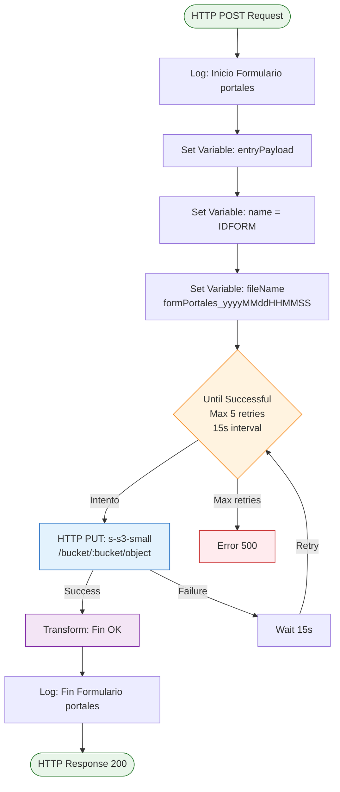
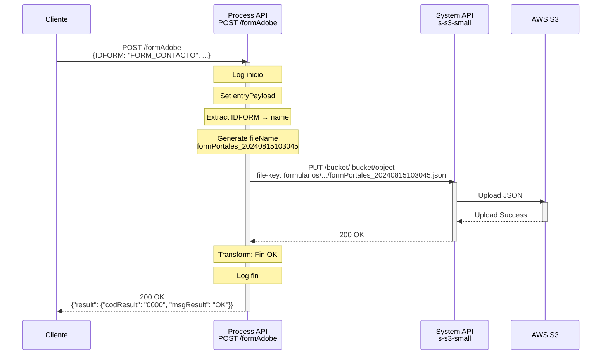
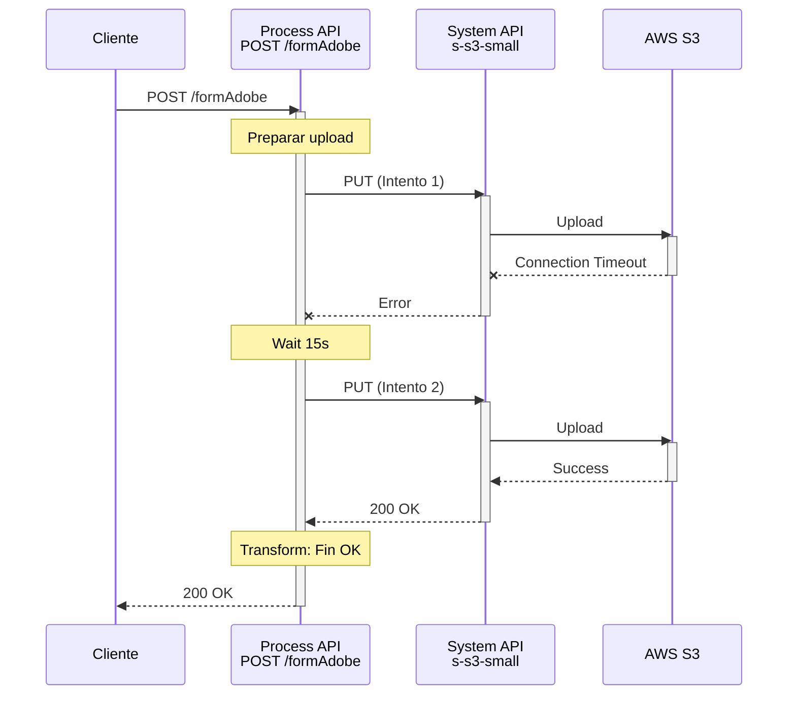
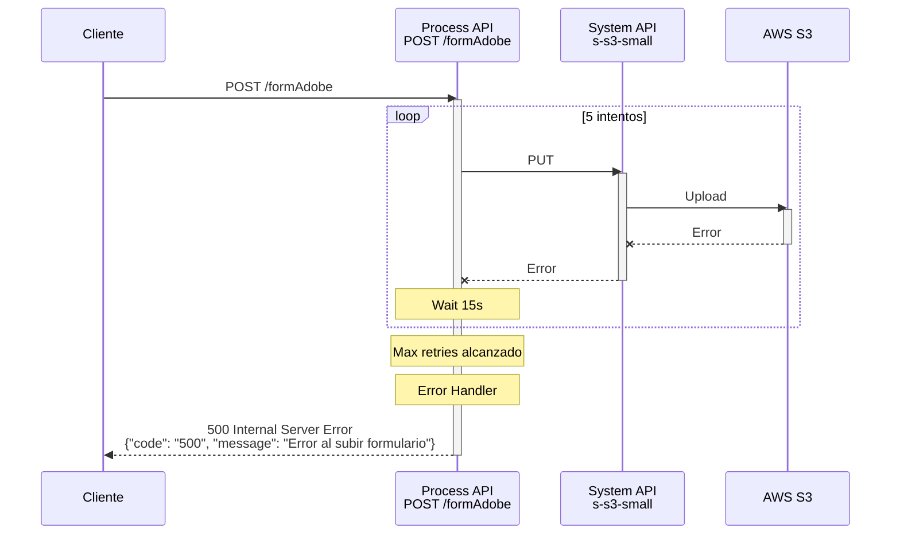

# POST /formAdobe

## 📌 Descripción General

### Propósito del Endpoint

Este endpoint recibe formularios Adobe desde portales web y los almacena en AWS S3 para su procesamiento posterior. Genera un nombre de archivo único basado en timestamp y organiza los formularios por tipo (IDFORM) en directorios específicos dentro del bucket S3.

### Tipo de API

**Capa:** Process API (API-Led Connectivity)

**Función:** Orquestación de almacenamiento de formularios en S3

### Patrón de Integración

**Tipo:** Orquestación con Retry Logic

**Descripción:** El Process API recibe el formulario, extrae metadatos, genera un nombre de archivo único, y lo sube a AWS S3 mediante el System API con lógica de reintentos para garantizar la entrega.

### Arquitectura API-Led Connectivity



---

## 💼 Propósito del Negocio

### Casos de Uso Principales

1. **Almacenamiento de Formularios de Portales**
   - Los portales web envían formularios completados por usuarios
   - Los formularios se almacenan en S3 para procesamiento asíncrono
   - Permite trazabilidad y auditoría de formularios recibidos

2. **Procesamiento Asíncrono**
   - Los formularios en S3 pueden ser procesados por otros sistemas
   - Desacopla la recepción del procesamiento
   - Permite procesamiento batch o en tiempo real según necesidad

3. **Backup y Auditoría**
   - Todos los formularios quedan almacenados en S3
   - Organización por tipo de formulario (IDFORM)
   - Nombres únicos con timestamp para trazabilidad

### 🔗 Endpoints Dependientes

Este Process API consume el siguiente System API:

| System API | Endpoint | Método | Propósito |
|------------|----------|--------|-----------|
| `ntgy-newco-s-s3-small` | `/bucket/:bucket/object` | PUT | Sube archivos JSON a AWS S3 |

### Lógica de Orquestación



**Pasos del Proceso:**

1. **Recepción del Formulario**: Recibe payload JSON con formulario
2. **Extracción de Metadatos**: Extrae IDFORM del payload
3. **Generación de Nombre**: Crea fileName único: `formPortales_yyyyMMddHHMMSS`
4. **Upload a S3**: Sube JSON a S3 con retry logic (5 intentos, 15s entre intentos)
5. **Confirmación**: Retorna resultado exitoso

### Estructura de Almacenamiento en S3

**Path Pattern:**
```
{formularioPathIn}/{IDFORM}/{fileName}.json
```

**Ejemplo:**
```
formularios/entrada/FORM_CONTACTO/formPortales_20240815103045.json
```

### Contexto Empresarial

- **Dominio:** Gestión de Formularios
- **Sector:** Energía - Utilities
- **División:** Naturgy España - NewCo
- **Proceso de Negocio:** Recepción y almacenamiento de formularios de portales web

### Stakeholders

- **Usuarios de Portales Web**: Envían formularios desde interfaces web
- **Equipo de Procesamiento**: Consume formularios desde S3 para procesamiento
- **Equipo de Auditoría**: Accede a formularios almacenados para revisión

### Valor de Negocio

- **Desacoplamiento**: Separa recepción de procesamiento de formularios
- **Resiliencia**: Retry logic garantiza entrega a S3
- **Trazabilidad**: Nombres únicos y organización por tipo
- **Escalabilidad**: S3 permite almacenamiento ilimitado

### Consumidores Potenciales

Este endpoint puede ser consumido por:
- Portales web de autoservicio
- Aplicaciones móviles con formularios
- Sistemas de terceros que envían formularios
- Herramientas de administración

---

## 🔧 Especificación Técnica

### URLs por Ambiente

| Ambiente | URL Base | URL Completa |
|----------|----------|--------------|
| **Local** | `http://localhost:8081` | `http://localhost:8081/api/formAdobe` |
| **Development** | `https://ntgy-newco-p-fua-evo-dev.us-e2.cloudhub.io` | `https://ntgy-newco-p-fua-evo-dev.us-e2.cloudhub.io/api/formAdobe` |
| **UAT** | `https://ntgy-newco-p-fua-evo-uat.us-e2.cloudhub.io` | `https://ntgy-newco-p-fua-evo-uat.us-e2.cloudhub.io/api/formAdobe` |
| **Production** | `https://ntgy-newco-p-fua-evo-pro.us-e2.cloudhub.io` | `https://ntgy-newco-p-fua-evo-pro.us-e2.cloudhub.io/api/formAdobe` |

### Método HTTP

```
POST /api/formAdobe
```

### Parámetros de Entrada

#### Request Body (application/json)

**Estructura Mínima Requerida:**

```json
{
  "IDFORM": "string"
}
```

**Campos:**

| Campo | Tipo | Obligatorio | Descripción | Ejemplo |
|-------|------|-------------|-------------|---------|
| `IDFORM` | String | ✅ Sí | Identificador del tipo de formulario | `"FORM_CONTACTO"` |
| `[otros campos]` | Any | ❌ No | Campos adicionales del formulario | Depende del tipo |

**Notas:**
- El campo `IDFORM` es obligatorio y se usa para organizar en S3
- El resto del payload se almacena completo en S3
- No hay validación de estructura adicional

### Respuestas

#### 200 OK - Éxito

**Estructura de Respuesta:**

```json
{
  "result": {
    "codResult": "0000",
    "msgResult": "OK"
  }
}
```

**Descripción de Campos:**

| Campo | Tipo | Valor | Descripción |
|-------|------|-------|-------------|
| `result.codResult` | String | "0000" | Código de resultado exitoso |
| `result.msgResult` | String | "OK" | Mensaje de confirmación |

#### 400 Bad Request - Error de Validación

```json
{
  "code": "400",
  "message": "Campo IDFORM es obligatorio"
}
```

#### 500 Internal Server Error - Error del Sistema

```json
{
  "code": "500",
  "message": "Error al subir formulario a S3"
}
```

### Autenticación

- **Tipo:** Client ID & Client Secret (Anypoint Platform)
- **Headers requeridos:**
  - `client_id`: ID del cliente registrado en Anypoint Platform
  - `client_secret`: Secret del cliente

### Timeouts

| Tipo | Valor |
|------|-------|
| **Request Timeout** | 90 segundos (incluye reintentos) |
| **Connection Timeout** | 30 segundos |
| **Retry Attempts** | 5 intentos |
| **Retry Interval** | 15 segundos entre intentos |

---

## 🏗️ Implementación Técnica

### Arquitectura del Flow



### Código de Implementación

#### Flow Principal

```xml
<flow name="post:\formAdobe:application\json:ntgy-newco-p-fua-config">
    <logger level="DEBUG" message="post:\formAdobe:application\json:ntgy-newco-p-fua-config" />
    <flow-ref name="post-form" />
</flow>
```

#### Subflow post-form

```xml
<sub-flow name="post-form">
    <!-- Log inicio -->
    <logger level="INFO" message='Inicio Formulario portales: #[payload]'/>
    
    <!-- Guardar payload original -->
    <set-variable value="#[payload]" variableName="entryPayload"/>
    
    <!-- Extraer IDFORM -->
    <set-variable value="#[vars.entryPayload.IDFORM]" variableName="name"/>
    
    <!-- Generar nombre de archivo único -->
    <set-variable 
        value='#["formPortales" ++ "_" ++ (now() as DateTime as String {format: "yyyyMMddHHMMSS"})]' 
        variableName="fileName" />
    
    <!-- Upload a S3 con retry -->
    <until-successful maxRetries="5" millisBetweenRetries="15000">
        <http:request method="PUT" config-ref="HTTP_Request_s_s3_small" path="/bucket/{bucket}/object">
            <http:body><![CDATA[#[vars.entryPayload]]]></http:body>
            <http:headers><![CDATA[#[output application/java
---
{
    "file-key" : p('s-s3-small.siteDL.formularioPathIn') ++ vars.name ++ "/" ++ vars.fileName ++ ".json"
}]]]></http:headers>
            <http:uri-params><![CDATA[#[output application/java
---
{
    "bucket" : p('s-s3-small.siteDL.bucket')
}]]]></http:uri-params>
        </http:request>
    </until-successful>
    
    <!-- Respuesta exitosa -->
    <ee:transform doc:name="Fin OK">
        <ee:message>
            <ee:set-payload><![CDATA[%dw 2.0
output application/json
---
{
  "result":{
        "codResult": "0000",
        "msgResult": "OK"
    }
}]]></ee:set-payload>
        </ee:message>
    </ee:transform>
    
    <!-- Log fin -->
    <logger level="INFO" message="Fin Formulario portales: #[payload]" />
</sub-flow>
```

### Generación de Nombre de Archivo

**DataWeave Expression:**

```dataweave
"formPortales" ++ "_" ++ (now() as DateTime as String {format: "yyyyMMddHHMMSS"})
```

**Ejemplos de nombres generados:**
- `formPortales_20240815103045.json`
- `formPortales_20240815103046.json`
- `formPortales_20240815103047.json`

### Construcción del Path en S3

**DataWeave Expression:**

```dataweave
p('s-s3-small.siteDL.formularioPathIn') ++ vars.name ++ "/" ++ vars.fileName ++ ".json"
```

**Ejemplo de path resultante:**
```
formularios/entrada/FORM_CONTACTO/formPortales_20240815103045.json
```

### Retry Logic

**Configuración:**
- **Estrategia:** Until Successful
- **Máximo de reintentos:** 5
- **Intervalo entre reintentos:** 15,000 ms (15 segundos)
- **Tiempo total máximo:** ~75 segundos (5 intentos × 15s)

**Comportamiento:**
1. Intento 1: Inmediato
2. Intento 2: Después de 15s si falla
3. Intento 3: Después de 15s si falla
4. Intento 4: Después de 15s si falla
5. Intento 5: Después de 15s si falla
6. Si todos fallan: Error 500

### Patrones de Diseño

**Patrón:** Fire-and-Store con Retry

**Justificación:** 
- Almacenamiento asíncrono en S3
- Retry logic garantiza entrega
- Desacopla recepción de procesamiento
- Resiliencia ante fallos temporales de S3

### Diagramas de Secuencia

#### 1. Flujo Normal de Éxito



#### 2. Flujo con Retry (Fallo Temporal)



#### 3. Flujo con Error Permanente (Max Retries)



### Manejo de Errores

**Estrategia:**

1. **Validación de Payload**: Si falta IDFORM, retorna 400
2. **Error de Conexión S3**: Retry automático (hasta 5 intentos)
3. **Error Permanente**: Después de 5 intentos, retorna 500
4. **Error de Transformación**: Retorna 500

**Logging:**
- Log de inicio con payload completo
- Log de fin con resultado
- Logs de error en caso de fallo

---

## 💻 Ejemplos de Uso

### Ejemplo 1: Formulario de Contacto

#### cURL

```bash
curl -X POST "https://ntgy-newco-p-fua-evo-dev.us-e2.cloudhub.io/api/formAdobe" \
  -H "Content-Type: application/json" \
  -H "client_id: YOUR_CLIENT_ID" \
  -H "client_secret: YOUR_CLIENT_SECRET" \
  -d '{
    "IDFORM": "FORM_CONTACTO",
    "nombre": "Juan Pérez",
    "email": "juan.perez@example.com",
    "telefono": "+34600123456",
    "mensaje": "Solicito información sobre tarifas"
  }'
```

#### Respuesta (200 OK)

```json
{
  "result": {
    "codResult": "0000",
    "msgResult": "OK"
  }
}
```

**Archivo creado en S3:**
```
formularios/entrada/FORM_CONTACTO/formPortales_20240815103045.json
```

### Ejemplo 2: Formulario de Reclamación

#### cURL

```bash
curl -X POST "https://ntgy-newco-p-fua-evo-dev.us-e2.cloudhub.io/api/formAdobe" \
  -H "Content-Type: application/json" \
  -H "client_id: YOUR_CLIENT_ID" \
  -H "client_secret: YOUR_CLIENT_SECRET" \
  -d '{
    "IDFORM": "FORM_RECLAMACION",
    "numeroContrato": "12345678",
    "tipoReclamacion": "FACTURACION",
    "descripcion": "Importe incorrecto en última factura",
    "fechaIncidencia": "2024-08-01"
  }'
```

#### Respuesta (200 OK)

```json
{
  "result": {
    "codResult": "0000",
    "msgResult": "OK"
  }
}
```

**Archivo creado en S3:**
```
formularios/entrada/FORM_RECLAMACION/formPortales_20240815103046.json
```

### Ejemplo 3: JavaScript (Fetch API)

```javascript
const formulario = {
  IDFORM: 'FORM_CONTACTO',
  nombre: 'María García',
  email: 'maria.garcia@example.com',
  telefono: '+34600987654',
  mensaje: 'Consulta sobre cambio de tarifa'
};

const response = await fetch('https://ntgy-newco-p-fua-evo-dev.us-e2.cloudhub.io/api/formAdobe', {
  method: 'POST',
  headers: {
    'Content-Type': 'application/json',
    'client_id': 'YOUR_CLIENT_ID',
    'client_secret': 'YOUR_CLIENT_SECRET'
  },
  body: JSON.stringify(formulario)
});

const result = await response.json();
console.log('Formulario enviado:', result.result.msgResult);
// Output: Formulario enviado: OK
```

### Ejemplo 4: Python (Requests)

```python
import requests
import json

formulario = {
    'IDFORM': 'FORM_CONTACTO',
    'nombre': 'Carlos López',
    'email': 'carlos.lopez@example.com',
    'telefono': '+34600111222',
    'mensaje': 'Solicito presupuesto para instalación solar'
}

url = 'https://ntgy-newco-p-fua-evo-dev.us-e2.cloudhub.io/api/formAdobe'
headers = {
    'Content-Type': 'application/json',
    'client_id': 'YOUR_CLIENT_ID',
    'client_secret': 'YOUR_CLIENT_SECRET'
}

response = requests.post(url, headers=headers, json=formulario)

if response.status_code == 200:
    result = response.json()
    print(f"Resultado: {result['result']['msgResult']}")
    # Output: Resultado: OK
else:
    print(f"Error: {response.status_code}")
    print(response.json())
```

### Ejemplo 5: Error - Campo IDFORM Faltante

#### cURL

```bash
curl -X POST "https://ntgy-newco-p-fua-evo-dev.us-e2.cloudhub.io/api/formAdobe" \
  -H "Content-Type: application/json" \
  -H "client_id: YOUR_CLIENT_ID" \
  -H "client_secret: YOUR_CLIENT_SECRET" \
  -d '{
    "nombre": "Juan Pérez",
    "email": "juan.perez@example.com"
  }'
```

#### Respuesta (400 Bad Request)

```json
{
  "code": "400",
  "message": "Campo IDFORM es obligatorio"
}
```

---

## 📝 Notas Importantes

### Para Desarrolladores

- ✅ **Campo IDFORM obligatorio** - Se usa para organizar en S3
- ✅ **Nombres únicos** - Timestamp garantiza unicidad
- ✅ **Retry automático** - 5 intentos con 15s de intervalo
- ✅ **Payload completo** - Todo el JSON se almacena en S3
- ⚠️ **Sin validación de estructura** - Cualquier JSON válido es aceptado

### Mejores Prácticas

1. **Incluir IDFORM descriptivo** - Facilita organización en S3
2. **Validar payload antes de enviar** - Aunque no hay validación estricta
3. **Manejar timeouts** - Considerar hasta 90s de timeout total
4. **Implementar retry en cliente** - Por si falla después de 5 intentos

### Limitaciones

- **Tamaño máximo de payload**: Limitado por configuración de HTTP (típicamente 10MB)
- **Sin validación de esquema**: Acepta cualquier estructura JSON
- **Sin respuesta de ubicación**: No retorna la URL del archivo en S3

### Monitoreo

**Métricas recomendadas:**
- Tasa de éxito de uploads
- Número de reintentos promedio
- Tiempo de respuesta
- Distribución de tipos de formularios (IDFORM)