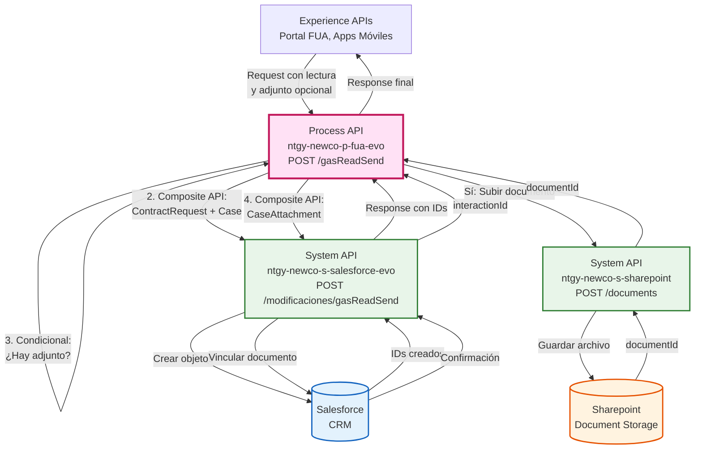
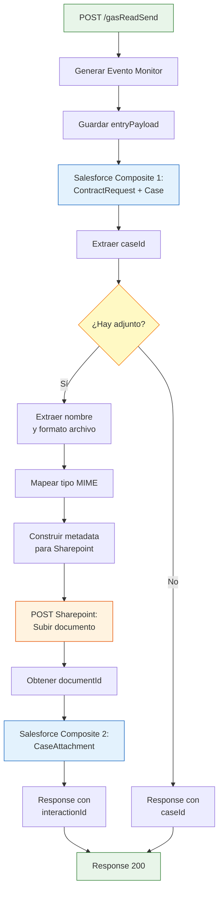
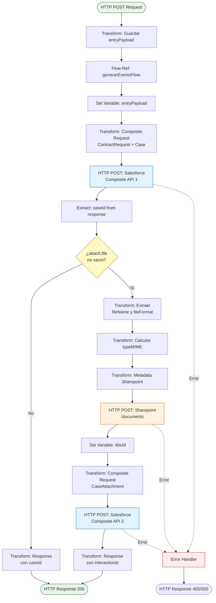
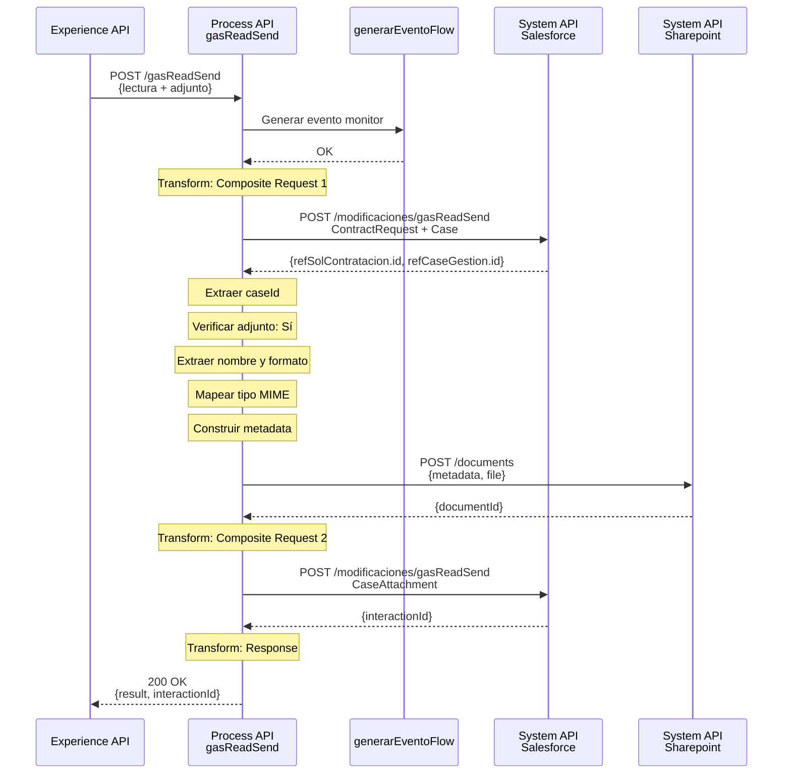
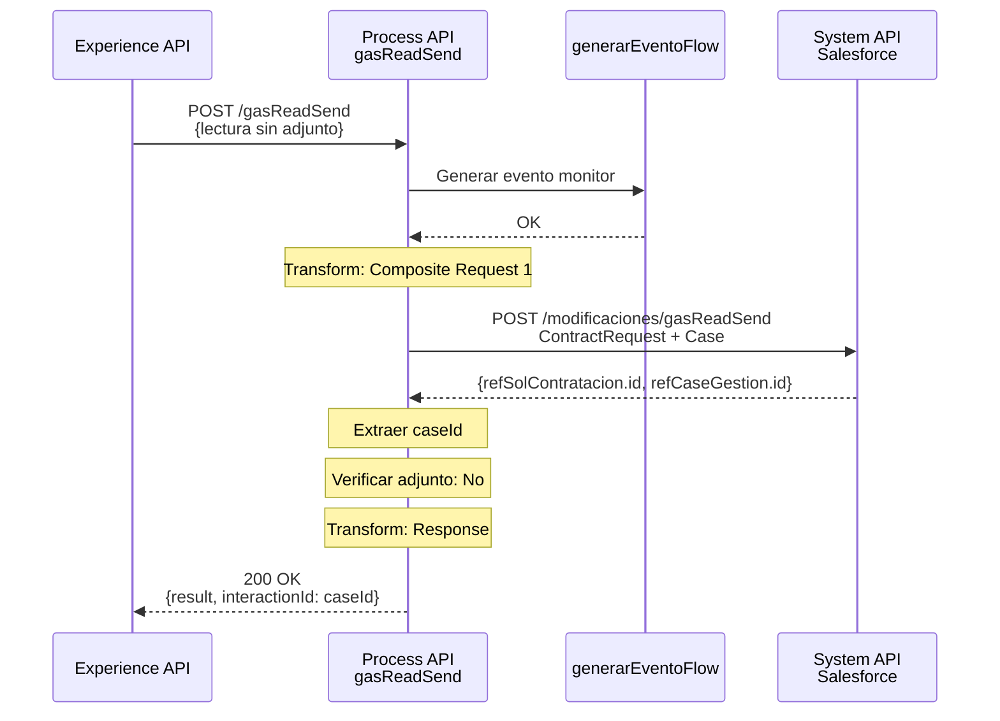
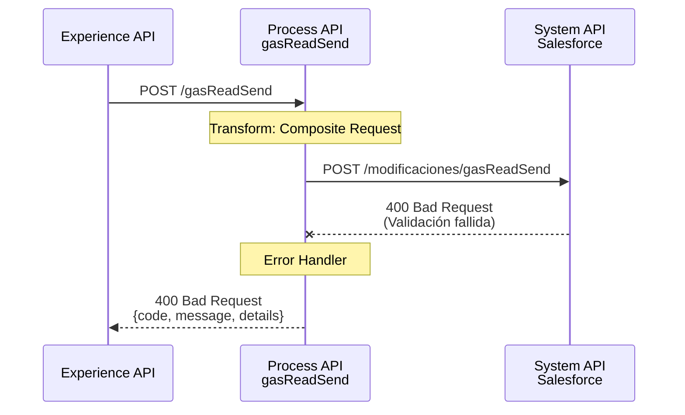
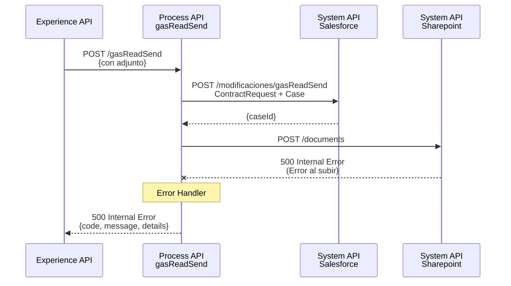

# POST /gasReadSend

## 📌 Descripción General

### Propósito del Endpoint

Este endpoint orquesta el proceso completo de **Facilita Lectura** para suministros de gas, permitiendo a los clientes enviar lecturas de sus contadores. Implementa una orquestación compleja que involucra múltiples sistemas: crea una solicitud de contrato y un caso de gestión en Salesforce, y opcionalmente sube documentos adjuntos a Sharepoint. El proceso incluye lógica condicional para manejar casos con y sin documentación fotográfica del contador.

### Tipo de API

**Capa:** Process API (API-Led Connectivity)

**Función:** Orquestación compleja de proceso de negocio con múltiples integraciones (Salesforce + Sharepoint)

### Patrón de Integración

**Tipo:** Orquestación Compleja con Lógica Condicional y Múltiples Backends

**Descripción:** El endpoint recibe los datos de la lectura del cliente, genera un evento de monitoreo, crea simultáneamente una solicitud de contrato y un caso de gestión en Salesforce usando Composite API. Si el cliente adjunta una foto del contador, el flujo sube el documento a Sharepoint, obtiene el ID del documento, y lo vincula al caso en Salesforce mediante una segunda llamada Composite API.

### Arquitectura API-Led Connectivity



---

## 💼 Propósito del Negocio

### Casos de Uso Principales

1. **Facilitar Lectura de Contador de Gas**
   - Permite a los clientes enviar lecturas de sus contadores de gas
   - Evita estimaciones y mejora la precisión de la facturación
   - Reduce visitas de técnicos para toma de lecturas

2. **Documentación Fotográfica Opcional**
   - Los clientes pueden adjuntar foto del contador como evidencia
   - Mejora la confiabilidad de las lecturas reportadas
   - Facilita la validación por parte del equipo de facturación

3. **Creación Automática de Caso de Gestión**
   - Genera automáticamente un caso en Salesforce para seguimiento
   - Permite trazabilidad completa del proceso
   - Facilita la gestión y resolución de incidencias

4. **Integración con Distribuidora**
   - El documento se marca para envío a la distribuidora
   - Cumple con requisitos regulatorios de comunicación
   - Automatiza el proceso de notificación

### 🔗 Endpoints Dependientes

Este Process API consume los siguientes System APIs:

| System API | Endpoint | Método | Propósito |
|------------|----------|--------|-----------|
| `ntgy-newco-s-salesforce-evo` | `/modificaciones/gasReadSend` | POST | Crear ContractRequest y Case simultáneamente (primera llamada) |
| `ntgy-newco-s-salesforce-evo` | `/modificaciones/gasReadSend` | POST | Crear CaseAttachment vinculando documento al caso (segunda llamada, condicional) |
| `ntgy-newco-s-sharepoint` | `/documents` | POST | Subir documento adjunto a Sharepoint (condicional) |

### Lógica de Orquestación



**Pasos del Proceso:**

1. **Generación de Evento**: Llamada a `generarEventoFlow` para monitoreo
2. **Guardar Payload**: Almacenar payload original en variable
3. **Salesforce Composite 1**: Crear ContractRequest y Case simultáneamente
4. **Extraer caseId**: Obtener ID del caso creado
5. **Decisión Condicional**: Verificar si hay documento adjunto
6. **Flujo con Adjunto** (si aplica):
   - Extraer nombre y formato del archivo
   - Mapear tipo MIME según extensión
   - Construir metadata para Sharepoint
   - Subir documento a Sharepoint
   - Obtener documentId
   - Crear CaseAttachment en Salesforce
7. **Respuesta Final**: Devolver interactionId o caseId

### Transformaciones Aplicadas

**Transformación 1: Construcción de Composite Request (Salesforce 1)**

Crea dos objetos simultáneamente usando referencias cruzadas:

| Objeto | Campo | Valor | Origen |
|--------|-------|-------|--------|
| `ContractRequest` | `acn_fld_Account__c` | ID de cuenta | `x-client-id` |
| `ContractRequest` | `acn_fld_Contract__c` | ID de contrato | `contractId` |
| `ContractRequest` | `acn_fld_CUPS__r.acn_fld_Name__c` | CUPS | `cups` |
| `ContractRequest` | `acn_fld_ReadingDate__c` | Fecha lectura | `now()` (hoy) |
| `ContractRequest` | `acn_fld_ReadingValue__c` | Valor lectura | `read` |
| `Case` | `AccountId` | ID de cuenta | `x-client-id` |
| `Case` | `NewCo_Contract__c` | ID de contrato | `contractId` |
| `Case` | `ContactId` | ID de contacto | `x-contact-id` |
| `Case` | `acn_fld_ReadingDate__c` | Fecha lectura | `now()` (hoy) |
| `Case` | `acn_fld_ReadingValue__c` | Valor lectura | `read` |
| `Case` | `acn_fld_ContractRequest__c` | Referencia | `@{refSolContratacion.id}` |

**Transformación 2: Mapeo de Tipos MIME**

| Extensión | Tipo MIME |
|-----------|-----------|
| `pdf` | `application/pdf` |
| `doc` | `application/msword` |
| `docx` | `application/vnd.openxmlformats-officedocument.wordprocessingml.document` |
| `png` | `image/png` |
| `jpeg`, `jpg` | `image/jpeg`, `image/jpg` |
| `zip` | `application/zip` |
| `xls` | `application/vnd.ms-excel` |
| `xlsx` | `application/xlsx` |
| `odt` | `application/vnd.oasis.opendocument.text` |
| `mp3` | `audio/mpeg` |
| `txt` | `text/plain` |
| `csv` | `application/csv` |

**Transformación 3: Metadata para Sharepoint**

```dataweave
{
  "docType": "06.02",
  "metadata": {
    "t_file_id": fileName,
    "t_doctp": "06.02",
    "c_customer_id": x-client-id,
    "m_contract_id": contractId,
    "m_cup": cups,
    "case_num": caseId
  },
  "typeMIME": calculatedMimeType,
  "file": base64EncodedFile
}
```

### Contexto Empresarial

- **Dominio:** Gestión de Lecturas y Facturación
- **Sector:** Energía - Utilities (Gas)
- **División:** Naturgy España - NewCo
- **Proceso de Negocio:** Facilita Lectura - Autogestión de lecturas de contador

### Stakeholders

- **Clientes Finales**: Necesitan enviar lecturas de sus contadores de gas
- **Equipo de Facturación**: Utiliza las lecturas para generar facturas precisas
- **Distribuidora de Gas**: Recibe notificación de las lecturas reportadas
- **Agentes de Call Center**: Pueden ayudar a clientes con el proceso
- **Equipo de Validación**: Revisa lecturas con documentación fotográfica

### Valor de Negocio

- **Precisión en Facturación**: Elimina estimaciones y mejora exactitud de facturas
- **Reducción de Costes**: Menos visitas de técnicos para toma de lecturas
- **Satisfacción del Cliente**: Empodera al cliente para gestionar sus lecturas
- **Cumplimiento Regulatorio**: Documentación y trazabilidad completa del proceso
- **Eficiencia Operativa**: Automatización completa del proceso de recepción de lecturas

### Consumidores Potenciales

Este endpoint puede ser consumido por:
- Portal web FUA
- Aplicaciones móviles de clientes
- Sistemas de agentes de call center
- Aplicaciones de terceros autorizados

---

## 🔧 Especificación Técnica

### URLs por Ambiente

| Ambiente | URL Base | URL Completa |
|----------|----------|--------------|
| **Local** | `http://localhost:8081` | `http://localhost:8081/api/gasReadSend` |
| **Development** | `https://ntgy-newco-p-fua-evo-dev.us-e2.cloudhub.io` | `https://ntgy-newco-p-fua-evo-dev.us-e2.cloudhub.io/api/gasReadSend` |
| **UAT** | `https://ntgy-newco-p-fua-evo-uat.us-e2.cloudhub.io` | `https://ntgy-newco-p-fua-evo-uat.us-e2.cloudhub.io/api/gasReadSend` |
| **Production** | `https://ntgy-newco-p-fua-evo-pro.us-e2.cloudhub.io` | `https://ntgy-newco-p-fua-evo-pro.us-e2.cloudhub.io/api/gasReadSend` |

### Método HTTP

```
POST /api/gasReadSend
```

### Parámetros de Entrada

#### Headers

| Header | Tipo | Requerido | Descripción |
|--------|------|-----------|-------------|
| `Content-Type` | string | ✅ Sí | Debe ser `application/json` |
| `client_id` | string | ✅ Sí | Client ID de Anypoint Platform |
| `client_secret` | string | ✅ Sí | Client Secret de Anypoint Platform |

#### Body (application/json)

**Estructura del Request:**

```json
{
  "x-client-id": "string",
  "x-contact-id": "string",
  "x-user-id": "string",
  "x-agent-mail": "string",
  "contractId": "string",
  "cups": "string",
  "read": "number",
  "traceparent": "string",
  "attach": {
    "file": "string (base64)",
    "fileNameWithExtension": "string"
  }
}
```

**Campos del Body:**

| Campo | Tipo | Requerido | Descripción | Ejemplo |
|-------|------|-----------|-------------|---------|
| `x-client-id` | string | ✅ Sí | ID de la cuenta del cliente en Salesforce | `"0011t00000ABC123"` |
| `x-contact-id` | string | ✅ Sí | ID del contacto en Salesforce | `"0031t00000DEF456"` |
| `x-user-id` | string | ❌ No | ID del usuario (agente) si aplica | `"0051t00000GHI789"` |
| `x-agent-mail` | string | ❌ No | Email del agente (para header username) | `"agente@naturgy.com"` |
| `contractId` | string | ✅ Sí | ID del contrato en Salesforce | `"8001t00000JKL012"` |
| `cups` | string | ✅ Sí | CUPS del suministro de gas | `"ES0021000000000001JN"` |
| `read` | number | ✅ Sí | Valor de la lectura del contador | `12345.67` |
| `traceparent` | string | ✅ Sí | Trace ID para trazabilidad (formato: `00-traceId-spanId-flags`) | `"00-abc123-def456-01"` |
| `attach` | object | ❌ No | Objeto con documento adjunto (opcional) | Ver estructura abajo |
| `attach.file` | string | ⚠️ Condicional | Archivo codificado en base64 (requerido si attach presente) | `"JVBERi0xLjQKJeLjz9..."` |
| `attach.fileNameWithExtension` | string | ⚠️ Condicional | Nombre del archivo con extensión (requerido si attach presente) | `"lectura_contador.jpg"` |

**⚠️ Nota sobre Adjuntos:**
- El campo `attach` es opcional
- Si se proporciona `attach`, ambos subcampos (`file` y `fileNameWithExtension`) son requeridos
- El archivo debe estar codificado en base64
- Extensiones soportadas: pdf, doc, docx, png, jpeg, jpg, zip, xls, xlsx, odt, mp3, txt, csv

### Respuestas

#### 200 OK - Éxito

**Descripción:** Lectura enviada correctamente, caso creado

**Estructura de Respuesta:**

```json
{
  "result": {
    "codResult": "0000",
    "msgResult": "No hay error"
  },
  "interactionId": "string"
}
```

**Campos de Respuesta:**

| Campo | Tipo | Descripción |
|-------|------|-------------|
| `result.codResult` | string | Código de resultado ("0000" = éxito) |
| `result.msgResult` | string | Mensaje descriptivo del resultado |
| `interactionId` | string | ID del caso creado en Salesforce (o ID del CaseAttachment si hay adjunto) |

#### 400 Bad Request - Error de Validación

**Descripción:** Parámetros inválidos o faltantes

```json
{
  "code": "BAD_REQUEST",
  "message": "Parámetros de entrada inválidos",
  "details": "El campo contractId es requerido"
}
```

#### 500 Internal Server Error - Error del Sistema

**Descripción:** Error en el procesamiento interno o en la comunicación con Salesforce/Sharepoint

```json
{
  "code": "INTERNAL_ERROR",
  "message": "Error al procesar la solicitud",
  "details": "Error de conexión con Salesforce"
}
```

### Autenticación

- **Tipo:** Client ID & Client Secret (Anypoint Platform)
- **Headers requeridos:** `client_id`, `client_secret`

### Timeouts

| Tipo | Valor |
|------|-------|
| **Request Timeout** | 120 segundos (proceso complejo) |
| **Connection Timeout** | 30 segundos |
| **Salesforce Timeout** | Configurado en properties |
| **Sharepoint Timeout** | Configurado en properties |

---

## 🏗️ Implementación Técnica

### Arquitectura del Flow



### Componentes del Flow

#### 1. Flow Principal: `post:\gasReadSend:application\json:ntgy-newco-p-fua-config`

**Ubicación:** `src/main/mule/ntgy-newco-p-fua.xml`

**Responsabilidades:**
- Recibir la petición HTTP POST
- Guardar payload original en variable
- Invocar el subflow `gasReadSend`

**Código XML:**
```xml
<flow name="post:\gasReadSend:application\json:ntgy-newco-p-fua-config">
    <ee:transform doc:name="Transform Message">
        <ee:message />
        <ee:variables>
            <ee:set-variable variableName="entryPayload">
                <![CDATA[%dw 2.0
                output application/json
                ---
                payload]]>
            </ee:set-variable>
        </ee:variables>
    </ee:transform>
    <flow-ref doc:name="Flow Reference" name="gasReadSend" />
</flow>
```

#### 2. Subflow: `gasReadSend`

**Ubicación:** `src/main/mule/implementation/gasReadSend.xml`

**Responsabilidades:**
- Logging de inicio
- Generación de evento de monitoreo
- Creación de ContractRequest y Case en Salesforce
- Manejo condicional de documentos adjuntos
- Subida de documentos a Sharepoint (si aplica)
- Vinculación de documentos al caso (si aplica)
- Construcción de respuesta final

**Estructura del Subflow:**

1. **Logging Inicial** (línea 3)
2. **Generación de Evento** (línea 4)
3. **Guardar Payload** (línea 5)
4. **Transform: Composite Request 1** (líneas 9-54)
5. **HTTP Request: Salesforce 1** (líneas 55-60)
6. **Logging Respuesta SF** (línea 61)
7. **Extraer caseId** (línea 62)
8. **Logging caseId** (línea 63)
9. **Choice: ¿Hay adjunto?** (líneas 64-139)
   - **When: Con adjunto** (líneas 65-135)
   - **Otherwise: Sin adjunto** (líneas 136-138)
10. **Logging Final** (línea 140)

### Transformaciones DataWeave

#### Transformación 1: Composite Request para Salesforce (Primera Llamada)

**Propósito:** Crear ContractRequest y Case simultáneamente

```dataweave
%dw 2.0
output application/json
---
{
  "allOrNone": true,
  "collateSubrequests": false,
  "compositeRequest": [
    {
      "method": "POST",
      "url": "/services/data/v52.0/sobjects/acn_obj_ContractRequest__c",
      "referenceId": "refSolContratacion",
      "body": {
        "NewCo_Recordtype__c": "acn_rt_With_Switching",
        "acn_fld_Account__c": vars.entryPayload."x-client-id",
        "acn_fld_Contract__c": vars.entryPayload.contractId,
        "acn_fld_Sctype__c": "23",
        "acn_fld_Category__c": "50",
        "acn_fld_Status__c": "01",
        "acn_fld_CUPS__r": {
          "acn_fld_Name__c": vars.entryPayload.cups
        },
        "acn_fld_ReadingDate__c": now()[0 to 9],
        "acn_fld_ReadingValue__c": vars.entryPayload.read,
        "NewCo_Creado_por__c": if(vars.entryPayload.'x-user-id' != null) 
                                  vars.entryPayload.'x-user-id' 
                                else 
                                  vars.entryPayload.'x-contact-id'
      }
    },
    {
      "method": "POST",
      "url": "/services/data/v52.0/sobjects/Case",
      "referenceId": "refCaseGestion",
      "body": {
        "NewCo_Recordtype__c": "Gestion",
        "AccountId": vars.entryPayload."x-client-id",
        "NewCo_Contract__c": vars.entryPayload.contractId,
        "ContactId": vars.entryPayload."x-contact-id",
        "Status": "06",
        "Priority": "02",
        "Origin": "FUA",
        "acn_fld_ReadingDate__c": now()[0 to 9],
        "acn_fld_ReadingValue__c": vars.entryPayload.read,
        ("OwnerId": payload."x-user-id") if(!isEmpty(payload."x-user-id")),
        "NewCo_Creado_por__c": if(vars.entryPayload.'x-user-id' != null) 
                                  vars.entryPayload.'x-user-id' 
                                else 
                                  vars.entryPayload.'x-contact-id',
        "acn_fld_Tittle__r": {
          "NewCo_ExternalId__c": "FacilitaLectura"
        },
        "acn_fld_ContractRequest__c": "@{refSolContratacion.id}",
        "comments": vars.entryPayload.cups,
        "NewCo_TraceId__c": splitBy(vars.entryPayload.traceparent,"-")[1]
      }
    }
  ]
}
```

**Características Clave:**
- `allOrNone: true` → Transacción atómica (todo o nada)
- `@{refSolContratacion.id}` → Referencia cruzada entre objetos
- `now()[0 to 9]` → Fecha actual en formato YYYY-MM-DD
- Lógica condicional para `NewCo_Creado_por__c` y `OwnerId`

#### Transformación 2: Extracción de Nombre y Formato de Archivo

**Propósito:** Separar nombre y extensión del archivo

```dataweave
%dw 2.0
import * from dw::core::Strings
output application/java
---
{
  fileFormat: substringAfterLast(vars.entryPayload.attach.fileNameWithExtension, "."),
  fileName: substringBeforeLast(vars.entryPayload.attach.fileNameWithExtension, "."),
  inputFile: if(!isEmpty(vars.entryPayload.attach.file)) 
               vars.entryPayload.attach.file 
             else 
               null
}
```

#### Transformación 3: Mapeo de Tipo MIME

**Propósito:** Determinar el tipo MIME según la extensión del archivo

```dataweave
%dw 2.0
output application/java
var formato = lower(vars.fileFormat)
---
if(formato == "pdf") "application/pdf" 
else if(formato == "doc") "application/msword"
else if(formato == "docx") "application/vnd.openxmlformats-officedocument.wordprocessingml.document"
else if(formato == "png") "image/png"
else if(formato == "jpeg") "image/jpeg"
else if(formato == "jpg") "image/jpg"
else if(formato == "zip") "application/zip"
else if(formato == "xls") "application/vnd.ms-excel"
else if(formato == "odt") "application/vnd.oasis.opendocument.text"
else if(formato == "mp3") "audio/mpeg"
else if(formato == "afp") "application/vnd.ibm.modcap"
else if(formato == "txt") "text/plain"
else if(formato == "csv") "application/csv"
else if(formato == "xlsx") "application/xlsx"
else null
```

#### Transformación 4: Metadata para Sharepoint

**Propósito:** Construir estructura de metadata para subida de documento

```dataweave
%dw 2.0
output application/json
---
{
  "docType": "06.02",
  "metadata": {
    "t_file_id": vars.fileName,
    "t_doctp": "06.02",
    "c_customer_id": vars.entryPayload."x-client-id",
    "t_nif_nie": "",
    "m_contract_id": vars.entryPayload.contractId,
    "m_cup": vars.entryPayload.cups,
    "d_sending_date": "",
    "case_num": vars.caseId,
    "m_document_id": ""
  },
  "typeMIME": vars.typeMime,
  "file": vars.inputFile
}
```

**Código de Documento:** `06.02` = Facilita Lectura

#### Transformación 5: Composite Request para CaseAttachment

**Propósito:** Vincular documento subido al caso en Salesforce

```dataweave
%dw 2.0
output application/json
---
{
  "allOrNone": true,
  "collateSubrequests": false,
  "compositeRequest": [
    {
      "method": "POST",
      "url": "/services/data/v52.0/sobjects/acn_obj_CaseAttachments__c",
      "referenceId": "refCaseAttachment",
      "body": {
        "acn_fld_DocumentKey__c": vars.docId,
        "acn_fld_Case__c": vars.caseId,
        "acn_fld_Nombre_de_PDF__c": vars.fileName ++ "." ++ vars.fileFormat,
        "acn_fld_Type__c": "06.02",
        "NewCo_fld_SubTypeGas__c": "06",
        "NewCo_Envio_distribuidora__c": true
      }
    }
  ]
}
```

#### Transformación 6: Respuesta Final (Con Adjunto)

**Propósito:** Construir respuesta exitosa con interactionId

```dataweave
%dw 2.0
output application/json
---
{
  "result": {
    "codResult": "0000",
    "msgResult": "No hay error"
  }
} ++ {"interactionId": payload.compositeResponse[0].body.id}
```

#### Transformación 7: Respuesta Final (Sin Adjunto)

**Propósito:** Construir respuesta exitosa con caseId

```dataweave
%dw 2.0
output application/json
---
{
  "result": {
    "codResult": "0000",
    "msgResult": "No hay error"
  }
} ++ {"interactionId": vars.caseId}
```

### Patrones de Diseño

**Patrón 1:** Composite API Pattern (Salesforce)

**Justificación:** 
- Permite crear múltiples objetos en una sola transacción
- Garantiza atomicidad (todo o nada)
- Reduce latencia al evitar múltiples llamadas HTTP
- Permite referencias cruzadas entre objetos creados

**Patrón 2:** Conditional Processing

**Justificación:**
- Maneja casos con y sin documentación adjunta
- Evita llamadas innecesarias a Sharepoint
- Optimiza el flujo según los datos de entrada
- Mejora la eficiencia del proceso

**Patrón 3:** Event-Driven Monitoring

**Justificación:**
- Genera eventos para monitoreo y trazabilidad
- Permite auditoría completa del proceso
- Facilita debugging y análisis de problemas
- Integración con sistemas de monitoreo

### Diagramas de Secuencia

#### 1. Flujo Completo con Documento Adjunto



#### 2. Flujo Sin Documento Adjunto



#### 3. Flujo con Error en Salesforce



#### 4. Flujo con Error en Sharepoint



### Manejo de Errores

**Estrategia:** Error handling global con respuestas estandarizadas y rollback automático

**Tipos de Errores:**

1. **Errores de Validación (400)**
   - Campos requeridos faltantes
   - Formato de archivo no soportado
   - IDs de Salesforce inválidos
   - Estructura de traceparent incorrecta

2. **Errores de Salesforce (400/500)**
   - Validación de reglas de negocio
   - Objetos no encontrados
   - Permisos insuficientes
   - Timeout en Composite API

3. **Errores de Sharepoint (500)**
   - Error al subir documento
   - Tamaño de archivo excedido
   - Formato de archivo corrupto
   - Timeout en subida

4. **Errores de Transacción (500)**
   - Fallo en `allOrNone: true` de Composite API
   - Rollback automático de objetos creados
   - Inconsistencia de datos

**Configuración de Retry:**
- Salesforce: 2 reintentos con 3s de delay
- Sharepoint: 1 reintento con 5s de delay
- Timeout total: 120 segundos

---

## 💻 Ejemplos de Uso

### Ejemplo 1: Envío de Lectura CON Documento Adjunto (Foto del Contador)

#### cURL

```bash
curl -X POST "https://ntgy-newco-p-fua-evo-dev.us-e2.cloudhub.io/api/gasReadSend" \
  -H "Content-Type: application/json" \
  -H "client_id: YOUR_CLIENT_ID" \
  -H "client_secret: YOUR_CLIENT_SECRET" \
  -d '{
    "x-client-id": "0011t00000ABC123",
    "x-contact-id": "0031t00000DEF456",
    "contractId": "8001t00000JKL012",
    "cups": "ES0021000000000001JN",
    "read": 12345.67,
    "traceparent": "00-4bf92f3577b34da6a3ce929d0e0e4736-00f067aa0ba902b7-01",
    "attach": {
      "file": "iVBORw0KGgoAAAANSUhEUgAAAAEAAAABCAYAAAAfFcSJAAAADUlEQVR42mNk+M9QDwADhgGAWjR9awAAAABJRU5ErkJggg==",
      "fileNameWithExtension": "lectura_contador.jpg"
    }
  }'
```

#### Respuesta (200 OK)

```json
{
  "result": {
    "codResult": "0000",
    "msgResult": "No hay error"
  },
  "interactionId": "a0X1t000000XYZ789"
}
```

**Nota:** El `interactionId` corresponde al ID del CaseAttachment creado en Salesforce

### Ejemplo 2: Envío de Lectura SIN Documento Adjunto

#### cURL

```bash
curl -X POST "https://ntgy-newco-p-fua-evo-dev.us-e2.cloudhub.io/api/gasReadSend" \
  -H "Content-Type: application/json" \
  -H "client_id: YOUR_CLIENT_ID" \
  -H "client_secret: YOUR_CLIENT_SECRET" \
  -d '{
    "x-client-id": "0011t00000ABC123",
    "x-contact-id": "0031t00000DEF456",
    "contractId": "8001t00000JKL012",
    "cups": "ES0021000000000001JN",
    "read": 12345.67,
    "traceparent": "00-4bf92f3577b34da6a3ce929d0e0e4736-00f067aa0ba902b7-01"
  }'
```

#### Respuesta (200 OK)

```json
{
  "result": {
    "codResult": "0000",
    "msgResult": "No hay error"
  },
  "interactionId": "5001t000000MNO345"
}
```

**Nota:** El `interactionId` corresponde al ID del Case creado en Salesforce

### Ejemplo 3: Envío por Agente (Con x-user-id y x-agent-mail)

#### cURL

```bash
curl -X POST "https://ntgy-newco-p-fua-evo-dev.us-e2.cloudhub.io/api/gasReadSend" \
  -H "Content-Type: application/json" \
  -H "client_id: YOUR_CLIENT_ID" \
  -H "client_secret: YOUR_CLIENT_SECRET" \
  -d '{
    "x-client-id": "0011t00000ABC123",
    "x-contact-id": "0031t00000DEF456",
    "x-user-id": "0051t00000GHI789",
    "x-agent-mail": "agente.callcenter@naturgy.com",
    "contractId": "8001t00000JKL012",
    "cups": "ES0021000000000001JN",
    "read": 12345.67,
    "traceparent": "00-4bf92f3577b34da6a3ce929d0e0e4736-00f067aa0ba902b7-01",
    "attach": {
      "file": "JVBERi0xLjQKJeLjz9MKMyAwIG9iago8PC9UeXBlIC9QYWdlCi9QYXJlbnQgMSAwIFIKL01lZGlhQm94IFswIDAgNjEyIDc5Ml0KL0NvbnRlbnRzIDQgMCBSCj4+CmVuZG9iago0IDAgb2JqCjw8L0xlbmd0aCA0NT4+CnN0cmVhbQpCVAovRjEgMjQgVGYKMTAwIDcwMCBUZAooTGVjdHVyYSBkZWwgQ29udGFkb3IpIFRqCkVUCmVuZHN0cmVhbQplbmRvYmoKMSAwIG9iago8PC9UeXBlIC9QYWdlcwovS2lkcyBbMyAwIFJdCi9Db3VudCAxCj4+CmVuZG9iagoyIDAgb2JqCjw8L1R5cGUgL0NhdGFsb2cKL1BhZ2VzIDEgMCBSCj4+CmVuZG9iagp4cmVmCjAgNQowMDAwMDAwMDAwIDY1NTM1IGYgCjAwMDAwMDAyMDggMDAwMDAgbiAKMDAwMDAwMDI2NSAwMDAwMCBuIAowMDAwMDAwMDE1IDAwMDAwIG4gCjAwMDAwMDAxMDkgMDAwMDAgbiAKdHJhaWxlcgo8PC9TaXplIDUKL1Jvb3QgMiAwIFIKPj4Kc3RhcnR4cmVmCjMxNAolJUVPRg==",
      "fileNameWithExtension": "lectura_contador.pdf"
    }
  }'
```

#### Respuesta (200 OK)

```json
{
  "result": {
    "codResult": "0000",
    "msgResult": "No hay error"
  },
  "interactionId": "a0X1t000000PQR456"
}
```

### Ejemplo 4: JavaScript (Fetch API)

```javascript
const sendGasReading = async (readingData, attachmentFile = null) => {
  const baseUrl = 'https://ntgy-newco-p-fua-evo-dev.us-e2.cloudhub.io/api/gasReadSend';
  
  // Construir payload
  const payload = {
    'x-client-id': readingData.clientId,
    'x-contact-id': readingData.contactId,
    'contractId': readingData.contractId,
    'cups': readingData.cups,
    'read': readingData.readValue,
    'traceparent': readingData.traceId
  };
  
  // Añadir adjunto si existe
  if (attachmentFile) {
    // Convertir archivo a base64
    const base64File = await fileToBase64(attachmentFile);
    payload.attach = {
      file: base64File,
      fileNameWithExtension: attachmentFile.name
    };
  }
  
  const response = await fetch(baseUrl, {
      method: 'POST',
    headers: {
      'Content-Type': 'application/json',
      'client_id': 'YOUR_CLIENT_ID',
      'client_secret': 'YOUR_CLIENT_SECRET'
    },
    body: JSON.stringify(payload)
  });
  
  if (!response.ok) {
    throw new Error(`HTTP error! status: ${response.status}`);
  }
  
  const data = await response.json();
  return data;
};

// Función auxiliar para convertir archivo a base64
const fileToBase64 = (file) => {
  return new Promise((resolve, reject) => {
    const reader = new FileReader();
    reader.readAsDataURL(file);
    reader.onload = () => {
      // Remover el prefijo "data:*/*;base64,"
      const base64 = reader.result.split(',')[1];
      resolve(base64);
    };
    reader.onerror = error => reject(error);
  });
};

// Uso - Sin adjunto
try {
  const result = await sendGasReading({
    clientId: '0011t00000ABC123',
    contactId: '0031t00000DEF456',
    contractId: '8001t00000JKL012',
    cups: 'ES0021000000000001JN',
    readValue: 12345.67,
    traceId: '00-4bf92f3577b34da6a3ce929d0e0e4736-00f067aa0ba902b7-01'
  });
  console.log('Lectura enviada:', result.interactionId);
} catch (error) {
  console.error('Error al enviar lectura:', error);
}

// Uso - Con adjunto (desde input file)
const fileInput = document.getElementById('counterPhoto');
fileInput.addEventListener('change', async (event) => {
  const file = event.target.files[0];
  if (file) {
    try {
      const result = await sendGasReading({
        clientId: '0011t00000ABC123',
        contactId: '0031t00000DEF456',
        contractId: '8001t00000JKL012',
        cups: 'ES0021000000000001JN',
        readValue: 12345.67,
        traceId: '00-4bf92f3577b34da6a3ce929d0e0e4736-00f067aa0ba902b7-01'
      }, file);
      console.log('Lectura con foto enviada:', result.interactionId);
    } catch (error) {
      console.error('Error al enviar lectura con foto:', error);
    }
  }
});
```

### Ejemplo 5: Python (Requests)

```python
import requests
import base64
from typing import Optional, Dict

def send_gas_reading(
    client_id: str,
    contact_id: str,
    contract_id: str,
    cups: str,
    read_value: float,
    trace_id: str,
    attachment_path: Optional[str] = None,
    user_id: Optional[str] = None,
    agent_mail: Optional[str] = None
) -> Dict:
    """
    Envía una lectura de contador de gas
    
    Args:
        client_id: ID del cliente en Salesforce
        contact_id: ID del contacto en Salesforce
        contract_id: ID del contrato
        cups: CUPS del suministro
        read_value: Valor de la lectura
        trace_id: ID de trazabilidad
        attachment_path: Ruta al archivo adjunto (opcional)
        user_id: ID del usuario/agente (opcional)
        agent_mail: Email del agente (opcional)
    
    Returns:
        dict: Respuesta con result e interactionId
    """
    base_url = 'https://ntgy-newco-p-fua-evo-dev.us-e2.cloudhub.io/api/gasReadSend'
    
    # Construir payload
    payload = {
        'x-client-id': client_id,
        'x-contact-id': contact_id,
        'contractId': contract_id,
        'cups': cups,
        'read': read_value,
        'traceparent': trace_id
    }
    
    # Añadir campos opcionales
    if user_id:
        payload['x-user-id'] = user_id
    if agent_mail:
        payload['x-agent-mail'] = agent_mail
    
    # Añadir adjunto si existe
    if attachment_path:
        with open(attachment_path, 'rb') as file:
            file_content = file.read()
            base64_content = base64.b64encode(file_content).decode('utf-8')
            
            import os
            filename = os.path.basename(attachment_path)
            
            payload['attach'] = {
                'file': base64_content,
                'fileNameWithExtension': filename
            }
    
    headers = {
        'Content-Type': 'application/json',
        'client_id': 'YOUR_CLIENT_ID',
        'client_secret': 'YOUR_CLIENT_SECRET'
    }
    
    response = requests.post(base_url, json=payload, headers=headers)
    response.raise_for_status()
    
    return response.json()

# Uso - Sin adjunto
try:
    result = send_gas_reading(
        client_id='0011t00000ABC123',
        contact_id='0031t00000DEF456',
        contract_id='8001t00000JKL012',
        cups='ES0021000000000001JN',
        read_value=12345.67,
        trace_id='00-4bf92f3577b34da6a3ce929d0e0e4736-00f067aa0ba902b7-01'
    )
    print(f"Lectura enviada. Interaction ID: {result['interactionId']}")
    print(f"Código resultado: {result['result']['codResult']}")
except requests.exceptions.RequestException as e:
    print(f"Error al enviar lectura: {e}")

# Uso - Con adjunto
try:
    result = send_gas_reading(
        client_id='0011t00000ABC123',
        contact_id='0031t00000DEF456',
        contract_id='8001t00000JKL012',
        cups='ES0021000000000001JN',
        read_value=12345.67,
        trace_id='00-4bf92f3577b34da6a3ce929d0e0e4736-00f067aa0ba902b7-01',
        attachment_path='/path/to/lectura_contador.jpg'
    )
    print(f"Lectura con foto enviada. Interaction ID: {result['interactionId']}")
except requests.exceptions.RequestException as e:
    print(f"Error al enviar lectura con foto: {e}")
```

### Ejemplo 6: Error - Campo Requerido Faltante

#### cURL

```bash
curl -X POST "https://ntgy-newco-p-fua-evo-dev.us-e2.cloudhub.io/api/gasReadSend" \
  -H "Content-Type: application/json" \
  -H "client_id: YOUR_CLIENT_ID" \
  -H "client_secret: YOUR_CLIENT_SECRET" \
  -d '{
    "x-client-id": "0011t00000ABC123",
    "x-contact-id": "0031t00000DEF456",
    "cups": "ES0021000000000001JN",
    "read": 12345.67
  }'
```

**Nota:** Falta el campo `contractId` y `traceparent`

#### Respuesta (400 Bad Request)

```json
{
  "code": "BAD_REQUEST",
  "message": "Parámetros de entrada inválidos",
  "details": "Los campos contractId y traceparent son requeridos"
}
```

### Ejemplo 7: Error - Formato de Archivo No Soportado

#### Respuesta (400 Bad Request)

```json
{
  "code": "BAD_REQUEST",
  "message": "Formato de archivo no soportado",
  "details": "La extensión .exe no está permitida. Extensiones soportadas: pdf, doc, docx, png, jpeg, jpg, zip, xls, xlsx, odt, mp3, txt, csv"
}
```

### Ejemplo 8: Error - Salesforce No Disponible

#### Respuesta (500 Internal Server Error)

```json
{
  "code": "INTERNAL_ERROR",
  "message": "Error al procesar la solicitud",
  "details": "Error de conexión con Salesforce: Connection timeout after 60s"
}
```
