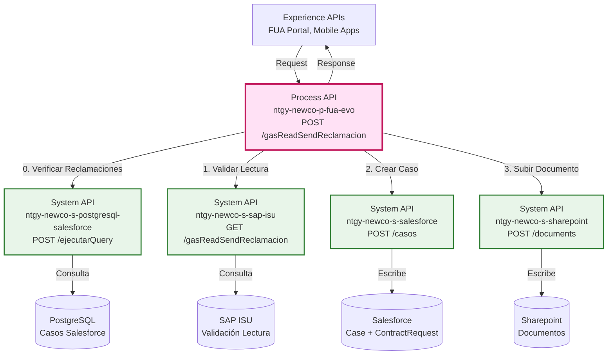
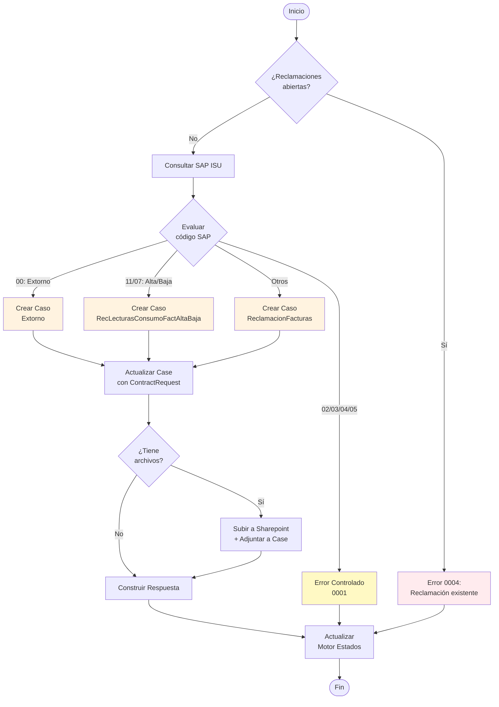
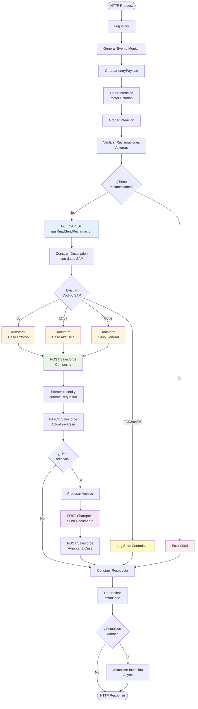
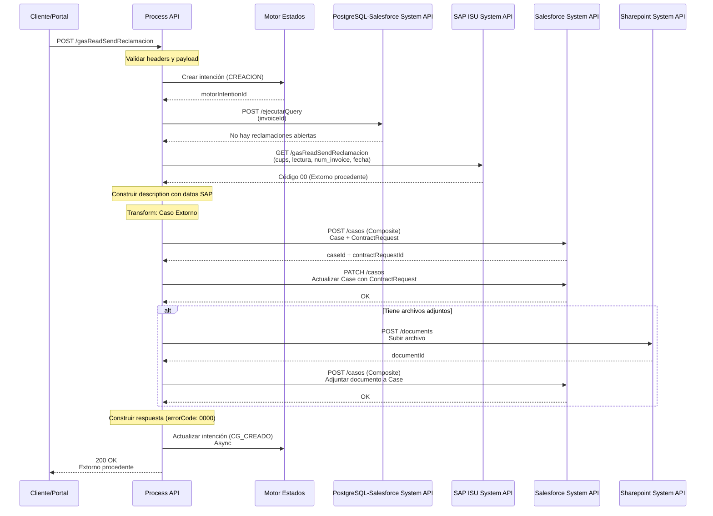
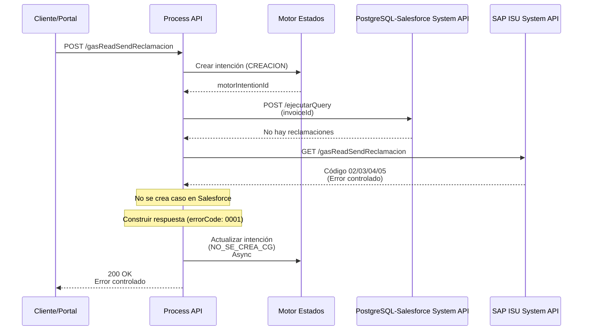
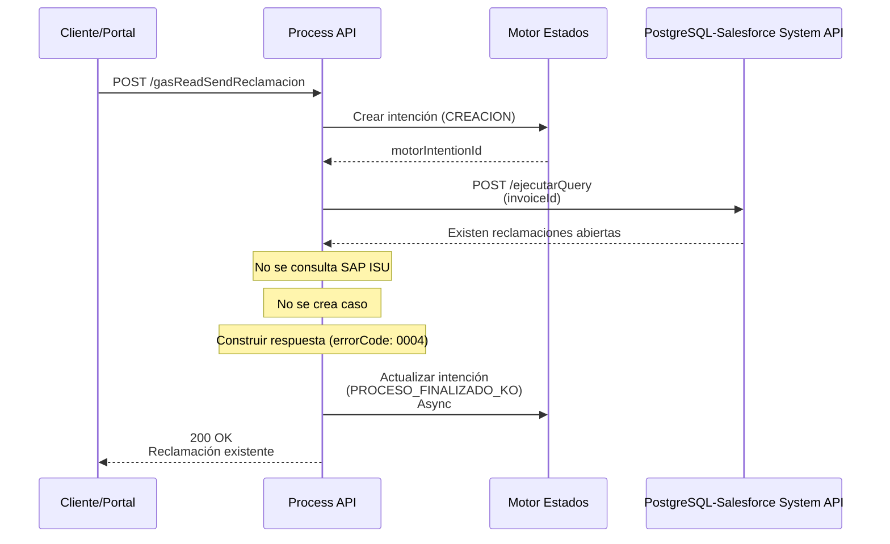

# POST /gasReadSendReclamacion

## 📌 Descripción General

### Propósito del Endpoint

Este endpoint gestiona **reclamaciones de lecturas de gas facturadas** cuando el cliente no está de acuerdo con la lectura registrada en su factura. El proceso consulta SAP ISU para validar la reclamación y, según el resultado, crea diferentes tipos de casos en Salesforce (Extorno, RecLecturasConsumoFactAltaBaja o ReclamacionFacturas).

### Tipo de API

**Capa:** Process API (API-Led Connectivity)

**Función:** Orquestación de validación en SAP ISU y creación de casos en Salesforce con gestión documental opcional

### Patrón de Integración

**Tipo:** Orquestación Condicional con Validación Previa

**Descripción:** 
1. Valida que no existan reclamaciones abiertas para la factura
2. Consulta SAP ISU para validar la lectura reclamada
3. Según el código de respuesta de SAP, crea diferentes tipos de casos en Salesforce
4. Opcionalmente sube documentos adjuntos a Sharepoint
5. Registra el proceso en el Motor de Estados

### Arquitectura API-Led Connectivity



---

## 💼 Propósito del Negocio

### Casos de Uso Principales

1. **Reclamación de Lectura con Extorno**
   - Cliente reclama lectura incorrecta que requiere extorno de factura
   - SAP ISU valida y confirma que procede extorno (código 00)
   - Se crea caso tipo "Extorno" en Salesforce

2. **Reclamación de Lectura por Alta/Baja**
   - Cliente reclama lectura relacionada con alta o baja del suministro
   - SAP ISU identifica situación especial (códigos 11 o 07)
   - Se crea caso tipo "RecLecturasConsumoFactAltaBaja" en Salesforce

3. **Reclamación General de Factura**
   - Cliente reclama lectura por otros motivos
   - SAP ISU valida pero no procede extorno automático
   - Se crea caso tipo "ReclamacionFacturas" en Salesforce

### 🔗 Endpoints Dependientes

Este Process API consume los siguientes System APIs:

| System API | Endpoint | Método | Propósito |
|------------|----------|--------|-----------|
| `ntgy-newco-s-postgresql-salesforce` | `/ejecutarQuery` | POST | Verifica reclamaciones abiertas para la factura |
| `ntgy-newco-s-sap-isu` | `/gasReadSendReclamacion` | GET | Valida la lectura reclamada contra datos de SAP ISU |
| `ntgy-newco-s-salesforce` | `/modificaciones/casos` | POST | Crea Case y ContractRequest (Composite API) |
| `ntgy-newco-s-salesforce` | `/modificaciones/casos` | POST | Actualiza Case con ContractRequest ID |
| `ntgy-newco-s-sharepoint` | `/documents` | POST | Sube documentos adjuntos (opcional) |
| `ntgy-newco-s-salesforce` | `/modificaciones/gasReadSend` | POST | Adjunta documento al Case (opcional) |

### Lógica de Orquestación



**Pasos del Proceso:**

1. **Validación Inicial**: Verifica que no existan reclamaciones abiertas para la factura
2. **Consulta SAP ISU**: Valida la lectura reclamada y obtiene datos de reclamación
3. **Evaluación de Respuesta**: Según código de SAP, determina tipo de caso a crear
4. **Creación en Salesforce**: Crea Case y ContractRequest mediante Composite API
5. **Actualización de Relación**: Vincula ContractRequest con Case creado
6. **Gestión Documental**: Si hay archivos, los sube a Sharepoint y adjunta al Case
7. **Motor de Estados**: Registra el proceso y su resultado

### Transformaciones Aplicadas

#### Códigos de Respuesta SAP ISU

| Código SAP | Significado | Tipo de Caso Salesforce | Código Respuesta |
|------------|-------------|-------------------------|------------------|
| `00` | Extorno procedente | Extorno | 0000 (Éxito) |
| `11`, `07` | Alta/Baja detectada | RecLecturasConsumoFactAltaBaja | 0002 (Caso creado) |
| `02`, `03`, `04`, `05` | Error controlado | No se crea caso | 0001 (Error controlado) |
| Otros | Reclamación general | ReclamacionFacturas | 0002 (Caso creado) |

#### Mapeo de Campos

| Campo Entrada | Campo Salesforce Case | Transformación |
|---------------|----------------------|----------------|
| `x-client-id` | `AccountId` | Directo |
| `x-contact-id` | `ContactId` | Directo |
| `contractId` | `NewCo_Contract__c` | Directo |
| `date` | `acn_fld_ReadingDate__c` | Formato: dd/MM/yyyy → yyyy-MM-dd |
| `readValue` | `acn_fld_ReadingValue__c` | Directo |
| `CUPS` | `acn_fld_CUPS__r.acn_fld_Name__c` | Relación externa |
| `invoiceId` | `NewCo_ClaimInvoiceNumber__c` | Condicional |
| `reasonSelected` | `NewCo_ClaimReason__c` | Directo |

### Contexto Empresarial

- **Dominio:** Gestión de Reclamaciones de Facturación
- **Sector:** Energía - Utilities (Gas Natural)
- **División:** Naturgy España - NewCo
- **Proceso de Negocio:** Reclamación de Lecturas Facturadas

### Stakeholders

- **Clientes Residenciales**: Reclaman lecturas incorrectas en sus facturas de gas
- **Agentes de Call Center**: Procesan reclamaciones en nombre de clientes
- **Equipo de Facturación**: Gestiona y resuelve las reclamaciones creadas
- **Equipo de SAP ISU**: Valida y procesa extornos cuando procede

### Valor de Negocio

- **Automatización**: Reduce tiempo de procesamiento de reclamaciones de horas a minutos
- **Validación Inmediata**: SAP ISU valida la reclamación antes de crear el caso
- **Trazabilidad**: Registro completo del proceso en Motor de Estados
- **Gestión Documental**: Centraliza documentos de soporte en Sharepoint
- **Experiencia del Cliente**: Respuesta inmediata sobre el estado de su reclamación

### Consumidores Potenciales

Este endpoint puede ser consumido por:
- Portal web FUA
- Aplicaciones móviles de clientes
- Sistemas de agentes de call center
- Integraciones de terceros autorizados

---

## 🔧 Especificación Técnica

### URLs por Ambiente

| Ambiente | URL Base | URL Completa |
|----------|----------|--------------|
| **Local** | `http://localhost:8081` | `http://localhost:8081/api/gasReadSendReclamacion` |
| **Development** | `https://ntgy-newco-p-fua-evo-dev.us-e2.cloudhub.io` | `https://ntgy-newco-p-fua-evo-dev.us-e2.cloudhub.io/api/gasReadSendReclamacion` |
| **UAT** | `https://ntgy-newco-p-fua-evo-uat.us-e2.cloudhub.io` | `https://ntgy-newco-p-fua-evo-uat.us-e2.cloudhub.io/api/gasReadSendReclamacion` |
| **Production** | `https://ntgy-newco-p-fua-evo-pro.us-e2.cloudhub.io` | `https://ntgy-newco-p-fua-evo-pro.us-e2.cloudhub.io/api/gasReadSendReclamacion` |

### Método HTTP

```
POST /api/gasReadSendReclamacion
```

### Headers Requeridos

| Header | Tipo | Obligatorio | Descripción |
|--------|------|-------------|-------------|
| `Content-Type` | string | ✅ | Debe ser `application/json` |
| `x-client-id` | string | ✅ | ID del cliente en Salesforce (AccountId) |
| `x-client-code` | string | ✅ | NIF/CIF del cliente |
| `x-contact-id` | string | ✅ | ID del contacto en Salesforce |
| `x-interaction-id` | string | ✅ | ID del caso padre (interacción) |
| `x-user-id` | string | ❌ | ID del usuario/agente (opcional) |
| `x-agent-mail` | string | ❌ | Email del agente (para impersonation en Salesforce) |
| `traceparent` | string | ✅ | Trace ID para seguimiento distribuido |
| `correlationId` | string | ✅ | ID de correlación para trazabilidad |

### Parámetros de Entrada

#### Request Body

```json
{
  "invoiceId": "string",
  "invoiceAtrId": "string",
  "contractId": "string",
  "billingAccountId": "string",
  "serviceAccountId": "string",
  "CUPS": "string",
  "readValue": "number",
  "date": "string",
  "reasonSelected": "string",
  "managementType": "string",
  "comments": "string",
  "files": [
    {
      "file": "string (base64)",
      "fileNameWithExtension": "string"
    }
  ]
}
```

#### Descripción de Campos

| Campo | Tipo | Obligatorio | Descripción | Ejemplo |
|-------|------|-------------|-------------|---------|
| `invoiceId` | string | ✅ | Número de factura reclamada | "2024001234" |
| `invoiceAtrId` | string | ❌ | Número de factura ATR | "ATR2024001234" |
| `contractId` | string | ✅ | ID del contrato en Salesforce | "8001234567890" |
| `billingAccountId` | string | ✅ | ID de cuenta de facturación | "BA001234" |
| `serviceAccountId` | string | ❌ | ID de cuenta de servicio | "SA001234" |
| `CUPS` | string | ✅ | Código CUPS del punto de suministro | "ES0021000000000001JN" |
| `readValue` | number | ✅ | Valor de lectura reclamado | 12345 |
| `date` | string | ✅ | Fecha de lectura (formato: dd/MM/yyyy) | "15/01/2024" |
| `reasonSelected` | string | ✅ | Código de motivo de reclamación | "08" |
| `managementType` | string | ✅ | Tipo de gestión | "claimInvoice" |
| `comments` | string | ❌ | Comentarios adicionales del cliente | "La lectura no coincide" |
| `files` | array | ❌ | Archivos adjuntos (fotos, documentos) | Ver estructura abajo |
| `files[].file` | string | ❌ | Contenido del archivo en base64 | "iVBORw0KGgo..." |
| `files[].fileNameWithExtension` | string | ❌ | Nombre del archivo con extensión | "lectura.jpg" |

### Respuestas

#### 200 OK - Éxito (Extorno)

```json
{
  "result": {
    "codResult": "0000",
    "msgResult": "Extorno procedente"
  },
  "caseCode": "",
  "lecturaFacilitada": {
    "kwh": "1234.56",
    "importe_total": "123.45",
    "InvoicesPDS": {
      "invoiceId": ["2024001235", "2024001236"]
    }
  }
}
```

#### 200 OK - Caso Creado (Otros)

```json
{
  "result": {
    "codResult": "0002",
    "msgResult": "Reclamación registrada"
  },
  "caseCode": "",
  "lecturaFacilitada": {
    "kwh": "1234.56",
    "importe_total": "123.45",
    "InvoicesPDS": {
      "invoiceId": []
    }
  }
}
```

#### 200 OK - Error Controlado SAP

```json
{
  "result": {
    "codResult": "0001",
    "msgResult": "Lectura fuera de rango permitido"
  },
  "caseCode": "",
  "lecturaFacilitada": ""
}
```

#### 200 OK - Reclamación Existente

```json
{
  "result": {
    "codResult": "0004",
    "msgResult": "Existen reclamaciones abiertas para esta factura"
  }
}
```

#### 400 Bad Request - Error de Validación

```json
{
  "code": "VALIDATION_ERROR",
  "message": "Campo requerido faltante: CUPS",
  "details": "El campo CUPS es obligatorio para procesar la reclamación"
}
```

#### 500 Internal Server Error - Error del Sistema

```json
{
  "code": "INTERNAL_ERROR",
  "message": "Error al procesar la reclamación",
  "details": "Error de conexión con SAP ISU"
}
```

### Códigos de Estado HTTP

| Código | Descripción | Cuándo se usa |
|--------|-------------|---------------|
| `200` | OK | Reclamación procesada (éxito o error controlado) |
| `400` | Bad Request | Datos de entrada inválidos o faltantes |
| `401` | Unauthorized | Credenciales inválidas o faltantes |
| `500` | Internal Server Error | Error en sistemas backend (SAP, Salesforce, Sharepoint) |
| `503` | Service Unavailable | Sistema backend no disponible |

### Autenticación

- **Tipo:** Client ID & Client Secret (Anypoint Platform)
- **Headers:** `client_id` y `client_secret`
- **Scope:** Acceso a Process API de FUA

### Timeouts

| Tipo | Valor | Descripción |
|------|-------|-------------|
| **Request Timeout** | 60 segundos | Tiempo máximo de espera para respuesta completa |
| **Connection Timeout** | 10 segundos | Tiempo máximo para establecer conexión |
| **SAP ISU Timeout** | Configurado en properties | Timeout específico para consulta SAP |
| **Salesforce Timeout** | Configurado en properties | Timeout específico para operaciones Salesforce |

---

## 🏗️ Implementación Técnica

### Arquitectura del Flow



### Transformaciones DataWeave

#### 1. Creación de Intención (Motor Estados)

```dataweave
%dw 2.0
output application/java
---
{
  evento: "CREACION",
  proceso: "ReclamacionFactura",
  nif: vars.entryPayload.'x-client-code',
  billingAccount: vars.entryPayload.billingAccountId,
  contrato: vars.entryPayload.contractId,
  casoGestion: "",
  jsonPayload: vars.entryPayload - "files"
}
```

#### 2. Query Parameters para SAP ISU

```dataweave
%dw 2.0
output application/json
---
{
  "cups": vars.entryPayload.CUPS,
  "lectura": vars.entryPayload.readValue,
  "num_invoice": vars.entryPayload.invoiceId,
  "fecha_lectura": vars.entryPayload.date
}
```

#### 3. Construcción de Description

```dataweave
%dw 2.0
import * from dw::core::Strings
var kwhDespues = substring(substringAfter(vars.lecturaFacilitada.datosReclamacion.kwh, "."), 0, 2)
var kwhAntes = substringBefore(vars.lecturaFacilitada.datosReclamacion.kwh, ".")
var auxKWH = if(!isEmpty(kwhDespues) and !isEmpty(kwhAntes)) 
  " / " ++ kwhAntes ++ "." ++ kwhDespues ++ "kwh" 
  else ""
output application/json
---
vars.lecturaFacilitada.result.codResult ++ " " ++ 
vars.lecturaFacilitada.result.msgResult ++ " " ++ 
auxKWH ++ " / " ++ 
vars.lecturaFacilitada.datosReclamacion.importe_total ++ "€ / " ++ 
(vars.lecturaFacilitada.datosReclamacion.InvoicesPDS.*invoiceId joinBy ",")
```

#### 4. Transformación de Fecha

```dataweave
%dw 2.0
output application/json
---
{
  acn_fld_ReadingDate__c: (vars.entryPayload.date as Date {format: 'dd/MM/yyyy'} 
    as String {format: 'yyyy-MM-dd'})
}
```

#### 5. Composite Request - Caso Extorno

```dataweave
%dw 2.0
output application/json
---
{
  "allOrNone": true,
  "collateSubrequests": false,
  "compositeRequest": [
    {
      "method": "POST",
      "url": "/services/data/v52.0/sobjects/Case",
      "referenceId": "refCaseGestion",
      "body": {
        "NewCo_Recordtype__c": "Gestion",
        "AccountId": vars.entryPayload."x-client-id",
        "ContactId": vars.entryPayload."x-contact-id",
        "Priority": "02",
        "Origin": "FUA",
        "NewCo_Creado_por__c": if(vars.entryPayload.'x-user-id' != null) 
          vars.entryPayload.'x-user-id' 
          else vars.entryPayload."x-contact-id",
        "ParentId": vars.entryPayload."x-interaction-id",
        "NewCo_Contract__c": vars.entryPayload.contractId,
        ("vlocity_cmt__ServiceAccountId__c": vars.entryPayload.serviceAccountId) 
          if(vars.entryPayload.managementType == "claimInvoice"),
        ("vlocity_cmt__BillingAccountId__c": vars.entryPayload.billingAccountId) 
          if(vars.entryPayload.managementType == "claimInvoice"),
        ("acn_fld_NumFacturaATR__c": vars.entryPayload.invoiceAtrId) 
          if(!(vars.entryPayload.managementType == "claimInvoice" and 
              vars.entryPayload.reasonSelected == "08")),
        "NewCo_Ip__c": payload.DirIp,
        "NewCo_ClaimReason__c": vars.entryPayload.reasonSelected,
        ("NewCo_ClaimInvoiceNumber__c": vars.entryPayload.invoiceId) 
          if(vars.entryPayload.managementType == "claimInvoice" and 
             vars.entryPayload.reasonSelected != "08"),
        "NewCo_CorrelationId__c": correlationId,
        ("NewCo_ClaimObservation__c": vars.entryPayload.comments) 
          if(vars.entryPayload.managementType == "claimInvoice"),
        "acn_fld_Tittle__r": {
          "NewCo_ExternalId__c": "Extorno"
        },
        "acn_fld_ReadingDate__c": (vars.entryPayload.date as Date {format: 'dd/MM/yyyy'} 
          as String {format: 'yyyy-MM-dd'}),
        "acn_fld_ReadingValue__c": vars.entryPayload.readValue,
        "acn_fld_Comments__c": "Cliente reclama última lectura facturada",
        "Description": vars.description,
        "NewCo_TraceId__c": splitBy(vars.entryPayload.traceparent, "-")[1],
        ("NewCo_IdentificadorDeIntencion__c": vars.motorIntentionId) 
          if (!isEmpty(vars.motorIntentionId))
      }
    },
    {
      "method": "POST",
      "url": "/services/data/v52.0/sobjects/acn_obj_ContractRequest__c",
      "referenceId": "refSolContratacion",
      "body": {
        "NewCo_Recordtype__c": "acn_rt_With_Switching",
        "acn_fld_Account__c": vars.entryPayload."x-client-id",
        "acn_fld_Contract__c": vars.entryPayload.contractId,
        "acn_fld_Sctype__c": "17",
        "acn_fld_Category__c": "24",
        "acn_fld_Status__c": "01",
        "acn_fld_CUPS__r": {
          "acn_fld_Name__c": vars.entryPayload.CUPS
        },
        "acn_fld_ReadingDate__c": (vars.entryPayload.date as Date {format: 'dd/MM/yyyy'} 
          as String {format: 'yyyy-MM-dd'}),
        "acn_fld_ReadingValue__c": vars.entryPayload.readValue,
        "NewCo_Creado_por__c": if(vars.entryPayload.'x-user-id' != null) 
          vars.entryPayload.'x-user-id' 
          else vars.entryPayload.'x-client-id',
        "NewCo_fld_case__c": "@{refCaseGestion.id}"
      }
    }
  ]
}
```

#### 6. Actualización de Case con ContractRequest

```dataweave
%dw 2.0
output application/json
---
{
  "allOrNone": true,
  "collateSubrequests": false,
  "compositeRequest": [
    {
      "method": "PATCH",
      "url": "/services/data/v52.0/sobjects/Case/" ++ vars.caseId,
      "referenceId": "refCaseGestion",
      "body": {
        "acn_fld_ContractRequest__c": vars.idCasoSolicitudContratacion
      }
    }
  ]
}
```

#### 7. Respuesta Final

```dataweave
%dw 2.0
output application/json
---
{
  "result": {
    "codResult": vars.errorCode,
    "msgResult": vars.lecturaFacilitada.result.msgResult
  },
  "caseCode": vars.caseCode default "",
  "lecturaFacilitada": vars.lecturaFacilitada.datosReclamacion default ""
}
```

### Patrones de Diseño

#### 1. Patrón: Validación Previa (Pre-Validation)

**Justificación:** Evita crear casos duplicados verificando reclamaciones abiertas antes de procesar

**Implementación:**
- Sub-flow `checkInvoiceReclamations` consulta casos existentes
- Si existen casos abiertos, retorna error 0004 sin procesar

#### 2. Patrón: Orquestación Condicional (Conditional Orchestration)

**Justificación:** Según el resultado de SAP ISU, se crean diferentes tipos de casos en Salesforce

**Implementación:**
- Choice router evalúa código de respuesta SAP
- Tres transformaciones diferentes según el tipo de caso
- Cada tipo de caso tiene su propio título y configuración

#### 3. Patrón: Composite API (Salesforce)

**Justificación:** Reduce latencia creando Case y ContractRequest en una sola llamada

**Implementación:**
- Salesforce Composite API con dos operaciones POST
- Referencia entre objetos usando `@{refCaseGestion.id}`
- Transaccional: `allOrNone: true`

#### 4. Patrón: Async Processing (Motor de Estados)

**Justificación:** No bloquea la respuesta al cliente mientras se actualiza el motor

**Implementación:**
- Async scope para actualización de intención
- Fire-and-forget pattern
- No afecta el tiempo de respuesta

### Diagramas de Secuencia

#### 1. Flujo Normal de Éxito (Extorno)



#### 2. Flujo con Error Controlado SAP



#### 3. Flujo con Reclamación Existente



### Manejo de Errores

#### Estrategia de Error Handling

| Tipo de Error | Acción | Código Respuesta | Motor Estados |
|---------------|--------|------------------|---------------|
| **Reclamación existente** | Retornar sin procesar | 0004 | PROCESO_FINALIZADO_KO |
| **Error controlado SAP** (02-05) | Retornar sin crear caso | 0001 | NO_SE_CREA_CG |
| **Extorno procedente** (00) | Crear caso Extorno | 0000 | CG_CREADO |
| **Alta/Baja** (11, 07) | Crear caso RecLecturas | 0002 | CG_CREADO |
| **Otros códigos SAP** | Crear caso ReclamacionFacturas | 0002 | CG_CREADO |
| **Error Salesforce** | Error mapping NTGY:ERROR_CASO_GESTION | 500 | NO_SE_CREA_CG |
| **Error SAP ISU** | Propagar error | 500 | NO_SE_CREA_CG |

#### Error Mapping

```xml
<error-mapping targetType="NTGY:ERROR_CASO_GESTION" />
```

Este error mapping captura errores específicos de Salesforce relacionados con la creación de casos.

---

## 💻 Ejemplos de Uso

### Ejemplo 1: Reclamación con Extorno (cURL)

#### Request

```bash
curl -X POST "https://ntgy-newco-p-fua-evo-pro.us-e2.cloudhub.io/api/gasReadSendReclamacion" \
  -H "Content-Type: application/json" \
  -H "client_id: YOUR_CLIENT_ID" \
  -H "client_secret: YOUR_CLIENT_SECRET" \
  -H "x-client-id: 0011234567890ABC" \
  -H "x-client-code: 12345678A" \
  -H "x-contact-id: 0031234567890DEF" \
  -H "x-interaction-id: 5001234567890GHI" \
  -H "traceparent: 00-4bf92f3577b34da6a3ce929d0e0e4736-00f067aa0ba902b7-01" \
  -H "correlationId: corr-123456789" \
  -d '{
    "invoiceId": "2024001234",
    "invoiceAtrId": "ATR2024001234",
    "contractId": "8001234567890",
    "billingAccountId": "BA001234",
    "serviceAccountId": "SA001234",
    "CUPS": "ES0021000000000001JN",
    "readValue": 12345,
    "date": "15/01/2024",
    "reasonSelected": "08",
    "managementType": "claimInvoice",
    "comments": "La lectura no coincide con mi contador"
  }'
```

#### Response (200 OK)

```json
{
  "result": {
    "codResult": "0000",
    "msgResult": "Extorno procedente"
  },
  "caseCode": "",
  "lecturaFacilitada": {
    "kwh": "1234.56",
    "importe_total": "123.45",
    "InvoicesPDS": {
      "invoiceId": ["2024001235", "2024001236"]
    }
  }
}
```

### Ejemplo 2: Reclamación con Archivo Adjunto (JavaScript)

```javascript
const fs = require('fs');

// Leer archivo y convertir a base64
const fileBuffer = fs.readFileSync('lectura_contador.jpg');
const fileBase64 = fileBuffer.toString('base64');

const requestBody = {
  invoiceId: "2024001234",
  contractId: "8001234567890",
  billingAccountId: "BA001234",
  CUPS: "ES0021000000000001JN",
  readValue: 12345,
  date: "15/01/2024",
  reasonSelected: "08",
  managementType: "claimInvoice",
  comments: "Adjunto foto del contador",
  files: [
    {
      file: fileBase64,
      fileNameWithExtension: "lectura_contador.jpg"
    }
  ]
};

const response = await fetch('https://ntgy-newco-p-fua-evo-pro.us-e2.cloudhub.io/api/gasReadSendReclamacion', {
  method: 'POST',
  headers: {
    'Content-Type': 'application/json',
    'client_id': 'YOUR_CLIENT_ID',
    'client_secret': 'YOUR_CLIENT_SECRET',
    'x-client-id': '0011234567890ABC',
    'x-client-code': '12345678A',
    'x-contact-id': '0031234567890DEF',
    'x-interaction-id': '5001234567890GHI',
    'traceparent': '00-4bf92f3577b34da6a3ce929d0e0e4736-00f067aa0ba902b7-01',
    'correlationId': 'corr-123456789'
  },
  body: JSON.stringify(requestBody)
});

const data = await response.json();
console.log('Respuesta:', data);
```

### Ejemplo 3: Error Controlado SAP (Python)

#### Request

```python
import requests
import json

url = "https://ntgy-newco-p-fua-evo-pro.us-e2.cloudhub.io/api/gasReadSendReclamacion"

headers = {
    "Content-Type": "application/json",
    "client_id": "YOUR_CLIENT_ID",
    "client_secret": "YOUR_CLIENT_SECRET",
    "x-client-id": "0011234567890ABC",
    "x-client-code": "12345678A",
    "x-contact-id": "0031234567890DEF",
    "x-interaction-id": "5001234567890GHI",
    "traceparent": "00-4bf92f3577b34da6a3ce929d0e0e4736-00f067aa0ba902b7-01",
    "correlationId": "corr-123456789"
}

payload = {
    "invoiceId": "2024001234",
    "contractId": "8001234567890",
    "billingAccountId": "BA001234",
    "CUPS": "ES0021000000000001JN",
    "readValue": 99999,  # Lectura fuera de rango
    "date": "15/01/2024",
    "reasonSelected": "08",
    "managementType": "claimInvoice"
}

response = requests.post(url, headers=headers, json=payload)
print(f"Status: {response.status_code}")
print(f"Response: {json.dumps(response.json(), indent=2)}")
```

#### Response (200 OK - Error Controlado)

```json
{
  "result": {
    "codResult": "0001",
    "msgResult": "Lectura fuera de rango permitido"
  },
  "caseCode": "",
  "lecturaFacilitada": ""
}
```

### Ejemplo 4: Reclamación Existente

#### Request

```bash
curl -X POST "https://ntgy-newco-p-fua-evo-pro.us-e2.cloudhub.io/api/gasReadSendReclamacion" \
  -H "Content-Type: application/json" \
  -H "client_id: YOUR_CLIENT_ID" \
  -H "client_secret: YOUR_CLIENT_SECRET" \
  -H "x-client-id: 0011234567890ABC" \
  -H "x-client-code: 12345678A" \
  -H "x-contact-id: 0031234567890DEF" \
  -H "x-interaction-id: 5001234567890GHI" \
  -H "traceparent: 00-4bf92f3577b34da6a3ce929d0e0e4736-00f067aa0ba902b7-01" \
  -H "correlationId: corr-123456789" \
  -d '{
    "invoiceId": "2024001234",
    "contractId": "8001234567890",
    "billingAccountId": "BA001234",
    "CUPS": "ES0021000000000001JN",
    "readValue": 12345,
    "date": "15/01/2024",
    "reasonSelected": "08",
    "managementType": "claimInvoice"
  }'
```

#### Response (200 OK - Reclamación Existente)

```json
{
  "result": {
    "codResult": "0004",
    "msgResult": "Existen reclamaciones abiertas para esta factura"
  }
}
```

### Ejemplo 5: Error de Validación

#### Request (falta campo obligatorio)

```bash
curl -X POST "https://ntgy-newco-p-fua-evo-pro.us-e2.cloudhub.io/api/gasReadSendReclamacion" \
  -H "Content-Type: application/json" \
  -H "client_id: YOUR_CLIENT_ID" \
  -H "client_secret: YOUR_CLIENT_SECRET" \
  -H "x-client-id: 0011234567890ABC" \
  -d '{
    "invoiceId": "2024001234",
    "contractId": "8001234567890"
  }'
```

#### Response (400 Bad Request)

```json
{
  "code": "VALIDATION_ERROR",
  "message": "Campos requeridos faltantes",
  "details": "Los siguientes campos son obligatorios: CUPS, readValue, date, billingAccountId, reasonSelected, managementType"
}
```
