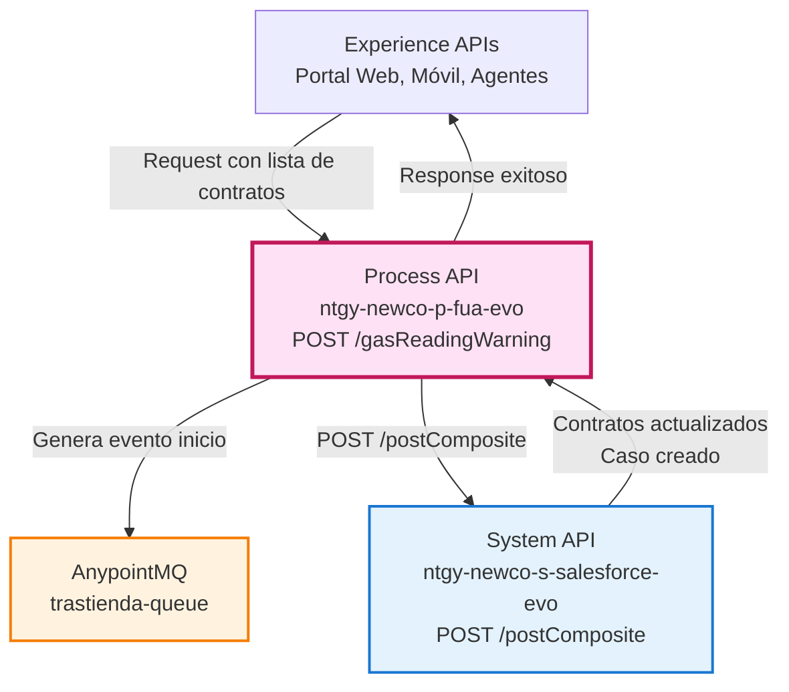
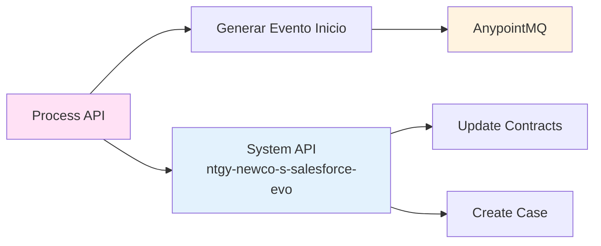
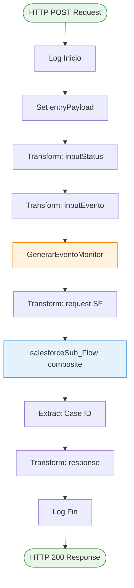
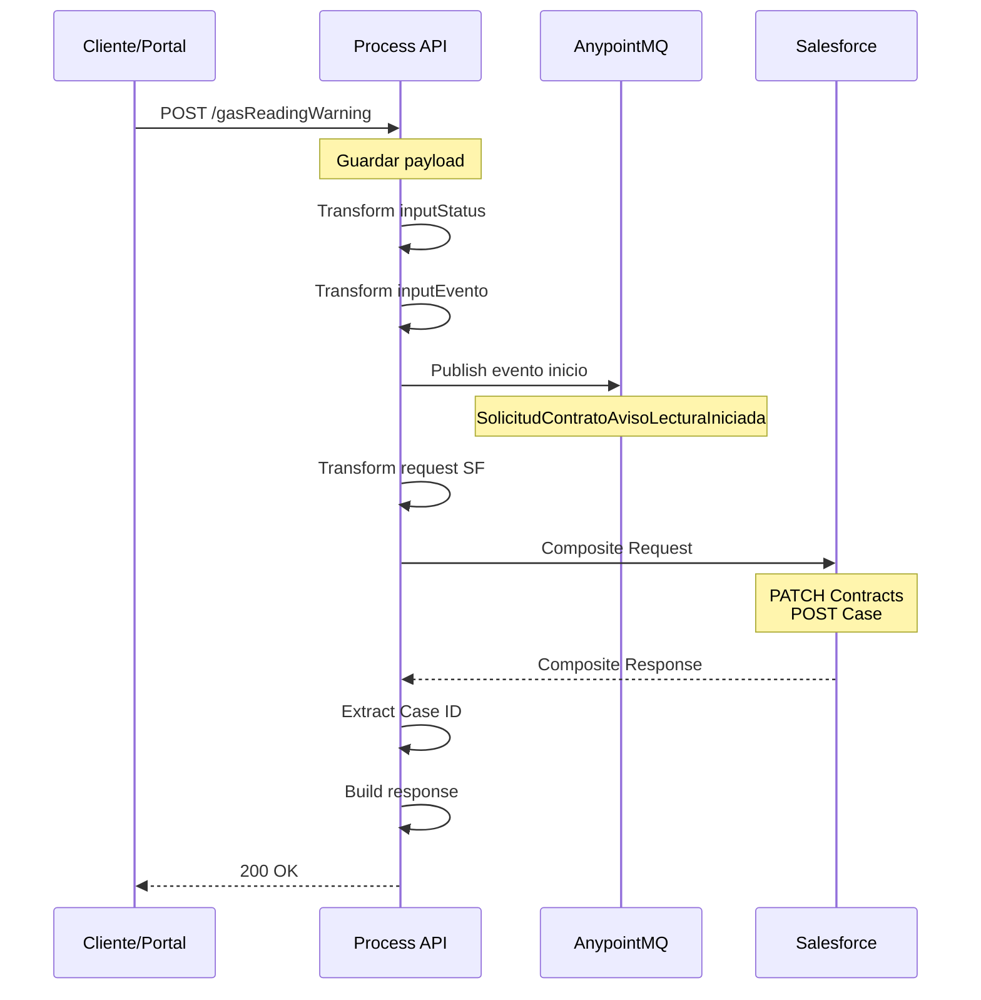
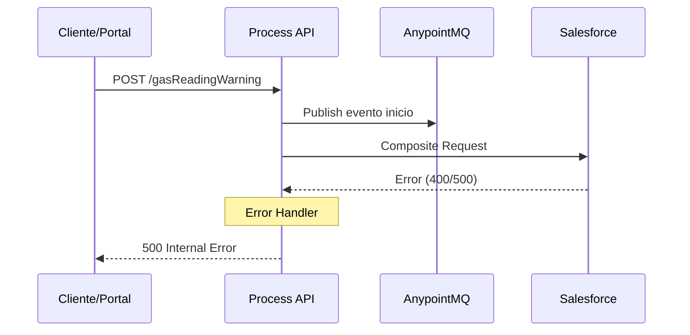
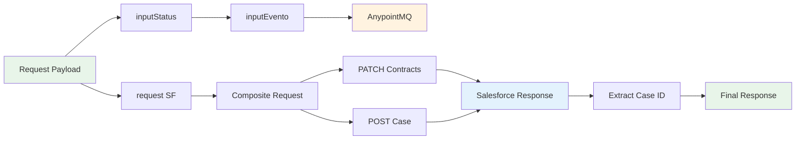

# POST /gasReadingWarning

## 📌 Descripción General

### Propósito del Endpoint

Este endpoint permite gestionar la activación o desactivación del aviso por email para la lectura de gas en uno o múltiples contratos de un cliente. Actualiza el campo `NewCo_EnviarEmailAvisoLectura__c` en los contratos de Salesforce y crea automáticamente un caso de gestión con el detalle de los cambios realizados.

### Tipo de API

**Capa:** Process API (API-Led Connectivity)

**Función:** Orquestación de actualización de contratos y creación de casos en Salesforce con generación de eventos de monitorización

### Patrón de Integración

**Tipo:** Orquestación con Operación Composite

**Descripción:** Orquesta una llamada al System API ntgy-newco-s-salesforce-evo (POST /postComposite) que ejecuta una operación composite en Salesforce para actualizar múltiples contratos y crear un caso de gestión en una única transacción atómica. Genera eventos de inicio y finalización para monitorización.

### Arquitectura API-Led Connectivity



---

## 💼 Propósito del Negocio

### Casos de Uso Principales

1. **Activación de Avisos de Lectura**
   - Cliente solicita recibir avisos por email cuando se realice la lectura del contador de gas
   - Beneficio: Mejora la transparencia y comunicación con el cliente

2. **Desactivación de Avisos de Lectura**
   - Cliente solicita dejar de recibir avisos por email de lectura de gas
   - Beneficio: Respeta las preferencias de comunicación del cliente

3. **Gestión Masiva de Múltiples Contratos**
   - Actualización simultánea de varios contratos del mismo cliente
   - Beneficio: Eficiencia operativa al procesar múltiples contratos en una sola operación

### 🔗 Endpoints Dependientes

Este Process API consume los siguientes servicios:

| Sistema | Operación | Método | Propósito |
|---------|-----------|--------|-----------|
| `ntgy-newco-s-salesforce-evo` | `/postComposite` | POST | Actualización de contratos y creación de casos (operación composite) |
| `AnypointMQ` | `trastienda-queue` | PUBLISH | Publicar evento de inicio |

### Lógica de Orquestación



**Pasos del Proceso:**

1. **Validación y Preparación**: Recibe payload con lista de contratos y flags de activación/desactivación
2. **Generación de Evento**: Publica evento `SolicitudContratoAvisoLecturaIniciada` a AnypointMQ
3. **Construcción de Request Composite**: Prepara operación atómica para el System API ntgy-newco-s-salesforce-evo con dos sub-requests:
   - PATCH: Actualiza campo `NewCo_EnviarEmailAvisoLectura__c` en contratos
   - POST: Crea caso de gestión con descripción de cambios
4. **Ejecución Composite**: Llama al System API (POST /postComposite) que ejecuta la operación atómica en Salesforce (allOrNone: true)
5. **Respuesta**: Retorna resultado exitoso al cliente

### Transformaciones Aplicadas

| Campo Original (Request) | Campo Transformado (Salesforce) | Transformación |
|--------------------------|----------------------------------|----------------|
| `contractIdList[].contractId` | `Contract.id` | Mapeo directo de IDs de contrato |
| `contractIdList[].flagEnvio` | `Contract.NewCo_EnviarEmailAvisoLectura__c` | Boolean de activación/desactivación |
| `contractIdList[].direccion` | `Case.Description` | Construcción de descripción dinámica |
| `x-client-id` | `Case.AccountId` | ID de cuenta del cliente |
| `x-contact-id` | `Case.ContactId` | ID de contacto del cliente |
| `x-user-id` | `Case.OwnerId` | Propietario del caso (si existe) |
| `x-interaction-id` | `Case.ParentId` | Caso padre (si existe) |
| `traceparent` | `Case.NewCo_TraceId__c` | Extracción de traceId para trazabilidad |

**Lógica de Descripción del Caso:**

El endpoint construye dinámicamente la descripción del caso concatenando:
- Activaciones: "Activada marca aviso lectura en dirección [dirección]"
- Desactivaciones: "Desactivada marca aviso lectura en dirección [dirección]"

Ejemplo:
```
Activada marca aviso lectura en dirección Calle Mayor 123
Desactivada marca aviso lectura en dirección Avenida Principal 456
```

### Contexto Empresarial

- **Dominio:** Gestión de Contratos y Notificaciones
- **Sector:** Energía - Utilities (Gas)
- **División:** Naturgy España - NewCo
- **Proceso de Negocio:** Gestión de preferencias de comunicación del cliente

### Stakeholders

- **Clientes Residenciales**: Necesitan controlar las notificaciones que reciben sobre sus contratos de gas
- **Agentes de Atención al Cliente**: Requieren herramienta para gestionar preferencias de notificación
- **Equipo de Operaciones**: Necesita trazabilidad de cambios en preferencias de comunicación

### Valor de Negocio

- **Mejora de Experiencia del Cliente**: Permite al cliente controlar sus preferencias de comunicación
- **Cumplimiento Normativo**: Respeta las preferencias de comunicación del cliente (GDPR)
- **Trazabilidad**: Genera casos de gestión para auditoría de cambios
- **Eficiencia Operativa**: Procesa múltiples contratos en una sola operación atómica

### Consumidores Potenciales

Este endpoint puede ser consumido por:
- Portal web de autoservicio (FUA)
- Aplicación móvil de clientes
- Sistema de agentes de call center
- Herramientas de gestión de back-office

---

## 🔧 Especificación Técnica

### URLs por Ambiente

| Ambiente | URL Base | URL Completa |
|----------|----------|--------------|
| **Local** | `http://localhost:8081` | `http://localhost:8081/api/gasReadingWarning` |
| **Development** | `https://ntgy-newco-p-fua-evo-dev.us-e2.cloudhub.io` | `https://ntgy-newco-p-fua-evo-dev.us-e2.cloudhub.io/api/gasReadingWarning` |
| **UAT** | `https://ntgy-newco-p-fua-evo-uat.us-e2.cloudhub.io` | `https://ntgy-newco-p-fua-evo-uat.us-e2.cloudhub.io/api/gasReadingWarning` |
| **Production** | `https://ntgy-newco-p-fua-evo-pro.us-e2.cloudhub.io` | `https://ntgy-newco-p-fua-evo-pro.us-e2.cloudhub.io/api/gasReadingWarning` |

### Método HTTP

```
POST /api/gasReadingWarning
```

### Headers Requeridos

| Header | Tipo | Obligatorio | Descripción |
|--------|------|-------------|-------------|
| `Content-Type` | string | ✅ | Debe ser `application/json` |
| `x-client-id` | string | ✅ | ID de la cuenta del cliente en Salesforce |
| `x-contact-id` | string | ✅ | ID del contacto del cliente en Salesforce |
| `x-client-code` | string | ✅ | Código/NIF del cliente |
| `x-user-id` | string | ⚠️ | ID del usuario que realiza la operación (opcional) |
| `x-interaction-id` | string | ⚠️ | ID de interacción padre (opcional) |
| `traceparent` | string | ⚠️ | Trace ID para trazabilidad distribuida (opcional) |

### Parámetros de Entrada

#### Request Body

```json
{
  "contractIdList": [
    {
      "contractId": "string",
      "flagEnvio": boolean,
      "direccion": "string"
    }
  ],
  "traceparent": "string"
}
```

#### Descripción de Campos

| Campo | Tipo | Obligatorio | Descripción |
|-------|------|-------------|-------------|
| `contractIdList` | array | ✅ | Lista de contratos a actualizar |
| `contractIdList[].contractId` | string | ✅ | ID del contrato en Salesforce (formato: 800XXXXXXXXXX) |
| `contractIdList[].flagEnvio` | boolean | ✅ | `true` para activar avisos, `false` para desactivar |
| `contractIdList[].direccion` | string | ✅ | Dirección del punto de suministro (para descripción del caso) |
| `traceparent` | string | ⚠️ | Trace ID para trazabilidad (formato W3C Trace Context) |

### Respuestas

#### 200 OK - Operación Exitosa

```json
{
  "result": {
    "codResult": "0000",
    "msgResult": "No hay error"
  }
}
```

#### 400 Bad Request - Error de Validación

```json
{
  "code": "VALIDATION_ERROR",
  "message": "Error en la validación de datos",
  "details": "Campo contractIdList es requerido"
}
```

#### 500 Internal Server Error - Error del Sistema

```json
{
  "code": "INTERNAL_ERROR",
  "message": "Error interno del servidor",
  "details": "Error al ejecutar operación composite en Salesforce"
}
```

### Validaciones

- ✅ `contractIdList` no puede estar vacío
- ✅ Cada elemento debe tener `contractId`, `flagEnvio` y `direccion`
- ✅ `contractId` debe ser un ID válido de Salesforce
- ✅ `flagEnvio` debe ser boolean
- ✅ Headers `x-client-id` y `x-contact-id` son obligatorios

### Autenticación

- **Tipo:** Client ID & Client Secret (Anypoint Platform)
- **Ubicación:** Headers de la petición HTTP

### Timeouts

| Tipo | Valor |
|------|-------|
| **Request Timeout** | 60 segundos |
| **Connection Timeout** | 30 segundos |
| **Salesforce Timeout** | 60 segundos |

---

## 🏗️ Implementación Técnica

### Arquitectura del Flow



### Transformaciones DataWeave

#### 1. Construcción del Evento de Inicio (inputStatus)

```dataweave
%dw 2.0
output application/json
---
{
    "eventType": "SolicitudContratoAvisoLecturaIniciada",
    "source": Mule::p('event.omega'),
    "data": vars.entryPayload,
    "queue": Mule::p('anypointMQ.trastiendaQueue'),
    "properties": {},
    "deleteNotice": false	
}
```

#### 2. Construcción del CloudEvent (inputEvento)

```dataweave
%dw 2.0
output application/json
---
{
    "body":{
        "specversion" : Mule::p('event.specversion'),
        "type" : vars.inputStatus.eventType,
        "source" : vars.inputStatus.source,
        "id" : uuid(),
        "time" : (now() >> "UTC") as String {format: "yyyy-MM-dd'T'HH:mm:ss.SSSXXX"},
        "datacontenttype" : Mule::p('event.datacontenttype'),
        "version": Mule::p('event.version'),
        "traceparent": vars.traceparent,
        "parenttraceid": Mule::p('event.parenttraceid'),
        "data": vars.inputStatus.data
    },
    "destino": vars.inputStatus.queue,
    "properties": vars.inputStatus.properties
}
```

#### 3. Construcción del Request Composite de Salesforce

```dataweave
%dw 2.0
output application/json

var trues  = vars.entryPayload.contractIdList filter ((item) -> item.flagEnvio == true)
var falses = vars.entryPayload.contractIdList filter ((item) -> item.flagEnvio == false)

var descFalseList = falses map ((item) -> "Desactivada marca aviso lectura en dirección " ++ item.direccion)
var descTrueList =  trues map ((item) -> "Activada marca aviso lectura en dirección " ++ item.direccion)

var finalDesc =
    (
        (descTrueList joinBy "\n")
        ++
        (if (!isEmpty(descTrueList) and !isEmpty(descFalseList)) "\n" else "")
        ++
        (descFalseList joinBy "\n")
    )
    default null

---
{
    "body":{
      "allOrNone": true,
      "collateSubrequests": false,
      "compositeRequest": [
        {
          "method": "PATCH",
          "url": "/services/data/v52.0/composite/sobjects",
          "referenceId": "refUpdateContracts",
          "body": {
              "allOrNone": true,
              "records": vars.entryPayload.contractIdList map ((i,index) -> {
                  "attributes": {
                      "type": "Contract"
                  },
                  "id": i.contractId,
                  "NewCo_EnviarEmailAvisoLectura__c": i.flagEnvio
              })
          }
        },
        {
          "method": "POST",
          "url": "/services/data/v52.0/composite/sobjects",
          "referenceId": "refCreateCases",
          "body": {
            "allOrNone": true,
            "records":[
                {          
                "attributes": {
                     "type": "Case"
                },          
                "NewCo_Recordtype__c": "Gestion",
                "AccountId": vars.entryPayload.'x-client-id',
                "ContactId": vars.entryPayload.'x-contact-id',
                "Status": "06",
                "Priority": "02",
                "Origin": "FUA",
                "acn_fld_BusinessLine__c": "02",
                ("OwnerId" : vars.entryPayload."x-user-id") if(!isEmpty(vars.entryPayload."x-user-id")),
                ("ParentId": vars.entryPayload."x-interaction-id") if(vars.entryPayload."x-interaction-id"?),
                "acn_fld_Tittle__r": {
                    "NewCo_ExternalId__c": "AvisoLecturaPorMail"
                },
                "NewCo_Creado_por__c": if(vars.entryPayload.'x-user-id' != null) 
                    vars.entryPayload.'x-user-id' 
                    else vars.entryPayload.'x-contact-id',
                "Description": finalDesc,
                "NewCo_TraceId__c": splitBy(vars.entryPayload.traceparent,"-")[1],
                ("NewCo_IdentificadorDeIntencion__c": vars.motorIntentionId) 
                    if (!isEmpty(vars.motorIntentionId))
                }
            ]
          }
        }
      ]
    },
    "operationSalesforce":"composite"
}
```

**Lógica Destacada:**
- Separa contratos con `flagEnvio=true` y `flagEnvio=false`
- Construye descripciones dinámicas para cada grupo
- Concatena descripciones con saltos de línea
- Operación atómica: si falla una actualización, se revierten todas

#### 4. Construcción de la Respuesta

```dataweave
%dw 2.0
output application/json
---
{
    "result": {
        "codResult": '0000',
        "msgResult": "No hay error"
    }
}
```

### Patrones de Diseño

**Patrón:** Composite Pattern + Event-Driven Architecture

**Justificación:** 
- **Composite Pattern**: Permite ejecutar múltiples operaciones en Salesforce de forma atómica (actualización de contratos + creación de caso)
- **Event-Driven**: Genera eventos de inicio para monitorización y auditoría sin bloquear el flujo principal

### Diagramas de Secuencia

#### 1. Flujo Normal de Éxito



#### 2. Flujo con Error de Salesforce



#### 3. Diagrama de Transformación de Datos



### Manejo de Errores

#### Estrategia de Error Handling

1. **Error Handler Global**: `general-errorsError_Handler`
2. **Validación de Entrada**: Validación automática por APIKit (RAML)
3. **Errores de Salesforce**: Capturados y transformados a formato estándar
4. **Rollback Automático**: Operación composite con `allOrNone: true`

#### Códigos de Error

| Código | Descripción | Acción |
|--------|-------------|--------|
| `0000` | Sin error | Operación exitosa |
| `0001` | Error de validación | Revisar payload de entrada |
| `500` | Error interno | Contactar soporte técnico |
| `SALESFORCE_ERROR` | Error en Salesforce | Revisar logs de Salesforce |

### Configuración

#### Propiedades del Sistema

```yaml
# properties-dev.yaml
anypointMQ:
  trastiendaQueue: "trastienda-queue"

event:
  omega: "omega-source"
  specversion: "1.0"
  datacontenttype: "application/json"
  version: "1.0"
  parenttraceid: "parent-trace-id"
```

#### Conectores Utilizados

- **Salesforce Connector**: v10.22.3
- **Anypoint MQ Connector**: v4.0.12
- **HTTP Listener**: v1.10.3

---

## 💻 Ejemplos de Uso

### Ejemplo 1: Activar Aviso en Un Contrato

#### cURL

```bash
curl -X POST "https://ntgy-newco-p-fua-evo-dev.us-e2.cloudhub.io/api/gasReadingWarning" \
  -H "Content-Type: application/json" \
  -H "x-client-id: 001XXXXXXXXXX" \
  -H "x-contact-id: 003XXXXXXXXXX" \
  -H "x-client-code: 12345678A" \
  -H "traceparent: 00-4bf92f3577b34da6a3ce929d0e0e4736-00f067aa0ba902b7-01" \
  -d '{
    "contractIdList": [
      {
        "contractId": "800XXXXXXXXXX",
        "flagEnvio": true,
        "direccion": "Calle Mayor 123, Madrid"
      }
    ],
    "traceparent": "00-4bf92f3577b34da6a3ce929d0e0e4736-00f067aa0ba902b7-01"
  }'
```

#### Respuesta (200 OK)

```json
{
  "result": {
    "codResult": "0000",
    "msgResult": "No hay error"
  }
}
```

### Ejemplo 2: Gestión Masiva de Múltiples Contratos

#### Request Body

```json
{
  "contractIdList": [
    {
      "contractId": "800XXXXXXXXXX",
      "flagEnvio": true,
      "direccion": "Calle Mayor 123, Madrid"
    },
    {
      "contractId": "800YYYYYYYYYY",
      "flagEnvio": false,
      "direccion": "Avenida Principal 456, Barcelona"
    },
    {
      "contractId": "800ZZZZZZZZZZ",
      "flagEnvio": true,
      "direccion": "Plaza Central 789, Valencia"
    }
  ],
  "traceparent": "00-4bf92f3577b34da6a3ce929d0e0e4736-00f067aa0ba902b7-01"
}
```

#### Respuesta (200 OK)

```json
{
  "result": {
    "codResult": "0000",
    "msgResult": "No hay error"
  }
}
```

**Caso Creado en Salesforce:**
```
Activada marca aviso lectura en dirección Calle Mayor 123, Madrid
Activada marca aviso lectura en dirección Plaza Central 789, Valencia
Desactivada marca aviso lectura en dirección Avenida Principal 456, Barcelona
```

### Ejemplo 3: JavaScript (Fetch API)

```javascript
const activarAvisoLectura = async () => {
  const response = await fetch(
    'https://ntgy-newco-p-fua-evo-dev.us-e2.cloudhub.io/api/gasReadingWarning',
    {
      method: 'POST',
      headers: {
        'Content-Type': 'application/json',
        'x-client-id': '001XXXXXXXXXX',
        'x-contact-id': '003XXXXXXXXXX',
        'x-client-code': '12345678A',
        'traceparent': '00-4bf92f3577b34da6a3ce929d0e0e4736-00f067aa0ba902b7-01'
      },
      body: JSON.stringify({
        contractIdList: [
          {
            contractId: '800XXXXXXXXXX',
            flagEnvio: true,
            direccion: 'Calle Mayor 123, Madrid'
          }
        ],
        traceparent: '00-4bf92f3577b34da6a3ce929d0e0e4736-00f067aa0ba902b7-01'
      })
    }
  );

  const data = await response.json();
  console.log('Resultado:', data);
  return data;
};

// Uso
activarAvisoLectura()
  .then(result => console.log('Aviso activado correctamente'))
  .catch(error => console.error('Error:', error));
```

### Ejemplo 4: Python (Requests)

```python
import requests
import json

def gestionar_aviso_lectura(contratos):
    url = 'https://ntgy-newco-p-fua-evo-dev.us-e2.cloudhub.io/api/gasReadingWarning'
    
    headers = {
        'Content-Type': 'application/json',
        'x-client-id': '001XXXXXXXXXX',
        'x-contact-id': '003XXXXXXXXXX',
        'x-client-code': '12345678A',
        'traceparent': '00-4bf92f3577b34da6a3ce929d0e0e4736-00f067aa0ba902b7-01'
    }
    
    payload = {
        'contractIdList': contratos,
        'traceparent': '00-4bf92f3577b34da6a3ce929d0e0e4736-00f067aa0ba902b7-01'
    }
    
    response = requests.post(url, headers=headers, json=payload)
    
    if response.status_code == 200:
        print('Aviso gestionado correctamente')
        return response.json()
    else:
        print(f'Error: {response.status_code}')
        return None

# Uso
contratos = [
    {
        'contractId': '800XXXXXXXXXX',
        'flagEnvio': True,
        'direccion': 'Calle Mayor 123,