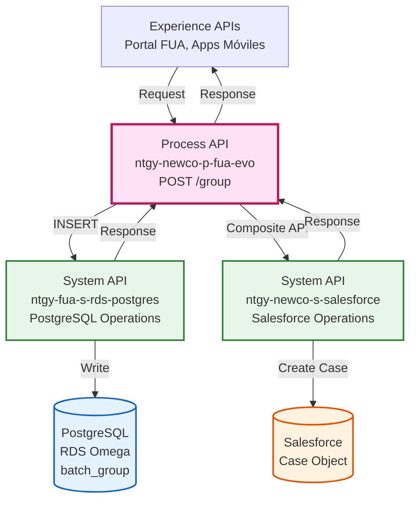
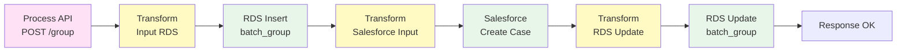
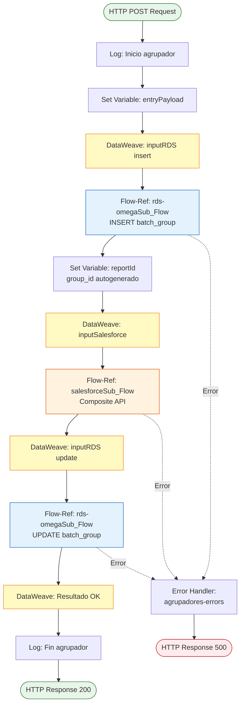
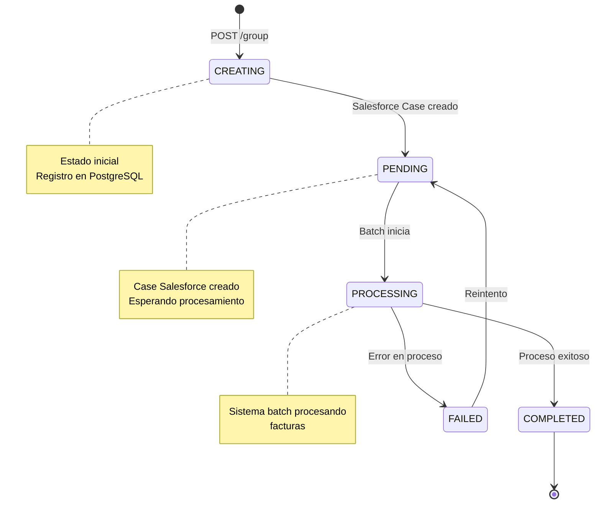
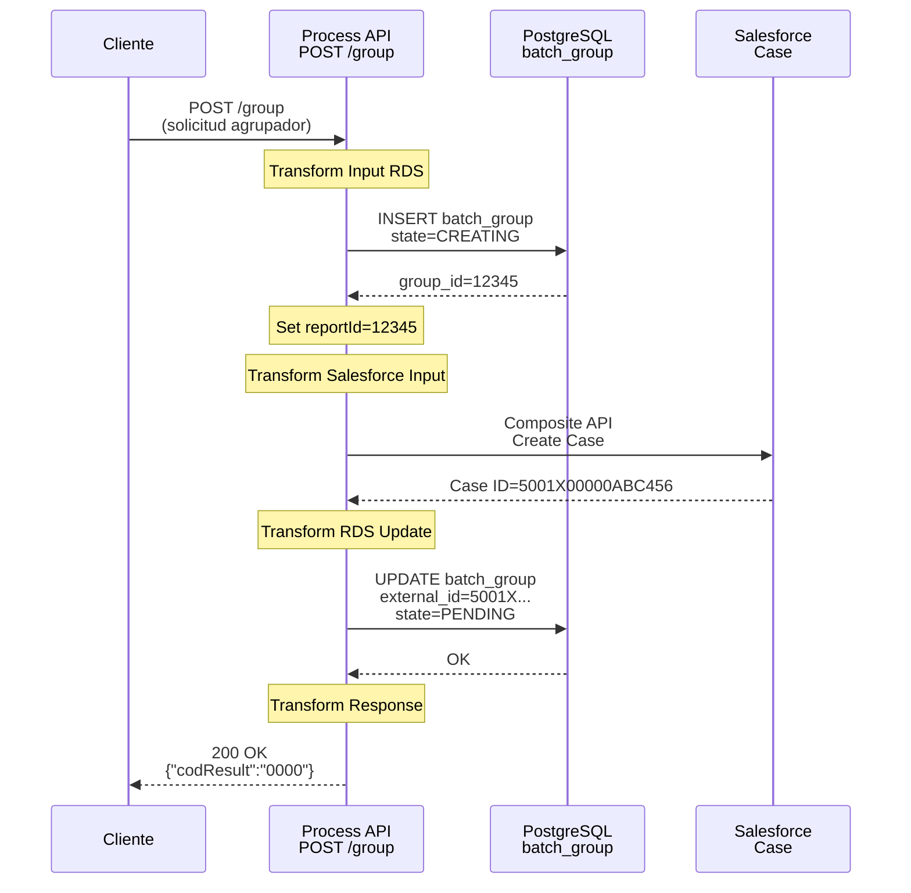
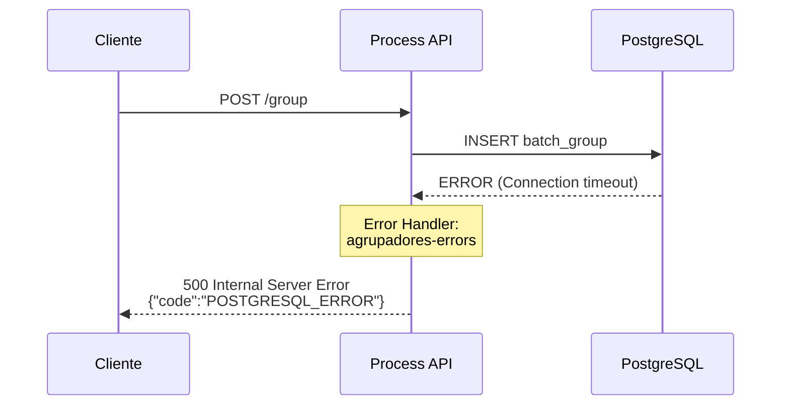
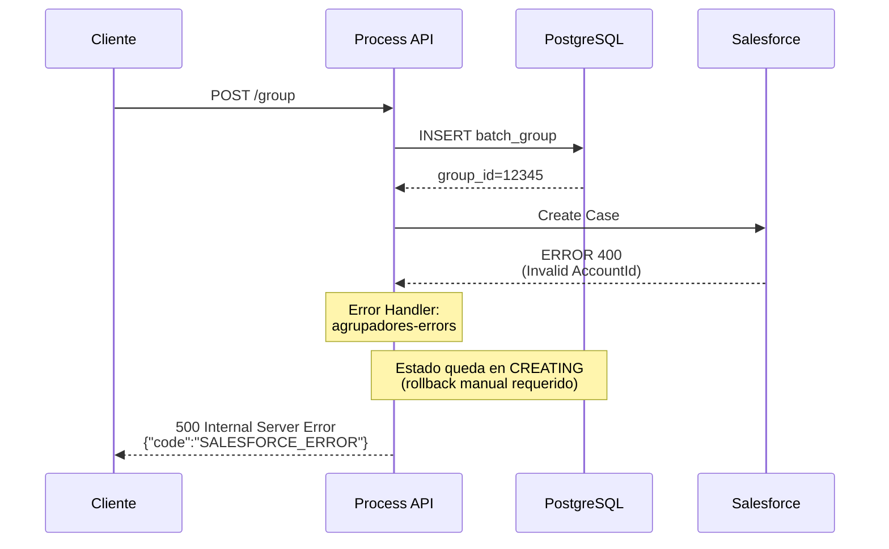

# POST /group

## 📌 Descripción General

### Propósito del Endpoint

Este endpoint permite crear solicitudes de agrupadores de facturas para clientes, generando un proceso de consolidación de informes de facturación por períodos y direcciones específicas. Orquesta la creación de registros en PostgreSQL y la generación de casos de gestión en Salesforce para seguimiento del proceso.

### Tipo de API

**Capa:** Process API (API-Led Connectivity)

**Función:** Orquestación de proceso de negocio para solicitudes de agrupadores de facturas

### Patrón de Integración

**Tipo:** Orquestación con Transformación

**Descripción:** Este endpoint orquesta un flujo secuencial que:
1. Crea un registro inicial en PostgreSQL (estado: CREATING)
2. Genera un Case de gestión en Salesforce
3. Actualiza el registro en PostgreSQL con el ID del Case (estado: PENDING)

### Arquitectura API-Led Connectivity



---

## 💼 Propósito del Negocio

### Casos de Uso Principales

1. **Solicitud de Agrupador de Facturas por Cliente**
   - Cliente solicita un informe consolidado de facturas para un período específico
   - Sistema genera un proceso batch para agrupar y procesar las facturas
   - Beneficio: Permite al cliente obtener informes personalizados de facturación

2. **Seguimiento de Solicitudes mediante Salesforce**
   - Cada solicitud genera un Case de gestión en Salesforce
   - Permite tracking y seguimiento del proceso de generación
   - Beneficio: Trazabilidad completa del proceso y gestión de incidencias

3. **Procesamiento Asíncrono de Agrupadores**
   - La solicitud se registra con estado PENDING para procesamiento posterior
   - Sistema batch procesa las facturas de forma asíncrona
   - Beneficio: Respuesta inmediata al cliente sin esperar procesamiento completo

### 🔗 Endpoints Dependientes

Este Process API consume los siguientes System APIs:

| System API | Endpoint | Método | Propósito |
|------------|----------|--------|-----------|
| `ntgy-fua-s-rds-postgres` | `/rds-omega` (subflow) | INSERT | Crear registro inicial en tabla batch_group |
| `ntgy-fua-s-rds-postgres` | `/rds-omega` (subflow) | UPDATE | Actualizar registro con external_id de Salesforce |
| `ntgy-newco-s-salesforce` | `/postComposite` (subflow) | POST | Crear Case de gestión en Salesforce |

### Lógica de Orquestación



**Pasos del Proceso:**

1. **Paso 1 - Registro Inicial**: Inserta registro en PostgreSQL con estado CREATING
2. **Paso 2 - Case Salesforce**: Crea Case de gestión con información del cliente y solicitud
3. **Paso 3 - Actualización**: Actualiza registro PostgreSQL con external_id (Case ID) y estado PENDING
4. **Paso 4 - Respuesta**: Retorna confirmación exitosa al cliente

### Transformaciones Aplicadas

#### Transformación 1: Input RDS Insert (Líneas 25-47)

| Campo Request | Campo PostgreSQL | Transformación |
|---------------|------------------|----------------|
| `clientId` | `client_id` | Directo |
| `email` | `email` | Directo |
| `billingAccountDataList` | `total_requested` | `sizeOf()` - Cuenta elementos |
| - | `state` | Constante: "CREATING" |
| - | `process_id` | Constante: "invoiceDetailGroup" |
| - | `request_date` | `now() >> "CET"` - Timestamp actual |
| `nif` | `nif` | Directo |
| `idioma` | `language` | Directo |
| `dateFrom` | `date_from` | Conversión a timestamp |
| `dateTo` | `date_to` | Conversión a timestamp |
| `name` | `name` | Directo |
| `contactId` | `contact_id` | Directo |
| `cupTypeId` | `sector_id` | Directo |
| `billingAccountDataList` | `request_detail` | Excluido del payload |

#### Transformación 2: Salesforce Composite (Líneas 49-60)

| Campo Request | Campo Salesforce | Transformación |
|---------------|------------------|----------------|
| - | `NewCo_Recordtype__c` | Constante: "Gestion" |
| `clientId` | `AccountId` | Directo |
| `contactId` | `ContactId` | Directo |
| `email`, `dateFrom`, `dateTo`, `addresses` | `comments` | Concatenación formateada |
| - | `acn_fld_Tittle__r.NewCo_ExternalId__c` | Constante: "SolicitudAgrupadorFacturas" |
| `cupTypeId` | `acn_fld_BusinessLine__c` | Mapeo: 1→"01", 2→"02" |
| - | `Origin` | Constante: "FUA" |

#### Transformación 3: RDS Update (Líneas 62-73)

| Campo Origen | Campo PostgreSQL | Transformación |
|--------------|------------------|----------------|
| `vars.reportId` | `group_id` | Variable del INSERT |
| `vars.salesforceResp.compositeResponse[0].body.id` | `external_id` | ID del Case creado |
| - | `state` | Constante: "PENDING" |

### Contexto Empresarial

- **Dominio:** Gestión de Facturación y Reporting
- **Sector:** Energía - Utilities
- **División:** Naturgy España - NewCo
- **Proceso de Negocio:** Solicitud y generación de agrupadores de facturas

### Stakeholders

- **Clientes Finales**: Solicitan informes consolidados de facturación
- **Equipo de Facturación**: Gestiona y procesa las solicitudes de agrupadores
- **Equipo de Atención al Cliente**: Realiza seguimiento de solicitudes mediante Salesforce
- **Sistema Batch**: Procesa las facturas de forma asíncrona

### Valor de Negocio

- **Autoservicio**: Permite a clientes solicitar informes sin intervención manual
- **Trazabilidad**: Cada solicitud tiene un Case de Salesforce para seguimiento
- **Eficiencia**: Procesamiento asíncrono optimiza recursos del sistema
- **Transparencia**: Cliente recibe confirmación inmediata de su solicitud

### Consumidores Potenciales

Este endpoint puede ser consumido por:
- Portal web FUA
- Aplicaciones móviles de clientes
- Sistemas de agentes de call center
- Portales de clientes empresariales

---

## 🔧 Especificación Técnica

### URLs por Ambiente

| Ambiente | URL Base | URL Completa |
|----------|----------|--------------|
| **Local** | `http://localhost:8081` | `http://localhost:8081/api/group` |
| **Development** | `https://ntgy-newco-p-fua-evo-dev.us-e2.cloudhub.io` | `https://ntgy-newco-p-fua-evo-dev.us-e2.cloudhub.io/api/group` |
| **UAT** | `https://ntgy-newco-p-fua-evo-uat.us-e2.cloudhub.io` | `https://ntgy-newco-p-fua-evo-uat.us-e2.cloudhub.io/api/group` |
| **Production** | `https://ntgy-newco-p-fua-evo-pro.us-e2.cloudhub.io` | `https://ntgy-newco-p-fua-evo-pro.us-e2.cloudhub.io/api/group` |

### Método HTTP

```
POST /api/group
```

### Parámetros de Entrada

#### Request Body (application/json)

```json
{
  "clientId": "string",
  "email": "string",
  "nif": "string",
  "idioma": "string",
  "dateFrom": "string",
  "dateTo": "string",
  "name": "string",
  "contactId": "string",
  "cupTypeId": number,
  "billingAccountDataList": [
    {
      "invoiceTypeId": "string",
      "invoiceNumber": "string",
      "address": "string"
    }
  ]
}
```

#### Campos Obligatorios

| Campo | Tipo | Descripción | Ejemplo |
|-------|------|-------------|---------|
| `clientId` | string | ID del cliente en Salesforce | "0011X00000ABC123" |
| `email` | string | Email del cliente para notificaciones | "cliente@example.com" |
| `nif` | string | NIF/CIF del cliente | "12345678A" |
| `idioma` | string | Idioma del cliente (ES/CA/EN) | "ES" |
| `dateFrom` | string | Fecha inicio del período (MM/DD/YYYY) | "01/01/2024" |
| `dateTo` | string | Fecha fin del período (MM/DD/YYYY) | "12/31/2024" |
| `name` | string | Nombre del cliente | "Juan Pérez" |
| `contactId` | string | ID del contacto en Salesforce | "0031X00000XYZ789" |
| `cupTypeId` | number | Tipo de suministro (1=Electricidad, 2=Gas) | 1 |
| `billingAccountDataList` | array | Lista de facturas a agrupar | Ver estructura abajo |

#### Estructura de billingAccountDataList

| Campo | Tipo | Descripción | Ejemplo |
|-------|------|-------------|---------|
| `invoiceTypeId` | string | Tipo de factura | "REGULAR" |
| `invoiceNumber` | string | Número de factura | "FAC-2024-001" |
| `address` | string | Dirección de suministro | "Calle Mayor 123, Madrid" |

### Respuestas

#### 200 OK - Solicitud Creada Exitosamente

```json
{
  "result": {
    "codResult": "0000",
    "msgResult": "No hay error"
  }
}
```

**Descripción:** La solicitud de agrupador se ha creado correctamente y está en estado PENDING para procesamiento.

#### 400 Bad Request - Error de Validación

```json
{
  "code": "VALIDATION_ERROR",
  "message": "Error en la validación de datos de entrada",
  "details": "Campo 'clientId' es obligatorio"
}
```

#### 500 Internal Server Error - Error del Sistema

```json
{
  "code": "SYSTEM_ERROR",
  "message": "Error al procesar la solicitud",
  "details": "Error en la conexión con PostgreSQL"
}
```

### Autenticación

- **Tipo:** Client ID & Client Secret (Anypoint Platform)
- **Headers Requeridos:**
  - `client_id`: ID de la aplicación cliente
  - `client_secret`: Secret de la aplicación cliente

### Timeouts

| Tipo | Valor |
|------|-------|
| **Request Timeout** | 60 segundos |
| **Connection Timeout** | 30 segundos |
| **Database Timeout** | 30 segundos |
| **Salesforce Timeout** | 60 segundos |

### Validaciones

- ✅ Todos los campos obligatorios deben estar presentes
- ✅ `email` debe tener formato válido
- ✅ `dateFrom` y `dateTo` deben ser fechas válidas en formato MM/DD/YYYY
- ✅ `cupTypeId` debe ser 1 (Electricidad) o 2 (Gas)
- ✅ `billingAccountDataList` no puede estar vacío

---

## 🏗️ Implementación Técnica

### Arquitectura del Flow



### Transformaciones DataWeave

#### 1. Transformación Input RDS Insert (Líneas 25-47)

```dataweave
%dw 2.0
output application/json

var reportRequestDate = (now() >> "CET") as String { format: "MM/dd/yyyy HH:mm:ss"}
var totalRequested = sizeOf(vars.entryPayload.billingAccountDataList)
var detail = vars.entryPayload - "billingAccountDataList"
---
{
    "insert": "INSERT INTO public.batch_group (client_id, email, total_requested, state, process_id, request_date, nif, language, date_from, date_to, name, contact_id, sector_id, request_detail) VALUES (:client_id, :email, :total_requested, :state, :process_id, TO_TIMESTAMP(:request_date,'MM/DD/YYYY HH24:MI:SS'), :nif, :language, TO_TIMESTAMP(:date_from, 'MM/DD/YYYY'), TO_TIMESTAMP(:date_to, 'MM/DD/YYYY'), :name, :contact_id, :sector_id, :request_detail)",
    "params": {
        "client_id": vars.entryPayload.clientId,
        "email": vars.entryPayload.email,
        "total_requested": totalRequested,
        "state": "CREATING",
        "process_id": "invoiceDetailGroup",
        "request_date": reportRequestDate,
        "nif": vars.entryPayload.nif,
        "language": vars.entryPayload.idioma,
        "date_from": vars.entryPayload.dateFrom,
        "date_to": vars.entryPayload.dateTo,
        "name": vars.entryPayload.name,
        "contact_id": vars.entryPayload.contactId,
        "sector_id": vars.entryPayload.cupTypeId,
        "request_detail": detail
    },
    "autogeneratedKeys": ['group_id'],
    "operationRDS": "insert"
}
```

**Lógica Especial:**
- Calcula `total_requested` contando elementos en `billingAccountDataList`
- Genera timestamp actual en zona horaria CET
- Excluye `billingAccountDataList` del campo `request_detail`
- Estado inicial: "CREATING"

#### 2. Transformación Salesforce Composite (Líneas 49-60)

```dataweave
%dw 2.0
output application/json

fun formatDate(fecha : String|Null) =
    fecha as Date {format: 'mm/DD/yyyy'} as String {format: 'dd/MM/yyyy'} default "0000-00-00"
 
var allAddresses = (vars.entryPayload.billingAccountDataList map $.address) joinBy "\r\n"
---
{
    "body": {
        "allOrNone": true,
        "collateSubrequests": false,
        "compositeRequest": [
            {
                "method": "POST",
                "url": "/services/data/v52.0/sobjects/Case",
                "referenceId": "refCaseGestion",
                "body": { 
                    "NewCo_Recordtype__c": "Gestion",
                    "AccountId": vars.entryPayload.clientId,
                    "ContactId": vars.entryPayload.contactId,
                    "comments": ("Caso Gestión relacionado con el proceso de solictud de agrupadores de facturas con email: " ++ (vars.entryPayload.email default "") ++ "\r\n" ++ ("fechas: " ++ ((formatDate(vars.entryPayload.dateFrom)) ++ " - " ++ ((formatDate(vars.entryPayload.dateTo))))) ++ "\r\n" ++ ("direcciones: " ++ ((allAddresses[0 to 3000] default allAddresses) default ""))),
                    "acn_fld_Tittle__r": {
                        "NewCo_ExternalId__c": "SolicitudAgrupadorFacturas"
                    },
                    "acn_fld_BusinessLine__c": if(vars.entryPayload.cupTypeId == 1) "01" else "02",
                    "Origin": "FUA"
                }
            }
        ]
    },
    "operationSalesforce": "composite"
}
```

**Lógica Especial:**
- Formatea fechas de MM/DD/YYYY a DD/MM/YYYY
- Concatena todas las direcciones con saltos de línea
- Limita direcciones a 3000 caracteres para campo comments
- Mapea `cupTypeId`: 1→"01" (Electricidad), 2→"02" (Gas)
- Usa Composite API para transaccionalidad

#### 3. Transformación RDS Update (Líneas 62-73)

```dataweave
%dw 2.0
output application/json
---
{
    "inputUpdate": {
        "update": "update public.batch_group set external_id = :external_id, state = 'PENDING' where group_id = :group_id",
        "params": {
            "group_id": vars.reportId,
            "external_id": vars.salesforceResp.compositeResponse[0].body.id
        }
    },
    "operationRDS": "update"
}
```

**Lógica Especial:**
- Actualiza con ID del Case creado en Salesforce
- Cambia estado de "CREATING" a "PENDING"
- Usa `group_id` autogenerado en el INSERT

### Tabla PostgreSQL: batch_group

#### Estructura de la Tabla

| Campo | Tipo | Descripción | Ejemplo |
|-------|------|-------------|---------|
| `group_id` | SERIAL | ID autogenerado (PK) | 12345 |
| `client_id` | VARCHAR | ID del cliente Salesforce | "0011X00000ABC123" |
| `email` | VARCHAR | Email del cliente | "cliente@example.com" |
| `total_requested` | INTEGER | Total de facturas solicitadas | 15 |
| `state` | VARCHAR | Estado del proceso | "PENDING" |
| `process_id` | VARCHAR | Identificador del proceso | "invoiceDetailGroup" |
| `request_date` | TIMESTAMP | Fecha de solicitud | "2024-01-15 10:30:00" |
| `nif` | VARCHAR | NIF/CIF del cliente | "12345678A" |
| `language` | VARCHAR | Idioma del cliente | "ES" |
| `date_from` | TIMESTAMP | Fecha inicio período | "2024-01-01 00:00:00" |
| `date_to` | TIMESTAMP | Fecha fin período | "2024-12-31 23:59:59" |
| `name` | VARCHAR | Nombre del cliente | "Juan Pérez" |
| `contact_id` | VARCHAR | ID contacto Salesforce | "0031X00000XYZ789" |
| `sector_id` | INTEGER | Tipo de suministro | 1 |
| `request_detail` | JSONB | Detalle de la solicitud | \{...\} |
| `external_id` | VARCHAR | ID del Case Salesforce | "5001X00000ABC456" |

#### Estados del Proceso



### Objeto Salesforce: Case

#### Campos Utilizados

| Campo Salesforce | Tipo | Descripción | Ejemplo |
|------------------|------|-------------|---------|
| `Id` | ID | ID del Case (autogenerado) | "5001X00000ABC456" |
| `NewCo_Recordtype__c` | String | Tipo de registro | "Gestion" |
| `AccountId` | Lookup | Referencia a Account | "0011X00000ABC123" |
| `ContactId` | Lookup | Referencia a Contact | "0031X00000XYZ789" |
| `comments` | Text Area | Comentarios del caso | "Caso Gestión..." |
| `acn_fld_Tittle__r.NewCo_ExternalId__c` | String | Título del caso | "SolicitudAgrupadorFacturas" |
| `acn_fld_BusinessLine__c` | Picklist | Línea de negocio | "01" (Electricidad) |
| `Origin` | Picklist | Origen del caso | "FUA" |

### Patrones de Diseño

**Patrón:** Saga Pattern (Orquestación)

**Justificación:** 
- Coordina múltiples operaciones transaccionales (PostgreSQL + Salesforce)
- Mantiene consistencia eventual entre sistemas
- Permite rollback mediante estados (CREATING → PENDING)

**Patrón:** State Machine

**Justificación:**
- Gestiona estados del proceso (CREATING → PENDING → PROCESSING → COMPLETED/FAILED)
- Permite tracking del progreso de la solicitud
- Facilita reintentos en caso de fallos

### Diagramas de Secuencia

#### 1. Flujo Normal de Éxito



#### 2. Flujo con Error en PostgreSQL INSERT



#### 3. Flujo con Error en Salesforce



### Manejo de Errores

#### Estrategia de Error Handling

**Error Handler:** `agrupadores-errorsError_Handler`

**Tipos de Errores Manejados:**

1. **APP:POSTGRESQL_OMEGA_INSERT**
   - Causa: Error al insertar en tabla batch_group
   - Acción: Retorna error 500 al cliente
   - Rollback: No requiere (no se creó registro)

2. **APP:COMPOSITE_SALESFORCE**
   - Causa: Error al crear Case en Salesforce
   - Acción: Retorna error 500 al cliente
   - Rollback: Registro queda en estado CREATING (requiere limpieza manual)

3. **APP:POSTGRESQL_OMEGA_UPDATE**
   - Causa: Error al actualizar registro con external_id
   - Acción: Retorna error 500 al cliente
   - Rollback: Case creado en Salesforce, registro en CREATING

**Estrategia de Recuperación:**

- **Reintentos Automáticos:** No implementados (operación idempotente)
- **Compensación:** Registros en CREATING pueden ser reprocesados manualmente
- **Monitoreo:** Alertas para registros en CREATING por más de 5 minutos

### Subflows Utilizados

#### rds-omegaSub_Flow (common.xml, líneas 437-468)

**Propósito:** Ejecutar operaciones en PostgreSQL (INSERT, UPDATE, QUERY)

**Operaciones Soportadas:**
- `insert`: Ejecuta INSERT y retorna claves autogeneradas
- `update`: Ejecuta UPDATE
- `query`: Ejecuta SELECT

**Configuración:**
- Endpoint: `ntgy-fua-s-rds-postgres`
- Paths: `/ejecutarInsert`, `/ejecutarUpdate`, `/ejecutarQuery`
- Target Variables: `resultRDSInsert`, `resultRDSUpdate`, `resultRDSQuery`

#### salesforceSub_Flow (common.xml, líneas 390-436)

**Propósito:** Ejecutar operaciones en Salesforce

**Operaciones Soportadas:**
- `composite`: Ejecuta Composite API (transaccional)

**Configuración:**
- Endpoint: `ntgy-newco-s-salesforce`
- Path: `/postComposite`
- Target Variable: `salesforceResp`
- Validación: Verifica httpStatusCode < 400

---

## 💻 Ejemplos de Uso

### Ejemplo 1: Solicitud Exitosa - Cliente Electricidad

#### Request

```bash
curl -X POST "https://ntgy-newco-p-fua-evo-dev.us-e2.cloudhub.io/api/group" \
  -H "Content-Type: application/json" \
  -H "client_id: YOUR_CLIENT_ID" \
  -H "client_secret: YOUR_CLIENT_SECRET" \
  -d '{
    "clientId": "0011X00000ABC123",
    "email": "juan.perez@example.com",
    "nif": "12345678A",
    "idioma": "ES",
    "dateFrom": "01/01/2024",
    "dateTo": "12/31/2024",
    "name": "Juan Pérez",
    "contactId": "0031X00000XYZ789",
    "cupTypeId": 1,
    "billingAccountDataList": [
      {
        "invoiceTypeId": "REGULAR",
        "invoiceNumber": "FAC-2024-001",
        "address": "Calle Mayor 123, Madrid"
      },
      {
        "invoiceTypeId": "REGULAR",
        "invoiceNumber": "FAC-2024-002",
        "address": "Calle Mayor 123, Madrid"
      }
    ]
  }'
```

#### Response (200 OK)

```json
{
  "result": {
    "codResult": "0000",
    "msgResult": "No hay error"
  }
}
```

**Resultado en PostgreSQL:**
```sql
-- Registro creado en batch_group
group_id: 12345
client_id: "0011X00000ABC123"
email: "juan.perez@example.com"
total_requested: 2
state: "PENDING"
external_id: "5001X00000ABC456"
```

**Resultado en Salesforce:**
```text
Case ID: 5001X00000ABC456
RecordType: Gestion
Origin: FUA
BusinessLine: 01 (Electricidad)
```

---

### Ejemplo 2: Solicitud Cliente Gas con Múltiples Direcciones

#### Request

```bash
curl -X POST "https://ntgy-newco-p-fua-evo-pro.us-e2.cloudhub.io/api/group" \
  -H "Content-Type: application/json" \
  -H "client_id: YOUR_CLIENT_ID" \
  -H "client_secret: YOUR_CLIENT_SECRET" \
  -d '{
    "clientId": "0011X00000DEF456",
    "email": "maria.garcia@example.com",
    "nif": "87654321B",
    "idioma": "CA",
    "dateFrom": "06/01/2024",
    "dateTo": "06/30/2024",
    "name": "Maria Garcia",
    "contactId": "0031X00000UVW012",
    "cupTypeId": 2,
    "billingAccountDataList": [
      {
        "invoiceTypeId": "REGULAR",
        "invoiceNumber": "FAC-2024-100",
        "address": "Carrer de Balmes 45, Barcelona"
      },
      {
        "invoiceTypeId": "REGULAR",
        "invoiceNumber": "FAC-2024-101",
        "address": "Avinguda Diagonal 200, Barcelona"
      },
      {
        "invoiceTypeId": "REGULAR",
        "invoiceNumber": "FAC-2024-102",
        "address": "Passeig de Gràcia 100, Barcelona"
      }
    ]
  }'
```

#### Response (200 OK)

```json
{
  "result": {
    "codResult": "0000",
    "msgResult": "No hay error"
  }
}
```

---

### Ejemplo 3: JavaScript (Fetch API)

```javascript
const createGroupRequest = async () => {
  const response = await fetch('https://ntgy-newco-p-fua-evo-dev.us-e2.cloudhub.io/api/group', {
    method: 'POST',
    headers: {
      'Content-Type': 'application/json',
      'client_id': 'YOUR_CLIENT_ID',
      'client_secret': 'YOUR_CLIENT_SECRET'
    },
    body: JSON.stringify({
      clientId: '0011X00000ABC123',
      email: 'cliente@example.com',
      nif: '12345678A',
      idioma: 'ES',
      dateFrom: '01/01/2024',
      dateTo: '12/31/2024',
      api_name: 'Cliente Ejemplo',
      contactId: '0031X00000XYZ789',
      cupTypeId: 1,
      billingAccountDataList: [
        {
          invoiceTypeId: 'REGULAR',
          invoiceNumber: 'FAC-2024-001',
          address: 'Calle Ejemplo 123, Madrid'
        }
      ]
    })
  });

  const data = await response.json();
  
  if (response.ok) {
    console.log('Solicitud creada exitosamente:', data);
    return data;
  } else {
    console.error('Error al crear solicitud:', data);
    throw new Error(data.message);
  }
};

// Uso
createGroupRequest()
  .then(result => console.log('Resultado:', result))
  .catch(error => console.error('Error:', error));
```

---

### Ejemplo 4: Python (Requests)

```python
import requests
import json

def create_group_request(client_data):
    url = 'https://ntgy-newco-p-fua-evo-dev.us-e2.cloudhub.io/api/group'
    
    headers = {
        'Content-Type': 'application/json',
        'client_id': 'YOUR_CLIENT_ID',
        'client_secret': 'YOUR_CLIENT_SECRET'
    }
    
    payload = {
        'clientId': client_data['client_id'],
        'email': client_data['email'],
        'nif': client_data['nif'],
        'idioma': client_data.get('language', 'ES'),
        'dateFrom': client_data['date_from'],
        'dateTo': client_data['date_to'],
        'name': client_data['name'],
        'contactId': client_data['contact_id'],
        'cupTypeId': client_data['cup_type'],
        'billingAccountDataList': client_data['invoices']
    }
    
    try:
        response = requests.post(url, headers=headers, json=payload, timeout=60)
        response.raise_for_status()
        
        result = response.json()
        print(f"Solicitud creada exitosamente: {result}")
        return result
        
    except requests.exceptions.HTTPError as http_err:
        print(f"Error HTTP: {http_err}")
        print(f"Respuesta: {response.text}")
        raise
    except requests.exceptions.Timeout:
        print("Error: Timeout al conectar con el servidor")
        raise
    except Exception as err:
        print(f"Error inesperado: {err}")
        raise

# Ejemplo de uso
client_data = {
    'client_id': '0011X00000ABC123',
    'email': 'cliente@example.com',
    'nif': '12345678A',
    'language': 'ES',
    'date_from': '01/01/2024',
    'date_to': '12/31/2024',
    'name': 'Cliente Ejemplo',
    'contact_id': '0031X00000XYZ789',
    'cup_type': 1,
    'invoices': [
        {
            'invoiceTypeId': 'REGULAR',
            'invoiceNumber': 'FAC-2024-001',
            'address': 'Calle Ejemplo 123, Madrid'
        }
    ]
}

result = create_group_request(client_data)
```

---

### Ejemplo 5: Error - Campo Obligatorio Faltante

#### Request

```bash
curl -X POST "https://ntgy-newco-p-fua-evo-dev.us-e2.cloudhub.io/api/group" \
  -H "Content-Type: application/json" \
  -H "client_id: YOUR_CLIENT_ID" \
  -H "client_secret: YOUR_CLIENT_SECRET" \
  -d '{
    "email": "cliente@example.com",
    "nif": "12345678A",
    "idioma": "ES"
  }'
```

#### Response (400 Bad Request)

```json
{
  "code": "VALIDATION_ERROR",
  "message": "Error en la validación de datos de entrada",
  "details": "Campos obligatorios faltantes: clientId, dateFrom, dateTo, name, contactId, cupTypeId, billingAccountDataList"
}
```

---

### Ejemplo 6: Error - Conexión con PostgreSQL

#### Response (500 Internal Server Error)

```json
{
  "code": "POSTGRESQL_OMEGA_INSERT",
  "message": "Error al insertar registro en base de datos",
  "details": "Connection timeout after 30 seconds"
}
```
