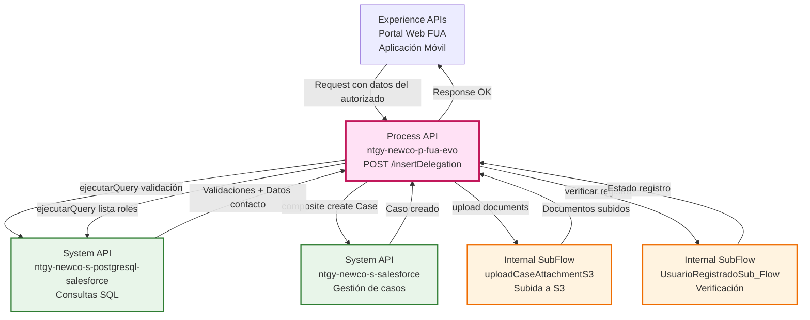
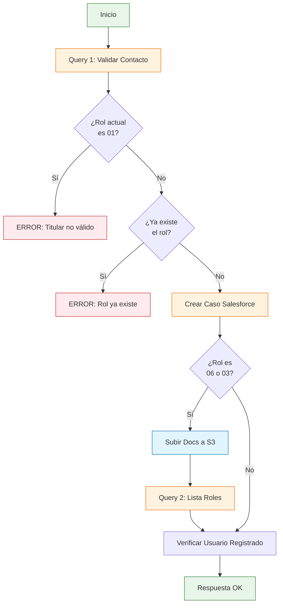
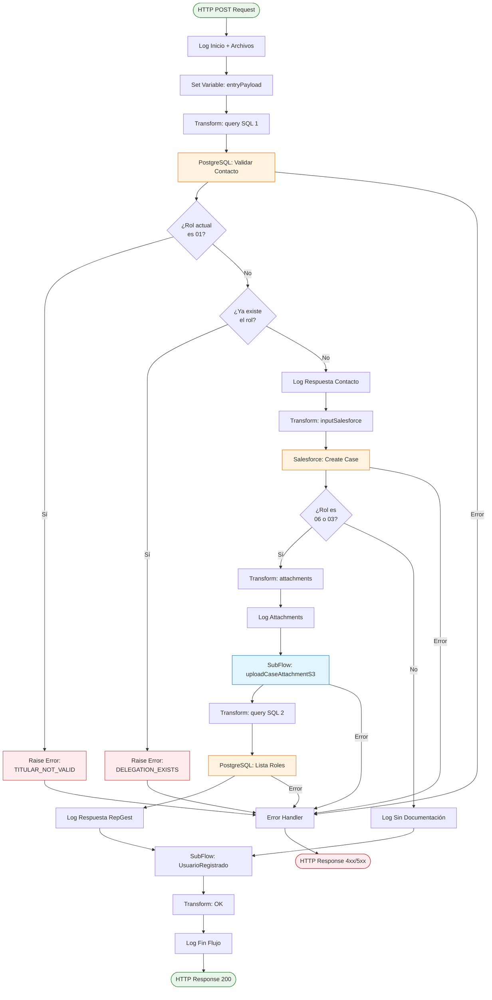
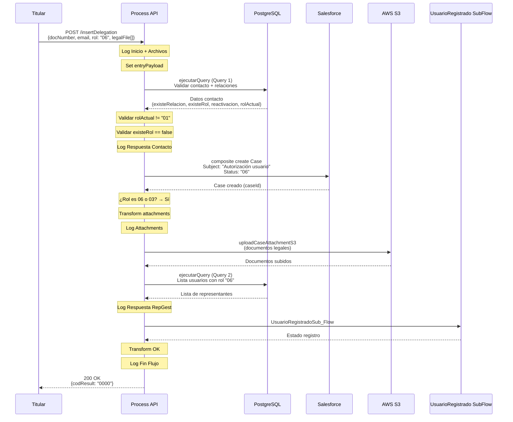
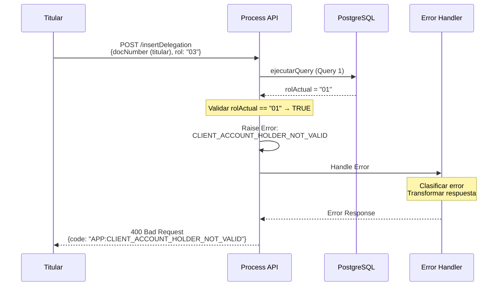
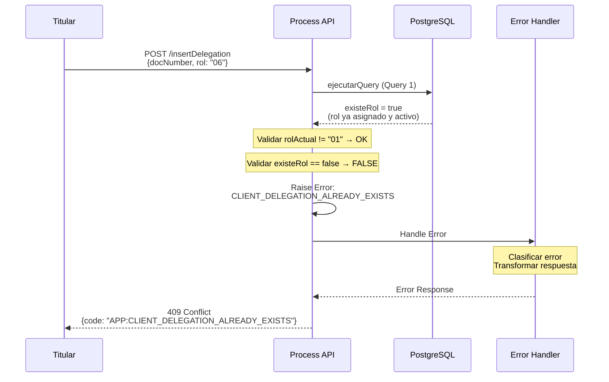
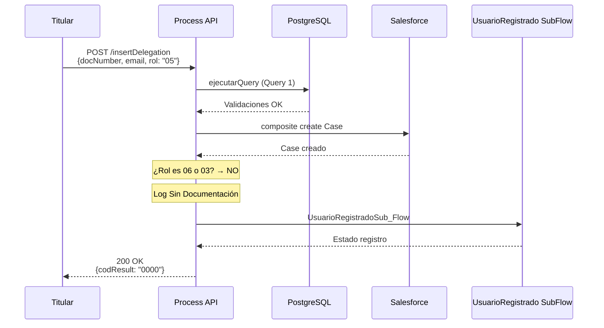

# POST /insertDelegation

## 📌 Descripción General

### Propósito del Endpoint

Este endpoint gestiona el proceso completo de pre-registro de asignación de roles y delegaciones a usuarios autorizados en el área de cliente FUA. Orquesta múltiples operaciones para:

1. Validar que el contacto existe y sus relaciones con la cuenta
2. Verificar que no sea un titular de cuenta (rol "01")
3. Comprobar que no tenga ya el rol asignado
4. Crear un caso de gestión en Salesforce
5. Subir documentación legal a S3 (para roles específicos)
6. Consultar otros usuarios con el mismo rol (para roles específicos)
7. Verificar si el usuario está registrado en el sistema

### Tipo de API

**Capa:** Process API (API-Led Connectivity)

**Función:** Orquestación del proceso de asignación de roles y delegaciones con validaciones de negocio

### Patrón de Integración

**Tipo:** Orquestación Condicional con Validaciones de Negocio

**Descripción:** Ejecuta una secuencia de operaciones con validaciones complejas en PostgreSQL, creación de caso en Salesforce, y procesamiento condicional según el tipo de rol (con o sin documentación legal).

### Arquitectura API-Led Connectivity



---

## 💼 Propósito del Negocio

### Casos de Uso Principales

1. **Asignación de Nuevo Rol a Usuario Autorizado**
   - El titular de cuenta asigna un rol específico a un usuario
   - El sistema valida que el usuario no tenga ya ese rol
   - Se crea un caso de gestión para procesar la solicitud
   - **Beneficio:** Control y trazabilidad de permisos

2. **Autorización de Representante Legal (Rol 06)**
   - Requiere documentación legal adjunta
   - Sube documentos a S3 para validación
   - Consulta otros representantes existentes
   - **Beneficio:** Cumplimiento legal y gestión de poderes

3. **Autorización de Gestor (Rol 03)**
   - Requiere documentación legal adjunta
   - Sube documentos a S3 para validación
   - Consulta otros gestores existentes
   - **Beneficio:** Gestión de usuarios con permisos administrativos

4. **Actualización de Permisos de Usuario Existente**
   - Si el contacto ya existe en la cuenta
   - Actualiza sus permisos con un nuevo rol
   - **Beneficio:** Flexibilidad en la gestión de permisos

5. **Validación de Restricciones de Negocio**
   - Impide asignar roles a titulares de cuenta
   - Previene duplicación de roles activos
   - Detecta casos de reactivación de roles dados de baja
   - **Beneficio:** Integridad de datos y reglas de negocio

### 🔗 Endpoints Dependientes

Este Process API consume los siguientes System APIs y SubFlows:

| System API / SubFlow | Endpoint | Método | Propósito |
|----------------------|----------|--------|-----------|
| `ntgy-newco-s-postgresql-salesforce` | `/ejecutarQuery` | POST | Validar contacto, relaciones y roles (Query 1) |
| `ntgy-newco-s-salesforce` | `/salesforceSub_Flow` | POST | Crear caso de gestión "ModifDatosClienteProcesoAlta" (composite) |
| `uploadCaseAttachmentS3` | SubFlow interno | - | Subir documentos legales a S3 (solo roles 06 y 03) |
| `ntgy-newco-s-postgresql-salesforce` | `/ejecutarQuery` | POST | Consultar lista de usuarios con mismo rol (Query 2) |
| `UsuarioRegistradoSub_Flow` | SubFlow interno | - | Verificar si usuario está registrado |

### Lógica de Orquestación



**Pasos del Proceso:**

1. **Validación de Contacto**: Consulta PostgreSQL para obtener datos del contacto y validar relaciones
2. **Validación de Titular**: Si el rol actual es "01" (Titular) → Error
3. **Validación de Rol Existente**: Si ya tiene el rol asignado y activo → Error
4. **Creación de Caso**: Crea caso de gestión en Salesforce con estado "06"
5. **Procesamiento Condicional por Rol**:
   - **Si rol es 06 o 03**: Sube documentos a S3 + Consulta otros usuarios con mismo rol
   - **Si rol es otro**: Continúa sin documentación
6. **Verificación de Usuario**: Comprueba si el usuario está registrado en el sistema
7. **Respuesta**: Retorna resultado exitoso

### Transformaciones Aplicadas

Este Process API aplica las siguientes transformaciones:

| Transformación | Origen | Destino | Descripción |
|----------------|--------|---------|-------------|
| **Body a Query SQL 1** | `docNumber`, `x-client-id`, `rol` | `query` | Construye query compleja de validación |
| **Validación Titular** | `respContacto[0].rolactual` | Raise Error | Si es "01" → Error |
| **Validación Rol Existente** | `respContacto[0].existerol` | Raise Error | Si es true → Error |
| **Body a Salesforce Case** | `docNumber`, `email`, `rol`, `x-client-id`, `x-contact-id` | `inputSalesforce.body` | Construye caso con subject y description dinámicos |
| **Files a S3 Attachments** | `legalFile[]`, `docNumber`, `caseId` | `attachments` | Prepara documentos para subida a S3 |
| **Body a Query SQL 2** | `x-client-id`, `rol` | `query` | Construye query para listar usuarios con mismo rol |

### Query SQL Compleja 1: Validación de Contacto

El endpoint ejecuta una query SQL muy compleja que valida múltiples condiciones:

```sql
SELECT 
  contact.sfid,
  contact.name,
  contact.mobilephone,
  contact.newco_preferredlanguage__c as idioma,
  contact.email,
  -- Valida si existe relación con la cuenta
  exists (
    SELECT 1 
    FROM newcosalesforce.accountcontactrelation a 
    WHERE a.contactid = contact.sfid 
      AND a.accountid = '{x-client-id}'
  ) as existeRelacion,
  -- Valida si ya tiene el rol asignado y activo
  exists (
    SELECT 1 
    FROM newcosalesforce.accountcontactrelation a 
    WHERE a.contactid = contact.sfid 
      AND a.accountid = '{x-client-id}' 
      AND a.roles = '{rol}' 
      AND a.newco_estadologinomega__c IN ('Validado','Pendiente')
  ) as existeRol,
  -- Valida si es una reactivación (rol dado de baja)
  exists (
    SELECT 1 
    FROM newcosalesforce.accountcontactrelation a 
    WHERE a.contactid = contact.sfid 
      AND a.accountid = '{x-client-id}' 
      AND a.roles = '{rol}' 
      AND a.newco_estadologinomega__c = 'Baja'
  ) as reactivacion,
  -- Obtiene el rol actual del usuario
  (
    SELECT a.roles 
    FROM newcosalesforce.accountcontactrelation a 
    WHERE a.contactid = contact.sfid 
      AND a.accountid = '{x-client-id}'
  ) as rolActual
FROM newcosalesforce.Contact as contact 
WHERE contact.newco_documentnumber__c = '{docNumber}'
```

**Propósito de la Query:**
- **existeRelacion**: Verifica si el contacto ya está relacionado con la cuenta
- **existeRol**: Verifica si ya tiene el rol asignado y activo (estados: Validado, Pendiente)
- **reactivacion**: Detecta si es un caso de reactivación (rol previamente dado de baja)
- **rolActual**: Obtiene el rol actual del usuario para validar que no sea titular ("01")

### Query SQL 2: Lista de Usuarios con Mismo Rol

Solo se ejecuta para roles 06 (Representante) y 03 (Gestor):

```sql
SELECT 
  a.contactid,
  a.roles,
  a.sfid,
  contact.name,
  contact.email,
  contact.newco_documentnumber__c docNumber
FROM newcosalesforce.accountcontactrelation a 
INNER JOIN newcosalesforce.Contact as contact 
  ON contact.sfid = a.contactid 
WHERE a.accountid = '{x-client-id}' 
  AND a.roles = '{rol}' 
  AND a.newco_estadologinomega__c != 'Baja'
```

**Propósito:** Obtener la lista de otros usuarios que ya tienen el mismo rol asignado y activo.

### Contexto Empresarial

- **Dominio:** Gestión de Usuarios y Permisos
- **Sector:** Energía - Utilities
- **División:** Naturgy España - NewCo
- **Proceso de Negocio:** Asignación de Roles y Delegaciones en Área de Cliente FUA

### Stakeholders

- **Titulares de Cuenta**: Asignan roles a usuarios autorizados
- **Usuarios Autorizados**: Reciben permisos para gestionar la cuenta
- **Equipo de Atención al Cliente**: Procesa casos de gestión de roles
- **Equipo Legal**: Valida documentación de representantes legales
- **Equipo de Seguridad**: Supervisa asignación de permisos

### Valor de Negocio

- **Control de Acceso**: Gestión granular de permisos por rol
- **Cumplimiento Legal**: Validación de documentación para representantes
- **Trazabilidad**: Registro completo del proceso en Salesforce
- **Prevención de Errores**: Validaciones de negocio automáticas
- **Flexibilidad**: Soporte para múltiples tipos de roles
- **Seguridad**: Impide asignación de roles a titulares

### Tipos de Roles

| Código | Nombre | Requiere Documentación | Descripción |
|--------|--------|------------------------|-------------|
| `01` | Titular | N/A | Titular de la cuenta (no puede recibir delegaciones) |
| `03` | Gestor | ✅ Sí | Usuario con permisos de gestión administrativa |
| `06` | Representante Legal | ✅ Sí | Representante legal con poderes |
| Otros | Autorizados | ❌ No | Usuarios autorizados con permisos limitados |

### Consumidores Potenciales

Este endpoint puede ser consumido por:
- Portal web de autoservicio FUA (titulares)
- Aplicaciones móviles de Naturgy
- Sistemas de gestión de usuarios
- Herramientas de administración de permisos

---

## 🔧 Especificación Técnica

### URLs por Ambiente

| Ambiente | URL Base | URL Completa |
|----------|----------|--------------|
| **Local** | `http://localhost:8081` | `http://localhost:8081/api/insertDelegation` |
| **Development** | `https://ntgy-newco-p-fua-evo-dev.us-e2.cloudhub.io` | `https://ntgy-newco-p-fua-evo-dev.us-e2.cloudhub.io/api/insertDelegation` |
| **UAT** | `https://ntgy-newco-p-fua-evo-uat.us-e2.cloudhub.io` | `https://ntgy-newco-p-fua-evo-uat.us-e2.cloudhub.io/api/insertDelegation` |
| **Production** | `https://ntgy-newco-p-fua-evo-pro.us-e2.cloudhub.io` | `https://ntgy-newco-p-fua-evo-pro.us-e2.cloudhub.io/api/insertDelegation` |

### Método HTTP

```
POST /api/insertDelegation
```

### Parámetros de Entrada

#### Request Headers (Requeridos)

| Header | Tipo | Requerido | Descripción |
|--------|------|-----------|-------------|
| `x-client-id` | string | ✅ Sí | ID de la cuenta (Account ID en Salesforce) |
| `x-contact-id` | string | ✅ Sí | ID del contacto del titular |
| `Content-Type` | string | ✅ Sí | `application/json` |
| `client_id` | string | ✅ Sí | Client ID de Anypoint Platform |
| `client_secret` | string | ✅ Sí | Client Secret de Anypoint Platform |

#### Request Body (application/json)

| Campo | Tipo | Requerido | Descripción |
|-------|------|-----------|-------------|
| `docNumber` | string | ⚠️ Opcional | Número de documento del usuario autorizado (DNI/NIE) |
| `email` | string | ⚠️ Opcional | Email del usuario autorizado |
| `contactIdTitular` | string | ⚠️ Opcional | ID del contacto del titular |
| `rol` | string | ⚠️ Opcional | Código del rol a asignar (ej: "03", "06") |
| `legalFile` | array | ⚠️ Condicional | Array de documentos legales (requerido para roles 06 y 03) |
| `legalFile[].file` | string | ⚠️ Condicional | Contenido del archivo en base64 |
| `legalFile[].fileNameWithExtension` | string | ⚠️ Condicional | Nombre del archivo con extensión |

**Ejemplo de Request (Rol con Documentación):**

```json
{
  "docNumber": "12345678A",
  "email": "autorizado@example.com",
  "contactIdTitular": "0031234567890ABCDE",
  "rol": "06",
  "legalFile": [
    {
      "file": "JVBERi0xLjQKJeLjz9MKMyAwIG9iago8PC9UeXBlL...",
      "fileNameWithExtension": "poder_legal.pdf"
    },
    {
      "file": "JVBERi0xLjQKJeLjz9MKMyAwIG9iago8PC9UeXBlL...",
      "fileNameWithExtension": "dni_representante.pdf"
    }
  ]
}
```

**Ejemplo de Request (Rol sin Documentación):**

```json
{
  "docNumber": "87654321B",
  "email": "usuario@example.com",
  "contactIdTitular": "0031234567890ABCDE",
  "rol": "05"
}
```

### Respuestas

#### ✅ 200 OK - Delegación Creada Exitosamente

```json
{
  "result": {
    "codResult": "0000",
    "msgResult": "No hay error"
  }
}
```

**Campos de Respuesta:**

| Campo | Tipo | Descripción |
|-------|------|-------------|
| `result.codResult` | string | Código de resultado ("0000" = éxito) |
| `result.msgResult` | string | Mensaje descriptivo del resultado |

#### ❌ 400 Bad Request - Titular No Válido

```json
{
  "code": "APP:CLIENT_ACCOUNT_HOLDER_NOT_VALID",
  "message": "No se puede asignar delegación a un titular de cuenta",
  "details": "El usuario con rol '01' (Titular) no puede recibir delegaciones"
}
```

#### ❌ 409 Conflict - Delegación Ya Existe

```json
{
  "code": "APP:CLIENT_DELEGATION_ALREADY_EXISTS",
  "message": "La delegación ya existe",
  "details": "El usuario ya tiene el rol asignado y activo (estado: Validado o Pendiente)"
}
```

#### ❌ 404 Not Found - Contacto No Encontrado

```json
{
  "code": "NOT_FOUND",
  "message": "Contacto no encontrado",
  "details": "No se encontró el contacto con el documento proporcionado"
}
```

#### ❌ 500 Internal Server Error - Error en Sistema Backend

```json
{
  "code": "INTERNAL_ERROR",
  "message": "Error al procesar la delegación",
  "details": "Error en la comunicación con PostgreSQL/Salesforce/S3"
}
```

### Autenticación

- **Tipo:** Client ID & Client Secret (Anypoint Platform)
- **Ubicación:** Headers HTTP

### Timeouts

| Tipo | Valor |
|------|-------|
| **Request Timeout** | 90 segundos |
| **Connection Timeout** | 10 segundos |

**Nota:** El timeout es mayor debido a la subida de documentos a S3 y múltiples consultas SQL.

---

## 🏗️ Implementación Técnica

### Arquitectura del Flow



### Transformaciones DataWeave

#### 1. Transformación: query SQL 1 (Validación)

**Ubicación en código:** Línea 11-19 del flow XML

```dataweave
%dw 2.0
output application/json
---
{
    "query": "select contact.sfid, contact.name, contact.mobilephone,contact.newco_preferredlanguage__c as idioma, contact.email,exists (select 1 from newcosalesforce.accountcontactrelation a where a.contactid = contact.sfid and a.accountid ='" ++ vars.entryPayload."x-client-id" ++ "') as existeRelacion, exists (select 1 from newcosalesforce.accountcontactrelation a where a.contactid = contact.sfid and a.accountid = '" ++ vars.entryPayload."x-client-id" ++ "' and a.roles = '" ++ vars.entryPayload.rol ++ "' and a.newco_estadologinomega__c in ('Validado','Pendiente')) as existeRol, exists (select 1 from newcosalesforce.accountcontactrelation a where a.contactid = contact.sfid and a.accountid = '" ++ vars.entryPayload."x-client-id" ++ "' and a.roles = '" ++ vars.entryPayload.rol ++ "' and a.newco_estadologinomega__c = 'Baja') as reactivacion,(select a.roles from	newcosalesforce.accountcontactrelation a where a.contactid = contact.sfid and a.accountid = '" ++ vars.entryPayload."x-client-id" ++ "') as rolActual from newcosalesforce.Contact as contact where contact.newco_documentnumber__c = '" ++ vars.entryPayload.docNumber ++ "'"
}
```

**Propósito:** Construye la query SQL compleja para validar el contacto y sus relaciones con la cuenta.

**Desglose de Validaciones:**
- `existeRelacion`: Verifica si el contacto ya está relacionado con la cuenta
- `existeRol`: Verifica si ya tiene el rol asignado y activo
- `reactivacion`: Detecta si es un caso de reactivación
- `rolActual`: Obtiene el rol actual para validar que no sea titular

#### 2. Validación: Titular No Válido

**Ubicación en código:** Línea 25-27 del flow XML

```xml
<when expression="#[vars.respContacto[0].rolactual == '01']">
    <raise-error type="APP:CLIENT_ACCOUNT_HOLDER_NOT_VALID" />
</when>
```

**Propósito:** Impide asignar delegaciones a titulares de cuenta (rol "01").

#### 3. Validación: Delegación Ya Existe

**Ubicación en código:** Línea 28-30 del flow XML

```xml
<when expression="#[vars.respContacto[0].existerol default false]">
    <raise-error type="APP:CLIENT_DELEGATION_ALREADY_EXISTS" />
</when>
```

**Propósito:** Impide duplicar roles activos para el mismo usuario.

#### 4. Transformación: inputSalesforce composite

**Ubicación en código:** Línea 33-68 del flow XML

```dataweave
%dw 2.0
output application/json

var docNumber = vars.entryPayload.docNumber
var rol = vars.entryPayload.rol
var mailInvitacion = vars.entryPayload.email
---
{
    "body": {
        "allOrNone": true,
        "collateSubrequests": false,
        "compositeRequest": [
            {
                "method": "POST",
                "url": "/services/data/v52.0/sobjects/Case",
                "referenceId": "refCaseGestion",
                "body": { 
                    "NewCo_Recordtype__c": "Gestion",
                    "AccountId": vars.entryPayload."x-client-id",
                    "ContactId": vars.entryPayload.'x-contact-id',
                    "acn_fld_Tittle__r": {
                        "NewCo_ExternalId__c": "ModifDatosClienteProcesoAlta"
                    },
                    "Status": "06",
                    "Subject": if(!isEmpty(vars.respContacto) and (vars.respContacto[0].existerelacion)) 
                               "Actualización permisos usuario" 
                               else "Autorización usuario",
                    "Description": if(!isEmpty(vars.respContacto) and (vars.respContacto[0].existerelacion)) 
                                   "Actualización permisos usuario: " ++ docNumber ++ " con el rol: " ++ rol ++ " mail informado: " ++ mailInvitacion 
                                   else "Autorización usuario: " ++ docNumber ++ " con el rol: " ++ rol ++ " mail informado: " ++ mailInvitacion,
                    "Origin": "FUA",
                    "comments": "Convalidación de texto legal OK"
                }
            }    
        ] 
    },
    "operationSalesforce": "composite"
}
```

**Propósito:** Crea un caso de gestión en Salesforce con subject y description dinámicos según si el usuario ya existe o es nuevo.

**Lógica Condicional:**
- **Si `existeRelacion` es true**: "Actualización permisos usuario"
- **Si `existeRelacion` es false**: "Autorización usuario"

#### 5. Transformación: attachments (Solo roles 06 y 03)

**Ubicación en código:** Línea 72-83 del flow XML

```dataweave
%dw 2.0
output application/json
---
vars.entryPayload.legalFile map ((item, index) -> {
    "siteBucket": "caseAttachment",
    "docNumber": vars.entryPayload.docNumber,
    "file": item.file,
    "fileNameWithExtension": item.fileNameWithExtension,
    "caseId": (vars.salesforceResp.compositeResponse filter ((item, index) -> item.referenceId == "refCaseGestion")).body.id[0]
})
```

**Propósito:** Prepara los documentos legales para subida a S3, asociándolos al caso creado en Salesforce.

#### 6. Transformación: query SQL 2 (Lista de Roles)

**Ubicación en código:** Línea 87-95 del flow XML

```dataweave
%dw 2.0
output application/json
---
{
    "query": "select a.contactid, a.roles, a.sfid, contact.name, contact.email, contact.newco_documentnumber__c docNumber  from newcosalesforce.accountcontactrelation a inner join newcosalesforce.Contact as contact on contact.sfid = a.contactid where a.accountid ='" ++ vars.entryPayload."x-client-id" ++ "' and a.roles = '" ++ vars.entryPayload.rol ++ "' and a.newco_estadologinomega__c !='Baja'"
}
```

**Propósito:** Consulta la lista de otros usuarios que ya tienen el mismo rol asignado (solo para roles 06 y 03).

#### 7. Transformación: OK

**Ubicación en código:** Línea 104-114 del flow XML

```dataweave
%dw 2.0
output application/json
---
{
    "result": {
        "codResult": "0000",
        "msgResult": "No hay error"
    }
}
```

**Propósito:** Construye la respuesta exitosa estándar.

### Patrones de Diseño

**Patrón:** Orquestación Condicional con Validaciones de Negocio (Conditional Orchestration with Business Validations)

**Justificación:** 
- Validaciones de negocio complejas antes de procesar
- Procesamiento condicional según tipo de rol
- Múltiples puntos de decisión en el flujo
- Errores de negocio específicos (raise-error)

**Patrón Secundario:** Guard Clauses Pattern

**Justificación:**
- Validaciones tempranas que detienen el flujo si no se cumplen
- Errores específicos para cada validación fallida
- Mejora la legibilidad y mantenibilidad del código

### Diagramas de Secuencia

#### 1. Flujo Normal de Éxito (Rol con Documentación)



#### 2. Flujo con Error: Titular No Válido



#### 3. Flujo con Error: Delegación Ya Existe



#### 4. Flujo Normal (Rol sin Documentación)



### Manejo de Errores

#### Estrategia de Error Handling

**Error Handler:** `login-errorsError_Handler` (referenciado en línea 3 del flow principal)

**Tipos de Errores Manejados:**

1. **Errores de Validación de Negocio (400/409)**
   - `APP:CLIENT_ACCOUNT_HOLDER_NOT_VALID`: Intento de asignar rol a titular
   - `APP:CLIENT_DELEGATION_ALREADY_EXISTS`: Rol ya existe y está activo

2. **Errores de No Encontrado (404)**
   - Contacto no existe en PostgreSQL
   - Cuenta no encontrada

3. **Errores de Sistema (500)**
   - Error de conexión con PostgreSQL (APP:POSTGRESQL_SALESFORCE)
   - Error de conexión con Salesforce
   - Error al subir documentos a S3

**Política de Reintentos:**
- PostgreSQL: 3 reintentos con backoff exponencial
- Salesforce: 2 reintentos
- S3: 2 reintentos

### Datos Almacenados en Variables

| Variable | Tipo | Descripción | Uso |
|----------|------|-------------|-----|
| `vars.entryPayload` | Object | Payload de entrada completo | Usado en todas las transformaciones |
| `vars.query` | Object | Query SQL construida | Consultas a PostgreSQL (2 queries) |
| `vars.respContacto` | Array | Respuesta de Query 1 | Contiene validaciones y datos del contacto |
| `vars.inputSalesforce` | Object | Input preparado para Salesforce | Datos del caso a crear |
| `vars.salesforceResp` | Object | Respuesta de Salesforce | Contiene el ID del caso creado |
| `vars.attachments` | Array | Documentos preparados para S3 | Solo para roles 06 y 03 |
| `vars.respRepGest` | Array | Respuesta de Query 2 | Lista de usuarios con mismo rol |

---

## 💻 Ejemplos de Uso

### Ejemplo 1: Asignación de Representante Legal (Rol 06) con Documentación

#### cURL

```bash
curl -X POST "https://ntgy-newco-p-fua-evo-dev.us-e2.cloudhub.io/api/insertDelegation" \
  -H "Content-Type: application/json" \
  -H "client_id: YOUR_CLIENT_ID" \
  -H "client_secret: YOUR_CLIENT_SECRET" \
  -H "x-client-id: 0011234567890ABCDE" \
  -H "x-contact-id: 0031234567890ABCDE" \
  -d '{
    "docNumber": "12345678A",
    "email": "representante@example.com",
    "contactIdTitular": "0031234567890ABCDE",
    "rol": "06",
    "legalFile": [
      {
        "file": "JVBERi0xLjQKJeLjz9MKMyAwIG9iago8PC9UeXBlL1BhZ2UvUGFyZW50IDIgMCBSL1Jlc291cmNlczw8L0ZvbnQ8PC9GMSA1IDAgUj4+L1Byb2NTZXRbL1BERi9UZXh0L0ltYWdlQi9JbWFnZUMvSW1hZ2VJXT4+L01lZGlhQm94WzAgMCA1OTUuMzIgODQxLjkyXS9Db250ZW50cyA0IDAgUi9Hcm91cDw8L1R5cGUvR3JvdXAvUy9UcmFuc3BhcmVuY3kvQ1MvRGV2aWNlUkdCPj4vVGFicz9TL1N0cnVjdFBhcmVudHMgMD4+CmVuZG9iago0IDAgb2JqCjw8L0ZpbHRlci9GbGF0ZURlY29kZS9MZW5ndGggNDQ+PnN0cmVhbQp4nCvkMlAwULCx0XfOL80rUTDU985MKY62BACFEQZUCmVuZHN0cmVhbQplbmRvYmoKNSAwIG9iago8PC9UeXBlL0ZvbnQvU3VidHlwZS9UeXBlMS9CYXNlRm9udC9IZWx2ZXRpY2EvRW5jb2RpbmcvV2luQW5zaUVuY29kaW5nPj4KZW5kb2JqCjIgMCBvYmoKPDwvVHlwZS9QYWdlcy9Db3VudCAxL0tpZHNbMyAwIFJdPj4KZW5kb2JqCjYgMCBvYmoKPDwvVHlwZS9DYXRhbG9nL1BhZ2VzIDIgMCBSPj4KZW5kb2JqCjcgMCBvYmoKPDwvUHJvZHVjZXIoaVRleHQgNS41LjEzLjEgXDI1MUMyMDAwLTIwMTggaVRleHQgR3JvdXAgTlYgXChBR1BMLXZlcnNpb25cKSkvTW9kRGF0ZShEOjIwMjQwMTAxMTIwMDAwKzAxJzAwJykvQ3JlYXRpb25EYXRlKEQ6MjAyNDAxMDExMjAwMDArMDEnMDAnKT4+CmVuZG9iagp4cmVmCjAgOAowMDAwMDAwMDAwIDY1NTM1IGYgCjAwMDAwMDAwMTUgMDAwMDAgbiAKMDAwMDAwMDM1NiAwMDAwMCBuIAowMDAwMDAwMjA4IDAwMDAwIG4gCjAwMDAwMDAzMDkgMDAwMDAgbiAKMDAwMDAwMDQxMyAwMDAwMCBuIAowMDAwMDAwNTAxIDAwMDAwIG4gCjAwMDAwMDA1NDYgMDAwMDAgbiAKdHJhaWxlcgo8PC9TaXplIDgvUm9vdCA2IDAgUi9JbmZvIDcgMCBSL0lEIFs8NjE2MjYzNjQ2NTY2Njc2ODY5NmE2YjZjNmQ2ZTZmNzA+PDYxNjI2MzY0NjU2NjY3Njg2OTZhNmI2YzZkNmU2ZjcwPl0+PgpzdGFydHhyZWYKNzE4CiUlRU9GCg==",
        "fileNameWithExtension": "poder_legal.pdf"
      },
      {
        "file": "JVBERi0xLjQKJeLjz9MKMyAwIG9iago8PC9UeXBlL1BhZ2UvUGFyZW50IDIgMCBSL1Jlc291cmNlczw8L0ZvbnQ8PC9GMSA1IDAgUj4+L1Byb2NTZXRbL1BERi9UZXh0L0ltYWdlQi9JbWFnZUMvSW1hZ2VJXT4+L01lZGlhQm94WzAgMCA1OTUuMzIgODQxLjkyXS9Db250ZW50cyA0IDAgUi9Hcm91cDw8L1R5cGUvR3JvdXAvUy9UcmFuc3BhcmVuY3kvQ1MvRGV2aWNlUkdCPj4vVGFicz9TL1N0cnVjdFBhcmVudHMgMD4+CmVuZG9iago0IDAgb2JqCjw8L0ZpbHRlci9GbGF0ZURlY29kZS9MZW5ndGggNDQ+PnN0cmVhbQp4nCvkMlAwULCx0XfOL80rUTDU985MKY62BACFEQZUCmVuZHN0cmVhbQplbmRvYmoKNSAwIG9iago8PC9UeXBlL0ZvbnQvU3VidHlwZS9UeXBlMS9CYXNlRm9udC9IZWx2ZXRpY2EvRW5jb2RpbmcvV2luQW5zaUVuY29kaW5nPj4KZW5kb2JqCjIgMCBvYmoKPDwvVHlwZS9QYWdlcy9Db3VudCAxL0tpZHNbMyAwIFJdPj4KZW5kb2JqCjYgMCBvYmoKPDwvVHlwZS9DYXRhbG9nL1BhZ2VzIDIgMCBSPj4KZW5kb2JqCjcgMCBvYmoKPDwvUHJvZHVjZXIoaVRleHQgNS41LjEzLjEgXDI1MUMyMDAwLTIwMTggaVRleHQgR3JvdXAgTlYgXChBR1BMLXZlcnNpb25cKSkvTW9kRGF0ZShEOjIwMjQwMTAxMTIwMDAwKzAxJzAwJykvQ3JlYXRpb25EYXRlKEQ6MjAyNDAxMDExMjAwMDArMDEnMDAnKT4+CmVuZG9iagp4cmVmCjAgOAowMDAwMDAwMDAwIDY1NTM1IGYgCjAwMDAwMDAwMTUgMDAwMDAgbiAKMDAwMDAwMDM1NiAwMDAwMCBuIAowMDAwMDAwMjA4IDAwMDAwIG4gCjAwMDAwMDAzMDkgMDAwMDAgbiAKMDAwMDAwMDQxMyAwMDAwMCBuIAowMDAwMDAwNTAxIDAwMDAwIG4gCjAwMDAwMDA1NDYgMDAwMDAgbiAKdHJhaWxlcgo8PC9TaXplIDgvUm9vdCA2IDAgUi9JbmZvIDcgMCBSL0lEIFs8NjE2MjYzNjQ2NTY2Njc2ODY5NmE2YjZjNmQ2ZTZmNzA+PDYxNjI2MzY0NjU2NjY3Njg2OTZhNmI2YzZkNmU2ZjcwPl0+PgpzdGFydHhyZWYKNzE4CiUlRU9GCg==",
        "fileNameWithExtension": "dni_representante.pdf"
      }
    ]
  }'
```

#### Respuesta (200 OK)

```json
{
  "result": {
    "codResult": "0000",
    "msgResult": "No hay error"
  }
}
```

**Resultado del Proceso:**
- ✅ Contacto validado en PostgreSQL
- ✅ Caso de gestión creado en Salesforce
- ✅ 2 documentos legales subidos a S3
- ✅ Lista de otros representantes consultada
- ✅ Usuario verificado

### Ejemplo 2: Asignación de Rol sin Documentación

#### cURL

```bash
curl -X POST "https://ntgy-newco-p-fua-evo-dev.us-e2.cloudhub.io/api/insertDelegation" \
  -H "Content-Type: application/json" \
  -H "client_id: YOUR_CLIENT_ID" \
  -H "client_secret: YOUR_CLIENT_SECRET" \
  -H "x-client-id: 0011234567890ABCDE" \
  -H "x-contact-id: 0031234567890ABCDE" \
  -d '{
    "docNumber": "87654321B",
    "email": "usuario@example.com",
    "contactIdTitular": "0031234567890ABCDE",
    "rol": "05"
  }'
```

#### Respuesta (200 OK)

```json
{
  "result": {
    "codResult": "0000",
    "msgResult": "No hay error"
  }
}
```

**Resultado del Proceso:**
- ✅ Contacto validado
- ✅ Caso creado (sin documentación)
- ✅ Usuario verificado

### Ejemplo 3: Error - Titular No Válido

#### cURL

```bash
curl -X POST "https://ntgy-newco-p-fua-evo-dev.us-e2.cloudhub.io/api/insertDelegation" \
  -H "Content-Type: application/json" \
  -H "client_id: YOUR_CLIENT_ID" \
  -H "client_secret: YOUR_CLIENT_SECRET" \
  -H "x-client-id: 0011234567890ABCDE" \
  -H "x-contact-id: 0031234567890ABCDE" \
  -d '{
    "docNumber": "11111111A",
    "email": "titular@example.com",
    "rol": "03"
  }'
```

#### Respuesta (400 Bad Request)

```json
{
  "code": "APP:CLIENT_ACCOUNT_HOLDER_NOT_VALID",
  "message": "No se puede asignar delegación a un titular de cuenta",
  "details": "El usuario con rol '01' (Titular) no puede recibir delegaciones",
  "timestamp": "2026-01-09T16:38:30.123Z"
}
```

### Ejemplo 4: Error - Delegación Ya Existe

#### cURL

```bash
curl -X POST "https://ntgy-newco-p-fua-evo-dev.us-e2.cloudhub.io/api/insertDelegation" \
  -H "Content-Type: application/json" \
  -H "client_id: YOUR_CLIENT_ID" \
  -H "client_secret: YOUR_CLIENT_SECRET" \
  -H "x-client-id: 0011234567890ABCDE" \
  -H "x-contact-id: 0031234567890ABCDE" \
  -d '{
    "docNumber": "22222222B",
    "email": "existente@example.com",
    "rol": "06"
  }'
```

#### Respuesta (409 Conflict)

```json
{
  "code": "APP:CLIENT_DELEGATION_ALREADY_EXISTS",
  "message": "La delegación ya existe",
  "details": "El usuario ya tiene el rol asignado y activo (estado: Validado o Pendiente)",
  "timestamp": "2026-01-09T16:38:45.123Z"
}
```

### Ejemplo 5: JavaScript (Frontend) - Asignación con Documentación

```javascript
async function asignarDelegacion(delegacionData, documentos) {
  try {
    // Convertir documentos a base64
    const legalFile = await Promise.all(
      documentos.map(async (doc) => ({
        file: await convertirABase64(doc.file),
        fileNameWithExtension: doc.name
      }))
    );
    
    const payload = {
      docNumber: delegacionData.docNumber,
      email: delegacionData.email,
      contactIdTitular: delegacionData.contactIdTitular,
      rol: delegacionData.rol,
      legalFile: legalFile
    };
    
    const response = await fetch(
      'https://ntgy-newco-p-fua-evo-dev.us-e2.cloudhub.io/api/insertDelegation',
      {
        method: 'POST',
        headers: {
          'Content-Type': 'application/json',
          'client_id': 'YOUR_CLIENT_ID',
          'client_secret': 'YOUR_CLIENT_SECRET',
          'x-client-id': sessionStorage.getItem('accountId'),
          'x-contact-id': sessionStorage.getItem('contactId')
        },
        body: JSON.stringify(payload)
      }
    );

    if (!response.ok) {
      const error = await response.json();
      throw new Error(error.message || `Error: ${response.status}`);
    }

    const data = await response.json();
    
    if (data.result.codResult === "0000") {
      console.log('✅ Delegación asignada exitosamente');
      return { success: true, data };
    }
    
    return { success: false, data };
  } catch (error) {
    console.error('❌ Error al asignar delegación:', error);
    throw error;
  }
}

async function convertirABase64(file) {
  return new Promise((resolve, reject) => {
    const reader = new FileReader();
    reader.readAsDataURL(file);
    reader.onload = () => {
      // Remover el prefijo "data:*/*;base64,"
      const base64 = reader.result.split(',')[1];
      resolve(base64);
    };
    reader.onerror = error => reject(error);
  });
}

// Uso: Formulario de asignación de representante
document.getElementById('formDelegacion').addEventListener('submit', async (e) => {
  e.preventDefault();
  
  const delegacionData = {
    docNumber: document.getElementById('docNumber').value,
    email: document.getElementById('email').value,
    contactIdTitular: sessionStorage.getItem('contactId'),
    rol: document.getElementById('rol').value
  };
  
  const fileInput = document.getElementById('legalFiles');
  const documentos = Array.from(fileInput.files);
  
  // Validar que se adjunten documentos para roles 06 y 03
  if ((delegacionData.rol === '06' || delegacionData.rol === '03') && documentos.length === 0) {
    alert('Debe adjuntar documentación legal para este tipo de rol');
    return;
  }
  
  try {
    mostrarLoading();
    const resultado = await asignarDelegacion(delegacionData, documentos);
    
    if (resultado.success) {
      mostrarExito('Delegación asignada correctamente. Se ha creado un caso de gestión.');
      limpiarFormulario();
    }
  } catch (error) {
    if (error.message.includes('TITULAR_NOT_VALID')) {
      mostrarError('No se puede asignar delegación a un titular de cuenta');
    } else if (error.message.includes('DELEGATION_EXISTS')) {
      mostrarError('Este usuario ya tiene el rol asignado');
    } else {
      mostrarError('Error al procesar la delegación. Por favor, inténtelo más tarde.');
    }
  } finally {
    ocultarLoading();
  }
});
```

---

## 📋 Notas Adicionales

### Validaciones de Negocio Implementadas

1. **Validación de Titular**: Impide asignar roles a usuarios que ya son titulares (rol "01")
2. **Validación de Duplicados**: Impide asignar un rol que el usuario ya tiene activo
3. **Detección de Reactivación**: Identifica casos donde el rol estaba dado de baja
4. **Validación de Relación**: Verifica si el contacto ya está relacionado con la cuenta

### Roles Especiales que Requieren Documentación

**Rol 06 - Representante Legal:**
- Requiere poder legal notarial
- Requiere DNI/NIE del representante
- Se consultan otros representantes existentes
- Documentos se suben a S3 bucket "caseAttachment"

**Rol 03 - Gestor:**
- Requiere autorización firmada
- Requiere DNI/NIE del gestor
- Se consultan otros gestores existentes
- Documentos se suben a S3 bucket "caseAttachment"

### Consideraciones de Seguridad

1. **Validación de Titular**: Protege contra asignación incorrecta de permisos
2. **Documentación Legal**: Asegura cumplimiento legal para roles críticos
3. **Trazabilidad**: Caso de gestión en Salesforce para auditoría
4. **Validación de Duplicados**: Previene inconsistencias en permisos
5. **Subida Segura a S3**: Documentos asociados al caso específico

### Consideraciones de Negocio

1. **Proceso Asíncrono**: El caso creado será procesado por el equipo de atención al cliente
2. **Estados del Caso**: Estado "06" indica caso pendiente de procesamiento
3. **Subject Dinámico**: Diferencia entre "Actualización" y "Autorización" según contexto
4. **Consulta de Roles Existentes**: Permite al sistema conocer otros usuarios con mismo rol
5. **Verificación de Usuario**: Comprueba si el usuario ya está registrado en el sistema

### Monitoreo y Alertas

**Métricas Clave a Monitorear:**
- Tasa de asignaciones por tipo de rol
- Errores de validación (titular, duplicados)
- Tiempo de subida de documentos a S3
- Casos creados por día/semana
- Ratio de asignaciones con/sin documentación

**Alertas Recomendadas:**
- Tasa de error > 10%
- Tiempo de respuesta > 90 segundos
- Fallos en subida a S3 > 5%
- Pico inusual de asignaciones de rol 06 o 03

### Mejoras Futuras

1. **Validación de Documentos**: OCR para validar contenido de documentos legales
2. **Notificaciones**: Email al usuario autorizado informando de la asignación
3. **Workflow Automático**: Aprobación automática para roles sin documentación
4. **Dashboard**: Panel de control de delegaciones por cuenta
5. **Historial**: Registro de cambios de roles por usuario
6. **Límites**: Configurar límites máximos de usuarios por rol
