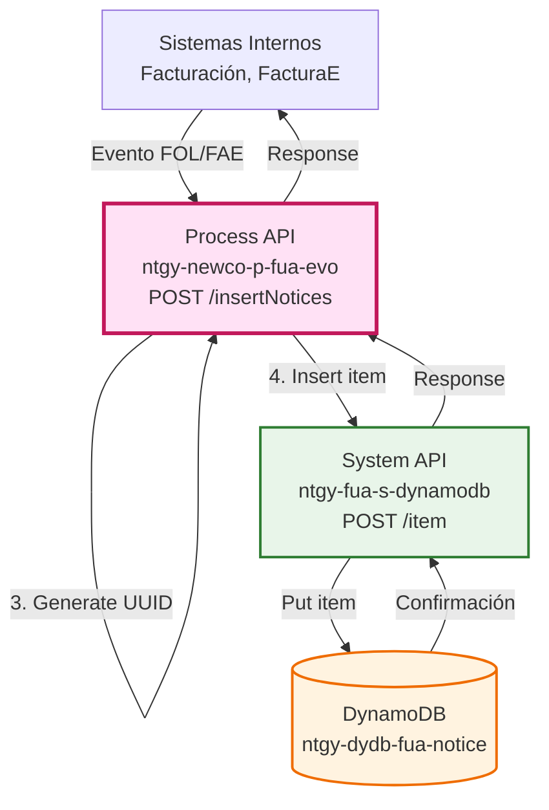
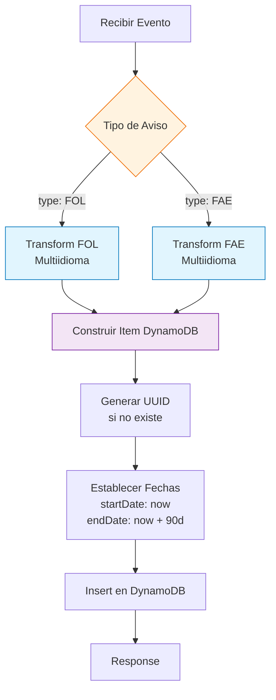
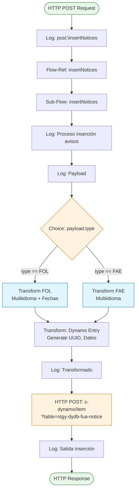
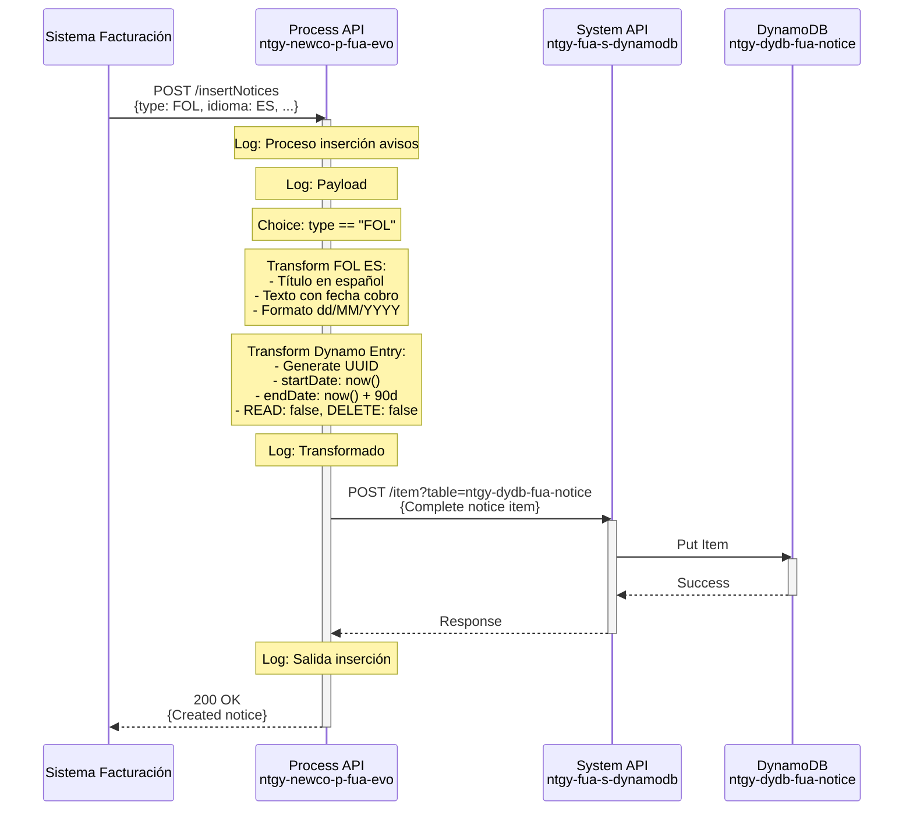
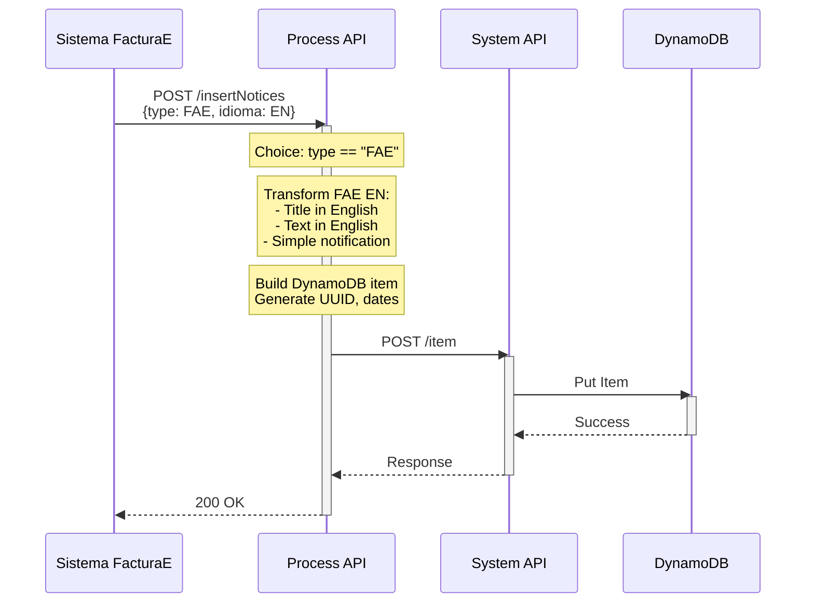
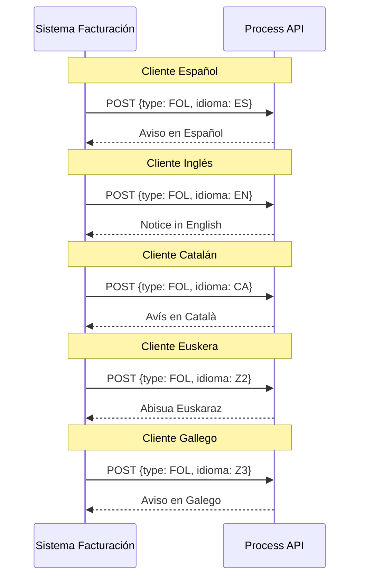

# POST /insertNotices

## 📌 Descripción General

### Propósito del Endpoint

Este endpoint crea nuevos avisos en DynamoDB para notificar a los clientes sobre eventos importantes relacionados con sus facturas. Soporta dos tipos de avisos: **FOL (Factura Online)** para notificar la disponibilidad de una nueva factura online, y **FAE (FacturaE)** para notificar la disponibilidad de una nueva FacturaE. El endpoint genera automáticamente el contenido del aviso en el idioma del cliente (ES, EN, CA, Euskera, Gallego) y establece una vigencia de 90 días.

### Tipo de API

**Capa:** Process API (API-Led Connectivity)

**Función:** Orquestación de creación de avisos multiidioma con generación automática de contenido

### Patrón de Integración

**Tipo:** Transformación Multiidioma + Inserción

**Descripción:** El endpoint recibe datos del evento (tipo de aviso, idioma, datos de factura), genera el contenido del aviso en el idioma correspondiente mediante transformaciones DataWeave, y lo inserta en DynamoDB.

### Arquitectura API-Led Connectivity



---

## 💼 Propósito del Negocio

### Casos de Uso Principales

1. **Notificación de Factura Online (FOL)**
   - El sistema de facturación genera una nueva factura online
   - Se crea un aviso automático para el cliente en su idioma
   - Beneficio: Comunicación proactiva sobre nuevas facturas

2. **Notificación de FacturaE (FAE)**
   - El sistema genera una nueva FacturaE
   - Se crea un aviso informando al cliente
   - Beneficio: Mantiene al cliente informado sobre documentos electrónicos

3. **Comunicación Multiidioma**
   - Los avisos se generan automáticamente en el idioma del cliente
   - Beneficio: Experiencia personalizada según preferencias lingüísticas

### 🔗 Endpoints Dependientes

Este Process API consume el siguiente System API:

| System API | Endpoint | Método | Propósito |
|------------|----------|--------|-----------|
| `ntgy-fua-s-dynamodb` | `/item` | POST | Inserta el nuevo aviso en la tabla ntgy-dydb-fua-notice |

### Lógica de Orquestación



**Pasos del Proceso:**

1. **Recepción de Evento**: Recibe datos del evento (tipo, idioma, datos de factura)
2. **Choice por Tipo**: Determina si es FOL o FAE
3. **Transformación Multiidioma**: Genera título y texto en el idioma del cliente
4. **Construcción de Item**: Prepara el item completo para DynamoDB
5. **Generación de UUID**: Crea ID único si no se proporciona
6. **Establecimiento de Fechas**: Calcula startDate (hoy) y endDate (hoy + 90 días)
7. **Inserción**: Guarda el aviso en DynamoDB
8. **Respuesta**: Retorna confirmación

### Tipos de Avisos Soportados

#### 1. FOL (Factura Online)

**Datos Requeridos:**
- `nif`: Código del cliente
- `idioma`: Idioma del aviso (ES, EN, CA, Z2, Z3)
- `fec_emi`: Fecha de emisión de la factura
- `fec_car`: Fecha estimada de cobro
- `url`: URL para acceder a la factura
- `dirSuministro`: Dirección de suministro

**Contenido Generado por Idioma:**

| Idioma | Código | Título | Texto (Resumen) |
|--------|--------|--------|-----------------|
| Español | ES | Tu nueva factura online ya está disponible | Incluye fecha de cobro y enlace a factura |
| English | EN | Your new online invoice is now available | Includes payment date and invoice link |
| Català | CA | La teva nova factura en línia ja està disponible | Inclou data de cobrament i enllaç a factura |
| Euskera | Z2 | Zure lineako faktura berria eskuragarri dago orain | Kobratzeko data eta fakturaren esteka |
| Galego | Z3 | A túa nova factura en liña xa está dispoñible | Inclúe data de cobro e ligazón á factura |

#### 2. FAE (FacturaE)

**Datos Requeridos:**
- `nif`: Código del cliente
- `idioma`: Idioma del aviso (ES, EN, CA, Z2, Z3)

**Contenido Generado por Idioma:**

| Idioma | Código | Título | Texto (Resumen) |
|--------|--------|--------|-----------------|
| Español | ES | Tu nueva FacturaE ya está disponible | Recibirás un email informándote |
| English | EN | Your new FacturaE is now available | You'll receive an email informing you |
| Català | CA | La teva nova FacturaE ja està disponible | Rebràs un email informant-te |
| Euskera | Z2 | Zure FacturaE berria eskuragarri dago orain | Mezu elektroniko bat jasoko duzu |
| Galego | Z3 | Zure FacturaE berria eskuragarri dago orain | Recibirás un correo electrónico |

### Transformaciones Aplicadas

**Generación Automática de Campos:**

| Campo | Valor | Descripción |
|-------|-------|-------------|
| `NOTICE_ID` | `uuid()` | ID único generado automáticamente si no se proporciona |
| `START_DATE` | `now()` | Fecha actual en formato yyyy/MM/dd |
| `END_DATE` | `now() + 90 días` | Fecha actual + 90 días |
| `VALIDITY` | `"90"` | Vigencia de 90 días |
| `VISIBILITY` | `"all"` | Visible para todos |
| `READ` | `false` | No leído por defecto |
| `DELETE` | `false` | No eliminado por defecto |

**Transformación de Fechas (Euskera Z2):**
- Entrada: `yyyy/MM/dd`
- Salida en texto: `dd/MM/yyyy`
- Otros idiomas mantienen formato original

### Contexto Empresarial

- **Dominio:** Gestión de Notificaciones y Facturación
- **Sector:** Energía - Utilities
- **División:** Naturgy España - NewCo
- **Proceso de Negocio:** Notificación Automática de Eventos de Facturación

### Stakeholders

- **Sistema de Facturación**: Genera eventos cuando hay nuevas facturas
- **Sistema FacturaE**: Genera eventos para FacturaE
- **Clientes FUA**: Reciben avisos en su idioma sobre sus facturas
- **Equipo de Comunicaciones**: Define contenido de avisos multiidioma

### Valor de Negocio

- **Automatización**: Creación automática de avisos sin intervención manual
- **Personalización**: Avisos en el idioma del cliente
- **Proactividad**: Notifica al cliente inmediatamente cuando hay nueva factura
- **Consistencia**: Formato y contenido estandarizado por tipo de aviso
- **Trazabilidad**: Todos los avisos quedan registrados en DynamoDB

### Consumidores Potenciales

Este endpoint es consumido por:
- Sistemas internos de facturación
- Sistema de generación de FacturaE
- Procesos batch de notificaciones
- Integraciones de backend

---

## 🔧 Especificación Técnica

### URLs por Ambiente

| Ambiente | URL Base | URL Completa |
|----------|----------|--------------|
| **Local** | `http://localhost:8081` | `http://localhost:8081/api/insertNotices` |
| **Development** | `https://ntgy-newco-p-fua-evo-dev.us-e2.cloudhub.io` | `https://ntgy-newco-p-fua-evo-dev.us-e2.cloudhub.io/api/insertNotices` |
| **UAT** | `https://ntgy-newco-p-fua-evo-uat.us-e2.cloudhub.io` | `https://ntgy-newco-p-fua-evo-uat.us-e2.cloudhub.io/api/insertNotices` |
| **Production** | `https://ntgy-newco-p-fua-evo-pro.us-e2.cloudhub.io` | `https://ntgy-newco-p-fua-evo-pro.us-e2.cloudhub.io/api/insertNotices` |

### Método HTTP

```
POST /api/insertNotices
```

### Parámetros de Entrada

#### Query Parameters

| Parámetro | Tipo | Requerido | Descripción | Ejemplo |
|-----------|------|-----------|-------------|---------|
| `x-client-code` | string | Condicional | Código del cliente (alternativa a nif en body) | `12345678A` |

#### Request Body - Tipo FOL (Factura Online)

```json
{
  "type": "FOL",
  "data": {
    "nif": "12345678A",
    "idioma": "ES",
    "fec_emi": "01/08/2026",
    "fec_car": "15/09/2026",
    "url": "https://portal.naturgy.es/facturas/2026-08",
    "dirSuministro": "Calle Principal 123, Madrid"
  }
}
```

| Campo | Tipo | Requerido | Descripción | Ejemplo |
|-------|------|-----------|-------------|---------|
| `type` | string | Sí | Tipo de aviso: "FOL" o "FAE" | `"FOL"` |
| `data.nif` | string | Sí | NIF/NIE del cliente | `"12345678A"` |
| `data.idioma` | string | Sí | Código de idioma (ES/EN/CA/Z2/Z3) | `"ES"` |
| `data.fec_emi` | string | Sí (FOL) | Fecha de emisión de factura | `"01/08/2026"` |
| `data.fec_car` | string | Sí (FOL) | Fecha estimada de cobro | `"15/09/2026"` |
| `data.url` | string | Sí (FOL) | URL de la factura online | `"https://..."` |
| `data.dirSuministro` | string | Sí (FOL) | Dirección de suministro | `"Calle..."` |

#### Request Body - Tipo FAE (FacturaE)

```json
{
  "type": "FAE",
  "data": {
    "nif": "12345678A",
    "idioma": "EN"
  }
}
```

| Campo | Tipo | Requerido | Descripción | Ejemplo |
|-------|------|-----------|-------------|---------|
| `type` | string | Sí | Tipo de aviso: "FOL" o "FAE" | `"FAE"` |
| `data.nif` | string | Sí | NIF/NIE del cliente | `"12345678A"` |
| `data.idioma` | string | Sí | Código de idioma (ES/EN/CA/Z2/Z3) | `"EN"` |

### Respuestas

#### 200 OK - Aviso Creado (FOL)

```json
{
  "CLIENT_CODE": "12345678A",
  "TYPE": "Información",
  "TEXT": "Acabamos de enviarte un email con tu nueva factura online, que tiene fecha estimada de cobro el 15/09/2026. En el correo puedes ver un pequeño resumen con los datos más relevantes o descargarte la versión completa. También puedes acceder a ella haciendo click {{urlFOL}}. Si no recibes el correo, por favor revisa en tu Área Clientes que lo tengamos bien escrito.",
  "TITLE": "Tu nueva factura online ya está disponible",
  "VISIBILITY": "all",
  "NOTICE_ID": "550e8400-e29b-41d4-a716-446655440000",
  "READ": false,
  "DELETE": false,
  "VALIDITY": "90",
  "START_DATE": "2026/08/28",
  "END_DATE": "2026/11/26",
  "IDIOMA": "ES",
  "DIRSUMINISTRO": "Calle Principal 123, Madrid",
  "URL": "https://portal.naturgy.es/facturas/2026-08"
}
```

#### 200 OK - Aviso Creado (FAE)

```json
{
  "CLIENT_CODE": "12345678A",
  "TYPE": "Información",
  "TEXT": "Recibirás un email informándote de la nueva FacturaE, que también puedes consultar en tu plataforma.",
  "TITLE": "Tu nueva FacturaE ya está disponible",
  "VISIBILITY": "all",
  "NOTICE_ID": "550e8400-e29b-41d4-a716-446655440001",
  "READ": false,
  "DELETE": false,
  "VALIDITY": "90",
  "START_DATE": "2026/08/28",
  "END_DATE": "2026/11/26",
  "IDIOMA": "ES"
}
```

#### 400 Bad Request

```json
{
  "message": "Bad request"
}
```

#### 500 Internal Server Error

```json
{
  "code": "APP:DYNAMO_ERROR",
  "message": "Error inserting notice in DynamoDB",
  "details": "Additional error details"
}
```

### Autenticación

- **Tipo:** Client ID & Client Secret (Anypoint Platform)

### Timeouts

| Tipo | Valor |
|------|-------|
| **Request Timeout** | 30 segundos |
| **Connection Timeout** | 10 segundos |

---

## 🏗️ Implementación Técnica

### Arquitectura del Flow



### Transformaciones DataWeave

#### 1. Transformación FOL - Español (ES)

```dataweave
%dw 2.0
output application/json

var content = payload.data
var fechaCar = content.fec_car as Date {format: "dd/MM/yyyy"} as String {format: "dd/MM/YYYY"}

---
{
    "type": "Información",
    "title": "Tu nueva factura online ya está disponible",
    "text": "Acabamos de enviarte un email con tu nueva factura online, que tiene fecha estimada de cobro el " ++ fechaCar ++ ". En el correo puedes ver un pequeño resumen con los datos más relevantes o descargarte la versión completa. También puedes acceder a ella haciendo click {{urlFOL}}. Si no recibes el correo, por favor revisa en tu Área Clientes que lo tengamos bien escrito.",
    "idioma": "ES",
    "visibility": "all",
    "validity": "90",
    "startDate": now() as Date {format: "dd/MM/yy"} as String {format: "yyyy/MM/dd"},
    "endDate": (now() + |P90D|) as Date {format: "dd/MM/yy"} as String {format: "yyyy/MM/dd"},
    "url": content.url,
    "dirSuministro": content.dirSuministro,
    "nif": content.nif
}
```

#### 2. Transformación FOL - English (EN)

```dataweave
%dw 2.0
output application/json

var content = payload.data
var fechaCar = content.fec_car as Date {format: "dd/MM/yyyy"} as String {format: "dd/MM/YYYY"}

---
{
    "type": "Information",
    "title": "Your new online invoice is now available",
    "text": "We have just sent you an email with your new online invoice, which has an estimated payment date of " ++ fechaCar ++ ". In the email you can see a brief summary with the most relevant data or download the full version. You can also access it by clicking {{urlFOL}}, If you do not receive the email, please check in your Customer Area that we have it written correctly.",
    "idioma": "EN",
    "visibility": "all",
    "validity": "90",
    "startDate": now() as Date {format: "dd/MM/yy"} as String {format: "yyyy/MM/dd"},
    "endDate": (now() + |P90D|) as Date {format: "dd/MM/yy"} as String {format: "yyyy/MM/dd"},
    "url": content.url,
    "dirSuministro": content.dirSuministro,
    "nif": content.nif
}
```

#### 3. Transformación FOL - Euskera (Z2) con Conversión de Fechas

```dataweave
%dw 2.0
output application/json

var content = payload.data
// Conversión especial para Euskera: yyyy/MM/dd -> dd/MM/yyyy
var fechaCar = content.fec_car as Date {format: "yyyy/MM/dd"} as String {format: "MM/dd/yyyy"}

---
{
    "type": "Informazioa",
    "title": "Zure lineako faktura berria eskuragarri dago orain",
    "text": "Mezu elektroniko bat bidali berri dizugu lineako faktura berriarekin, " ++ fechaCar ++ " kobratzeko data estimatua duena. Posta elektronikoan datu garrantzitsuenekin laburpen txiki bat ikus dezakezu edo bertsio osoa deskargatu. Hemen klik eginda ere sar {{urlFOL}}. Mezu elektronikoa jasotzen ez baduzu, mesedez, egiaztatu zure Bezeroen Eremuan idatzita daukagula.",
    "idioma": "Z2",
    "visibility": "all",
    "validity": "90",
    "startDate": now() as Date {format: "dd/MM/yy"} as String {format: "yyyy/MM/dd"},
    "endDate": (now() + |P90D|) as Date {format: "dd/MM/yy"} as String {format: "yyyy/MM/dd"},
    "url": content.url,
    "dirSuministro": content.dirSuministro,
    "nif": content.nif
}
```

#### 4. Transformación FAE - Español (ES)

```dataweave
%dw 2.0
output application/json

var content = payload.data

---
{
    "type": "Información",
    "title": "Tu nueva FacturaE ya está disponible",
    "text": "Recibirás un email informándote de la nueva FacturaE, que también puedes consultar en tu plataforma.",
    "idioma": "ES",
    "visibility": "all",
    "validity": "90",
    "startDate": now() as Date {format: "dd/MM/yy"} as String {format: "yyyy/MM/dd"},
    "endDate": (now() + |P90D|) as Date {format: "dd/MM/yy"} as String {format: "yyyy/MM/dd"},
    "nif": content.nif
}
```

#### 5. Construcción del Item DynamoDB

```dataweave
%dw 2.0
output application/json
---
{
    "CLIENT_CODE": attributes.queryParams.'x-client-code' default payload.nif,
    "TYPE": payload.'type',
    "TEXT": payload.text,
    "TITLE": payload.title,
    "VISIBILITY": payload.visibility,
    "NOTICE_ID": payload.noticeId default uuid(),
    "READ": payload.read default false,
    "DELETE": payload.delete default false,
    "VALIDITY": payload.validity,
    "START_DATE": payload.startDate,
    "END_DATE": payload.endDate,
    "IDIOMA": payload.idioma,
    "DIRSUMINISTRO": payload.dirSuministro,
    "URL": payload.url
}
```

### Patrones de Diseño

**Patrón:** Content-Based Routing + Template Method + Internationalization (i18n)

**Justificación:** 
- **Content-Based Routing**: Choice por tipo de aviso (FOL vs FAE)
- **Template Method**: Estructura común con variaciones por idioma
- **i18n**: Generación automática de contenido multiidioma
- **UUID Generation**: Identificadores únicos automáticos
- **Date Calculation**: Cálculo automático de vigencia

### Diagramas de Secuencia

#### 1. Flujo Normal - Crear Aviso FOL en Español



#### 2. Flujo Normal - Crear Aviso FAE en Inglés



#### 3. Flujo con Múltiples Idiomas



### Manejo de Errores

El endpoint utiliza error mapping específico para DynamoDB:

```xml
<error-mapping targetType="APP:DYNAMO_ERROR" />
```

**Errores Capturados:**
1. **Errores de inserción** en DynamoDB
2. **Errores de conexión** con System API
3. **Errores de transformación** DataWeave
4. **Tipo de aviso no soportado** (ni FOL ni FAE)

**Códigos de Error Comunes:**
- `400`: Parámetros inválidos o tipo no soportado
- `500`: Error de inserción en DynamoDB
- `APP:DYNAMO_ERROR`: Error específico de DynamoDB

---

## 💻 Ejemplos de Uso

### Ejemplo 1: Crear Aviso FOL en Español

#### cURL

```bash
curl -X POST "https://ntgy-newco-p-fua-evo-dev.us-e2.cloudhub.io/api/insertNotices" \
  -H "Content-Type: application/json" \
  -H "client_id: YOUR_CLIENT_ID" \
  -H "client_secret: YOUR_CLIENT_SECRET" \
  -d '{
    "type": "FOL",
    "data": {
      "nif": "12345678A",
      "idioma": "ES",
      "fec_emi": "01/08/2026",
      "fec_car": "15/09/2026",
      "url": "https://portal.naturgy.es/facturas/2026-08",
      "dirSuministro": "Calle Principal 123, Madrid"
    }
  }'
```

#### Respuesta (200 OK)

```json
{
  "CLIENT_CODE": "12345678A",
  "TYPE": "Información",
  "TEXT": "Acabamos de enviarte un email con tu nueva factura online, que tiene fecha estimada de cobro el 15/09/2026. En el correo puedes ver un pequeño resumen con los datos más relevantes o descargarte la versión completa. También puedes acceder a ella haciendo click {{urlFOL}}. Si no recibes el correo, por favor revisa en tu Área Clientes que lo tengamos bien escrito.",
  "TITLE": "Tu nueva factura online ya está disponible",
  "VISIBILITY": "all",
  "NOTICE_ID": "550e8400-e29b-41d4-a716-446655440000",
  "READ": false,
  "DELETE": false,
  "VALIDITY": "90",
  "START_DATE": "2026/08/28",
  "END_DATE": "2026/11/26",
  "IDIOMA": "ES",
  "DIRSUMINISTRO": "Calle Principal 123, Madrid",
  "URL": "https://portal.naturgy.es/facturas/2026-08"
}
```

### Ejemplo 2: Crear Aviso FOL en Inglés

#### cURL

```bash
curl -X POST "https://ntgy-newco-p-fua-evo-dev.us-e2.cloudhub.io/api/insertNotices" \
  -H "Content-Type: application/json" \
  -H "client_id: YOUR_CLIENT_ID" \
  -H "client_secret: YOUR_CLIENT_SECRET" \
  -d '{
    "type": "FOL",
    "data": {
      "nif": "98765432B",
      "idioma": "EN",
      "fec_emi": "01/08/2026",
      "fec_car": "15/09/2026",
      "url": "https://portal.naturgy.es/invoices/2026-08",
      "dirSuministro": "Main Street 123, Madrid"
    }
  }'
```

#### Respuesta (200 OK)

```json
{
  "CLIENT_CODE": "98765432B",
  "TYPE": "Information",
  "TEXT": "We have just sent you an email with your new online invoice, which has an estimated payment date of 15/09/2026. In the email you can see a brief summary with the most relevant data or download the full version. You can also access it by clicking {{urlFOL}}, If you do not receive the email, please check in your Customer Area that we have it written correctly.",
  "TITLE": "Your new online invoice is now available",
  "VISIBILITY": "all",
  "NOTICE_ID": "550e8400-e29b-41d4-a716-446655440001",
  "READ": false,
  "DELETE": false,
  "VALIDITY": "90",
  "START_DATE": "2026/08/28",
  "END_DATE": "2026/11/26",
  "IDIOMA": "EN",
  "DIRSUMINISTRO": "Main Street 123, Madrid",
  "URL": "https://portal.naturgy.es/invoices/2026-08"
}
```

### Ejemplo 3: Crear Aviso FAE en Español

#### cURL

```bash
curl -X POST "https://ntgy-newco-p-fua-evo-dev.us-e2.cloudhub.io/api/insertNotices" \
  -H "Content-Type: application/json" \
  -H "client_id: YOUR_CLIENT_ID" \
  -H "client_secret: YOUR_CLIENT_SECRET" \
  -d '{
    "type": "FAE",
    "data": {
      "nif": "12345678A",
      "idioma": "ES"
    }
  }'
```

#### Respuesta (200 OK)

```json
{
  "CLIENT_CODE": "12345678A",
  "TYPE": "Información",
  "TEXT": "Recibirás un email informándote de la nueva FacturaE, que también puedes consultar en tu plataforma.",
  "TITLE": "Tu nueva FacturaE ya está disponible",
  "VISIBILITY": "all",
  "NOTICE_ID": "550e8400-e29b-41d4-a716-446655440002",
  "READ": false,
  "DELETE": false,
  "VALIDITY": "90",
  "START_DATE": "2026/08/28",
  "END_DATE": "2026/11/26",
  "IDIOMA": "ES"
}
```

### Ejemplo 4: JavaScript (Node.js)

```javascript
const createNotice = async (type, clientData) => {
  try {
    const response = await fetch(
      'https://ntgy-newco-p-fua-evo-dev.us-e2.cloudhub.io/api/insertNotices',
      {
        method: 'POST',
        headers: {
          'Content-Type': 'application/json',
          'client_id': 'YOUR_CLIENT_ID',
          'client_secret': 'YOUR_CLIENT_SECRET'
        },
        body: JSON.stringify({
          type: type,
          data: clientData
        })
      }
    );

    if (!response.ok) {
      throw new Error(`HTTP error! status: ${response.status}`);
    }

    const data = await response.json();
    console.log('Aviso creado:', data.NOTICE_ID);
    console.log('Título:', data.TITLE);
    console.log('Idioma:', data.IDIOMA);
    
    return data;
  } catch (error) {
    console.error('Error al crear aviso:', error);
    throw error;
  }
};

// Uso: Crear aviso FOL en Español
const folData = {
  nif: '12345678A',
  idioma: 'ES',
  fec_emi: '01/08/2026',
  fec_car: '15/09/2026',
  url: 'https://portal.naturgy.es/facturas/2026-08',
  dirSuministro: 'Calle Principal 123, Madrid'
};

createNotice('FOL', folData)
  .then(notice => console.log('Aviso FOL creado:', notice.NOTICE_ID))
  .catch(error => console.error('Error:', error));

// Uso: Crear aviso FAE en Inglés
const faeData = {
  nif: '98765432B',
  idioma: 'EN'
};

createNotice('FAE', faeData)
  .then(notice => console.log('Aviso FAE creado:', notice.NOTICE_ID))
  .catch(error => console.error('Error:', error));
```

### Ejemplo 5: Python (Requests)

```python
import requests
from datetime import datetime, timedelta

def create_notice(notice_type, client_data):
    """
    Crea un nuevo aviso en DynamoDB
    
    Args:
        notice_type (str): Tipo de aviso ('FOL' o 'FAE')
        client_data (dict): Datos del cliente y aviso
    
    Returns:
        dict: Respuesta con el aviso creado
    """
    url = 'https://ntgy-newco-p-fua-evo-dev.us-e2.cloudhub.io/api/insertNotices'
    
    headers = {
        'Content-Type': 'application/json',
        'client_id': 'YOUR_CLIENT_ID',
        'client_secret': 'YOUR_CLIENT_SECRET'
    }
    
    payload = {
        'type': notice_type,
        'data': client_data
    }
    
    try:
        response = requests.post(url, headers=headers, json=payload, timeout=30)
        response.raise_for_status()
        
        data = response.json()
        print(f"✅ Aviso {notice_type} creado exitosamente")
        print(f"   ID: {data.get('NOTICE_ID')}")
        print(f"   Título: {data.get('TITLE')}")
        print(f"   Idioma: {data.get('IDIOMA')}")
        print(f"   Vigencia: {data.get('START_DATE')} - {data.get('END_DATE')}")
        
        return data
        
    except requests.exceptions.RequestException as e:
        print(f"❌ Error al crear aviso: {e}")
        raise

# Uso: Crear aviso FOL en Español
if __name__ == "__main__":
    # Aviso FOL en Español
    fol_data_es = {
        'nif': '12345678A',
        'idioma': 'ES',
        'fec_emi': '01/08/2026',
        'fec_car': '15/09/2026',
        'url': 'https://portal.naturgy.es/facturas/2026-08',
        'dirSuministro': 'Calle Principal 123, Madrid'
    }
    
    notice_fol = create_notice('FOL', fol_data_es)
    
    # Aviso FOL en Catalán
    fol_data_ca = {
        'nif': '98765432B',
        'idioma': 'CA',
        'fec_emi': '01/08/2026',
        'fec_car': '15/09/2026',
        'url': 'https://portal.naturgy.es/factures/2026-08',
        'dirSuministro': 'Carrer Principal 123, Barcelona'
    }
    
    notice_fol_ca = create_notice('FOL', fol_data_ca)
    
    # Aviso FAE en Inglés
    fae_data_en = {
        'nif': '11223344C',
        'idioma': 'EN'
    }
    
    notice_fae = create_notice('FAE', fae_data_en)
    
    print(f"\n📊 Total de avisos creados: 3")
```

### Ejemplo 6: Batch de Avisos Multiidioma

```python
import requests
from typing import List, Dict

def create_notices_batch(notices: List[Dict]) -> List[Dict]:
    """
    Crea múltiples avisos en batch
    
    Args:
        notices: Lista de avisos a crear
    
    Returns:
        Lista de avisos creados
    """
    url = 'https://ntgy-newco-p-fua-evo-dev.us-e2.cloudhub.io/api/insertNotices'
    
    headers = {
        'Content-Type': 'application/json',
        'client_id': 'YOUR_CLIENT_ID',
        'client_secret': 'YOUR_CLIENT_SECRET'
    }
    
    created_notices = []
    
    for notice in notices:
        try:
            response = requests.post(url, headers=headers, json=notice, timeout=30)
            response.raise_for_status()
            created_notices.append(response.json())
            print(f"✅ Aviso creado: {notice['data']['nif']} ({notice['data']['idioma']})")
        except Exception as e:
            print(f"❌ Error creando aviso para {notice['data']['nif']}: {e}")
    
    return created_notices

# Uso: Crear avisos para múltiples clientes en diferentes idiomas
if __name__ == "__main__":
    notices_to_create = [
        {
            'type': 'FOL',
            'data': {
                'nif': '12345678A',
                'idioma': 'ES',
                'fec_emi': '01/08/2026',
                'fec_car': '15/09/2026',
                'url': 'https://portal.naturgy.es/facturas/2026-08',
                'dirSuministro': 'Calle Principal 123, Madrid'
            }
        },
        {
            'type': 'FOL',
            'data': {
                'nif': '98765432B',
                'idioma': 'EN',
                'fec_emi': '01/08/2026',
                'fec_car': '15/09/2026',
                'url': 'https://portal.naturgy.es/invoices/2026-08',
                'dirSuministro': 'Main Street 456, Barcelona'
            }
        },
        {
            'type': 'FAE',
            'data': {
                'nif': '11223344C',
                'idioma': 'CA'
            }
        },
        {
            'type': 'FOL',
            'data': {
                'nif': '55667788D',
                'idioma': 'Z2',  # Euskera
                'fec_emi': '2026/08/01',
                'fec_car': '2026/09/15',
                'url': 'https://portal.naturgy.es/fakturak/2026-08',
                'dirSuministro': 'Kale Nagusia 789, Bilbao'
            }
        }
    ]
    
    created = create_notices_batch(notices_to_create)
    print(f"\n📊 Total de avisos creados: {len(created)}/{len(notices_to_create)}")
```
