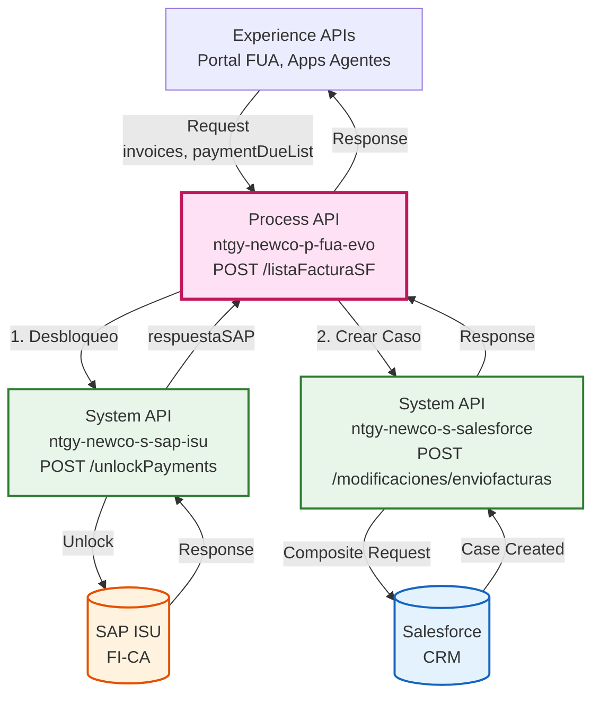
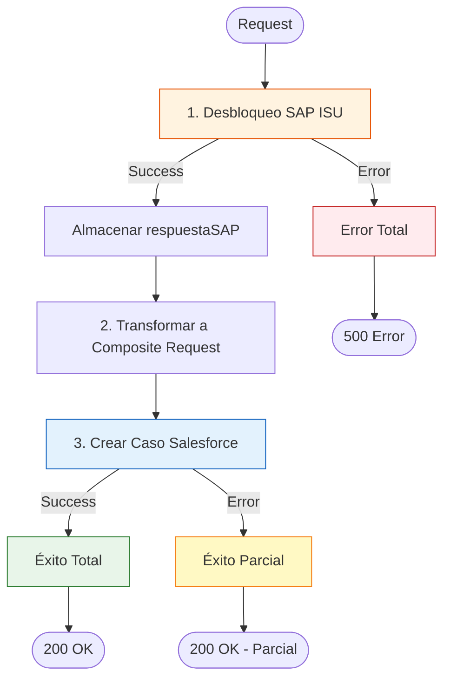
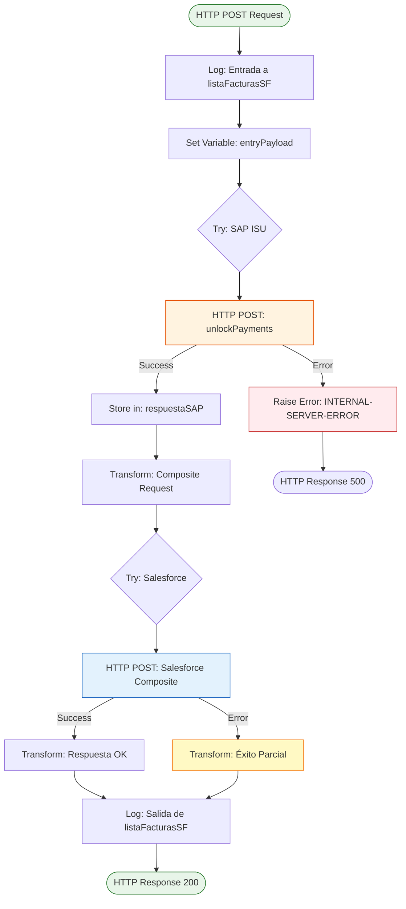
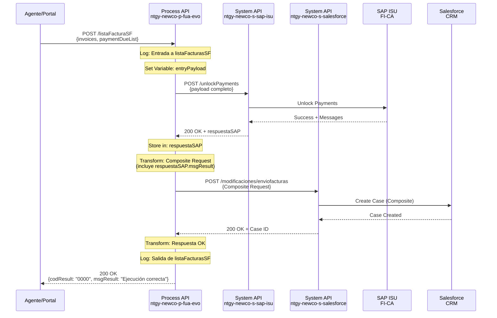
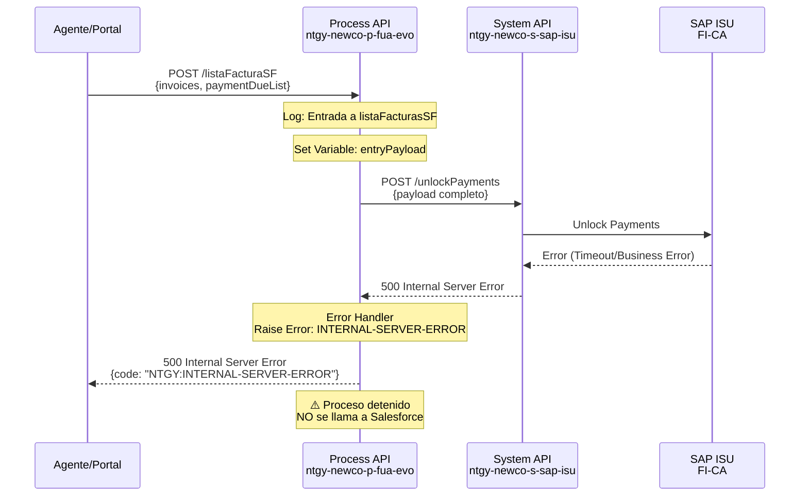
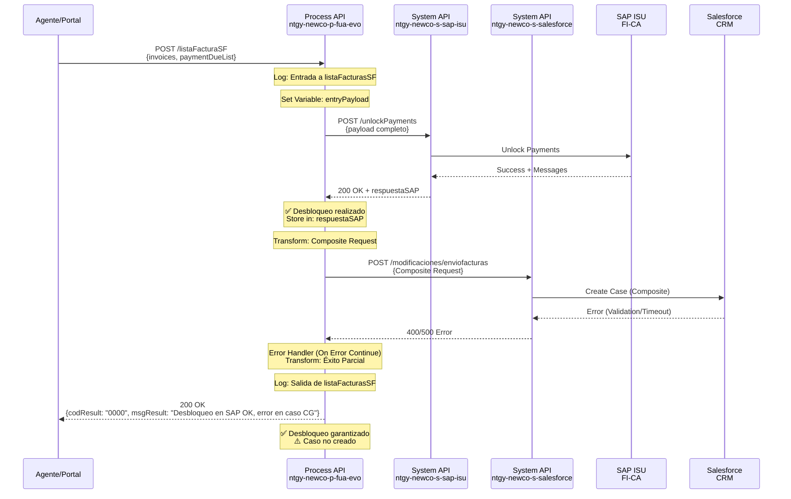

# POST /listaFacturaSF

## 📌 Descripción General

### Propósito del Endpoint

Este endpoint orquesta un proceso complejo de dos pasos para gestionar facturas: primero desbloquea pagos en SAP ISU y luego crea un caso de gestión en Salesforce con la información de las facturas. Es un endpoint crítico para la gestión de reclamaciones y casos relacionados con facturación.

### Tipo de API

**Capa:** Process API (API-Led Connectivity)

**Función:** Orquestación secuencial de desbloqueo de pagos y creación de caso

### Patrón de Integración

**Tipo:** Orquestación Secuencial con Manejo de Errores Parciales

**Descripción:** El endpoint ejecuta dos operaciones en secuencia:
1. **Paso Crítico**: Desbloqueo de pagos en SAP ISU (obligatorio)
2. **Paso Secundario**: Creación de caso en Salesforce (best-effort)

Si el paso 1 falla, se devuelve error. Si el paso 2 falla, se devuelve éxito parcial indicando que el desbloqueo se realizó pero el caso no se creó.

### Arquitectura API-Led Connectivity



---

## 💼 Propósito del Negocio

### Casos de Uso Principales

1. **Desbloqueo de Facturas con Creación de Caso**
   - Los agentes pueden desbloquear pagos de facturas y crear automáticamente un caso de seguimiento
   - Integra el proceso de desbloqueo con la gestión de casos en Salesforce
   - Beneficio: Trazabilidad completa del proceso de desbloqueo

2. **Gestión de Reclamaciones de Facturación**
   - Permite gestionar reclamaciones relacionadas con facturas bloqueadas
   - Crea un caso de gestión con toda la información relevante
   - Beneficio: Centralización de la gestión de incidencias

3. **Automatización de Procesos de Atención al Cliente**
   - Automatiza la creación de casos cuando se desbloquean pagos
   - Vincula facturas específicas al caso creado
   - Beneficio: Reducción de tareas manuales y mejora en la eficiencia

### 🔗 Endpoints Dependientes

Este Process API consume los siguientes System APIs en secuencia:

| System API | Endpoint | Método | Propósito | Orden |
|------------|----------|--------|-----------|-------|
| `ntgy-newco-s-sap-isu` | `/unlockPayments` | POST | Desbloqueo de pagos en SAP ISU | 1º (Crítico) |
| `ntgy-newco-s-salesforce` | `/modificaciones/enviofacturas` | POST | Creación de caso mediante Composite API | 2º (Best-effort) |

### Lógica de Orquestación



**Pasos del Proceso:**

1. **Desbloqueo en SAP ISU** (Crítico)
   - Se envía el payload completo al System API de SAP ISU
   - Se almacena la respuesta en variable `respuestaSAP`
   - Si falla: Se lanza error INTERNAL-SERVER-ERROR y se detiene el proceso

2. **Transformación DataWeave** (Preparación)
   - Se construye un Salesforce Composite Request
   - Se mapean datos del payload y de la respuesta SAP
   - Se incluyen facturas, referencias de pago y comentarios

3. **Creación de Caso en Salesforce** (Best-effort)
   - Se envía el Composite Request a Salesforce
   - Se crea un Case con recordtype "Gestion"
   - Si falla: Se devuelve éxito parcial (desbloqueo realizado)

### Transformaciones Aplicadas

**Transformación Compleja: Salesforce Composite Request**

El endpoint construye un request complejo para la API Composite de Salesforce:

| Campo Original | Campo Salesforce | Transformación |
|----------------|------------------|----------------|
| `payload.'x-client-id'` | `AccountId` | Directo (propagado desde header por Experience API) |
| `payload.'x-contact-id'` | `ContactId` | Directo (propagado desde header por Experience API) |
| `payload.'x-user-id'` | `OwnerId` | Condicional (si no está vacío, propagado desde header) |
| `payload.invoices.invoiceATRid` | `acn_fld_NumFacturaATR__c` | Join con ";" |
| `payload.invoices.invoiceId` + `payload.paymentDueList.numRef` | `NewCo_ClaimInvoiceNumber__c` | Concatenación + Join con ";" |
| `vars.respuestaSAP.msgResult` | `comments` | Filtrado + Join con "," (excluye "No hay error") |
| `payload.parentId` | `ParentId` | Directo (generado por Experience API desde x-interaction-id) |
| `payload.DirIp` | `NewCo_Ip__c` | Directo (generado por Experience API desde remoteAddress) |
| `payload.emailChannel` | `NewCo_OperationEmail__c` | Directo (del cliente) |

**Lógica Especial:**
- Filtrado de mensajes SAP: Se excluyen mensajes que contienen "No hay error"
- Campos condicionales: `OwnerId` solo se incluye si `x-user-id` no está vacío
- Lookup por ExternalId: Se usa `acn_fld_Tittle__r.NewCo_ExternalId__c` para vincular el tipo de caso

### Contexto Empresarial

- **Dominio:** Gestión de Facturación y Casos
- **Sector:** Energía - Utilities
- **División:** Naturgy España - NewCo
- **Proceso de Negocio:** Desbloqueo de pagos con creación automática de caso de seguimiento

### Stakeholders

- **Agentes de Call Center**: Necesitan desbloquear pagos y crear casos de seguimiento
- **Equipo de Facturación**: Monitorea los desbloqueos realizados
- **Equipo de Atención al Cliente**: Gestiona los casos creados en Salesforce
- **Clientes**: Se benefician de la resolución rápida de problemas de facturación

### Valor de Negocio

- **Automatización**: Reduce tareas manuales al crear automáticamente el caso
- **Trazabilidad**: Vincula el desbloqueo con un caso de seguimiento
- **Eficiencia**: Proceso unificado en una sola llamada API
- **Resiliencia**: Garantiza el desbloqueo incluso si falla la creación del caso
- **Auditoría**: Registra todos los desbloqueos con información completa

### Consumidores Potenciales

Este endpoint puede ser consumido por:
- Aplicaciones de agentes de call center
- Portales de gestión interna
- Sistemas de atención al cliente
- Herramientas de back-office

---

## 🔧 Especificación Técnica

### URLs por Ambiente

| Ambiente | URL Base | URL Completa |
|----------|----------|--------------|
| **Local** | `http://localhost:8081` | `http://localhost:8081/api/listaFacturaSF` |
| **Development** | `https://ntgy-newco-p-fua-evo-dev.us-e2.cloudhub.io` | `https://ntgy-newco-p-fua-evo-dev.us-e2.cloudhub.io/api/listaFacturaSF` |
| **UAT** | `https://ntgy-newco-p-fua-evo-uat.us-e2.cloudhub.io` | `https://ntgy-newco-p-fua-evo-uat.us-e2.cloudhub.io/api/listaFacturaSF` |
| **Production** | `https://ntgy-newco-p-fua-evo-pro.us-e2.cloudhub.io` | `https://ntgy-newco-p-fua-evo-pro.us-e2.cloudhub.io/api/listaFacturaSF` |

### Método HTTP

```
POST /api/listaFacturaSF
```

### Parámetros de Entrada

#### Headers Requeridos

| Header | Tipo | Requerido | Descripción | Ejemplo |
|--------|------|-----------|-------------|---------|
| `Content-Type` | String | ✅ Sí | Tipo de contenido | `application/json` |
| `client_id` | String | ✅ Sí | Client ID de Anypoint Platform | `{your_client_id}` |
| `client_secret` | String | ✅ Sí | Client Secret de Anypoint Platform | `{your_client_secret}` |
| `x-client-id` | String | ✅ Sí | ID del cliente (AccountId en Salesforce) | `"0012345678"` |
| `x-contact-id` | String | ✅ Sí | ID del contacto en Salesforce | `"003XXXXXXXX"` |
| `x-user-id` | String | ⚠️ Opcional | ID del usuario/agente (OwnerId) | `"005XXXXXXXX"` |
| `x-agent-mail` | String | ⚠️ Opcional | Email del agente para Salesforce | `"agente@naturgy.com"` |

#### Body (JSON)

**Estructura del Request:**

⚠️ **Nota Importante:** Este Process API recibe el payload enriquecido por el Experience API. El Experience API añade campos adicionales de contexto (headers FUA, DirIp, parentId) al payload original del cliente.

```json
{
  "contractAccountId": "string",
  "contactId": "string",
  "invoices": [
    {
      "invoiceId": "string",
      "invoiceATRid": "string"
    }
  ],
  "emailChannel": "string",
  "reasonSelected": "string",
  "invoiceId": "string",
  "managementType": "string",
  "comments": "string",
  "paymentDueList": [
    {
      "numRef": "string"
    }
  ],
  "x-client-id": "string",
  "x-contact-id": "string",
  "x-user-id": "string",
  "x-user-role": "string",
  "DirIp": "string",
  "parentId": "string"
}
```

**Campos del Body:**

**Campos del Cliente (pass-through desde Experience API):**

| Campo | Tipo | Requerido | Descripción |
|-------|------|-----------|-------------|
| `contractAccountId` | String | ✅ Sí | ID de la cuenta contrato |
| `contactId` | String | ⚠️ Opcional | ID del contacto en Salesforce |
| `invoices` | Array | ⚠️ Opcional | Lista de facturas a desbloquear |
| `invoices[].invoiceId` | String | ⚠️ Opcional | ID de la factura |
| `invoices[].invoiceATRid` | String | ⚠️ Opcional | ID ATR de la factura |
| `emailChannel` | String | ⚠️ Opcional | Email del canal de operación |
| `reasonSelected` | String | ⚠️ Opcional | Razón seleccionada |
| `invoiceId` | String | ⚠️ Opcional | ID de factura individual |
| `managementType` | String | ⚠️ Opcional | Tipo de gestión (ej: "NPB") |
| `comments` | String | ⚠️ Opcional | Comentarios adicionales |
| `paymentDueList` | Array | ⚠️ Opcional | Lista de referencias de pago |
| `paymentDueList[].numRef` | String | ⚠️ Opcional | Número de referencia de pago |

**Campos Añadidos por Experience API (headers propagados):**

| Campo | Tipo | Requerido | Descripción |
|-------|------|-----------|-------------|
| `x-client-id` | String | ✅ Sí | ID del cliente (propagado desde header) |
| `x-contact-id` | String | ⚠️ Opcional | ID del contacto (propagado desde header) |
| `x-user-id` | String | ⚠️ Opcional | ID del usuario/agente (propagado desde header) |
| `x-user-role` | String | ⚠️ Opcional | Rol del usuario (propagado desde header) |

**Campos Generados por Experience API:**

| Campo | Tipo | Requerido | Descripción |
|-------|------|-----------|-------------|
| `DirIp` | String | ⚠️ Opcional | Dirección IP del cliente (extraída de remoteAddress) |
| `parentId` | String | ⚠️ Opcional | ID de interacción padre (extraído de x-interaction-id) |

### Respuestas

#### 200 OK - Éxito Total

**Descripción:** Desbloqueo realizado en SAP ISU y caso creado en Salesforce exitosamente

**Content-Type:** `application/json`

**Estructura:**

```json
{
  "result": {
    "codResult": "0000",
    "msgResult": "Ejecución correcta"
  },
  "contactId": "003XXXXXXXX"
}
```

#### 200 OK - Éxito Parcial

**Descripción:** Desbloqueo realizado en SAP ISU pero fallo en la creación del caso en Salesforce

**Content-Type:** `application/json`

**Estructura:**

```json
{
  "result": {
    "codResult": "0000",
    "msgResult": "Se ha realizado el desbloqueo en SAP con error en la creación del caso CG"
  }
}
```

#### 400 Bad Request - Error de Validación

**Descripción:** Parámetros de entrada inválidos o faltantes

**Content-Type:** `application/json`

**Estructura:**

```json
{
  "code": "VALIDATION_ERROR",
  "message": "Parámetros de entrada inválidos",
  "details": "El campo 'invoices' es requerido"
}
```

#### 500 Internal Server Error - Error en SAP ISU

**Descripción:** Error en el desbloqueo de pagos en SAP ISU (paso crítico)

**Content-Type:** `application/json`

**Estructura:**

```json
{
  "code": "NTGY:INTERNAL-SERVER-ERROR",
  "message": "Internal server error",
  "details": "Error al desbloquear pagos en SAP ISU"
}
```

### Autenticación

- **Tipo:** Client ID & Client Secret (Anypoint Platform)
- **Ubicación:** Headers HTTP
- **Validación:** Gestionada por API Manager de Anypoint Platform

### Timeouts

| Tipo | Valor | Descripción |
|------|-------|-------------|
| **Request Timeout** | 30 segundos | Timeout general del request |
| **SAP ISU Timeout** | 30 segundos | Timeout para llamada a System API SAP |
| **Salesforce Timeout** | 60 segundos | Timeout para llamada a System API Salesforce |
| **Connection Timeout** | 10 segundos | Timeout de conexión |

---

## 🏗️ Implementación Técnica

### Arquitectura del Flow



### Componentes del Flow

#### 1. Flow Principal: `post:\listaFacturaSF:application\json:ntgy-newco-p-fua-config`

**Ubicación:** `src/main/mule/ntgy-newco-p-fua-evo.xml`

**Componentes:**
1. **Logger (INFO)**: Registra el inicio de la operación
2. **Flow Reference**: Invoca el subflow `listaFacturasSFSub_Flow`

#### 2. Subflow: `listaFacturasSFSub_Flow`

**Ubicación:** `src/main/mule/implementation/listaFacturasSFSub_Flow.xml`

**Componentes Principales:**

1. **Logger (INFO)**: Log de entrada con payload
2. **Set Variable**: Almacena payload original en `entryPayload`
3. **Try-Catch Block 1**: Llamada a SAP ISU
   - HTTP Request POST a `/unlockPayments`
   - Target: `respuestaSAP`
   - Error Handler: Lanza INTERNAL-SERVER-ERROR
4. **Transform**: Construcción de Composite Request
5. **Try-Catch Block 2**: Llamada a Salesforce
   - HTTP Request POST a `/modificaciones/enviofacturas`
   - Header condicional: `username` (si existe `x-agent-mail`)
   - Success: Respuesta OK
   - Error: Respuesta de éxito parcial
6. **Logger (INFO)**: Log de salida con payload

### Transformaciones DataWeave

#### Transformación 1: Salesforce Composite Request

**Ubicación:** Inline en el subflow (después del primer try-catch)

**Código:**

```dataweave
%dw 2.0
output application/json
---
{
    "allOrNone" : true,
    "collateSubrequests": false,
    "compositeRequest" : [
        {
            "method" : "POST",
            "url" : "/services/data/v52.0/sobjects/Case",
            "referenceId" : "refCaseGestion",
            "body" : { 
                "NewCo_Recordtype__c" : "Gestion",
                "AccountId" : payload.'x-client-id',
                "ContactId" :  payload.'x-contact-id',
                "Status" : "",
                "Priority" : "02",
                "Origin" : "FUA",
                ("OwnerId" : payload."x-user-id") if(!isEmpty(payload."x-user-id")),
                "NewCo_Creado_por__c" : if(payload.'x-user-id' != null) 
                    payload.'x-user-id' 
                    else payload.'x-contact-id',
                "ParentId" : payload.parentId,
                "NewCo_Ip__c": payload.dirIp,
                ("acn_fld_NumFacturaATR__c": payload.invoices.invoiceATRid joinBy ";"), 
                ("NewCo_ClaimInvoiceNumber__c": 
                    ((payload.invoices.invoiceId default []) ++ 
                     (payload.paymentDueList.numRef default [])) joinBy ";" 
                ),                
                "NewCo_CorrelationId__c": correlationId,
                "NewCo_PaymentChannel__c": "",
                "NewCo_PaymentBreakdown__c":"",
                "NewCo_OperationLanguage__c": "",
                "NewCo_PaymentDocument__c": "",
                "NewCo_OperationPhone__c": "",
                "NewCo_OperationEmail__c": payload.emailChannel,
                "acn_fld_Tittle__r":{
                    "NewCo_ExternalId__c":"SolicitudNPB"
                },
                "comments": vars.respuestaSAP.msgResult 
                    filter !($ contains "No hay error") 
                    joinBy  ","
            }
        }
    ]
}
```

**Propósito:** Construir un Salesforce Composite Request para crear un Case con toda la información relevante

**Características Especiales:**
- `allOrNone: true`: Operación transaccional
- Campos condicionales: `OwnerId` solo si `x-user-id` no está vacío
- Concatenación de arrays: `invoiceId` + `numRef`
- Filtrado de mensajes: Excluye "No hay error"
- Lookup por ExternalId: `acn_fld_Tittle__r.NewCo_ExternalId__c`

#### Transformación 2: Respuesta Exitosa

**Código:**

```dataweave
%dw 2.0
output application/json 
--- 
{ 
    "result": { 
        "codResult": '0000', 
        "msgResult": "Ejecución correcta" 
    },
    "contactId": if(isEmpty(vars.contactId)) 
        vars.entryPayload.compositeResponse[0].body.id 
        else vars.contactId
}
```

#### Transformación 3: Respuesta de Éxito Parcial

**Código:**

```dataweave
%dw 2.0
output application/json 
--- 
{ 
    "result": { 
        "codResult": '0000', 
        "msgResult": "Se ha realizado el desbloqueo en SAP con error en la creación del caso CG" 
    }
}
```

### Configuración HTTP

**HTTP Request 1: SAP ISU**

```xml
<http:request 
    method="POST" 
    doc:name="ntgy-newco-s-sap-isu" 
    config-ref="HTTP_Request_ntgy-newco-s-sap" 
    path="${ntgy-newco-s-sap.functions.unlockPayments}" 
    target="respuestaSAP">
</http:request>
```

**Propiedades:**
- `ntgy-newco-s-sap.functions.unlockPayments`: `/unlockPayments`
- Target: `respuestaSAP` (almacena respuesta)

**HTTP Request 2: Salesforce**

```xml
<http:request 
    method="POST" 
    doc:name="ntgy-newco-s-salesforce" 
    config-ref="HTTP_Request_configuration_ntgy_newco_s_salesforce" 
    path="${ntgy-newco-s-salesforce.pathFacturas}" 
    responseTimeout="${ntgy-newco-s-salesforce.timeout}">
    <http:headers>
        <![CDATA[#[output application/java
---
{
    ("username" : vars.entryPayload.'x-agent-mail') 
        if (!isEmpty(vars.entryPayload.'x-agent-mail'))
}]]]>
    </http:headers>
</http:request>
```

**Propiedades:**
- `ntgy-newco-s-salesforce.pathFacturas`: `/modificaciones/enviofacturas`
- `ntgy-newco-s-salesforce.timeout`: `60000` (60 segundos)
- Header condicional: `username` solo si existe `x-agent-mail`

### Patrones de Diseño

**Patrón 1: Orquestación Secuencial con Resiliencia**

**Justificación:** 
- El desbloqueo en SAP es crítico y debe completarse
- La creación del caso es importante pero no crítica
- Se garantiza el desbloqueo incluso si falla Salesforce

**Patrón 2: Error Handling en Múltiples Niveles**

**Justificación:**
- Try-catch en SAP: Error total si falla
- Try-catch en Salesforce: Éxito parcial si falla
- Permite diferentes estrategias de recuperación

**Patrón 3: Composite API Pattern**

**Justificación:**
- Uso de Salesforce Composite API para operaciones complejas
- Permite crear múltiples objetos en una sola llamada
- Reduce latencia y mejora rendimiento

### Diagramas de Secuencia

#### 1. Flujo Normal de Éxito (Ambos Sistemas OK)



#### 2. Flujo con Error en SAP ISU (Error Total)



#### 3. Flujo con Error en Salesforce (Éxito Parcial)



### Manejo de Errores

**Estrategia:** Error Handling en Dos Niveles con Resiliencia

**Nivel 1: SAP ISU (Crítico)**
- **Tipo:** Try-Catch con Raise Error
- **Comportamiento:** Si falla, se lanza error y se detiene el proceso
- **Respuesta:** 500 Internal Server Error
- **Rationale:** El desbloqueo es la operación crítica que debe completarse

**Nivel 2: Salesforce (Best-Effort)**
- **Tipo:** Try-Catch con On Error Continue
- **Comportamiento:** Si falla, se devuelve éxito parcial
- **Respuesta:** 200 OK con mensaje de éxito parcial
- **Rationale:** El caso es importante pero no crítico; el desbloqueo ya se realizó

**Tipos de Errores Manejados:**

1. **Errores de SAP ISU (500)**
   - Timeout en la comunicación
   - Error de negocio en el desbloqueo
   - Sistema SAP no disponible
   - Response: Error total, proceso detenido

2. **Errores de Salesforce (200 - Parcial)**
   - Timeout en la comunicación
   - Error de validación en Composite Request
   - Sistema Salesforce no disponible
   - Response: Éxito parcial, desbloqueo realizado

3. **Errores de Validación (400)**
   - Headers faltantes (x-client-id, x-contact-id)
   - Body inválido o vacío
   - Estructura de invoices incorrecta
   - Response: Error de validación

---

## 💻 Ejemplos de Uso

### Ejemplo 1: Llamada Exitosa (Ambos Sistemas OK)

#### cURL

```bash
curl -X POST "https://ntgy-newco-p-fua-evo-dev.us-e2.cloudhub.io/api/listaFacturaSF" \
  -H "Content-Type: application/json" \
  -H "client_id: YOUR_CLIENT_ID" \
  -H "client_secret: YOUR_CLIENT_SECRET" \
  -H "x-client-id: 0012345678" \
  -H "x-contact-id: 003XXXXXXXX" \
  -H "x-user-id: 005XXXXXXXX" \
  -H "x-agent-mail: agente@naturgy.com" \
  -d '{
    "contractAccountId": "1234567890",
    "contactId": "003XXXXXXXX",
    "invoices": [
      {
        "invoiceId": "1234567890",
        "invoiceATRid": "ATR123456"
      },
      {
        "invoiceId": "0987654321",
        "invoiceATRid": "ATR654321"
      }
    ],
    "emailChannel": "cliente@example.com",
    "managementType": "NPB",
    "comments": "Desbloqueo solicitado por agente",
    "paymentDueList": [
      {
        "numRef": "REF001"
      },
      {
        "numRef": "REF002"
      }
    ],
    "x-client-id": "0012345678",
    "x-contact-id": "003XXXXXXXX",
    "x-user-id": "005XXXXXXXX",
    "x-user-role": "newcoAgent",
    "DirIp": "192.168.1.100",
    "parentId": "uuid-1234-5678-90ab-cdef"
  }'
```

#### Respuesta (200 OK - Éxito Total)

```json
{
  "result": {
    "codResult": "0000",
    "msgResult": "Ejecución correcta"
  },
  "contactId": "003XXXXXXXX"
}
```

### Ejemplo 2: Éxito Parcial (SAP OK, Salesforce Error)

#### cURL

```bash
curl -X POST "https://ntgy-newco-p-fua-evo-dev.us-e2.cloudhub.io/api/listaFacturaSF" \
  -H "Content-Type: application/json" \
  -H "client_id: YOUR_CLIENT_ID" \
  -H "client_secret: YOUR_CLIENT_SECRET" \
  -H "x-client-id: 0012345678" \
  -H "x-contact-id: 003XXXXXXXX" \
  -d '{
    "contractAccountId": "1234567890",
    "contactId": "003XXXXXXXX",
    "invoices": [
      {
        "invoiceId": "1234567890",
        "invoiceATRid": "ATR123456"
      }
    ],
    "emailChannel": "cliente@example.com",
    "paymentDueList": [],
    "x-client-id": "0012345678",
    "x-contact-id": "003XXXXXXXX",
    "DirIp": "192.168.1.100",
    "parentId": null
  }'
```

#### Respuesta (200 OK - Éxito Parcial)

```json
{
  "result": {
    "codResult": "0000",
    "msgResult": "Se ha realizado el desbloqueo en SAP con error en la creación del caso CG"
  }
}
```

**Nota:** El desbloqueo se realizó correctamente en SAP ISU, pero la creación del caso en Salesforce falló. El proceso se considera exitoso porque la operación crítica (desbloqueo) se completó.

### Ejemplo 3: Error Total (SAP ISU Falla)

#### cURL

```bash
curl -X POST "https://ntgy-newco-p-fua-evo-dev.us-e2.cloudhub.io/api/listaFacturaSF" \
  -H "Content-Type: application/json" \
  -H "client_id: YOUR_CLIENT_ID" \
  -H "client_secret: YOUR_CLIENT_SECRET" \
  -H "x-client-id: 0012345678" \
  -H "x-contact-id: 003XXXXXXXX" \
  -d '{
    "contractAccountId": "1234567890",
    "invoices": [
      {
        "invoiceId": "9999999999",
        "invoiceATRid": "ATR999999"
      }
    ],
    "emailChannel": "cliente@example.com",
    "paymentDueList": [],
    "x-client-id": "0012345678",
    "x-contact-id": "003XXXXXXXX",
    "DirIp": "192.168.1.100"
  }'
```

#### Respuesta (500 Internal Server Error)

```json
{
  "code": "NTGY:INTERNAL-SERVER-ERROR",
  "message": "Internal server error",
  "details": "Error al desbloquear pagos en SAP ISU: Timeout en la comunicación"
}
```

### Ejemplo 4: JavaScript (Fetch API)

```javascript
const desbloquearFacturas = async (invoices, paymentDueList, clientId, contactId, userId = null) => {
  try {
    const response = await fetch(
      'https://ntgy-newco-p-fua-evo-dev.us-e2.cloudhub.io/api/listaFacturaSF',
      {
        method: 'POST',
        headers: {
          'Content-Type': 'application/json',
          'client_id': 'YOUR_CLIENT_ID',
          'client_secret': 'YOUR_CLIENT_SECRET',
          'x-client-id': clientId,
          'x-contact-id': contactId,
          ...(userId && { 'x-user-id': userId }),
          'x-agent-mail': 'agente@naturgy.com'
        },
        body: JSON.stringify({
          contractAccountId: clientId,
          contactId: contactId,
          invoices: invoices,
          paymentDueList: paymentDueList,
          emailChannel: 'cliente@example.com',
          managementType: 'NPB',
          'x-client-id': clientId,
          'x-contact-id': contactId,
          ...(userId && { 'x-user-id': userId }),
          DirIp: '192.168.1.100',
          parentId: 'uuid-' + Date.now()
        })
      }
    );

    if (!response.ok) {
      throw new Error(`HTTP error! status: ${response.status}`);
    }

    const result = await response.json();
    
    // Verificar si fue éxito total o parcial
    if (result.result.msgResult === "Ejecución correcta") {
      console.log('✅ Desbloqueo y caso creados exitosamente');
      console.log('Case ID:', result.contactId);
    } else {
      console.warn('⚠️ Desbloqueo realizado pero caso no creado');
      console.warn('Mensaje:', result.result.msgResult);
    }
    
    return result;
  } catch (error) {
    console.error('❌ Error en desbloqueo de facturas:', error);
    throw error;
  }
};

// Uso
const invoices = [
  { invoiceId: '1234567890', invoiceATRid: 'ATR123456' },
  { invoiceId: '0987654321', invoiceATRid: 'ATR654321' }
];

const paymentDueList = [
  { numRef: 'REF001' },
  { numRef: 'REF002' }
];

desbloquearFacturas(
  invoices, 
  paymentDueList, 
  '0012345678', 
  '003XXXXXXXX', 
  '005XXXXXXXX'
).then(result => {
  console.log('Resultado:', result);
});
```

### Ejemplo 5: Python (Requests)

```python
import requests
from typing import List, Dict, Optional

def desbloquear_facturas(
    invoices: List[Dict[str, str]],
    payment_due_list: List[Dict[str, str]],
    client_id: str,
    contact_id: str,
    user_id: Optional[str] = None,
    agent_mail: Optional[str] = None,
    parent_id: Optional[str] = None,
    dir_ip: str = "192.168.1.100",
    email_channel: Optional[str] = None
) -> Dict:
    """
    Desbloquea pagos en SAP ISU y crea caso en Salesforce
    
    Args:
        invoices: Lista de facturas a desbloquear
        payment_due_list: Lista de referencias de pago
        client_id: ID del cliente (AccountId)
        contact_id: ID del contacto
        user_id: ID del usuario/agente (opcional)
        agent_mail: Email del agente (opcional)
        parent_id: ID del caso padre (opcional)
        dir_ip: Dirección IP
        email_channel: Email del canal (opcional)
        
    Returns:
        dict: Resultado de la operación
    """
    url = 'https://ntgy-newco-p-fua-evo-dev.us-e2.cloudhub.io/api/listaFacturaSF'
    
    headers = {
        'Content-Type': 'application/json',
        'client_id': 'YOUR_CLIENT_ID',
        'client_secret': 'YOUR_CLIENT_SECRET',
        'x-client-id': client_id,
        'x-contact-id': contact_id
    }
    
    # Headers opcionales
    if user_id:
        headers['x-user-id'] = user_id
    if agent_mail:
        headers['x-agent-mail'] = agent_mail
    
    payload = {
        'contractAccountId': client_id,
        'contactId': contact_id,
        'invoices': invoices,
        'paymentDueList': payment_due_list,
        'x-client-id': client_id,
        'x-contact-id': contact_id,
        'DirIp': dir_ip
    }
    
    # Campos opcionales
    if user_id:
        payload['x-user-id'] = user_id
    if parent_id:
        payload['parentId'] = parent_id
    if email_channel:
        payload['emailChannel'] = email_channel
    
    try:
        response = requests.post(url, json=payload, headers=headers, timeout=90)
        response.raise_for_status()
        
        result = response.json()
        
        # Verificar tipo de éxito
        if result['result']['msgResult'] == "Ejecución correcta":
            print(f"✅ Desbloqueo y caso creados exitosamente")
            print(f"   Contact ID: {result.get('contactId', 'N/A')}")
        else:
            print(f"⚠️ Desbloqueo realizado pero caso no creado")
            print(f"   Mensaje: {result['result']['msgResult']}")
        
        return result
        
    except requests.exceptions.HTTPError as http_err:
        print(f"❌ HTTP error occurred: {http_err}")
        print(f"   Response: {response.text}")
        raise
    except requests.exceptions.Timeout:
        print("❌ Request timed out (>90s)")
        raise
    except Exception as err:
        print(f"❌ An error occurred: {err}")
        raise

# Uso
if __name__ == "__main__":
    invoices = [
        {'invoiceId': '1234567890', 'invoiceATRid': 'ATR123456'},
        {'invoiceId': '0987654321', 'invoiceATRid': 'ATR654321'}
    ]
    
    payment_due_list = [
        {'numRef': 'REF001'},
        {'numRef': 'REF002'}
    ]
    
    try:
        result = desbloquear_facturas(
            invoices=invoices,
            payment_due_list=payment_due_list,
            client_id='0012345678',
            contact_id='003XXXXXXXX',
            user_id='005XXXXXXXX',
            agent_mail='agente@naturgy.com',
            email_channel='cliente@example.com'
        )
        
        print("\n📊 Resultado completo:")
        print(f"   Código: {result['result']['codResult']}")
        print(f"   Mensaje: {result['result']['msgResult']}")
        
    except Exception as e:
        print(f"\n❌ Failed to process: {e}")
```

### Ejemplo 6: Error de Validación (Headers Faltantes)

#### cURL

```bash
curl -X POST "https://ntgy-newco-p-fua-evo-dev.us-e2.cloudhub.io/api/listaFacturaSF" \
  -H "Content-Type: application/json" \
  -H "client_id: YOUR_CLIENT_ID" \
  -H "client_secret: YOUR_CLIENT_SECRET" \
  -d '{
    "invoices": [
      {
        "invoiceId": "1234567890"
      }
    ]
  }'
```

#### Respuesta (400 Bad Request)

```json
{
  "code": "VALIDATION_ERROR",
  "message": "Headers requeridos faltantes",
  "details": "Los headers 'x-client-id' y 'x-contact-id' son obligatorios"
}
```
