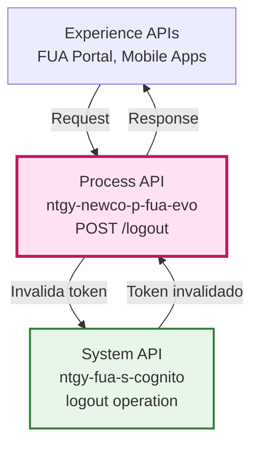
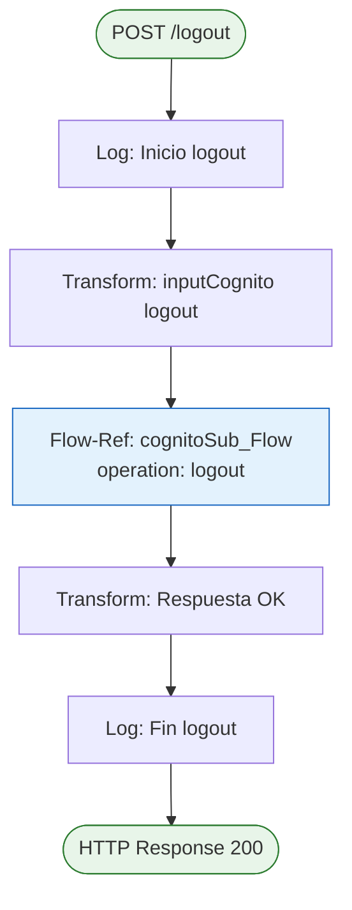
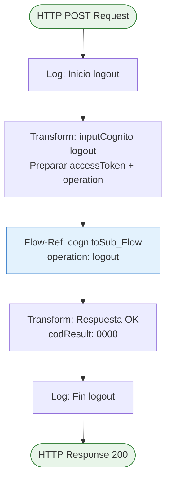
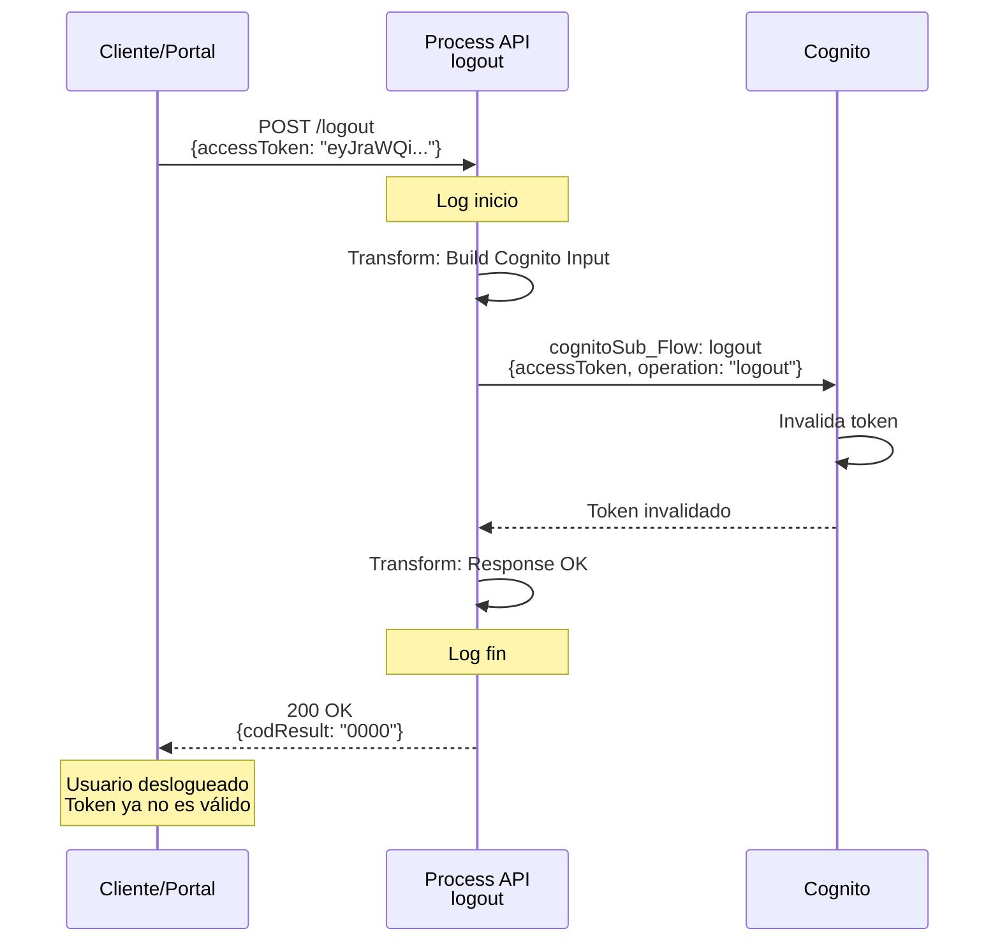
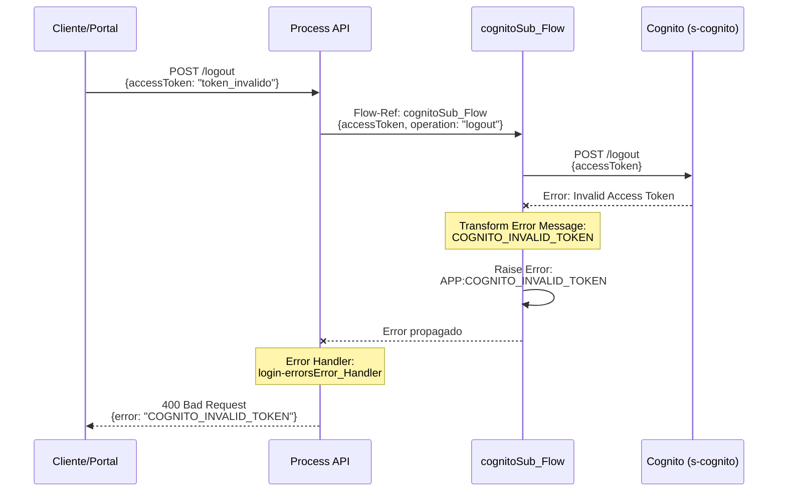
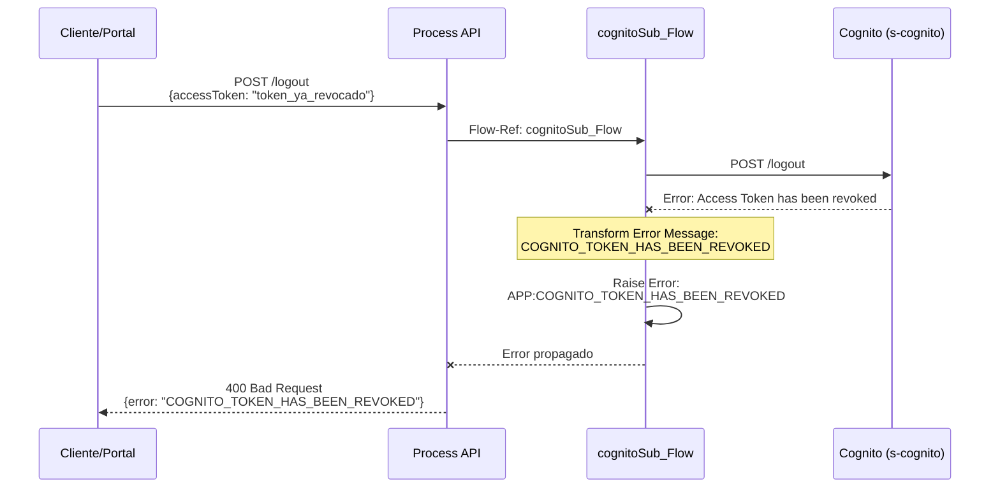
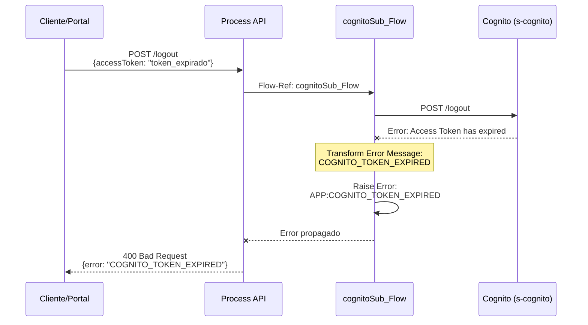

# POST /logout

## 📌 Descripción General

### Propósito del Endpoint

Este endpoint orquesta el proceso de cierre de sesión de un usuario mediante la invalidación de su token de acceso en AWS Cognito. Es un endpoint simple y directo que delega la operación de logout al servicio de autenticación.

### Tipo de API

**Capa:** Process API (API-Led Connectivity)

**Función:** Orquestación del proceso de cierre de sesión

### Patrón de Integración

**Tipo:** Pass-Through con Transformación Mínima

**Descripción:** Recibe el token de acceso, lo transforma al formato requerido por Cognito y ejecuta la operación de logout

### Arquitectura API-Led Connectivity



---

## 💼 Propósito del Negocio

### Casos de Uso Principales

1. **Cierre de Sesión Explícito**
   - Usuario decide cerrar sesión desde el portal o app
   - Invalida el token de acceso para prevenir uso posterior
   - Beneficio: Seguridad y control de acceso

2. **Invalidación de Token**
   - Revoca el token de acceso actual del usuario
   - Previene accesos no autorizados con tokens antiguos
   - Beneficio: Protección de la cuenta del usuario

3. **Gestión de Sesiones**
   - Permite al usuario cerrar sesión en todos los dispositivos
   - Limpia el estado de autenticación en Cognito
   - Beneficio: Control total sobre sesiones activas

### 🔗 Endpoints Dependientes

Este Process API consume el siguiente System API:

| System API | Endpoint | Método | Propósito |
|------------|----------|--------|-----------|
| `ntgy-fua-s-cognito` | `/cognitoSub_Flow` | Flow-Ref | Invalida token de acceso en Cognito |

### Lógica de Orquestación



**Pasos del Proceso:**

1. **Log Inicio**: Registra el inicio del proceso de logout
2. **Transformación**: Prepara el input para Cognito con el accessToken
3. **Cognito Logout**: Ejecuta la operación de logout en Cognito
4. **Respuesta**: Retorna respuesta exitosa
5. **Log Fin**: Registra la finalización del proceso

### Transformaciones Aplicadas

| Campo Original (Request) | Campo Transformado (Cognito) | Transformación |
|--------------------------|------------------------------|----------------|
| `accessToken` | `accessToken` | Pass-through |
| N/A | `operation` | Valor fijo: "logout" |

### Contexto Empresarial

- **Dominio:** Gestión de Autenticación y Sesiones
- **Sector:** Energía - Utilities
- **División:** Naturgy España - NewCo
- **Proceso de Negocio:** Cierre de sesión seguro en FUA

### Stakeholders

- **Clientes**: Necesitan cerrar sesión de forma segura
- **Equipo de Seguridad**: Gestiona políticas de autenticación
- **Equipo de Desarrollo**: Implementa flujos de autenticación
- **Equipo de Soporte**: Asiste con problemas de sesión

### Valor de Negocio

- **Seguridad**: Invalidación inmediata de tokens de acceso
- **Control**: Usuario tiene control total sobre sus sesiones
- **Cumplimiento**: Cumple con políticas de seguridad corporativas
- **Simplicidad**: Proceso simple y rápido de cierre de sesión

### Consumidores Potenciales

Este endpoint puede ser consumido por:
- Portal web FUA (Frontal Único de Atención)
- Aplicaciones móviles de clientes
- Sistemas de agentes de call center
- Aplicaciones de terceros autorizadas

---

## 🔧 Especificación Técnica

### URLs por Ambiente

| Ambiente | URL Base | URL Completa |
|----------|----------|--------------|
| **Local** | `http://localhost:8081` | `http://localhost:8081/api/logout` |
| **Development** | `https://ntgy-newco-p-fua-evo-dev.us-e2.cloudhub.io` | `https://ntgy-newco-p-fua-evo-dev.us-e2.cloudhub.io/api/logout` |
| **UAT** | `https://ntgy-newco-p-fua-evo-uat.us-e2.cloudhub.io` | `https://ntgy-newco-p-fua-evo-uat.us-e2.cloudhub.io/api/logout` |
| **Production** | `https://ntgy-newco-p-fua-evo-pro.us-e2.cloudhub.io` | `https://ntgy-newco-p-fua-evo-pro.us-e2.cloudhub.io/api/logout` |

### Método HTTP

```
POST /api/logout
```

### Parámetros de Entrada

#### Request Body

```json
{
  "accessToken": "string"
}
```

| Campo | Tipo | Obligatorio | Descripción | Ejemplo |
|-------|------|-------------|-------------|---------|
| `accessToken` | string | ✅ Sí | Token de acceso JWT obtenido durante el login | "eyJraWQiOiJ..." |

**Validaciones:**
- `accessToken`: Debe ser un token JWT válido emitido por Cognito
- El token debe estar activo (no expirado)

### Respuestas

#### 200 OK - Logout Exitoso

```json
{
  "result": {
    "codResult": "0000",
    "msgResult": "No hay error"
  }
}
```

| Campo | Tipo | Descripción |
|-------|------|-------------|
| `result.codResult` | string | Código de resultado ("0000" = éxito) |
| `result.msgResult` | string | Mensaje descriptivo del resultado |

#### 400 Bad Request - Token Inválido

```json
{
  "error": {
    "code": "APP:COGNITO_INVALID_TOKEN",
    "message": "El token de acceso no es válido",
    "timestamp": "2026-09-02T13:34:06Z"
  }
}
```

#### 400 Bad Request - Token Revocado

```json
{
  "error": {
    "code": "APP:COGNITO_TOKEN_HAS_BEEN_REVOKED",
    "message": "El token de acceso ha sido revocado",
    "timestamp": "2026-09-02T13:34:06Z"
  }
}
```

#### 400 Bad Request - Token Expirado

```json
{
  "error": {
    "code": "APP:COGNITO_TOKEN_EXPIRED",
    "message": "El token de acceso ha expirado",
    "timestamp": "2026-09-02T13:34:06Z"
  }
}
```

#### 500 Internal Server Error - Error en Cognito

```json
{
  "error": {
    "code": "APP:COGNITO_ERROR",
    "message": "Error al procesar logout en Cognito",
    "timestamp": "2026-09-02T13:34:06Z"
  }
}
```

### Autenticación

- **Tipo:** Client ID & Client Secret (Anypoint Platform)
- **Headers:** `client_id` y `client_secret` en cada request
- **Nota:** El accessToken se envía en el body, no en headers

### Timeouts

| Tipo | Valor |
|------|-------|
| **Request Timeout** | 30 segundos |
| **Connection Timeout** | 10 segundos |
| **Cognito Timeout** | 30 segundos |

---

## 🏗️ Implementación Técnica

### Arquitectura del Flow



### Transformaciones DataWeave

#### 1. Construcción de Input Cognito (Líneas 10-18 del logoutFlow)

```dataweave
%dw 2.0
output application/json
---
{
  "accessToken": payload.accessToken,
  "operation": "logout"
}
```

**Propósito:** Prepara el input para la operación de logout en Cognito.

**Campos:**
- `accessToken`: Token JWT del usuario (pass-through desde el request)
- `operation`: Valor fijo "logout" que indica la operación a ejecutar

**Ubicación en código:** Variable `inputCognito` en el flow `logoutFlow`

#### 2. Construcción de Respuesta OK (Líneas 21-31 del logoutFlow)

```dataweave
%dw 2.0
output application/json
---
{
  "result": {
    "codResult": "0000",
    "msgResult": "No hay error"
  }
}
```

**Propósito:** Genera respuesta estándar de éxito.

**Ubicación en código:** Transformación final en el flow `logoutFlow` antes del log de fin

### Operaciones Cognito

**Flow-Ref:** `cognitoSub_Flow` (Línea 20 del logoutFlow)

**Operación:** `logout`

**Endpoint Cognito:** `POST /logout` (System API: ntgy-fua-s-cognito, línea 244 del cognitoSub_Flow)

**Configuración HTTP:** `HTTP_Request_s-cognito`

**Input al Flow-Ref:**
```json
{
  "accessToken": "eyJraWQiOiJ...",
  "operation": "logout"
}
```

**Request HTTP a Cognito (líneas 244-251):**
```json
{
  "accessToken": "eyJraWQiOiJ..."
}
```

**Acción en Cognito:**
- Ejecuta operación `GlobalSignOut` en AWS Cognito
- Invalida el token de acceso proporcionado
- Revoca la sesión del usuario en todos los dispositivos
- Previene uso posterior del token

**Output Esperado (Éxito):**
```json
{
  "error": false,
  "message": "Logout successful"
}
```

**Output Esperado (Error):**
```json
{
  "error": true,
  "message": "An error occurred (NotAuthorizedException) when calling the GlobalSignOut operation: [error_detail]"
}
```

**Variable de respuesta:** `logoutResponse` (target del http:request)

#### Transformación de Errores (Líneas 253-283 del cognitoSub_Flow)

El subflujo `cognitoSub_Flow` transforma los mensajes de error de Cognito a códigos de error específicos:

```dataweave
%dw 2.0
output application/json
---
vars.logoutResponse.message match {
    case "An error occurred (NotAuthorizedException) when calling the GlobalSignOut operation: Invalid Access Token" 
        -> "APP:COGNITO_INVALID_TOKEN"
    case "An error occurred (NotAuthorizedException) when calling the GlobalSignOut operation: Access Token has been revoked" 
        -> "APP:COGNITO_TOKEN_HAS_BEEN_REVOKED"
    case "An error occurred (NotAuthorizedException) when calling the GlobalSignOut operation: Access Token has expired" 
        -> "APP:COGNITO_TOKEN_EXPIRED"
    else -> "APP:COGNITO_INVALID_TOKEN"
}
```

**Variable de error:** `messageError` (almacena el tipo de error mapeado)

**Errores Específicos Manejados:**
1. **Invalid Access Token**: Token con formato inválido o no reconocido (línea 266)
2. **Access Token has been revoked**: Token previamente revocado (línea 268)
3. **Access Token has expired**: Token que ha superado su tiempo de vida (línea 270)

**Mecanismo de propagación:**
- Se evalúa `vars.logoutResponse.error == true` (línea 253)
- Se transforma el mensaje a código de error (líneas 255-273)
- Se lanza error específico con `raise-error` (líneas 275-283)

### Patrones de Diseño

**Patrón 1:** Pass-Through con Transformación Mínima

**Justificación:** 
- Endpoint simple que delega la lógica a Cognito
- Transformación mínima necesaria para adaptar el formato
- No requiere validaciones complejas ni orquestación multi-sistema
- El flow principal (`logoutFlow`) solo prepara el input y delega al subflujo

**Patrón 2:** Stateless Operation

**Justificación:**
- No mantiene estado de sesión en el Process API
- Toda la gestión de sesiones está en Cognito (AWS)
- Operación idempotente (múltiples llamadas con el mismo token tienen el mismo efecto)
- No se almacena información de sesión en Object Store

**Patrón 3:** Subflujo Reutilizable (cognitoSub_Flow)

**Justificación:**
- El subflujo `cognitoSub_Flow` maneja múltiples operaciones de Cognito (login, logout, signup, etc.)
- Centraliza la lógica de comunicación con el System API de Cognito
- Reutilizable por múltiples endpoints del Process API
- Manejo de errores consistente para todas las operaciones de Cognito

### Diagramas de Secuencia

#### 1. Flujo Normal de Éxito



#### 2. Flujo con Error - Token Inválido



#### 3. Flujo con Error - Token Revocado



#### 4. Flujo con Error - Token Expirado



### Manejo de Errores

#### Errores de Negocio

| Error Type | HTTP Status | Descripción | Acción |
|------------|-------------|-------------|--------|
| `APP:COGNITO_INVALID_TOKEN` | 400 | El token de acceso no es válido o tiene formato incorrecto | Solicitar nuevo login |
| `APP:COGNITO_TOKEN_HAS_BEEN_REVOKED` | 400 | El token de acceso ya ha sido revocado previamente | Informar que la sesión ya fue cerrada |
| `APP:COGNITO_TOKEN_EXPIRED` | 400 | El token de acceso ha expirado | Solicitar nuevo login |

#### Errores Técnicos

| Error Type | HTTP Status | Descripción | Acción |
|------------|-------------|-------------|--------|
| `APP:COGNITO_ERROR` | 500 | Error al procesar logout en Cognito | Reintentar, verificar conectividad |
| `COGNITO:*` | 500 | Error genérico de Cognito | Verificar configuración y credenciales |

#### Error Handler

**Referencia:** `login-errorsError_Handler`

**Estrategia:**
- Errores de token: Retornar 400 con mensaje descriptivo
- Errores técnicos: Retornar 500 con código de error específico
- Logging completo de todos los errores para auditoría

---

## 💻 Ejemplos de Uso

### Ejemplo 1: Logout Exitoso

#### cURL

```bash
curl -X POST "https://ntgy-newco-p-fua-evo-dev.us-e2.cloudhub.io/api/logout" \
  -H "Content-Type: application/json" \
  -H "client_id: YOUR_CLIENT_ID" \
  -H "client_secret: YOUR_CLIENT_SECRET" \
  -d '{
    "accessToken": "eyJraWQiOiJxNzRZXC9cL0pKT0pqXC9Zb2pHNnBcL0pqXC9Zb2pHNnBcL0pqXC9Zb2pHNnA..."
  }'
```

#### Respuesta (200 OK)

```json
{
  "result": {
    "codResult": "0000",
    "msgResult": "No hay error"
  }
}
```

**Resultado:**
- ✅ Token de acceso invalidado en Cognito
- ✅ Sesión del usuario cerrada
- ✅ Token ya no puede ser utilizado para acceder a recursos protegidos

### Ejemplo 2: Error - Token Inválido

#### cURL

```bash
curl -X POST "https://ntgy-newco-p-fua-evo-dev.us-e2.cloudhub.io/api/logout" \
  -H "Content-Type: application/json" \
  -H "client_id: YOUR_CLIENT_ID" \
  -H "client_secret: YOUR_CLIENT_SECRET" \
  -d '{
    "accessToken": "token_con_formato_invalido"
  }'
```

#### Respuesta (400 Bad Request)

```json
{
  "error": {
    "code": "APP:COGNITO_INVALID_TOKEN",
    "message": "El token de acceso no es válido",
    "timestamp": "2026-09-02T13:34:06Z"
  }
}
```

### Ejemplo 3: Error - Token Revocado

#### cURL

```bash
curl -X POST "https://ntgy-newco-p-fua-evo-dev.us-e2.cloudhub.io/api/logout" \
  -H "Content-Type: application/json" \
  -H "client_id: YOUR_CLIENT_ID" \
  -H "client_secret: YOUR_CLIENT_SECRET" \
  -d '{
    "accessToken": "eyJraWQiOiJ...[token_ya_usado_para_logout]"
  }'
```

#### Respuesta (400 Bad Request)

```json
{
  "error": {
    "code": "APP:COGNITO_TOKEN_HAS_BEEN_REVOKED",
    "message": "El token de acceso ha sido revocado",
    "timestamp": "2026-09-02T13:34:06Z"
  }
}
```

**Nota:** Este error ocurre cuando se intenta hacer logout con un token que ya fue utilizado para cerrar sesión previamente.

### Ejemplo 4: Error - Token Expirado

#### cURL

```bash
curl -X POST "https://ntgy-newco-p-fua-evo-dev.us-e2.cloudhub.io/api/logout" \
  -H "Content-Type: application/json" \
  -H "client_id: YOUR_CLIENT_ID" \
  -H "client_secret: YOUR_CLIENT_SECRET" \
  -d '{
    "accessToken": "eyJraWQiOiJ...[token_expirado]"
  }'
```

#### Respuesta (400 Bad Request)

```json
{
  "error": {
    "code": "APP:COGNITO_TOKEN_EXPIRED",
    "message": "El token de acceso ha expirado",
    "timestamp": "2026-09-02T13:34:06Z"
  }
}
```

**Nota:** Los tokens de acceso tienen un tiempo de vida limitado (típicamente 1 hora). Este error indica que el token ha superado su tiempo de validez.

### Ejemplo 5: JavaScript (Fetch API)

```javascript
const logout = async (accessToken) => {
  try {
    const response = await fetch(
      'https://ntgy-newco-p-fua-evo-dev.us-e2.cloudhub.io/api/logout',
      {
        method: 'POST',
        headers: {
          'Content-Type': 'application/json',
          'client_id': 'YOUR_CLIENT_ID',
          'client_secret': 'YOUR_CLIENT_SECRET'
        },
        body: JSON.stringify({
          accessToken: accessToken
        })
      }
    );

    if (!response.ok) {
      const error = await response.json();
      throw new Error(`Error ${response.status}: ${error.error.message}`);
    }

    const data = await response.json();
    console.log('Logout exitoso:', data);
    
    // Limpiar token del almacenamiento local
    localStorage.removeItem('accessToken');
    localStorage.removeItem('refreshToken');
    
    // Redirigir a página de login
    window.location.href = '/login';
    
    return data;
  } catch (error) {
    console.error('Error al cerrar sesión:', error);
    throw error;
  }
};

// Uso
const accessToken = localStorage.getItem('accessToken');
logout(accessToken)
  .then(() => console.log('Sesión cerrada correctamente'))
  .catch(error => console.error('Error:', error));
```

### Ejemplo 6: Python (Requests)

```python
import requests
import json

def logout(access_token):
    """
    Cierra la sesión del usuario invalidando el token de acceso
    
    Args:
        access_token (str): Token de acceso JWT del usuario
    
    Returns:
        dict: Respuesta del API
    """
    url = "https://ntgy-newco-p-fua-evo-dev.us-e2.cloudhub.io/api/logout"
    
    headers = {
        'Content-Type': 'application/json',
        'client_id': 'YOUR_CLIENT_ID',
        'client_secret': 'YOUR_CLIENT_SECRET'
    }
    
    payload = {
        'accessToken': access_token
    }
    
    try:
        response = requests.post(url, headers=headers, json=payload, timeout=30)
        response.raise_for_status()
        
        result = response.json()
        print(f"✅ Logout exitoso")
        print(f"Código: {result['result']['codResult']}")
        print(f"Mensaje: {result['result']['msgResult']}")
        
        # Limpiar tokens almacenados
        # (implementar según tu sistema de almacenamiento)
        
        return result
        
    except requests.exceptions.HTTPError as e:
        if response.status_code == 400:
            error_data = response.json()
            print(f"❌ Token inválido: {error_data['error']['message']}")
        elif response.status_code == 500:
            error_data = response.json()
            print(f"❌ Error técnico: {error_data['error']['message']}")
        raise
    except requests.exceptions.RequestException as e:
        print(f"❌ Error de conexión: {str(e)}")
        raise

# Uso
access_token = "eyJraWQiOiJxNzRZXC9cL0pKT0pqXC9Zb2pHNnBcL0pqXC9Zb2pHNnA..."

try:
    result = logout(access_token)
    print(f"Resultado: {json.dumps(result, indent=2)}")
except Exception as e:
    print(f"Error: {str(e)}")
```

### Ejemplo 7: React Hook

```javascript
import { useState } from 'react';
import { useNavigate } from 'react-router-dom';

const useLogout = () => {
  const [loading, setLoading] = useState(false);
  const [error, setError] = useState(null);
  const navigate = useNavigate();

  const logout = async () => {
    setLoading(true);
    setError(null);

    try {
      const accessToken = localStorage.getItem('accessToken');
      
      if (!accessToken) {
        throw new Error('No hay sesión activa');
      }

      const response = await fetch(
        'https://ntgy-newco-p-fua-evo-dev.us-e2.cloudhub.io/api/logout',
        {
          method: 'POST',
          headers: {
            'Content-Type': 'application/json',
            'client_id': process.env.REACT_APP_CLIENT_ID,
            'client_secret': process.env.REACT_APP_CLIENT_SECRET
          },
          body: JSON.stringify({ accessToken })
        }
      );

      if (!response.ok) {
        const errorData = await response.json();
        throw new Error(errorData.error.message);
      }

      // Limpiar almacenamiento local
      localStorage.removeItem('accessToken');
      localStorage.removeItem('refreshToken');
      localStorage.removeItem('userData');

      // Redirigir a login
      navigate('/login');
      
      return await response.json();
    } catch (err) {
      setError(err.message);
      throw err;
    } finally {
      setLoading(false);
    }
  };

  return { logout, loading, error };
};

// Uso en componente
const LogoutButton = () => {
  const { logout, loading, error } = useLogout();

  const handleLogout = async () => {
    try {
      await logout();
      console.log('Sesión cerrada correctamente');
    } catch (error) {
      console.error('Error al cerrar sesión:', error);
    }
  };

  return (
    <button onClick={handleLogout} disabled={loading}>
      {loading ? 'Cerrando sesión...' : 'Cerrar Sesión'}
    </button>
  );
};

export default LogoutButton;
```

### Ejemplo 8: Postman Collection con Manejo de Errores

```json
{
  "info": {
    "name": "Logout",
    "schema": "https://schema.getpostman.com/json/collection/v2.1.0/collection.json"
  },
  "item": [
    {
      "name": "Logout - Success",
      "request": {
        "method": "POST",
        "header": [
          {
            "key": "Content-Type",
            "value": "application/json"
          },
          {
            "key": "client_id",
            "value": "{{client_id}}"
          },
          {
            "key": "client_secret",
            "value": "{{client_secret}}"
          }
        ],
        "body": {
          "mode": "raw",
          "raw": "{\n  \"accessToken\": \"{{access_token}}\"\n}"
        },
        "url": {
          "raw": "{{base_url}}/api/logout",
          "host": ["{{base_url}}"],
          "path": ["api", "logout"]
        }
      },
      "response": []
    },
    {
      "name": "Logout - Invalid Token",
      "request": {
        "method": "POST",
        "header": [
          {
            "key": "Content-Type",
            "value": "application/json"
          },
          {
            "key": "client_id",
            "value": "{{client_id}}"
          },
          {
            "key": "client_secret",
            "value": "{{client_secret}}"
          }
        ],
        "body": {
          "mode": "raw",
          "raw": "{\n  \"accessToken\": \"token_invalido\"\n}"
        },
        "url": {
          "raw": "{{base_url}}/api/logout",
          "host": ["{{base_url}}"],
          "path": ["api", "logout"]
        }
      },
      "response": []
    }
  ]
}