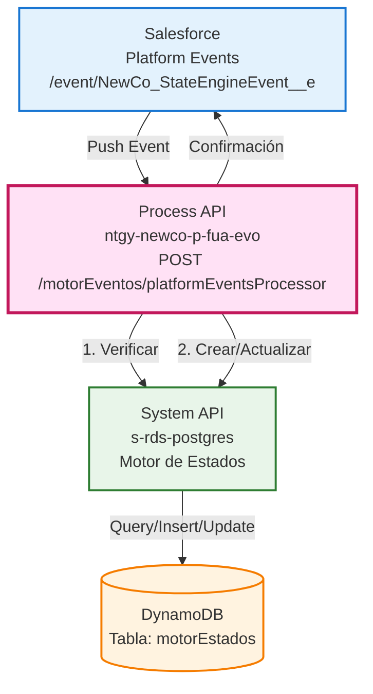
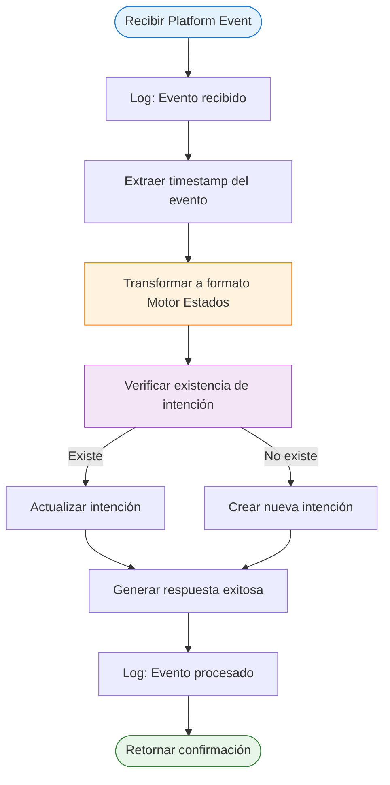
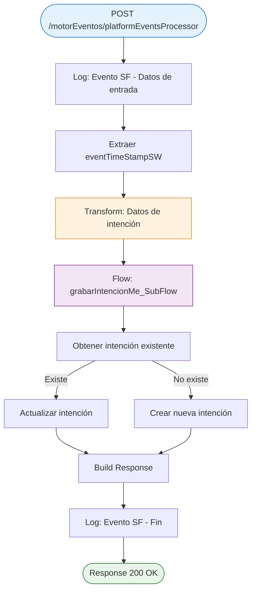
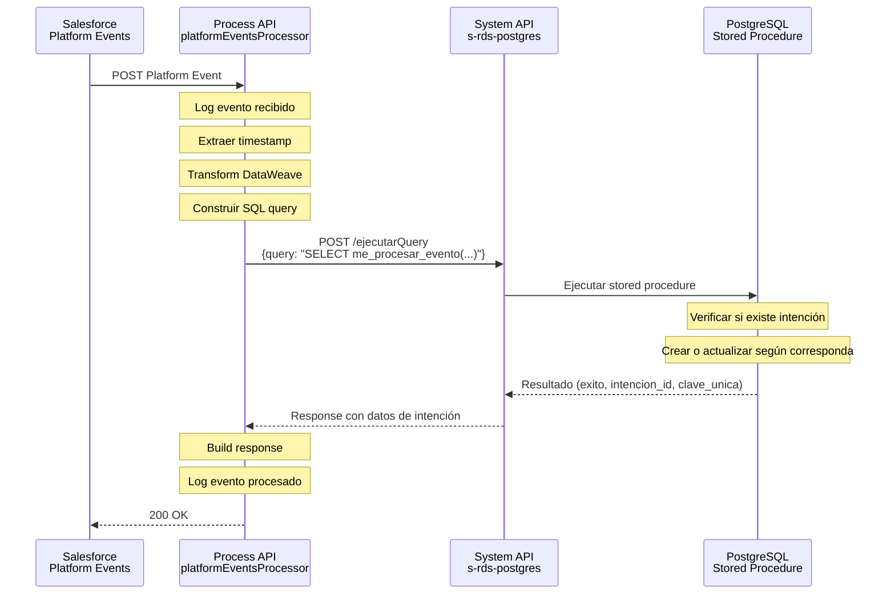
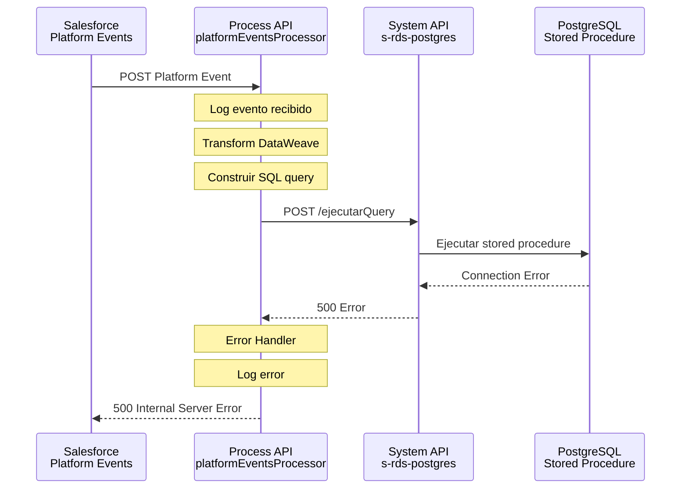

# POST /motorEventos/platformEventsProcessor

## 📌 Descripción General

### Propósito del Endpoint

Este endpoint actúa como **receptor de Platform Events de Salesforce**, procesando eventos del streaming channel `/event/NewCo_StateEngineEvent__e` para sincronizar el estado de intenciones de negocio en el Motor de Estados (DynamoDB).

### Tipo de API

**Capa:** Process API (API-Led Connectivity)

**Función:** Orquestación de procesamiento de eventos asíncronos desde Salesforce hacia el Motor de Estados

### Patrón de Integración

**Tipo:** Event-Driven / Orquestación con Lógica Condicional

**Descripción:** 
- Recibe eventos push de Salesforce Platform Events
- Transforma el payload del evento a formato del Motor de Estados
- Verifica existencia de la intención (idempotencia)
- Crea o actualiza la intención según corresponda
- Responde con confirmación de procesamiento

### Arquitectura API-Led Connectivity



---

## 💼 Propósito del Negocio

### Casos de Uso Principales

1. **Sincronización de Estados de Intenciones**
   - Salesforce publica eventos cuando cambia el estado de una intención de negocio
   - El Motor de Estados mantiene un registro histórico y actualizado
   - Permite trazabilidad completa del ciclo de vida de procesos

2. **Procesamiento Asíncrono de Eventos**
   - Desacopla Salesforce del Motor de Estados
   - Permite procesamiento no bloqueante
   - Garantiza entrega mediante streaming channel

3. **Gestión de Procesos de Negocio**
   - Soporta múltiples tipos de procesos: ModificacionMetodoPago, CambioDeProducto, CambioIBAN, CambioTitular
   - Traduce códigos de proceso de Salesforce a códigos internos del Motor
   - Mantiene coherencia entre sistemas

### 🔗 Endpoints Dependientes

Este Process API consume los siguientes System APIs:

| System API | Endpoint | Método | Propósito |
|------------|----------|--------|-----------|
| `s-rds-postgres` | `/ejecutarQuery` | POST | Ejecutar stored procedure `me_procesar_evento()` para gestionar intenciones (crear, actualizar o consultar) |

### Lógica de Orquestación



**Pasos del Proceso:**

1. **Recepción del Evento**: Platform Event llega desde Salesforce con datos de la intención
2. **Extracción de Timestamp**: Se captura `CreatedDate` del evento para trazabilidad
3. **Transformación DataWeave**: Mapeo de campos del evento a estructura del Motor de Estados
4. **Verificación de Existencia**: Consulta si `idIntencion` ya existe en DynamoDB
5. **Creación o Actualización**: Según resultado, crea nueva intención o actualiza existente
6. **Confirmación**: Retorna respuesta exitosa a Salesforce

### Transformaciones Aplicadas

| Campo Original (Platform Event) | Campo Transformado (Motor Estados) | Transformación |
|--------------------------------|-----------------------------------|----------------|
| `NewCo_IntentionId__c` | `idIntencion` | Directo |
| `NewCo_MessageCode__c` | `evento` | Directo |
| `NewCo_ProcessCode__c` | `proceso` | Mapeo condicional (ver tabla abajo) |
| `NewCo_AdditionalInformation__c` | `jsonPayload.comentario` | Default "" si null |
| `NewCo_ErrorMessage__c` | `jsonPayload.mensajeSalesforce` | Default "" si null |
| `CreatedDate` | `eventTimeStampSW` | Variable de contexto |

**Mapeo de Códigos de Proceso:**

| Código Salesforce | Código Motor Estados | Descripción |
|-------------------|---------------------|-------------|
| `ModificacionMetodoPago` | `ModificacionMetodoPago` | Con firma, sin switching |
| `CambioDeProducto` | `CambioDeProducto` | Con firma, sin switching |
| `CambioCuentaBancaria` | `CambioIBAN` | Con firma, sin switching |
| `CambioTitularConSubrogacion` | `CambioTitular` | Con firma, CON switching |
| `CambioTitularSinSubrogacion` | `CambioTitular` | Con firma, CON switching |

### Contexto Empresarial

- **Dominio:** Gestión de Intenciones y Estados de Procesos
- **Sector:** Energía - Utilities
- **División:** Naturgy España - NewCo
- **Proceso de Negocio:** Motor de Estados para gestión del ciclo de vida de intenciones comerciales

### Stakeholders

- **Equipo Salesforce**: Publica eventos cuando cambian estados de intenciones
- **Equipo Motor de Estados**: Consume eventos para mantener registro histórico
- **Equipos de Negocio**: Consultan estado de intenciones para seguimiento de procesos

### Valor de Negocio

- **Trazabilidad Completa**: Registro histórico de todos los eventos de intenciones
- **Desacoplamiento de Sistemas**: Salesforce y Motor de Estados operan independientemente
- **Procesamiento Asíncrono**: No bloquea operaciones en Salesforce
- **Idempotencia**: Manejo seguro de eventos duplicados

### Consumidores Potenciales

Este endpoint es consumido exclusivamente por:
- **Salesforce Platform Events** (streaming channel: `/event/NewCo_StateEngineEvent__e`)

---

## 🔧 Especificación Técnica

### URLs por Ambiente

| Ambiente | URL Base | URL Completa |
|----------|----------|--------------|
| **Local** | `http://localhost:8081` | `http://localhost:8081/api/motorEventos/platformEventsProcessor` |
| **Development** | `https://ntgy-newco-p-fua-evo-dev.us-e2.cloudhub.io` | `https://ntgy-newco-p-fua-evo-dev.us-e2.cloudhub.io/api/motorEventos/platformEventsProcessor` |
| **UAT** | `https://ntgy-newco-p-fua-evo-uat.us-e2.cloudhub.io` | `https://ntgy-newco-p-fua-evo-uat.us-e2.cloudhub.io/api/motorEventos/platformEventsProcessor` |
| **Production** | `https://ntgy-newco-p-fua-evo-pro.us-e2.cloudhub.io` | `https://ntgy-newco-p-fua-evo-pro.us-e2.cloudhub.io/api/motorEventos/platformEventsProcessor` |

### Método HTTP

```
POST /api/motorEventos/platformEventsProcessor
```

### Parámetros de Entrada

#### Headers

| Header | Tipo | Requerido | Descripción |
|--------|------|-----------|-------------|
| `Content-Type` | string | Sí | `application/json` |
| `client_id` | string | Sí | Client ID de Anypoint Platform |
| `client_secret` | string | Sí | Client Secret de Anypoint Platform |

#### Body (Platform Event Payload)

```json
{
  "data": {
    "payload": {
      "CreatedDate": "2026-09-04T11:30:00.000Z",
      "NewCo_ProcessCode__c": "ModificacionMetodoPago",
      "NewCo_IntentionId__c": "INT-12345",
      "NewCo_MessageCode__c": "INICIO_PROCESO",
      "NewCo_AdditionalInformation__c": "Información adicional del proceso",
      "NewCo_ErrorMessage__c": ""
    }
  },
  "eventPayload": {
    "NewCo_IntentionId__c": "INT-12345",
    "NewCo_MessageCode__c": "INICIO_PROCESO",
    "NewCo_AdditionalInformation__c": "Información adicional del proceso",
    "NewCo_ErrorMessage__c": ""
  }
}
```

**Campos del Platform Event:**

| Campo | Tipo | Requerido | Descripción |
|-------|------|-----------|-------------|
| `data.payload.CreatedDate` | string (ISO 8601) | Sí | Timestamp de creación del evento |
| `data.payload.NewCo_ProcessCode__c` | string | Sí | Código del proceso de negocio |
| `eventPayload.NewCo_IntentionId__c` | string | Sí | ID único de la intención |
| `eventPayload.NewCo_MessageCode__c` | string | Sí | Código del evento/mensaje |
| `eventPayload.NewCo_AdditionalInformation__c` | string | No | Información adicional (comentarios) |
| `eventPayload.NewCo_ErrorMessage__c` | string | No | Mensaje de error de Salesforce (si aplica) |

### Respuestas

#### 200 OK - Evento Procesado Correctamente

```json
{
  "result": {
    "codResult": "0000",
    "msgResult": "Motor Estados - Evento procesado correctamente"
  }
}
```

#### 400 Bad Request - Error de Validación

```json
{
  "code": "VALIDATION_ERROR",
  "message": "Datos de entrada inválidos",
  "details": "Campo requerido faltante: NewCo_IntentionId__c"
}
```

#### 500 Internal Server Error - Error de Sistema

```json
{
  "code": "SYSTEM_ERROR",
  "message": "Error al procesar evento",
  "details": "Error de conexión con Motor de Estados"
}
```

### Autenticación

- **Tipo:** Client ID & Client Secret (Anypoint Platform)
- **Nota:** Este endpoint es invocado por Salesforce Platform Events, que debe estar configurado con las credenciales apropiadas

### Timeouts

| Tipo | Valor |
|------|-------|
| **Request Timeout** | 30 segundos |
| **Connection Timeout** | 10 segundos |
| **Motor Estados Timeout** | 20 segundos |

---

## 🏗️ Implementación Técnica

### Arquitectura del Flow



### Código de Implementación

#### Flow Principal (ntgy-newco-p-fua.xml)

```xml
<flow name="post:\motorEventos\platformEventsProcessor:application\json:ntgy-newco-p-fua-config">
    <flow-ref name="platformEventsProcessorSub_Flow" />
</flow>
```

**Ubicación:** `src/main/mule/ntgy-newco-p-fua.xml` (línea del flow principal)

#### Sub-Flow: platformEventsProcessorSub_Flow

```xml
<sub-flow name="platformEventsProcessorSub_Flow">
    <!-- 1. Log de entrada -->
    <logger level="INFO" 
            message="Motor Estados - procesador SF platformEvents - evento recibido: #[payload]"/>
    
    <!-- 2. Extraer timestamp del evento -->
    <set-variable value="#[payload.data.payload.CreatedDate]" 
                  variableName="eventTimeStampSW"/>
    
    <!-- 3. Transformar datos para Motor de Estados -->
    <ee:transform>
        <ee:variables>
            <ee:set-variable variableName="createIntentionData">
                %dw 2.0
                output application/java
                
                var tipoProceso = payload.data.payload.NewCo_ProcessCode__c
                
                // Mapeo de códigos de proceso
                var proceso = tipoProceso match {
                    case "ModificacionMetodoPago" -> "ModificacionMetodoPago"
                    case "CambioDeProducto" -> "CambioDeProducto"
                    case "CambioCuentaBancaria" -> "CambioIBAN"
                    case "CambioTitularConSubrogacion" -> "CambioTitular"
                    case "CambioTitularSinSubrogacion" -> "CambioTitular"
                    else -> ""
                }
                ---
                {
                    idIntencion: payload.eventPayload.NewCo_IntentionId__c,
                    evento: payload.eventPayload.NewCo_MessageCode__c,
                    proceso: "",
                    nif: "",
                    billingAccount: "",
                    contrato: "",
                    casoGestion: "",
                    jsonPayload: {
                        "comentario": payload.eventPayload.NewCo_AdditionalInformation__c default "",
                        "mensajeSalesforce": payload.eventPayload.NewCo_ErrorMessage__c default ""
                    }
                }
            </ee:set-variable>
        </ee:variables>
    </ee:transform>
    
    <!-- 4. Grabar/Actualizar intención en Motor de Estados -->
    <flow-ref name="grabarIntencionMe_SubFlow" />
    
    <!-- 5. Construir respuesta exitosa -->
    <ee:transform>
        <ee:message>
            <ee:set-payload>
                %dw 2.0
                output application/json
                ---
                { 
                    "result": { 
                        "codResult": "0000", 
                        "msgResult": "Motor Estados - Evento procesado correctamente"
                    }
                }
            </ee:set-payload>
        </ee:message>
    </ee:transform>
    
    <!-- 6. Log de finalización -->
    <logger level="INFO" 
            message="Motor Estados - Evento procesado correctamente (idIntencion: #[vars.createIntentionData.idIntencion] | evento: #[vars.createIntentionData.evento])" />
</sub-flow>
```

**Ubicación:** `src/main/mule/services/motorIntenciones/platformEventsProcessor.xml`

#### Sub-Flow: grabarIntencionMe_SubFlow

Este subflow construye dinámicamente una query SQL y la ejecuta a través del endpoint `/ejecutarQuery`:

```xml
<sub-flow name="grabarIntencionMe_SubFlow">
    <try>
        <!-- 1. Construir query SQL con stored procedure -->
        <ee:transform doc:name="sqlSentence">
            <ee:variables>
                <ee:set-variable variableName="sqlSentence">
                    %dw 2.0
                    output application/json
                    
                    var sqlStr = "SELECT public.me_procesar_evento("
                        ++ (if(!isEmpty(nif)) "'" ++ nif ++ "'" else "NULL")
                        ++ (if(!isEmpty(proceso)) ",'" ++ proceso ++ "'" else ",NULL")
                        ++ (if(!isEmpty(billingAccount)) ",'" ++ billingAccount ++ "'" else ",NULL")
                        ++ (if(!isEmpty(evento)) ",'" ++ evento ++ "'" else ",NULL")
                        ++ (if(!isEmpty(contrato)) ",'" ++ contrato ++ "'" else ",NULL")
                        ++ (if(!isEmpty(casoGestion)) ",'" ++ casoGestion ++ "'" else ",NULL")
                        ++ (if(!isEmpty(eventvars)) ",'" ++ write(eventvars, 'application/json') ++ "'" else ",NULL")
                        ++ ",'" ++ eventTimeStamp ++ "'"
                        ++ (if(!isEmpty(idIntencion)) ",'" ++ idIntencion ++ "'" else ",NULL")
                        ++ (if(!isEmpty(tipoContrato)) ",'" ++ tipoContrato ++ "'" else ",NULL")
                        ++ ")"
                    ---
                    { "query": sqlStr }
                </ee:set-variable>
            </ee:variables>
        </ee:transform>
        
        <!-- 2. Ejecutar query en PostgreSQL -->
        <http:request method="POST" 
                      config-ref="HTTP_Request_s-rds-postgres"
                      path="/ejecutarQuery"
                      target="rdsQueryResult">
            <http:body>#[vars.sqlSentence]</http:body>
        </http:request>
        
        <!-- 3. Procesar respuesta -->
        <set-variable variableName="motorResponseData"
                      value="#[read(vars.rdsQueryResult[0].me_procesar_evento.value, 'application/json')]"/>
    </try>
</sub-flow>
```

**Ubicación:** `src/main/mule/implementation/platformEventsProcessor.xml`

**Nota:** La stored procedure `me_procesar_evento()` maneja internamente la lógica de verificar, crear o actualizar la intención según corresponda.

### Transformaciones DataWeave

#### Transformación Principal: Evento → Motor de Estados

```dataweave
%dw 2.0
output application/java

var tipoProceso = payload.data.payload.NewCo_ProcessCode__c

// Traducción de códigos de proceso Salesforce → Motor Estados
var proceso = tipoProceso match {
    case "ModificacionMetodoPago" -> "ModificacionMetodoPago"
    case "CambioDeProducto" -> "CambioDeProducto"
    case "CambioCuentaBancaria" -> "CambioIBAN"
    case "CambioTitularConSubrogacion" -> "CambioTitular"
    case "CambioTitularSinSubrogacion" -> "CambioTitular"
    else -> ""
}
---
{
    idIntencion: payload.eventPayload.NewCo_IntentionId__c,
    evento: payload.eventPayload.NewCo_MessageCode__c,
    proceso: "",
    nif: "",
    billingAccount: "",
    contrato: "",
    casoGestion: "",
    jsonPayload: {
        "comentario": payload.eventPayload.NewCo_AdditionalInformation__c default "",
        "mensajeSalesforce": payload.eventPayload.NewCo_ErrorMessage__c default ""
    }
}
```

**Características:**
- Mapeo condicional de códigos de proceso
- Manejo de valores null con `default ""`
- Estructura anidada para `jsonPayload`

### Patrones de Diseño

**Patrón:** Event-Driven Architecture + Stored Procedure Pattern

**Justificación:** 
- **Event-Driven**: Salesforce publica eventos, el Process API los consume de forma asíncrona
- **Stored Procedure Pattern**: La lógica de negocio (verificar, crear, actualizar) está encapsulada en PostgreSQL
- **Idempotencia**: La stored procedure `me_procesar_evento()` maneja internamente la idempotencia
- **Orquestación Simplificada**: El Process API solo construye la query y ejecuta, la lógica compleja está en la base de datos

### Interacción con Motor de Estados

#### 🔄 Mecanismo de Ejecución

El endpoint NO llama a múltiples endpoints REST. En su lugar:

1. **Construye una query SQL** dinámicamente en DataWeave
2. **Invoca la stored procedure** `public.me_procesar_evento()` con 10 parámetros
3. **Envía la query** al endpoint genérico `POST /ejecutarQuery` de s-rds-postgres
4. **La stored procedure** maneja toda la lógica:
   - Verifica si existe la intención
   - Crea nueva intención si no existe
   - Actualiza intención existente si ya existe
   - Retorna resultado con ID de intención y clave única

#### 📋 Parámetros de la Stored Procedure

| Parámetro | Tipo | Descripción |
|-----------|------|-------------|
| `p_nif` | string | Número de identificación fiscal |
| `p_proceso` | string | Código del proceso (ej: "ModificacionMetodoPago") |
| `p_billing_account` | string | Cuenta de facturación |
| `p_evento` | string | Código del evento desde Salesforce |
| `p_contrato` | string | Código del contrato |
| `p_caso_gestion` | string | ID del caso de gestión |
| `p_vars` | jsonb | Variables adicionales en formato JSON |
| `p_timestamp` | timestamp | Timestamp del evento |
| `p_id_intencion` | string | ID de la intención (si existe) |
| `p_energia` | string | Tipo de energía ("Elec", "Gas", "Dual", "Mant") |

#### 📤 Respuesta de la Stored Procedure

```json
{
  "exito": true,
  "intencion_id": "INT-12345",
  "clave_unica": "abc123xyz"
}
```

### Diagramas de Secuencia

#### 1. Flujo Normal de Éxito - Crear o Actualizar Intención



#### 2. Flujo con Error Técnico



### Manejo de Errores

#### Estrategia de Error Handling

1. **Errores de Transformación**: Capturados por error handler de DataWeave
2. **Errores de Conexión**: Retry automático (3 intentos) con backoff exponencial
3. **Errores de Negocio**: Logged pero no bloquean el procesamiento
4. **Errores de Sistema**: Retornan 500 con detalles del error

#### Códigos de Error

| Código | Descripción | Acción |
|--------|-------------|--------|
| `0000` | Éxito | Evento procesado correctamente |
| `VALIDATION_ERROR` | Error de validación | Verificar estructura del evento |
| `CONNECTION_ERROR` | Error de conexión | Verificar conectividad con Motor Estados |
| `SYSTEM_ERROR` | Error de sistema | Revisar logs y contactar soporte |

---

## 💻 Ejemplos de Uso

### Ejemplo 1: Evento de Inicio de Proceso

#### Platform Event Payload

```json
{
  "data": {
    "payload": {
      "CreatedDate": "2026-09-04T11:30:00.000Z",
      "NewCo_ProcessCode__c": "ModificacionMetodoPago",
      "NewCo_IntentionId__c": "INT-12345",
      "NewCo_MessageCode__c": "INICIO_PROCESO",
      "NewCo_AdditionalInformation__c": "Cliente solicita cambio de método de pago",
      "NewCo_ErrorMessage__c": ""
    }
  },
  "eventPayload": {
    "NewCo_IntentionId__c": "INT-12345",
    "NewCo_MessageCode__c": "INICIO_PROCESO",
    "NewCo_AdditionalInformation__c": "Cliente solicita cambio de método de pago",
    "NewCo_ErrorMessage__c": ""
  }
}
```

#### Respuesta (200 OK)

```json
{
  "result": {
    "codResult": "0000",
    "msgResult": "Motor Estados - Evento procesado correctamente"
  }
}
```

### Ejemplo 2: Evento de Error desde Salesforce

#### Platform Event Payload

```json
{
  "data": {
    "payload": {
      "CreatedDate": "2026-09-04T12:15:00.000Z",
      "NewCo_ProcessCode__c": "CambioDeProducto",
      "NewCo_IntentionId__c": "INT-67890",
      "NewCo_MessageCode__c": "ERROR_VALIDACION",
      "NewCo_AdditionalInformation__c": "Validación fallida en Salesforce",
      "NewCo_ErrorMessage__c": "El producto seleccionado no está disponible para este contrato"
    }
  },
  "eventPayload": {
    "NewCo_IntentionId__c": "INT-67890",
    "NewCo_MessageCode__c": "ERROR_VALIDACION",
    "NewCo_AdditionalInformation__c": "Validación fallida en Salesforce",
    "NewCo_ErrorMessage__c": "El producto seleccionado no está disponible para este contrato"
  }
}
```

#### Respuesta (200 OK)

```json
{
  "result": {
    "codResult": "0000",
    "msgResult": "Motor Estados - Evento procesado correctamente"
  }
}
```

### Ejemplo 3: cURL (Simulación de Platform Event)

```bash
curl -X POST "http://localhost:8081/api/motorEventos/platformEventsProcessor" \
  -H "Content-Type: application/json" \
  -H "client_id: YOUR_CLIENT_ID" \
  -H "client_secret: YOUR_CLIENT_SECRET" \
  -d '{
    "data": {
      "payload": {
        "CreatedDate": "2026-09-04T11:30:00.000Z",
        "NewCo_ProcessCode__c": "CambioTitularConSubrogacion",
        "NewCo_IntentionId__c": "INT-11111",
        "NewCo_MessageCode__c": "PROCESO_COMPLETADO",
        "NewCo_AdditionalInformation__c": "Cambio de titular completado exitosamente",
        "NewCo_ErrorMessage__c": ""
      }
    },
    "eventPayload": {
      "NewCo_IntentionId__c": "INT-11111",
      "NewCo_MessageCode__c": "PROCESO_COMPLETADO",
      "NewCo_AdditionalInformation__c": "Cambio de titular completado exitosamente",
      "NewCo_ErrorMessage__c": ""
    }
  }'
```

### Ejemplo 4: JavaScript (Node.js)

```javascript
const axios = require('axios');

const platformEvent = {
  data: {
    payload: {
      CreatedDate: new Date().toISOString(),
      NewCo_ProcessCode__c: "CambioCuentaBancaria",
      NewCo_IntentionId__c: "INT-22222",
      NewCo_MessageCode__c: "FIRMA_PENDIENTE",
      NewCo_AdditionalInformation__c: "Esperando firma del cliente",
      NewCo_ErrorMessage__c: ""
    }
  },
  eventPayload: {
    NewCo_IntentionId__c: "INT-22222",
    NewCo_MessageCode__c: "FIRMA_PENDIENTE",
    NewCo_AdditionalInformation__c: "Esperando firma del cliente",
    NewCo_ErrorMessage__c: ""
  }
};

axios.post('http://localhost:8081/api/motorEventos/platformEventsProcessor', platformEvent, {
  headers: {
    'Content-Type': 'application/json',
    'client_id': 'YOUR_CLIENT_ID',
    'client_secret': 'YOUR_CLIENT_SECRET'
  }
})
.then(response => {
  console.log('Evento procesado:', response.data);
})
.catch(error => {
  console.error('Error al procesar evento:', error.response?.data || error.message);
});
```

### Ejemplo 5: Python

```python
import requests
from datetime import datetime

platform_event = {
    "data": {
        "payload": {
            "CreatedDate": datetime.utcnow().isoformat() + "Z",
            "NewCo_ProcessCode__c": "ModificacionMetodoPago",
            "NewCo_IntentionId__c": "INT-33333",
            "NewCo_MessageCode__c": "INICIO_PROCESO",
            "NewCo_AdditionalInformation__c": "Cambio de domiciliación bancaria",
            "NewCo_ErrorMessage__c": ""
        }
    },
    "eventPayload": {
        "NewCo_IntentionId__c": "INT-33333",
        "NewCo_MessageCode__c": "INICIO_PROCESO",
        "NewCo_AdditionalInformation__c": "Cambio de domiciliación bancaria",
        "NewCo_ErrorMessage__c": ""
    }
}

response = requests.post(
    'http://localhost:8081/api/motorEventos/platformEventsProcessor',
    json=platform_event,
    headers={
        'Content-Type': 'application/json',
        'client_id': 'YOUR_CLIENT_ID',
        'client_secret': 'YOUR_CLIENT_SECRET'
    }
)

if response.status_code == 200:
    print('Evento procesado correctamente:', response.json())
else:
    print(f'Error {response.status_code}:', response.json())
```

### Ejemplo 6: Error de Validación

#### Request con Campo Faltante

```json
{
  "data": {
    "payload": {
      "CreatedDate": "2026-09-04T11:30:00.000Z",
      "NewCo_ProcessCode__c": "ModificacionMetodoPago"
    }
  },
  "eventPayload": {
    "NewCo_MessageCode__c": "INICIO_PROCESO"
  }
}
```

#### Respuesta (400 Bad Request)

```json
{
  "code": "VALIDATION_ERROR",
  "message": "Datos de entrada inválidos",
  "details": "Campo requerido faltante: NewCo_IntentionId__c"
}
```
