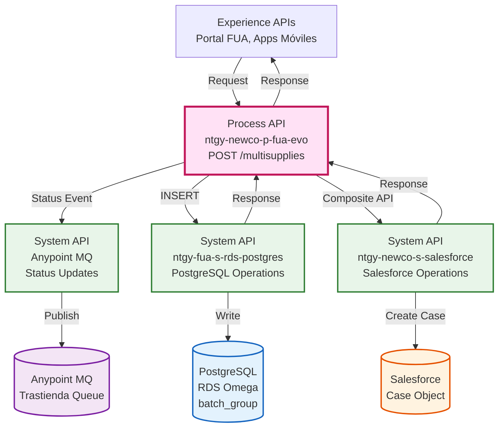
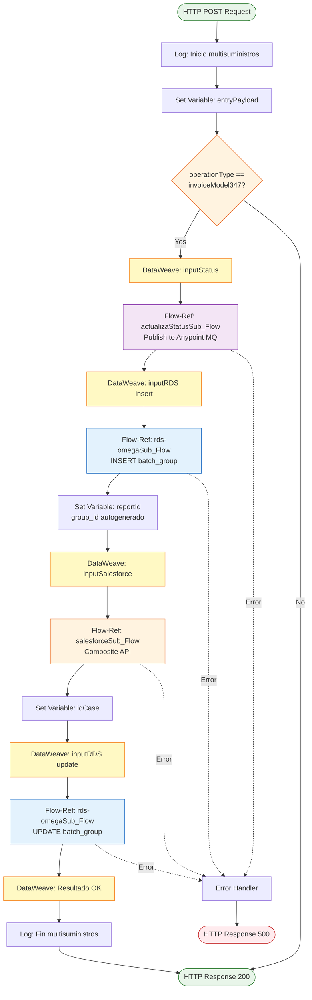
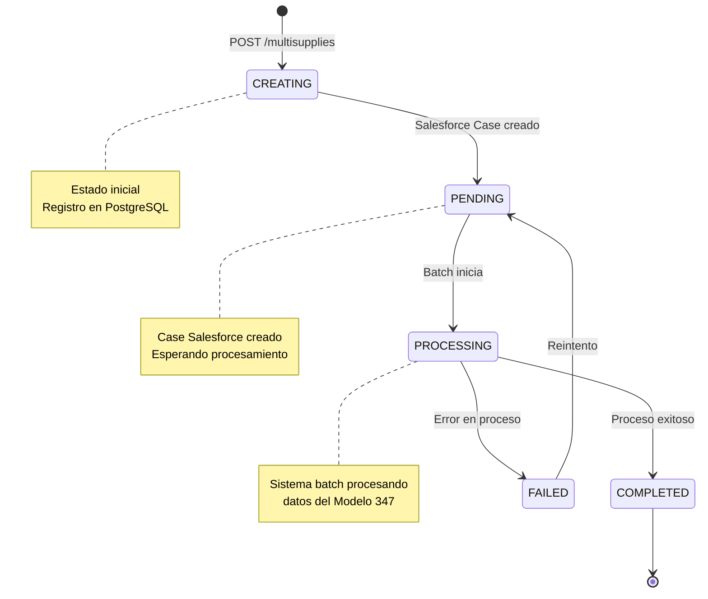
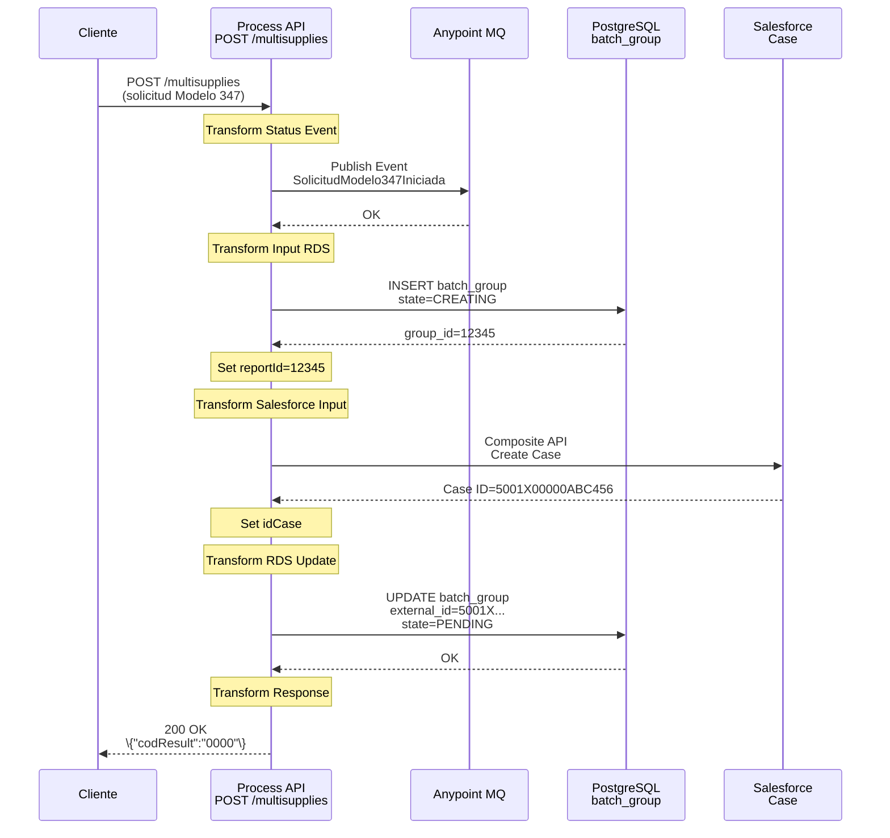
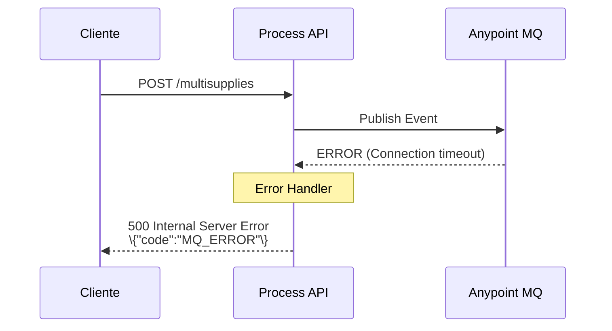
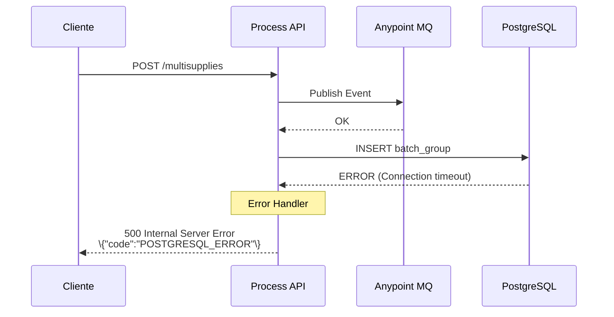

# POST /multisupplies

## 📌 Descripción General

### Propósito del Endpoint

Este endpoint permite crear solicitudes para petición de datos en formato multisuministro, específicamente para la generación del Modelo 347 de declaraciones fiscales anuales. Orquesta la creación de registros en PostgreSQL y la generación de casos de gestión en Salesforce para seguimiento del proceso de generación del informe fiscal.

### Tipo de API

**Capa:** Process API (API-Led Connectivity)

**Función:** Orquestación de proceso de negocio para solicitudes de Modelo 347

### Patrón de Integración

**Tipo:** Orquestación con Transformación

**Descripción:** Este endpoint orquesta un flujo secuencial que:
1. Actualiza estado del proceso (evento: SolicitudModelo347Iniciada)
2. Crea un registro inicial en PostgreSQL (estado: CREATING)
3. Genera un Case de gestión en Salesforce
4. Actualiza el registro en PostgreSQL con el ID del Case (estado: PENDING)

### Arquitectura API-Led Connectivity



---

## 💼 Propósito del Negocio

### Casos de Uso Principales

1. **Solicitud de Modelo 347 Anual**
   - Cliente solicita el informe del Modelo 347 para un año fiscal específico
   - Sistema genera un proceso para recopilar datos de operaciones con terceros
   - Beneficio: Facilita el cumplimiento de obligaciones fiscales anuales

2. **Seguimiento de Solicitudes Fiscales**
   - Cada solicitud genera un Case de gestión en Salesforce
   - Permite tracking del proceso de generación del informe fiscal
   - Beneficio: Trazabilidad completa y gestión de incidencias

3. **Procesamiento Asíncrono de Datos Fiscales**
   - La solicitud se registra con estado PENDING para procesamiento posterior
   - Sistema batch procesa los datos fiscales de forma asíncrona
   - Beneficio: Respuesta inmediata sin esperar procesamiento completo

### 🔗 Endpoints Dependientes

Este Process API consume los siguientes System APIs:

| System API | Endpoint | Método | Propósito |
|------------|----------|--------|-----------|
| `actualizaStatusSub_Flow` | Anypoint MQ | PUBLISH | Publicar evento de inicio de solicitud |
| `ntgy-fua-s-rds-postgres` | `/rds-omega` (subflow) | INSERT | Crear registro inicial en tabla batch_group |
| `ntgy-fua-s-rds-postgres` | `/rds-omega` (subflow) | UPDATE | Actualizar registro con external_id de Salesforce |
| `ntgy-newco-s-salesforce` | `/composite` (subflow) | POST | Crear Case de gestión en Salesforce |

### Lógica de Orquestación

```mermaid
graph LR
    P[Process API<br/>POST /multisupplies] --> T1[Transform<br/>Status Event]
    T1 --> S1[Publish Status<br/>Anypoint MQ]
    S1 --> T2[Transform<br/>Input RDS]
    T2 --> S2[RDS Insert<br/>batch_group]
    S2 --> T3[Transform<br/>Salesforce Input]
    T3 --> S3[Salesforce<br/>Create Case]
    S3 --> T4[Transform<br/>RDS Update]
    T4 --> S4[RDS Update<br/>batch_group]
    S4 --> R[Response OK]
    
    style P fill:#ffe1f5
    style S1 fill:#f3e5f5
    style S2 fill:#e8f5e9
    style S3 fill:#e8f5e9
    style S4 fill:#e8f5e9
    style T1 fill:#fff9c4
    style T2 fill:#fff9c4
    style T3 fill:#fff9c4
    style T4 fill:#fff9c4
```



**Pasos del Proceso:**

1. **Paso 1 - Evento de Estado**: Publica evento "SolicitudModelo347Iniciada" en Anypoint MQ
2. **Paso 2 - Registro Inicial**: Inserta registro en PostgreSQL con estado CREATING
3. **Paso 3 - Case Salesforce**: Crea Case de gestión con información del cliente y año fiscal
4. **Paso 4 - Actualización**: Actualiza registro PostgreSQL con external_id (Case ID) y estado PENDING
5. **Paso 5 - Respuesta**: Retorna confirmación exitosa al cliente

### Transformaciones Aplicadas

#### Transformación 1: Status Event (Líneas 25-40)

| Campo Request | Campo Event | Transformación |
|---------------|-------------|----------------|
| `entryPayload` | `data` | Payload completo |
| - | `eventType` | Constante: "SolicitudModelo347Iniciada" |
| - | `source` | Propiedad: `event.omega` |
| - | `queue` | Propiedad: `anypointMQ.trastiendaQueue` |
| - | `deleteNotice` | Constante: false |

#### Transformación 2: Input RDS Insert (Líneas 42-65)

| Campo Request | Campo PostgreSQL | Transformación |
|---------------|------------------|----------------|
| `x-client-id` | `client_id` | Header |
| `email` | `email` | Directo |
| - | `total_requested` | Constante: "1" |
| - | `state` | Constante: "CREATING" |
| `operationType` | `process_id` | Directo: "invoiceModel347" |
| `name` | `name` | Directo |
| - | `request_date` | `now() >> "CET"` - Timestamp actual |
| `x-client-code` | `nif` | Header (NIF del cliente) |
| `x-language` | `language` | Header |
| `date` (año) | `date_from` | "01/01/YYYY 00:00:00" |
| `date` (año) | `date_to` | "31/12/YYYY 23:59:59" |
| `x-contact-id` | `contact_id` | Header |
| `entryPayload` | `request_detail` | Payload completo |

#### Transformación 3: Salesforce Composite (Líneas 67-90)

| Campo Request | Campo Salesforce | Transformación |
|---------------|------------------|----------------|
| - | `NewCo_Recordtype__c` | Constante: "Gestion" |
| `x-client-id` | `AccountId` | Header |
| `x-contact-id` | `ContactId` | Header |
| `email`, `date`, `x-client-code` | `comments` | Concatenación formateada |
| - | `acn_fld_Tittle__r.NewCo_ExternalId__c` | Constante: "SolicitudModelo347" |
| - | `Origin` | Constante: "FUA" |

#### Transformación 4: RDS Update (Líneas 92-105)

| Campo Origen | Campo PostgreSQL | Transformación |
|--------------|------------------|----------------|
| `vars.reportId` | `group_id` | Variable del INSERT |
| `vars.salesforceResp.compositeResponse[0].body.id` | `external_id` | ID del Case creado |
| - | `state` | Constante: "PENDING" |

### Contexto Empresarial

- **Dominio:** Gestión Fiscal y Cumplimiento Normativo
- **Sector:** Energía - Utilities
- **División:** Naturgy España - NewCo
- **Proceso de Negocio:** Solicitud y generación del Modelo 347 (declaración anual de operaciones con terceros)

### Stakeholders

- **Clientes Finales**: Solicitan el Modelo 347 para cumplimiento fiscal
- **Equipo de Facturación**: Gestiona y procesa las solicitudes del Modelo 347
- **Equipo de Atención al Cliente**: Realiza seguimiento de solicitudes mediante Salesforce
- **Sistema Batch**: Procesa los datos fiscales de forma asíncrona
- **Departamento Fiscal**: Utiliza los informes generados para declaraciones

### Valor de Negocio

- **Cumplimiento Fiscal**: Facilita el cumplimiento de obligaciones tributarias anuales
- **Autoservicio**: Permite a clientes solicitar el Modelo 347 sin intervención manual
- **Trazabilidad**: Cada solicitud tiene un Case de Salesforce para seguimiento
- **Eficiencia**: Procesamiento asíncrono optimiza recursos del sistema
- **Transparencia**: Cliente recibe confirmación inmediata de su solicitud

### Consumidores Potenciales

Este endpoint puede ser consumido por:
- Portal web FUA
- Aplicaciones móviles de clientes
- Sistemas de agentes de call center
- Portales de clientes empresariales
- Sistemas de gestión fiscal

---

## 🔧 Especificación Técnica

### URLs por Ambiente

| Ambiente | URL Base | URL Completa |
|----------|----------|--------------|
| **Local** | `http://localhost:8081` | `http://localhost:8081/api/multisupplies` |
| **Development** | `https://ntgy-newco-p-fua-evo-dev.us-e2.cloudhub.io` | `https://ntgy-newco-p-fua-evo-dev.us-e2.cloudhub.io/api/multisupplies` |
| **UAT** | `https://ntgy-newco-p-fua-evo-uat.us-e2.cloudhub.io` | `https://ntgy-newco-p-fua-evo-uat.us-e2.cloudhub.io/api/multisupplies` |
| **Production** | `https://ntgy-newco-p-fua-evo-pro.us-e2.cloudhub.io` | `https://ntgy-newco-p-fua-evo-pro.us-e2.cloudhub.io/api/multisupplies` |

### Método HTTP

```http
POST /api/multisupplies
```

### Parámetros de Entrada

#### Headers Obligatorios

| Header | Tipo | Descripción | Ejemplo |
|--------|------|-------------|---------|
| `x-client-id` | string | ID del cliente en Salesforce | "0011X00000ABC123" |
| `x-client-code` | string | NIF/CIF del cliente | "12345678A" |
| `x-contact-id` | string | ID del contacto en Salesforce | "0031X00000XYZ789" |
| `x-language` | string | Idioma del cliente (ES/CA/EN) | "ES" |
| `client_id` | string | Client ID de Anypoint Platform | "..." |
| `client_secret` | string | Client Secret de Anypoint Platform | "..." |

#### Request Body (application/json)

Estructura del payload de entrada:

| Campo | Tipo | Descripción | Ejemplo |
|-------|------|-------------|---------|
| `operationType` | string | Tipo de operación (debe ser "invoiceModel347") | "invoiceModel347" |
| `email` | string | Email del cliente para notificaciones | "cliente@example.com" |
| `name` | string | Nombre del cliente | "Juan Pérez" |
| `date` | string | Año fiscal para el Modelo 347 | "2024" |
| `billingAccountDataList` | array | Lista de cuentas de facturación (opcional) | Ver estructura abajo |

#### Estructura de billingAccountDataList (Opcional)

| Campo | Tipo | Descripción | Ejemplo |
|-------|------|-------------|---------|
| `billingAccount` | string | Número de cuenta de facturación | "1234567890" |
| `address` | string | Dirección asociada | "Calle Mayor 123, Madrid" |

### Respuestas

#### 200 OK - Solicitud Creada Exitosamente

Respuesta exitosa cuando la solicitud se crea correctamente.

**Descripción:** La solicitud del Modelo 347 se ha creado correctamente y está en estado PENDING para procesamiento.

#### 400 Bad Request - Error de Validación

Error cuando faltan campos obligatorios o los datos son inválidos.

#### 500 Internal Server Error - Error del Sistema

Error cuando hay problemas con PostgreSQL, Salesforce o Anypoint MQ.

### Autenticación

- **Tipo:** Client ID & Client Secret (Anypoint Platform)
- **Headers Requeridos:**
  - `client_id`: ID de la aplicación cliente
  - `client_secret`: Secret de la aplicación cliente

### Timeouts

| Tipo | Valor |
|------|-------|
| **Request Timeout** | 60 segundos |
| **Connection Timeout** | 30 segundos |
| **Database Timeout** | 30 segundos |
| **Salesforce Timeout** | 60 segundos |
| **Anypoint MQ Timeout** | 30 segundos |

### Validaciones

- ✅ Todos los headers obligatorios deben estar presentes
- ✅ `operationType` debe ser "invoiceModel347"
- ✅ `email` debe tener formato válido
- ✅ `date` debe ser un año válido (formato YYYY)
- ✅ `x-client-id` debe ser un ID válido de Salesforce
- ✅ `x-contact-id` debe ser un ID válido de Salesforce

---

## 🏗️ Implementación Técnica

### Arquitectura del Flow



### Transformaciones DataWeave

Las transformaciones DataWeave se encuentran inline en el código XML del subflow `multisuppliesSub_Flow`.

**Lógica Especial de las Transformaciones:**

1. **Status Event**: Publica evento de inicio en Anypoint MQ para tracking
2. **Input RDS Insert**: Calcula fechas del año fiscal completo (01/01 - 31/12), estado inicial CREATING
3. **Salesforce Composite**: Crea Case específico para Modelo 347 con año fiscal en comentarios
4. **RDS Update**: Actualiza con ID del Case de Salesforce y cambia estado a PENDING

### Tabla PostgreSQL: batch_group

#### Estructura de la Tabla

| Campo | Tipo | Descripción | Ejemplo |
|-------|------|-------------|---------|
| `group_id` | SERIAL | ID autogenerado (PK) | 12345 |
| `client_id` | VARCHAR | ID del cliente Salesforce | "0011X00000ABC123" |
| `email` | VARCHAR | Email del cliente | "cliente@example.com" |
| `total_requested` | INTEGER | Total de solicitudes (siempre 1 para Modelo 347) | 1 |
| `state` | VARCHAR | Estado del proceso | "PENDING" |
| `process_id` | VARCHAR | Identificador del proceso | "invoiceModel347" |
| `request_date` | TIMESTAMP | Fecha de solicitud | "2024-01-15 10:30:00" |
| `nif` | VARCHAR | NIF/CIF del cliente | "12345678A" |
| `language` | VARCHAR | Idioma del cliente | "ES" |
| `date_from` | TIMESTAMP | Fecha inicio año fiscal | "2024-01-01 00:00:00" |
| `date_to` | TIMESTAMP | Fecha fin año fiscal | "2024-12-31 23:59:59" |
| `name` | VARCHAR | Nombre del cliente | "Juan Pérez" |
| `contact_id` | VARCHAR | ID contacto Salesforce | "0031X00000XYZ789" |
| `request_detail` | JSONB | Detalle de la solicitud | \{...\} |
| `external_id` | VARCHAR | ID del Case Salesforce | "5001X00000ABC456" |

#### Estados del Proceso



### Objeto Salesforce: Case

#### Campos Utilizados

| Campo Salesforce | Tipo | Descripción | Ejemplo |
|------------------|------|-------------|---------|
| `Id` | ID | ID del Case (autogenerado) | "5001X00000ABC456" |
| `NewCo_Recordtype__c` | String | Tipo de registro | "Gestion" |
| `AccountId` | Lookup | Referencia a Account | "0011X00000ABC123" |
| `ContactId` | Lookup | Referencia a Contact | "0031X00000XYZ789" |
| `comments` | Text Area | Comentarios del caso | "Caso Gestión relacionado con..." |
| `acn_fld_Tittle__r.NewCo_ExternalId__c` | String | Título del caso | "SolicitudModelo347" |
| `Origin` | Picklist | Origen del caso | "FUA" |

### Patrones de Diseño

**Patrón:** Saga Pattern (Orquestación)

**Justificación:** 
- Coordina múltiples operaciones transaccionales (Anypoint MQ + PostgreSQL + Salesforce)
- Mantiene consistencia eventual entre sistemas
- Permite rollback mediante estados (CREATING → PENDING)

**Patrón:** Event-Driven Architecture

**Justificación:**
- Publica eventos de estado en Anypoint MQ para tracking
- Permite que otros sistemas reaccionen a cambios de estado
- Desacopla el proceso de solicitud del procesamiento batch

**Patrón:** State Machine

**Justificación:**
- Gestiona estados del proceso (CREATING → PENDING → PROCESSING → COMPLETED/FAILED)
- Permite tracking del progreso de la solicitud
- Facilita reintentos en caso de fallos

### Diagramas de Secuencia

#### 1. Flujo Normal de Éxito



#### 2. Flujo con Error en Anypoint MQ



#### 3. Flujo con Error en PostgreSQL INSERT



### Manejo de Errores

#### Estrategia de Error Handling

**Tipos de Errores Manejados:**

1. **APP:ANYPOINT_MQ_PUBLISH**
   - Causa: Error al publicar evento en Anypoint MQ
   - Acción: Retorna error 500 al cliente
   - Rollback: No requiere (no se creó registro)

2. **APP:POSTGRESQL_OMEGA_INSERT**
   - Causa: Error al insertar en tabla batch_group
   - Acción: Retorna error 500 al cliente
   - Rollback: Evento publicado en MQ (puede requerir compensación)

3. **APP:COMPOSITE_SALESFORCE**
   - Causa: Error al crear Case en Salesforce
   - Acción: Retorna error 500 al cliente
   - Rollback: Registro queda en estado CREATING (requiere limpieza manual)

4. **APP:POSTGRESQL_OMEGA_UPDATE**
   - Causa: Error al actualizar registro con external_id
   - Acción: Retorna error 500 al cliente
   - Rollback: Case creado en Salesforce, registro en CREATING

**Estrategia de Recuperación:**

- **Reintentos Automáticos:** No implementados (operación idempotente)
- **Compensación:** Registros en CREATING pueden ser reprocesados manualmente
- **Monitoreo:** Alertas para registros en CREATING por más de 5 minutos
- **Event Tracking:** Eventos en Anypoint MQ permiten tracking del proceso

### Subflows Utilizados

#### actualizaStatusSub_Flow

**Propósito:** Publicar eventos de estado en Anypoint MQ

**Configuración:**
- Queue: Configurado en propiedad `anypointMQ.trastiendaQueue`
- Event Type: "SolicitudModelo347Iniciada"
- Source: Configurado en propiedad `event.omega`

#### rds-omegaSub_Flow

**Propósito:** Ejecutar operaciones en PostgreSQL (INSERT, UPDATE, QUERY)

**Operaciones Soportadas:**
- `insert`: Ejecuta INSERT y retorna claves autogeneradas
- `update`: Ejecuta UPDATE

**Configuración:**
- Endpoint: `ntgy-fua-s-rds-postgres`
- Paths: `/ejecutarInsert`, `/ejecutarUpdate`
- Target Variables: `resultRDSInsert`, `resultRDSUpdate`

#### salesforceSub_Flow

**Propósito:** Ejecutar operaciones en Salesforce

**Operaciones Soportadas:**
- `composite`: Ejecuta Composite API (transaccional)

**Configuración:**
- Endpoint: `ntgy-newco-s-salesforce`
- Path: `/postComposite`
- Target Variable: `salesforceResp`
- Validación: Verifica httpStatusCode < 400

---

## 💻 Ejemplos de Uso

### Ejemplo 1: Solicitud Exitosa - Modelo 347 para 2024

#### Request

```bash
curl -X POST "https://ntgy-newco-p-fua-evo-dev.us-e2.cloudhub.io/api/multisupplies" \
  -H "Content-Type: application/json" \
  -H "x-client-id: 0011X00000ABC123" \
  -H "x-client-code: 12345678A" \
  -H "x-contact-id: 0031X00000XYZ789" \
  -H "x-language: ES" \
  -H "client_id: YOUR_CLIENT_ID" \
  -H "client_secret: YOUR_CLIENT_SECRET" \
  -d '{
    "operationType": "invoiceModel347",
    "email": "juan.perez@example.com",
    "name": "Juan Pérez",
    "date": "2024"
  }'
```

#### Response (200 OK)

```
{
  "result": {
    "codResult": "0000",
    "msgResult": "No hay error"
  }
}
```

**Resultado en PostgreSQL:**
```sql
-- Registro creado en batch_group
group_id: 12345
client_id: "0011X00000ABC123"
email: "juan.perez@example.com"
total_requested: 1
state: "PENDING"
process_id: "invoiceModel347"
date_from: "2024-01-01 00:00:00"
date_to: "2024-12-31 23:59:59"
external_id: "5001X00000ABC456"
```

**Resultado en Salesforce:**
```
Case ID: 5001X00000ABC456
RecordType: Gestion
Origin: FUA
Title: SolicitudModelo347
```

---

### Ejemplo 2: Solicitud con Cuentas de Facturación

#### Request

```bash
curl -X POST "https://ntgy-newco-p-fua-evo-pro.us-e2.cloudhub.io/api/multisupplies" \
  -H "Content-Type: application/json" \
  -H "x-client-id: 0011X00000DEF456" \
  -H "x-client-code: 87654321B" \
  -H "x-contact-id: 0031X00000UVW012" \
  -H "x-language: CA" \
  -H "client_id: YOUR_CLIENT_ID" \
  -H "client_secret: YOUR_CLIENT_SECRET" \
  -d '{
    "operationType": "invoiceModel347",
    "email": "maria.garcia@example.com",
    "name": "Maria Garcia",
    "date": "2023",
    "billingAccountDataList": [
      {
        "billingAccount": "1234567890",
        "address": "Carrer de Balmes 45, Barcelona"
      },
      {
        "billingAccount": "0987654321",
        "address": "Avinguda Diagonal 200, Barcelona"
      }
    ]
  }'
```

#### Response (200 OK)

```
{
  "result": {
    "codResult": "0000",
    "msgResult": "No hay error"
  }
}
```

---

### Ejemplo 3: JavaScript (Fetch API)

```javascript
const createModelo347Request = async () => {
  const response = await fetch('https://ntgy-newco-p-fua-evo-dev.us-e2.cloudhub.io/api/multisupplies', {
    method: 'POST',
    headers: {
      'Content-Type': 'application/json',
      'x-client-id': '0011X00000ABC123',
      'x-client-code': '12345678A',
      'x-contact-id': '0031X00000XYZ789',
      'x-language': 'ES',
      'client_id': 'YOUR_CLIENT_ID',
      'client_secret': 'YOUR_CLIENT_SECRET'
    },
    body: JSON.stringify({
      operationType: 'invoiceModel347',
      email: 'cliente@example.com',
      api_name: 'Cliente Ejemplo',
      date: '2024'
    })
  });

  const data = await response.json();
  
  if (response.ok) {
    console.log('Solicitud Modelo 347 creada exitosamente:', data);
    return data;
  } else {
    console.error('Error al crear solicitud:', data);
    throw new Error(data.message);
  }
};

// Uso
createModelo347Request()
  .then(result => console.log('Resultado:', result))
  .catch(error => console.error('Error:', error));
```

---

### Ejemplo 4: Python (Requests)

```python
import requests
import json

def create_modelo347_request(client_data):
    url = 'https://ntgy-newco-p-fua-evo-dev.us-e2.cloudhub.io/api/multisupplies'
    
    headers = {
        'Content-Type': 'application/json',
        'x-client-id': client_data['client_id'],
        'x-client-code': client_data['nif'],
        'x-contact-id': client_data['contact_id'],
        'x-language': client_data.get('language', 'ES'),
        'client_id': 'YOUR_CLIENT_ID',
        'client_secret': 'YOUR_CLIENT_SECRET'
    }
    
    payload = {
        'operationType': 'invoiceModel347',
        'email': client_data['email'],
        'name': client_data['name'],
        'date': client_data['fiscal_year']
    }
    
    try:
        response = requests.post(url, headers=headers, json=payload, timeout=60)
        response.raise_for_status()
        
        result = response.json()
        print(f"Solicitud Modelo 347 creada exitosamente: {result}")
        return result
        
    except requests.exceptions.HTTPError as http_err:
        print(f"Error HTTP: {http_err}")
        print(f"Respuesta: {response.text}")
        raise
    except requests.exceptions.Timeout:
        print("Error: Timeout al conectar con el servidor")
        raise
    except Exception as err:
        print(f"Error inesperado: {err}")
        raise

# Ejemplo de uso
client_data = {
    'client_id': '0011X00000ABC123',
    'nif': '12345678A',
    'contact_id': '0031X00000XYZ789',
    'email': 'cliente@example.com',
    'name': 'Cliente Ejemplo',
    'language': 'ES',
    'fiscal_year': '2024'
}

result = create_modelo347_request(client_data)
```

---

### Ejemplo 5: Error - Campo Obligatorio Faltante

#### Request

```bash
curl -X POST "https://ntgy-newco-p-fua-evo-dev.us-e2.cloudhub.io/api/multisupplies" \
  -H "Content-Type: application/json" \
  -H "x-client-id: 0011X00000ABC123" \
  -H "client_id: YOUR_CLIENT_ID" \
  -H "client_secret: YOUR_CLIENT_SECRET" \
  -d '{
    "operationType": "invoiceModel347",
    "email": "cliente@example.com"
  }'
```

#### Response (400 Bad Request)

```
{
  "code": "VALIDATION_ERROR",
  "message": "Error en la validación de datos de entrada",
  "details": "Headers obligatorios faltantes: x-client-code, x-contact-id, x-language"
}
```

---

### Ejemplo 6: Error - Tipo de Operación Inválido

#### Request

```bash
curl -X POST "https://ntgy-newco-p-fua-evo-dev.us-e2.cloudhub.io/api/multisupplies" \
  -H "Content-Type: application/json" \
  -H "x-client-id: 0011X00000ABC123" \
  -H "x-client-code: 12345678A" \
  -H "x-contact-id: 0031X00000XYZ789" \
  -H "x-language: ES" \
  -H "client_id: YOUR_CLIENT_ID" \
  -H "client_secret: YOUR_CLIENT_SECRET" \
  -d '{
    "operationType": "invalidType",
    "email": "cliente@example.com",
    "name": "Cliente Ejemplo",
    "date": "2024"
  }'
```

#### Response (400 Bad Request)

```
{
  "code": "VALIDATION_ERROR",
  "message": "Tipo de operación inválido",
  "details": "operationType debe ser 'invoiceModel347'"
}
```
