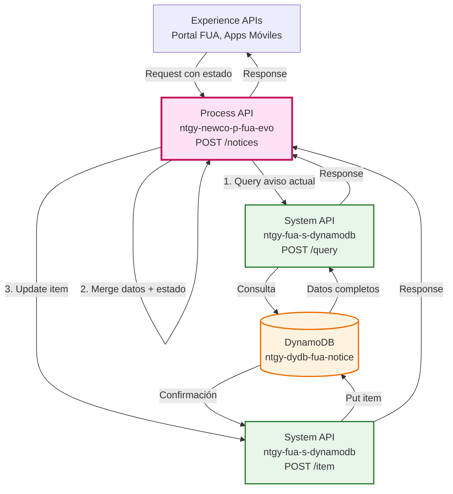
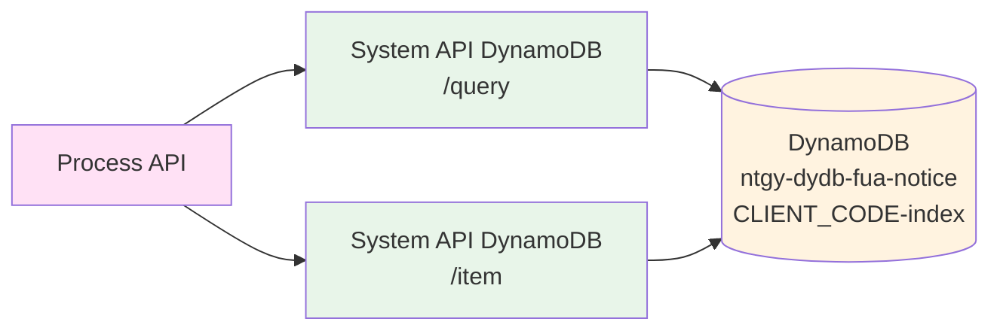
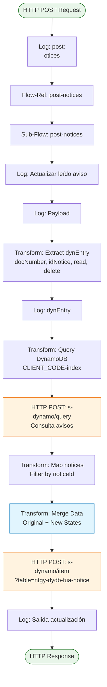
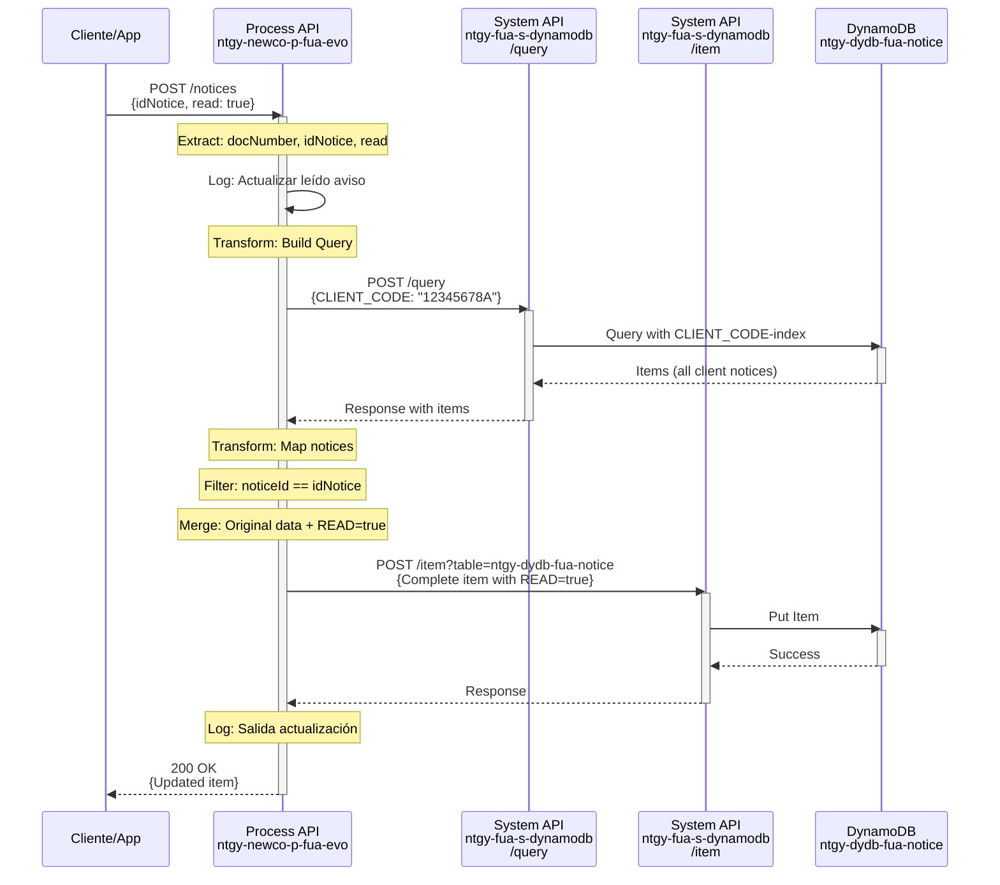
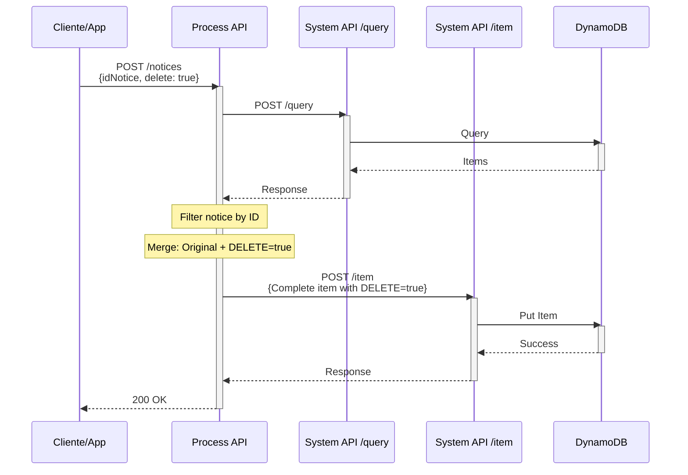
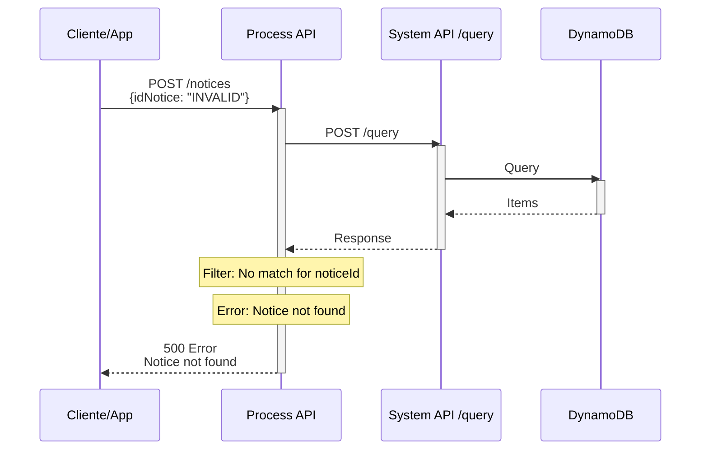

# POST /notices

## 📌 Descripción General

### Propósito del Endpoint

Este endpoint actualiza el estado de un aviso específico del cliente en DynamoDB, permitiendo marcar un aviso como leído (`read: true`) o como eliminado (`delete: true`). El endpoint primero consulta el aviso actual para obtener todos sus datos, luego actualiza únicamente los campos de estado (`READ` y `DELETE`) preservando toda la información original del aviso.

### Tipo de API

**Capa:** Process API (API-Led Connectivity)

**Función:** Orquestación de actualización de estado de avisos con preservación de datos

### Patrón de Integración

**Tipo:** Consulta + Actualización Parcial

**Descripción:** El endpoint realiza una consulta previa para obtener los datos completos del aviso, luego actualiza solo los campos de estado (`READ`, `DELETE`) preservando todos los demás campos originales.

### Arquitectura API-Led Connectivity



---

## 💼 Propósito del Negocio

### Casos de Uso Principales

1. **Marcar Aviso como Leído**
   - El cliente visualiza un aviso y el sistema lo marca como leído
   - Beneficio: Permite al cliente identificar qué avisos ya ha revisado

2. **Eliminar Aviso**
   - El cliente descarta un aviso que ya no desea ver
   - Beneficio: Mejora la experiencia del usuario permitiendo gestionar sus notificaciones

3. **Gestión de Notificaciones**
   - El cliente puede gestionar el estado de sus avisos desde el portal o app
   - Beneficio: Control total sobre las notificaciones visibles

### 🔗 Endpoints Dependientes

Este Process API consume los siguientes System APIs:

| System API | Endpoint | Método | Propósito |
|------------|----------|--------|-----------|
| `ntgy-fua-s-dynamodb` | `/query` | POST | Consulta el aviso actual por CLIENT_CODE usando índice secundario |
| `ntgy-fua-s-dynamodb` | `/item` | POST | Actualiza el item completo en DynamoDB con nuevos estados |

### Lógica de Orquestación



**Pasos del Proceso:**

1. **Extracción de Parámetros**: Obtiene `docNumber`, `idNotice`, `read`, `delete` del payload
2. **Consulta Aviso Actual**: Query a DynamoDB por `CLIENT_CODE` para obtener todos los avisos del cliente
3. **Filtrado de Aviso**: Filtra el aviso específico por `noticeId` de la lista obtenida
4. **Merge de Datos**: Combina datos originales del aviso con nuevos estados (`READ`, `DELETE`)
5. **Actualización en DynamoDB**: Guarda el item completo actualizado usando PUT item
6. **Respuesta**: Retorna confirmación de actualización

### Transformaciones Aplicadas

**Actualización Parcial con Preservación de Datos:**

El endpoint NO sobrescribe el aviso completo, sino que:
1. Consulta el aviso actual para obtener todos sus campos
2. Actualiza SOLO los campos `READ` y `DELETE`
3. Preserva todos los demás campos originales (TITLE, TEXT, URL, etc.)

| Campo | Origen | Acción |
|-------|--------|--------|
| `CLIENT_CODE` | Aviso original | Preservado |
| `NOTICE_ID` | Aviso original | Preservado |
| `TYPE` | Aviso original | Preservado |
| `TEXT` | Aviso original | Preservado |
| `TITLE` | Aviso original | Preservado |
| `VISIBILITY` | Aviso original | Preservado |
| `READ` | Request payload | **ACTUALIZADO** |
| `DELETE` | Request payload | **ACTUALIZADO** |
| `VALIDITY` | Aviso original | Preservado |
| `START_DATE` | Aviso original | Preservado |
| `END_DATE` | Aviso original | Preservado |
| `IDIOMA` | Aviso original | Preservado |
| `DIRSUMINISTRO` | Aviso original | Preservado |
| `URL` | Aviso original | Preservado |

### Contexto Empresarial

- **Dominio:** Gestión de Notificaciones y Comunicaciones
- **Sector:** Energía - Utilities
- **División:** Naturgy España - NewCo
- **Proceso de Negocio:** Gestión de Estado de Avisos del Cliente

### Stakeholders

- **Clientes FUA**: Gestionan el estado de sus avisos (leído/eliminado)
- **Equipo de UX**: Mejora la experiencia del usuario con gestión de notificaciones
- **Equipo de Desarrollo**: Mantiene la integridad de datos en DynamoDB

### Valor de Negocio

- **Control del Usuario**: Permite al cliente gestionar sus notificaciones
- **Experiencia Personalizada**: El cliente ve solo avisos relevantes
- **Integridad de Datos**: Preserva toda la información original del aviso
- **Trazabilidad**: Mantiene registro de qué avisos han sido leídos o eliminados

### Consumidores Potenciales

Este endpoint puede ser consumido por:
- Portal web FUA (autoservicio de clientes)
- Aplicaciones móviles iOS/Android
- Sistemas de agentes de call center
- Integraciones de terceros autorizados

---

## 🔧 Especificación Técnica

### URLs por Ambiente

| Ambiente | URL Base | URL Completa |
|----------|----------|--------------|
| **Local** | `http://localhost:8081` | `http://localhost:8081/api/notices` |
| **Development** | `https://ntgy-newco-p-fua-evo-dev.us-e2.cloudhub.io` | `https://ntgy-newco-p-fua-evo-dev.us-e2.cloudhub.io/api/notices` |
| **UAT** | `https://ntgy-newco-p-fua-evo-uat.us-e2.cloudhub.io` | `https://ntgy-newco-p-fua-evo-uat.us-e2.cloudhub.io/api/notices` |
| **Production** | `https://ntgy-newco-p-fua-evo-pro.us-e2.cloudhub.io` | `https://ntgy-newco-p-fua-evo-pro.us-e2.cloudhub.io/api/notices` |

### Método HTTP

```
POST /api/notices
```

### Parámetros de Entrada

#### Query Parameters

| Parámetro | Tipo | Requerido | Descripción | Ejemplo |
|-----------|------|-----------|-------------|---------|
| `docNumber` | string | Sí | Número de documento del cliente (NIF/NIE) | `12345678A` |

**Nota:** El `docNumber` puede venir en el query param `x-client-code` o en el body como `payload.nif`.

#### Request Body

```json
{
  "x-client-code": "12345678A",
  "nif": "12345678A",
  "idNotice": "NOTICE-2026-001",
  "read": true,
  "delete": false
}
```

| Campo | Tipo | Requerido | Descripción | Ejemplo |
|-------|------|-----------|-------------|---------|
| `x-client-code` | string | Condicional | Código del cliente (alternativa a query param) | `12345678A` |
| `nif` | string | Condicional | NIF del cliente (fallback) | `12345678A` |
| `idNotice` | string | Sí | ID único del aviso a actualizar | `NOTICE-2026-001` |
| `read` | boolean | No | Marca el aviso como leído | `true` |
| `delete` | boolean | No | Marca el aviso como eliminado | `false` |

**Nota:** Al menos uno de los campos `read` o `delete` debe estar presente.

### Respuestas

#### 200 OK - Actualización Exitosa

```json
{
  "CLIENT_CODE": "12345678A",
  "NOTICE_ID": "NOTICE-2026-001",
  "READ": true,
  "DELETE": false,
  "TYPE": "INFO",
  "TEXT": "Su factura del mes de agosto ya está disponible",
  "TITLE": "Nueva Factura Disponible",
  "VISIBILITY": "VISIBLE",
  "START_DATE": "2026/08/01",
  "VALIDITY": "30",
  "END_DATE": "2026/09/01",
  "IDIOMA": "ES",
  "DIRSUMINISTRO": "Calle Principal 123",
  "URL": "https://portal.naturgy.es/facturas"
}
```

#### 400 Bad Request

```json
{
  "message": "Bad request"
}
```

#### 500 Internal Server Error

```json
{
  "code": "ERROR_CODE",
  "message": "Error message",
  "details": "Additional error details"
}
```

### Autenticación

- **Tipo:** Client ID & Client Secret (Anypoint Platform)

### Timeouts

| Tipo | Valor |
|------|-------|
| **Request Timeout** | 30 segundos |
| **Connection Timeout** | 10 segundos |

---

## 🏗️ Implementación Técnica

### Arquitectura del Flow



### Transformaciones DataWeave

#### 1. Extracción de Parámetros de Entrada

```dataweave
%dw 2.0
output application/json
---
{
    "docNumber": payload.'x-client-code' default payload.nif,
    "idNotice": payload.idNotice,
    "read": payload.read,
    "delete": payload.delete
}
```

#### 2. Construcción de Query para Consultar Aviso

```dataweave
%dw 2.0
output application/json
---
{
    "attributes": {
        ":CLIENT_CODE": {
            "S": vars.dynEntry.docNumber
        }
    },
    "condition": "CLIENT_CODE=:CLIENT_CODE",
    "tableName": "ntgy-dydb-fua-notice",
    "index": "CLIENT_CODE-index"
}
```

#### 3. Transformación de Avisos Consultados

```dataweave
%dw 2.0
output application/json
---
{
  "result": {
    "codResult": "0000",
    "msgResult": "Item found"
  },
  "notices": payload.items map ((item, index) -> {
      "clientCode": item.CLIENT_CODE,
      "noticeId": item.NOTICE_ID,
      "type": item.TYPE,
      "text": item.TEXT,
      "title": item.TITLE,
      "visibility": item.VISIBILITY,
      "validity": item.VALIDITY,
      "startDate": item.START_DATE,
      "endDate": item.END_DATE,
      "idioma": item.IDIOMA,
      "dirSuministro": item.DIRSUMINISTRO,
      "url": item.URL 
  })
}
```

#### 4. Merge de Datos Originales con Nuevos Estados

```dataweave
%dw 2.0
output application/json
var datos = payload.notices filter ((item, index) -> item.noticeId == vars.dynEntry.idNotice)
---
{
    "CLIENT_CODE": datos.clientCode[0],
    "NOTICE_ID": datos.noticeId[0],
    "READ": vars.dynEntry.read,
    "DELETE": vars.dynEntry.delete,
    "TYPE": datos.'type'[0],
    "TEXT": datos.text[0],
    "TITLE": datos.title[0],
    "VISIBILITY": datos.visibility[0],
    "START_DATE": datos.startDate[0],
    "VALIDITY": datos.validity[0],
    "END_DATE": datos.endDate[0],
    "IDIOMA": datos.idioma[0],
    "DIRSUMINISTRO": datos.dirSuministro[0],
    "URL": datos.url[0]
}
```

### Patrones de Diseño

**Patrón:** Read-Modify-Write con Preservación de Datos

**Justificación:** 
- DynamoDB requiere el item completo para actualizaciones
- Se consulta primero para obtener todos los campos
- Se actualizan solo los campos de estado
- Se preserva toda la información original del aviso
- Evita pérdida de datos por actualizaciones parciales

### Diagramas de Secuencia

#### 1. Flujo Normal - Marcar como Leído



#### 2. Flujo Normal - Marcar como Eliminado



#### 3. Flujo con Error - Aviso No Encontrado



### Manejo de Errores

El endpoint utiliza el error handler global `errorManagerFlow` que:

1. **Captura errores de consulta** a DynamoDB
2. **Captura errores de actualización** en DynamoDB
3. **Maneja avisos no encontrados** (filtro vacío)
4. **Transforma errores** a formato estándar
5. **Registra errores** en logs para troubleshooting

**Códigos de Error Comunes:**
- `400`: Parámetros inválidos o faltantes (idNotice, docNumber)
- `404`: Aviso no encontrado para el cliente
- `500`: Error de conexión con DynamoDB o error interno
- `503`: DynamoDB no disponible

---

## 💻 Ejemplos de Uso

### Ejemplo 1: Marcar Aviso como Leído

#### cURL

```bash
curl -X POST "https://ntgy-newco-p-fua-evo-dev.us-e2.cloudhub.io/api/notices" \
  -H "Content-Type: application/json" \
  -H "client_id: YOUR_CLIENT_ID" \
  -H "client_secret: YOUR_CLIENT_SECRET" \
  -d '{
    "x-client-code": "12345678A",
    "idNotice": "NOTICE-2026-001",
    "read": true,
    "delete": false
  }'
```

#### Respuesta (200 OK)

```json
{
  "CLIENT_CODE": "12345678A",
  "NOTICE_ID": "NOTICE-2026-001",
  "READ": true,
  "DELETE": false,
  "TYPE": "INFO",
  "TEXT": "Su factura del mes de agosto ya está disponible. Puede consultarla en el portal.",
  "TITLE": "Nueva Factura Disponible",
  "VISIBILITY": "VISIBLE",
  "START_DATE": "2026/08/01",
  "VALIDITY": "30",
  "END_DATE": "2026/09/01",
  "IDIOMA": "ES",
  "DIRSUMINISTRO": "Calle Principal 123, Madrid",
  "URL": "https://portal.naturgy.es/facturas/2026-08"
}
```

### Ejemplo 2: Marcar Aviso como Eliminado

#### cURL

```bash
curl -X POST "https://ntgy-newco-p-fua-evo-dev.us-e2.cloudhub.io/api/notices" \
  -H "Content-Type: application/json" \
  -H "client_id: YOUR_CLIENT_ID" \
  -H "client_secret: YOUR_CLIENT_SECRET" \
  -d '{
    "nif": "12345678A",
    "idNotice": "NOTICE-2026-002",
    "read": false,
    "delete": true
  }'
```

#### Respuesta (200 OK)

```json
{
  "CLIENT_CODE": "12345678A",
  "NOTICE_ID": "NOTICE-2026-002",
  "READ": false,
  "DELETE": true,
  "TYPE": "ALERT",
  "TEXT": "Recordatorio de pago",
  "TITLE": "Recordatorio de Pago",
  "VISIBILITY": "VISIBLE",
  "START_DATE": "2026/08/20",
  "VALIDITY": "15",
  "END_DATE": "2026/09/15",
  "IDIOMA": "ES",
  "DIRSUMINISTRO": "Calle Principal 123, Madrid",
  "URL": "https://portal.naturgy.es/pagos"
}
```

### Ejemplo 3: JavaScript (Fetch API)

```javascript
const updateNoticeStatus = async (clientCode, noticeId, isRead, isDeleted) => {
  try {
    const response = await fetch(
      'https://ntgy-newco-p-fua-evo-dev.us-e2.cloudhub.io/api/notices',
      {
        method: 'POST',
        headers: {
          'Content-Type': 'application/json',
          'client_id': 'YOUR_CLIENT_ID',
          'client_secret': 'YOUR_CLIENT_SECRET'
        },
        body: JSON.stringify({
          'x-client-code': clientCode,
          idNotice: noticeId,
          read: isRead,
          delete: isDeleted
        })
      }
    );

    if (!response.ok) {
      throw new Error(`HTTP error! status: ${response.status}`);
    }

    const data = await response.json();
    console.log('Aviso actualizado:', data);
    
    return data;
  } catch (error) {
    console.error('Error al actualizar aviso:', error);
    throw error;
  }
};

// Uso: Marcar como leído
updateNoticeStatus('12345678A', 'NOTICE-2026-001', true, false)
  .then(data => console.log('Marcado como leído'))
  .catch(error => console.error('Error:', error));

// Uso: Marcar como eliminado
updateNoticeStatus('12345678A', 'NOTICE-2026-002', false, true)
  .then(data => console.log('Marcado como eliminado'))
  .catch(error => console.error('Error:', error));
```

### Ejemplo 4: Python (Requests)

```python
import requests

def update_notice_status(client_code, notice_id, is_read=None, is_deleted=None):
    """
    Actualiza el estado de un aviso del cliente
    
    Args:
        client_code (str): Código del cliente (NIF/NIE)
        notice_id (str): ID del aviso a actualizar
        is_read (bool, optional): Marcar como leído
        is_deleted (bool, optional): Marcar como eliminado
    
    Returns:
        dict: Respuesta con el aviso actualizado
    """
    url = 'https://ntgy-newco-p-fua-evo-dev.us-e2.cloudhub.io/api/notices'
    
    headers = {
        'Content-Type': 'application/json',
        'client_id': 'YOUR_CLIENT_ID',
        'client_secret': 'YOUR_CLIENT_SECRET'
    }
    
    payload = {
        'x-client-code': client_code,
        'idNotice': notice_id
    }
    
    # Agregar solo los campos que se van a actualizar
    if is_read is not None:
        payload['read'] = is_read
    if is_deleted is not None:
        payload['delete'] = is_deleted
    
    try:
        response = requests.post(url, headers=headers, json=payload, timeout=30)
        response.raise_for_status()
        
        data = response.json()
        print(f"Aviso {notice_id} actualizado exitosamente")
        print(f"Estado: READ={data.get('READ')}, DELETE={data.get('DELETE')}")
        
        return data
        
    except requests.exceptions.RequestException as e:
        print(f"Error al actualizar aviso: {e}")
        raise

# Uso: Marcar como leído
if __name__ == "__main__":
    client_code = "12345678A"
    notice_id = "NOTICE-2026-001"
    
    # Marcar como leído
    result = update_notice_status(client_code, notice_id, is_read=True, is_deleted=False)
    print(f"\nAviso marcado como leído:")
    print(f"Título: {result.get('TITLE')}")
    print(f"Leído: {result.get('READ')}")
    
    # Marcar como eliminado
    result = update_notice_status(client_code, "NOTICE-2026-002", is_read=False, is_deleted=True)
    print(f"\nAviso marcado como eliminado:")
    print(f"Título: {result.get('TITLE')}")
    print(f"Eliminado: {result.get('DELETE')}")
```
