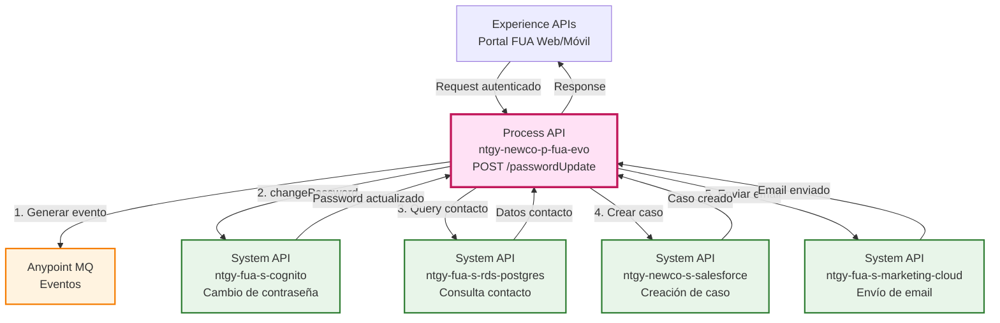
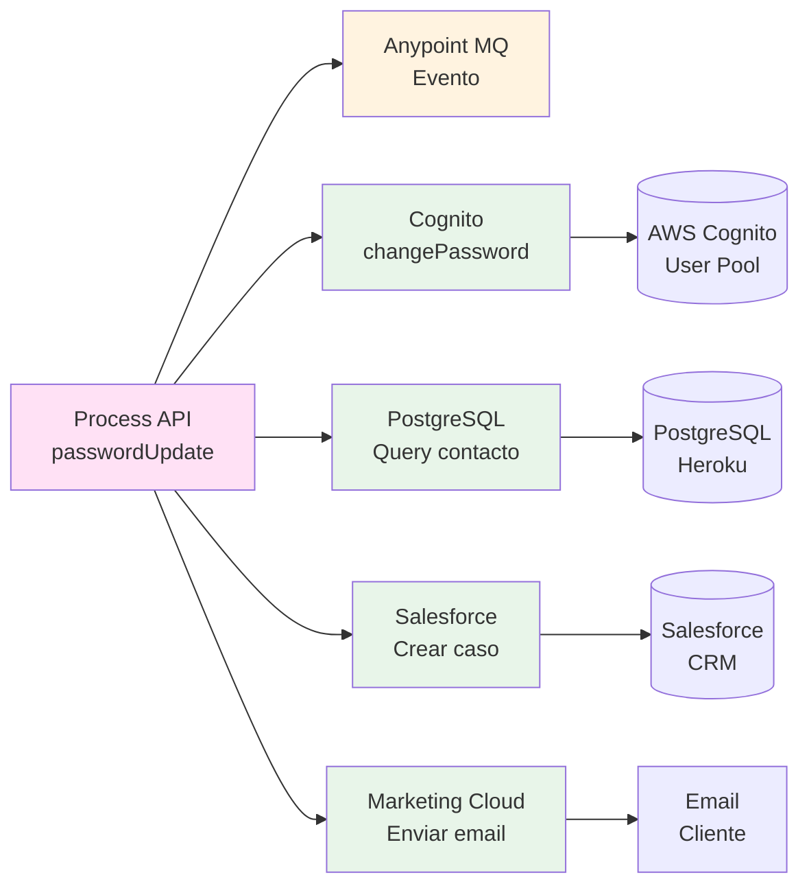
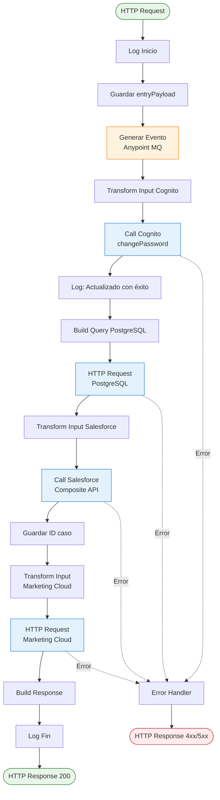
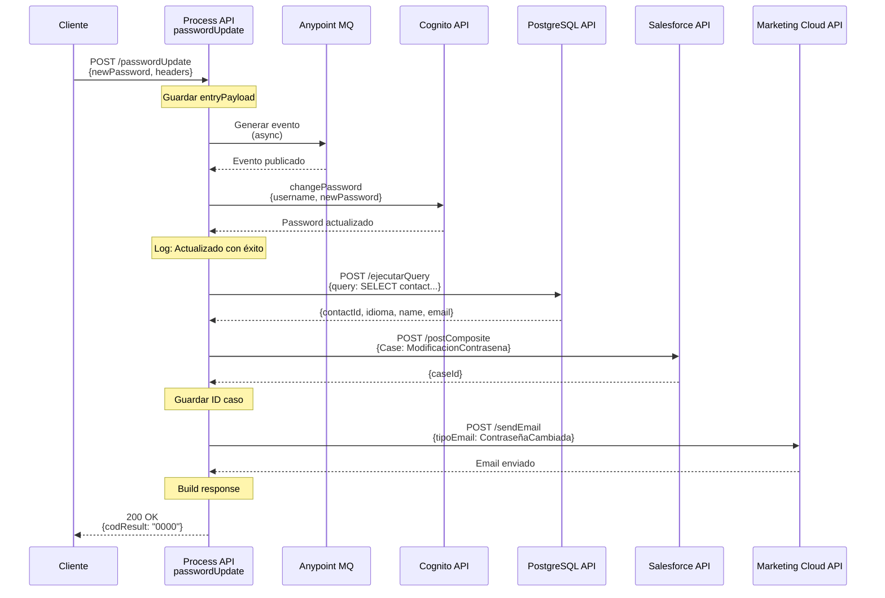
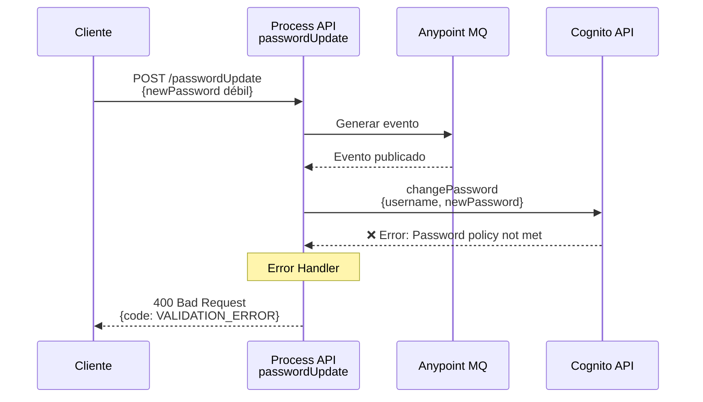
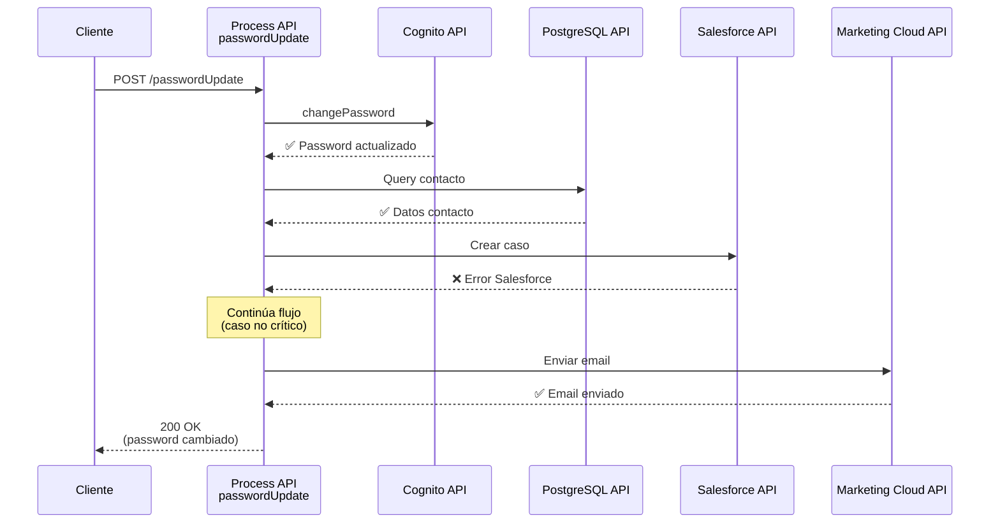

# POST /passwordUpdate

## 📌 Descripción General

### Propósito del Endpoint

Este endpoint permite a un usuario **autenticado** cambiar su contraseña desde el área privada del portal FUA. A diferencia del endpoint de recuperación de contraseña, este requiere que el usuario esté previamente autenticado y proporciona una experiencia completa que incluye la actualización en Cognito, creación de caso de gestión en Salesforce, y envío de email de confirmación.

### Tipo de API

**Capa:** Process API (API-Led Connectivity)

**Función:** Orquestación de múltiples servicios para gestión segura de cambio de contraseña

### Patrón de Integración

**Tipo:** Orquestación Síncrona con Generación de Eventos

**Descripción:** Este endpoint orquesta llamadas a 4 System APIs diferentes de forma secuencial:
1. Generación de evento asíncrono (Anypoint MQ)
2. Cambio de contraseña en AWS Cognito
3. Consulta de datos del contacto en PostgreSQL
4. Creación de caso de gestión en Salesforce
5. Envío de email de confirmación vía Marketing Cloud

### Arquitectura API-Led Connectivity



---

## 💼 Propósito del Negocio

### Casos de Uso Principales

1. **Cambio de Contraseña por Seguridad**
   - Usuario desea actualizar su contraseña periódicamente por seguridad
   - Beneficio: Mejora la seguridad de la cuenta del cliente

2. **Cambio de Contraseña por Compromiso**
   - Usuario sospecha que su contraseña ha sido comprometida
   - Beneficio: Respuesta rápida ante posibles brechas de seguridad

3. **Actualización de Credenciales**
   - Usuario desea usar una contraseña más memorable o segura
   - Beneficio: Mejora la experiencia de usuario y reduce olvidos

### 🔗 Endpoints Dependientes

Este Process API consume los siguientes System APIs:

| System API | Endpoint | Método | Propósito |
|------------|----------|--------|-----------|
| `ntgy-fua-s-cognito` | `/changePassword` | POST | Actualizar contraseña en AWS Cognito |
| `ntgy-fua-s-rds-postgres` | `/ejecutarQuery` | POST | Consultar datos del contacto (email, idioma) |
| `ntgy-newco-s-salesforce` | `/postComposite` | POST | Crear caso de gestión "ModificacionContrasena" |
| `ntgy-fua-s-marketing-cloud` | `/sendEmail` | POST | Enviar email de confirmación al cliente |

### Lógica de Orquestación



**Pasos del Proceso:**

1. **Generación de Evento**: Publica evento asíncrono en Anypoint MQ para auditoría
2. **Actualización en Cognito**: Cambia la contraseña del usuario en AWS Cognito
3. **Consulta de Datos**: Obtiene email, nombre e idioma preferido del contacto desde PostgreSQL
4. **Creación de Caso**: Crea caso de gestión en Salesforce con tipo "ModificacionContrasena"
5. **Envío de Email**: Envía email de confirmación al cliente en su idioma preferido
6. **Respuesta**: Retorna confirmación exitosa al cliente

### Transformaciones Aplicadas

#### Transformación 1: Input para Cognito

| Campo Original (Request) | Campo Transformado (Cognito) | Transformación |
|--------------------------|------------------------------|----------------|
| `x-client-doc-number` (header) | `username` | Directo |
| `newPassword` (body) | `newPassword` | Directo |
| N/A | `operation` | Constante: "changePassword" |

#### Transformación 2: Query PostgreSQL

**Query SQL generada:**
```sql
SELECT contact.sfid as contactId,
       contact.newco_preferredlanguage__c as idioma,
       contact.name,
       contact.email 
FROM newcosalesforce.Contact as contact 
WHERE contact.sfid = '[x-contact-id]'
```

#### Transformación 3: Caso Salesforce

| Campo Original | Campo Salesforce | Transformación |
|----------------|------------------|----------------|
| `x-contact-id` | `ContactId` | Directo |
| N/A | `NewCo_Recordtype__c` | Constante: "Gestion" |
| N/A | `Priority` | Constante: "02" |
| N/A | `Origin` | Constante: "FUA" |
| N/A | `Status` | Constante: "06" |
| N/A | `acn_fld_Tittle__r.NewCo_ExternalId__c` | Constante: "ModificacionContrasena" |
| `traceparent` | `NewCo_TraceId__c` | Extrae segundo segmento del traceparent |

#### Transformación 4: Email Marketing Cloud

| Campo Original | Campo Marketing Cloud | Transformación |
|----------------|----------------------|----------------|
| `x-contact-id` | `contactKey`, `subscriberKey`, `ContactKey` | Directo |
| PostgreSQL: `email` | `emailAddress` | Desde query |
| PostgreSQL: `name` | `nombre` | Desde query |
| PostgreSQL: `idioma` | `idioma` | Mapeo: Euskera→euskera, Gallego→gallego, Catalán→catalan, default→castellano |
| N/A | `tipoEmail` | Constante: "ContraseñaCambiada" |

### Contexto Empresarial

- **Dominio:** Gestión de Identidad y Acceso
- **Sector:** Energía - Utilities
- **División:** Naturgy España - NewCo
- **Proceso de Negocio:** Autoservicio de gestión de credenciales en portal FUA

### Stakeholders

- **Clientes Naturgy**: Usuarios finales que gestionan sus credenciales de forma autónoma
- **Equipo de Seguridad**: Monitorea cambios de contraseña y posibles patrones sospechosos
- **Equipo de Atención al Cliente**: Recibe casos de gestión para seguimiento si es necesario
- **Equipo de Marketing**: Gestiona comunicaciones de confirmación al cliente

### Valor de Negocio

- **Autonomía del Cliente**: Permite cambio de contraseña sin intervención de call center
- **Seguridad Mejorada**: Facilita la actualización periódica de credenciales
- **Trazabilidad Completa**: Genera caso en Salesforce y evento en MQ para auditoría
- **Experiencia Multicanal**: Confirmación por email en idioma preferido del cliente
- **Reducción de Costos**: Disminuye llamadas al call center por gestión de contraseñas

### Consumidores Potenciales

Este endpoint puede ser consumido por:
- Portal web FUA (área privada autenticada)
- Aplicación móvil FUA (sección de perfil/seguridad)
- Sistemas de agentes de call center (cambio asistido)

---

## 🔧 Especificación Técnica

### URLs por Ambiente

| Ambiente | URL Base | URL Completa |
|----------|----------|--------------|
| **Local** | `http://localhost:8081` | `http://localhost:8081/api/passwordUpdate` |
| **Development** | `https://ntgy-newco-p-fua-evo-dev.us-e2.cloudhub.io` | `https://ntgy-newco-p-fua-evo-dev.us-e2.cloudhub.io/api/passwordUpdate` |
| **UAT** | `https://ntgy-newco-p-fua-evo-uat.us-e2.cloudhub.io` | `https://ntgy-newco-p-fua-evo-uat.us-e2.cloudhub.io/api/passwordUpdate` |
| **Production** | `https://ntgy-newco-p-fua-evo-pro.us-e2.cloudhub.io` | `https://ntgy-newco-p-fua-evo-pro.us-e2.cloudhub.io/api/passwordUpdate` |

### Método HTTP

```
POST /api/passwordUpdate
```

### Headers Requeridos

| Header | Tipo | Obligatorio | Descripción |
|--------|------|-------------|-------------|
| `Content-Type` | string | ✅ Sí | Debe ser `application/json` |
| `x-client-doc-number` | string | ✅ Sí | Número de documento del cliente (NIF/NIE) |
| `x-contact-id` | string | ✅ Sí | ID del contacto en Salesforce (sfid) |
| `traceparent` | string | ✅ Sí | Header de tracing distribuido (formato W3C) |
| `client_id` | string | ✅ Sí | Client ID de Anypoint Platform |
| `client_secret` | string | ✅ Sí | Client Secret de Anypoint Platform |

### Parámetros de Entrada

#### Request Body

```json
{
  "docNumber": "string",
  "userRole": "string",
  "newPassword": "string"
}
```

| Campo | Tipo | Obligatorio | Descripción | Validaciones |
|-------|------|-------------|-------------|--------------|
| `docNumber` | string | ✅ Sí | Número de documento del cliente | Debe coincidir con `x-client-doc-number` header |
| `userRole` | string | ⚠️ Opcional | Rol del usuario (no usado en implementación actual) | N/A |
| `newPassword` | string | ✅ Sí | Nueva contraseña del usuario | Debe cumplir políticas de Cognito (mínimo 8 caracteres, mayúsculas, minúsculas, números) |

### Respuestas

#### ✅ 200 OK - Cambio Exitoso

```json
{
  "result": {
    "codResult": "0000",
    "msgResult": "No hay error"
  }
}
```

**Descripción:** La contraseña se ha cambiado exitosamente en Cognito, se ha creado el caso en Salesforce y se ha enviado el email de confirmación.

#### ❌ 400 Bad Request - Error de Validación

```json
{
  "code": "VALIDATION_ERROR",
  "message": "La nueva contraseña no cumple con los requisitos de seguridad",
  "details": "Password must contain at least 8 characters, including uppercase, lowercase, and numbers"
}
```

**Causas comunes:**
- Contraseña no cumple políticas de Cognito
- Headers requeridos faltantes
- Formato de datos incorrecto

#### ❌ 401 Unauthorized - Error de Autenticación

```json
{
  "code": "AUTHENTICATION_ERROR",
  "message": "Usuario no autenticado o credenciales inválidas"
}
```

**Causas comunes:**
- Headers de autenticación faltantes o inválidos
- Usuario no existe en Cognito
- Sesión expirada

#### ❌ 500 Internal Server Error - Error del Sistema

```json
{
  "code": "SYSTEM_ERROR",
  "message": "Error al procesar el cambio de contraseña",
  "details": "Error en servicio de Cognito/Salesforce/Marketing Cloud"
}
```

**Causas comunes:**
- Error en AWS Cognito
- Error en PostgreSQL
- Error en Salesforce
- Error en Marketing Cloud
- Timeout en algún servicio

### Autenticación

- **Tipo:** Client ID & Client Secret (Anypoint Platform)
- **Headers:** `client_id` y `client_secret`
- **Adicional:** Headers de contexto del usuario (`x-client-doc-number`, `x-contact-id`)

### Timeouts

| Tipo | Valor | Descripción |
|------|-------|-------------|
| **Request Timeout** | 60 segundos | Timeout total del endpoint |
| **Cognito Timeout** | 30 segundos | Timeout para cambio de contraseña |
| **PostgreSQL Timeout** | 10 segundos | Timeout para query de contacto |
| **Salesforce Timeout** | 30 segundos | Timeout para creación de caso |
| **Marketing Cloud Timeout** | 20 segundos | Timeout para envío de email |

### Rate Limiting

- **Límite:** 100 requests por minuto por cliente
- **Header de respuesta:** `X-RateLimit-Remaining`
- **Comportamiento:** HTTP 429 cuando se excede el límite

---

## 🏗️ Implementación Técnica

### Arquitectura del Flow



### Transformaciones DataWeave

#### 1. Transformación Input Cognito

**Ubicación:** Inline en `passwordUpdateFlow` (líneas 18-30)

```dataweave
%dw 2.0
output application/json
---
{
  "username": vars.entryPayload.'x-client-doc-number',
  "newPassword": vars.entryPayload.newPassword,
  "operation": "changePassword"
}
```

**Propósito:** Preparar payload para el System API de Cognito con la operación de cambio de contraseña.

#### 2. Transformación Query PostgreSQL

**Ubicación:** Inline en `passwordUpdateFlow` (líneas 32-44)

```dataweave
%dw 2.0
output application/json
---
{
  "query": "select contact.sfid as contactId,
            contact.newco_preferredlanguage__c as idioma,
            contact.name,
            contact.email 
            from newcosalesforce.Contact as contact 
            where contact.sfid = '" ++ vars.entryPayload.'x-contact-id' ++ "'"
}
```

**Propósito:** Construir query SQL para obtener datos del contacto necesarios para el email y el caso.

**Campos consultados:**
- `sfid`: ID del contacto
- `newco_preferredlanguage__c`: Idioma preferido (Euskera, Gallego, Catalán, o default)
- `name`: Nombre del contacto
- `email`: Email del contacto

#### 3. Transformación Input Salesforce

**Ubicación:** Inline en `passwordUpdateFlow` (líneas 47-73)

```dataweave
%dw 2.0
output application/json
---
{
  "body": {
    "allOrNone": true,
    "collateSubrequests": false,
    "compositeRequest": [
      {
        "method": "POST",
        "url": "/services/data/v52.0/sobjects/Case",
        "referenceId": "refCaseGestion",
        "body": {
          "NewCo_Recordtype__c": "Gestion",
          "ContactId": vars.entryPayload.'x-contact-id',
          "Priority": "02",
          "Origin": "FUA",
          "Status": "06",
          "NewCo_Creado_por__c": vars.entryPayload.'x-contact-id',
          "acn_fld_Tittle__r": {
            "NewCo_ExternalId__c": "ModificacionContrasena"
          },
          "NewCo_TraceId__c": splitBy(vars.entryPayload.traceparent, "-")[1],
          ("NewCo_IdentificadorDeIntencion__c": vars.motorIntentionId) 
            if (!isEmpty(vars.motorIntentionId))
        }
      }
    ]
  },
  "operationSalesforce": "composite"
}
```

**Propósito:** Crear caso de gestión en Salesforce con tipo "ModificacionContrasena" para trazabilidad.

**Campos del caso:**
- `NewCo_Recordtype__c`: "Gestion" (tipo de caso)
- `ContactId`: ID del contacto
- `Priority`: "02" (prioridad media)
- `Origin`: "FUA" (origen del caso)
- `Status`: "06" (estado cerrado)
- `acn_fld_Tittle__r.NewCo_ExternalId__c`: "ModificacionContrasena" (título del caso)
- `NewCo_TraceId__c`: ID de tracing extraído del header traceparent

#### 4. Transformación Input Marketing Cloud

**Ubicación:** Inline en `passwordUpdateFlow` (líneas 76-97)

```dataweave
%dw 2.0
output application/json

var idioma = vars.clientResp[0].idioma match {
  case "Euskera" -> "euskera"
  case "Gallego" -> "gallego"
  case "Catalán" -> "catalan"
  else -> "castellano"
}

---
{
  "contactKey": vars.entryPayload.'x-contact-id',
  "eventDefinitionKey": p('s-marketing-cloud.eventDefinitionKeyLog'),
  "data": {
    "subscriberKey": vars.entryPayload.'x-contact-id',
    "ContactKey": vars.entryPayload.'x-contact-id',
    "emailAddress": vars.clientResp[0].email,
    "nombre": vars.clientResp[0].name,
    "tipoEmail": "ContraseñaCambiada",
    "idioma": idioma
  }
}
```

**Propósito:** Preparar payload para envío de email de confirmación en el idioma preferido del cliente.

**Mapeo de idiomas:**
- "Euskera" → "euskera"
- "Gallego" → "gallego"
- "Catalán" → "catalan"
- Cualquier otro → "castellano" (default)

### Patrones de Diseño

#### 1. Patrón de Orquestación Síncrona

**Justificación:** Se requiere confirmación inmediata al usuario de que su contraseña ha sido cambiada exitosamente. Cada paso depende del anterior.

**Implementación:**
- Llamadas secuenciales a múltiples System APIs
- Cada respuesta alimenta la siguiente llamada
- Error en cualquier paso detiene el flujo

#### 2. Patrón Event-Driven

**Justificación:** Generación de evento asíncrono para auditoría sin bloquear el flujo principal.

**Implementación:**
- Llamada a `generarEventoFlow` al inicio
- Publicación en Anypoint MQ
- No afecta el resultado del endpoint

#### 3. Patrón de Transformación de Datos

**Justificación:** Cada sistema backend requiere formato específico de datos.

**Implementación:**
- 4 transformaciones DataWeave inline
- Mapeo de campos entre sistemas
- Enriquecimiento de datos (idioma, traceId)

### Diagramas de Secuencia

#### 1. Flujo Normal de Éxito



#### 2. Flujo con Error en Cognito



#### 3. Flujo con Error en Salesforce (No Crítico)



### Manejo de Errores

#### Estrategia por Sistema

| Sistema | Tipo de Error | Estrategia | Impacto |
|---------|---------------|------------|---------|
| **Cognito** | Password policy | Retornar 400 | ❌ Crítico - Detiene flujo |
| **Cognito** | User not found | Retornar 401 | ❌ Crítico - Detiene flujo |
| **PostgreSQL** | Query error | Retornar 500 | ❌ Crítico - Detiene flujo |
| **PostgreSQL** | Timeout | Retornar 500 | ❌ Crítico - Detiene flujo |
| **Salesforce** | API error | Log error | ⚠️ No crítico - Continúa |
| **Salesforce** | Timeout | Log error | ⚠️ No crítico - Continúa |
| **Marketing Cloud** | Send error | Log error | ⚠️ No crítico - Continúa |
| **Marketing Cloud** | Timeout | Log error | ⚠️ No crítico - Continúa |

#### Error Mappings

```xml
<!-- Cognito -->
<error-mapping targetType="APP:COGNITO" />

<!-- PostgreSQL -->
<error-mapping targetType="APP:POSTGRESQL_SALESFORCE" />

<!-- Salesforce -->
<error-mapping targetType="APP:SALESFORCE" />

<!-- Marketing Cloud -->
<error-mapping targetType="APP:MARKETING_CLOUD" />
```

#### Códigos de Error Personalizados

| Código | Descripción | HTTP Status |
|--------|-------------|-------------|
| `COGNITO_PASSWORD_POLICY` | Contraseña no cumple políticas | 400 |
| `COGNITO_USER_NOT_FOUND` | Usuario no existe en Cognito | 401 |
| `POSTGRESQL_QUERY_ERROR` | Error en query de PostgreSQL | 500 |
| `SALESFORCE_API_ERROR` | Error en API de Salesforce | 500 |
| `MARKETING_CLOUD_ERROR` | Error en envío de email | 500 |

### Logging y Monitoreo

#### Puntos de Logging

1. **Inicio del flujo** (INFO)
   ```
   password Update - Inicio: [payload sin newPassword]
   ```

2. **Después de Cognito** (DEBUG)
   ```
   Actualizado con exito
   ```

3. **Fin del flujo** (INFO)
   ```
   Fin flujo passwordUpdate
   ```

#### Métricas Clave

- Tiempo total de ejecución
- Tiempo por cada System API
- Tasa de éxito/error por sistema
- Volumen de cambios de contraseña por hora/día

---

## 💻 Ejemplos de Uso

### Ejemplo 1: Llamada Exitosa con cURL

#### Request

```bash
curl -X POST "https://ntgy-newco-p-fua-evo-dev.us-e2.cloudhub.io/api/passwordUpdate" \
  -H "Content-Type: application/json" \
  -H "client_id: YOUR_CLIENT_ID" \
  -H "client_secret: YOUR_CLIENT_SECRET" \
  -H "x-client-doc-number: 12345678A" \
  -H "x-contact-id: 0031t00000AbCdEFG" \
  -H "traceparent: 00-4bf92f3577b34da6a3ce929d0e0e4736-00f067aa0ba902b7-01" \
  -d '{
    "docNumber": "12345678A",
    "userRole": "customer",
    "newPassword": "NewSecureP@ssw0rd123"
  }'
```

#### Respuesta (200 OK)

```json
{
  "result": {
    "codResult": "0000",
    "msgResult": "No hay error"
  }
}
```

**Descripción:** La contraseña se cambió exitosamente. El usuario recibirá un email de confirmación en su idioma preferido.

---

### Ejemplo 2: Error de Validación (Contraseña Débil)

#### Request

```bash
curl -X POST "https://ntgy-newco-p-fua-evo-dev.us-e2.cloudhub.io/api/passwordUpdate" \
  -H "Content-Type: application/json" \
  -H "client_id: YOUR_CLIENT_ID" \
  -H "client_secret: YOUR_CLIENT_SECRET" \
  -H "x-client-doc-number: 12345678A" \
  -H "x-contact-id: 0031t00000AbCdEFG" \
  -H "traceparent: 00-4bf92f3577b34da6a3ce929d0e0e4736-00f067aa0ba902b7-01" \
  -d '{
    "docNumber": "12345678A",
    "userRole": "customer",
    "newPassword": "123"
  }'
```

#### Respuesta (400 Bad Request)

```json
{
  "code": "VALIDATION_ERROR",
  "message": "La nueva contraseña no cumple con los requisitos de seguridad",
  "details": "Password must contain at least 8 characters, including uppercase, lowercase, and numbers"
}
```

---

### Ejemplo 3: JavaScript (Fetch API)

```javascript
const passwordUpdate = async () => {
  try {
    const response = await fetch(
      'https://ntgy-newco-p-fua-evo-dev.us-e2.cloudhub.io/api/passwordUpdate',
      {
        method: 'POST',
        headers: {
          'Content-Type': 'application/json',
          'client_id': 'YOUR_CLIENT_ID',
          'client_secret': 'YOUR_CLIENT_SECRET',
          'x-client-doc-number': '12345678A',
          'x-contact-id': '0031t00000AbCdEFG',
          'traceparent': '00-4bf92f3577b34da6a3ce929d0e0e4736-00f067aa0ba902b7-01'
        },
        body: JSON.stringify({
          docNumber: '12345678A',
          userRole: 'customer',
          newPassword: 'NewSecureP@ssw0rd123'
        })
      }
    );

    const data = await response.json();
    
    if (response.ok) {
      console.log('Contraseña actualizada exitosamente:', data);
      // Mostrar mensaje de éxito al usuario
      alert('Tu contraseña ha sido actualizada. Recibirás un email de confirmación.');
    } else {
      console.error('Error al actualizar contraseña:', data);
      // Mostrar mensaje de error al usuario
      alert(`Error: ${data.message}`);
    }
  } catch (error) {
    console.error('Error de red:', error);
    alert('Error de conexión. Por favor, intenta de nuevo.');
  }
};

// Llamar la función
passwordUpdate();
```

---

### Ejemplo 4: Python (Requests)

```python
import requests
import json

def update_password():
    url = "https://ntgy-newco-p-fua-evo-dev.us-e2.cloudhub.io/api/passwordUpdate"
    
    headers = {
        "Content-Type": "application/json",
        "client_id": "YOUR_CLIENT_ID",
        "client_secret": "YOUR_CLIENT_SECRET",
        "x-client-doc-number": "12345678A",
        "x-contact-id": "0031t00000AbCdEFG",
        "traceparent": "00-4bf92f3577b34da6a3ce929d0e0e4736-00f067aa0ba902b7-01"
    }
    
    payload = {
        "docNumber": "12345678A",
        "userRole": "customer",
        "newPassword": "NewSecureP@ssw0rd123"
    }
    
    try:
        response = requests.post(url, headers=headers, json=payload, timeout=30)
        
        if response.status_code == 200:
            data = response.json()
            print(f"✅ Contraseña actualizada exitosamente")
            print(f"Código: {data['result']['codResult']}")
            print(f"Mensaje: {data['result']['msgResult']}")
            return True
        else:
            error_data = response.json()
            print(f"❌ Error al actualizar contraseña")
            print(f"Código HTTP: {response.status_code}")
            print(f"Error: {error_data.get('message', 'Error desconocido')}")
            return False
            
    except requests.exceptions.Timeout:
        print("❌ Timeout: La solicitud tardó demasiado")
        return False
    except requests.exceptions.RequestException as e:
        print(f"❌ Error de conexión: {str(e)}")
        return False

# Ejecutar
if __name__ == "__main__":
    update_password()
```

---

### Ejemplo 5: Respuesta de Error (Usuario No Encontrado)

#### Request

```bash
curl -X POST "https://ntgy-newco-p-fua-evo-dev.us-e2.cloudhub.io/api/passwordUpdate" \
  -H "Content-Type: application/json" \
  -H "client_id: YOUR_CLIENT_ID" \
  -H "client_secret: YOUR_CLIENT_SECRET" \
  -H "x-client-doc-number: 99999999Z" \
  -H "x-contact-id: 0031t00000InvalidID" \
  -H "traceparent: 00-4bf92f3577b34da6a3ce929d0e0e4736-00f067aa0ba902b7-01" \
  -d '{
    "docNumber": "99999999Z",
    "userRole": "customer",
    "newPassword": "NewSecureP@ssw0rd123"
  }'
```

#### Respuesta (401 Unauthorized)

```json
{
  "code": "AUTHENTICATION_ERROR",
  "message": "Usuario no autenticado o credenciales inválidas",
  "details": "User not found in Cognito"
}
```

---

## 📊 Comparación con recoveryPasswordUpdate

### Diferencias Clave

| Aspecto | passwordUpdate | recoveryPasswordUpdate |
|---------|----------------|------------------------|
| **Contexto de Uso** | Usuario autenticado en área privada | Usuario con token de recuperación |
| **Autenticación** | Headers de sesión (`x-client-doc-number`, `x-contact-id`) | Token de recuperación en DynamoDB |
| **Validación Previa** | Sesión activa | Token válido y no expirado |
| **DynamoDB** | ❌ No usa | ✅ Valida y actualiza token |
| **PostgreSQL** | ✅ Consulta datos del contacto | ❌ No usa |
| **Cognito** | ✅ changePassword | ✅ changePassword |
| **Salesforce** | ✅ Crea caso (sin try-catch) | ✅ Crea caso (con try-catch) |
| **Marketing Cloud** | ✅ Envía email de confirmación | ❌ No envía email |
| **Anypoint MQ** | ✅ Genera evento | ❌ No genera evento |
| **Flujo** | 5 pasos (evento, cognito, pg, sf, mc) | 4 pasos (dynamo, cognito, sf, dynamo) |

### Cuándo Usar Cada Endpoint

**Usar `POST /passwordUpdate`:**
- Usuario está autenticado en el portal
- Cambio de contraseña desde configuración de perfil
- Usuario conoce su contraseña actual
- Requiere confirmación por email

**Usar `POST /recoveryPasswordUpdate`:**
- Usuario olvidó su contraseña
- Tiene token de recuperación válido
- Proceso de "Olvidé mi contraseña"
- No requiere autenticación previa
