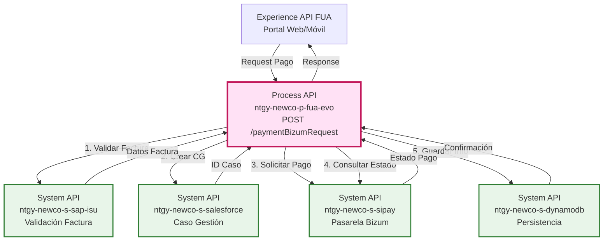
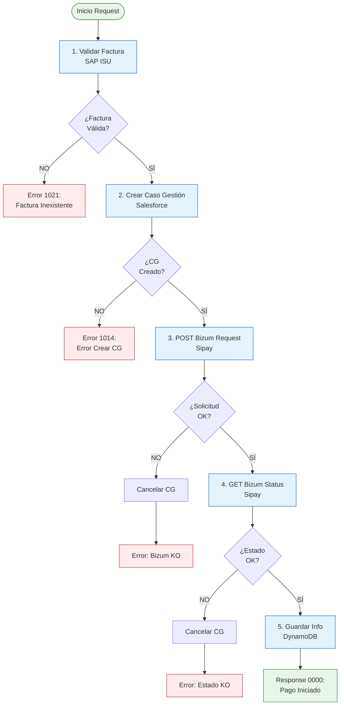
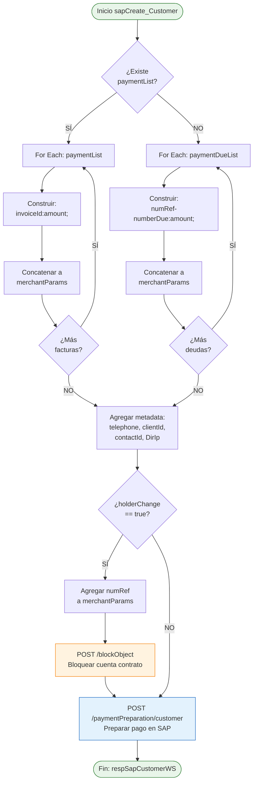
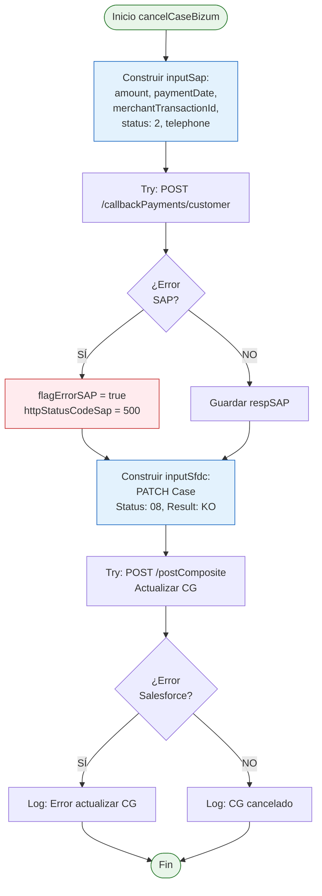
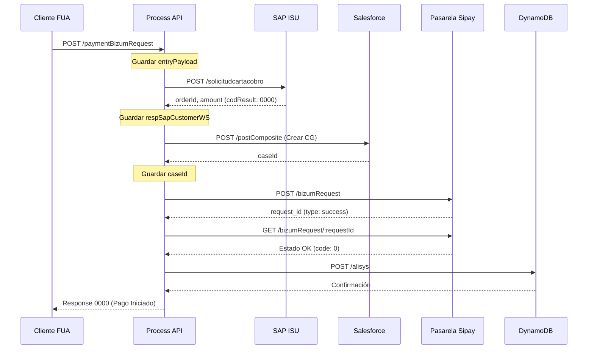
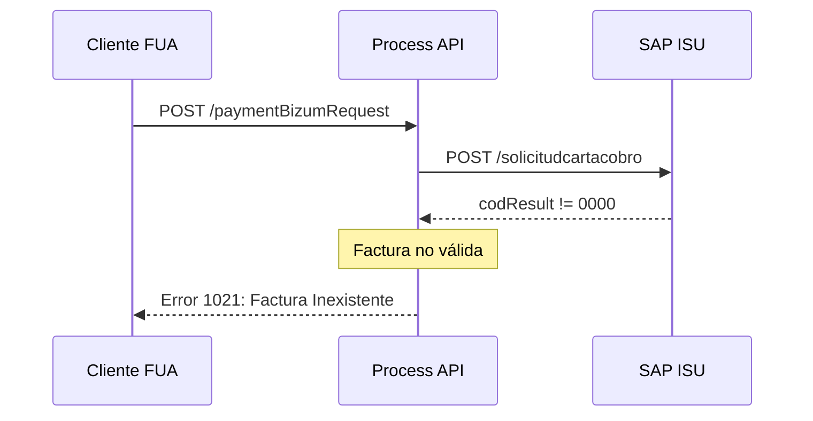
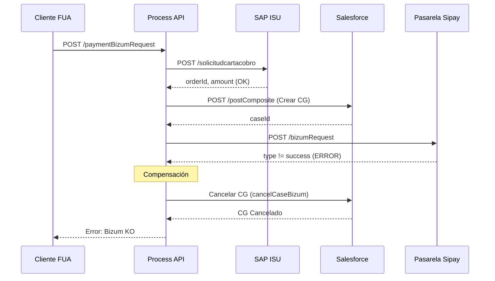

# POST /paymentBizumRequest

## 📌 Descripción General

### Propósito del Endpoint

Orquesta el proceso completo de solicitud de cobro vía Bizum desde la vista del cliente en el portal FUA. Este endpoint coordina la validación de la factura en SAP ISU, la creación de un Caso de Gestión en Salesforce para tracking, la solicitud de pago a través de la pasarela Sipay, y la persistencia de la información en DynamoDB para análisis posterior.

### Tipo de API

**Capa:** Process API (API-Led Connectivity)

**Función:** Orquestación de proceso de pago Bizum con validación, tracking y persistencia

### Patrón de Integración

**Tipo:** Orquestación Compleja con Manejo de Errores y Compensación

**Descripción:** Flujo secuencial con validaciones en cada paso, creación de caso de gestión para tracking, integración con pasarela de pago externa, y mecanismo de compensación (cancelación de caso) en caso de error.

### Arquitectura API-Led Connectivity



---

## 💼 Propósito del Negocio

### Casos de Uso Principales

1. **Pago de Factura Pendiente vía Bizum**
   - Cliente visualiza factura pendiente en portal FUA
   - Selecciona pago con Bizum como método de pago
   - Sistema valida factura, crea tracking y procesa pago
   - **Beneficio:** Facilita pago inmediato sin salir del portal

2. **Tracking de Proceso de Pago**
   - Sistema crea Caso de Gestión en Salesforce al iniciar pago
   - Registra cada paso del proceso (validación, solicitud, estado)
   - Permite seguimiento completo del proceso de pago
   - **Beneficio:** Trazabilidad completa para auditoría y soporte

3. **Gestión de Errores con Compensación**
   - Si falla la pasarela de pago, cancela el Caso de Gestión
   - Registra motivo del error para análisis
   - Informa al cliente del error de forma clara
   - **Beneficio:** Evita casos huérfanos y mejora experiencia de usuario

### 🔗 Endpoints Dependientes

Este Process API consume los siguientes System APIs:

| System API | Endpoint | Propósito |
|------------|----------|-----------|
| `ntgy-newco-s-sap-isu` | `POST /paymentPreparation/customer` | Preparar pago en SAP ISU - validar factura y obtener datos (orderId, amount) |
| `ntgy-newco-s-sap-isu` | `POST /blockObject` | Bloquear temporalmente cuenta contrato en caso de cambio de titular |
| `ntgy-newco-s-sap-isu` | `POST /callbackPayments/customer` | Notificar a SAP el resultado del pago (usado en compensación si falla) |
| `ntgy-newco-s-salesforce` | `POST /postComposite` | Crear y actualizar Caso de Gestión para tracking del proceso de pago |
| `ntgy-newco-s-sipay` | `POST /bizum/paymentRequest` | Iniciar solicitud de pago Bizum en pasarela Sipay |
| `ntgy-newco-s-sipay` | `GET /paymentBizumRequest/:requestId` | Consultar estado de solicitud Bizum en pasarela Sipay |
| `ntgy-newco-s-dynamodb` | `POST /alisys` | Persistir información del pago exitoso para análisis posterior |

### Lógica de Orquestación



**Pasos del Proceso:**

1. **Validación en SAP ISU**: Verifica existencia de factura y obtiene datos (orderId, amount)
2. **Creación de Caso de Gestión**: Registra inicio del proceso en Salesforce con datos del pago
3. **Solicitud a Pasarela Bizum**: Inicia solicitud de cobro en Sipay con datos del cliente
4. **Consulta de Estado**: Verifica que la solicitud fue procesada correctamente
5. **Persistencia en DynamoDB**: Guarda información del pago para análisis (solo si éxito)
6. **Compensación**: Si falla paso 3 o 4, cancela el Caso de Gestión creado

### Transformaciones Aplicadas

#### Transformación 1: Request SAP → Validación Factura

| Campo Entrada (FUA) | Campo SAP | Transformación |
|---------------------|-----------|----------------|
| `x-client-id` | `accountId` | Directo |
| `x-contact-id` | `contactId` | Directo |
| `phoneChannel` | `telephone` | Directo |
| `docNumber` | `documentNumber` | Directo |

#### Transformación 2: Datos SAP → Caso de Gestión Salesforce

| Campo SAP | Campo Salesforce | Transformación |
|-----------|------------------|----------------|
| `orderId` | `NewCo_PaymentDocument__c` | Directo |
| `amount` | `NewCo_OperationAmount__c` | Directo |
| - | `NewCo_PaymentMode__c` | Constante: "Bizum" |
| - | `NewCo_OperationDate__c` | `now()` en formato ISO |
| - | `Status` | Constante: "02" |
| - | `Origin` | Constante: "FUA" |

#### Transformación 3: Datos → Solicitud Bizum Sipay

| Campo Origen | Campo Sipay | Transformación |
|--------------|-------------|----------------|
| `orderId` | `order` | Substring (elimina primer carácter) |
| `phoneChannel` | `phoneChannel` | Directo |
| `amount` | `amount` | Desde respuesta SAP |

#### Transformación 4: Datos → DynamoDB

| Campo Origen | Campo DynamoDB | Transformación |
|--------------|----------------|----------------|
| `orderId` | `leaseKey` | Directo |
| `amount` | `amount` | Desde respuesta SAP |
| `caseId` | `idSfdc` | Desde respuesta Salesforce |
| `phoneChannel` | `telephone` | Directo |
| `x-client-code` | `clientCode` | Default: `docNumber` si no existe |
| - | `paymentMethod` | Constante: "Bizum" |

### Contexto Empresarial

- **Dominio:** Gestión de Pagos y Cobros
- **Sector:** Energía - Utilities
- **División:** Naturgy España - NewCo
- **Proceso de Negocio:** Cobro de facturas vía Bizum desde portal de autoservicio

### Stakeholders

- **Clientes Naturgy**: Necesitan pagar facturas de forma rápida y segura desde el portal
- **Equipo de Cobros**: Requiere tracking de solicitudes de pago y reducción de morosidad
- **Equipo de Soporte**: Necesita trazabilidad completa para resolver incidencias
- **Equipo de Análisis**: Requiere datos de pagos para análisis de comportamiento

### Valor de Negocio

- **Reducción de Morosidad**: Facilita el pago inmediato de facturas pendientes
- **Mejora de Experiencia**: Pago sin salir del portal, proceso guiado
- **Trazabilidad Completa**: Cada pago tiene un Caso de Gestión asociado
- **Análisis de Datos**: Información persistida en DynamoDB para análisis
- **Reducción de Costes**: Menos llamadas a call center para gestionar pagos

### Consumidores Potenciales

Este endpoint puede ser consumido por:
- Portal web FUA (Frontal Único de Atención)
- Aplicación móvil Naturgy
- Sistemas de agentes de call center (con adaptación)
- Integraciones de terceros autorizados

---

## 🔧 Especificación Técnica

### URLs por Ambiente

| Ambiente | URL Base | URL Completa |
|----------|----------|--------------|
| **Local** | `http://localhost:8081` | `http://localhost:8081/api/paymentBizumRequest` |
| **Development** | `https://ntgy-newco-p-fua-evo-dev.us-e2.cloudhub.io` | `https://ntgy-newco-p-fua-evo-dev.us-e2.cloudhub.io/api/paymentBizumRequest` |
| **UAT** | `https://ntgy-newco-p-fua-evo-uat.us-e2.cloudhub.io` | `https://ntgy-newco-p-fua-evo-uat.us-e2.cloudhub.io/api/paymentBizumRequest` |
| **Production** | `https://ntgy-newco-p-fua-evo-pro.us-e2.cloudhub.io` | `https://ntgy-newco-p-fua-evo-pro.us-e2.cloudhub.io/api/paymentBizumRequest` |

### Método HTTP

```
POST /api/paymentBizumRequest
```

### Headers Requeridos

| Header | Tipo | Obligatorio | Descripción |
|--------|------|-------------|-------------|
| `Content-Type` | string | ✅ | Debe ser `application/json` |
| `x-client-id` | string | ✅ | ID del cliente (AccountId en Salesforce) |
| `x-contact-id` | string | ✅ | ID del contacto (ContactId en Salesforce) |
| `x-user-id` | string | ❌ | ID del usuario (si está autenticado) |
| `x-client-code` | string | ❌ | Código del cliente (alternativo a docNumber) |
| `DirIp` | string | ❌ | Dirección IP del cliente para auditoría |

### Parámetros de Entrada (Body)

```json
{
  "phoneChannel": "string",
  "docNumber": "string",
  "outContractAccountId": "string"
}
```

#### Descripción de Campos

| Campo | Tipo | Obligatorio | Descripción | Ejemplo |
|-------|------|-------------|-------------|---------|
| `phoneChannel` | string | ✅ | Número de teléfono móvil asociado a Bizum | `"612345678"` |
| `docNumber` | string | ✅ | Número de documento del cliente (DNI/NIE) | `"12345678A"` |
| `outContractAccountId` | string | ❌ | ID de cuenta contrato (para cambios de titular) | `"1234567890"` |

### Respuestas

#### ✅ Respuesta Exitosa (200 OK)

```json
{
  "result": {
    "codResult": "0000",
    "msgResult": "No hay error"
  },
  "code": "0",
  "request_id": "abc123xyz789",
  "id_cobro": "F1234567890"
}
```

**Descripción de Campos:**

| Campo | Tipo | Descripción |
|-------|------|-------------|
| `result.codResult` | string | Código de resultado (`"0000"` = éxito) |
| `result.msgResult` | string | Mensaje descriptivo del resultado |
| `code` | string | Código de estado de Sipay (`"0"` = éxito) |
| `request_id` | string | ID de solicitud generado por Sipay |
| `id_cobro` | string | ID del documento de pago (orderId de SAP) |

#### ❌ Error 1021: Factura Inexistente

```json
{
  "result": {
    "codResult": "1021",
    "msgResult": "Numero de factura Inexistente"
  }
}
```

**Causa:** La factura no existe en SAP ISU o no está disponible para pago.

#### ❌ Error 1014: Error Creando Caso Gestión

```json
{
  "result": {
    "codResult": "1014",
    "msgResult": "Error creando Caso Gestion"
  }
}
```

**Causa:** Fallo al crear el Caso de Gestión en Salesforce.

#### ❌ Error 0001: Error en Proceso de Pago Bizum

```json
{
  "result": {
    "codResult": "0001",
    "msgResult": "Error en proceso de pago Bizum"
  },
  "status": "bizum_status_ko"
}
```

**Causa:** Error en la pasarela Sipay (POST o GET Bizum Request).

**Nota:** El código de error puede variar según el error específico de Sipay (`status_code` del payload).

### Códigos de Estado HTTP

| Código | Descripción | Escenario |
|--------|-------------|-----------|
| `200` | OK | Solicitud procesada correctamente (éxito o error de negocio) |
| `400` | Bad Request | Parámetros inválidos o faltantes |
| `401` | Unauthorized | Credenciales inválidas |
| `500` | Internal Server Error | Error técnico no controlado |
| `503` | Service Unavailable | Backend no disponible |

### Autenticación

- **Tipo:** Client ID & Client Secret (Anypoint Platform)
- **Headers:** `client_id` y `client_secret`

### Timeouts

| Tipo | Valor | Descripción |
|------|-------|-------------|
| **Request Timeout** | 30 segundos | Timeout general del endpoint |
| **SAP ISU Timeout** | Configurado en properties | Timeout para validación de factura |
| **Salesforce Timeout** | 60 segundos | Timeout para operaciones en Salesforce |
| **Sipay Timeout** | 30 segundos | Timeout para solicitudes a pasarela Bizum |
| **DynamoDB Timeout** | Configurado en properties | Timeout para persistencia |

---

## 🏗️ Implementación Técnica

### Arquitectura del Flow

```mermaid
flowchart TD
    Start([HTTP POST Request]) --> LogStart[Log: Inicio paymentBizumRequest]
    LogStart --> SaveEntry[Guardar entryPayload]
    SaveEntry --> CallSAP[Flow-Ref: sapCreate_Customer]
    CallSAP --> CheckSAP{¿SAP codResult<br/>== 0000?}
    
    CheckSAP -->|NO| ErrorSAP[Transform: Error 1021<br/>Factura Inexistente]
    ErrorSAP --> LogEnd1[Log: Final]
    LogEnd1 --> End1([Response Error 1021])
    
    CheckSAP -->|SÍ| SaveSAPVars[Guardar Variables:<br/>respSapCustomerWS<br/>amount, orderId]
    SaveSAPVars --> BuildCGInput[Transform: Input CG<br/>Composite Request]
    BuildCGInput --> TryCreateCG[Try: Crear CG Salesforce]
    TryCreateCG --> LogCGInput[Log: Input CG]
    LogCGInput --> PostCG[HTTP POST: Salesforce Composite]
    PostCG --> SaveCaseId[Guardar caseId]
    SaveCaseId --> CheckCGError{¿Error<br/>Crear CG?}
    
    CheckCGError -->|SÍ| ErrorCG[Transform: Error 1014<br/>Error Crear CG]
    ErrorCG --> LogEnd2[Log: Final]
    LogEnd2 --> End2([Response Error 1014])
    
    CheckCGError -->|NO| BuildBizumInput[Transform: Input Sipay<br/>postBizumRequest]
    BuildBizumInput --> TryPostBizum[Try: POST Bizum Request]
    TryPostBizum --> PostBizum[HTTP POST: Sipay Bizum]
    PostBizum --> LogPostBizum[Log: methodBizum]
    LogPostBizum --> CheckPostBizum{¿POST Bizum<br/>type == success?}
    
    CheckPostBizum -->|NO| BuildCancelData1[Transform: datosSap<br/>+ motive]
    BuildCancelData1 --> CancelCG1[Flow-Ref: cancelCaseBizum]
    CancelCG1 --> ErrorPostBizum[Transform: Error Bizum KO]
    ErrorPostBizum --> LogEnd3[Log: Final]
    LogEnd3 --> End3([Response Error Bizum])
    
    CheckPostBizum -->|SÍ| BuildGetInput[Transform: Input<br/>getBizumRequest]
    BuildGetInput --> TryGetBizum[Try: GET Bizum Status]
    TryGetBizum --> GetBizum[HTTP GET: Sipay Status]
    GetBizum --> LogGetBizum[Log: getR2PBizum]
    LogGetBizum --> CheckGetBizum{¿GET Bizum<br/>code == 0?}
    
    CheckGetBizum -->|NO| BuildCancelData2[Transform: datosSap<br/>+ motive]
    BuildCancelData2 --> CancelCG2[Flow-Ref: cancelCaseBizum]
    CancelCG2 --> ErrorGetBizum[Transform: Error Bizum KO]
    ErrorGetBizum --> LogEnd4[Log: Final]
    LogEnd4 --> End4([Response Error Bizum])
    
    CheckGetBizum -->|SÍ| BuildDynamoInput[Transform: Input DynamoDB]
    BuildDynamoInput --> PostDynamo[HTTP POST: DynamoDB]
    PostDynamo --> LogDynamo[Log: Guardamos info Dynamo]
    LogDynamo --> BuildSuccess[Transform: Response OK<br/>0000]
    BuildSuccess --> LogEnd5[Log: Final]
    LogEnd5 --> End5([Response 200 OK])
    
    style Start fill:#e8f5e9,stroke:#2e7d32
    style End1 fill:#ffebee,stroke:#c62828
    style End2 fill:#ffebee,stroke:#c62828
    style End3 fill:#ffebee,stroke:#c62828
    style End4 fill:#ffebee,stroke:#c62828
    style End5 fill:#e8f5e9,stroke:#2e7d32
    style CallSAP fill:#e3f2fd,stroke:#1565c0
    style PostCG fill:#e3f2fd,stroke:#1565c0
    style PostBizum fill:#e3f2fd,stroke:#1565c0
    style GetBizum fill:#e3f2fd,stroke:#1565c0
    style PostDynamo fill:#e3f2fd,stroke:#1565c0
```



### Transformaciones DataWeave Clave

#### 1. Construcción de Input para Caso de Gestión (Salesforce)

```dataweave
%dw 2.0
output application/json

fun concatena(valor) =
    (write(valor, "application/json", {"indent": false}) as String ++ '\r'
        replace "{" with ""
        replace "}" with ""
        replace "," with "\r\n")
        replace "\"" with ""

var ok = "Inicio de pago con Bizum. Documento de pago " ++ 
         vars.respSapCustomerWS.orderId ++ " – Importe " ++ 
         vars.respSapCustomerWS.amount
var operationResult = "OK"
var comment = {
    "amount": vars.respSapCustomerWS.amount,
    "currency": "EUR",
    "order": vars.orderId
}
---
{
    "allOrNone": true,
    "collateSubrequests": false,
    "compositeRequest": [
        {
            "method": "POST",
            "url": "/services/data/v52.0/sobjects/Case",
            "referenceId": "refCaseGestion",
            "body": { 
                "NewCo_Recordtype__c": "Gestion",
                "AccountId": vars.entryPayload.'x-client-id',
                "ContactId": vars.entryPayload.'x-contact-id',
                "Status": "02",
                "Priority": "02",
                "Origin": "FUA",
                "NewCo_Creado_por__c": 
                    if (vars.entryPayload.'x-user-id' != null) 
                        vars.entryPayload.'x-user-id' 
                    else 
                        vars.entryPayload.'x-contact-id',
                "NewCo_Ip__c": vars.entryPayload.'DirIp',
                "NewCo_CorrelationId__c": correlationId,
                "NewCo_PaymentBreakdown__c": vars.merchantParams,
                "NewCo_OperationAmount__c": vars.respSapCustomerWS.amount,
                "NewCo_OperationDate__c": now() as String {format: "uuuu-MM-dd'T'HH:mm:ss'Z'"},
                "NewCo_OperationResult__c": operationResult,
                "NewCo_ResultDescription__c": ok,
                "NewCo_PaymentMode__c": "Bizum",
                "NewCo_PaymentDocument__c": vars.respSapCustomerWS.orderId,
                "acn_fld_Tittle__r": {
                    "NewCo_ExternalId__c": "PagoDeuda"
                },
                "comments": 
                    if (vars.entryPayload.outContractAccountId != null and 
                        vars.entryPayload.outContractAccountId != "") 
                        "Caso Gestión relacionado con el proceso de cambio de titular de la cuenta contrato con código: " ++ 
                        vars.entryPayload.outContractAccountId
                    else
                        "[CREACIÓN CG - Info previa hacia pasarela pago]\r\n" ++
                        "fecha: " ++ ((now() >> "Europe/Madrid") as String {format: "yyyy-MM-dd HH:mm:ss"}) ++ "\r\n" ++
                        concatena(comment)
            }
        }
    ]
}
```

**Propósito:** Construye el request composite para crear un Caso de Gestión en Salesforce con toda la información del pago.

#### 2. Construcción de Input para Solicitud Bizum (Sipay)

```dataweave
%dw 2.0
output application/json
var contador = sizeOf(vars.orderId) - 1
---
{
    "order": vars.orderId[1 to contador],
    "phoneChannel": vars.entryPayload.phoneChannel,
    "amount": vars.respSapCustomerWS.amount
}
```

**Propósito:** Prepara los datos para la solicitud de pago Bizum, eliminando el primer carácter del orderId.

#### 3. Construcción de Input para DynamoDB

```dataweave
%dw 2.0
output application/json
---
{
    leaseKey: vars.orderId,
    amount: vars.respSapCustomerWS.amount,
    idSfdc: vars.caseId,
    telephone: vars.entryPayload.phoneChannel,
    clientCode: vars.entryPayload.'x-client-code' default vars.entryPayload.docNumber,
    paymentMethod: "Bizum"
}
```

**Propósito:** Estructura los datos del pago exitoso para persistencia en DynamoDB.

#### 4. Construcción de Respuesta Exitosa

```dataweave
%dw 2.0
output application/json
---
{
    "result": {
        "codResult": "0000",
        "msgResult": "No hay error"
    },
    "code": "0",
    "request_id": vars.responseSipay.request_id,
    "id_cobro": vars.orderId
}
```

**Propósito:** Construye la respuesta exitosa con los IDs de tracking.

### Subflows Principales

#### 1. Subflow: sapCreate_Customer

**Propósito:** Preparar el pago en SAP ISU, construir merchantParams y opcionalmente bloquear cuenta contrato.

**Flujo:**



**Variables Generadas:**
- `merchantParams`: String con formato `"telephone:XXX;clientId:YYY;contactId:ZZZ;DirIp:AAA;invoiceId:amount;..."`
- `respSapCustomerWS`: Respuesta de SAP con `orderId` y `amount`

**Lógica de merchantParams:**

1. **Si existe `paymentList`** (pago de facturas específicas):
   ```
   invoiceId1:amount1;invoiceId2:amount2;...
   ```

2. **Si existe `paymentDueList`** (pago de deudas):
   ```
   numRef1-numberDue1:amount1;numRef2-numberDue2:amount2;...
   ```

3. **Metadata adicional** (siempre):
   ```
   telephone:612345678;clientId:001XXX;contactId:003YYY;DirIp:192.168.1.1;
   ```

4. **Si holderChange = true** (cambio de titular):
   ```
   numRef:outContractAccountId;
   ```

**Ejemplo de merchantParams completo:**
```
telephone:612345678;clientId:0011234567890ABC;contactId:0031234567890DEF;DirIp:192.168.1.100;F1234567890:150.50;F0987654321:75.25;
```

#### 2. Subflow: cancelCaseBizum

**Propósito:** Compensación - cancelar Caso de Gestión y notificar a SAP cuando falla la pasarela de pago.

**Flujo:**



**Variables de Entrada:**
- `datosSap`: `{ amount, telephone, merchantTransactionId }`
- `motive`: Motivo de cancelación con código y descripción del error
- `caseId`: ID del Caso de Gestión a cancelar

**Acciones Realizadas:**

1. **Notificar a SAP** (status = "2" = Pago fallido):
   ```json
   {
     "amount": 150.50,
     "paymentDate": "20240924",
     "merchantTransactionId": "F1234567890",
     "status": "2",
     "statusDescription": "Unexpected Gateway Response: 103 - Card in Blacklist or suspected of fraud",
     "telephone": "612345678",
     "operationType": "ACB",
     "source": "W"
   }
   ```

2. **Actualizar Caso de Gestión en Salesforce**:
   - Cambiar `Status` a "08" (Cancelado)
   - Establecer `NewCo_OperationResult__c` a "KO"
   - Registrar `NewCo_ResultDescription__c` con el motivo
   - Agregar comentario con detalles del error

**Propósito de la Compensación:**
- Mantener consistencia entre sistemas
- Evitar casos huérfanos en Salesforce
- Registrar en SAP que el pago no se completó
- Mantener trazabilidad completa del error

### Patrones de Diseño

#### 1. Patrón Saga con Compensación

**Justificación:** El proceso de pago involucra múltiples sistemas. Si falla la pasarela de pago después de crear el Caso de Gestión, se ejecuta una compensación (cancelación del caso) para mantener consistencia.

**Implementación:**
- Paso 2: Crear Caso de Gestión (transacción)
- Paso 3-4: Solicitar y verificar pago (transacción)
- Si falla 3 o 4: Ejecutar `cancelCaseBizum` (compensación)

#### 2. Patrón Try-Catch con Logging

**Justificación:** Cada llamada a sistema externo está envuelta en try-catch para capturar errores y continuar el flujo de forma controlada.

**Implementación:**
```xml
<try doc:name="Try Crear CG SF">
    <http:request ... />
    <error-handler>
        <on-error-continue>
            <logger level="INFO" message="Error Crear CG SF" />
            <set-variable variableName="errorCG" value="#[true]" />
        </on-error-continue>
    </error-handler>
</try>
```

#### 3. Patrón de Variables de Estado

**Justificación:** Se utilizan variables para mantener el estado del proceso y facilitar la toma de decisiones en pasos posteriores.

**Variables Clave:**
- `entryPayload`: Payload original del request
- `respSapCustomerWS`: Respuesta completa de SAP ISU
- `amount`: Importe del pago
- `orderId`: ID del documento de pago
- `caseId`: ID del Caso de Gestión creado
- `errorCG`: Flag de error en creación de CG

### Diagramas de Secuencia

#### 1. Flujo Normal de Éxito



#### 2. Flujo con Error en Validación SAP



#### 3. Flujo con Error en Pasarela y Compensación



### Manejo de Errores

#### Estrategia de Manejo de Errores

**Nivel 1: Validación de Negocio**
- Error 1021: Factura inexistente en SAP ISU
- Error 1014: Fallo al crear Caso de Gestión
- Respuesta: HTTP 200 con código de error en body

**Nivel 2: Errores de Pasarela**
- Error en POST Bizum Request (Sipay)
- Error en GET Bizum Status (Sipay)
- Acción: Cancelar Caso de Gestión (compensación)
- Respuesta: HTTP 200 con código de error en body

**Nivel 3: Errores Técnicos**
- Timeout en llamadas HTTP
- Errores de conectividad
- Respuesta: HTTP 500 o 503

#### Tabla de Códigos de Error

| Código | Mensaje | Causa | Acción Recomendada |
|--------|---------|-------|-------------------|
| `0000` | No hay error | Proceso exitoso | Ninguna |
| `1021` | Numero de factura Inexistente | Factura no existe en SAP | Verificar número de factura |
| `1014` | Error creando Caso Gestion | Fallo en Salesforce | Reintentar o contactar soporte |
| `0001` | Error en proceso de pago Bizum | Error en Sipay | Verificar datos Bizum o reintentar |
| Variable | Mensaje de Sipay | Error específico de pasarela | Ver detalles en `status_code` |

#### Mecanismo de Compensación

**Subflow: cancelCaseBizum**

Cuando falla la pasarela de pago (POST o GET Bizum), se ejecuta este subflow para:

1. Construir datos de cancelación:
   - `datosSap`: Información del pago (amount, telephone, merchantTransactionId)
   - `motive`: Motivo de la cancelación con código y descripción del error

2. Actualizar el Caso de Gestión en Salesforce:
   - Cambiar estado a "Cancelado"
   - Registrar motivo de cancelación
   - Mantener trazabilidad completa

**Propósito:** Evitar casos huérfanos y mantener consistencia de datos entre sistemas.

---

## 💻 Ejemplos de Uso

### Ejemplo 1: Solicitud Exitosa de Pago Bizum

#### Request

```bash
curl -X POST "https://ntgy-newco-p-fua-evo-uat.us-e2.cloudhub.io/api/paymentBizumRequest" \
  -H "Content-Type: application/json" \
  -H "client_id: YOUR_CLIENT_ID" \
  -H "client_secret: YOUR_CLIENT_SECRET" \
  -H "x-client-id: 0011234567890ABC" \
  -H "x-contact-id: 0031234567890DEF" \
  -H "x-user-id: user123" \
  -H "x-client-code: CLI001" \
  -H "DirIp: 192.168.1.100" \
  -d '{
    "phoneChannel": "612345678",
    "docNumber": "12345678A",
    "outContractAccountId": ""
  }'
```

#### Response (200 OK)

```json
{
  "result": {
    "codResult": "0000",
    "msgResult": "No hay error"
  },
  "code": "0",
  "request_id": "abc123xyz789def456",
  "id_cobro": "F1234567890"
}
```

**Interpretación:**
- ✅ Factura validada en SAP ISU
- ✅ Caso de Gestión creado en Salesforce
- ✅ Solicitud Bizum iniciada en Sipay
- ✅ Estado verificado correctamente
- ✅ Información persistida en DynamoDB
- 📱 Cliente recibirá notificación Bizum en su móvil

### Ejemplo 2: Error - Factura Inexistente

#### Request

```bash
curl -X POST "https://ntgy-newco-p-fua-evo-uat.us-e2.cloudhub.io/api/paymentBizumRequest" \
  -H "Content-Type: application/json" \
  -H "client_id: YOUR_CLIENT_ID" \
  -H "client_secret: YOUR_CLIENT_SECRET" \
  -H "x-client-id: 0011234567890ABC" \
  -H "x-contact-id: 0031234567890DEF" \
  -H "DirIp: 192.168.1.100" \
  -d '{
    "phoneChannel": "612345678",
    "docNumber": "12345678A"
  }'
```

#### Response (200 OK)

```json
{
  "result": {
    "codResult": "1021",
    "msgResult": "Numero de factura Inexistente"
  }
}
```

**Interpretación:**
- ❌ La factura no existe en SAP ISU o no está disponible para pago
- 🔍 Verificar que el cliente tenga facturas pendientes
- 💡 Puede ser que la factura ya esté pagada

### Ejemplo 3: Error en Pasarela Bizum

#### Request

```bash
curl -X POST "https://ntgy-newco-p-fua-evo-uat.us-e2.cloudhub.io/api/paymentBizumRequest" \
  -H "Content-Type: application/json" \
  -H "client_id: YOUR_CLIENT_ID" \
  -H "client_secret: YOUR_CLIENT_SECRET" \
  -H "x-client-id: 0011234567890ABC" \
  -H "x-contact-id: 0031234567890DEF" \
  -H "DirIp: 192.168.1.100" \
  -d '{
    "phoneChannel": "612999999",
    "docNumber": "12345678A"
  }'
```

#### Response (200 OK)

```json
{
  "result": {
    "codResult": "0001",
    "msgResult": "Error en proceso de pago Bizum"
  },
  "status": "bizum_status_ko"
}
```

**Interpretación:**
- ✅ Factura validada en SAP ISU
- ✅ Caso de Gestión creado en Salesforce
- ❌ Error en pasarela Sipay (teléfono no válido para Bizum)
- 🔄 Caso de Gestión cancelado automáticamente
- 💡 Verificar que el teléfono esté dado de alta en Bizum

### Ejemplo 4: JavaScript (Fetch API)

```javascript
const paymentData = {
  phoneChannel: "612345678",
  docNumber: "12345678A",
  outContractAccountId: ""
};

const headers = {
  'Content-Type': 'application/json',
  'client_id': 'YOUR_CLIENT_ID',
  'client_secret': 'YOUR_CLIENT_SECRET',
  'x-client-id': '0011234567890ABC',
  'x-contact-id': '0031234567890DEF',
  'x-user-id': 'user123',
  'DirIp': '192.168.1.100'
};

fetch('https://ntgy-newco-p-fua-evo-uat.us-e2.cloudhub.io/api/paymentBizumRequest', {
  method: 'POST',
  headers: headers,
  body: JSON.stringify(paymentData)
})
.then(response => response.json())
.then(data => {
  if (data.result.codResult === '0000') {
    console.log('✅ Pago Bizum iniciado correctamente');
    console.log('Request ID:', data.request_id);
    console.log('ID Cobro:', data.id_cobro);
    // Mostrar mensaje al usuario: "Revisa tu móvil para confirmar el pago"
  } else {
    console.error('❌ Error:', data.result.msgResult);
    // Mostrar mensaje de error al usuario
  }
})
.catch(error => {
  console.error('Error técnico:', error);
});
```

### Ejemplo 5: Python (Requests)

```python
import requests
import json

url = "https://ntgy-newco-p-fua-evo-uat.us-e2.cloudhub.io/api/paymentBizumRequest"

headers = {
    "Content-Type": "application/json",
    "client_id": "YOUR_CLIENT_ID",
    "client_secret": "YOUR_CLIENT_SECRET",
    "x-client-id": "0011234567890ABC",
    "x-contact-id": "0031234567890DEF",
    "x-user-id": "user123",
    "DirIp": "192.168.1.100"
}

payload = {
    "phoneChannel": "612345678",
    "docNumber": "12345678A",
    "outContractAccountId": ""
}

response = requests.post(url, headers=headers, json=payload)
data = response.json()

if data['result']['codResult'] == '0000':
    print(f"✅ Pago Bizum iniciado correctamente")
    print(f"Request ID: {data['request_id']}")
    print(f"ID Cobro: {data['id_cobro']}")
else:
    print(f"❌ Error: {data['result']['msgResult']}")
```

### Ejemplo 6: Postman Collection

```json
{
  "info": {
    "name": "Payment Bizum Request",
    "schema": "https://schema.getpostman.com/json/collection/v2.1.0/collection.json"
  },
  "item": [
    {
      "name": "POST Payment Bizum Request",
      "request": {
        "method": "POST",
        "header": [
          {
            "key": "Content-Type",
            "value": "application/json"
          },
          {
            "key": "client_id",
            "value": "{{client_id}}"
          },
          {
            "key": "client_secret",
            "value": "{{client_secret}}"
          },
          {
            "key": "x-client-id",
            "value": "{{x_client_id}}"
          },
          {
            "key": "x-contact-id",
            "value": "{{x_contact_id}}"
          },
          {
            "key": "x-user-id",
            "value": "{{x_user_id}}"
          },
          {
            "key": "DirIp",
            "value": "{{client_ip}}"
          }
        ],
        "body": {
          "mode": "raw",
          "raw": "{\n  \"phoneChannel\": \"612345678\",\n  \"docNumber\": \"12345678A\",\n  \"outContractAccountId\": \"\"\n}"
        },
        "url": {
          "raw": "{{base_url}}/api/paymentBizumRequest",
          "host": ["{{base_url}}"],
          "path": ["api", "paymentBizumRequest"]
        }
      }
    }
  ]
}
```

### Notas de Implementación

#### Para Desarrolladores Frontend

1. **Validación Previa:**
   - Verificar que el teléfono tenga formato válido (9 dígitos)
   - Confirmar que el cliente tiene facturas pendientes
   - Mostrar importe antes de iniciar el pago

2. **Manejo de Respuesta:**
   - Si `codResult === "0000"`: Mostrar mensaje "Revisa tu móvil para confirmar el pago"
   - Si `codResult === "1021"`: Mostrar "No hay facturas pendientes de pago"
   - Si `codResult === "1014"`: Mostrar "Error técnico, intenta más tarde"
   - Si `codResult === "0001"`: Mostrar "Error en Bizum, verifica tus datos"

3. **Timeout:**
   - Configurar timeout de 35 segundos (el endpoint puede tardar hasta 30s)
   - Mostrar indicador de carga durante el proceso

#### Para Desarrolladores Backend

1. **Headers Obligatorios:**
   - `x-client-id` y `x-contact-id` son críticos para crear el CG
   - `DirIp` es importante para auditoría
   - `x-user-id` es opcional pero recomendado

2. **Idempotencia:**
   - El endpoint NO es idempotente
   - Cada llamada crea un nuevo Caso de Gestión
   - Implementar control de duplicados en el cliente

3. **Monitoreo:**
   - Monitorear tasa de errores 1021 (facturas inexistentes)
   - Alertar si tasa de errores Bizum > 5%
   - Trackear tiempo de respuesta (objetivo < 30s)
