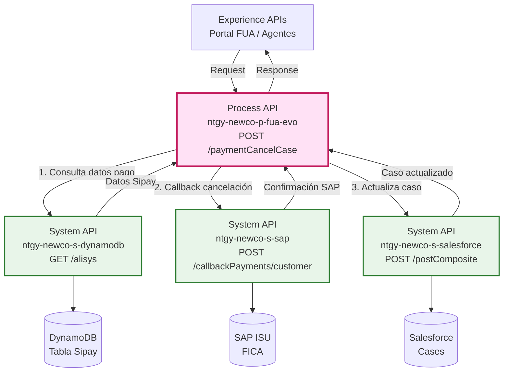
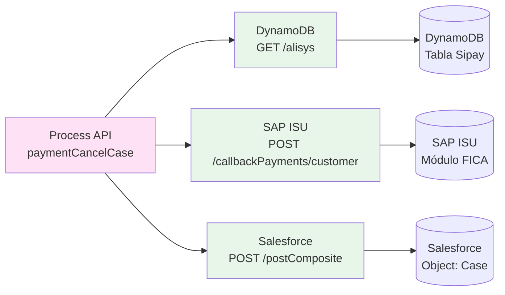
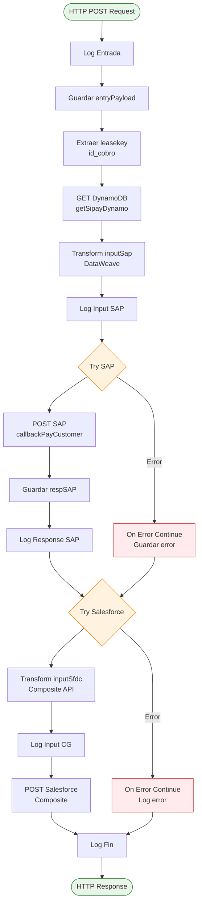
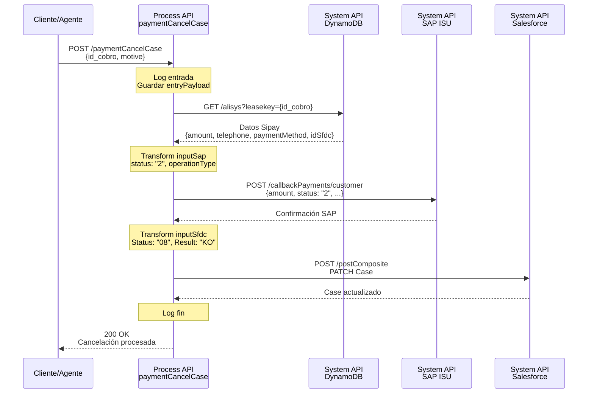
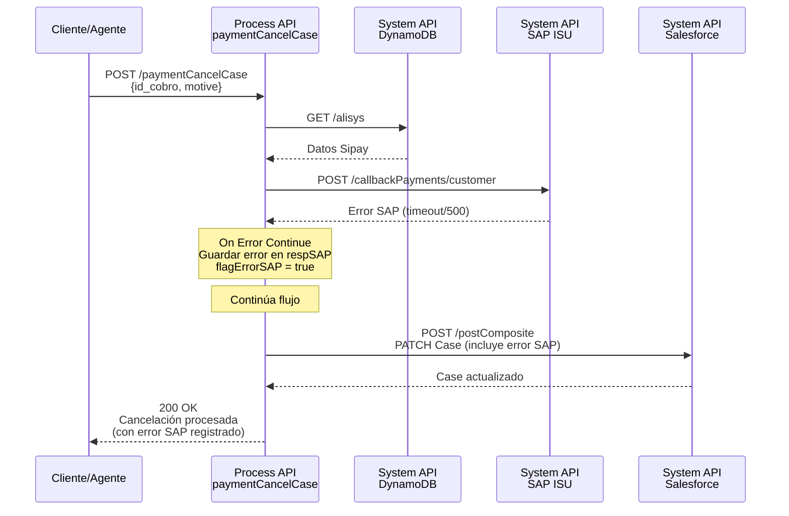
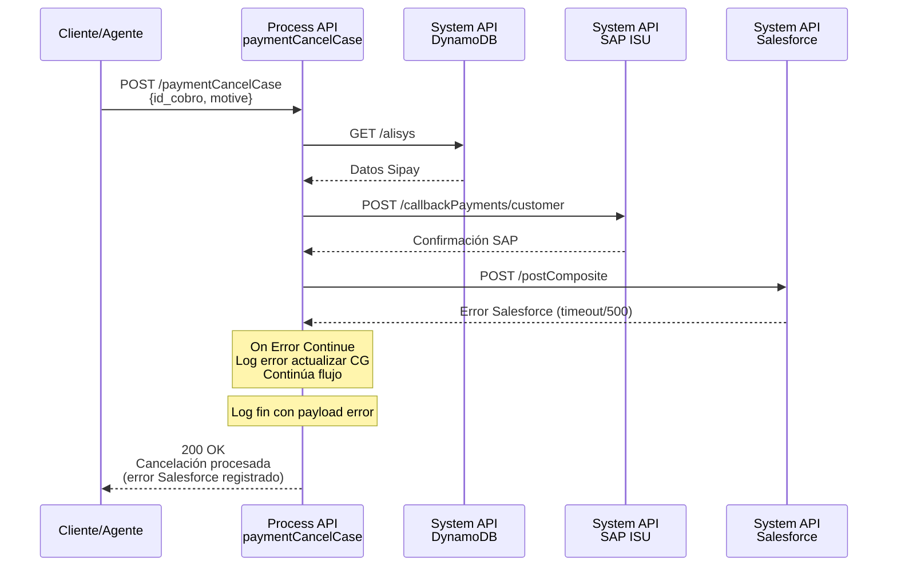

# POST /paymentCancelCase

## 📌 Descripción General

### Propósito del Endpoint

Este endpoint orquesta el proceso completo de cancelación de un caso de gestión asociado a un pago por tarjeta o Bizum. Coordina la actualización del estado del pago en SAP ISU y la actualización del caso correspondiente en Salesforce, garantizando la trazabilidad completa del proceso de cancelación.

### Tipo de API

**Capa:** Process API (API-Led Connectivity)

**Función:** Orquestación de cancelación de casos de gestión en pagos

### Patrón de Integración

**Tipo:** Orquestación con Transformación

**Descripción:** El endpoint orquesta tres operaciones secuenciales:
1. Consulta de datos del pago en DynamoDB (vía System API)
2. Envío de callback de cancelación a SAP ISU (vía System API)
3. Actualización del caso en Salesforce con estado "08" (vía System API)

### Arquitectura API-Led Connectivity



---

## 💼 Propósito del Negocio

### Casos de Uso Principales

1. **Cancelación de Pago por Tarjeta con Caso de Gestión**
   - Cliente o agente cancela un pago por tarjeta que tiene un caso de gestión asociado
   - Se actualiza el estado en SAP ISU y se cierra el caso en Salesforce
   - Beneficio: Trazabilidad completa del proceso de cancelación

2. **Cancelación de Pago Bizum con Caso de Gestión**
   - Cliente o agente cancela un pago Bizum que tiene un caso de gestión asociado
   - Se registra la cancelación en SAP ISU con operationType "ACB"
   - Beneficio: Gestión unificada de cancelaciones independiente del método de pago

3. **Actualización de Estado de Caso tras Cancelación**
   - El caso en Salesforce se actualiza automáticamente con estado "08" (cancelado)
   - Se registran comentarios detallados con información de la cancelación
   - Beneficio: Visibilidad completa para agentes de atención al cliente

### 🔗 Endpoints Dependientes

Este Process API consume los siguientes System APIs:

| System API | Endpoint | Método | Propósito |
|------------|----------|--------|-----------|
| `ntgy-newco-s-dynamodb` | `/alisys` | GET | Consulta datos del pago Sipay (amount, telephone, paymentMethod, idSfdc) |
| `ntgy-newco-s-sap` | `/callbackPayments/customer` | POST | Envía callback de cancelación a SAP ISU con status "2" |
| `ntgy-newco-s-salesforce` | `/postComposite` | POST | Actualiza caso en Salesforce con Status "08" y resultado "KO" |

### Lógica de Orquestación



**Pasos del Proceso:**

1. **Consulta DynamoDB**: Obtiene datos del pago Sipay (amount, telephone, paymentMethod, idSfdc) usando id_cobro como clave
2. **Construye Payload SAP**: Transforma datos para callback de cancelación con status "2" y operationType según método de pago
3. **Envía Callback SAP**: Notifica cancelación a SAP ISU (con manejo de errores y continuación)
4. **Actualiza Salesforce**: Actualiza caso con Status "08", resultado "KO" y comentarios detallados (con manejo de errores y continuación)

### Transformaciones Aplicadas

| Campo Original (DynamoDB) | Campo Transformado (SAP) | Transformación |
|---------------------------|--------------------------|----------------|
| `amount` | `amount` | Conversión a Number |
| `leasekey` | `merchantTransactionId` | Directo (id_cobro) |
| `telephone` | `telephone` | Trim y validación de null |
| `paymentMethod` | `operationType` | "Bizum" → "ACB", otros → "ACT" |
| - | `status` | Fijo: "2" (cancelación) |
| - | `statusDescription` | Fijo: "Unexpected Gateway Response: 103 - Card in Blacklist or suspected of fraud" |
| - | `paymentDate` | Fecha actual en formato yyyyMMdd |
| - | `source` | Fijo: "W" (web) |

| Campo Original (Request) | Campo Transformado (Salesforce) | Transformación |
|--------------------------|--------------------------------|----------------|
| `motive` | `NewCo_ResultDescription__c` | Directo (motivo de cancelación) |
| `amount` | `NewCo_OperationAmount__c` | Desde DynamoDB |
| - | `Status` | Fijo: "08" (cancelado) |
| - | `NewCo_OperationDate__c` | Fecha actual ISO 8601 |
| - | `NewCo_OperationResult__c` | Fijo: "KO" |
| - | `comments` | Concatenación de datos de cancelación, respuesta pasarela y respuesta SAP |

### Contexto Empresarial

- **Dominio:** Gestión de Pagos y Casos
- **Sector:** Energía - Utilities
- **División:** Naturgy España - NewCo
- **Proceso de Negocio:** Cancelación de casos de gestión en pagos por tarjeta y Bizum

### Stakeholders

- **Clientes Naturgy**: Necesitan cancelar pagos y tener visibilidad del estado
- **Agentes de Atención al Cliente**: Gestionan cancelaciones y consultan estado de casos
- **Equipo de Facturación**: Requieren trazabilidad de pagos cancelados en SAP ISU
- **Equipo de CRM**: Mantienen actualizado el estado de casos en Salesforce

### Valor de Negocio

- **Trazabilidad Completa**: Registro de cancelaciones en todos los sistemas (DynamoDB, SAP, Salesforce)
- **Gestión Unificada**: Proceso único para tarjeta y Bizum
- **Resiliencia**: Manejo de errores con continuación del flujo
- **Auditoría**: Comentarios detallados en Salesforce con información completa de la cancelación

### Consumidores Potenciales

Este endpoint puede ser consumido por:
- Portal web de autoservicio FUA
- Aplicaciones móviles de clientes
- Sistemas de agentes de call center
- Procesos batch de cancelación masiva

---

## 🔧 Especificación Técnica

### URLs por Ambiente

| Ambiente | URL Base | URL Completa |
|----------|----------|--------------|
| **Local** | `http://localhost:8081` | `http://localhost:8081/api/paymentCancelCase` |
| **Development** | `https://ntgy-newco-p-fua-evo-dev.us-e2.cloudhub.io` | `https://ntgy-newco-p-fua-evo-dev.us-e2.cloudhub.io/api/paymentCancelCase` |
| **UAT** | `https://ntgy-newco-p-fua-evo-uat.us-e2.cloudhub.io` | `https://ntgy-newco-p-fua-evo-uat.us-e2.cloudhub.io/api/paymentCancelCase` |
| **Production** | `https://ntgy-newco-p-fua-evo-pro.us-e2.cloudhub.io` | `https://ntgy-newco-p-fua-evo-pro.us-e2.cloudhub.io/api/paymentCancelCase` |

### Método HTTP

```
POST /api/paymentCancelCase
```

### Parámetros de Entrada

#### Request Body (application/json)

```json
{
  "id_cobro": "string",
  "motive": "string"
}
```

| Campo | Tipo | Requerido | Descripción |
|-------|------|-----------|-------------|
| `id_cobro` | string | Sí | Identificador único del cobro (leasekey) usado como clave en DynamoDB |
| `motive` | string | Sí | Motivo de la cancelación del caso |

**Ejemplo de Request:**

```json
{
  "id_cobro": "12345678",
  "motive": "Cliente solicita cancelación por error en el importe"
}
```

### Respuestas

#### 200 OK - Cancelación Procesada

```json
{
  "status": "success",
  "message": "Caso cancelado correctamente"
}
```

**Nota:** El endpoint procesa la cancelación incluso si hay errores en SAP o Salesforce (patrón de continuación).

#### 400 Bad Request - Datos Inválidos

```json
{
  "code": "BAD_REQUEST",
  "message": "Parámetros de entrada inválidos",
  "details": "El campo id_cobro es requerido"
}
```

#### 404 Not Found - Pago No Encontrado

```json
{
  "code": "NOT_FOUND",
  "message": "Pago no encontrado en DynamoDB",
  "details": "No existe registro con id_cobro: 12345678"
}
```

#### 500 Internal Server Error - Error del Sistema

```json
{
  "code": "INTERNAL_ERROR",
  "message": "Error al procesar la cancelación",
  "details": "Error en la comunicación con sistemas backend"
}
```

### Autenticación

- **Tipo:** Client ID & Client Secret (Anypoint Platform)
- **Headers Requeridos:**
  - `client_id`: ID del cliente de la aplicación
  - `client_secret`: Secret del cliente de la aplicación

### Timeouts

| Tipo | Valor |
|------|-------|
| **Request Timeout** | 60 segundos |
| **Connection Timeout** | 30 segundos |
| **DynamoDB Query** | 10 segundos |
| **SAP Callback** | 30 segundos |
| **Salesforce Update** | 30 segundos |

---

## 🏗️ Implementación Técnica

### Arquitectura del Flow



### Transformaciones DataWeave

#### 1. Transformación Input SAP (inputSap)

**Ubicación:** Inline en `ntgy-newco-p-fua.xml` (líneas 1089-1103)

```dataweave
%dw 2.0
output application/json
---
{
    amount: vars.getSipay.amount as Number,
    paymentDate: ((now() >> "Europe/Madrid") as String {format: "yyyyMMdd"}),
    merchantTransactionId: vars.leasekey,
    status: "2",
    statusDescription: "Unexpected Gateway Response: 103 - Card in Blacklist or suspected of fraud",
    telephone: trim(if(isEmpty(vars.getSipay.telephone)) (null) else vars.getSipay.telephone),
    operationType: if (vars.getSipay.paymentMethod == "Bizum") "ACB" else "ACT",
    source: "W"
}
```

**Campos Generados:**
- `amount`: Monto del pago (convertido a Number)
- `paymentDate`: Fecha actual en formato yyyyMMdd (zona horaria Europe/Madrid)
- `merchantTransactionId`: ID del cobro (leasekey)
- `status`: "2" (indica cancelación)
- `statusDescription`: Mensaje estándar de cancelación
- `telephone`: Teléfono del cliente (con trim y validación de null)
- `operationType`: "ACB" para Bizum, "ACT" para tarjeta
- `source`: "W" (web)

#### 2. Transformación Input Salesforce (inputSfdc)

**Ubicación:** Inline en `ntgy-newco-p-fua.xml` (líneas 1118-1143)

```dataweave
%dw 2.0
output application/json
fun concatena (valor)=
(write(valor, "application/json", {"indent":false}) as String ++ '\r' replace  "{" with "" replace  "}" with "" replace "," with "\r\n") replace "\"" with "" 

---
{
    "allOrNone" : true,
    "collateSubrequests": false,
    "compositeRequest" : [
        {
            "method" : "PATCH",
            "url" : "/services/data/v52.0/sobjects/Case/" ++ vars.getSipay.idSfdc,
            "referenceId" : "updatedCase",
            "body" : { 
                "Status" : "08",
                "NewCo_OperationAmount__c": vars.getSipay.amount,
                "NewCo_OperationDate__c": now() as String {format: "uuuu-MM-dd'T'HH:mm:ss'Z'"},
                "NewCo_OperationResult__c": "KO",
                "NewCo_ResultDescription__c": vars.entryPayload.motive,
                "comments": "[Actualización final CG tras pago]\r\n" ++ 
                           "fecha: " ++ (now() >> "Europe/Madrid") as String {format: "yyyy-MM-dd HH:mm:ss"} ++ 
                           "\r\n[Respuesta Final Pasarela Pago]\r\n" ++ concatena(vars.entryPayload) ++ 
                           "\r\n[Respuesta Final SAP]\r\n" ++ concatena(vars.respSAP)
            }
        }
    ]
}
```

**Función Auxiliar `concatena`:**
- Convierte objeto a JSON sin indentación
- Elimina llaves, comillas y reemplaza comas por saltos de línea
- Formatea datos para comentarios legibles

**Campos del Case Update:**
- `Status`: "08" (estado cancelado)
- `NewCo_OperationAmount__c`: Monto de la operación
- `NewCo_OperationDate__c`: Fecha/hora actual en formato ISO 8601
- `NewCo_OperationResult__c`: "KO" (resultado negativo)
- `NewCo_ResultDescription__c`: Motivo de cancelación del request
- `comments`: Comentarios detallados con información completa de la cancelación

### Patrones de Diseño

**Patrón 1: Orquestación Secuencial con Resiliencia**

**Justificación:** El proceso requiere ejecutar operaciones en orden específico (DynamoDB → SAP → Salesforce), pero debe continuar incluso si SAP o Salesforce fallan, para garantizar que al menos se intenta actualizar todos los sistemas.

**Patrón 2: Error Handling con Continuación**

**Justificación:** Se usa `on-error-continue` en las llamadas a SAP y Salesforce para que el flujo no se detenga si uno de estos sistemas falla. Los errores se registran pero no bloquean el proceso completo.

**Patrón 3: Variable Storage para Trazabilidad**

**Justificación:** Se almacenan las respuestas de cada sistema en variables (`entryPayload`, `getSipay`, `respSAP`) para poder incluirlas en los comentarios de Salesforce y tener trazabilidad completa.

### Diagramas de Secuencia

#### 1. Flujo Normal de Éxito



#### 2. Flujo con Error en SAP (Continuación)



#### 3. Flujo con Error en Salesforce (Continuación)



### Manejo de Errores

#### Estrategia de Error Handling

**1. Error en Consulta DynamoDB:**
- **Comportamiento:** Falla el flujo completo
- **Razón:** Sin datos de DynamoDB no se puede proceder
- **Respuesta:** 404 Not Found o 500 Internal Server Error

**2. Error en Callback SAP:**
- **Comportamiento:** `on-error-continue` - el flujo continúa
- **Acciones:**
  - Log del error: `"Error SAP: {error.errorMessage.payload}"`
  - Guardar error en variable `respSAP`
  - Guardar httpStatusCode en `httpStatusCodeSap`
  - Setear flag `flagErrorSAP = true`
- **Razón:** Permitir actualización de Salesforce aunque SAP falle

**3. Error en Actualización Salesforce:**
- **Comportamiento:** `on-error-continue` - el flujo continúa
- **Acciones:**
  - Log del error: `"Error actualizar CG SF: {error.errorMessage.payload}"`
  - Setear payload con error
- **Razón:** El proceso de cancelación se considera completado aunque Salesforce falle

#### Códigos de Error

| Código | Descripción | Causa |
|--------|-------------|-------|
| 400 | Bad Request | Parámetros de entrada inválidos o faltantes |
| 404 | Not Found | Pago no encontrado en DynamoDB |
| 500 | Internal Server Error | Error en comunicación con sistemas backend |
| 503 | Service Unavailable | Sistemas backend no disponibles |

### Configuración de Conectores

#### HTTP Request - SAP ISU

```xml
<http:request 
    method="POST" 
    config-ref="HTTP_Request_ntgy-newco-s-sap" 
    path="${ntgy-newco-s-sap.functions.postCallbackPayCustomer}" 
    target="respSAP">
    <http:body><![CDATA[#[vars.inputSap]]]></http:body>
</http:request>
```

**Configuración:**
- Config: `HTTP_Request_ntgy-newco-s-sap`
- Path: `${ntgy-newco-s-sap.functions.postCallbackPayCustomer}`
- Target: Variable `respSAP`

#### HTTP Request - Salesforce

```xml
<http:request 
    method="POST" 
    config-ref="HTTP_Request_configuration_ntgy_newco_s_salesforce" 
    path="${ntgy-newco-s-salesforce.pathPayPrepAgent}">
    <http:body><![CDATA[#[vars.inputSfdc]]]></http:body>
</http:request>
```

**Configuración:**
- Config: `HTTP_Request_configuration_ntgy_newco_s_salesforce`
- Path: `${ntgy-newco-s-salesforce.pathPayPrepAgent}` (Composite API)
- Body: Variable `inputSfdc`

### Logging y Trazabilidad

El flujo incluye logging detallado en cada paso:

1. **Log Entrada** (línea 1078): Registra inicio con payload completo
2. **Log Input SAP** (línea 1104): Registra payload transformado para SAP
3. **Log Response SAP** (línea 1112): Registra respuesta de SAP
4. **Log Error SAP** (línea 1117): Registra errores de SAP si ocurren
5. **Log Input CG** (línea 1144): Registra payload para Salesforce
6. **Log Error Salesforce** (línea 1150): Registra errores de Salesforce si ocurren
7. **Log Fin** (línea 1154): Registra finalización del proceso

**Nivel de Log:** INFO para operaciones normales, permite trazabilidad completa del flujo.

---

## 💻 Ejemplos de Uso

### Ejemplo 1: Cancelación de Pago por Tarjeta

#### cURL

```bash
curl -X POST "https://ntgy-newco-p-fua-evo-dev.us-e2.cloudhub.io/api/paymentCancelCase" \
  -H "Content-Type: application/json" \
  -H "client_id: YOUR_CLIENT_ID" \
  -H "client_secret: YOUR_CLIENT_SECRET" \
  -d '{
    "id_cobro": "12345678",
    "motive": "Cliente solicita cancelación por error en el importe"
  }'
```

#### Request Body

```json
{
  "id_cobro": "12345678",
  "motive": "Cliente solicita cancelación por error en el importe"
}
```

#### Respuesta (200 OK)

```json
{
  "status": "success",
  "message": "Caso cancelado correctamente"
}
```

### Ejemplo 2: Cancelación de Pago Bizum

#### JavaScript (Fetch API)

```javascript
const cancelPaymentCase = async (idCobro, motive) => {
  const response = await fetch(
    'https://ntgy-newco-p-fua-evo-dev.us-e2.cloudhub.io/api/paymentCancelCase',
    {
      method: 'POST',
      headers: {
        'Content-Type': 'application/json',
        'client_id': 'YOUR_CLIENT_ID',
        'client_secret': 'YOUR_CLIENT_SECRET'
      },
      body: JSON.stringify({
        id_cobro: idCobro,
        motive: motive
      })
    }
  );

  const data = await response.json();
  console.log('Cancelación procesada:', data);
  return data;
};

// Uso
cancelPaymentCase('87654321', 'Pago duplicado - cancelar transacción Bizum');
```

#### Request Body

```json
{
  "id_cobro": "87654321",
  "motive": "Pago duplicado - cancelar transacción Bizum"
}
```

#### Respuesta (200 OK)

```json
{
  "status": "success",
  "message": "Caso cancelado correctamente"
}
```

### Ejemplo 3: Python (Requests)

```python
import requests
import json

def cancel_payment_case(id_cobro, motive):
    url = "https://ntgy-newco-p-fua-evo-dev.us-e2.cloudhub.io/api/paymentCancelCase"
    
    headers = {
        "Content-Type": "application/json",
        "client_id": "YOUR_CLIENT_ID",
        "client_secret": "YOUR_CLIENT_SECRET"
    }
    
    payload = {
        "id_cobro": id_cobro,
        "motive": motive
    }
    
    response = requests.post(url, headers=headers, json=payload)
    
    if response.status_code == 200:
        print("Cancelación exitosa:", response.json())
    else:
        print(f"Error {response.status_code}:", response.json())
    
    return response.json()

# Uso
cancel_payment_case(
    "12345678",
    "Cliente reporta fraude en la transacción"
)
```

#### Request Body

```json
{
  "id_cobro": "12345678",
  "motive": "Cliente reporta fraude en la transacción"
}
```

#### Respuesta (200 OK)

```json
{
  "status": "success",
  "message": "Caso cancelado correctamente"
}
```

### Ejemplo 4: Error - Pago No Encontrado

#### cURL

```bash
curl -X POST "https://ntgy-newco-p-fua-evo-dev.us-e2.cloudhub.io/api/paymentCancelCase" \
  -H "Content-Type: application/json" \
  -H "client_id: YOUR_CLIENT_ID" \
  -H "client_secret: YOUR_CLIENT_SECRET" \
  -d '{
    "id_cobro": "99999999",
    "motive": "Cancelación solicitada"
  }'
```

#### Respuesta (404 Not Found)

```json
{
  "code": "NOT_FOUND",
  "message": "Pago no encontrado en DynamoDB",
  "details": "No existe registro con id_cobro: 99999999"
}
```

### Ejemplo 5: Error - Datos Inválidos

#### Request Body (Falta campo requerido)

```json
{
  "id_cobro": "12345678"
}
```

#### Respuesta (400 Bad Request)

```json
{
  "code": "BAD_REQUEST",
  "message": "Parámetros de entrada inválidos",
  "details": "El campo motive es requerido"
}
```

### Notas de Implementación

**Consideraciones Importantes:**

1. **Resiliencia**: El endpoint continúa el flujo incluso si SAP o Salesforce fallan, garantizando que se intenta actualizar todos los sistemas.

2. **Trazabilidad**: Todos los datos (request, respuestas de DynamoDB, SAP y Salesforce) se registran en los comentarios del caso de Salesforce.

3. **Idempotencia**: Se recomienda implementar lógica de idempotencia en el cliente para evitar cancelaciones duplicadas.

4. **Timeouts**: Considerar los timeouts configurados (60s total) al implementar la lógica de retry en el cliente.

5. **Método de Pago**: El sistema detecta automáticamente si es tarjeta o Bizum y ajusta el `operationType` en consecuencia (ACT/ACB).
