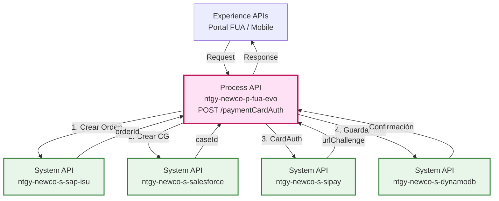
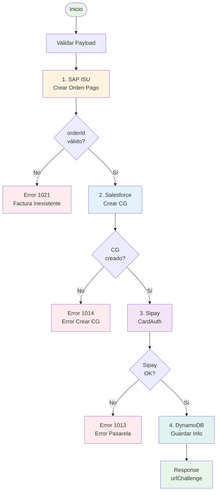
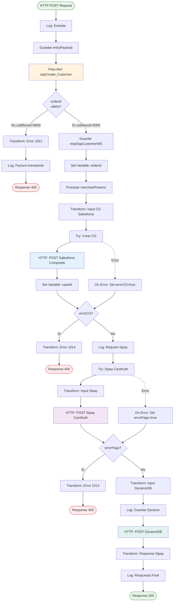
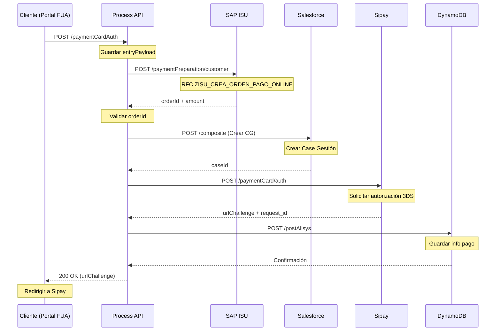
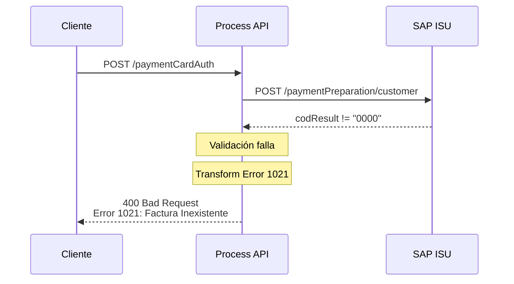
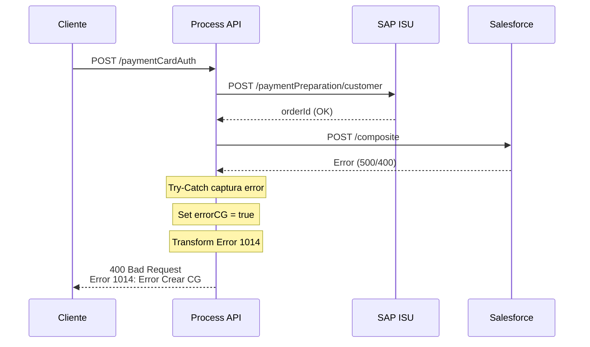
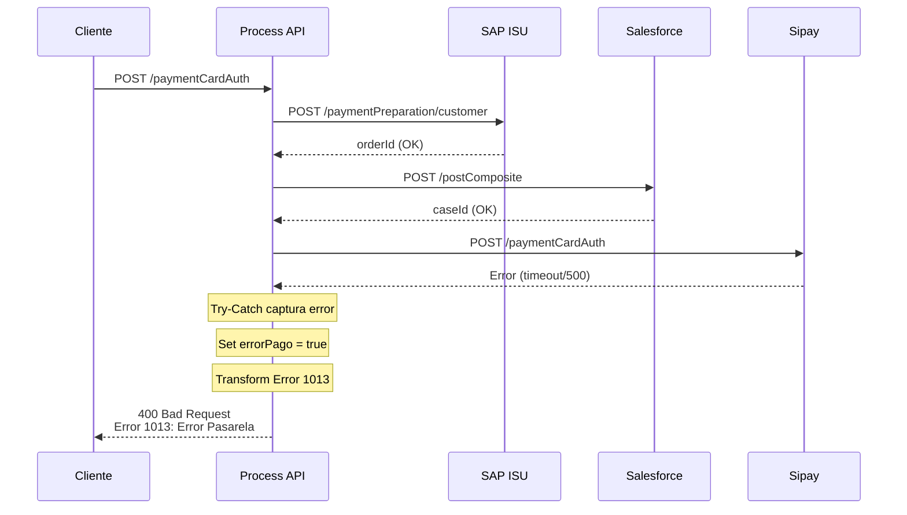

# POST /paymentCardAuth

## 📌 Descripción General

### Propósito del Endpoint

Este endpoint orquesta el proceso completo de preparación de pago con tarjeta para clientes del portal FUA. Coordina la creación del documento de pago en SAP ISU, el registro del caso de gestión en Salesforce, la solicitud de autorización en la pasarela de pago Sipay, y el almacenamiento de la información en DynamoDB para seguimiento.

### Tipo de API

**Capa:** Process API (API-Led Connectivity)

**Función:** Orquestación de proceso de negocio de preparación de pago con tarjeta

### Patrón de Integración

**Tipo:** Orquestación Multi-Backend con Manejo de Errores por Capa

**Descripción:** Flujo secuencial que coordina 4 backends diferentes con validaciones y manejo de errores específico en cada etapa. Implementa patrón de compensación en caso de fallo.

### Arquitectura API-Led Connectivity



---

## 💼 Propósito del Negocio

### Casos de Uso Principales

1. **Pago de Facturas con Tarjeta**
   - Cliente selecciona facturas pendientes en portal FUA
   - Sistema prepara el pago y obtiene URL de autorización
   - Cliente es redirigido a pasarela segura de Sipay

2. **Pago de Deuda con Tarjeta**
   - Cliente consulta deuda pendiente
   - Solicita pago con tarjeta de crédito/débito
   - Sistema coordina creación de documento y autorización

3. **Cambio de Titular con Pago**
   - Proceso de cambio de titular requiere pago
   - Sistema prepara pago asociado al proceso
   - Registra relación con cuenta contrato saliente

### 🔗 Endpoints Dependientes

Este Process API consume los siguientes System APIs en secuencia:

| System API | Endpoint | Método | Propósito |
|------------|----------|--------|-----------|
| `ntgy-newco-s-sap-isu` | `/paymentPreparation/customer` | POST | Crear documento de pago en SAP ISU (RFC ZISU_CREA_ORDEN_PAGO_ONLINE) |
| `ntgy-newco-s-sap-isu` | `/blockObject` | POST | Bloquear cuenta contrato temporalmente (solo si holderChange=true) |
| `ntgy-newco-s-salesforce` | `/postComposite` | POST | Crear Case de Gestión tipo "Gestion" con información del pago |
| `ntgy-newco-s-sipay` | `/paymentCardAuth` | POST | Solicitar autorización de tarjeta y obtener URL de challenge |
| `ntgy-newco-s-dynamodb` | `/alisys` | POST | Almacenar información del pago para seguimiento |

### Lógica de Orquestación



**Pasos del Proceso:**

1. **Validación Inicial**: Guardar payload de entrada y preparar variables
2. **SAP ISU**: Crear documento de pago (orderId) mediante RFC
3. **Validación SAP**: Si orderId no existe → Error 1021
4. **Salesforce**: Crear Case de Gestión con información del pago
5. **Validación CG**: Si falla creación → Error 1014
6. **Sipay**: Solicitar autorización de tarjeta (CardAuth)
7. **Validación Sipay**: Si falla pasarela → Error 1013
8. **DynamoDB**: Almacenar información para seguimiento
9. **Respuesta**: Retornar URL de challenge y datos de confirmación

### Transformaciones Aplicadas

#### Transformación 1: Input para Salesforce Composite API

| Campo Original | Campo Salesforce | Transformación |
|----------------|------------------|----------------|
| `x-client-id` | `AccountId` | Directo |
| `x-contact-id` | `ContactId` | Directo |
| `x-user-id` | `NewCo_Creado_por__c` | Condicional (si null → x-contact-id) |
| `DirIp` | `NewCo_Ip__c` | Directo |
| `correlationId` | `NewCo_CorrelationId__c` | Directo |
| `merchantParams` | `NewCo_PaymentBreakdown__c` | Procesado (sin último ";") |
| `respSapCustomerWS.amount` | `NewCo_OperationAmount__c` | Directo |
| `respSapCustomerWS.orderId` | `NewCo_PaymentDocument__c` | Directo |
| - | `NewCo_PaymentMode__c` | Constante: "Tarjeta" |
| - | `NewCo_OperationResult__c` | Constante: "OK" |

#### Transformación 2: Input para Sipay CardAuth

| Campo Original | Campo Sipay | Transformación |
|----------------|-------------|----------------|
| `amount` | `amount` | Directo |
| - | `currency` | Constante: "EUR" |
| `orderId` | `order` | Variable calculada |
| `request_id` | `requestId` | Directo |
| `errorURL` | `errorURL` | Directo |
| `successURL` | `successURL` | Directo |
| `cardOwner` | `cardOwner` | Default: "" |

#### Transformación 3: Input para DynamoDB

| Campo Original | Campo DynamoDB | Transformación |
|----------------|----------------|----------------|
| `orderId` | `leaseKey` | Variable |
| `respSapCustomerWS.amount` | `amount` | Directo |
| `caseId` | `idSfdc` | Variable |
| `paymentList[].invoiceId` | `invoice` | Join con ";" |
| `phoneChannel` | `telephone` | Directo |
| `x-client-code` | `clientCode` | Default: docNumber |
| `respSipay.request_id` | `requestId` | Directo |
| - | `paymentMethod` | Constante: "Tarjeta" |

### Contexto Empresarial

- **Dominio:** Gestión de Pagos y Cobros
- **Sector:** Energía - Utilities
- **División:** Naturgy España - NewCo
- **Proceso de Negocio:** Preparación de Pago Online con Tarjeta

### Stakeholders

- **Clientes Finales**: Necesitan pagar facturas de forma segura online
- **Equipo de Cobros**: Requiere trazabilidad completa del proceso de pago
- **Equipo de Atención al Cliente**: Necesita visibilidad de casos de gestión
- **Equipo de Sistemas**: Requiere integración robusta con pasarela de pago

### Valor de Negocio

- **Reducción de Morosidad**: Facilita el pago inmediato de deudas
- **Mejora de Experiencia**: Proceso de pago online sin fricción
- **Trazabilidad Completa**: Registro en múltiples sistemas para auditoría
- **Reducción de Costes**: Automatización del proceso de cobro

### Consumidores Potenciales

Este endpoint puede ser consumido por:
- Portal web FUA (Frontal Único de Atención)
- Aplicaciones móviles de clientes
- Sistemas de agentes de call center (para pagos asistidos)
- Integraciones de terceros autorizados

---

## 🔧 Especificación Técnica

### URLs por Ambiente

| Ambiente | URL Base | URL Completa |
|----------|----------|--------------|
| **Local** | `http://localhost:8081` | `http://localhost:8081/api/paymentCardAuth` |
| **Development** | `https://ntgy-newco-p-fua-evo-dev.us-e2.cloudhub.io` | `https://ntgy-newco-p-fua-evo-dev.us-e2.cloudhub.io/api/paymentCardAuth` |
| **UAT** | `https://ntgy-newco-p-fua-evo-uat.us-e2.cloudhub.io` | `https://ntgy-newco-p-fua-evo-uat.us-e2.cloudhub.io/api/paymentCardAuth` |
| **Production** | `https://ntgy-newco-p-fua-evo-pro.us-e2.cloudhub.io` | `https://ntgy-newco-p-fua-evo-pro.us-e2.cloudhub.io/api/paymentCardAuth` |

### Método HTTP

```
POST /api/paymentCardAuth
```

### Headers Requeridos

| Header | Tipo | Obligatorio | Descripción |
|--------|------|-------------|-------------|
| `Content-Type` | string | Sí | Debe ser `application/json` |
| `x-client-id` | string | Sí | ID del cliente en Salesforce |
| `x-contact-id` | string | Sí | ID del contacto en Salesforce |
| `x-user-id` | string | No | ID del usuario que realiza la operación |
| `x-client-code` | string | No | Código del cliente |
| `DirIp` | string | Sí | Dirección IP del cliente |
| `correlationId` | string | Sí | ID de correlación para trazabilidad |

### Parámetros de Entrada (Body)

```json
{
  "amount": "number (decimal)",
  "request_id": "string",
  "errorURL": "string (URL)",
  "successURL": "string (URL)",
  "cardOwner": "string (opcional)",
  "phoneChannel": "string",
  "docNumber": "string",
  "paymentList": [
    {
      "invoiceId": "string"
    }
  ],
  "paymentDueList": [
    {
      "outContractAccountId": "string",
      "numRef": "string"
    }
  ],
  "outContractAccountId": "string (opcional)"
}
```

#### Descripción de Campos

| Campo | Tipo | Obligatorio | Descripción |
|-------|------|-------------|-------------|
| `amount` | number | Sí | Importe total del pago en euros |
| `request_id` | string | Sí | ID único de la solicitud |
| `errorURL` | string | Sí | URL de redirección en caso de error |
| `successURL` | string | Sí | URL de redirección en caso de éxito |
| `cardOwner` | string | No | Nombre del titular de la tarjeta |
| `phoneChannel` | string | Sí | Teléfono de contacto |
| `docNumber` | string | Sí | Número de documento del cliente |
| `paymentList` | array | Condicional | Lista de facturas a pagar |
| `paymentDueList` | array | Condicional | Lista de deudas a pagar |
| `outContractAccountId` | string | No | ID de cuenta contrato saliente (cambio titular) |

### Respuestas

#### 200 OK - Éxito

```json
{
  "result": {
    "codResult": "0000",
    "msgResult": "No hay error"
  },
  "urlChallenge": "https://sipay.gateway.com/challenge/...",
  "request_id_conf": "REQ123456789",
  "id_cobro": "ORD987654321"
}
```

| Campo | Tipo | Descripción |
|-------|------|-------------|
| `result.codResult` | string | Código de resultado ("0000" = éxito) |
| `result.msgResult` | string | Mensaje descriptivo del resultado |
| `urlChallenge` | string | URL de la pasarela Sipay para autorización 3DS |
| `request_id_conf` | string | ID de confirmación de Sipay |
| `id_cobro` | string | ID del documento de pago (orderId de SAP) |

#### 400 Bad Request - Error de Negocio

**Error 1021: Número de factura inexistente**

```json
{
  "result": {
    "codResult": "1021",
    "msgResult": "Numero de factura Inexistente"
  }
}
```

**Error 1014: Error creando Caso Gestión**

```json
{
  "result": {
    "codResult": "1014",
    "msgResult": "Error creando Caso Gestion"
  }
}
```

**Error 1013: Error en pasarela de pago**

```json
{
  "result": {
    "codResult": "1013",
    "msgResult": "Ha ocurrido un error en la pasarela de pago"
  }
}
```

#### 500 Internal Server Error

```json
{
  "code": "INTERNAL_ERROR",
  "message": "Error interno del servidor",
  "details": "Descripción técnica del error"
}
```

### Autenticación

- **Tipo:** Client ID & Client Secret (Anypoint Platform)
- **Headers:** `client_id` y `client_secret`

### Timeouts

| Tipo | Valor |
|------|-------|
| **Request Timeout** | 30 segundos (Sipay: 30s) |
| **Connection Timeout** | 10 segundos |
| **Total Process Timeout** | ~60 segundos (orquestación completa) |

---

## 🏗️ Implementación Técnica

### Arquitectura del Flow



### Llamada Condicional a SAP Block Object

**Condición:** Solo se ejecuta si `holderChange = true` (proceso de cambio de titular)

Cuando el pago está asociado a un proceso de cambio de titular, el sistema realiza una llamada adicional a SAP ISU para bloquear temporalmente la cuenta contrato:

```xml
<http:request 
    method="POST"
    config-ref="HTTP_Request_ntgy-newco-s-sap" 
    path="${ntgy-newco-s-sap.functions.blockObject}">
    <http:body>
        {
            "proceso": "03",
            "flagBloqueo": "B",
            "cuentaContrato": vars.entryPayload.outContractAccountId
        }
    </http:body>
</http:request>
```

**Parámetros:**
- `proceso`: "03" - Código de proceso para bloqueo temporal con subrogación
- `flagBloqueo`: "B" - Flag de bloqueo
- `cuentaContrato`: ID de la cuenta contrato saliente

**Propósito:** Bloquear temporalmente la cuenta contrato durante el proceso de cambio de titular para evitar operaciones concurrentes que puedan causar inconsistencias.

**Ubicación en el flujo:** Se ejecuta después de construir los `merchantParams` y antes de llamar a SAP para crear el documento de pago.

---

### Transformaciones DataWeave

#### 1. Transformación Input Salesforce Composite API

```dataweave
%dw 2.0
output application/json

fun concatena(valor) =
    (write(valor, "application/json", {"indent": false}) as String ++ '\r'
        replace "{" with ""
        replace "}" with ""
        replace "," with "\r\n")
        replace "\"" with ""

var ok = "Inicio de pago con tarjeta. Documento de pago " ++ 
         vars.respSapCustomerWS.orderId ++ " – Importe " ++ 
         vars.respSapCustomerWS.amount
var operationResult = "OK"
var comment = {
    "amount": payload.amount,
    "currency": "EUR",
    "order": vars.orderId,
    "requestId": vars.entryPayload.request_id
}
---
{
    "allOrNone": true,
    "collateSubrequests": false,
    "compositeRequest": [
        {
            "method": "POST",
            "url": "/services/data/v52.0/sobjects/Case",
            "referenceId": "refCaseGestion",
            "body": { 
                "NewCo_Recordtype__c": "Gestion",
                "AccountId": vars.entryPayload.'x-client-id',
                "ContactId": vars.entryPayload.'x-contact-id',
                "Status": "02",
                "Priority": "02",
                "Origin": "FUA",
                "NewCo_Creado_por__c": 
                    if (vars.entryPayload.'x-user-id' != null) 
                        vars.entryPayload.'x-user-id' 
                    else 
                        vars.entryPayload.'x-contact-id',
                "NewCo_Ip__c": vars.entryPayload.'DirIp',
                "NewCo_CorrelationId__c": correlationId,
                "NewCo_PaymentBreakdown__c": vars.merchantParams,
                "NewCo_OperationAmount__c": vars.respSapCustomerWS.amount,
                "NewCo_OperationDate__c": now() as String {format: "uuuu-MM-dd'T'HH:mm:ss'Z'"},
                "NewCo_OperationResult__c": operationResult,
                "NewCo_ResultDescription__c": ok,
                "NewCo_PaymentMode__c": "Tarjeta",
                "NewCo_PaymentDocument__c": vars.respSapCustomerWS.orderId,
                "acn_fld_Tittle__r": {
                    "NewCo_ExternalId__c": "PagoDeuda"
                },
                "comments": 
                    if (vars.entryPayload.outContractAccountId != null and 
                        vars.entryPayload.outContractAccountId != "") 
                        "Caso Gestión relacionado con el proceso de cambio de titular de la cuenta contrato con código: " ++ 
                        vars.entryPayload.outContractAccountId
                    else
                        "[CREACIÓN CG - Info previa hacia pasarela pago]\r\n" ++
                        "fecha: " ++ ((now() >> "Europe/Madrid") as String {format: "yyyy-MM-dd HH:mm:ss"}) ++ "\r\n" ++
                        concatena(comment)
            }
        }
    ]
}
```

#### 2. Transformación Input Sipay CardAuth

```dataweave
%dw 2.0
output application/json
---
{
    "amount": payload.amount,
    "currency": "EUR",
    "order": vars.orderId,
    "requestId": vars.entryPayload.request_id,
    "errorURL": vars.entryPayload.errorURL,
    "successURL": vars.entryPayload.successURL,
    "cardOwner": vars.entryPayload.cardOwner default ""
}
```

#### 3. Transformación Input DynamoDB

```dataweave
%dw 2.0
output application/json
---
{
    leaseKey: vars.orderId,
    amount: vars.respSapCustomerWS.amount,
    idSfdc: vars.caseId,
    invoice: 
        if (!isEmpty(vars.entryPayload.paymentList))
            ((vars.entryPayload.paymentList map ((item) -> item.invoiceId)) joinBy ";")
        else
            ((vars.entryPayload.paymentDueList map ((item) -> 
                item.outContractAccountId default item.numRef)) joinBy ";"),
    telephone: vars.entryPayload.phoneChannel,
    clientCode: vars.entryPayload.'x-client-code' default vars.entryPayload.docNumber,
    requestId: vars.respSipay.payload.request_id default vars.entryPayload.request_id,
    paymentMethod: "Tarjeta"
}
```

#### 4. Transformación Response Final

```dataweave
%dw 2.0
output application/json
---
{
    "result": {
        "codResult": "0000",
        "msgResult": "No hay error"
    },
    "urlChallenge": vars.respSipay.payload.url,
    "request_id_conf": vars.respSipay.payload.request_id,
    "id_cobro": vars.orderId
}
```

### Patrones de Diseño

**Patrón:** Saga Pattern (Orquestación con Compensación)

**Justificación:** 
- Coordina transacciones distribuidas entre 4 sistemas independientes
- Cada paso valida antes de continuar
- Manejo de errores específico por capa
- No implementa compensación automática (requiere intervención manual)

**Patrón:** Try-Catch por Capa

**Justificación:**
- Aísla errores de cada backend
- Permite continuar o abortar según criticidad
- Registra errores específicos para troubleshooting

### Diagramas de Secuencia

#### 1. Flujo Normal de Éxito



#### 2. Flujo con Error SAP (Factura Inexistente)



#### 3. Flujo con Error Salesforce



#### 4. Flujo con Error Sipay



### Manejo de Errores

#### Estrategia por Capa

| Capa | Error | Código | Acción |
|------|-------|--------|--------|
| SAP ISU | orderId inválido | 1021 | Abortar proceso, retornar error |
| Salesforce | Fallo crear CG | 1014 | Abortar proceso, retornar error |
| Sipay | Error pasarela | 1013 | Abortar proceso, retornar error |
| DynamoDB | Error almacenamiento | - | Continuar (no crítico) |

#### Códigos de Error Específicos

**1021 - Número de factura inexistente**
- **Causa:** SAP ISU no pudo crear el documento de pago
- **Origen:** RFC ZISU_CREA_ORDEN_PAGO_ONLINE retorna codResult != "0000"
- **Acción:** Validar que las facturas existen y están pendientes de pago
- **Recuperación:** Usuario debe verificar facturas seleccionadas

**1014 - Error creando Caso Gestión**
- **Causa:** Salesforce no pudo crear el Case de Gestión
- **Origen:** Error en llamada POST /composite a Salesforce
- **Acción:** Revisar conectividad con Salesforce y permisos
- **Recuperación:** Reintentar operación o contactar soporte

**1013 - Error en pasarela de pago**
- **Causa:** Sipay no pudo procesar la solicitud de autorización
- **Origen:** Error en llamada POST /paymentCard/auth a Sipay
- **Acción:** Revisar conectividad con Sipay y configuración
- **Recuperación:** Reintentar operación o usar método de pago alternativo

#### Logging

Cada etapa del proceso registra logs con nivel INFO:

```
paymentPreparationSipayCardAuth_Customer Inicio - [payload]
paymentPreparationSipayCardAuth_Customer - Input CG - [vars.inputCG]
paymentPreparationSipayCardAuth_Customer - Request Sipay: [payload]
paymentPreparationSipayCardAuth_Customer - [vars.inputDynamoDB]
paymentPreparationSipayCardAuth_Customer - Respuesta paymentPreparation_Customer: [payload]
```

En caso de error:
```
paymentPreparationSipayCardAuth_Customer - Numero de factura Inexistente: [payload]
paymentPreparationSipayCardAuth_Customer - Error Crear CG SF - [error.errorMessage.payload]
paymentPreparationSipayCardAuth_Customer - Error Sipay - [error.errorMessage.payload]
```

---

## 💻 Ejemplos de Uso

### Ejemplo 1: Pago de Facturas Exitoso

#### Request

```bash
curl -X POST "https://ntgy-newco-p-fua-evo-dev.us-e2.cloudhub.io/api/paymentCardAuth" \
  -H "Content-Type: application/json" \
  -H "client_id: YOUR_CLIENT_ID" \
  -H "client_secret: YOUR_CLIENT_SECRET" \
  -H "x-client-id: 0011234567890ABC" \
  -H "x-contact-id: 0031234567890DEF" \
  -H "x-user-id: 0051234567890GHI" \
  -H "x-client-code: 12345678" \
  -H "DirIp: 192.168.1.100" \
  -H "correlationId: 550e8400-e29b-41d4-a716-446655440000" \
  -d '{
    "amount": 125.50,
    "request_id": "REQ-2026-001234",
    "errorURL": "https://portal.naturgy.es/payment/error",
    "successURL": "https://portal.naturgy.es/payment/success",
    "cardOwner": "Juan Pérez García",
    "phoneChannel": "+34612345678",
    "docNumber": "12345678A",
    "paymentList": [
      {
        "invoiceId": "INV-2026-001"
      },
      {
        "invoiceId": "INV-2026-002"
      }
    ]
  }'
```

#### Response (200 OK)

```json
{
  "result": {
    "codResult": "0000",
    "msgResult": "No hay error"
  },
  "urlChallenge": "https://secure.sipay.es/paytpv/v1/challenge?token=eyJhbGciOiJIUzI1NiIsInR5cCI6IkpXVCJ9...",
  "request_id_conf": "REQ-2026-001234-CONF",
  "id_cobro": "ORD-SAP-987654321"
}
```

**Siguiente paso:** Redirigir al usuario a `urlChallenge` para completar autenticación 3DS

---

### Ejemplo 2: Pago de Deuda

#### Request

```bash
curl -X POST "https://ntgy-newco-p-fua-evo-dev.us-e2.cloudhub.io/api/paymentCardAuth" \
  -H "Content-Type: application/json" \
  -H "client_id: YOUR_CLIENT_ID" \
  -H "client_secret: YOUR_CLIENT_SECRET" \
  -H "x-client-id: 0011234567890ABC" \
  -H "x-contact-id: 0031234567890DEF" \
  -H "DirIp: 192.168.1.100" \
  -H "correlationId: 550e8400-e29b-41d4-a716-446655440001" \
  -d '{
    "amount": 350.75,
    "request_id": "REQ-2026-001235",
    "errorURL": "https://portal.naturgy.es/payment/error",
    "successURL": "https://portal.naturgy.es/payment/success",
    "cardOwner": "María López Martínez",
    "phoneChannel": "+34698765432",
    "docNumber": "87654321B",
    "paymentDueList": [
      {
        "outContractAccountId": "CA-123456",
        "numRef": "REF-001"
      }
    ]
  }'
```

#### Response (200 OK)

```json
{
  "result": {
    "codResult": "0000",
    "msgResult": "No hay error"
  },
  "urlChallenge": "https://secure.sipay.es/paytpv/v1/challenge?token=eyJhbGciOiJIUzI1NiIsInR5cCI6IkpXVCJ9...",
  "request_id_conf": "REQ-2026-001235-CONF",
  "id_cobro": "ORD-SAP-987654322"
}
```

---

### Ejemplo 3: Error - Factura Inexistente (1021)

#### Request

```bash
curl -X POST "https://ntgy-newco-p-fua-evo-dev.us-e2.cloudhub.io/api/paymentCardAuth" \
  -H "Content-Type: application/json" \
  -H "client_id: YOUR_CLIENT_ID" \
  -H "client_secret: YOUR_CLIENT_SECRET" \
  -H "x-client-id: 0011234567890ABC" \
  -H "x-contact-id: 0031234567890DEF" \
  -H "DirIp: 192.168.1.100" \
  -H "correlationId: 550e8400-e29b-41d4-a716-446655440002" \
  -d '{
    "amount": 100.00,
    "request_id": "REQ-2026-001236",
    "errorURL": "https://portal.naturgy.es/payment/error",
    "successURL": "https://portal.naturgy.es/payment/success",
    "phoneChannel": "+34612345678",
    "docNumber": "12345678A",
    "paymentList": [
      {
        "invoiceId": "INV-INVALID-999"
      }
    ]
  }'
```

#### Response (400 Bad Request)

```json
{
  "result": {
    "codResult": "1021",
    "msgResult": "Numero de factura Inexistente"
  }
}
```

---

### Ejemplo 4: Error - Fallo en Salesforce (1014)

#### Response (400 Bad Request)

```json
{
  "result": {
    "codResult": "1014",
    "msgResult": "Error creando Caso Gestion"
  }
}
```

**Causa posible:** Salesforce no disponible o error de permisos

---

### Ejemplo 5: Error - Fallo en Pasarela Sipay (1013)

#### Response (400 Bad Request)

```json
{
  "result": {
    "codResult": "1013",
    "msgResult": "Ha ocurrido un error en la pasarela de pago"
  }
}
```

**Causa posible:** Sipay no disponible, timeout, o error de configuración

---

### Ejemplo 6: JavaScript (Fetch API)

```javascript
async function iniciarPagoTarjeta(datosPago) {
  try {
    const response = await fetch(
      'https://ntgy-newco-p-fua-evo-dev.us-e2.cloudhub.io/api/paymentCardAuth',
      {
        method: 'POST',
        headers: {
          'Content-Type': 'application/json',
          'client_id': 'YOUR_CLIENT_ID',
          'client_secret': 'YOUR_CLIENT_SECRET',
          'x-client-id': datosPago.clientId,
          'x-contact-id': datosPago.contactId,
          'x-user-id': datosPago.userId,
          'DirIp': datosPago.ipAddress,
          'correlationId': datosPago.correlationId
        },
        body: JSON.stringify({
          amount: datosPago.amount,
          request_id: datosPago.requestId,
          errorURL: 'https://portal.naturgy.es/payment/error',
          successURL: 'https://portal.naturgy.es/payment/success',
          cardOwner: datosPago.cardOwner,
          phoneChannel: datosPago.phone,
          docNumber: datosPago.docNumber,
          paymentList: datosPago.invoices
        })
      }
    );

    const data = await response.json();

    if (response.ok && data.result.codResult === '0000') {
      // Redirigir a pasarela de pago
      window.location.href = data.urlChallenge;
    } else {
      // Manejar error
      console.error('Error en pago:', data.result.msgResult);
      alert(`Error: ${data.result.msgResult} (Código: ${data.result.codResult})`);
    }
  } catch (error) {
    console.error('Error de red:', error);
    alert('Error de conexión. Por favor, inténtelo de nuevo.');
  }
}

// Uso
const datosPago = {
  clientId: '0011234567890ABC',
  contactId: '0031234567890DEF',
  userId: '0051234567890GHI',
  ipAddress: '192.168.1.100',
  correlationId: crypto.randomUUID(),
  amount: 125.50,
  requestId: `REQ-${Date.now()}`,
  cardOwner: 'Juan Pérez García',
  phone: '+34612345678',
  docNumber: '12345678A',
  invoices: [
    { invoiceId: 'INV-2026-001' },
    { invoiceId: 'INV-2026-002' }
  ]
};

iniciarPagoTarjeta(datosPago);
```

---

### Ejemplo 7: Python (Requests)

```python
import requests
import uuid
from datetime import datetime

def iniciar_pago_tarjeta(datos_pago):
    """
    Inicia proceso de pago con tarjeta
    
    Args:
        datos_pago (dict): Datos del pago
        
    Returns:
        dict: Respuesta del API con urlChallenge
    """
    url = "https://ntgy-newco-p-fua-evo-dev.us-e2.cloudhub.io/api/paymentCardAuth"
    
    headers = {
        "Content-Type": "application/json",
        "client_id": "YOUR_CLIENT_ID",
        "client_secret": "YOUR_CLIENT_SECRET",
        "x-client-id": datos_pago["client_id"],
        "x-contact-id": datos_pago["contact_id"],
        "x-user-id": datos_pago.get("user_id", ""),
        "DirIp": datos_pago["ip_address"],
        "correlationId": str(uuid.uuid4())
    }
    
    payload = {
        "amount": datos_pago["amount"],
        "request_id": f"REQ-{int(datetime.now().timestamp())}",
        "errorURL": "https://portal.naturgy.es/payment/error",
        "successURL": "https://portal.naturgy.es/payment/success",
        "cardOwner": datos_pago["card_owner"],
        "phoneChannel": datos_pago["phone"],
        "docNumber": datos_pago["doc_number"],
        "paymentList": datos_pago["invoices"]
    }
    
    try:
        response = requests.post(url, json=payload, headers=headers, timeout=30)
        response.raise_for_status()
        
        data = response.json()
        
        if data["result"]["codResult"] == "0000":
            print(f"✓ Pago iniciado correctamente")
            print(f"  URL Challenge: {data['urlChallenge']}")
            print(f"  ID Cobro: {data['id_cobro']}")
            return data
        else:
            print(f"✗ Error: {data['result']['msgResult']}")
            print(f"  Código: {data['result']['codResult']}")
            return None
            
    except requests.exceptions.RequestException as e:
        print(f"✗ Error de conexión: {e}")
        return None

# Uso
datos_pago = {
    "client_id": "0011234567890ABC",
    "contact_id": "0031234567890DEF",
    "user_id": "0051234567890GHI",
    "ip_address": "192.168.1.100",
    "amount": 125.50,
    "card_owner": "Juan Pérez García",
    "phone": "+34612345678",
    "doc_number": "12345678A",
    "invoices": [
        {"invoiceId": "INV-2026-001"},
        {"invoiceId": "INV-2026-002"}
    ]
}

resultado = iniciar_pago_tarjeta(datos_pago)
if resultado:
    # Redirigir usuario a resultado["urlChallenge"]
    print(f"Redirigir a: {resultado['urlChallenge']}")
```

---

### Notas de Implementación

#### Flujo Completo del Pago

1. **Cliente inicia pago** → POST /paymentCardAuth
2. **API retorna urlChallenge** → URL de Sipay
3. **Cliente redirigido a Sipay** → Autenticación 3DS
4. **Sipay procesa pago** → Autorización/Rechazo
5. **Sipay notifica resultado** → POST /callbackPayments/customer (otro endpoint)
6. **Cliente redirigido** → successURL o errorURL

#### Consideraciones de Seguridad

- **PCI-DSS**: Este endpoint NO maneja datos de tarjeta directamente
- **3DS**: Autenticación delegada a Sipay (cumplimiento PSD2)
- **HTTPS**: Todas las comunicaciones deben ser sobre TLS 1.2+
- **Tokens**: No almacenar datos sensibles de tarjeta

#### Timeouts Recomendados

- **Cliente → Process API**: 60 segundos
- **Espera en urlChallenge**: 5 minutos (usuario completa 3DS)
- **Callback de Sipay**: Asíncrono (no bloqueante)

#### Monitoreo

Métricas clave a monitorear:
- Tasa de éxito por etapa (SAP, Salesforce, Sipay)
- Tiempo de respuesta total
- Códigos de error más frecuentes
- Tasa de abandono en pasarela Sipay
