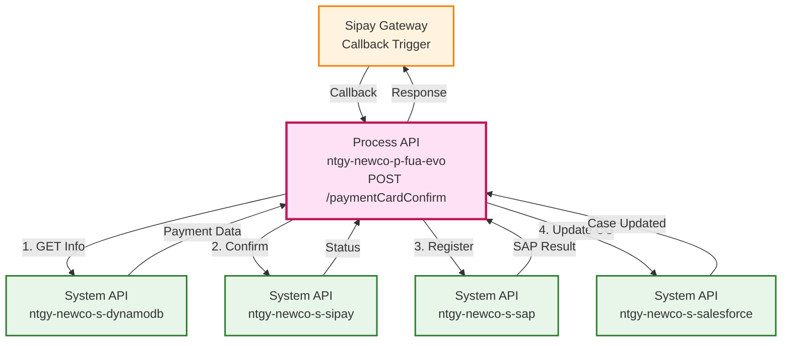
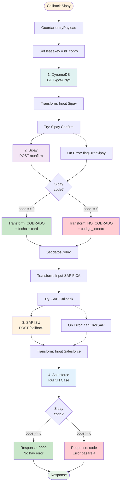
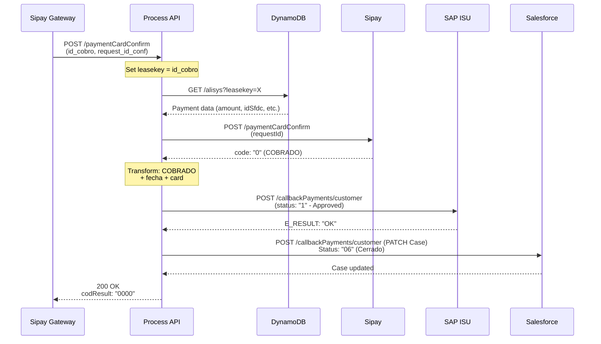
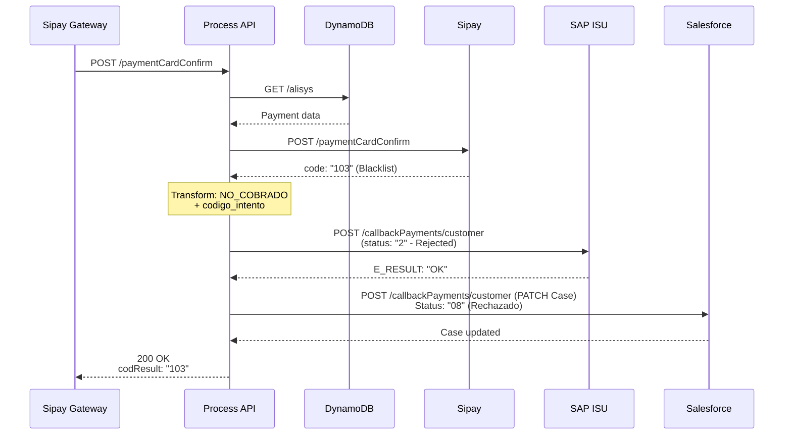
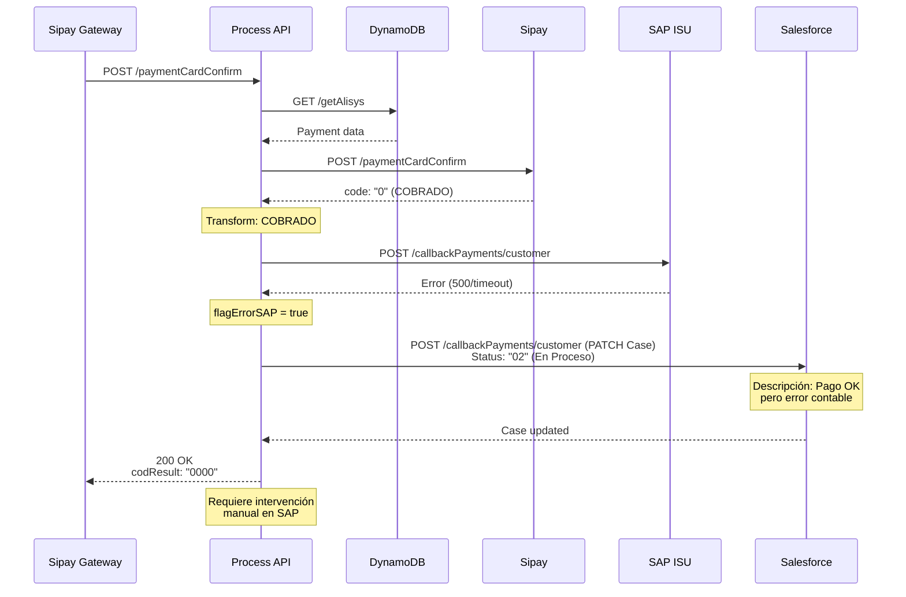
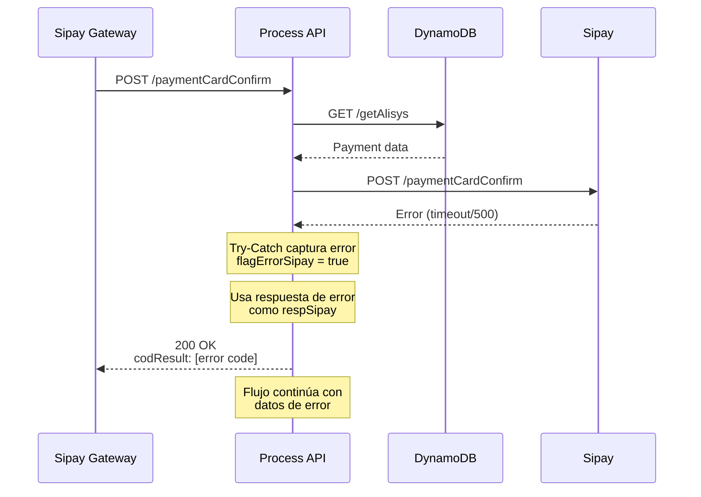

# POST /paymentCardConfirm

## 📌 Descripción General

### Propósito del Endpoint

Este endpoint actúa como **callback de confirmación** invocado por la pasarela Sipay tras completar el proceso de autorización 3DS del pago con tarjeta. Orquesta la recuperación de información del pago desde DynamoDB, confirma el estado con Sipay, registra el resultado en SAP ISU y actualiza el Case de Gestión en Salesforce.

**Relación con `/paymentCardAuth`:**
- `/paymentCardAuth` → Inicia el pago y obtiene URL de challenge
- Cliente completa 3DS en Sipay
- **`/paymentCardConfirm`** → Confirma y registra el resultado final

### Tipo de API

**Capa:** Process API (API-Led Connectivity)

**Función:** Callback de confirmación y orquestación de registro de resultado de pago

### Patrón de Integración

**Tipo:** Callback Pattern + Orquestación Multi-Backend Secuencial

**Descripción:** Flujo secuencial que recupera contexto del pago, confirma con pasarela, y registra resultado en múltiples sistemas backend con lógica condicional según estado del pago.

### Arquitectura API-Led Connectivity



---

## 💼 Propósito del Negocio

### Casos de Uso Principales

1. **Confirmación de Pago Exitoso**
   - Cliente completa autenticación 3DS en Sipay
   - Sistema confirma pago autorizado (COBRADO)
   - Registra pago en SAP ISU y actualiza Salesforce
   - Case de Gestión pasa a estado "Cerrado" (06)

2. **Registro de Pago Rechazado**
   - Cliente falla autenticación 3DS o tarjeta rechazada
   - Sistema registra pago NO_COBRADO
   - Actualiza SAP con estado rechazado
   - Case de Gestión pasa a estado "Rechazado" (08)

3. **Manejo de Error en Contabilización**
   - Pago autorizado por Sipay pero error en SAP
   - Sistema registra pago exitoso pero marca error contable
   - Case de Gestión queda en estado "En Proceso" (02)
   - Requiere intervención manual para contabilizar

### 🔗 Endpoints Dependientes

Este Process API consume los siguientes System APIs en secuencia:

| System API | Endpoint | Método | Propósito |
|------------|----------|--------|-----------|
| `ntgy-newco-s-dynamodb` | `/alisys` | GET | Recuperar información del pago (amount, idSfdc, invoice, etc.) |
| `ntgy-newco-s-sipay` | `/paymentCardConfirm` | POST | Confirmar estado final de autorización 3DS |
| `ntgy-newco-s-sap` | `/callbackPayments/customer` | POST | Registrar resultado en SAP ISU (FICA) |
| `ntgy-newco-s-salesforce` | `/callbackPayments/customer` | POST | Actualizar Case de Gestión con resultado (PATCH) |

### Lógica de Orquestación



**Pasos del Proceso:**

1. **Recepción Callback**: Sipay invoca endpoint con id_cobro y request_id_conf
2. **Recuperar Contexto**: GET a DynamoDB para obtener datos del pago
3. **Confirmar con Sipay**: POST confirm para obtener estado final
4. **Decisión por Código**: Analizar código Sipay (0 = éxito, otro = rechazo)
5. **Transformar Datos**: Preparar estructura según estado (COBRADO/NO_COBRADO)
6. **Registrar en SAP**: POST callback con estado para contabilización
7. **Actualizar Salesforce**: PATCH del Case con resultado final
8. **Respuesta**: Retornar 0000 si exitoso, código Sipay si error

### Transformaciones Aplicadas

#### Transformación 1: Datos de Pago COBRADO

| Campo Origen | Campo Destino | Transformación |
|--------------|---------------|----------------|
| `leasekey` | `codigo_cobro` | Directo (id_cobro) |
| - | `estado_cobro` | Constante: "COBRADO" |
| `now()` | `fecha_cobro` | Formato: "yyyy-MM-dd HH:mm:ss" |
| `respSipay.payload.order` | `orderid` | Directo |
| `respSipay.payload.masked_card` | `card` | Tarjeta enmascarada |
| - | `paymentMode` | Constante: "Tarjeta" |

#### Transformación 2: Datos de Pago NO_COBRADO

| Campo Origen | Campo Destino | Transformación |
|--------------|---------------|----------------|
| `leasekey` | `codigo_cobro` | Directo (id_cobro) |
| - | `estado_cobro` | Constante: "NO_COBRADO" |
| `respSipay.payload.code` | `codigo_intento` | Código de error Sipay |
| Properties | `desc_intento` | Lookup: sipayCardPBL.resultCodes.code_X |
| - | `paymentMode` | Constante: "Tarjeta" |

#### Transformación 3: Input SAP FICA

| Campo Origen | Campo Destino | Transformación |
|--------------|---------------|----------------|
| `getSipay.amount` | `amount` | Cast a Number |
| `now()` | `paymentDate` | Formato: "yyyyMMdd" (Europe/Madrid) |
| `datosCobro.codigo_cobro` | `merchantTransactionId` | Directo |
| `datosCobro.estado_cobro` | `status` | "1" si COBRADO, "2" si NO_COBRADO |
| - | `statusDescription` | Condicional según estado |
| `getSipay.telephone` | `telephone` | Trim (null si vacío) |
| - | `operationType` | Constante: "ACT" |
| - | `source` | Constante: "W" (Web) |

#### Transformación 4: Update Salesforce Case

| Campo Origen | Campo Salesforce | Transformación |
|--------------|------------------|----------------|
| `getSipay.idSfdc` | Case ID (URL) | ID del Case a actualizar |
| Lógica compleja | `Status` | "06" (OK), "08" (Rechazado), "02" (Error SAP) |
| `getSipay.amount` | `NewCo_OperationAmount__c` | Directo |
| `now()` | `NewCo_OperationDate__c` | ISO 8601 |
| `resultStatus` | `NewCo_OperationResult__c` | "OK" o "KO" |
| `descSipay` | `NewCo_ResultDescription__c` | Descripción del resultado |
| `datosCobro.paymentMode` | `NewCo_PaymentMode__c` | "Tarjeta" |
| Múltiples | `comments` | Concatenación de respuestas |

### Contexto Empresarial

- **Dominio:** Gestión de Pagos y Cobros - Confirmación
- **Sector:** Energía - Utilities
- **División:** Naturgy España - NewCo
- **Proceso de Negocio:** Callback de Confirmación de Pago Online con Tarjeta

### Stakeholders

- **Sipay (Pasarela de Pago)**: Invoca callback tras autorización 3DS
- **Equipo de Cobros**: Requiere registro preciso del resultado
- **Equipo de Contabilidad**: Necesita contabilización en SAP ISU
- **Equipo de Atención al Cliente**: Requiere actualización de casos

### Valor de Negocio

- **Automatización Completa**: Registro automático del resultado en todos los sistemas
- **Trazabilidad Total**: Información completa en SAP, Salesforce y DynamoDB
- **Gestión de Excepciones**: Identificación de pagos exitosos con error contable
- **Auditoría**: Registro detallado de cada paso del proceso

### Consumidores Potenciales

Este endpoint es invocado exclusivamente por:
- **Sipay Gateway**: Callback automático tras autorización 3DS
- **Sistemas de Testing**: Para simular callbacks en ambientes no productivos

---

## 🔧 Especificación Técnica

### URLs por Ambiente

| Ambiente | URL Base | URL Completa |
|----------|----------|--------------|
| **Local** | `http://localhost:8081` | `http://localhost:8081/api/paymentCardConfirm` |
| **Development** | `https://ntgy-newco-p-fua-evo-dev.us-e2.cloudhub.io` | `https://ntgy-newco-p-fua-evo-dev.us-e2.cloudhub.io/api/paymentCardConfirm` |
| **UAT** | `https://ntgy-newco-p-fua-evo-uat.us-e2.cloudhub.io` | `https://ntgy-newco-p-fua-evo-uat.us-e2.cloudhub.io/api/paymentCardConfirm` |
| **Production** | `https://ntgy-newco-p-fua-evo-pro.us-e2.cloudhub.io` | `https://ntgy-newco-p-fua-evo-pro.us-e2.cloudhub.io/api/paymentCardConfirm` |

### Método HTTP

```
POST /api/paymentCardConfirm
```

### Headers Requeridos

| Header | Tipo | Obligatorio | Descripción |
|--------|------|-------------|-------------|
| `Content-Type` | string | Sí | Debe ser `application/json` |
| `client_id` | string | Sí | Client ID de Anypoint Platform |
| `client_secret` | string | Sí | Client Secret de Anypoint Platform |

### Parámetros de Entrada (Body)

```json
{
  "id_cobro": "string",
  "request_id_conf": "string"
}
```

#### Descripción de Campos

| Campo | Tipo | Obligatorio | Descripción |
|-------|------|-------------|-------------|
| `id_cobro` | string | Sí | ID del documento de pago (orderId de SAP) - usado como leasekey en DynamoDB |
| `request_id_conf` | string | Sí | ID de confirmación de Sipay para validar el pago |

### Respuestas

#### 200 OK - Pago Confirmado Exitosamente

```json
{
  "result": {
    "codResult": "0000",
    "msgResult": "No hay error"
  }
}
```

| Campo | Tipo | Descripción |
|-------|------|-------------|
| `result.codResult` | string | Código de resultado ("0000" = éxito) |
| `result.msgResult` | string | Mensaje descriptivo del resultado |

#### 200 OK - Pago Rechazado por Pasarela

```json
{
  "result": {
    "codResult": "103",
    "msgResult": "Se ha producido un error en pasarela de pago"
  }
}
```

| Campo | Tipo | Descripción |
|-------|------|-------------|
| `result.codResult` | string | Código de error de Sipay (ej: "103" = tarjeta en blacklist) |
| `result.msgResult` | string | Mensaje genérico de error |

#### Códigos de Error Sipay Comunes

| Código | Descripción |
|--------|-------------|
| `0` | Pago autorizado correctamente |
| `103` | Tarjeta en blacklist o sospecha de fraude |
| `104` | Fondos insuficientes |
| `105` | Tarjeta caducada |
| `106` | CVV incorrecto |
| `107` | Límite de transacciones excedido |

#### 500 Internal Server Error

```json
{
  "code": "INTERNAL_ERROR",
  "message": "Error interno del servidor",
  "details": "Descripción técnica del error"
}
```

### Estados de Cobro

| Estado | Descripción | Código Sipay | Acción |
|--------|-------------|--------------|--------|
| **COBRADO** | Pago autorizado y procesado | `0` | Registrar en SAP con status "1" (Approved) |
| **NO_COBRADO** | Pago rechazado | `!= 0` | Registrar en SAP con status "2" (Rejected) |

### Estados del Case en Salesforce

| Status | Descripción | Condición |
|--------|-------------|-----------|
| **"06"** | Cerrado - Pago exitoso | Sipay OK + SAP OK |
| **"08"** | Rechazado - Pago fallido | Sipay rechazó pago |
| **"02"** | En Proceso - Error contable | Sipay OK pero SAP error |

### Autenticación

- **Tipo:** Client ID & Client Secret (Anypoint Platform)
- **Headers:** `client_id` y `client_secret`

### Timeouts

| Tipo | Valor |
|------|-------|
| **Request Timeout** | 30 segundos (Sipay: 30s) |
| **Connection Timeout** | 10 segundos |
| **Total Process Timeout** | ~45 segundos (orquestación completa) |

---

## 🏗️ Implementación Técnica

### Arquitectura del Flow

```mermaid
flowchart TD
    Start([HTTP POST Callback]) --> LogStart[Log: Entrada]
    LogStart --> SavePayload[Set: entryPayload]
    SavePayload --> SetLeasekey[Set: leasekey = id_cobro]
    SetLeasekey --> GetDynamo[Flow-Ref: getSipayDynamo]
    
    GetDynamo --> CallDynamo[HTTP GET: DynamoDB<br/>/getAlisys?leasekey=X]
    CallDynamo --> LogDynamo[Log: Response Get Dynamo]
    LogDynamo --> BuildSipay[Transform: Input Sipay Confirm]
    BuildSipay --> LogSipay[Log: Request Sipay Confirm]
    LogSipay --> TrySipay[Try: Sipay Confirm]
    
    TrySipay --> CallSipay[HTTP POST: Sipay<br/>/paymentCard/confirm]
    CallSipay --> LogRespSipay[Log: Response Sipay]
    LogRespSipay --> SetInput[Set: inputSipay]
    SetInput --> CheckCode{Sipay<br/>code?}
    
    TrySipay -.-> ErrorSipay[On Error: flagErrorSipay=true]
    ErrorSipay --> SetInput
    
    CheckCode -->|code == 0| TransCobrado[Transform: COBRADO]
    CheckCode -->|code != 0| TransNoCobrado[Transform: NO_COBRADO]
    
    TransCobrado --> SetDatos[Set: datosCobro]
    TransNoCobrado --> SetDatos
    
    SetDatos --> LogDatos[Log: Datos Cobro]
    LogDatos --> BuildSAP[Transform: Input SAP FICA]
    BuildSAP --> TrySAP[Try: SAP Callback]
    
    TrySAP --> CallSAP[HTTP POST: SAP<br/>/postCallbackPayCustomer]
    CallSAP --> SetRespSAP[Set: respSAP]
    SetRespSAP --> LogSAP[Log: Response SAP]
    LogSAP --> CallSF[Flow-Ref: salesforceRequestSipay]
    
    TrySAP -.-> ErrorSAP[On Error: flagErrorSAP=true]
    ErrorSAP --> CallSF
    
    CallSF --> BuildSF[Transform: Input Salesforce]
    BuildSF --> LogSF[Log: Input CG]
    LogSF --> ReqSF[HTTP POST: Salesforce<br/>PATCH Case]
    ReqSF --> SetRespSF[Set: respSalesforce]
    SetRespSF --> LogRespSF[Log: Respuesta Salesforce]
    LogRespSF --> CheckFinal{Sipay<br/>code?}
    
    CheckFinal -->|code == 0| RespOK[Transform: Response OK]
    CheckFinal -->|code != 0| RespKO[Transform: Response KO]
    
    RespOK --> LogEnd[Log: Salida]
    RespKO --> LogEnd
    LogEnd --> End([Response 200])
    
    style Start fill:#fff3e0,stroke:#f57c00
    style End fill:#e8f5e9,stroke:#2e7d32
    style CallDynamo fill:#e0f2f1
    style CallSipay fill:#f3e5f5
    style CallSAP fill:#fff3e0
    style ReqSF fill:#e3f2fd
    style TransCobrado fill:#c8e6c9
    style TransNoCobrado fill:#ffcdd2
    style RespOK fill:#c8e6c9
    style RespKO fill:#ffcdd2
```



### Transformaciones DataWeave

#### 1. Input Sipay Confirm

```dataweave
%dw 2.0
output application/json
---
{
    requestId: vars.entryPayload.request_id_conf
}
```

#### 2. Transform COBRADO (Pago Exitoso)

```dataweave
%dw 2.0
output application/json
---
{
    "codigo_cobro": vars.leasekey,
    "estado_cobro": "COBRADO",
    "fecha_cobro": now() as String {format: "yyyy-MM-dd HH:mm:ss"},
    "orderid": vars.respSipay.payload.order,
    "card": vars.respSipay.payload.masked_card,
    "paymentMode": "Tarjeta"
}
```

#### 3. Transform NO_COBRADO (Pago Rechazado)

```dataweave
%dw 2.0
output application/json
---
{
    "codigo_cobro": vars.leasekey,
    "estado_cobro": "NO_COBRADO",
    "codigo_intento": vars.respSipay.payload.code,
    "desc_intento": Mule::p("sipayCardPBL.resultCodes.code_" ++ vars.respSipay.payload.code),
    "paymentMode": "Tarjeta"
}
```

#### 4. Input SAP FICA

```dataweave
%dw 2.0
output application/json

var statusCobro = if(vars.datosCobro.estado_cobro == "COBRADO") "1" else "2"
var statusDescCobro = 
    if(vars.datosCobro.estado_cobro == "COBRADO") 
        "Approved" 
    else 
        "Unexpected Gateway Response: 103 - Card in Blacklist or suspected of fraud"
---
{
    amount: vars.getSipay.amount as Number,
    paymentDate: ((now() >> "Europe/Madrid") as String {format: "yyyyMMdd"}),
    merchantTransactionId: vars.datosCobro.codigo_cobro,
    status: statusCobro,
    statusDescription: statusDescCobro,
    telephone: trim(if(isEmpty(vars.getSipay.telephone)) (null) else vars.getSipay.telephone),
    operationType: "ACT",
    source: "W"
}
```

#### 5. Input Salesforce Composite (PATCH Case)

```dataweave
%dw 2.0
output application/json

var resultStatus = 
    if(vars.respSAP.ZFI_FM_PAGO_TPV.export.E_RESULT == "OK" and 
       vars.datosCobro.estado_cobro == "COBRADO") 
        "OK" 
    else 
        "KO"

var descSipay = 
    if(vars.datosCobro.estado_cobro != "COBRADO") 
        vars.datosCobro.desc_intento default "Se ha producido un error desconocido en pasarela de pago"
    else if(vars.respSAP.ZFI_FM_PAGO_TPV.export.E_RESULT == "NOK") 
        vars.respSAP.ZFI_FM_PAGO_TPV.export.ES_ERROR.DESCRIPTION
    else if(vars.flagErrorSAP == true) 
        "El pago se realizo con exito pero no se ha contabilizado en SAP" 
    else 
        "El pago se realizo con exito"

fun concatena(valor) =
    (write(valor, "application/json", {"indent":false}) as String ++ '\r' 
        replace "{" with "" 
        replace "}" with "" 
        replace "," with "\r\n") 
        replace "\"" with ""
---
{
    "allOrNone": true,
    "collateSubrequests": false,
    "compositeRequest": [
        {
            "method": "PATCH",
            "url": "/services/data/v52.0/sobjects/Case/" ++ vars.getSipay.idSfdc,
            "referenceId": "updatedCase",
            "body": { 
                "Status": 
                    if((vars.flagErrorSAP == true or 
                        vars.respSAP.ZFI_FM_PAGO_TPV.export.E_RESULT == "NOK") and 
                        vars.datosCobro.estado_cobro == "COBRADO")  
                        "02"
                    else if(resultStatus == "OK")
                        "06"
                    else if(vars.datosCobro.estado_cobro != "COBRADO")
                        "08"
                    else 
                        "02",
                "NewCo_OperationAmount__c": vars.getSipay.amount,
                "NewCo_OperationDate__c": now() as String {format: "uuuu-MM-dd'T'HH:mm:ss'Z'"},
                "NewCo_OperationResult__c": resultStatus,
                "NewCo_ResultDescription__c": descSipay,
                "NewCo_PaymentMode__c": vars.datosCobro.paymentMode,
                "comments": 
                    "[Actualización final CG tras pago]\r\n" ++ 
                    "fecha: " ++ ((now() >> "Europe/Madrid") as String {format: "yyyy-MM-dd HH:mm:ss"}) ++ 
                    "\r\n[Respuesta Final Pasarela Pago]\r\n" ++ 
                    concatena(vars.inputSipay) ++ 
                    "\r\n[Respuesta Final SAP]\r\n" ++ 
                    concatena(vars.respSAP)
            }
        }
    ]
}
```

#### 6. Response OK

```dataweave
%dw 2.0
output application/json
---
{
    "result": {
        "codResult": "0000",
        "msgResult": "No hay error"
    }
}
```

#### 7. Response KO

```dataweave
%dw 2.0
output application/json
---
{
    "result": {
        "codResult": vars.respSipay.payload.code,
        "msgResult": "Se ha producido un error en pasarela de pago"
    }
}
```

### Subflujos Referenciados

#### Subflujo: getSipayDynamo

**Propósito:** Recuperar información del pago desde DynamoDB

```xml
<sub-flow name="getSipayDynamo">
    <http:request method="GET" 
        config-ref="HTTP_Request_configuration_ntgy_newco_s_dynamodb" 
        path="${ntgy-newco-s-dynamodb.functions.getAlisys}" 
        target="getSipay">
        <http:query-params>
            { "leasekey": vars.leasekey }
        </http:query-params>
    </http:request>
    <logger message="getDynamo- Sipay: #[vars.getSipay]" />
</sub-flow>
```

**Datos Recuperados (vars.getSipay):**
- `amount` - Importe del pago
- `idSfdc` - ID del Case de Gestión
- `invoice` - Facturas asociadas
- `telephone` - Teléfono del cliente
- `clientCode` - Código del cliente
- `requestId` - ID de solicitud original
- `paymentMethod` - "Tarjeta"

#### Subflujo: salesforceRequestSipay

**Propósito:** Actualizar Case de Gestión en Salesforce con resultado final

**Operación:** PATCH del Case mediante Composite API

**Lógica de Estados:**
- **Status "06"**: Pago exitoso + SAP OK → Case cerrado
- **Status "08"**: Pago rechazado → Case rechazado
- **Status "02"**: Pago exitoso + SAP error → Case en proceso (requiere intervención)

### Patrones de Diseño

**Patrón:** Callback Pattern + Saga Pattern

**Justificación:**
- Callback invocado por sistema externo (Sipay)
- Coordina transacciones distribuidas entre 4 sistemas
- Manejo de errores específico por capa
- Registro de resultado en múltiples sistemas

**Patrón:** Try-Catch por Backend

**Justificación:**
- Aísla errores de Sipay y SAP
- Permite continuar flujo incluso con errores parciales
- Registra flags de error para lógica condicional

### Diagramas de Secuencia

#### 1. Flujo Normal - Pago Exitoso



#### 2. Flujo - Pago Rechazado



#### 3. Flujo - Pago Exitoso con Error SAP



#### 4. Flujo - Error en Sipay Confirm



### Manejo de Errores

#### Estrategia por Capa

| Capa | Error | Flag | Acción |
|------|-------|------|--------|
| DynamoDB | No encontrado | - | Fallo crítico (no debería ocurrir) |
| Sipay | Error confirm | `flagErrorSipay` | Continuar con datos de error |
| SAP | Error callback | `flagErrorSAP` | Continuar, marcar Case como "02" |
| Salesforce | Error update | - | Registrar error, continuar |

#### Logging

Cada etapa registra logs con nivel INFO:

```
paymentPreparationSipayCardConfirm_Customer - [payload]
paymentPreparationSipayCardConfirm_Customer - Response Get Dynamo: [vars.getSipay]
paymentPreparationSipayCardConfirm_Customer - Request Sipay Confirm: [payload]
paymentPreparationSipayCardConfirm_Customer - Response Sipay Confirm: [vars.respSipay]
paymentPreparationSipayCardConfirm_Customer - datosCobro: [vars.datosCobro]
salesforceRequestSipay - Input CG (update case): [vars.inputSfdc]
salesforceRequestSipay - Respuesta Salesforce (update case): [vars.respSalesforce]
paymentPreparationSipayCardConfirm_Customer Fin - [payload]
```

En caso de error:
```
paymentPreparationSipayCardConfirm_Customer - Error Sipay Confirm: [error.errorMessage.payload]
callbackPayments_Agent - Error actualizar CG SF: [error.errorMessage.payload]
```

---

## 💻 Ejemplos de Uso

### Ejemplo 1: Callback de Pago Exitoso

#### Request (Invocado por Sipay)

```bash
curl -X POST "https://ntgy-newco-p-fua-evo-dev.us-e2.cloudhub.io/api/paymentCardConfirm" \
  -H "Content-Type: application/json" \
  -H "client_id: YOUR_CLIENT_ID" \
  -H "client_secret: YOUR_CLIENT_SECRET" \
  -d '{
    "id_cobro": "ORD-SAP-987654321",
    "request_id_conf": "REQ-2026-001234-CONF"
  }'
```

#### Response (200 OK)

```json
{
  "result": {
    "codResult": "0000",
    "msgResult": "No hay error"
  }
}
```

**Resultado en Sistemas:**
- **DynamoDB**: Información recuperada correctamente
- **Sipay**: Pago confirmado (code: "0")
- **SAP ISU**: Pago registrado con status "1" (Approved)
- **Salesforce**: Case actualizado a Status "06" (Cerrado)

---

### Ejemplo 2: Callback de Pago Rechazado

#### Request

```bash
curl -X POST "https://ntgy-newco-p-fua-evo-dev.us-e2.cloudhub.io/api/paymentCardConfirm" \
  -H "Content-Type: application/json" \
  -H "client_id: YOUR_CLIENT_ID" \
  -H "client_secret: YOUR_CLIENT_SECRET" \
  -d '{
    "id_cobro": "ORD-SAP-987654322",
    "request_id_conf": "REQ-2026-001235-CONF"
  }'
```

#### Response (200 OK)

```json
{
  "result": {
    "codResult": "103",
    "msgResult": "Se ha producido un error en pasarela de pago"
  }
}
```

**Resultado en Sistemas:**
- **Sipay**: Pago rechazado (code: "103" - Tarjeta en blacklist)
- **SAP ISU**: Pago registrado con status "2" (Rejected)
- **Salesforce**: Case actualizado a Status "08" (Rechazado)

---

### Ejemplo 3: Pago Exitoso con Error en SAP

#### Request

```bash
curl -X POST "https://ntgy-newco-p-fua-evo-dev.us-e2.cloudhub.io/api/paymentCardConfirm" \
  -H "Content-Type: application/json" \
  -H "client_id: YOUR_CLIENT_ID" \
  -H "client_secret: YOUR_CLIENT_SECRET" \
  -d '{
    "id_cobro": "ORD-SAP-987654323",
    "request_id_conf": "REQ-2026-001236-CONF"
  }'
```

#### Response (200 OK)

```json
{
  "result": {
    "codResult": "0000",
    "msgResult": "No hay error"
  }
}
```

**Resultado en Sistemas:**
- **Sipay**: Pago confirmado (code: "0")
- **SAP ISU**: Error al contabilizar (timeout/500)
- **Salesforce**: Case actualizado a Status "02" (En Proceso)
  - Descripción: "El pago se realizo con exito pero no se ha contabilizado en SAP"
  - **Requiere intervención manual** para contabilizar en SAP

---

### Ejemplo 4: JavaScript (Simulación de Callback)

```javascript
// Nota: Este endpoint es invocado por Sipay, no por cliente
// Este ejemplo es solo para testing/simulación

async function simularCallbackSipay(idCobro, requestIdConf) {
  try {
    const response = await fetch(
      'https://ntgy-newco-p-fua-evo-dev.us-e2.cloudhub.io/api/paymentCardConfirm',
      {
        method: 'POST',
        headers: {
          'Content-Type': 'application/json',
          'client_id': 'YOUR_CLIENT_ID',
          'client_secret': 'YOUR_CLIENT_SECRET'
        },
        body: JSON.stringify({
          id_cobro: idCobro,
          request_id_conf: requestIdConf
        })
      }
    );

    const data = await response.json();

    if (data.result.codResult === '0000') {
      console.log('✓ Pago confirmado exitosamente');
      console.log('  El pago ha sido registrado en SAP y Salesforce');
    } else {
      console.log('✗ Pago rechazado');
      console.log(`  Código: ${data.result.codResult}`);
      console.log(`  Mensaje: ${data.result.msgResult}`);
    }

    return data;
  } catch (error) {
    console.error('Error en callback:', error);
    return null;
  }
}

// Uso (solo para testing)
simularCallbackSipay('ORD-SAP-987654321', 'REQ-2026-001234-CONF');
```

---

### Ejemplo 5: Python (Simulación de Callback)

```python
import requests

def simular_callback_sipay(id_cobro, request_id_conf):
    """
    Simula callback de Sipay (solo para testing)
    
    Args:
        id_cobro (str): ID del documento de pago
        request_id_conf (str): ID de confirmación de Sipay
        
    Returns:
        dict: Respuesta del API
    """
    url = "https://ntgy-newco-p-fua-evo-dev.us-e2.cloudhub.io/api/paymentCardConfirm"
    
    headers = {
        "Content-Type": "application/json",
        "client_id": "YOUR_CLIENT_ID",
        "client_secret": "YOUR_CLIENT_SECRET"
    }
    
    payload = {
        "id_cobro": id_cobro,
        "request_id_conf": request_id_conf
    }
    
    try:
        response = requests.post(url, json=payload, headers=headers, timeout=45)
        response.raise_for_status()
        
        data = response.json()
        
        if data["result"]["codResult"] == "0000":
            print("✓ Pago confirmado exitosamente")
            print("  Registrado en SAP ISU y Salesforce")
        else:
            print("✗ Pago rechazado")
            print(f"  Código: {data['result']['codResult']}")
            print(f"  Mensaje: {data['result']['msgResult']}")
        
        return data
        
    except requests.exceptions.RequestException as e:
        print(f"✗ Error en callback: {e}")
        return None

# Uso (solo para testing)
resultado = simular_callback_sipay(
    "ORD-SAP-987654321",
    "REQ-2026-001234-CONF"
)
```

---

### Notas de Implementación

#### Flujo Completo del Pago (2 Endpoints)

1. **Cliente inicia pago** → POST /paymentCardAuth
2. **API retorna urlChallenge** → URL de Sipay
3. **Cliente redirigido a Sipay** → Autenticación 3DS
4. **Sipay procesa pago** → Autorización/Rechazo
5. **Sipay invoca callback** → **POST /paymentCardConfirm** (este endpoint)
6. **API registra resultado** → SAP + Salesforce
7. **Cliente redirigido** → successURL o errorURL

#### Consideraciones de Seguridad

- **Callback Seguro**: Validar que el callback viene de Sipay (IP whitelist)
- **Idempotencia**: El callback puede ser invocado múltiples veces
- **Timeout**: Sipay espera respuesta en < 30 segundos
- **Retry**: Sipay reintenta si no recibe respuesta

#### Gestión de Estados

**Estados del Case en Salesforce:**
- **"02"** (En Proceso): Pago OK pero error en SAP → Requiere intervención
- **"06"** (Cerrado): Pago OK y contabilizado → Proceso completo
- **"08"** (Rechazado): Pago rechazado por pasarela → No requiere acción

#### Monitoreo

Métricas clave a monitorear:
- Tasa de callbacks recibidos vs pagos iniciados
- Tasa de pagos COBRADO vs NO_COBRADO
- Tasa de errores en SAP (flagErrorSAP)
- Tiempo de respuesta del callback
- Casos con Status "02" (requieren intervención)

#### Troubleshooting

**Problema: Callback no recibido**
- Verificar conectividad con Sipay
- Revisar logs de Sipay
- Verificar URL de callback configurada

**Problema: Pago OK pero Case en "02"**
- Revisar logs de SAP ISU
- Verificar conectividad con SAP
- Contabilizar manualmente en SAP
- Actualizar Case a "06" manualmente

**Problema: DynamoDB no retorna datos**
- Verificar que /paymentCardAuth se ejecutó correctamente
- Revisar que el id_cobro existe en DynamoDB
- Verificar conectividad con DynamoDB
