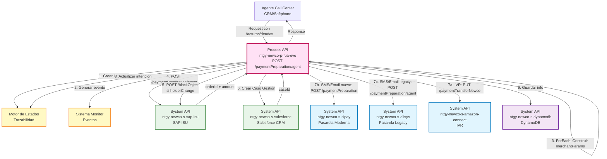
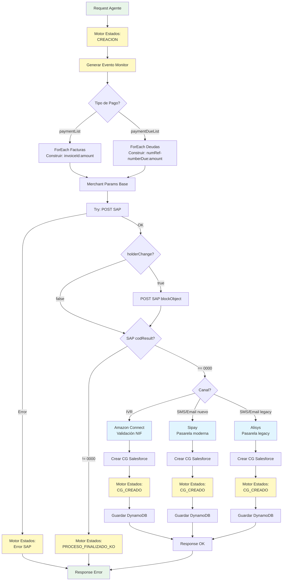
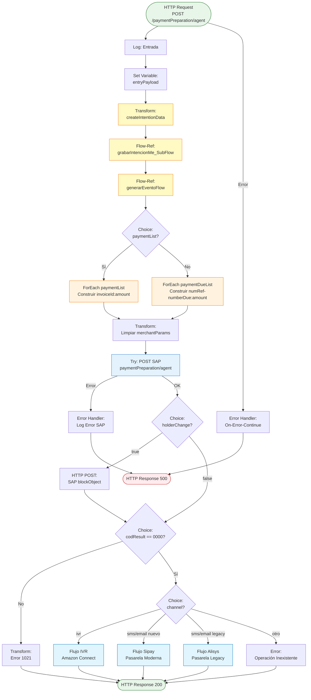
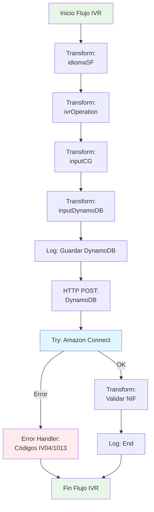
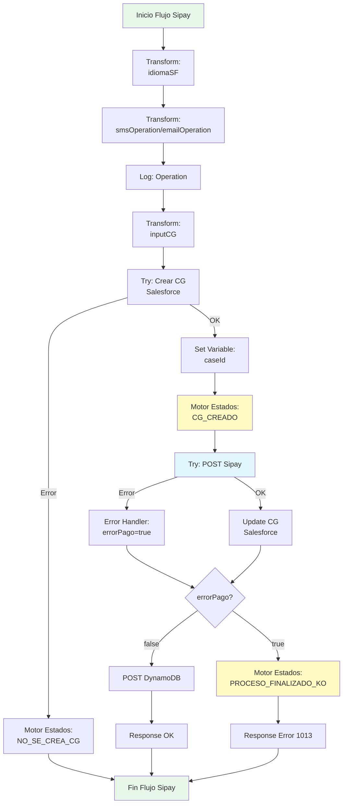

# POST /paymentPreparation/agent

## 📌 Descripción General

### Propósito del Endpoint

Este endpoint prepara pagos online para **agentes de call center** mediante la orquestación de múltiples backends: SAP ISU para validación, y tres pasarelas de pago (Sipay para SMS/Email modernos, Alisys legacy, y Amazon Connect para IVR). Incluye integración completa con el motor de estados para trazabilidad y monitorización de procesos de pago.

### Tipo de API

**Capa:** Process API (API-Led Connectivity)

**Función:** Orquestación multi-backend para preparación de pagos iniciados por agentes

### Diferencias con `/paymentPreparation/customer`

| Aspecto | Customer | Agent |
|---------|----------|-------|
| **Usuario** | Cliente final (autoservicio) | Agente de call center |
| **Header** | `x-client-id` | `x-agent-mail` |
| **Motor de Estados** | ❌ No integrado | ✅ Integración completa |
| **Monitorización** | ❌ No | ✅ Genera eventos de monitor |
| **Amazon Connect** | ❌ No | ✅ Integración IVR con validación NIF |
| **Error Handler** | Código 500 | Código 0001 |
| **Trazabilidad** | Básica | Avanzada (motor de estados) |

### Patrón de Integración

**Tipo:** Orquestación Compleja Multi-Backend con Motor de Estados

**Descripción:** 
1. Registra intención en motor de estados (evento CREACION)
2. Genera evento de monitorización
3. Construye merchantParams iterativamente (ForEach)
4. Valida y prepara pago en SAP ISU
5. Si hay cambio de titular, bloquea cuenta en SAP
6. Crea Caso Gestión en Salesforce
7. Según canal, envía a pasarela correspondiente:
   - **IVR:** Amazon Connect (con validación NIF)
   - **SMS/Email (nuevo):** Sipay
   - **SMS/Email (legacy):** Alisys
8. Actualiza motor de estados con resultado
9. Guarda información en DynamoDB
10. Retorna resultado del proceso

### Arquitectura API-Led Connectivity



---

## 💼 Propósito del Negocio

### Casos de Uso Principales

1. **Pago Asistido por Agente (IVR)**
   - Agente inicia pago y transfiere a IVR para captura de tarjeta
   - Beneficio: Seguridad PCI-DSS (agente no maneja datos de tarjeta)

2. **Envío de Link de Pago por SMS**
   - Agente envía SMS con link de pago al cliente
   - Beneficio: Cliente paga desde su móvil de forma segura

3. **Envío de Link de Pago por Email**
   - Agente envía email con link de pago al cliente
   - Beneficio: Cliente paga desde cualquier dispositivo

4. **Cambio de Titular con Pago**
   - Proceso especial que bloquea temporalmente la cuenta
   - Beneficio: Seguridad en procesos de subrogación

### 🔗 Endpoints Dependientes

Este Process API consume los siguientes System APIs:

| System API | Endpoint | Método | Propósito |
|------------|----------|--------|-----------|
| `ntgy-newco-s-sap-isu` | `/paymentPreparation/agent` | POST | Validar y preparar pago en SAP ISU |
| `ntgy-newco-s-sap-isu` | `/blockObject` | POST | Bloquear cuenta temporalmente (cambio titular) |
| `ntgy-newco-s-salesforce` | `/paymentPreparation/agent` | POST | Crear y actualizar Caso Gestión (composite request) |
| `ntgy-newco-s-sipay` | `/paymentPreparation` | POST | Pasarela moderna para SMS/Email |
| `ntgy-newco-s-alisys` | `/paymentPreparation/agent` | POST | Pasarela legacy para SMS/Email/IVR |
| `ntgy-newco-s-amazon-connect` | `/paymentTransferNewco` | PUT | Transferencia IVR con validación NIF |
| `ntgy-newco-s-dynamodb` | `/alisys` | POST | Guardar información de pago |

### Lógica de Negocio



**Pasos del Proceso:**

1. **Motor de Estados:** Registra intención con evento "CREACION"
2. **Monitorización:** Genera evento de monitor
3. **Construcción merchantParams:** ForEach para concatenar datos de pago
4. **Validación SAP:** Prepara pago y obtiene orderId
5. **Bloqueo (opcional):** Si hay cambio de titular, bloquea cuenta
6. **Validación Resultado SAP:** Verifica codResult == "0000"
7. **Selección de Pasarela:** Según canal (IVR/SMS/Email)
8. **Caso Gestión:** Crea CG en Salesforce con información del pago
9. **Motor de Estados:** Actualiza con evento "CG_CREADO"
10. **DynamoDB:** Guarda información para trazabilidad
11. **Respuesta:** Retorna resultado del proceso

### Transformaciones Aplicadas

**Construcción de merchantParams (Iterativa - Idéntica a customer):**

| Paso | Transformación | Resultado |
|------|----------------|-----------|
| 1 | ForEach facturas/deudas | `invoiceId:amount;` o `numRef-numberDue:amount;` |
| 2 | Limpiar último `;` | `substringBeforeLast(merchantParams, ";")` |

**Transformación para Motor de Estados (NUEVO):**

```dataweave
{
  evento: "CREACION",
  proceso: "PagoDeuda",
  nif: vars.entryPayload.'x-client-code',
  billingAccount: "",
  contrato: "",
  casoGestion: "",
  jsonPayload: vars.entryPayload
}
```

**Transformación para Amazon Connect (IVR - NUEVO):**

```dataweave
{
  idAgente: (vars.entryPayload.'x-agent-mail' splitBy "@")[0],
  importe: vars.respSapAgentWS.amount,
  docCliente: vars.entryPayload.'x-client-code',
  idTransaccion: vars.respSapAgentWS.orderId,
  telefonoConfirmacion: tlfnConfNoPrefix (si hasConfirmation y es móvil válido)
}
```

**Validación de Teléfono Móvil:**

```dataweave
fun isValidMobile(phone): Boolean =
    if (phone == null) false
    else phone matches /^[67][0-9]{8}$/
```

### Contexto Empresarial

- **Dominio:** Pagos y Facturación Asistida
- **Sector:** Energía - Utilities
- **División:** Naturgy España - NewCo
- **Proceso de Negocio:** Preparación de pagos online asistidos por agentes de call center

### Stakeholders

- **Agentes de Call Center**: Inician y gestionan pagos de clientes
- **Clientes**: Reciben links de pago o pagan por IVR
- **Departamento de Cobranza**: Gestiona pagos y deudas
- **Sistemas de Facturación**: SAP ISU como backend
- **Pasarelas de Pago**: Sipay (moderna), Alisys (legacy), Amazon Connect (IVR)
- **Motor de Estados**: Trazabilidad completa del proceso

### Valor de Negocio

- **Seguridad PCI-DSS**: Agente no maneja datos de tarjeta (IVR)
- **Flexibilidad de Canales**: IVR, SMS, Email
- **Trazabilidad Completa**: Motor de estados registra cada paso
- **Monitorización**: Eventos para análisis y alertas
- **Modernización**: Sipay para nuevos flujos, Alisys para legacy
- **Integración CRM**: Caso Gestión en Salesforce para seguimiento

### Consumidores Potenciales

Este endpoint puede ser consumido por:
- Sistemas de CRM de agentes
- Softphones de call center
- Herramientas de gestión de cobranza
- Sistemas de back office

---

## 🔧 Especificación Técnica

### URLs por Ambiente

| Ambiente | URL Base | URL Completa |
|----------|----------|--------------|
| **Local** | `http://localhost:8081` | `http://localhost:8081/api/paymentPreparation/agent` |
| **Development** | `https://ntgy-newco-p-fua-evo-dev.us-e2.cloudhub.io` | `https://ntgy-newco-p-fua-evo-dev.us-e2.cloudhub.io/api/paymentPreparation/agent` |
| **UAT** | `https://ntgy-newco-p-fua-evo-uat.us-e2.cloudhub.io` | `https://ntgy-newco-p-fua-evo-uat.us-e2.cloudhub.io/api/paymentPreparation/agent` |
| **Production** | `https://ntgy-newco-p-fua-evo-pro.us-e2.cloudhub.io` | `https://ntgy-newco-p-fua-evo-pro.us-e2.cloudhub.io/api/paymentPreparation/agent` |

### Método HTTP

```
POST /api/paymentPreparation/agent
```

### Parámetros de Entrada

#### Headers (Requeridos)

| Header | Tipo | Descripción | Requerido |
|--------|------|-------------|-----------|
| `Content-Type` | string | Tipo de contenido (application/json) | Sí |
| `client_id` | string | Client ID de Anypoint Platform | Sí |
| `client_secret` | string | Client Secret de Anypoint Platform | Sí |
| `x-client-code` | string | NIF/CIF del cliente | Sí |
| `x-client-id` | string | ID del cliente en Salesforce | Sí |
| `x-contact-id` | string | ID del contacto en Salesforce | Sí |
| `x-agent-mail` | string | Email del agente (NUEVO) | Sí |
| `x-user-id` | string | ID del usuario (opcional) | No |

#### Body (application/json)

**Estructura con paymentList (Facturas):**

```json
{
  "paymentList": [
    {
      "invoiceId": "string",
      "amount": "number"
    }
  ],
  "channel": "string",
  "language": "string",
  "phoneChannel": "string",
  "phoneConfirmation": "string",
  "emailChannel": "string",
  "hasConfirmation": "boolean",
  "firstName": "string",
  "name": "string",
  "dirIp": "string",
  "errorURL": "string",
  "successURL": "string",
  "holderChange": "boolean",
  "outContractAccountId": "string",
  "parentId": "string",
  "traceparent": "string",
  "description": "string"
}
```

**Estructura con paymentDueList (Deudas):**

```json
{
  "paymentDueList": [
    {
      "numRef": "string",
      "numberDue": "string",
      "amount": "number",
      "outContractAccountId": "string"
    }
  ],
  "channel": "string",
  "language": "string",
  "phoneChannel": "string",
  "phoneConfirmation": "string",
  "emailChannel": "string",
  "hasConfirmation": "boolean",
  "firstName": "string",
  "name": "string",
  "dirIp": "string",
  "errorURL": "string",
  "successURL": "string",
  "holderChange": "boolean",
  "outContractAccountId": "string",
  "parentId": "string",
  "traceparent": "string"
}
```

**Campos del Body:**

| Campo | Tipo | Descripción | Requerido |
|-------|------|-------------|-----------|
| `paymentList` | array | Lista de facturas a pagar | Sí* |
| `paymentList[].invoiceId` | string | ID de la factura | Sí |
| `paymentList[].amount` | number | Importe de la factura | Sí |
| `paymentDueList` | array | Lista de deudas a pagar | Sí* |
| `paymentDueList[].numRef` | string | Número de referencia | Sí |
| `paymentDueList[].numberDue` | string | Número de deuda (default: "0000") | No |
| `paymentDueList[].amount` | number | Importe de la deuda | Sí |
| `paymentDueList[].outContractAccountId` | string | ID cuenta contrato | No |
| `channel` | string | Canal de pago: "ivr", "sms", "email" | Sí |
| `language` | string | Idioma: "es", "ca", "en", "gl", "eu" | Sí |
| `phoneChannel` | string | Teléfono del cliente | Sí |
| `phoneConfirmation` | string | Teléfono de confirmación | Condicional |
| `emailChannel` | string | Email del cliente | Condicional |
| `hasConfirmation` | boolean | Indica si enviar confirmación | Sí |
| `firstName` | string | Nombre del cliente | No |
| `name` | string | Nombre completo del cliente | Sí |
| `dirIp` | string | Dirección IP del cliente | Sí |
| `errorURL` | string | URL de redirección en caso de error | Sí |
| `successURL` | string | URL de redirección en caso de éxito | Sí |
| `holderChange` | boolean | Indica si hay cambio de titular | No |
| `outContractAccountId` | string | ID de cuenta contrato (si holderChange) | Condicional |
| `parentId` | string | ID del caso padre en Salesforce | No |
| `traceparent` | string | Trace ID para trazabilidad | Sí |
| `description` | string | Descripción adicional | No |

**Nota:** Se debe proporcionar `paymentList` O `paymentDueList`, no ambos.

### Respuestas

#### 200 OK - Éxito (IVR con Validación NIF)

**Descripción:** Pago preparado exitosamente en Amazon Connect con validación de NIF.

```json
{
  "result": {
    "codResult": "IV01",
    "msgResult": "NIF coincide con el registrado del titular"
  }
}
```

**Códigos de Validación NIF (Amazon Connect):**

| Código | Descripción |
|--------|-------------|
| `IV01` | NIF coincide con el registrado del titular |
| `IV02` | NIF no disponible en el titular |
| `IV03` | NIF corresponde a otro cliente |
| `IV04` | Error en la pasarela de pago (código 5) |
| `IV99` | Error desconocido en validación NIF |

#### 200 OK - Éxito (SMS/Email)

**Descripción:** Link de pago enviado exitosamente.

```json
{
  "result": {
    "codResult": "0000",
    "msgResult": "No hay error"
  }
}
```

#### 200 OK - Factura Inexistente

**Descripción:** La factura no existe en SAP.

```json
{
  "result": {
    "codResult": "1021",
    "msgResult": "Numero de factura Inexistente"
  }
}
```

#### 200 OK - Error en Pasarela

**Descripción:** Error al comunicarse con la pasarela de pago.

```json
{
  "result": {
    "codResult": "1013",
    "msgResult": "Ha ocurrido un error en la pasarela de pago"
  }
}
```

#### 200 OK - Operación Inexistente

**Descripción:** Canal de pago no válido.

```json
{
  "result": {
    "codResult": "0001",
    "msgResult": "Operacion Inexistente"
  }
}
```

#### 500 Internal Server Error - Error de Sistema

**Descripción:** Error en SAP u otro sistema.

```json
{
  "result": {
    "id": "",
    "caseNumber": "",
    "codResult": "0001",
    "msgResult": "Error description"
  }
}
```

### Autenticación

- **Tipo:** Client ID & Client Secret (Anypoint Platform)
- **Headers Requeridos:** `client_id`, `client_secret`, `x-agent-mail`, `x-client-code`, `x-client-id`, `x-contact-id`

### Timeouts

| Tipo | Valor |
|------|-------|
| **Request Timeout** | 30 segundos (estándar HTTP) |
| **Amazon Connect Timeout** | 30 segundos (específico) |
| **Connection Timeout** | 10 segundos |

### Validaciones

1. **Headers requeridos:** Content-Type, client_id, client_secret, x-agent-mail, x-client-code, x-client-id, x-contact-id
2. **Body JSON válido:** Debe ser JSON bien formado
3. **paymentList O paymentDueList:** Debe existir uno de los dos
4. **channel válido:** Debe ser "ivr", "sms" o "email"
5. **language válido:** Debe ser "es", "ca", "en", "gl" o "eu"
6. **phoneConfirmation:** Si hasConfirmation=true, debe ser móvil válido (6/7 + 8 dígitos)
7. **holderChange:** Si true, outContractAccountId es requerido

---

## 🏗️ Implementación Técnica

### Arquitectura del Flow



### Sub-Flujos Detallados

#### 1. Flujo IVR (Amazon Connect)



#### 2. Flujo Sipay (SMS/Email Moderno)



### Transformaciones DataWeave Clave

#### 1. Motor de Estados - Crear Intención

```dataweave
%dw 2.0
output application/java
---
{
  evento: "CREACION",
  proceso: "PagoDeuda",
  nif: vars.entryPayload.'x-client-code',
  billingAccount: "",
  contrato: "",
  casoGestion: "",
  jsonPayload: vars.entryPayload
}
```

#### 2. Amazon Connect - IVR Operation

```dataweave
%dw 2.0
import * from dw::core::Strings
output application/json

var idAgente = (vars.entryPayload.'x-agent-mail' splitBy "@")[0]
var tlfnConfNoPrefix = 
  if(vars.entryPayload.phoneConfirmation contains("+34 ")) 
    substringAfter(vars.entryPayload.phoneConfirmation, "+34 ") 
  else if(vars.entryPayload.phoneConfirmation contains("+34")) 
    substringAfter(vars.entryPayload.phoneConfirmation, "+34")
  else vars.entryPayload.phoneConfirmation

fun isValidMobile(phone): Boolean =
    if (phone == null) false
    else phone matches /^[67][0-9]{8}$/
---
{
  "idAgente": idAgente,
  "importe": vars.respSapAgentWS.amount,
  "docCliente": vars.entryPayload.'x-client-code',
  "idTransaccion": vars.respSapAgentWS.orderId,
  "telefonoConfirmacion": 
    if (vars.entryPayload.hasConfirmation == false) ""
    else if (!isValidMobile(tlfnConfNoPrefix)) ""
    else tlfnConfNoPrefix
}
```

#### 3. Validación NIF Amazon Connect

```dataweave
%dw 2.0
output application/json
---
if(payload.result.codResult != null)
  payload
else
{
  "result": {
    "codResult": 
      if(payload.nif_validation_message == "NIF coincide con el registrado del titular")
        "IV01"
      else if(payload.nif_validation_message == "NIF no disponible en el titular")
        "IV02"
      else if(payload.nif_validation_message == "NIF corresponde a otro cliente")
        "IV03"
      else
        "IV99",
    "msgResult": payload.nif_validation_message
  }
}
```

### Variables de Flow

| Variable | Tipo | Descripción | Origen |
|----------|------|-------------|--------|
| `entryPayload` | object | Payload original completo | Request body |
| `createIntentionData` | object | Datos para motor de estados | Transform |
| `motorIntentionId` | string | ID de intención en motor | grabarIntencionMe_SubFlow |
| `merchantParams` | string | Parámetros concatenados | Construcción iterativa |
| `respSapAgentWS` | object | Respuesta de SAP | HTTP POST SAP |
| `respSAP` | object | Respuesta SAP validada | Set Variable |
| `blockObjectReq` | object | Request para bloqueo SAP | Transform condicional |
| `idiomaSF` | object | Idioma para Salesforce | Transform |
| `ivrOperation` | object | Datos para Amazon Connect | Transform |
| `emailOperation` | object | Datos para Sipay/Alisys email | Transform |
| `smsOperation` | object | Datos para Sipay/Alisys SMS | Transform |
| `inputCG` | object | Request para Caso Gestión | Transform |
| `caseId` | string | ID del Caso Gestión creado | Salesforce response |
| `inputDynamoDB` | object | Datos para DynamoDB | Transform |
| `errorPago` | boolean | Indica error en pasarela | Set Variable |
| `errorCG` | boolean | Indica error al crear CG | Set Variable |

### Manejo de Errores

#### Error Handler Principal

**Tipo:** On-Error-Continue (ANY)

**Transformación:**

```dataweave
%dw 2.0
output application/json
---
{
  result: {
    id: "",
    caseNumber: "",
    codResult: "0001",
    msgResult: error.description
  }
}
```

#### Integración Motor de Estados en Errores

Cada error actualiza el motor de estados de forma asíncrona:

```dataweave
{
  "evento": "PROCESO_FINALIZADO_KO",
  "jsonPayload": {
    "comentario": "Descripción del error"
  }
}
```

### Logging

**Puntos de Logging:**

1. **Entrada:** `paymentPreparation_Agent Inicio - #[payload]`
2. **Respuesta SAP:** `paymentPreparation_Agent - Respuesta SAP - #[vars.respSapAgentWS]`
3. **Input CG:** `paymentPreparation_Agent - Input CG - #[vars.inputCG]`
4. **Respuesta Pasarela:** `paymentPreparation_Agent - Respuesta [Sipay/Alisys] - #[vars.resp...]`
5. **Salida:** `Fin paymentPreparation_Agent - #[vars.entryPayload.channel] - #[payload]`

---

## 💻 Ejemplos de Uso

### Ejemplo 1: Pago IVR con Validación NIF

#### Request

```bash
curl -X POST "https://ntgy-newco-p-fua-evo-dev.us-e2.cloudhub.io/api/paymentPreparation/agent" \
  -H "Content-Type: application/json" \
  -H "client_id: YOUR_CLIENT_ID" \
  -H "client_secret: YOUR_CLIENT_SECRET" \
  -H "x-client-code: 12345678A" \
  -H "x-client-id: 0031w00000ABCDEFGH" \
  -H "x-contact-id: 0031w00000CONTACTID" \
  -H "x-agent-mail: agente@naturgy.com" \
  -d '{
    "paymentList": [
      {
        "invoiceId": "F2024001",
        "amount": 85.50
      }
    ],
    "channel": "ivr",
    "language": "es",
    "phoneChannel": "+34612345678",
    "phoneConfirmation": "+34612345678",
    "hasConfirmation": true,
    "name": "Juan Pérez",
    "dirIp": "192.168.1.100",
    "errorURL": "https://crm.naturgy.es/payment/error",
    "successURL": "https://crm.naturgy.es/payment/success",
    "parentId": "500XXXXXXXXXX",
    "traceparent": "00-abc123-def456-01"
  }'
```

#### Response (200 OK)

```json
{
  "result": {
    "codResult": "IV01",
    "msgResult": "NIF coincide con el registrado del titular"
  }
}
```

### Ejemplo 2: Envío de Link por SMS (Sipay)

#### Request

```bash
curl -X POST "https://ntgy-newco-p-fua-evo-dev.us-e2.cloudhub.io/api/paymentPreparation/agent" \
  -H "Content-Type: application/json" \
  -H "client_id: YOUR_CLIENT_ID" \
  -H "client_secret: YOUR_CLIENT_SECRET" \
  -H "x-client-code: 87654321B" \
  -H "x-client-id: 0031w00000HIJKLMNO" \
  -H "x-contact-id: 0031w00000CONTACT2" \
  -H "x-agent-mail: agente2@naturgy.com" \
  -d '{
    "paymentDueList": [
      {
        "numRef": "200123456789",
        "numberDue": "0001",
        "amount": 150.00
      }
    ],
    "channel": "sms",
    "language": "ca",
    "phoneChannel": "+34687654321",
    "phoneConfirmation": "+34687654321",
    "hasConfirmation": true,
    "firstName": "Maria",
    "name": "Maria García",
    "dirIp": "192.168.1.101",
    "errorURL": "https://crm.naturgy.es/payment/error",
    "successURL": "https://crm.naturgy.es/payment/success",
    "parentId": "500YYYYYYYYYY",
    "traceparent": "00-xyz789-uvw012-01"
  }'
```

#### Response (200 OK)

```json
{
  "result": {
    "codResult": "0000",
    "msgResult": "No hay error"
  }
}
```

### Ejemplo 3: Error - NIF No Coincide (IVR)

#### Request

```bash
curl -X POST "https://ntgy-newco-p-fua-evo-dev.us-e2.cloudhub.io/api/paymentPreparation/agent" \
  -H "Content-Type: application/json" \
  -H "client_id: YOUR_CLIENT_ID" \
  -H "client_secret: YOUR_CLIENT_SECRET" \
  -H "x-client-code: 99999999Z" \
  -H "x-client-id: 0031w00000PQRSTUVW" \
  -H "x-contact-id: 0031w00000CONTACT3" \
  -H "x-agent-mail: agente3@naturgy.com" \
  -d '{
    "paymentList": [{"invoiceId": "F2024002", "amount": 100.00}],
    "channel": "ivr",
    "language": "es",
    "phoneChannel": "+34600000000",
    "hasConfirmation": false,
    "name": "Cliente Test",
    "dirIp": "192.168.1.102",
    "errorURL": "https://crm.naturgy.es/payment/error",
    "successURL": "https://crm.naturgy.es/payment/success",
    "traceparent": "00-test123-test456-01"
  }'
```

#### Response (200 OK)

```json
{
  "result": {
    "codResult": "IV03",
    "msgResult": "NIF corresponde a otro cliente"
  }
}
```

### Ejemplo 4: JavaScript (Fetch API)

```javascript
const prepareAgentPayment = async (paymentData, agentEmail) => {
  const url = 'https://ntgy-newco-p-fua-evo-dev.us-e2.cloudhub.io/api/paymentPreparation/agent';
  
  try {
    const response = await fetch(url, {
      method: 'POST',
      headers: {
        'Content-Type': 'application/json',
        'client_id': 'YOUR_CLIENT_ID',
        'client_secret': 'YOUR_CLIENT_SECRET',
        'x-client-code': paymentData.clientCode,
        'x-client-id': paymentData.clientId,
        'x-contact-id': paymentData.contactId,
        'x-agent-mail': agentEmail
      },
      body: JSON.stringify(paymentData)
    });

    const result = await response.json();
    
    // Manejar códigos específicos de IVR
    if (result.result.codResult.startsWith('IV')) {
      console.log('Validación NIF:', result.result.msgResult);
      return { 
        success: result.result.codResult === 'IV01', 
        nifValidation: result.result.codResult,
        message: result.result.msgResult 
      };
    }
    
    // Manejar otros códigos
    if (result.result.codResult === '0000') {
      console.log('Pago preparado exitosamente');
      return { success: true, message: 'Link enviado' };
    }
    
    console.error('Error:', result.result.msgResult);
    return { success: false, error: result.result.msgResult };
    
  } catch (error) {
    console.error('Error al preparar pago:', error.message);
    throw error;
  }
};

// Uso
const paymentData = {
  clientCode: '12345678A',
  clientId: '0031w00000ABCDEFGH',
  contactId: '0031w00000CONTACTID',
  paymentList: [
    { invoiceId: 'F2024001', amount: 85.50 }
  ],
  channel: 'ivr',
  language: 'es',
  phoneChannel: '+34612345678',
  phoneConfirmation: '+34612345678',
  hasConfirmation: true,
  name: 'Juan Pérez',
  dirIp: '192.168.1.100',
  errorURL: 'https://crm.naturgy.es/payment/error',
  successURL: 'https://crm.naturgy.es/payment/success',
  traceparent: '00-abc123-def456-01'
};

prepareAgentPayment(paymentData, 'agente@naturgy.com')
  .then(result => {
    if (result.success) {
      console.log('Proceso completado:', result.message);
    } else {
      console.error('Error:', result.error);
    }
  });
```

### Ejemplo 5: Python (Requests)

```python
import requests
from typing import Dict, Any

def prepare_agent_payment(
    payment_data: Dict[str, Any],
    agent_email: str,
    client_code: str,
    client_id: str,
    contact_id: str
) -> Dict[str, Any]:
    """
    Prepara pago de agente en pasarela
    
    Args:
        payment_data (dict): Datos del pago
        agent_email (str): Email del agente
        client_code (str): NIF del cliente
        client_id (str): ID Salesforce del cliente
        contact_id (str): ID Salesforce del contacto
        
    Returns:
        dict: Resultado del proceso
    """
    url = 'https://ntgy-newco-p-fua-evo-dev.us-e2.cloudhub.io/api/paymentPreparation/agent'
    
    headers = {
        'Content-Type': 'application/json',
        'client_id': 'YOUR_CLIENT_ID',
        'client_secret': 'YOUR_CLIENT_SECRET',
        'x-client-code': client_code,
        'x-client-id': client_id,
        'x-contact-id': contact_id,
        'x-agent-mail': agent_email
    }
    
    try:
        response = requests.post(
            url, 
            json=payment_data, 
            headers=headers, 
            timeout=30
        )
        response.raise_for_status()
        
        data = response.json()
        cod_result = data['result']['codResult']
        msg_result = data['result']['msgResult']
        
        # Manejar códigos de validación NIF
        if cod_result.startswith('IV'):
            nif_codes = {
                'IV01': 'NIF válido',
                'IV02': 'NIF no disponible',
                'IV03': 'NIF de otro cliente',
                'IV04': 'Error en pasarela',
                'IV99': 'Error desconocido'
            }
            print(f"Validación NIF: {nif_codes.get(cod_result, 'Desconocido')}")
            return {
                'success': cod_result == 'IV01',
                'nif_validation': cod_result,
                'message': msg_result
            }
        
        # Manejar otros códigos
        if cod_result == '0000':
            print("Pago preparado exitosamente")
            return {'success': True, 'message': msg_result}
        
        print(f"Error: {msg_result}")
        return {'success': False, 'error': msg_result}
        
    except requests.exceptions.Timeout:
        print("Error: Timeout al preparar pago")
        raise
    except Exception as e:
        print(f"Error inesperado: {str(e)}")
        raise

# Uso
if __name__ == "__main__":
    payment_data = {
        'paymentList': [
            {'invoiceId': 'F2024001', 'amount': 85.50}
        ],
        'channel': 'ivr',
        'language': 'es',
        'phoneChannel': '+34612345678',
        'phoneConfirmation': '+34612345678',
        'hasConfirmation': True,
        'name': 'Juan Pérez',
        'dirIp': '192.168.1.100',
        'errorURL': 'https://crm.naturgy.es/payment/error',
        'successURL': 'https://crm.naturgy.es/payment/success',
        'traceparent': '00-abc123-def456-01'
    }
    
    try:
        result = prepare_agent_payment(
            payment_data=payment_data,
            agent_email='agente@naturgy.com',
            client_code='12345678A',
            client_id='0031w00000ABCDEFGH',
            contact_id='0031w00000CONTACTID'
        )
        
        if result['success']:
            print(f"\n✓ Proceso completado: {result['message']}")
        else:
            print(f"\n✗ Error: {result['error']}")
            
    except Exception as e:
        print(f"No se pudo preparar el pago: {e}")
```
