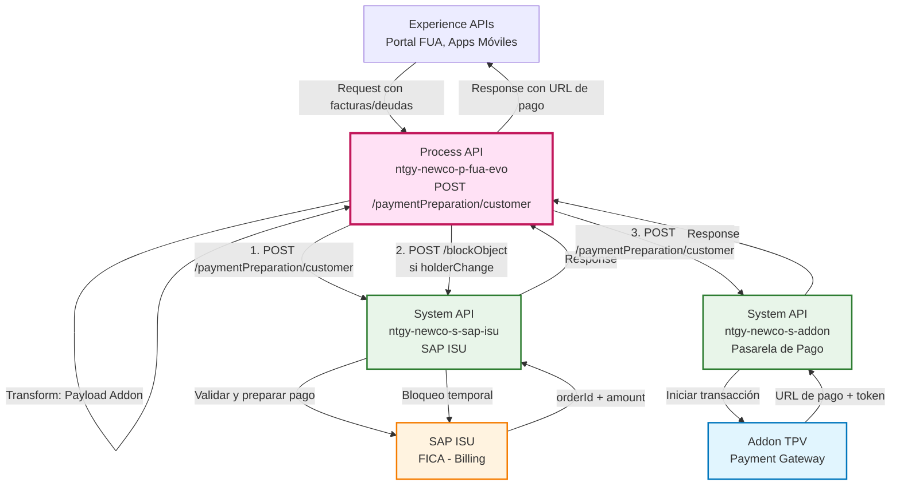
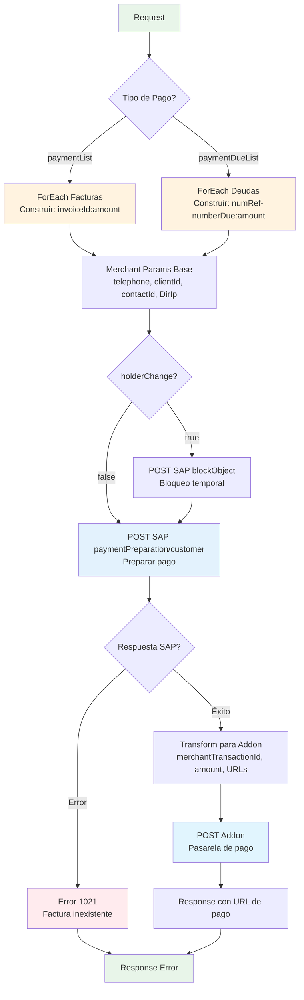
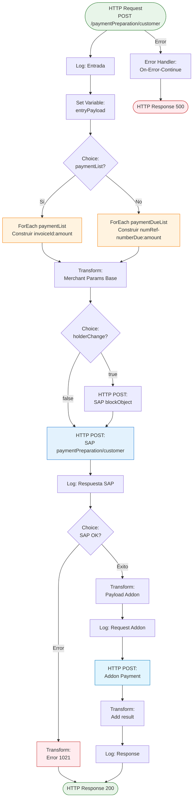
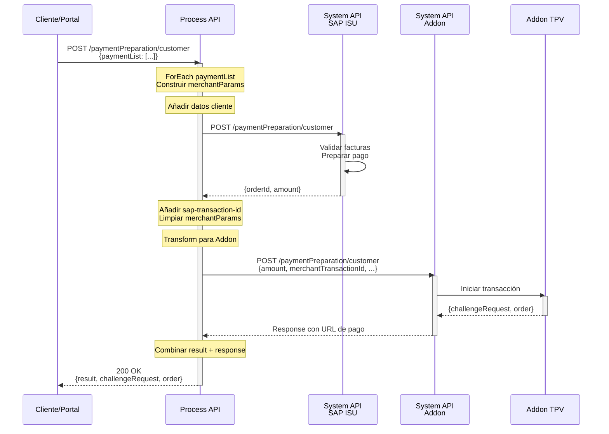
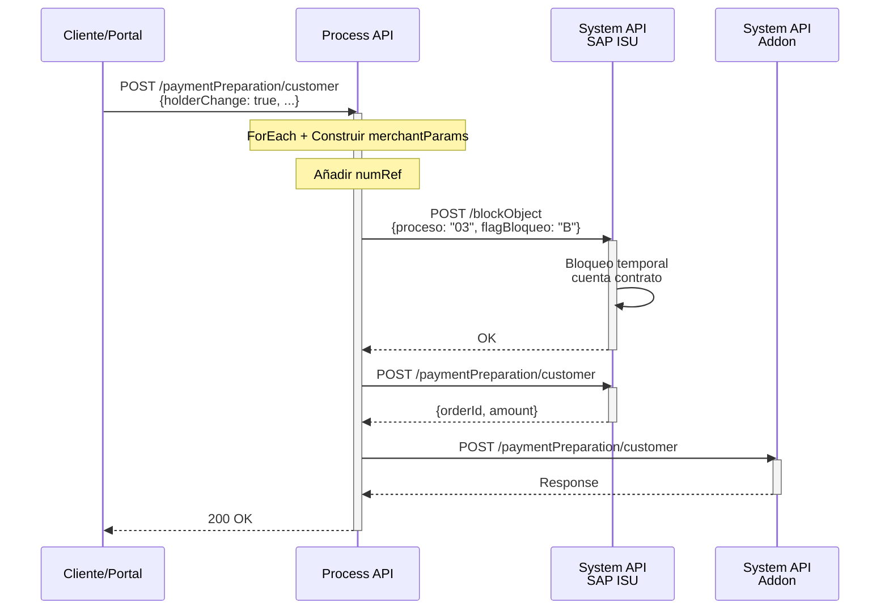
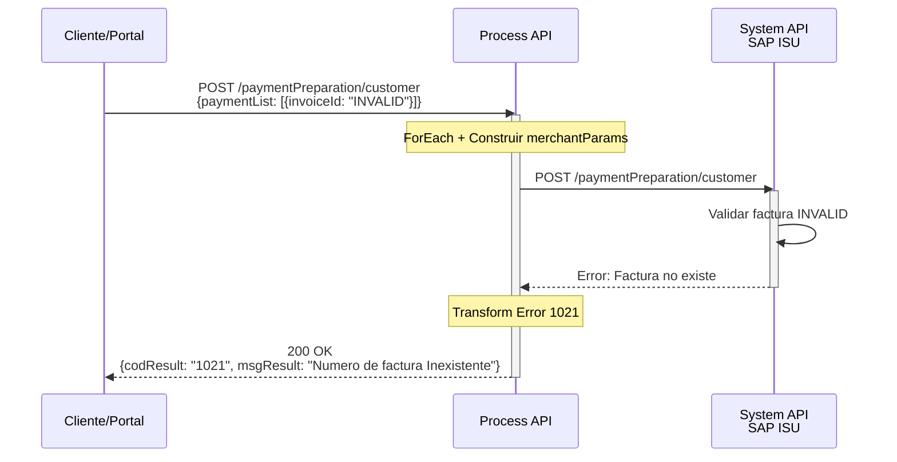

# POST /paymentPreparation/customer

## 📌 Descripción General

### Propósito del Endpoint

Este endpoint prepara pagos online para clientes mediante la orquestación de dos backends críticos: SAP ISU para validación y preparación del pago, y Addon como pasarela de pago (TPV). Procesa tanto pagos de facturas individuales como deudas acumuladas, construyendo dinámicamente los parámetros de comercio necesarios para la transacción.

### Tipo de API

**Capa:** Process API (API-Led Connectivity)

**Función:** Orquestación multi-backend para preparación de pagos de clientes

### Patrón de Integración

**Tipo:** Orquestación Compleja con Transformación de Datos

**Descripción:** 
1. Recibe request con lista de facturas o deudas
2. Construye merchantParams iterativamente (ForEach)
3. Valida y prepara pago en SAP ISU
4. Si hay cambio de titular, bloquea cuenta en SAP
5. Transforma datos para pasarela de pago
6. Envía a Addon (TPV) para iniciar transacción
7. Retorna URL de pago y datos de transacción

### Arquitectura API-Led Connectivity



---

## 💼 Propósito del Negocio

### Casos de Uso Principales

1. **Pago de Facturas Individuales**
   - Los clientes pueden pagar una o múltiples facturas
   - Beneficio: Flexibilidad en la gestión de pagos

2. **Pago de Deudas Acumuladas**
   - Permite pagar deudas pendientes por número de referencia
   - Beneficio: Regularización de situación financiera

3. **Cambio de Titular con Pago**
   - Proceso especial que bloquea temporalmente la cuenta
   - Beneficio: Seguridad en procesos de subrogación

### 🔗 Endpoints Dependientes

Este Process API consume los siguientes System APIs:

| System API | Endpoint | Método | Propósito |
|------------|----------|--------|-----------|
| `ntgy-newco-s-sap-isu` | `/paymentPreparation/customer` | POST | Validar y preparar pago en SAP ISU |
| `ntgy-newco-s-sap-isu` | `/blockObject` | POST | Bloquear cuenta temporalmente (cambio titular) |
| `ntgy-newco-s-addon` | `/paymentPreparation/customer` | POST | Iniciar transacción en pasarela de pago |

### Lógica de Negocio



**Pasos del Proceso:**

1. **Recepción:** Recibe lista de facturas o deudas a pagar
2. **Construcción merchantParams:** ForEach para concatenar datos de pago
3. **Bloqueo (opcional):** Si hay cambio de titular, bloquea cuenta
4. **Validación SAP:** Prepara pago y obtiene orderId
5. **Transformación:** Prepara payload para pasarela de pago
6. **Pasarela:** Envía a Addon para iniciar transacción
7. **Respuesta:** Retorna URL de pago y datos de transacción

### Transformaciones Aplicadas

**Construcción de merchantParams (Iterativa):**

| Paso | Transformación | Resultado |
|------|----------------|-----------|
| 1 | ForEach facturas/deudas | `invoiceId:amount;` o `numRef-numberDue:amount;` |
| 2 | Añadir datos cliente | `telephone:...; clientId:...; contactId:...; DirIp:...` |
| 3 | Añadir numRef (si holderChange) | `numRef:...; [anterior]` |
| 4 | Añadir transacción SAP | `sap-transaction-id:...; [anterior]` |
| 5 | Limpiar último `;` | `substringBeforeLast(merchantParams, ";")` |

**Transformación para Addon:**

| Campo Original | Campo Transformado | Transformación |
|----------------|-------------------|----------------|
| `payload.orderId` | `merchantTransactionId` | Eliminar primer carácter: `orderId[1 to contador]` |
| `payload.amount` | `amount` | Sin cambio |
| `entryPayload.errorURL` | `errorURL` | Sin cambio |
| `entryPayload.successURL` | `successURL` | Sin cambio |
| `merchantParams` | `merchantParams` | Concatenación completa |

### Contexto Empresarial

- **Dominio:** Pagos y Facturación
- **Sector:** Energía - Utilities
- **División:** Naturgy España - NewCo
- **Proceso de Negocio:** Preparación de pagos online para clientes

### Stakeholders

- **Clientes Residenciales**: Necesitan pagar facturas online
- **Departamento de Cobranza**: Gestiona pagos y deudas
- **Sistemas de Facturación**: SAP ISU como backend
- **Pasarela de Pago**: Addon como TPV

### Valor de Negocio

- **Conveniencia**: Pago online 24/7
- **Seguridad**: Validación en SAP antes de pago
- **Flexibilidad**: Pago de múltiples facturas o deudas
- **Trazabilidad**: merchantParams con información completa
- **Integración**: Orquestación transparente de backends

### Consumidores Potenciales

Este endpoint puede ser consumido por:
- Portal web de autoservicio FUA
- Aplicaciones móviles de clientes
- Sistemas de gestión de pagos
- Procesos de regularización de deudas

---

## 🔧 Especificación Técnica

### URLs por Ambiente

| Ambiente | URL Base | URL Completa |
|----------|----------|--------------|
| **Local** | `http://localhost:8081` | `http://localhost:8081/api/paymentPreparation/customer` |
| **Development** | `https://ntgy-newco-p-fua-evo-dev.us-e2.cloudhub.io` | `https://ntgy-newco-p-fua-evo-dev.us-e2.cloudhub.io/api/paymentPreparation/customer` |
| **UAT** | `https://ntgy-newco-p-fua-evo-uat.us-e2.cloudhub.io` | `https://ntgy-newco-p-fua-evo-uat.us-e2.cloudhub.io/api/paymentPreparation/customer` |
| **Production** | `https://ntgy-newco-p-fua-evo-pro.us-e2.cloudhub.io` | `https://ntgy-newco-p-fua-evo-pro.us-e2.cloudhub.io/api/paymentPreparation/customer` |

### Método HTTP

```
POST /api/paymentPreparation/customer
```

### Parámetros de Entrada

#### Headers (Requeridos)

| Header | Tipo | Descripción | Requerido |
|--------|------|-------------|-----------|
| `Content-Type` | string | Tipo de contenido (application/json) | Sí |
| `client_id` | string | Client ID de Anypoint Platform | Sí |
| `client_secret` | string | Client Secret de Anypoint Platform | Sí |
| `x-client-id` | string | ID del cliente en Salesforce | Sí |

#### Body (application/json)

**Estructura con paymentList (Facturas):**

```json
{
  "paymentList": [
    {
      "invoiceId": "string",
      "amount": "number"
    }
  ],
  "phoneChannel": "string",
  "contactId": "string",
  "DirIp": "string",
  "errorURL": "string",
  "successURL": "string",
  "holderChange": "boolean",
  "outContractAccountId": "string"
}
```

**Estructura con paymentDueList (Deudas):**

```json
{
  "paymentDueList": [
    {
      "numRef": "string",
      "numberDue": "string",
      "amount": "number"
    }
  ],
  "phoneChannel": "string",
  "contactId": "string",
  "DirIp": "string",
  "errorURL": "string",
  "successURL": "string",
  "holderChange": "boolean",
  "outContractAccountId": "string"
}
```

**Campos del Body:**

| Campo | Tipo | Descripción | Requerido |
|-------|------|-------------|-----------|
| `paymentList` | array | Lista de facturas a pagar | Sí* |
| `paymentList[].invoiceId` | string | ID de la factura | Sí |
| `paymentList[].amount` | number | Importe de la factura | Sí |
| `paymentDueList` | array | Lista de deudas a pagar | Sí* |
| `paymentDueList[].numRef` | string | Número de referencia | Sí |
| `paymentDueList[].numberDue` | string | Número de deuda (default: "0000") | No |
| `paymentDueList[].amount` | number | Importe de la deuda | Sí |
| `phoneChannel` | string | Teléfono del cliente | Sí |
| `contactId` | string | ID del contacto en Salesforce | Sí |
| `DirIp` | string | Dirección IP del cliente | Sí |
| `errorURL` | string | URL de redirección en caso de error | Sí |
| `successURL` | string | URL de redirección en caso de éxito | Sí |
| `holderChange` | boolean | Indica si hay cambio de titular | No |
| `outContractAccountId` | string | ID de cuenta contrato (si holderChange) | Condicional |

**Nota:** Se debe proporcionar `paymentList` O `paymentDueList`, no ambos.

### Respuestas

#### 200 OK - Éxito

**Descripción:** Pago preparado exitosamente en pasarela.

```json
{
  "result": {
    "codResult": "0000",
    "msgResult": "No hay error"
  },
  "challengeRequest": {
    "threeDSServerTransID": "string",
    "acsTransID": "string",
    "acsURL": "string",
    "messageVersion": "string",
    "challengeWindowSize": "string"
  },
  "order": {
    "paytpvToken": "string",
    "merchantTransactionId": "string"
  }
}
```

**Campos de Respuesta:**

| Campo | Tipo | Descripción |
|-------|------|-------------|
| `result.codResult` | string | Código de resultado ("0000" = éxito) |
| `result.msgResult` | string | Mensaje descriptivo |
| `challengeRequest` | object | Datos para 3D Secure |
| `challengeRequest.acsURL` | string | URL de autenticación 3DS |
| `order.paytpvToken` | string | Token de la transacción |
| `order.merchantTransactionId` | string | ID de transacción del comercio |

#### 200 OK - Factura Inexistente

**Descripción:** La factura no existe en SAP.

```json
{
  "result": {
    "codResult": "1021",
    "msgResult": "Numero de factura Inexistente"
  }
}
```

**Código Específico:**
- `1021`: Indica que la factura no existe o no es válida en SAP

#### 400 Bad Request - Error de Validación

**Descripción:** Parámetros inválidos o faltantes.

```json
{
  "error": {
    "code": "400",
    "message": "Parámetros requeridos faltantes"
  }
}
```

#### 500 Internal Server Error - Error de Sistema

**Descripción:** Error en SAP o Addon.

```json
{
  "result": {
    "id": "",
    "caseNumber": "",
    "codResult": "500",
    "msgResult": "Error description"
  }
}
```

### Autenticación

- **Tipo:** Client ID & Client Secret (Anypoint Platform)
- **Headers Requeridos:** `client_id`, `client_secret`, `x-client-id`

### Timeouts

| Tipo | Valor |
|------|-------|
| **Request Timeout** | 30 segundos |
| **Connection Timeout** | 10 segundos |

### Validaciones

1. **Headers requeridos:** Content-Type, client_id, client_secret, x-client-id
2. **Body JSON válido:** Debe ser JSON bien formado
3. **paymentList O paymentDueList:** Debe existir uno de los dos
4. **URLs válidas:** errorURL y successURL deben ser URLs válidas
5. **holderChange:** Si true, outContractAccountId es requerido

---

## 🏗️ Implementación Técnica

### Arquitectura del Flow



### Transformaciones DataWeave

#### 1. ForEach paymentList - Construcción de merchantParams

```dataweave
%dw 2.0
output application/java
---
// Por cada factura en el loop
vars.invoiceAmount ++ vars.merchantParams default vars.invoiceAmount

// Donde invoiceAmount se construye como:
vars.invoiceId ++ ":" ++ vars.amount ++ ";"
```

**Ejemplo:**
- Input: `[{invoiceId: "F001", amount: 100}, {invoiceId: "F002", amount: 50}]`
- Output: `"F001:100;F002:50;"`

#### 2. ForEach paymentDueList - Construcción de merchantParams

```dataweave
%dw 2.0
output application/java
---
// Por cada deuda en el loop
vars.numRefAmount ++ vars.merchantParams default vars.numRefAmount

// Donde numRefAmount se construye como:
vars.numRef ++ "-" ++ vars.numberDue ++ ":" ++ vars.amount ++ ";"
```

**Ejemplo:**
- Input: `[{numRef: "R001", numberDue: "0001", amount: 200}]`
- Output: `"R001-0001:200;"`

#### 3. Merchant Params Base

```dataweave
%dw 2.0
output application/java
---
"telephone: " ++ vars.entryPayload.phoneChannel ++ ";" ++
"clientId: " ++ vars.entryPayload.'x-client-id' ++ ";" ++
"contactId: " ++ vars.entryPayload.contactId ++ ";" ++
"DirIp:" ++ vars.entryPayload.'DirIp' ++ ";" ++ 
vars.merchantParams
```

**Propósito:** Añade información del cliente a merchantParams

#### 4. Merchant Params - Holder Change

```dataweave
%dw 2.0
output application/java
---
"numRef:" ++ vars.entryPayload.outContractAccountId ++ ";" ++ 
vars.merchantParams
```

**Propósito:** Añade número de referencia si hay cambio de titular

#### 5. Merchant Params - SAP Transaction

```dataweave
%dw 2.0
output application/java
---
"sap-transaction-id: " ++ payload.orderId ++ ";" ++
vars.merchantParams
```

**Propósito:** Añade ID de transacción de SAP

#### 6. Merchant Params - Limpieza Final

```dataweave
%dw 2.0
import * from dw::core::Strings
output application/java
---
substringBeforeLast(vars.merchantParams, ";")
```

**Propósito:** Elimina el último `;` de la cadena

#### 7. OrderId - Eliminar Primer Carácter

```dataweave
%dw 2.0
output application/java
var contador = sizeOf(payload.orderId) - 1
---
payload.orderId[1 to contador]
```

**Propósito:** Elimina el primer carácter del orderId de SAP

#### 8. Payload para Addon

```dataweave
%dw 2.0
output application/json
---
{
  "amount": payload.amount,
  "country": "ES",
  "currency": "EUR",
  "description": "Pago Online del Cliente " ++ vars.entryPayload.'x-client-id',
  "merchantTransactionId": vars.orderId,
  "operationType": "DEBIT",
  "customerId": vars.entryPayload.'x-client-id',
  "errorURL": vars.entryPayload.errorURL,
  "successURL": vars.entryPayload.successURL,
  "statusURL": p('ntgy-newco-e-paondi.url') ++ p('ntgy-newco-e-paondi.path'),
  "merchantParams": vars.merchantParams
}
```

**Propósito:** Construye payload completo para pasarela de pago Addon

#### 9. Response Final

```dataweave
%dw 2.0
output application/json
---
{
  "result": {
    "codResult": "0000",
    "msgResult": "No hay error"
  }
} ++ payload
```

**Propósito:** Combina result estándar con respuesta de Addon

### Configuración HTTP

**HTTP Request Configurations:**

1. **SAP ISU:**
   - Config: `HTTP_Request_ntgy-newco-s-sap`
   - Host: `mule-worker-internal-ntgy-newco-s-sap-isu.de-c1.cloudhub.io`
   - Port: `8091`
   - Protocol: `HTTP`
   - Base Path: `/api`
   - Timeout: `30000` ms
   - Endpoints:
     - `${ntgy-newco-s-sap.functions.postPayPrepCustomer}` → `/paymentPreparation/customer`
     - `${ntgy-newco-s-sap.functions.blockObject}` → `/blockObject`

2. **Addon (Pasarela de Pago):**
   - Config: `HTTP_Request_ntgy-newco-s-addon`
   - Host: `mule-worker-internal-ntgy-newco-s-addon.de-c1.cloudhub.io`
   - Port: `8091`
   - Protocol: `HTTP`
   - Base Path: `/api`
   - Endpoint: `${ntgy-newco-s-addon.pathPayPrepCustomer}` → `/paymentPreparation/customer`

### Variables de Flow

| Variable | Tipo | Descripción | Origen |
|----------|------|-------------|--------|
| `entryPayload` | object | Payload original completo | Request body |
| `merchantParams` | string | Parámetros concatenados | Construcción iterativa |
| `invoiceId` | string | ID de factura (en loop) | paymentList item |
| `amount` | number | Importe (en loop) | paymentList/paymentDueList item |
| `invoiceAmount` | string | Factura formateada | Construcción en loop |
| `numRef` | string | Número de referencia (en loop) | paymentDueList item |
| `numberDue` | string | Número de deuda (en loop) | paymentDueList item |
| `numRefAmount` | string | Deuda formateada | Construcción en loop |
| `blockObjectReq` | object | Request para bloqueo SAP | Construcción condicional |
| `orderId` | string | ID de transacción (sin 1er char) | Respuesta SAP transformada |

### Patrones de Diseño

**Patrón:** Orquestación Multi-Backend

**Justificación:** 
- SAP ISU valida y prepara el pago
- Addon gestiona la transacción con TPV
- Separación de responsabilidades clara

**Patrón:** Construcción Iterativa (ForEach)

**Justificación:**
- Procesa listas de longitud variable
- Construye merchantParams dinámicamente
- Concatenación acumulativa eficiente

**Patrón:** Choice para Lógica Condicional

**Justificación:**
- 3 puntos de decisión en el flujo
- Manejo de diferentes tipos de pago
- Validación de respuestas

### Diagramas de Secuencia

#### 1. Flujo Normal - Pago de Facturas



#### 2. Flujo con Cambio de Titular



#### 3. Flujo con Error - Factura Inexistente



---

## 💻 Ejemplos de Uso

### Ejemplo 1: Pago de Facturas Múltiples

**Request:**

```bash
curl -X POST "https://ntgy-newco-p-fua-evo-pro.us-e2.cloudhub.io/api/paymentPreparation/customer" \
  -H "Content-Type: application/json" \
  -H "client_id: YOUR_CLIENT_ID" \
  -H "client_secret: YOUR_CLIENT_SECRET" \
  -H "x-client-id: 0011234567890ABC" \
  -d '{
    "paymentList": [
      {
        "invoiceId": "FE001234567890",
        "amount": 125.50
      },
      {
        "invoiceId": "FE001234567891",
        "amount": 89.30
      }
    ],
    "phoneChannel": "+34612345678",
    "contactId": "0031234567890DEF",
    "DirIp": "192.168.1.100",
    "errorURL": "https://portal.naturgy.com/payment/error",
    "successURL": "https://portal.naturgy.com/payment/success",
    "holderChange": false
  }'
```

**Response:**

```json
{
  "result": {
    "codResult": "0000",
    "msgResult": "No hay error"
  },
  "challengeRequest": {
    "threeDSServerTransID": "3ac7caa7-aa42-2663-791b-2ac05a542c4a",
    "acsTransID": "13c701a3-5a88-4c45-89e9-ef65e50a8bf9",
    "acsURL": "https://acs.addon.com/3ds/challenge",
    "messageVersion": "2.1.0",
    "challengeWindowSize": "05"
  },
  "order": {
    "paytpvToken": "abc123def456ghi789",
    "merchantTransactionId": "1234567890"
  }
}
```

### Ejemplo 2: Pago de Deudas

**Request:**

```bash
curl -X POST "https://ntgy-newco-p-fua-evo-pro.us-e2.cloudhub.io/api/paymentPreparation/customer" \
  -H "Content-Type: application/json" \
  -H "client_id: YOUR_CLIENT_ID" \
  -H "client_secret: YOUR_CLIENT_SECRET" \
  -H "x-client-id: 0011234567890ABC" \
  -d '{
    "paymentDueList": [
      {
        "numRef": "1900123456",
        "numberDue": "0001",
        "amount": 250.75
      }
    ],
    "phoneChannel": "+34612345678",
    "contactId": "0031234567890DEF",
    "DirIp": "192.168.1.100",
    "errorURL": "https://portal.naturgy.com/payment/error",
    "successURL": "https://portal.naturgy.com/payment/success"
  }'
```

**Response:**

```json
{
  "result": {
    "codResult": "0000",
    "msgResult": "No hay error"
  },
  "challengeRequest": {
    "threeDSServerTransID": "4bd8dbb8-bb53-3774-892c-3bd16b653d5b",
    "acsTransID": "24d812b4-6b99-5d56-90f0-fg76f61b9cg0",
    "acsURL": "https://acs.addon.com/3ds/challenge",
    "messageVersion": "2.1.0",
    "challengeWindowSize": "05"
  },
  "order": {
    "paytpvToken": "xyz789uvw456rst123",
    "merchantTransactionId": "9876543210"
  }
}
```

### Ejemplo 3: Cambio de Titular con Pago

**Request:**

```bash
curl -X POST "https://ntgy-newco-p-fua-evo-pro.us-e2.cloudhub.io/api/paymentPreparation/customer" \
  -H "Content-Type: application/json" \
  -H "client_id: YOUR_CLIENT_ID" \
  -H "client_secret: YOUR_CLIENT_SECRET" \
  -H "x-client-id: 0011234567890ABC" \
  -d '{
    "paymentList": [
      {
        "invoiceId": "FE001234567890",
        "amount": 150.00
      }
    ],
    "phoneChannel": "+34612345678",
    "contactId": "0031234567890DEF",
    "DirIp": "192.168.1.100",
    "errorURL": "https://portal.naturgy.com/payment/error",
    "successURL": "https://portal.naturgy.com/payment/success",
    "holderChange": true,
    "outContractAccountId": "1900123456"
  }'
```

**Response:**

```json
{
  "result": {
    "codResult": "0000",
    "msgResult": "No hay error"
  },
  "challengeRequest": {
    "threeDSServerTransID": "5ce9ecc9-cc64-4885-903d-4ce27c764e6c",
    "acsTransID": "35e923c5-7c00-6e67-01g1-hg87g72c0dh1",
    "acsURL": "https://acs.addon.com/3ds/challenge",
    "messageVersion": "2.1.0",
    "challengeWindowSize": "05"
  },
  "order": {
    "paytpvToken": "mno456pqr789stu012",
    "merchantTransactionId": "5432109876"
  }
}
```

### Ejemplo 4: Error - Factura Inexistente

**Request:**

```bash
curl -X POST "https://ntgy-newco-p-fua-evo-pro.us-e2.cloudhub.io/api/paymentPreparation/customer" \
  -H "Content-Type: application/json" \
  -H "client_id: YOUR_CLIENT_ID" \
  -H "client_secret: YOUR_CLIENT_SECRET" \
  -H "x-client-id: 0011234567890ABC" \
  -d '{
    "paymentList": [
      {
        "invoiceId": "FE999999999999",
        "amount": 100.00
      }
    ],
    "phoneChannel": "+34612345678",
    "contactId": "0031234567890DEF",
    "DirIp": "192.168.1.100",
    "errorURL": "https://portal.naturgy.com/payment/error",
    "successURL": "https://portal.naturgy.com/payment/success"
  }'
```

**Response:**

```json
{
  "result": {
    "codResult": "1021",
    "msgResult": "Numero de factura Inexistente"
  }
}
```

---

## 📋 Resumen de Correcciones Realizadas

### Cambios Principales

1. **Endpoints Dependientes Corregidos:**
   - ✅ Confirmado: `ntgy-newco-s-sap-isu` → `/paymentPreparation/customer`
   - ✅ Confirmado: `ntgy-newco-s-sap-isu` → `/blockObject`
   - ✅ Confirmado: `ntgy-newco-s-addon` → `/paymentPreparation/customer`

2. **Flujo de Orquestación Actualizado:**
   - ✅ ForEach para construcción iterativa de merchantParams
   - ✅ Bloqueo condicional de cuenta (holderChange)
   - ✅ Validación en SAP ISU
   - ✅ Transformación para Addon
   - ✅ Respuesta con URL de pago

3. **Transformaciones DataWeave Documentadas:**
   - ✅ 9 transformaciones completas con ejemplos
   - ✅ Construcción iterativa de merchantParams
   - ✅ Limpieza de orderId (eliminar primer carácter)
   - ✅ Payload completo para Addon

4. **Diagramas Actualizados:**
   - ✅ Arquitectura API-Led Connectivity
   - ✅ Lógica de negocio con Choice y ForEach
   - ✅ 3 diagramas de secuencia (normal, holderChange, error)
   - ✅ Flowchart de implementación técnica

5. **Ejemplos de Uso Completos:**
   - ✅ 4 ejemplos con curl
   - ✅ Casos: facturas múltiples, deudas, holderChange, error

La documentación ahora refleja con precisión la implementación real del código analizado en `paymentPreparation_CustomerFlow`.
