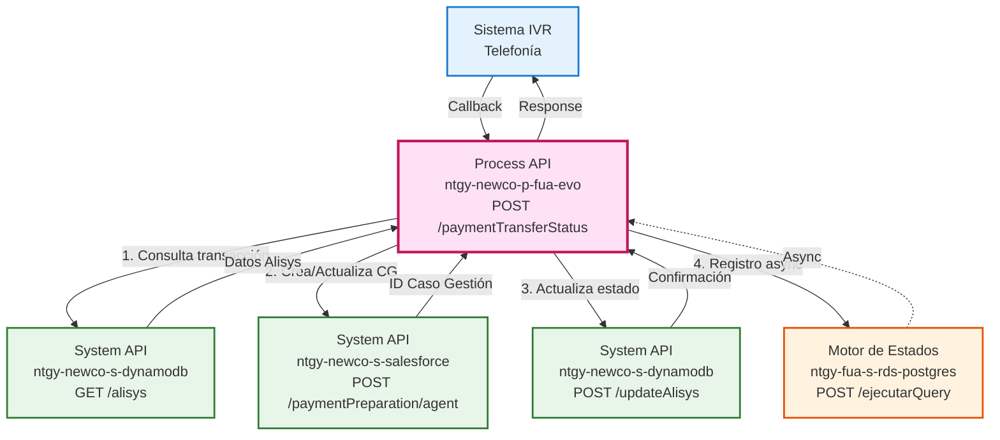
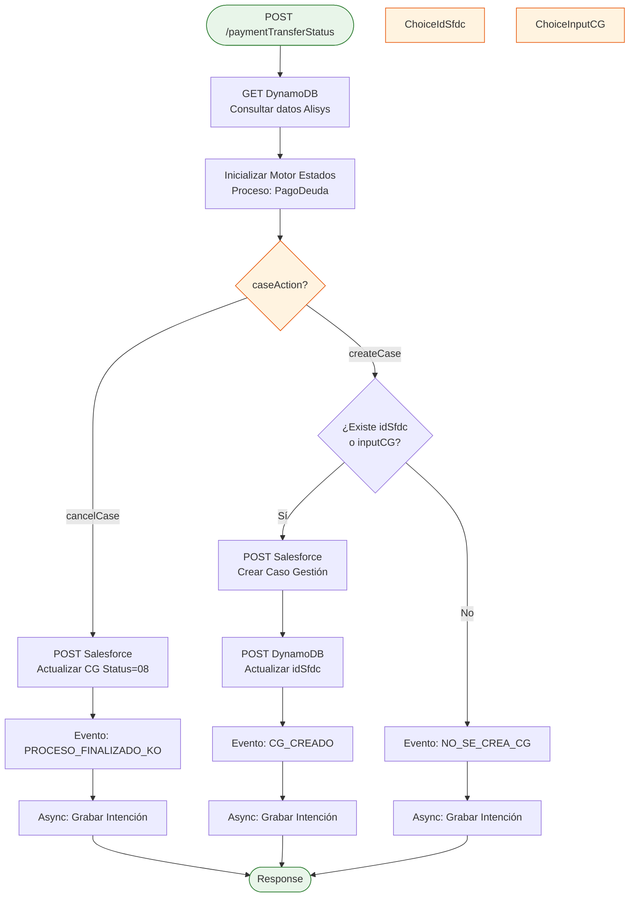
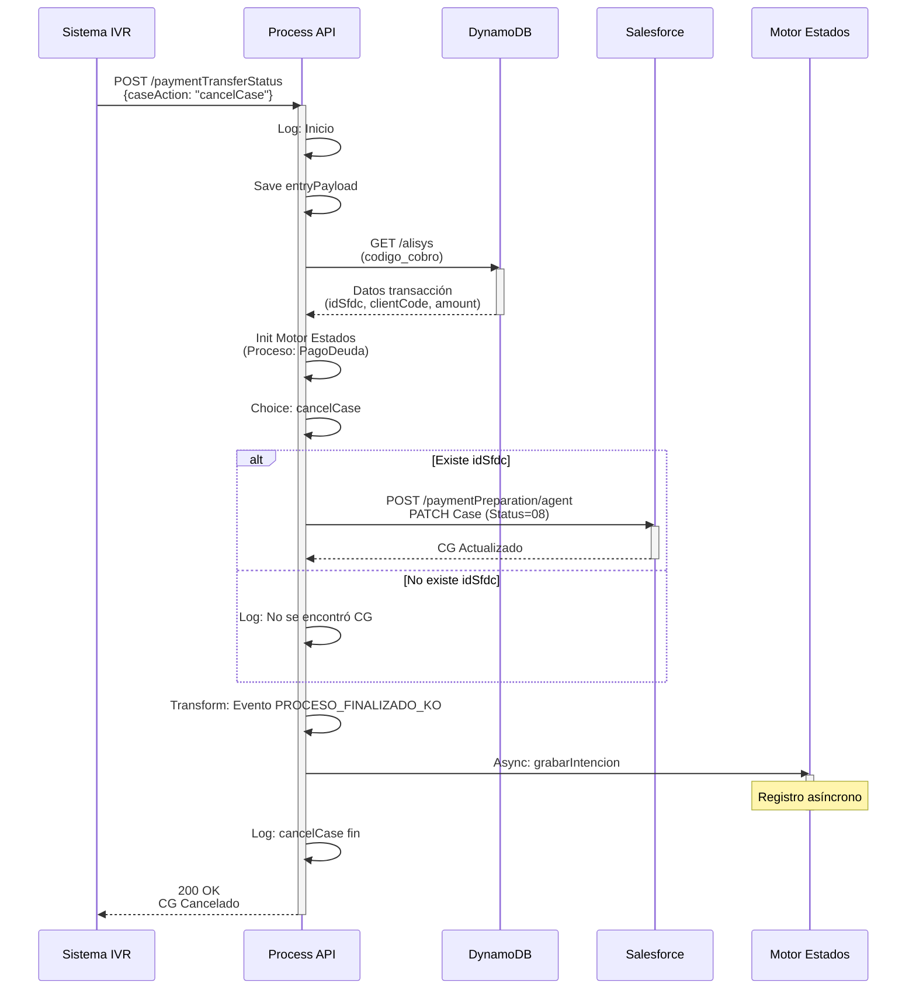
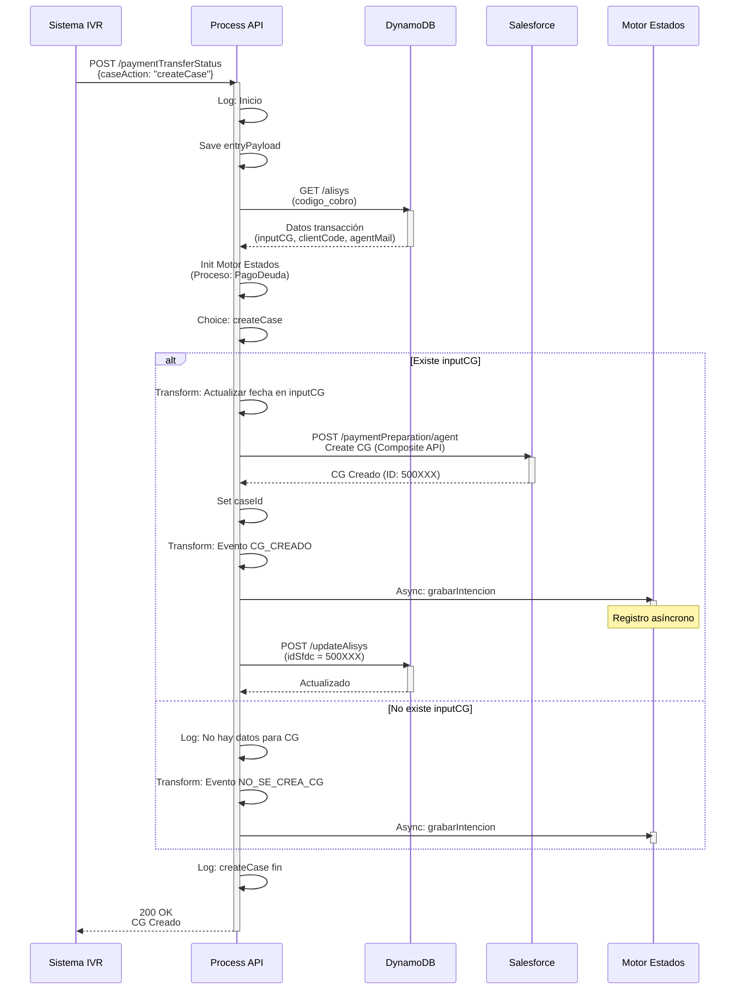
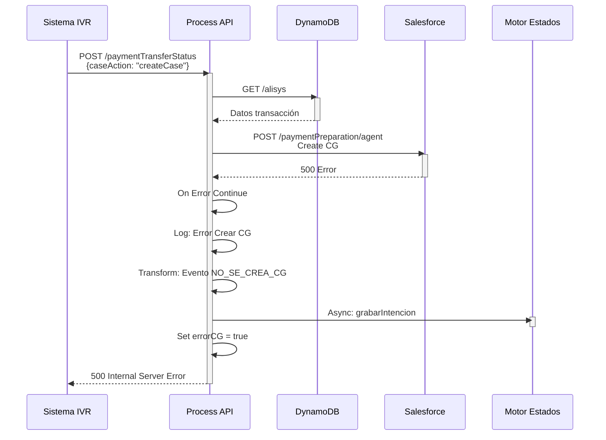

# POST /paymentTransferStatus

## 📌 Descripción General

### Propósito del Endpoint

Este endpoint actúa como un **callback** que se invoca desde el sistema de telefonía IVR (Interactive Voice Response) para gestionar el estado de una transferencia de llamada relacionada con un pago por tarjeta. Dependiendo del resultado de la transferencia, el endpoint puede **crear** o **cancelar** un Caso de Gestión en Salesforce, actualizando el estado del proceso de pago en múltiples sistemas.

### Tipo de API

**Capa:** Process API (API-Led Connectivity)

**Función:** Orquestación compleja de múltiples backends para gestión de callbacks de pagos IVR

### Patrón de Integración

**Tipo:** Orquestación con Lógica Condicional + Procesamiento Asíncrono

**Descripción:** Este endpoint implementa un patrón de orquestación complejo que:
1. Consulta información de la transacción en DynamoDB
2. Inicializa el contexto del Motor de Estados
3. Ejecuta lógica condicional según el parámetro `caseAction`
4. Realiza operaciones en Salesforce (crear/actualizar CG)
5. Actualiza el estado en DynamoDB
6. Registra eventos de forma asíncrona en el Motor de Estados

### Arquitectura API-Led Connectivity



---

## 💼 Propósito del Negocio

### Casos de Uso Principales

1. **Cancelación de Pago por Transferencia Fallida (cancelCase)**
   - Cuando el sistema IVR no puede transferir la llamada al agente para completar el pago
   - Se actualiza el Caso de Gestión existente en Salesforce con estado "08" (cancelado)
   - Se registra el evento de fallo en el Motor de Estados
   - Beneficio: Tracking completo de intentos de pago fallidos

2. **Creación de Caso de Gestión por Transferencia Exitosa (createCase)**
   - Cuando la transferencia de llamada al agente es exitosa
   - Se crea un nuevo Caso de Gestión en Salesforce para tracking del pago
   - Se actualiza DynamoDB con el ID del CG creado
   - Se registra el evento de creación en el Motor de Estados
   - Beneficio: Trazabilidad completa del proceso de pago por IVR

3. **Tracking de Proceso de Pago (Motor de Estados)**
   - Registro de todos los eventos del proceso "PagoDeuda"
   - Permite auditoría y análisis de flujos de pago
   - Beneficio: Visibilidad completa del customer journey en pagos IVR

### 🔗 Endpoints Dependientes

Este Process API consume los siguientes System APIs y sistemas:

| System API | Endpoint | Método | Propósito |
|------------|----------|--------|-----------|
| `ntgy-newco-s-dynamodb` | `/alisys` | GET | Consulta de datos de transacción de pago (idTransaccion, clientCode, amount, idSfdc, inputCG) |
| `ntgy-newco-s-salesforce` | `/paymentPreparation/agent` | POST | Creación o actualización de Caso de Gestión mediante Composite API |
| `ntgy-newco-s-dynamodb` | `/updateAlisys` | POST | Actualización de registro Alisys con ID del Caso de Gestión creado |
| `ntgy-fua-s-rds-postgres` | `/ejecutarQuery` | POST | Ejecución de stored procedure me_procesar_evento para registro de eventos en Motor de Estados (proceso PagoDeuda) |

### Lógica de Orquestación



### Configuración de Conectores

**Archivo:** `src/main/mule/ntgy-newco-p-fua.xml`

**Flow Principal (líneas 1046-1048):**
```xml
<flow name="post:\paymentTransferStatus:ntgy-newco-p-fua-config">
    <flow-ref doc:name="paymentTransferStatus" 
              name="paymentTransferStatus_AgentFlow"/>
</flow>
```

**Sub-flow de Implementación:**
El código proporcionado muestra la implementación completa del sub-flow `paymentTransferStatus_AgentFlow` con:
- Consulta a DynamoDB (getAlisysDynamo)
- Lógica condicional (Choice router)
- Operaciones en Salesforce (HTTP Request)
- Actualización de DynamoDB
- Registro asíncrono en Motor de Estados

### Transformaciones DataWeave Detalladas

#### 1. Consulta DynamoDB por ID de Transacción

```dataweave
%dw 2.0
output application/json
---
codigo_cobro: vars.entryPayload.idTransaccion
```

#### 2. Inicialización de Datos para Motor de Estados

```dataweave
%dw 2.0
output application/java
---
{
    evento: "",
    proceso: "PagoDeuda",
    nif: vars.getAlisys.clientCode,
    billingAccount: "",
    contrato: "",
    casoGestion: "",
    jsonPayload: {}
}
```

#### 3. Actualización de Fecha en Input CG (createCase)

```dataweave
%dw 2.0
output application/json

fun actualizarFecha(composite) = composite update {
    case .compositeRequest[0].body.comments -> $ replace /fecha: .*/ with (
        "fecha: " ++ ((now() >> "Europe/Madrid") as String {format: "yyyy-MM-dd HH:mm:ss"})  
    )
}
---
actualizarFecha(read(vars.getAlisys.inputCG, "application/json"))
```

### Patrones de Diseño

**Patrón 1: Callback Pattern**

**Justificación:** Este endpoint implementa el patrón callback para permitir que el sistema IVR notifique el resultado de una transferencia de llamada de forma asíncrona.

**Patrón 2: Saga Pattern (Compensación)**

**Justificación:** En caso de error al crear el CG, se registra un evento de compensación en el Motor de Estados para mantener la consistencia del proceso.

**Patrón 3: Async Fire-and-Forget**

**Justificación:** El registro en Motor de Estados se hace de forma asíncrona para no bloquear la respuesta al sistema IVR.

### Diagramas de Secuencia

#### 1. Flujo cancelCase - Transferencia Fallida



#### 2. Flujo createCase - Transferencia Exitosa



#### 3. Flujo con Error en Salesforce



### Manejo de Errores

**Estrategia:** Try-Catch con On Error Continue + Registro de Eventos

**Tipos de Errores Manejados:**

1. **Error al Actualizar CG en Salesforce (cancelCase)**
   - Capturado por: `<on-error-continue>`
   - Acción: Log del error + Continúa el flujo
   - Respuesta: Devuelve el error de Salesforce

2. **Error al Crear CG en Salesforce (createCase)**
   - Capturado por: `<on-error-continue>`
   - Acción: Log del error + Evento NO_SE_CREA_CG + Set errorCG flag
   - Respuesta: 500 Internal Server Error

3. **Error en DynamoDB**
   - No hay manejo específico
   - Se propaga al error handler global

4. **Error en Motor de Estados**
   - Procesamiento asíncrono, no afecta la respuesta
   - Errores registrados en logs del Motor de Estados

**Error Handler Global:** El endpoint utiliza el error handler global del proyecto definido en `errorManagerFlow`.

---

## 💻 Ejemplos de Uso

### Ejemplo 1: Cancelar Caso de Gestión (cancelCase)

#### Request con cURL

```bash
curl -X POST "https://ntgy-newco-p-fua-evo-dev.us-e2.cloudhub.io/api/paymentTransferStatus" \
  -H "Content-Type: application/json" \
  -H "client_id: YOUR_CLIENT_ID" \
  -H "client_secret: YOUR_CLIENT_SECRET" \
  -d '{
    "idTransaccion": "PAY-2026-03-09-12345",
    "caseAction": "cancelCase"
  }'
```

#### Response (200 OK)

```json
{
  "compositeResponse": [
    {
      "body": {
        "id": "500XXXXXXXXXXXXXXX",
        "success": true,
        "errors": []
      },
      "httpHeaders": {
        "Location": "/services/data/v52.0/sobjects/Case/500XXXXXXXXXXXXXXX"
      },
      "httpStatusCode": 200,
      "referenceId": "updatedCase"
    }
  ]
}
```

### Ejemplo 2: Crear Caso de Gestión (createCase)

#### Request con cURL

```bash
curl -X POST "https://ntgy-newco-p-fua-evo-dev.us-e2.cloudhub.io/api/paymentTransferStatus" \
  -H "Content-Type: application/json" \
  -H "client_id: YOUR_CLIENT_ID" \
  -H "client_secret: YOUR_CLIENT_SECRET" \
  -d '{
    "idTransaccion": "PAY-2026-03-09-67890",
    "caseAction": "createCase"
  }'
```

#### Response (200 OK)

```json
{
  "compositeResponse": [
    {
      "body": {
        "id": "500YYYYYYYYYYYYYY",
        "success": true,
        "errors": []
      },
      "httpHeaders": {
        "Location": "/services/data/v52.0/sobjects/Case/500YYYYYYYYYYYYYY"
      },
      "httpStatusCode": 201,
      "referenceId": "newCase"
    }
  ]
}
```

### Ejemplo 3: JavaScript (Node.js)

```javascript
const axios = require('axios');

async function paymentTransferCallback(idTransaccion, caseAction) {
  try {
    const response = await axios.post(
      'https://ntgy-newco-p-fua-evo-dev.us-e2.cloudhub.io/api/paymentTransferStatus',
      {
        idTransaccion: idTransaccion,
        caseAction: caseAction
      },
      {
        headers: {
          'Content-Type': 'application/json',
          'client_id': process.env.CLIENT_ID,
          'client_secret': process.env.CLIENT_SECRET
        }
      }
    );

    console.log('✅ Callback procesado exitosamente');
    console.log('Respuesta:', JSON.stringify(response.data, null, 2));
    
    if (response.data.compositeResponse) {
      const caseId = response.data.compositeResponse[0].body.id;
      console.log(`ID del Caso de Gestión: ${caseId}`);
    }
    
    return response.data;
  } catch (error) {
    console.error('❌ Error en callback:', error.response?.data || error.message);
    throw error;
  }
}

// Uso - Cancelar CG
paymentTransferCallback('PAY-2026-03-09-12345', 'cancelCase');

// Uso - Crear CG
paymentTransferCallback('PAY-2026-03-09-67890', 'createCase');
```

### Ejemplo 4: Python (Requests)

```python
import requests
import json
import os

def payment_transfer_callback(id_transaccion, case_action):
    """
    Envía callback de transferencia de pago IVR
    
    Args:
        id_transaccion (str): ID de la transacción de pago
        case_action (str): 'cancelCase' o 'createCase'
    """
    url = 'https://ntgy-newco-p-fua-evo-dev.us-e2.cloudhub.io/api/paymentTransferStatus'
    
    headers = {
        'Content-Type': 'application/json',
        'client_id': os.getenv('CLIENT_ID'),
        'client_secret': os.getenv('CLIENT_SECRET')
    }
    
    payload = {
        'idTransaccion': id_transaccion,
        'caseAction': case_action
    }
    
    try:
        response = requests.post(url, headers=headers, json=payload, timeout=30)
        response.raise_for_status()
        
        data = response.json()
        print(f"✅ Callback procesado: {case_action}")
        print(f"Respuesta: {json.dumps(data, indent=2)}")
        
        if 'compositeResponse' in data:
            case_id = data['compositeResponse'][0]['body']['id']
            print(f"ID del Caso de Gestión: {case_id}")
        
        return data
        
    except requests.exceptions.Timeout:
        print("⚠️ Timeout: El servicio no respondió en 30 segundos")
        return None
    except requests.exceptions.RequestException as e:
        print(f"❌ Error: {e}")
        if hasattr(e.response, 'text'):
            print(f"Detalles: {e.response.text}")
        return None

# Uso
payment_transfer_callback('PAY-2026-03-09-12345', 'cancelCase')
payment_transfer_callback('PAY-2026-03-09-67890', 'createCase')
```

### Ejemplo 5: Error - Sin Datos para Crear CG

#### Request

```bash
curl -X POST "https://ntgy-newco-p-fua-evo-dev.us-e2.cloudhub.io/api/paymentTransferStatus" \
  -H "Content-Type: application/json" \
  -H "client_id: YOUR_CLIENT_ID" \
  -H "client_secret: YOUR_CLIENT_SECRET" \
  -d '{
    "idTransaccion": "PAY-INVALID-12345",
    "caseAction": "createCase"
  }'
```

#### Response (200 OK - Sin CG creado)

```json
{
  "message": "No se ha podido crear CG porque no hay idCobro o no hay entrada para CG",
  "idTransaccion": "PAY-INVALID-12345",
  "evento": "NO_SE_CREA_CG"
}
```

### Ejemplo 6: Error - Fallo en Salesforce

#### Request

```bash
curl -X POST "https://ntgy-newco-p-fua-evo-dev.us-e2.cloudhub.io/api/paymentTransferStatus" \
  -H "Content-Type: application/json" \
  -H "client_id: YOUR_CLIENT_ID" \
  -H "client_secret: YOUR_CLIENT_SECRET" \
  -d '{
    "idTransaccion": "PAY-2026-03-09-ERROR",
    "caseAction": "createCase"
  }'
```

#### Response (500 Internal Server Error)

```json
{
  "error": "Error al crear Caso de Gestión en Salesforce",
  "message": "INVALID_FIELD: Field 'Status' is not valid",
  "idTransaccion": "PAY-2026-03-09-ERROR",
  "timestamp": "2026-03-09T15:30:00Z"
}
```

**Pasos del Proceso:**

#### Modo cancelCase:
1. **Consulta DynamoDB**: Obtiene datos de la transacción por `idTransaccion`
2. **Inicializa Motor Estados**: Crea contexto del proceso "PagoDeuda"
3. **Actualiza Salesforce**: Marca el CG existente como cancelado (Status=08)
4. **Registra Evento**: Evento "PROCESO_FINALIZADO_KO" de forma asíncrona
5. **Responde**: Confirma la cancelación

#### Modo createCase:
1. **Consulta DynamoDB**: Obtiene datos de la transacción por `idTransaccion`
2. **Inicializa Motor Estados**: Crea contexto del proceso "PagoDeuda"
3. **Valida Datos**: Verifica existencia de `idSfdc` o `inputCG`
4. **Crea CG en Salesforce**: Usa Composite API para crear el Caso de Gestión
5. **Actualiza DynamoDB**: Guarda el ID del CG creado
6. **Registra Evento**: Evento "CG_CREADO" de forma asíncrona
7. **Responde**: Confirma la creación

### Transformaciones Aplicadas

**Transformaciones DataWeave Principales:**

1. **Input para consulta DynamoDB:**
```dataweave
{
  codigo_cobro: vars.entryPayload.idTransaccion
}
```

2. **Inicialización Motor de Estados:**
```dataweave
{
  evento: "",
  proceso: "PagoDeuda",
  nif: vars.getAlisys.clientCode,
  billingAccount: "",
  contrato: "",
  casoGestion: "",
  jsonPayload: {}
}
```

3. **Input para actualizar CG (cancelCase):**
```dataweave
{
  "allOrNone": true,
  "compositeRequest": [{
    "method": "PATCH",
    "url": "/services/data/v52.0/sobjects/Case/" ++ vars.getAlisys.idSfdc,
    "body": {
      "Status": "08",
      "NewCo_OperationResult__c": "KO",
      "NewCo_ResultDescription__c": "No se ha podido transferir la llamada para el pago por IVR"
    }
  }]
}
```

4. **Input para crear CG (createCase):**
```dataweave
// Actualiza fecha en el inputCG almacenado en DynamoDB
actualizarFecha(read(vars.getAlisys.inputCG, "application/json"))
```

5. **Input para actualizar DynamoDB:**
```dataweave
{
  "keys": {
    "leaseKey": vars.entryPayload.idTransaccion
  },
  "updateValues": [{
    "name": "idSfdc",
    "value": vars.idCasoGestion.compositeResponse[0].body.id
  }]
}
```

### Contexto Empresarial

- **Dominio:** Gestión de Pagos y Cobros
- **Sector:** Energía - Utilities
- **División:** Naturgy España - NewCo
- **Proceso de Negocio:** PagoDeuda (Pago de Deuda mediante IVR)
- **Canal:** IVR (Interactive Voice Response) - Telefonía

### Stakeholders

- **Sistema IVR**: Invoca el callback tras intentar transferir la llamada
- **Agentes de Call Center**: Reciben las llamadas transferidas para procesar pagos
- **Equipo de Cobros**: Monitorea los Casos de Gestión de pagos
- **Equipo de Operaciones**: Supervisa el Motor de Estados para tracking de procesos
- **Clientes**: Beneficiarios finales del proceso de pago por IVR

### Valor de Negocio

- **Trazabilidad Completa**: Registro de todos los eventos del proceso de pago
- **Gestión de Excepciones**: Manejo automático de transferencias fallidas
- **Auditoría**: Tracking completo en Motor de Estados para análisis
- **Eficiencia Operativa**: Automatización de creación/cancelación de CGs
- **Mejora Continua**: Datos para análisis de tasa de éxito de transferencias IVR

### Consumidores Potenciales

Este endpoint es consumido por:
- Sistema IVR de Naturgy (callback automático)
- Plataforma de telefonía (Amazon Connect u otro proveedor)
- Sistemas de monitoreo de pagos

---

## 🔧 Especificación Técnica

### URLs por Ambiente

| Ambiente | URL Base | URL Completa |
|----------|----------|--------------|
| **Local** | `http://localhost:8081` | `http://localhost:8081/api/paymentTransferStatus` |
| **Development** | `https://ntgy-newco-p-fua-evo-dev.us-e2.cloudhub.io` | `https://ntgy-newco-p-fua-evo-dev.us-e2.cloudhub.io/api/paymentTransferStatus` |
| **UAT** | `https://ntgy-newco-p-fua-evo-uat.us-e2.cloudhub.io` | `https://ntgy-newco-p-fua-evo-uat.us-e2.cloudhub.io/api/paymentTransferStatus` |
| **Production** | `https://ntgy-newco-p-fua-evo-pro.us-e2.cloudhub.io` | `https://ntgy-newco-p-fua-evo-pro.us-e2.cloudhub.io/api/paymentTransferStatus` |

### Método HTTP

```
POST /api/paymentTransferStatus
```

### Parámetros de Entrada

#### Body (application/json)

| Campo | Tipo | Obligatorio | Descripción |
|-------|------|-------------|-------------|
| `idTransaccion` | string | ✅ Sí | ID único de la transacción de pago (código de cobro en DynamoDB) |
| `caseAction` | string | ✅ Sí | Acción a realizar: `"cancelCase"` o `"createCase"` |

**Valores válidos para `caseAction`:**
- `"cancelCase"`: Cancelar el Caso de Gestión (transferencia fallida)
- `"createCase"`: Crear el Caso de Gestión (transferencia exitosa)

#### Ejemplo de Request Body

**Modo cancelCase:**
```json
{
  "idTransaccion": "PAY-2026-03-09-12345",
  "caseAction": "cancelCase"
}
```

**Modo createCase:**
```json
{
  "idTransaccion": "PAY-2026-03-09-12345",
  "caseAction": "createCase"
}
```

### Respuestas

#### Respuesta Exitosa (200 OK)

La respuesta varía según el modo de operación y el resultado de las operaciones en los backends.

**Modo cancelCase - Éxito:**
```json
{
  "compositeResponse": [
    {
      "body": {
        "id": "500XXXXXXXXXXXXXXX",
        "success": true
      },
      "httpStatusCode": 200,
      "referenceId": "updatedCase"
    }
  ]
}
```

**Modo createCase - Éxito:**
```json
{
  "compositeResponse": [
    {
      "body": {
        "id": "500XXXXXXXXXXXXXXX",
        "success": true
      },
      "httpStatusCode": 201,
      "referenceId": "newCase"
    }
  ]
}
```

**Modo createCase - Sin datos para crear CG:**
```json
{
  "message": "No se ha podido crear CG porque no hay idCobro o no hay entrada para CG"
}
```

#### Respuesta de Error (500 Internal Server Error)

```json
{
  "error": "Error al procesar callback",
  "message": "Error en operación con Salesforce",
  "details": "[Detalles del error]"
}
```

### Códigos de Estado HTTP

| Código | Descripción |
|--------|-------------|
| **200** | Operación completada exitosamente |
| **400** | Request inválido (falta idTransaccion o caseAction) |
| **500** | Error interno en la orquestación de backends |

### Autenticación

- **Tipo:** Client ID & Client Secret (Anypoint Platform)
- **Ubicación:** Headers HTTP
- **Gestión:** Configuración de Anypoint Platform

### Timeouts

| Tipo | Valor | Aplicable a |
|------|-------|-------------|
| **DynamoDB Timeout** | No especificado | Consultas y actualizaciones |
| **Salesforce Timeout** | 60 segundos | Operaciones Composite API |
| **Motor Estados Timeout** | 3 segundos | Registro de intenciones (async) |

---

## 🏗️ Implementación Técnica

### Arquitectura del Flow

```mermaid
flowchart TD
    Start([HTTP POST Request]) --> LogStart[Log: Inicio paymentTransferStatus]
    LogStart --> SavePayload[Set Variable: entryPayload]
    SavePayload --> TransformDDB[Transform: Input DynamoDB]
    TransformDDB --> GetAlisys[Flow-Ref: getAlisysDynamo]
    GetAlisys --> InitMotor[Transform: createIntentionData<br/>Proceso: PagoDeuda]
    InitMotor --> LogMotor[Log: Datos Motor Estados]
    LogMotor --> Choice{Choice: caseAction}
    
    Choice -->|cancelCase| LogCancel[Log: cancelCase inicio]
    LogCancel --> TryCancel[Try Block]
    TryCancel --> ChoiceIdSfdc{¿Existe idSfdc?}
    ChoiceIdSfdc -->|Sí| TransformCancelCG[Transform: Input CG Update]
    TransformCancelCG --> LogInputCG1[Log: Input CG]
    LogInputCG1 --> RequestSF1[HTTP Request: Salesforce]
    ChoiceIdSfdc -->|No| LogNoCG1[Log: No se encontró CG]
    RequestSF1 --> TransformEventKO[Transform: updateIntentionData<br/>Evento: PROCESO_FINALIZADO_KO]
    LogNoCG1 --> TransformEventKO
    TransformEventKO --> AsyncKO[Async: grabarIntencionMe_SubFlow]
    AsyncKO --> LogCancelEnd[Log: cancelCase fin]
    LogCancelEnd --> End([HTTP Response])
    
    Choice -->|createCase| LogCreate[Log: createCase inicio]
    LogCreate --> TryCreate[Try Block]
    TryCreate --> ChoiceInputCG{¿Existe idSfdc<br/>o inputCG?}
    ChoiceInputCG -->|Sí| TransformCreateCG[Transform: inputCGcreate<br/>Actualizar fecha]
    TransformCreateCG --> LogInputCG2[Log: Input CG]
    LogInputCG2 --> RequestSF2[HTTP Request: Salesforce<br/>Create CG]
    RequestSF2 --> SetCaseId[Set Variable: caseId]
    SetCaseId --> TransformEventOK[Transform: updateIntentionData<br/>Evento: CG_CREADO]
    TransformEventOK --> AsyncOK[Async: grabarIntencionMe_SubFlow]
    AsyncOK --> TransformUpdateDDB[Transform: inputDynamoDB]
    TransformUpdateDDB --> LogUpdateDDB[Log: Update DynamoDB]
    LogUpdateDDB --> RequestDDB[HTTP Request: DynamoDB<br/>Update Alisys]
    RequestDDB --> LogCreateEnd[Log: createCase fin]
    LogCreateEnd --> End
    
    ChoiceInputCG -->|No| LogNoCG2[Log: No hay datos para CG]
    LogNoCG2 --> TransformEventNoCG[Transform: updateIntentionData<br/>Evento: NO_SE_CREA_CG]
    TransformEventNoCG --> AsyncNoCG[Async: grabarIntencionMe_SubFlow]
    AsyncNoCG --> End
    
    TryCancel -->|Error| ErrorCancel[On Error Continue]
    ErrorCancel --> LogErrorCancel[Log: Error actualizar CG]
    LogErrorCancel --> End
    
    TryCreate -->|Error| ErrorCreate[On Error Continue]
    ErrorCreate --> LogErrorCreate[Log: Error Crear CG]
    LogErrorCreate --> TransformErrorEvent[Transform: updateIntentionData<br/>Evento: NO_SE_CREA_CG]
    TransformErrorEvent --> AsyncError[Async: grabarIntencionMe_SubFlow]
    AsyncError --> SetErrorFlag[Set Variable: errorCG=true]
    SetErrorFlag --> End
    
    style Start fill:#e8f5e9,stroke:#2e7d32
    style End fill:#e8f5e9,stroke:#2e7d32
    style Choice fill:#fff3e0,stroke:#e65100