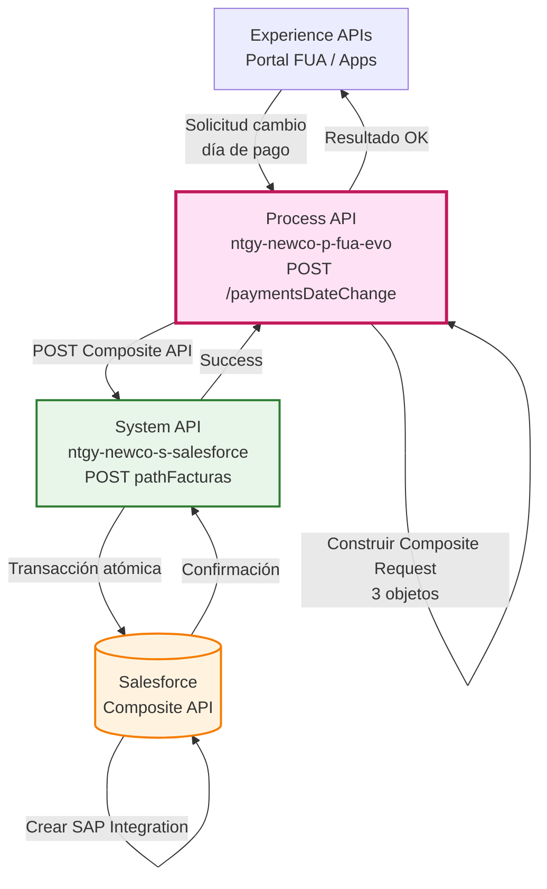
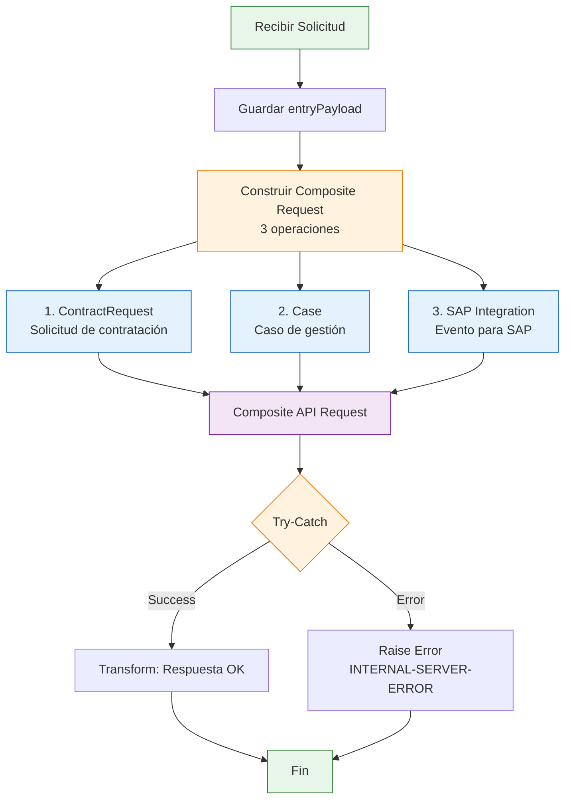
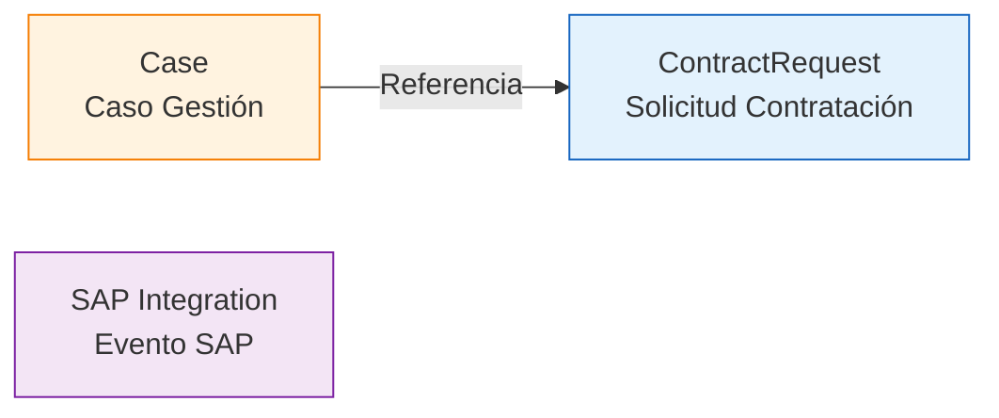
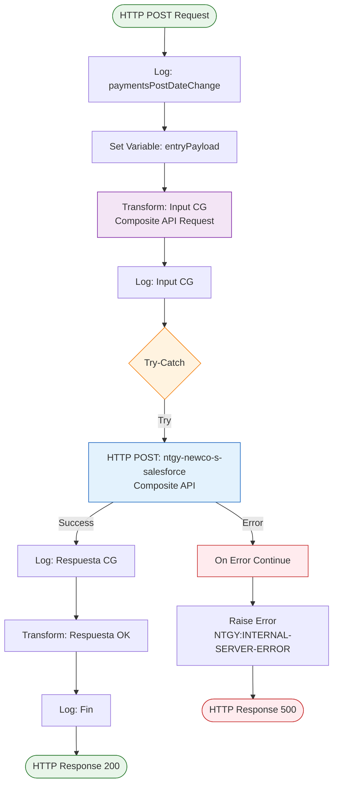
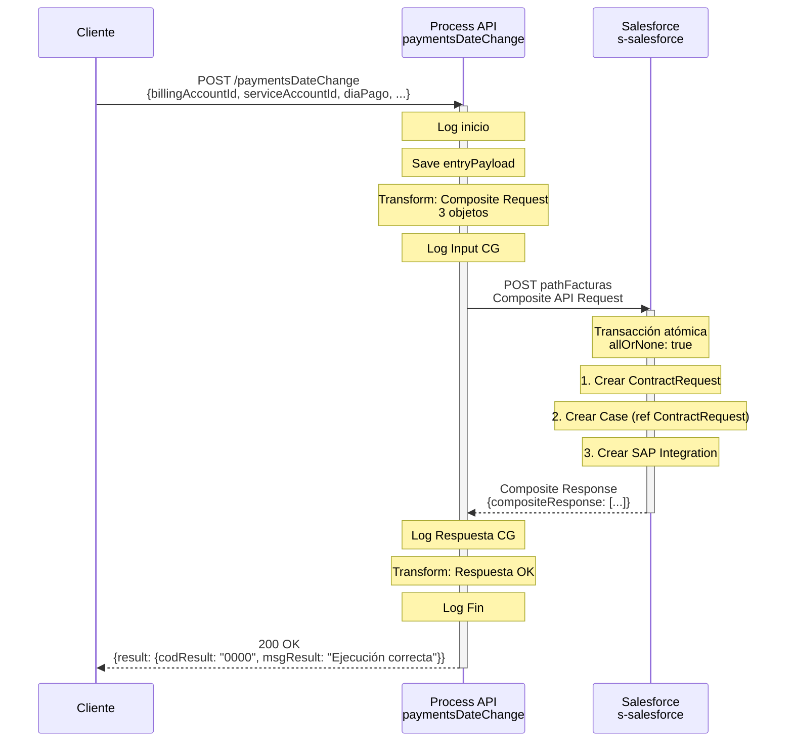
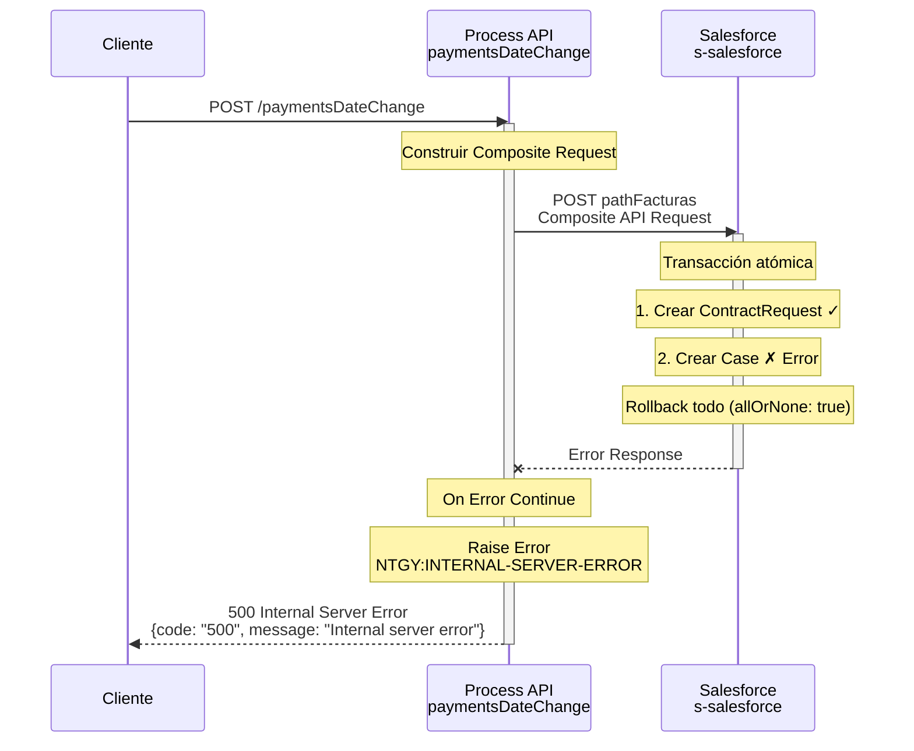

# POST /paymentsDateChange

## 📌 Descripción General

### Propósito del Endpoint

Este endpoint permite cambiar el día fijo de pago de una cuenta de cliente. Crea automáticamente tres objetos en Salesforce mediante Composite API en una transacción atómica: una solicitud de contratación (ContractRequest), un caso de gestión (Case) y un evento de integración SAP. Esto garantiza que el cambio quede registrado y se notifique a todos los sistemas involucrados.

### Tipo de API

**Capa:** Process API (API-Led Connectivity)

**Función:** Orquestación de cambio de día de pago con creación de múltiples objetos en Salesforce

### Patrón de Integración

**Tipo:** Orquestación con Transacción Atómica

**Descripción:** El Process API recibe la solicitud de cambio de día de pago, construye un request de Salesforce Composite API con 3 operaciones (crear ContractRequest, Case y SAP Integration), y ejecuta todo en una transacción atómica que garantiza consistencia.

### Arquitectura API-Led Connectivity



---

## 💼 Propósito del Negocio

### Casos de Uso Principales

1. **Cambio de Día Fijo de Pago por Cliente**
   - Cliente solicita cambiar su día de pago mensual
   - Se crea solicitud de contratación automáticamente
   - Se genera caso de gestión para seguimiento
   - Se notifica a SAP para actualización de sistemas

2. **Cambio de Día de Pago por Agente**
   - Agente de call center realiza el cambio por el cliente
   - Se registra el agente que realizó la operación
   - Se vincula con la interacción del call center
   - Trazabilidad completa de la operación

3. **Integración con SAP**
   - Evento automático para sincronización con SAP
   - Garantiza actualización en sistema de facturación
   - Permite procesamiento posterior en SAP ISU

### 🔗 Endpoints Dependientes

Este Process API consume el siguiente System API:

| System API | Endpoint | Método | Propósito |
|------------|----------|--------|-----------|
| `ntgy-newco-s-salesforce` | `${pathFacturas}` | POST | Ejecuta Composite API en Salesforce |

### Lógica de Orquestación



**Pasos del Proceso:**

1. **Recepción de Solicitud**: Recibe payload con datos del cambio
2. **Construcción de Composite Request**: Crea 3 sub-requests en una transacción
3. **Ejecución en Salesforce**: Envía Composite API con allOrNone=true
4. **Manejo de Respuesta**: Transforma respuesta o maneja error
5. **Confirmación**: Retorna resultado exitoso

### Objetos Creados en Salesforce



**Relaciones:**
- El **Case** referencia al **ContractRequest** mediante `@&#123;refSolContratacion.id&#125;` (sintaxis de Salesforce Composite API)
- Los 3 objetos se crean en una transacción atómica

### Contexto Empresarial

- **Dominio:** Gestión de Pagos y Facturación
- **Sector:** Energía - Utilities
- **División:** Naturgy España - NewCo
- **Proceso de Negocio:** Cambio de día fijo de pago

### Stakeholders

- **Clientes**: Solicitan cambio de día de pago
- **Agentes de Call Center**: Realizan cambios por los clientes
- **Equipo de Facturación**: Procesa cambios en SAP
- **Equipo de CRM**: Gestiona casos en Salesforce

### Valor de Negocio

- **Automatización**: Creación automática de solicitud y caso
- **Consistencia**: Transacción atómica garantiza integridad
- **Trazabilidad**: Registro completo en Salesforce
- **Integración**: Notificación automática a SAP
- **Flexibilidad**: Permite cambios por cliente o agente

### Consumidores Potenciales

Este endpoint puede ser consumido por:
- Portales web de autoservicio
- Aplicaciones móviles
- Sistemas de call center
- Herramientas de gestión de agentes

---

## 🔧 Especificación Técnica

### URLs por Ambiente

| Ambiente | URL Base | URL Completa |
|----------|----------|--------------|
| **Local** | `http://localhost:8081` | `http://localhost:8081/api/paymentsDateChange` |
| **Development** | `https://ntgy-newco-p-fua-evo-dev.us-e2.cloudhub.io` | `https://ntgy-newco-p-fua-evo-dev.us-e2.cloudhub.io/api/paymentsDateChange` |
| **UAT** | `https://ntgy-newco-p-fua-evo-uat.us-e2.cloudhub.io` | `https://ntgy-newco-p-fua-evo-uat.us-e2.cloudhub.io/api/paymentsDateChange` |
| **Production** | `https://ntgy-newco-p-fua-evo-pro.us-e2.cloudhub.io` | `https://ntgy-newco-p-fua-evo-pro.us-e2.cloudhub.io/api/paymentsDateChange` |

### Método HTTP

```
POST /api/paymentsDateChange
```

### Parámetros de Entrada

#### Request Body (application/json)

**Estructura:**

```json
{
  "billingAccountId": "string",
  "serviceAccountId": "string",
  "diaPago": "string",
  "clientId": "string",
  "x-user-id": "string",
  "x-client-id": "string",
  "x-contact-id": "string",
  "x-agent-mail": "string",
  "x-interaction-id": "string",
  "DirIp": "string"
}
```

**Campos:**

| Campo | Tipo | Obligatorio | Descripción | Ejemplo |
|-------|------|-------------|-------------|---------|
| `billingAccountId` | String | ✅ Sí | ID de cuenta de facturación en Salesforce | `"a1B2C3D4E5F6G7H8I9"` |
| `serviceAccountId` | String | ✅ Sí | ID de cuenta de servicio en Salesforce | `"a2C3D4E5F6G7H8I9J0"` |
| `diaPago` | String | ✅ Sí | Nuevo día fijo de pago (1-31) | `"15"` |
| `clientId` | String | ✅ Sí | ID del cliente | `"001XXXXXXXXXXXX"` |
| `x-user-id` | String | ❌ No | ID del usuario/agente que realiza el cambio | `"005XXXXXXXXXXXX"` |
| `x-client-id` | String | ✅ Sí | ID de la cuenta del cliente (Account) | `"001XXXXXXXXXXXX"` |
| `x-contact-id` | String | ✅ Sí | ID del contacto del cliente | `"003XXXXXXXXXXXX"` |
| `x-agent-mail` | String | ❌ No | Email del agente (se envía como header) | `"agente@naturgy.com"` |
| `x-interaction-id` | String | ❌ No | ID de interacción padre (call center) | `"500XXXXXXXXXXXX"` |
| `DirIp` | String | ❌ No | Dirección IP del cliente | `"192.168.1.1"` |

**Notas:**
- Los campos con prefijo `x-` son metadatos de contexto
- `x-user-id` se usa para `OwnerId` del caso si está presente
- `x-agent-mail` se envía como header `username` a Salesforce
- `x-interaction-id` se usa para `ParentId` del caso si está presente

### Respuestas

#### 200 OK - Éxito

**Estructura de Respuesta:**

```json
{
  "result": {
    "codResult": "0000",
    "msgResult": "Ejecución correcta"
  }
}
```

**Descripción de Campos:**

| Campo | Tipo | Valor | Descripción |
|-------|------|-------|-------------|
| `result.codResult` | String | "0000" | Código de resultado exitoso |
| `result.msgResult` | String | "Ejecución correcta" | Mensaje de confirmación |

#### 400 Bad Request - Error de Validación

```json
{
  "code": "400",
  "message": "Campos obligatorios faltantes"
}
```

#### 500 Internal Server Error - Error del Sistema

```json
{
  "code": "500",
  "message": "Internal server error"
}
```

**Causas comunes:**
- Error en Salesforce Composite API
- Fallo en creación de alguno de los 3 objetos
- Problema de conectividad con Salesforce

### Autenticación

- **Tipo:** Client ID & Client Secret (Anypoint Platform)
- **Headers requeridos:**
  - `client_id`: ID del cliente registrado en Anypoint Platform
  - `client_secret`: Secret del cliente

### Timeouts

| Tipo | Valor |
|------|-------|
| **Request Timeout** | 60 segundos |
| **Connection Timeout** | 30 segundos |
| **Salesforce Timeout** | Configurado en properties |

---

## 🏗️ Implementación Técnica

### Arquitectura del Flow



### Salesforce Composite API Request

#### Estructura Completa

```dataweave
%dw 2.0
output application/json
---
{
  "allOrNone": true,
  "collateSubrequests": false,
  "compositeRequest": [
    {
      "method": "POST",
      "url": "/services/data/v52.0/sobjects/acn_obj_ContractRequest__c",
      "referenceId": "refSolContratacion",
      "body": {
        "NewCo_BillingAccount__c": payload.billingAccountId,
        "NewCo_ServiceAccount__c": payload.serviceAccountId,
        "NewCo_Recordtype__c": "acn_rt_Without_Switching",
        "acn_fld_Sctype__c": "03",
        "acn_fld_Category__c": "58",
        "NewCo_DiaFijodePago__c": payload.diaPago,
        "acn_fld_Status__c": "06",
        "NewCo_Creado_por__c": if(payload.'x-user-id' != null) payload.'x-user-id' else payload.clientId
      }
    },
    {
      "method": "POST",
      "url": "/services/data/v52.0/sobjects/Case",
      "referenceId": "refCaseGestion",
      "body": {
        "NewCo_Recordtype__c": "Gestion",
        "AccountId": payload.'x-client-id',
        "ContactId": payload.'x-contact-id',
        "Status": "06",
        "Priority": "02",
        "Origin": "FUA",        
        ("OwnerId": payload."x-user-id") if(!isEmpty(payload."x-user-id")),        
        ("ParentId": payload."x-interaction-id") if(payload."x-interaction-id"?),
        "vlocity_cmt__ServiceAccountId__c": payload.serviceAccountId,
        "vlocity_cmt__BillingAccountId__c": payload.billingAccountId,
        "acn_fld_Tittle__r": {
          "NewCo_ExternalId__c": "DiaFijoPagoCambiado"
        },
        "Subject": "Cambio de día fijo de pago",
        "Description": "Cambio de día fijo de pago",
        "acn_fld_ContractRequest__c": "@&#123;refSolContratacion.id&#125;",
        "NewCo_Creado_por__c": if(payload.'x-user-id' != null) payload.'x-user-id' else payload.'x-contact-id',
        "NewCo_Ip__c": payload.DirIp,
        "NewCo_CorrelationId__c": correlationId
      }
    },
    {
      "method": "POST",
      "url": "/services/data/v52.0/sobjects/NewCo_SAP_Integration__c",
      "referenceId": "refNewCo_SAP_Integration__c",
      "body": {
        "NewCo_fld_EventName__c": "MetodoPagoDiaFijoPagoCambiado",
        "NewCo_fld_Account__c": payload.'x-client-id',
        "NewCo_BillingAccount__c": payload.billingAccountId
      }
    }
  ]
}
```

### Objetos Salesforce Creados

#### 1. ContractRequest (Solicitud de Contratación)

**Objeto:** `acn_obj_ContractRequest__c`

| Campo Salesforce | Valor | Descripción |
|------------------|-------|-------------|
| `NewCo_BillingAccount__c` | billingAccountId | Cuenta de facturación |
| `NewCo_ServiceAccount__c` | serviceAccountId | Cuenta de servicio |
| `NewCo_Recordtype__c` | "acn_rt_Without_Switching" | Tipo de registro (sin cambio de comercializadora) |
| `acn_fld_Sctype__c` | "03" | Tipo de solicitud de contratación |
| `acn_fld_Category__c` | "58" | Categoría de la solicitud |
| `NewCo_DiaFijodePago__c` | diaPago | Nuevo día fijo de pago |
| `acn_fld_Status__c` | "06" | Estado de la solicitud |
| `NewCo_Creado_por__c` | x-user-id o clientId | Usuario que crea la solicitud |

#### 2. Case (Caso de Gestión)

**Objeto:** `Case`

| Campo Salesforce | Valor | Descripción |
|------------------|-------|-------------|
| `NewCo_Recordtype__c` | "Gestion" | Tipo de registro del caso |
| `AccountId` | x-client-id | Cuenta del cliente |
| `ContactId` | x-contact-id | Contacto del cliente |
| `Status` | "06" | Estado del caso |
| `Priority` | "02" | Prioridad del caso |
| `Origin` | "FUA" | Origen del caso (Portal FUA) |
| `OwnerId` | x-user-id (condicional) | Propietario del caso (si hay agente) |
| `ParentId` | x-interaction-id (condicional) | Caso padre (si hay interacción) |
| `vlocity_cmt__ServiceAccountId__c` | serviceAccountId | Cuenta de servicio |
| `vlocity_cmt__BillingAccountId__c` | billingAccountId | Cuenta de facturación |
| `acn_fld_Tittle__r.NewCo_ExternalId__c` | "DiaFijoPagoCambiado" | Tipología del caso |
| `Subject` | "Cambio de día fijo de pago" | Asunto del caso |
| `Description` | "Cambio de día fijo de pago" | Descripción del caso |
| `acn_fld_ContractRequest__c` | @&#123;refSolContratacion.id&#125; | Referencia a ContractRequest |
| `NewCo_Creado_por__c` | x-user-id o x-contact-id | Usuario que crea el caso |
| `NewCo_Ip__c` | DirIp | Dirección IP del cliente |
| `NewCo_CorrelationId__c` | correlationId | ID de correlación |

**Campos Condicionales:**
- `OwnerId`: Solo se incluye si `x-user-id` no está vacío
- `ParentId`: Solo se incluye si `x-interaction-id` existe

#### 3. SAP Integration (Evento para SAP)

**Objeto:** `NewCo_SAP_Integration__c`

| Campo Salesforce | Valor | Descripción |
|------------------|-------|-------------|
| `NewCo_fld_EventName__c` | "MetodoPagoDiaFijoPagoCambiado" | Nombre del evento para SAP |
| `NewCo_fld_Account__c` | x-client-id | Cuenta del cliente |
| `NewCo_BillingAccount__c` | billingAccountId | Cuenta de facturación |

### Referencias entre Objetos

**Uso de @&#123;referenceId&#125;:**

El Case referencia al ContractRequest usando:
```dataweave
"acn_fld_ContractRequest__c": "@&#123;refSolContratacion.id&#125;"
```

Esto permite que Salesforce resuelva el ID del ContractRequest creado en la misma transacción.

### Header Especial

**Header username:**

```dataweave
{
  ("username" : vars.entryPayload.'x-agent-mail') if (!isEmpty(vars.entryPayload.'x-agent-mail'))
}
```

Si `x-agent-mail` está presente, se envía como header `username` a Salesforce para identificar al agente.

### Patrones de Diseño

**Patrón:** Composite API con Transacción Atómica

**Justificación:** 
- Crea 3 objetos relacionados en una sola transacción
- `allOrNone: true` garantiza consistencia (todo o nada)
- Referencias entre objetos mediante `@&#123;referenceId&#125;`
- Reduce llamadas a Salesforce (1 en lugar de 3)

### Diagramas de Secuencia

#### 1. Flujo Normal de Éxito



#### 2. Flujo con Error en Salesforce



### Manejo de Errores

**Estrategia:**

1. **Try-Catch**: Envuelve la llamada a Salesforce
2. **On Error Continue**: Captura cualquier error
3. **Raise Error**: Lanza error tipo `NTGY:INTERNAL-SERVER-ERROR`
4. **Transacción Atómica**: Si falla una operación, fallan todas

**Logging:**
- Log de inicio con payload completo
- Log de Input CG (Composite Request)
- Log de Respuesta CG (Composite Response)
- Log de fin con resultado

---

## 💻 Ejemplos de Uso

### Ejemplo 1: Cambio de Día de Pago por Cliente

#### cURL

```bash
curl -X POST "https://ntgy-newco-p-fua-evo-dev.us-e2.cloudhub.io/api/paymentsDateChange" \
  -H "Content-Type: application/json" \
  -H "client_id: YOUR_CLIENT_ID" \
  -H "client_secret: YOUR_CLIENT_SECRET" \
  -d '{
    "billingAccountId": "a1B2C3D4E5F6G7H8I9",
    "serviceAccountId": "a2C3D4E5F6G7H8I9J0",
    "diaPago": "15",
    "clientId": "001XXXXXXXXXXXX",
    "x-client-id": "001XXXXXXXXXXXX",
    "x-contact-id": "003XXXXXXXXXXXX",
    "DirIp": "192.168.1.100"
  }'
```

#### Respuesta (200 OK)

```json
{
  "result": {
    "codResult": "0000",
    "msgResult": "Ejecución correcta"
  }
}
```

**Objetos creados en Salesforce:**
- ContractRequest con día de pago: 15
- Case con tipología "DiaFijoPagoCambiado"
- SAP Integration con evento "MetodoPagoDiaFijoPagoCambiado"

### Ejemplo 2: Cambio de Día de Pago por Agente

#### cURL

```bash
curl -X POST "https://ntgy-newco-p-fua-evo-dev.us-e2.cloudhub.io/api/paymentsDateChange" \
  -H "Content-Type: application/json" \
  -H "client_id: YOUR_CLIENT_ID" \
  -H "client_secret: YOUR_CLIENT_SECRET" \
  -d '{
    "billingAccountId": "a1B2C3D4E5F6G7H8I9",
    "serviceAccountId": "a2C3D4E5F6G7H8I9J0",
    "diaPago": "5",
    "clientId": "001XXXXXXXXXXXX",
    "x-user-id": "005XXXXXXXXXXXX",
    "x-client-id": "001XXXXXXXXXXXX",
    "x-contact-id": "003XXXXXXXXXXXX",
    "x-agent-mail": "agente.callcenter@naturgy.com",
    "x-interaction-id": "500XXXXXXXXXXXX",
    "DirIp": "10.0.0.50"
  }'
```

#### Respuesta (200 OK)

```json
{
  "result": {
    "codResult": "0000",
    "msgResult": "Ejecución correcta"
  }
}
```

**Diferencias con ejemplo 1:**
- Case tiene `OwnerId` = x-user-id (agente)
- Case tiene `ParentId` = x-interaction-id (interacción call center)
- Header `username` = x-agent-mail enviado a Salesforce

### Ejemplo 3: JavaScript (Fetch API)

```javascript
const cambio = {
  billingAccountId: 'a1B2C3D4E5F6G7H8I9',
  serviceAccountId: 'a2C3D4E5F6G7H8I9J0',
  diaPago: '20',
  clientId: '001XXXXXXXXXXXX',
  'x-client-id': '001XXXXXXXXXXXX',
  'x-contact-id': '003XXXXXXXXXXXX',
  DirIp: '192.168.1.100'
};

const response = await fetch('https://ntgy-newco-p-fua-evo-dev.us-e2.cloudhub.io/api/paymentsDateChange', {
  method: 'POST',
  headers: {
    'Content-Type': 'application/json',
    'client_id': 'YOUR_CLIENT_ID',
    'client_secret': 'YOUR_CLIENT_SECRET'
  },
  body: JSON.stringify(cambio)
});

const result = await response.json();
console.log('Cambio realizado:', result.result.msgResult);
// Output: Cambio realizado: Ejecución correcta
```

### Ejemplo 4: Python (Requests)

```python
import requests

cambio = {
    'billingAccountId': 'a1B2C3D4E5F6G7H8I9',
    'serviceAccountId': 'a2C3D4E5F6G7H8I9J0',
    'diaPago': '10',
    'clientId': '001XXXXXXXXXXXX',
    'x-client-id': '001XXXXXXXXXXXX',
    'x-contact-id': '003XXXXXXXXXXXX',
    'DirIp': '192.168.1.100'
}

url = 'https://ntgy-newco-p-fua-evo-dev.us-e2.cloudhub.io/api/paymentsDateChange'
headers = {
    'Content-Type': 'application/json',
    'client_id': 'YOUR_CLIENT_ID',
    'client_secret': 'YOUR_CLIENT_SECRET'
}

response = requests.post(url, headers=headers, json=cambio)

if response.status_code == 200:
    result = response.json()
    print(f"Cambio realizado: {result['result']['msgResult']}")
    # Output: Cambio realizado: Ejecución correcta
else:
    print(f"Error: {response.status_code}")
    print(response.json())
```

---

## 📝 Notas Importantes

### Para Desarrolladores

- ✅ **Transacción atómica** - allOrNone=true garantiza consistencia
- ✅ **3 objetos en una llamada** - Composite API optimiza performance
- ✅ **Referencias entre objetos** - @&#123;referenceId&#125; permite enlazar objetos
- ✅ **Campos condicionales** - OwnerId y ParentId según contexto
- ✅ **Header especial** - username para identificar agente
- ⚠️ **Try-catch obligatorio** - Manejo de errores crítico

### Mejores Prácticas

1. **Incluir x-user-id cuando sea agente** - Permite trazabilidad
2. **Proporcionar x-interaction-id en call center** - Vincula con interacción
3. **Validar día de pago** - Debe estar entre 1 y 31
4. **Manejar errores 500** - Implementar retry logic en cliente
5. **Logging completo** - Revisar logs para troubleshooting

### Campos Obligatorios vs Opcionales

**Obligatorios:**
- `billingAccountId`
- `serviceAccountId`
- `diaPago`
- `clientId`
- `x-client-id`
- `x-contact-id`

**Opcionales pero recomendados:**
- `x-user-id` (para operaciones de agente)
- `x-agent-mail` (para identificar agente en Salesforce)
- `x-interaction-id` (para vincular con interacción call center)
- `DirIp` (para auditoría)

### Transacción Atómica

**Comportamiento allOrNone=true:**
- Si **todas** las operaciones tienen éxito → Se confirman todas
- Si **alguna** operación falla → Se revierten todas (rollback)
- Garantiza consistencia de datos en Salesforce

**Ejemplo de rollback:**
```
1. ContractRequest creado ✓
2. Case falla ✗
3. SAP Integration no se ejecuta
→ Resultado: ContractRequest se revierte, nada se crea
```

### Objetos Salesforce y sus Propósitos

| Objeto | Propósito | Procesamiento Posterior |
|--------|-----------|------------------------|
| **ContractRequest** | Solicitud formal de cambio | Workflow de aprobación en Salesforce |
| **Case** | Caso de gestión para seguimiento | Asignación a equipo de facturación |
| **SAP Integration** | Evento para sincronización | Procesamiento batch hacia SAP ISU |

### Limitaciones

- **Día de pago válido**: Debe ser entre 1 y 31
- **IDs de Salesforce**: Deben ser válidos y existir
- **Timeout**: Máximo 60 segundos para toda la operación
- **Sin validación de negocio**: No valida si el día es válido para el cliente

### Monitoreo

**Métricas recomendadas:**
- Tasa de éxito de cambios de día de pago
- Tiempo de respuesta de Composite API
- Errores por tipo (validación vs sistema)
- Distribución de días de pago solicitados
- Cambios por cliente vs agente

### Troubleshooting

**Problema:** Error 500 en Salesforce
- **Causa posible:** IDs inválidos (billingAccountId, serviceAccountId, etc.)
- **Solución:** Verificar que los IDs existen en Salesforce

**Problema:** Case no tiene OwnerId
- **Causa posible:** x-user-id no proporcionado o vacío
- **Solución:** Incluir x-user-id cuando sea operación de agente

**Problema:** Case no vinculado a interacción
- **Causa posible:** x-interaction-id no proporcionado
- **Solución:** Incluir x-interaction-id en operaciones de call center

**Problema:** Evento SAP no procesado
- **Causa posible:** Fallo en creación de SAP Integration
- **Solución:** Revisar logs de Salesforce, verificar permisos

### Integración con SAP

El objeto `NewCo_SAP_Integration__c` con evento `MetodoPagoDiaFijoPagoCambiado` desencadena:

1. **Procesamiento batch** en Salesforce
2. **Envío a SAP ISU** mediante integración
3. **Actualización de día de pago** en sistema de facturación
4. **Confirmación** de cambio al cliente

**Tiempo de procesamiento típico:** 15-30 minutos desde creación hasta actualización en SAP
