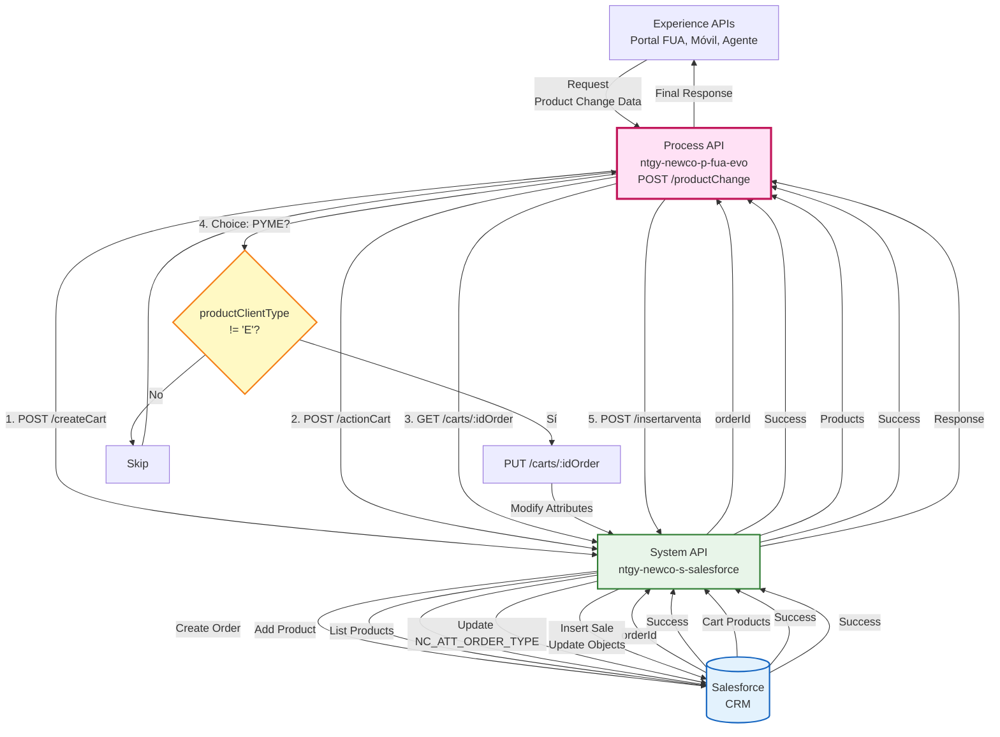
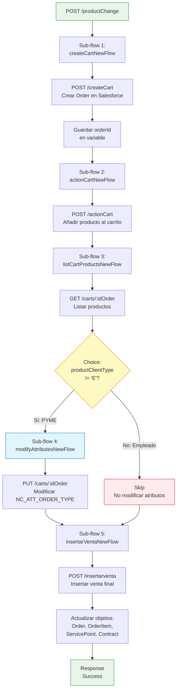
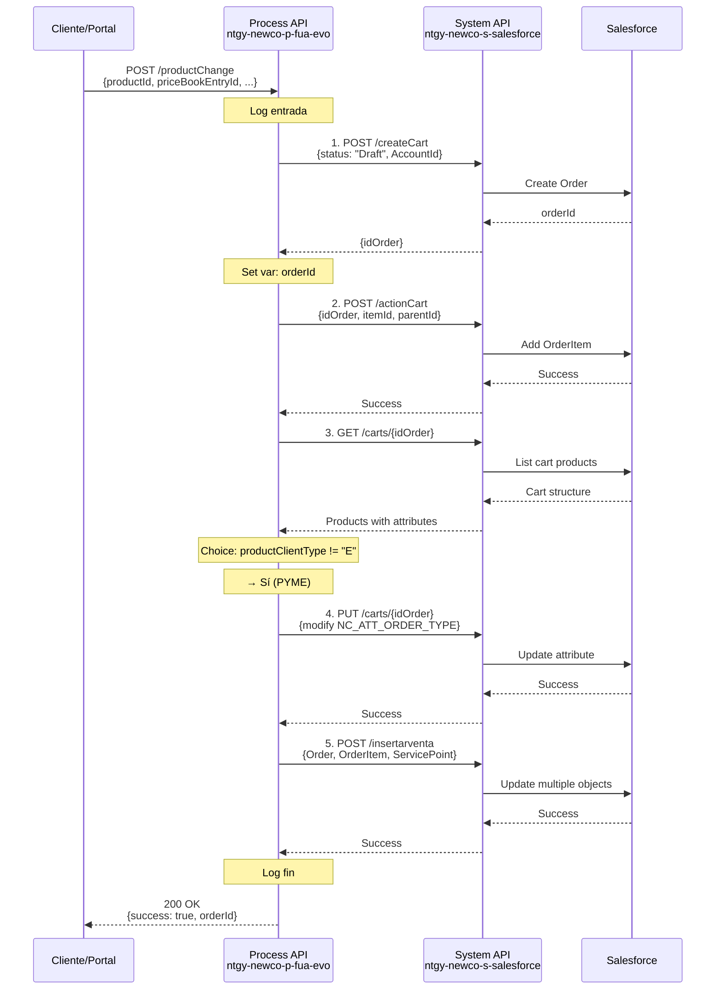
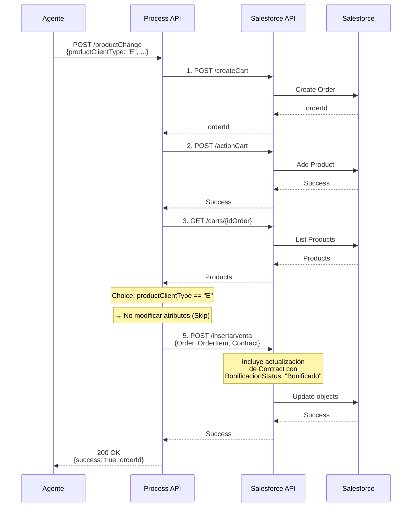
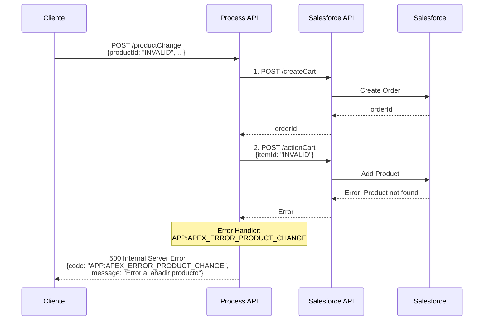

# POST /productChange

## 📌 Descripción General

### Propósito del Endpoint

Este endpoint orquesta el proceso completo de cambio de producto o tarifa energética en Salesforce. Implementa un flujo secuencial de 5 sub-flows que gestionan la creación del carrito de compra, adición del nuevo producto, modificación de atributos (según tipo de cliente), y finalización de la venta con actualización de múltiples objetos en Salesforce.

### Tipo de API

**Capa:** Process API (API-Led Connectivity)

**Función:** Orquestación secuencial de cambio de producto con lógica condicional según tipo de cliente

### Patrón de Integración

**Tipo:** Orquestación Secuencial con Lógica Condicional

**Descripción:** El endpoint implementa un flujo de orquestación secuencial que:
1. Crea un carrito de compra (Order) en Salesforce
2. Añade el nuevo producto al carrito (OrderItem)
3. Lista los productos del carrito para obtener su estructura completa
4. Modifica atributos del producto (solo para productos PYME)
5. Inserta la venta final y actualiza objetos relacionados (Order, OrderItem, ServicePoint, Contract)

### Arquitectura API-Led Connectivity



---

## 💼 Propósito del Negocio

### Casos de Uso Principales

1. **Cambio de Tarifa Energética**
   - El cliente solicita cambiar de una tarifa a otra (ej: de indexada a fija)
   - Se crea un nuevo pedido (Order) con el producto seleccionado
   - Se actualiza el contrato con la nueva configuración

2. **Cambio de Producto con Bonificación**
   - Empleados de Naturgy cambian a productos con bonificación especial
   - Se actualiza el estado de bonificación del contrato
   - No se modifican atributos de tipo de oferta

3. **Cambio de Producto PYME**
   - Clientes PYME cambian de producto
   - Se modifica el atributo `NC_ATT_ORDER_TYPE` con el tipo de oferta
   - Se registra el tipo de contratación (FIDE - Fidelización)

### 🔗 Endpoints Dependientes

Este Process API consume 5 endpoints diferentes del mismo System API:

| System API | Endpoint | Método | Propósito |
|------------|----------|--------|-----------|
| `ntgy-newco-s-salesforce` | `/modificaciones/createCart` | POST | Crear carrito de compra (Order) |
| `ntgy-newco-s-salesforce` | `/modificaciones/actionCart` | POST | Añadir producto al carrito (OrderItem) |
| `ntgy-newco-s-salesforce` | `/carts/{idOrder}` | GET | Listar productos del carrito |
| `ntgy-newco-s-salesforce` | `/carts/{idOrder}` | PUT | Modificar atributos del producto |
| `ntgy-newco-s-salesforce` | `/modificaciones/insertarventa` | POST | Insertar venta final |

### Lógica de Orquestación



**Pasos del Proceso:**

1. **createCartNewFlow**: Crea un carrito de compra (Order) en Salesforce con estado "Draft"
2. **actionCartNewFlow**: Añade el nuevo producto al carrito con tipo de contratación "FIDE"
3. **listCartProductsNewFlow**: Lista los productos del carrito para obtener estructura completa
4. **Choice (Condicional)**: 
   - Si `productClientType != "E"` (PYME) → Ejecuta `modifyAttributesNewFlow`
   - Si `productClientType == "E"` (Empleado) → Skip
5. **insertarVentaNewFlow**: Inserta la venta final y actualiza objetos Salesforce

### Transformaciones Aplicadas

**Transformación 1: Input createCart**

| Campo | Valor | Descripción |
|-------|-------|-------------|
| `status` | "Draft" | Estado inicial del carrito |
| `priceListName` | "NewCo B2C" | Lista de precios aplicable |
| `originatingChannel` | "FUA" | Canal de origen (Portal FUA) |
| `effectiveDate` | `now()` | Fecha efectiva del cambio |
| `AccountId` | `x-client-id` | ID de la cuenta del cliente |

**Transformación 2: Input actionCart**

| Campo | Valor | Descripción |
|-------|-------|-------------|
| `idOrder` | `orderId` | ID del carrito creado |
| `itemId` | `priceBookEntryId` | ID de la entrada en el catálogo de precios |
| `parentId` | `productId` | ID del producto |
| `NewCo_TipoContratacion__c` | "FIDE" | Tipo de contratación (Fidelización) |

**Transformación 3: Input modifyAttributes (Compleja)**

Navega estructura anidada de atributos:
- `attributeCategories` → `productAttributes`
- Busca atributo: `NC_ATT_ORDER_TYPE`
- Actualiza con: `price.productOfferType`

**Transformación 4: Input insertarVenta (Composición de Objetos)**

Compone múltiples objetos Salesforce:
1. **Order**: Actualiza con datos de facturación y creador
2. **OrderItem**: Añade datos del producto y precios
3. **ServicePoint** (condicional): Actualiza consumo anual
4. **Contract** (condicional): Actualiza estado de bonificación para empleados

### Contexto Empresarial

- **Dominio:** Gestión de Productos y Cambios de Tarifa
- **Sector:** Energía - Utilities
- **División:** Naturgy España - NewCo
- **Proceso de Negocio:** Cambio de producto/tarifa energética

### Stakeholders

- **Clientes de Naturgy**: Solicitan cambios de tarifa para optimizar costes
- **Agentes de Call Center**: Gestionan cambios de producto para clientes
- **Empleados de Naturgy**: Acceden a productos con bonificaciones especiales
- **Departamento Comercial**: Gestiona catálogo de productos y ofertas
- **Equipo de Salesforce**: Mantiene objetos y lógica de negocio en CRM

### Valor de Negocio

- **Automatización**: Proceso completo de cambio de producto sin intervención manual
- **Trazabilidad**: Registro completo del cambio en Salesforce (Order, OrderItem)
- **Diferenciación**: Lógica específica para PYMES vs Empleados
- **Flexibilidad**: Soporte para tarifas planas e indexadas
- **Integridad**: Actualización atómica de múltiples objetos relacionados

### Consumidores Potenciales

Este endpoint puede ser consumido por:
- Portal web FUA
- Aplicaciones móviles de clientes
- Sistemas de agentes de call center
- Herramientas de gestión comercial

---

## 🔧 Especificación Técnica

### URLs por Ambiente

| Ambiente | URL Base | URL Completa |
|----------|----------|--------------|
| **Local** | `http://localhost:8081` | `http://localhost:8081/api/productChange` |
| **Development** | `https://ntgy-newco-p-fua-evo-dev.us-e2.cloudhub.io` | `https://ntgy-newco-p-fua-evo-dev.us-e2.cloudhub.io/api/productChange` |
| **UAT** | `https://ntgy-newco-p-fua-evo-uat.us-e2.cloudhub.io` | `https://ntgy-newco-p-fua-evo-uat.us-e2.cloudhub.io/api/productChange` |
| **Production** | `https://ntgy-newco-p-fua-evo-pro.us-e2.cloudhub.io` | `https://ntgy-newco-p-fua-evo-pro.us-e2.cloudhub.io/api/productChange` |

### Método HTTP

```
POST /api/productChange
```

### Request Body

```json
{
  "x-client-id": "string",
  "x-user-id": "string",
  "productId": "string",
  "priceBookEntryId": "string",
  "contractId": "string",
  "techDataId": "string",
  "productClientType": "string",
  "mailingAddress": "string",
  "startDate": "string",
  "bankAccount": {
    "contactId": "string"
  },
  "price": {
    "productOfferType": "string",
    "flatRateAmount": number,
    "annualAmount": number,
    "maxConsumption": number,
    "consumoAnual": number
  }
}
```

| Campo | Tipo | Obligatorio | Descripción | Ejemplo |
|-------|------|-------------|-------------|---------|
| `x-client-id` | string | ✅ | ID de la cuenta del cliente en Salesforce | `0011234567890ABC` |
| `x-user-id` | string | ⚠️ | ID del usuario que realiza el cambio (agente o cliente) | `0051234567890DEF` |
| `productId` | string | ✅ | ID del producto en Salesforce (Product2) | `01t1234567890GHI` |
| `priceBookEntryId` | string | ✅ | ID de la entrada en el catálogo de precios | `01u1234567890JKL` |
| `contractId` | string | ✅ | ID del contrato a modificar | `8001234567890MNO` |
| `techDataId` | string | ✅ | ID del punto de suministro (ServicePoint) | `a0P1234567890QRS` |
| `productClientType` | string | ✅ | Tipo de cliente: "R" (Residencial), "E" (Empleado), "P" (PYME) | `"R"` |
| `mailingAddress` | string | ✅ | ID de la dirección de facturación (Premise) | `a0Q1234567890TUV` |
| `startDate` | string | ✅ | Fecha de inicio del nuevo producto (formato: dd/MM/yyyy) | `"01/09/2026"` |
| `bankAccount.contactId` | string | ✅ | ID del contacto de facturación | `0031234567890WXY` |
| `price.productOfferType` | string | ✅ | Tipo de oferta: "ONLINE", "TELEFONO", etc. | `"ONLINE"` |
| `price.flatRateAmount` | number | ✅ | Cuota mensual (para tarifas planas, 0 si no aplica) | `85.50` |
| `price.annualAmount` | number | ⚠️ | Importe anual estimado (solo tarifas planas) | `1026.00` |
| `price.maxConsumption` | number | ⚠️ | Consumo máximo pactado (solo tarifas planas) | `350.0` |
| `price.consumoAnual` | number | ⚠️ | Consumo anual base (actualiza ServicePoint) | `3500.0` |

**Notas:**
- `x-user-id`: Si no se proporciona, se usa `x-client-id` como creador
- `productClientType`: Determina si se modifican atributos ("E" = No, otros = Sí)
- Campos de `price`: Algunos son opcionales según tipo de tarifa (plana vs indexada)

### Respuestas

#### Respuesta Exitosa (200 OK)

```json
{
  "success": true,
  "orderId": "8011234567890ABC",
  "message": "Product change completed successfully"
}
```

| Campo | Tipo | Descripción |
|-------|------|-------------|
| `success` | boolean | Indica si el cambio se completó exitosamente |
| `orderId` | string | ID del pedido (Order) creado en Salesforce |
| `message` | string | Mensaje descriptivo del resultado |

#### Respuesta de Error (400 Bad Request)

```json
{
  "code": "VALIDATION_ERROR",
  "message": "El campo productId es obligatorio",
  "timestamp": "2026-08-27T13:00:00Z"
}
```

#### Respuesta de Error - Salesforce (500 Internal Server Error)

```json
{
  "code": "APP:APEX_ERROR_PRODUCT_CHANGE",
  "message": "Error en Salesforce al crear el carrito",
  "details": "FIELD_CUSTOM_VALIDATION_EXCEPTION: El producto no está disponible",
  "timestamp": "2026-08-27T13:00:00Z"
}
```

### Autenticación

- **Tipo:** Client ID & Client Secret (Anypoint Platform)
- **Headers:** `client_id` y `client_secret` en los headers de la petición

### Timeouts

| Tipo | Valor |
|------|-------|
| **Request Timeout** | 120 segundos (2 minutos) |
| **Connection Timeout** | 30 segundos |
| **Salesforce Timeout** | 60 segundos por llamada |
| **Salesforce Response Timeout** | 120 segundos |

**Nota:** El timeout total considera 5 llamadas secuenciales a Salesforce.

---

## 🏗️ Implementación Técnica

### Arquitectura del Flow

```mermaid
flowchart TD
    Start([HTTP POST Request]) --> Log1[Log Entrada<br/>originalPayload]
    Log1 --> SubFlow1[Sub-flow 1:<br/>createCartNewFlow]
    
    SubFlow1 --> Transform1[Transform:<br/>Input createCart]
    Transform1 --> Call1[POST /createCart<br/>Salesforce]
    Call1 --> SaveVar1[Set Variable:<br/>orderId]
    
    SaveVar1 --> SubFlow2[Sub-flow 2:<br/>actionCartNewFlow]
    SubFlow2 --> Transform2[Transform:<br/>Input actionCart]
    Transform2 --> Call2[POST /actionCart<br/>Salesforce]
    
    Call2 --> SubFlow3[Sub-flow 3:<br/>listCartProductsNewFlow]
    SubFlow3 --> Call3[GET /carts/:idOrder<br/>Salesforce]
    
    Call3 --> Choice{Choice:<br/>productClientType<br/>!= "E"?}
    
    Choice -->|Sí: PYME| LogPyme[Log: Producto PYME]
    LogPyme --> SubFlow4[Sub-flow 4:<br/>modifyAttributesNewFlow]
    SubFlow4 --> Transform3[Transform:<br/>Input modifyAttributes<br/>Navegación compleja]
    Transform3 --> Call4[PUT /carts/:idOrder<br/>Salesforce]
    
    Choice -->|No: Empleado| LogEmp[Log: No modificar<br/>atributos]
    
    Call4 --> SubFlow5[Sub-flow 5:<br/>insertarVentaNewFlow]
    LogEmp --> SubFlow5
    
    SubFlow5 --> Transform4[Transform:<br/>Input insertarVenta<br/>Composición objetos]
    Transform4 --> Call5[POST /insertarventa<br/>Salesforce]
    
    Call5 --> LogFin[Log Fin]
    LogFin --> End([HTTP Response 200])
    
    Call1 -.->|Error| ErrorHandler[Error Handler:<br/>APP:APEX_ERROR_PRODUCT_CHANGE]
    Call2 -.->|Error| ErrorHandler
    Call3 -.->|Error| ErrorHandler
    Call4 -.->|Error| ErrorHandler
    Call5 -.->|Error| ErrorHandler
    
    ErrorHandler --> ErrorResponse([HTTP Response 500])
    
    style Start fill:#e8f5e9,stroke:#2e7d32
    style End fill:#e8f5e9,stroke:#2e7d32
    style Choice fill:#fff9c4,stroke:#f57f17
    style SubFlow1 fill:#e1f5fe,stroke:#0277bd
    style SubFlow2 fill:#e1f5fe,stroke:#0277bd
    style SubFlow3 fill:#e1f5fe,stroke:#0277bd
    style SubFlow4 fill:#e1f5fe,stroke:#0277bd
    style SubFlow5 fill:#e1f5fe,stroke:#0277bd
    style ErrorHandler fill:#ffebee,stroke:#c62828
    style ErrorResponse fill:#ffebee,stroke:#c62828
```

### Transformaciones DataWeave

#### Transformación 1: Input createCart

**Ubicación:** Sub-flow `createCartNewFlow` (líneas 13-26 del XML)

```dataweave
%dw 2.0
output application/json
---
{
    "body": {
        "status": "Draft",
        "priceListName": "NewCo B2C",
        "originatingChannel": "FUA",
        "effectiveDate": now() as Date,
        "AccountId": vars.originalPayload."x-client-id"
    }
}
```

**Propósito:** Crear la estructura para crear un carrito de compra (Order) en Salesforce con estado inicial "Draft".

**Campos fijos:**
- `status`: "Draft" (borrador)
- `priceListName`: "NewCo B2C" (lista de precios B2C)
- `originatingChannel`: "FUA" (canal de origen)

**Campos dinámicos:**
- `effectiveDate`: Fecha actual
- `AccountId`: ID del cliente desde el request

#### Transformación 2: Input actionCart

**Ubicación:** Sub-flow `actionCartNewFlow` (líneas 44-60 del XML)

```dataweave
%dw 2.0
output application/json
---
{
    "idOrder": vars.orderId,
    "productsAdd": [
        {
            "itemId": vars.originalPayload.priceBookEntryId,
            "parentId": vars.originalPayload.productId,
            "fieldsToUpdate": {
                "NewCo_TipoContratacion__c": "FIDE"
            }
        }
    ]    
}
```

**Propósito:** Añadir el nuevo producto al carrito con tipo de contratación "FIDE" (Fidelización).

**Campos:**
- `idOrder`: ID del carrito creado en el paso anterior
- `itemId`: ID de la entrada en el catálogo de precios
- `parentId`: ID del producto (Product2)
- `NewCo_TipoContratacion__c`: "FIDE" (tipo de contratación fijo)

#### Transformación 3: Input modifyAttributes (Compleja)

**Ubicación:** Sub-flow `modifyAttributesNewFlow` (líneas 88-140 del XML)

Esta es la transformación más compleja del endpoint. Navega una estructura anidada de atributos para modificar el valor de `NC_ATT_ORDER_TYPE`.

```dataweave
%dw 2.0
import * from dw::util::Values
output application/json indent=false
---
{
  "methodName": "putCartsItems",
  "items": {
      "records": (payload.records filter ((item) -> 
          (item.PricebookEntry.Id == vars.originalPayload.priceBookEntryId)
      )) map ((product) -> {
      (product mapObject ((value, key, index) ->
          {
              (if (key ~= "attributeCategories" and value != null)
                  (key): {
                      "totalSize": value.totalSize,
                      "messages": value.messages,
                      "records": value.records map ((attributeCategory) -> {
                          (attributeCategory mapObject ((value2, key2, index2) -> {
                              (if (key2 ~= "productAttributes" and value2 != null) 
                                  (key2): {
                                      "totalSize": value2.totalSize,
                                      "messages": value2.messages,
                                      "records": value2.records map ((productAttribute) -> {
                                          (if (productAttribute.code == "NC_ATT_ORDER_TYPE" as String)
                                              (productAttribute update "userValues" with 
                                                  vars.originalPayload.price.productOfferType as String)
                                          else
                                              productAttribute)
                                      }),
                                  }
                              else
                                  (key2):value2
                              )
                          }))
                      })
                  }
              else if ((key ~= "vlocity_cmt__RootItemId__c" or 
                       key ~= "vlocity_cmt__LineNumber__c" or 
                       key ~= "vlocity_cmt__Action__c" or 
                       key ~= "Id") and value != null)
                  (key):value
              else 
                  {}
          )				
      }))
    }
  )
  },
  "cartId": vars.orderId
}
```

**Propósito:** Modificar el atributo `NC_ATT_ORDER_TYPE` del producto en el carrito con el valor de `productOfferType`.

**Lógica:**
1. Filtra el producto por `priceBookEntryId`
2. Navega: `product` → `attributeCategories` → `productAttributes`
3. Busca el atributo con `code == "NC_ATT_ORDER_TYPE"`
4. Actualiza `userValues` con `price.productOfferType`
5. Mantiene otros campos necesarios: `vlocity_cmt__RootItemId__c`, `vlocity_cmt__LineNumber__c`, etc.

**Funciones DataWeave utilizadas:**
- `mapObject`: Iterar sobre propiedades de objetos
- `filter`: Filtrar registros
- `update`: Actualizar valor de una propiedad
- Operador `~=`: Comparación de strings (case-insensitive)

#### Transformación 4: Input insertarVenta (Composición de Objetos)

**Ubicación:** Sub-flow `insertarVentaNewFlow` (líneas 156-210 del XML)

```dataweave
%dw 2.0
output application/json
var actualDate = now() as Date
---
{
    "sObjectList": [
        {
            "attributes": {
                "type": "Order",
                "url": "/services/data/v53.0/sobjects/Order/" ++ vars.orderId
            },
            "Id": vars.orderId,
            "vlocity_cmt__OriginatingChannel__c": "FUA",
            "NewCo_Uso_de_energia__c": "Doméstico",
            "NewCo_Comercializadora__c": "NewCo",
            "NewCo_Creado_por__c": if(!isEmpty(vars.originalPayload.'x-user-id')) 
                vars.originalPayload.'x-user-id' 
            else 
                vars.originalPayload."x-client-id",
            "BillToContactId": vars.originalPayload.bankAccount.contactId,
            "AccountId": vars.originalPayload."x-client-id",
            "EffectiveDate": now() as Date,
            "NewCo_PremiseFacturacion__c": vars.originalPayload.mailingAddress
        },
        {
            "attributes": {
                "type": "OrderItem"
            },
            "Product2Id": vars.originalPayload.productId,
            "NewCo_Cambio_Titular__c": "false",
            "NewCo_Cambio_Tarifa_Atr__c": "false",
            "NewCo_contractoff__c": vars.originalPayload.contractId,
            "NewCo_contractoffLK__c": vars.originalPayload.contractId,
            "NewCo_TipoContratacion__c": "14",
            "NewCo_FechaDirectriz__c": actualDate,
            "NewCo_FechaReservaPrecios__c": actualDate,
            "vlocity_cmt__RecurringCharge__c": vars.originalPayload.price.flatRateAmount,
            "vlocity_cmt__OneTimeCharge__c": vars.originalPayload.price.annualAmount,
            "NewCo_StartDate__c": vars.originalPayload.startDate,
            "NewCo_ConsumoMaximoAnual__c": vars.originalPayload.price.maxConsumption
        },		
        ({
            "attributes": {
                "type": "vlocity_cmt__ServicePoint__c"
            },
            "Id": vars.originalPayload.techDataId,
            "NewCo_ConsumoAnual__c": vars.originalPayload.price.consumoAnual
        }) if(vars.originalPayload.price.consumoAnual?),
        ({
            "attributes": {
                "type": "Contract"
            },
            "Id": vars.originalPayload.contractId,
            "NewCo_BonificacionStatus__c": "Bonificado"
        }) if(vars.originalPayload.productClientType == 'E')
    ],
    "orderId": vars.orderId,
    "caseId": vars.caseId
}
```

**Propósito:** Componer una lista de objetos Salesforce para insertar/actualizar en una sola operación.

**Objetos incluidos:**

1. **Order** (Pedido):
   - Actualiza con datos de facturación
   - Establece creador (usuario o cliente)
   - Configura canal de origen y uso de energía

2. **OrderItem** (Línea de pedido):
   - Añade producto con ID y precios
   - Establece tipo de contratación "14" (código interno)
   - Configura fechas de directriz y reserva de precios
   - Incluye cargos recurrentes y únicos (tarifas planas)

3. **ServicePoint** (Punto de suministro - condicional):
   - Solo se incluye si `consumoAnual` está presente
   - Actualiza el consumo anual del punto de suministro

4. **Contract** (Contrato - condicional):
   - Solo se incluye si `productClientType == "E"` (Empleado)
   - Actualiza estado de bonificación a "Bonificado"

**Lógica condicional:**
- Usa operador `if` de DataWeave para incluir objetos condicionalmente
- `if(vars.originalPayload.price.consumoAnual?)`: Verifica existencia del campo
- `if(vars.originalPayload.productClientType == 'E')`: Verifica tipo de cliente

### Patrones de Diseño

**Patrón 1: Orquestación Secuencial**

**Justificación:** El proceso de cambio de producto requiere pasos secuenciales donde cada uno depende del anterior:
1. Crear carrito → Obtener `orderId`
2. Añadir producto → Usar `orderId`
3. Listar productos → Obtener estructura completa
4. Modificar atributos → Usar estructura del paso 3
5. Insertar venta → Finalizar con `orderId`

**Patrón 2: Choice (Lógica Condicional)**

**Justificación:** Diferencia el comportamiento según tipo de cliente:
- **PYME (productClientType != "E")**: Modifica atributo `NC_ATT_ORDER_TYPE`
- **Empleado (productClientType == "E")**: Skip, no modifica atributos

**Patrón 3: Error Mapping Unificado**

**Justificación:** Todos los sub-flows mapean errores de Salesforce al mismo tipo:
- `<error-mapping targetType="APP:APEX_ERROR_PRODUCT_CHANGE" />`
- Facilita el manejo centralizado de errores de Salesforce

**Patrón 4: Variable Sharing**

**Justificación:** Usa variables para compartir datos entre sub-flows:
- `vars.orderId`: Compartido entre todos los sub-flows
- `vars.originalPayload`: Datos del request disponibles en todo el flujo

### Diagramas de Secuencia

#### 1. Flujo Normal de Éxito (Producto PYME)



#### 2. Flujo para Producto de Empleado



#### 3. Flujo con Error en Salesforce



### Manejo de Errores

**Estrategia de Manejo de Errores:**

1. **Error Mapping Unificado:**
   - Todos los sub-flows usan: `<error-mapping targetType="APP:APEX_ERROR_PRODUCT_CHANGE" />`
   - Cualquier error de Salesforce se mapea a este tipo personalizado
   - Facilita el manejo centralizado en error handlers

2. **Errores por Sub-flow:**

   **createCartNewFlow:**
   - Error al crear Order en Salesforce
   - Causas: Validaciones de Salesforce, AccountId inválido, permisos

   **actionCartNewFlow:**
   - Error al añadir producto al carrito
   - Causas: priceBookEntryId inválido, productId no existe, validaciones

   **listCartProductsNewFlow:**
   - Error al listar productos del carrito
   - Causas: orderId inválido, carrito no existe

   **modifyAttributesNewFlow:**
   - Error al modificar atributos
   - Causas: Estructura de atributos incorrecta, atributo no existe

   **insertarVentaNewFlow:**
   - Error al insertar venta final
   - Causas: Validaciones de Salesforce, objetos relacionados inválidos

3. **Propagación de Errores:**
   - Si cualquier sub-flow falla, el error se propaga al flow principal
   - El flow principal no tiene error handler específico
   - Se usa el error handler global de la aplicación

4. **Información de Error:**
   - Código: `APP:APEX_ERROR_PRODUCT_CHANGE`
   - Mensaje: Descripción del error de Salesforce
   - Details: Stack trace o información adicional

**Error Handlers Aplicables:**
- `error/general-errors.xml`: Errores HTTP y de conectividad
- Error mapping inline en cada sub-flow

### Configuración de Backends

**Salesforce System API (ntgy-newco-s-salesforce):**

| Configuración | Valor (dev) | Descripción |
|---------------|-------------|-------------|
| **Config-ref** | `HTTP_Request_configuration_ntgy_newco_s_salesforce` | Configuración HTTP |
| **Host** | `mule-worker-internal-ntgy-newco-s-salesforce-des.de-c1.cloudhub.io` | Host interno |
| **Port** | 8091 | Puerto |
| **Protocol** | HTTP | Protocolo |
| **Timeout** | 60000 ms (60 seg) | Timeout de request |
| **Response Timeout** | 120000 ms (120 seg) | Timeout de respuesta |
| **Base Path** | `/api` | Ruta base |

**Endpoints utilizados:**

| Path | Método | Config Property | Propósito |
|------|--------|-----------------|-----------|
| `/modificaciones/createCart` | POST | `pathCreateCart` | Crear carrito |
| `/modificaciones/actionCart` | POST | `pathActionCart` | Añadir producto |
| `/carts/{idOrder}` | GET | `pathListCartProducts` | Listar productos |
| `/carts/{idOrder}` | PUT | `pathModifyAttributes` | Modificar atributos |
| `/modificaciones/insertarventa` | POST | `pathInsertarventa` | Insertar venta |

---

## 💻 Ejemplos de Uso

### Ejemplo 1: Cambio de Producto PYME (Tarifa Plana)

#### cURL

```bash
curl -X POST "https://ntgy-newco-p-fua-evo-dev.us-e2.cloudhub.io/api/productChange" \
  -H "Content-Type: application/json" \
  -H "client_id: YOUR_CLIENT_ID" \
  -H "client_secret: YOUR_CLIENT_SECRET" \
  -d '{
    "x-client-id": "0011234567890ABC",
    "x-user-id": "0051234567890DEF",
    "productId": "01t1234567890GHI",
    "priceBookEntryId": "01u1234567890JKL",
    "contractId": "8001234567890MNO",
    "techDataId": "a0P1234567890QRS",
    "productClientType": "R",
    "mailingAddress": "a0Q1234567890TUV",
    "startDate": "01/09/2026",
    "bankAccount": {
      "contactId": "0031234567890WXY"
    },
    "price": {
      "productOfferType": "ONLINE",
      "flatRateAmount": 85.50,
      "annualAmount": 1026.00,
      "maxConsumption": 350.0,
      "consumoAnual": 3500.0
    }
  }'
```

#### Respuesta (200 OK)

```json
{
  "success": true,
  "orderId": "8011234567890ZZZ",
  "message": "Product change completed successfully"
}
```

### Ejemplo 2: Cambio de Producto Empleado

#### cURL

```bash
curl -X POST "https://ntgy-newco-p-fua-evo-dev.us-e2.cloudhub.io/api/productChange" \
  -H "Content-Type: application/json" \
  -H "client_id: YOUR_CLIENT_ID" \
  -H "client_secret: YOUR_CLIENT_SECRET" \
  -d '{
    "x-client-id": "001EMP1234567890",
    "productId": "01tEMP1234567890",
    "priceBookEntryId": "01uEMP1234567890",
    "contractId": "800EMP1234567890",
    "techDataId": "a0PEMP1234567890",
    "productClientType": "E",
    "mailingAddress": "a0QEMP1234567890",
    "startDate": "01/09/2026",
    "bankAccount": {
      "contactId": "003EMP1234567890"
    },
    "price": {
      "productOfferType": "EMPLEADO",
      "flatRateAmount": 65.00,
      "annualAmount": 780.00,
      "maxConsumption": 300.0,
      "consumoAnual": 3000.0
    }
  }'
```

#### Respuesta (200 OK)

```json
{
  "success": true,
  "orderId": "801EMP1234567890",
  "message": "Product change completed successfully"
}
```

**Nota:** Para empleados, NO se modifica el atributo `NC_ATT_ORDER_TYPE`, pero SÍ se actualiza el contrato con `NewCo_BonificacionStatus__c = "Bonificado"`.

### Ejemplo 3: Cambio a Tarifa Indexada (Sin Tarifa Plana)

#### cURL

```bash
curl -X POST "https://ntgy-newco-p-fua-evo-dev.us-e2.cloudhub.io/api/productChange" \
  -H "Content-Type: application/json" \
  -H "client_id: YOUR_CLIENT_ID" \
  -H "client_secret: YOUR_CLIENT_SECRET" \
  -d '{
    "x-client-id": "0011234567890ABC",
    "productId": "01tINDEX1234567",
    "priceBookEntryId": "01uINDEX1234567",
    "contractId": "8001234567890MNO",
    "techDataId": "a0P1234567890QRS",
    "productClientType": "R",
    "mailingAddress": "a0Q1234567890TUV",
    "startDate": "01/09/2026",
    "bankAccount": {
      "contactId": "0031234567890WXY"
    },
    "price": {
      "productOfferType": "TELEFONO",
      "flatRateAmount": 0,
      "annualAmount": 0,
      "maxConsumption": 0
    }
  }'
```

#### Respuesta (200 OK)

```json
{
  "success": true,
  "orderId": "801INDEX1234567",
  "message": "Product change completed successfully"
}
```

### Ejemplo 4: Error - Producto No Válido

#### cURL

```bash
curl -X POST "https://ntgy-newco-p-fua-evo-dev.us-e2.cloudhub.io/api/productChange" \
  -H "Content-Type: application/json" \
  -H "client_id: YOUR_CLIENT_ID" \
  -H "client_secret: YOUR_CLIENT_SECRET" \
  -d '{
    "x-client-id": "0011234567890ABC",
    "productId": "INVALID_PRODUCT_ID",
    "priceBookEntryId": "01u1234567890JKL",
    "contractId": "8001234567890MNO",
    "techDataId": "a0P1234567890QRS",
    "productClientType": "R",
    "mailingAddress": "a0Q1234567890TUV",
    "startDate": "01/09/2026",
    "bankAccount": {
      "contactId": "0031234567890WXY"
    },
    "price": {
      "productOfferType": "ONLINE",
      "flatRateAmount": 85.50
    }
  }'
```

#### Respuesta (500 Internal Server Error)

```json
{
  "code": "APP:APEX_ERROR_PRODUCT_CHANGE",
  "message": "Error al añadir producto al carrito",
  "details": "INVALID_FIELD: Product2Id is not valid",
  "timestamp": "2026-08-27T13:00:00Z"
}
```

### Ejemplo 5: JavaScript (Fetch API)

```javascript
const changeProduct = async (productChangeData) => {
  const url = 'https://ntgy-newco-p-fua-evo-dev.us-e2.cloudhub.io/api/productChange';
  
  const response = await fetch(url, {
    method: 'POST',
    headers: {
      'Content-Type': 'application/json',
      'client_id': 'YOUR_CLIENT_ID',
      'client_secret': 'YOUR_CLIENT_SECRET'
    },
    body: JSON.stringify(productChangeData)
  });
  
  const data = await response.json();
  
  if (response.ok) {
    console.log('✅ Cambio de producto exitoso');
    console.log(`Order ID: ${data.orderId}`);
    return data;
  } else {
    console.error('❌ Error en cambio de producto');
    console.error(`Código: ${data.code}`);
    console.error(`Mensaje: ${data.message}`);
    throw new Error(data.message);
  }
};

// Uso
const productData = {
  "x-client-id": "0011234567890ABC",
  "x-user-id": "0051234567890DEF",
  "productId": "01t1234567890GHI",
  "priceBookEntryId": "01u1234567890JKL",
  "contractId": "8001234567890MNO",
  "techDataId": "a0P1234567890QRS",
  "productClientType": "R",
  "mailingAddress": "a0Q1234567890TUV",
  "startDate": "01/09/2026",
  "bankAccount": {
    "contactId": "0031234567890WXY"
  },
  "price": {
    "productOfferType": "ONLINE",
    "flatRateAmount": 85.50,
    "annualAmount": 1026.00,
    "maxConsumption": 350.0,
    "consumoAnual": 3500.0
  }
};

changeProduct(productData)
  .then(result => console.log('Resultado:', result))
  .catch(error => console.error('Error:', error));
```

### Ejemplo 6: Python (Requests)

```python
import requests
from typing import Dict, Optional

def change_product(product_data: Dict) -> Optional[Dict]:
    """
    Realiza un cambio de producto/tarifa en Salesforce.
    
    Args:
        product_data: Diccionario con datos del cambio de producto
        
    Returns:
        Dict con resultado del cambio o None si hay error
    """
    url = "https://ntgy-newco-p-fua-evo-dev.us-e2.cloudhub.io/api/productChange"
    
    headers = {
        "Content-Type": "application/json",
        "client_id": "YOUR_CLIENT_ID",
        "client_secret": "YOUR_CLIENT_SECRET"
    }
    
    try:
        response = requests.post(url, json=product_data, headers=headers, timeout=120)
        response.raise_for_status()
        
        data = response.json()
        
        print(f"✅ Cambio de producto exitoso")
        print(f"Order ID: {data.get('orderId')}")
        print(f"Mensaje: {data.get('message')}")
        
        return data
        
    except requests.exceptions.HTTPError as e:
        error_data = e.response.json()
        print(f"❌ Error en cambio de producto")
        print(f"Código: {error_data.get('code')}")
        print(f"Mensaje: {error_data.get('message')}")
        print(f"Detalles: {error_data.get('details')}")
        return None
        
    except requests.exceptions.RequestException as e:
        print(f"❌ Error en la petición: {e}")
        return None

# Uso
if __name__ == "__main__":
    product_data = {
        "x-client-id": "0011234567890ABC",
        "x-user-id": "0051234567890DEF",
        "productId": "01t1234567890GHI",
        "priceBookEntryId": "01u1234567890JKL",
        "contractId": "8001234567890MNO",
        "techDataId": "a0P1234567890QRS",
        "productClientType": "R",
        "mailingAddress": "a0Q1234567890TUV",
        "startDate": "01/09/2026",
        "bankAccount": {
            "contactId": "0031234567890WXY"
        },
        "price": {
            "productOfferType": "ONLINE",
            "flatRateAmount": 85.50,
            "annualAmount": 1026.00,
            "maxConsumption": 350.0,
            "consumoAnual": 3500.0
        }
    }
    
    result = change_product(product_data)
    if result:
        print(f"\n✅ Cambio completado con Order ID: {result['orderId']}")
```

---

**Última Actualización:** 27/08/2026  
**Versión del API:** 1.97.0-SNAPSHOT  
**Mantenido por:** Equipo MuleSoft Naturgy
